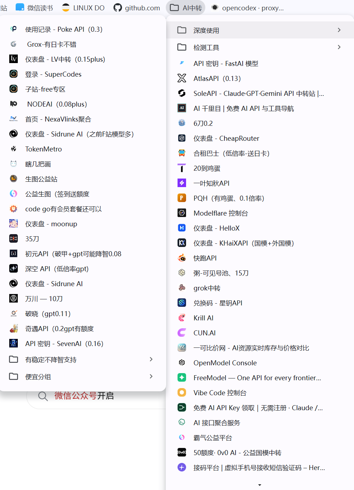

# AI 中转

> AI模型变化周期快,不同周期有不同的高性价比方案，这个专栏里面内容就是记录整理当下阶段高性价比使用方案，以及获取新方案、公益站和推广福利的信息源；
> 本页内容主要是自发性的一些记录，真实自己在用的高性价比方案。

## 复杂任务优先用强模型

模型价格不是唯一成本。做复杂分析、长链路推理、方案比较和需要多轮修正的任务时，强模型通常有更好的问题拆解、上下文理解和结果稳定性。普通模型虽然单次调用更便宜，但如果关键结论错误、分析视角单一或中途返工，实际耗时和总成本反而更高。

## 中转体验

magpie（一个Agent中灵活切换多种供应商）：https://usemagpie.ai/zh/；

疯狂领鸡蛋：

### 夯

- [SuperCodes](https://supercodes.vip/) — 号池里有百十个GPTpro时候就是夯王之王0.06plus、0.08pro，停止注册
- [SuperCodes子站-free专区](https://megac.vip/) — 0.04freeluna专区，可以注册

### 顶级（稳定偏贵）

- [PokeAPI](https://www.poke2api.com/register?aff=VQACDV5K2HQF) — GPT0.3倍率官key稳定偏贵，模型多，GPT、Claude、国模
- [NexaVlinks](https://www.nexavlinks.com/register?aff=K5JB3ZPBQ36V) - 老兵中转，0.3-0.4官key，支持多模型，有时有低价稳定组使用，GPT、Claude、国模
- [Sidrune AI](https://fluxionai.space/register?aff=BDRJBNTYF9X7) - GPT、Claude、国模模型多，倍率从低到高都有
- [破晓](https://api.poxiao.vip/register?aff=5ZGYMNYV4FTH) - 0.11倍gpt6A稳定、0.16倍gpt6.1sol稳定

### 支持破甲

- [初元API](https://initapi.ai/register?aff=HYE6R9) - 主要是一些低倍率破甲国模，0.085不稳定GPT

## 社区与信息源

中转方案、公益站和新站推广福利的变化周期短，社区通常比固定资源页更早出现线索。下面这些站点可以作为信息源：

- [Linux.do](https://linux.do/)：各种大佬分享 AI 工具、模型服务和使用方法相关讨论；
- [NodeSeek](https://www.nodeseek.com/)：关注站点活动、服务信息和新方案分享；
- [DeepFlood](https://www.deepflood.com/)：关注 AI 服务、公益站和推广信息。

这些社区中会有各种大佬中转站推广或公益中转站福利，可以在这些站点中领AI时代“鸡蛋”。

