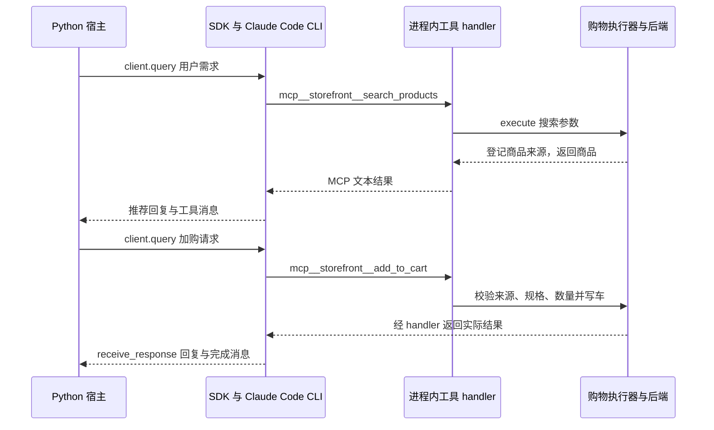

# 购物 Agent：用 Claude Agent SDK 完成选购与加购

这个案例用 Claude Agent SDK 承接对话和工具循环，把商品搜索、推荐和加购接到项目自己的业务后端。本文从一次选购耳机的操作开始，沿控制台入口追到购物车写入。

> 版本基线：`anthropics/commerce-agents` 核心包 `0.1.0.dev0`，本地快照 `87e4f91617d0e42dd9c998ae9167d4c21836e2fd`；仓库 `requirements.txt` 固定 `claude-agent-sdk==0.2.139`。路径相对源码仓库，代码为真实摘录，原英文注释译为中文，函数内摘录省略外围声明。本次只静态核对源码与测试，没有启动 SDK、模型服务或构建。定位方式见[导读](./index.md#版本与验证范围)。

## 一、顾客怎样从找耳机走到加入购物车

顾客先提出找耳机的需求，Agent 查询商品并给出推荐；顾客选中 `AR-1105`，再要求加入两副。成功完成后，当前会话的购物车中应有这件商品和对应数量，控制台收到加购回复；调用展示工具时，还会得到商品展示数据 JSON。

这里有两次用户输入：找商品和确认加购。模型负责根据需求选择工具、组织参数和解释结果；搜索工具读取商品，加购工具检查来源、规格与数量，业务后端保存购物车。**“已加购”的依据是后端返回的写入结果。**

商品 ID 和搜索词来自 SDK 路径的现有测试；上述对话顺序用于解释实现，不是本次真实模型运行记录。运行入口是 `shopping-agent/runtime-agent-sdk/main.py` 的控制台，零售网页入口使用另一套 Messages API 实现。

## 二、两轮对话怎样流转，源码从哪里跟读 {#source-reading-route}

这里的**宿主**是读取顾客输入、启动 SDK 并打印结果的 Python 控制台。SDK 启动 Claude Code CLI 承接模型与工具循环；项目通过 MCP（模型上下文协议）把 Python 业务函数提供给 SDK。图中的 handler 是收到工具参数后执行对应 Python 函数的处理器。

下面沿搜索成功、顾客确认后加购成功的路径看两轮对话。图中的 `client.query()` 向 SDK 发送消息，`receive_response()` 接收本轮回复和执行结果。模型可能插入读取偏好或规格等调用，图中只保留贯穿本文的业务步骤。



### 对照流程打开源码

先用下表定位文件，再随正文追踪每一步。这里的 `agent.py` 都指 `shopping-agent/runtime-agent-sdk/shopping_agent_sdk/agent.py`，不要先进入 Messages API 的 `orchestrator.py`。

| 顺序 | 文件与符号 | 读到什么就可以继续 |
| --- | --- | --- |
| 1. 找启动入口 | `shopping-agent/runtime-agent-sdk/main.py` 的 `chat()`、`once()` | 谁调用 `make_options()`，客户端在哪里创建，用户输入交给谁 |
| 2. 看 SDK 配置 | `shopping-agent/runtime-agent-sdk/shopping_agent_sdk/agent.py` 的 `make_options()` | 提示词、工具服务、允许工具、Skill、模型和回合上限怎样进入 SDK |
| 3. 发送用户消息 | SDK `agent.py` 的 `run_turn()` | 谁调用 `client.query()`，发送前如何补充业务事实 |
| 4. 跟进工具注册 | `shopping-agent/runtime-agent-sdk/shopping_agent_sdk/shopping_tools.py` 的 `build_shopping_server()`，再到 `commerce-common/commerce_common/agent_sdk.py` 的 `build_sdk_tools()` | 一个业务工具名怎样绑定到可执行的 Python handler |
| 5. 追一次加购 | `shopping-agent/core/shopping_agent/executor.py` 的 `handlers()`、`_add_to_cart()`，再到同目录 `gates.py` 和 `examples/retail/api/mock_retail.py` | 模型给出的 ID 怎样经过检查，哪句代码真正修改购物车 |
| 6. 看结果返回 | SDK `agent.py` 的 `run_turn()`，共享 `agent_sdk.py` 的 `collect_turn()` | 谁收集回复，展示数据和业务状态分别留在哪里 |

第一次阅读只跟一个工具名，比如 `add_to_cart`。在 SDK 侧它叫 `mcp__storefront__add_to_cart`，注册表和核心执行器里叫 `add_to_cart`；后面的工具注册小节解释这两个名字如何对应。hook 收尾、缓存和中断细节可等这条链走通后再读。

## 三、怎样用 SDK 装配购物 Agent

`make_options()` 是项目的装配函数，返回交给 SDK 的配置和留在 Python 宿主中的业务工具集合。`ClaudeAgentOptions` 是 SDK 的运行配置对象，声明模型、系统提示词、工具、工作目录和执行限制。`ShoppingToolset` 是本项目为一段购物会话保存后端、身份、状态与工具执行器的对象，两者在这个函数里连接。

来源：`shopping-agent/runtime-agent-sdk/shopping_agent_sdk/agent.py:69`，`make_options()` 主体。

```python
config = config or default_config()
skills_root = SKILLS_DIR if skills_dir is None else skills_dir
skills = load_skill_registry(skills_root)
# 先绑定业务后端和顾客身份，再把对应工具服务挂到 SDK。
toolset = ShoppingToolset(
    backend=backend or load_mock_backend(),
    config=config,
    session=ShoppingSessionContext(session_id=session_id, user_id=user_id),
)
ensure_project_skills(skills_root, RUNTIME_ROOT)
options = ClaudeAgentOptions(
    system_prompt=build_system_prompt(config, skills),
    mcp_servers={SERVER_NAME: build_shopping_server(toolset)},
    allowed_tools=allowed_tool_names(config),
    tools=["Skill"],
    skills=skills.names,
    setting_sources=["project"],
    cwd=RUNTIME_ROOT,
    # 开启项目配置以发现 Skill，同时阻止 CLI
    # 把工作目录上层的 CLAUDE.md 加进 Agent 上下文。
    env={"CLAUDE_CODE_DISABLE_CLAUDE_MDS": "1"},
    model=config.model,
    max_turns=max_turns,
    permission_mode="dontAsk",
    hooks=close_on_presentation_hook(toolset, config.close_on_presentation),
)
return options, toolset
```

`load_mock_backend()` 默认创建零售 `MockRetail`，即持有商品目录和购物车的模拟后端。`ShoppingSessionContext` 携带会话与顾客 ID，工具后端据此选取数据。部署方可以通过 `backend` 参数替换为自己的商店接口实现。

这些选项对案例有不同作用：

| 配置 | 在购物案例中的作用 |
| --- | --- |
| `system_prompt` | 使用 core 中的购物提示词，追加 SDK 的 Skill 加载说明 |
| `mcp_servers` | 挂载名为 `storefront` 的进程内工具服务，让 SDK 能调用 Python 业务函数 |
| `allowed_tools` | 列出本部署实际允许的 `mcp__storefront__*` 工具名，与配置后的工具表一致 |
| `tools=["Skill"]`、`skills` | 启用 SDK 内置 Skill 工具并列出可用流程；没有一并开放命令行和文件编辑等编程工具 |
| `cwd`、`setting_sources` | 让 SDK 从指定项目目录发现 `.claude/skills`；额外禁止自动加载上层 `CLAUDE.md` |
| `max_turns`、`hooks` | 向 SDK 设置轮次上限，并注册展示完成后的收尾回调 |

`permission_mode="dontAsk"` 配合显式允许列表，避免每次搜索都弹 SDK 权限确认。购物来源检查、库存判断仍在业务执行器和后端中执行，这个选项不会自动允许任意业务写入。

### 角色提示词与 Skill 怎样准备

Skill 是供模型按需读取的业务流程说明；本例把选购步骤放在 `SKILL.md` 中，由 SDK 内置的 `Skill` 工具读取。

`build_system_prompt()` 使用 core 中的角色规则，要求读取商品后推荐、只引用真实商品 ID、按顾客条件选择规格，再追加 `SKILL_TOOL_ADAPTER`。这段适配说明把原来的 `load_skill` 指令改为使用 SDK 的 `Skill` 工具。

`ensure_project_skills()` 将 `shopping-agent/skills/` 下的流程链接到 SDK 运行目录的 `.claude/skills/`，不能创建符号链接时改为复制。模型从提示词中看见 Skill 索引，匹配复杂选购需求后，通过内置工具读取 `search-discovery/SKILL.md` 等正文。函数会清理目标目录里的旧条目，因此传入的 `RUNTIME_ROOT` 应是为这个 Agent 准备的目录。

## 四、用户消息怎样进入 SDK 并触发业务工具

配置和工具状态准备好后，控制台才能把用户输入交给 SDK。下面依次看客户端入口、发送消息，以及 SDK 如何把模型选择的工具接回 Python。

### 创建客户端并接收顾客输入

`ClaudeSDKClient` 是 Claude Agent SDK 提供的异步客户端，用来发送用户消息并接收一轮 Agent 执行结果。SDK 启动 Claude Code CLI 承接模型循环；宿主 Python 进程提供业务工具。项目没有在这条路径中直接编写 `messages.create()` 的循环。

控制台的单次入口最容易看清连接关系。来源：`shopping-agent/runtime-agent-sdk/main.py:66`。

```python
async def once(prompt: str) -> None:
    # 一份配置交给 SDK，一份工具状态留在 Python 宿主。
    options, toolset = make_options()
    async with ClaudeSDKClient(options=options) as client:
        result = await run_turn(client, prompt, toolset=toolset)
        print_turn(result)
```

`make_options()` 返回配置 `options` 和业务工具集合 `toolset`。客户端读取配置，项目自己的 `run_turn()` 负责发送前处理与结果整理，`print_turn()` 打印回复、展示数据、工具调用和费用。

这段 `once()` 只展示单次调用的入口。本文搜索后再加购的两轮操作使用交互式 `chat()`，它在输入循环中复用同一个客户端和工具集合；第六节展开状态怎样保留。

### 发送消息并等待一轮结果

用户消息到来后，`run_turn()` 先补充命中规则的业务事实，再发送给 SDK，调用 `collect_turn()` 收集本轮回复与工具轨迹，返回宿主可消费的结果。来源：`shopping-agent/runtime-agent-sdk/shopping_agent_sdk/agent.py:108`，省略声明。

```python
if toolset is not None:
    toolset.begin_turn()
    text = await ground_message(text, toolset)
# SDK 推进内部工具循环，宿主收集整轮结果。
await client.query(text)
result = await collect_turn(client)
result.ui = toolset.drain_ui_events() if toolset is not None else []
return result
```

`begin_turn()` 清空本回合的调用统计，不清空 `toolset.state`。`ground_message()` 对命中的订单或商品 ID 规则执行读取，再把结果附在用户消息后；读取失败会记录日志并继续。条款规则没有对应预读入口，仍由提示词引导。这是代码侧补充事实的做法，没有使用 Messages API 的强制 `tool_choice`。

SDK 路径也不会自动把完整顾客快照拼成第二个 system 块。模型通过 `get_preferences` 读取顾客偏好、记忆和账户信息，通过 `get_cart` 读取购物车。两个入口不能混为一谈：当前执行器的偏好结果并不包含购物车。

### 模型选择工具后，SDK 如何调用业务函数

第三节的 `mcp_servers` 需要一份工具服务配置。本例通过 `create_sdk_mcp_server()` 创建**进程内 MCP 服务**，工具函数仍在宿主 Python 进程运行，无需另开一个 HTTP 工具服务器。

返回的 `McpSdkServerConfig` 是 SDK 接收的工具服务配置，随后放入 `ClaudeAgentOptions.mcp_servers`。

来源：`shopping-agent/runtime-agent-sdk/shopping_agent_sdk/shopping_tools.py:99`。

```python
def build_shopping_server(toolset: ShoppingToolset) -> McpSdkServerConfig:
    # 工具在当前 Python 进程执行，由 SDK 调用。
    return create_sdk_mcp_server(
        name=SERVER_NAME, version=SERVER_VERSION, tools=build_shopping_sdk_tools(toolset)
    )
```

`build_shopping_sdk_tools()` 读取 `shopping_agent.tools.registry.build_tools()` 的名称、说明与参数 schema，再调用共享的 `build_sdk_tools()`。schema 是工具输入的结构定义，例如加购接收商品 ID 和数量。Skill 交给 SDK 内置工具处理，因此这里过滤掉 core 中的 `load_skill`。

`SdkMcpTool` 是 SDK 中保存工具定义与处理函数的对象。共享注册函数为每个名字建立闭包，把调用接回同一个 toolset。来源：`commerce-common/commerce_common/agent_sdk.py:187`，省略外层声明。

```python
def register(name: str) -> SdkMcpTool[Any]:
    contract = contracts[name]

    async def handler(args: dict[str, Any]) -> dict[str, Any]:
        # 闭包保留工具原名，执行后转换成 SDK 可接收的 MCP 结果。
        return sdk_result(await toolset.execute(name, args or {}))

    return tool(name, str(contract["description"]), dict(contract["input_schema"]))(handler)

return [register(name) for name in names]
```

SDK 的 `tool()` 用工具名、说明和参数结构包装 `handler`。模型选择 `mcp__storefront__search_products` 后，SDK 把参数交给对应 handler；闭包保留的名字仍是 `search_products`，所以 `toolset.execute()` 能继续使用 core 的分派表。

**在源码中继续跳转：** 去共享 `BaseToolset.execute()`，再进入 `ShoppingToolExecutor.execute()` 继承的统一分派实现，按 `handlers()` 中的 `"search_products": self._search_products` 找到查询方法。要看加购，则沿 `"add_to_cart": self._add_to_cart` 跳转。无需把 SDK 工具名硬编码成一套新的业务函数。

`ShoppingToolExecutor` 是 core 中真正执行购物操作的对象。toolset 初始化时把它与当前状态绑定，SDK 和 Messages API 两条路径因而能复用同样的来源与数量检查。来源：`shopping-agent/runtime-agent-sdk/shopping_agent_sdk/shopping_tools.py:72`。

```python
self.attach_memory(build_memory(self.config, self.memory_store, self.memory_write_filter))
# SDK 工具继续使用 core 执行器的业务检查。
self.executor = self.executor_class(
    backend=self.backend,
    config=self.config,
    skills=SkillRegistry([]),
    session=self.session,
    state=self.state,
    memory=self.memory,
    inline_context=True,
)
```

`SkillRegistry([])` 表示这个执行器不负责加载业务 Skill，加载权已交给 SDK。`inline_context=True` 则让偏好读取工具额外返回记忆与账户信息，弥补 SDK 路径没有动态 system 上下文块的差异。

## 五、搜索结果怎样成为加购依据，后端怎样写购物车

主模型收到需求后，可以读取 Skill 并调用 `search_products`。核心 `_search_products()` 会查询后端，再把真实商品放入 `ShoppingSessionState.seen_products`，这份会话状态为后续 ID 操作提供来源依据。

来源：`shopping-agent/core/shopping_agent/executor.py:139`，搜索处理器末尾。

```python
limit = self._search_limit(tool_input.get("limit"))
products = await self._backend.search_products(self._session, query, filters, limit)
# 记录真实返回的商品，后续按 ID 加购才有依据。
self._state.remember_products(products)
return ToolOutcome(search_result_text(query, products, self._config.max_fenced_chars))
```

搜索结果经 MCP 回到 SDK，SDK 将工具结果用于下一次模型决策。顾客说“加两副”时，模型调用 `mcp__storefront__add_to_cart`，注册的 handler 转到 `_add_to_cart()`，再进入 `gated_add_to_cart()`。

来源：`shopping-agent/core/shopping_agent/gates.py:111`，省略声明和末尾确认文本。

```python
if held := check_provenance(state, product_id) or check_options(state, product_id):
    return held
requested = max(1, quantity)
max_quantity = config.max_quantity_per_item
# 在同一会话锁内读车、计算可加数量并写入。
async with _cart_lock(session):
    current = await backend.get_cart(session)
    existing = next((i for i in current.items if i.product_id == product_id), None)
    if existing is None and len(current.items) >= config.max_cart_lines:
        return ToolOutcome.error("The cart is full.")
    allowed = min(requested, max(0, max_quantity - (existing.quantity if existing else 0)))
    if allowed <= 0:
        return ToolOutcome.error(
            f"This item is already at the per-item limit of {max_quantity}."
        )
    cart = await backend.add_to_cart(session, product_id, allowed)
```

未登记的商品 ID 会被来源检查拦住；带规格选项的父款会被要求先确定实际规格。通过检查后，代码在当前会话的锁内重新读购物车，按已有数量计算还能增加多少，再调用后端写入。默认数量上限为 24；重复加购也不能绕过最终数量限制。

零售 `MockRetail.add_to_cart()` 再检查商品存在、不是父款且当前可售，随后更新按会话保存的购物车。来源：`examples/retail/api/mock_retail.py:300`，省略声明。

```python
product = self.product(product_id)
if product is None or product.has_options:
    # 执行器会提前拦住这两种情况；真实购物车服务
    # 也需要按自己的业务规则拒绝它们。
    raise KeyError(product_id)
if not product.in_stock:
    raise Unavailable(unavailable_detail(product, self.listing_of(product_id)))
existing = self._carts.lines(session.session_id).get(product_id)
quantity += existing.quantity if existing else 0
return self._carts.put(session.session_id, product, quantity)
```

`ToolOutcome` 是项目的工具结果对象，保存确认文本、事件和错误状态。`sdk_result()` 将它转换成 MCP 文本结果，让 SDK 可以交给模型；普通失败设置 `is_error`，来源不足这类业务阻断则作为说明文本返回，指导模型修正。用户看到“已加购”之前，应该已有真实后端写入结果。

## 六、回复怎样返回，下一轮怎样延续状态

`collect_turn()` 从 `client.receive_response()` 读取 SDK 消息。`AssistantMessage` 是模型消息，`TextBlock` 是正文块，`ToolUseBlock` 是工具调用块，`ToolResultBlock` 保存工具返回的内容与错误状态；`ResultMessage` 标记回合完成并携带费用和错误状态。项目把它们整理成 `TurnResult`，即宿主消费的一轮回复记录。

来源：`commerce-common/commerce_common/agent_sdk.py:251`，省略初始化和后续错误、完成消息处理。

```python
async for message in client.receive_response():
    if isinstance(message, AssistantMessage):
        for block in message.content:
            if isinstance(block, TextBlock):
                chunks.append(block.text)
            # 这里只收集 SDK 已产生的调用轨迹，不再次执行工具。
            elif isinstance(block, ToolUseBlock):
                result.tool_calls.append(block.name)
                result.tool_inputs.append(dict(block.input or {}))
                names_by_id[block.id] = block.name
```

这里是在收集执行轨迹，工具并不是到 `collect_turn()` 里才执行。真正执行早已由 SDK 调到 MCP handler。`ToolUseBlock` 中的参数和 `ToolResultBlock` 中的错误用于结果展示及诊断，不能把“模型发过调用”直接当作“业务写入成功”。

模型调用 `present_products` 时，core 的 `enrich_products()` 从 `seen_products` 补全价格、评分等字段，再生成展示事件。`BaseToolset.execute()` 同时把这些事件存入缓冲区。来源：同一共享文件第 124 行。

```python
async def execute(self, name: str, args: dict[str, Any]) -> ToolOutcome:
    outcome = await self.executor.execute(name, args)
    # 只缓存展示事件；普通购物车更新不会进入这个列表。
    self.ui_events.extend(event.data for event in outcome.events if event.type == "ui")
    self.round_calls.append((name, outcome))
    self.turn_calls.append(name)
    return outcome
```

回合结束后，`run_turn()` 用 `drain_ui_events()` 取出并清空缓冲区，返回 `result.ui`。控制台打印其中的商品卡 JSON，不会呈现网页卡片，也没有部分卡片流。这里仅收集 `ui` 事件，`cart_update` 不会自动进入 `result.ui`；接自己的界面时要另读购物车或扩展事件接入。

`checkout` 仍是 core 的展示工具：读取购物车、调用后端结账交接方法，把地址等信息放进展示数据。模型收到的是工具确认，实际支付由后续结账系统处理。

### 下一条消息怎样接续同一辆购物车

交互式 `chat()` 在输入循环外创建客户端，每条输入复用同一个 `client` 和 `toolset`。SDK 侧因此能延续对话，Python 侧的已见商品和购物车也继续存在。若每条消息都重新调用 `make_options()`，会重新创建工具状态和默认模拟后端，不能据此接续“刚才那副耳机”。

## 七、收尾、记忆、测试与接入真实业务的边界

### 展示完成后何时停止模型循环

`close_on_presentation_hook()` 注册 `PostToolBatch`，即一轮工具执行完后的回调。当建议按钮成功且同轮其他调用都是无需后续处理的展示调用时，它返回停止信号，省去额外收尾。这个事件名与行为对应仓库固定的 SDK/CLI 版本。

`HookMatcher` 把回调挂到指定事件；`HookContext` 是 SDK 传入的回调上下文，`HookJSONOutput` 则描述返回给 SDK 的控制结果，本例用其中的停止信号结束回合。

来源：`commerce-common/commerce_common/agent_sdk.py:171`，省略外层开关判断。

```python
async def hook(
    input_data: Any, _tool_use_id: str | None, _context: HookContext
) -> HookJSONOutput:
    # 用整批调用判定能否收尾，避免只看最后一个工具。
    if toolset.closes_turn(len(input_data.get("tool_calls") or [])):
        return {"continue_": False, "stopReason": "The reply closed on its chips."}
    return {}

return {CLOSE_HOOK_EVENT: [HookMatcher(hooks=[hook])]}
```

`toolset.closes_turn()` 还会检查 SDK 报告的批次调用数是否等于 toolset 记录数。若本轮混入 SDK 内置 Skill 调用，数量不符就继续，避免误判为纯展示轮。`max_turns` 则直接交给 SDK，并不采用 Messages API 中“工具轮次达到上限后强制文本”的那段 Python 逻辑。

### 长期记忆和运行方式的边界

长期记忆也需要宿主安排。当前 toolset 默认使用内存记忆存储；模型可调用 `save_memory`、`recall_memories`，但 SDK `run_turn()` 没有自动执行回合后记忆提取，也没有示例 HTTP 宿主的会话写回协议。跨重启恢复需要同时处理 SDK 对话与 Python 业务状态，不能只复用一个顾客 ID。

与网页示例相比，这条路径的主要区别是：循环由 SDK 推进，Skill 用内置工具加载，展示数据在完整回合后返回。需要逐帧 UI 和自己控制模型请求时再看 Messages API；要复用 SDK 的执行循环、由宿主消费完整结果，则从这里的 `make_options → ClaudeSDKClient → run_turn` 接入。

### 用现有测试对照，接入自己的商店

源码已有 `shopping-agent/runtime-agent-sdk/tests/test_agent.py` 的 `test_search_add_and_present_round_trip_through_the_registered_tools`，通过注册后的 handler 检查耳机搜索、加购与展示数据；`test_config_gated_tools_register_and_allowlist_in_lockstep` 检查工具注册与允许列表一致。本次只核对断言，没有运行测试或真实 SDK 会话。要接自己的商店，优先替换后端和已认证身份，再补持久状态、库存原子更新与界面事件消费。

下一篇[商户案例](./02-merchant-agent.md)复用这里的 SDK 工具接法，具体展开改价暂存、控制台批准和可选分析子代理。
