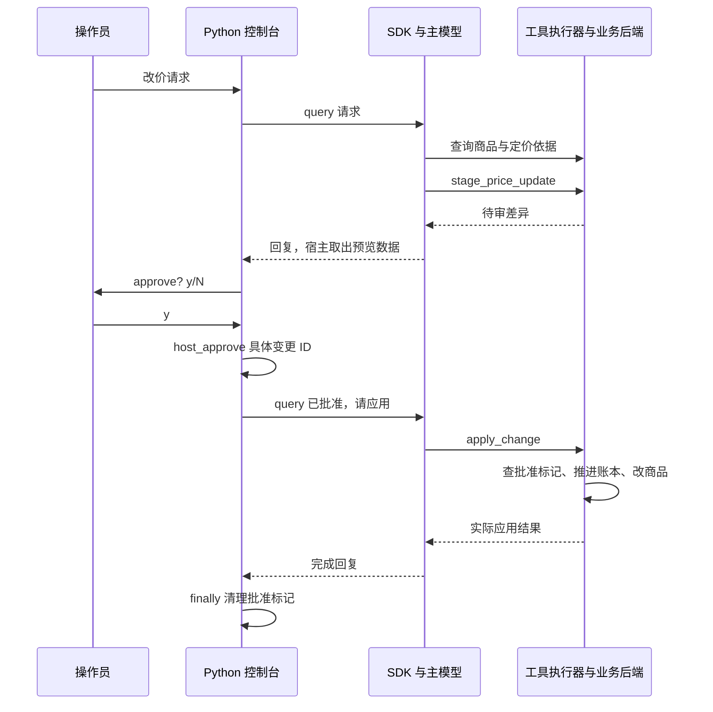

# 商户 Agent：用 Claude Agent SDK 暂存、批准并应用改价

商户案例用 Claude Agent SDK 调用查询、暂存和应用工具，由 Python 控制台取得操作者批准。本文沿一笔耳机改价，追踪模型提案、人工批准和后端写入怎样连接。

> 版本基线：`anthropics/commerce-agents` 核心包 `0.1.0.dev0`，本地快照 `87e4f91617d0e42dd9c998ae9167d4c21836e2fd`；仓库固定 `claude-agent-sdk==0.2.139`。以下为真实源码摘录，路径相对源码仓库，原英文注释译为中文，函数内片段省略外围声明。本次只静态核对，未启动 SDK、模型调用、测试或构建。定位方式见[导读](./index.md#版本与验证范围)。

## 一、运营怎样提出、批准并完成一笔改价

运营人员提出“把降噪耳机从 249 美元调到 239 美元”。Agent 读取商品与定价依据，生成包含旧价、新价和变更 ID 的待审提案。控制台打印预览 JSON，再询问 `approve? [y/N]`；操作者批准后，Agent 才能尝试应用这笔变更。

这条流程有两个不同的业务结果：**暂存成功时，商品仍是旧价；应用成功后，商品目录才变成新价。** 批准由控制台记录，模型负责在获得许可后的对话中调用应用工具。判断是否完成，要查看应用工具的结果和后端记录。

耳机 `AR-1105` 和改价输入来自 SDK 测试；上述对话是讲解场景，不是本次模型运行记录。本文使用 `merchant-agent/runtime-agent-sdk/main.py` 的默认交互模式。经营分析子代理默认关闭，第七节再说明如何启用。

## 二、改价流程怎样流转，源码从哪里跟读 {#source-reading-route}

购物篇已经讲过 SDK 如何连接业务工具；商户篇沿用这套接法，增加待审变更和人工批准。这里的宿主仍是 Python 控制台，MCP（模型上下文协议）把查询、暂存、应用等工具暴露给 SDK。

下图展示批准并应用成功的路径。`query` 是向 SDK 发送消息的调用，`host_approve` 是宿主为具体变更记录批准的方法。**第一次对话生成提案，控制台批准后再发起一次对话尝试应用。**



### 对照流程打开源码

本篇的 SDK `agent.py` 指 `merchant-agent/runtime-agent-sdk/merchant_agent_sdk/agent.py`。主线与[购物篇](./01-shopping-agent.md)共享工具注册方法，但批准控制和分析接入需要分别跟读。

| 顺序 | 文件与符号 | 要确认的连接 |
| --- | --- | --- |
| 1. 启动控制台 | `merchant-agent/runtime-agent-sdk/main.py` 的 `chat()` | 批准配置怎样进入 `make_options()`，同一个 SDK 客户端怎样接收多次输入 |
| 2. 注册业务工具 | SDK `agent.py` 的 `make_options()`，以及 `merchant-agent/runtime-agent-sdk/merchant_agent_sdk/merchant_tools.py` | 工具如何挂在 `merchant` 服务下，操作者和待审状态存在哪里 |
| 3. 暂存改价 | `merchant-agent/core/merchant_agent/executor.py` 的 `_stage_price_update()`，`examples/retail/api/mock_merchant.py` 的 `stage_price_update()` | 新旧价格由谁提供，提案如何进入账本与预览 |
| 4. 批准并应用 | 控制台的 `confirm_staged_changes()`，再到 core 的 `check_apply_change()` 与后端 `apply_change()` | `y/N` 如何变成服务端标记，第二次 SDK 对话如何触发写入 |
| 5. 按需开启分析 | SDK `agent.py` 的 `build_analysis_agent()` 与 `agents` 配置 | 子代理获得哪些工具，返回什么，和 Messages API 分析循环有什么差别 |

读改价时沿同一个 `change_id` 查看暂存记录、`toolset.state.seen_changes` 和 `approved_change_ids`。先走通批准成功的路径，再看拒绝、二次提醒和可选分析。不要进入 `runtime-messages-api/analysis.py` 来解释 SDK 子代理，那是另一种实现。

## 三、怎样用 SDK 装配商户工具、身份与批准配置

`ClaudeSDKClient` 是 SDK 的异步对话客户端。`MerchantToolset` 是项目保存商户后端、操作者身份、会话状态和执行器的对象。控制台先构造业务配置，再创建 toolset 和 SDK 选项。

来源：`merchant-agent/runtime-agent-sdk/main.py:87`，`chat()` 的初始化部分；省略后续输入循环。

```python
config = default_config()
if host_approval:
    config = config.model_copy(
        update={
            # 这是业务变更批准要求，与 SDK 工具权限分开。
            "require_host_approval": True,
            "approval_surface": "the y/N prompt in this console",
        }
    )
else:
    config = config.model_copy(update={"require_host_approval": False})
options, toolset = make_options(config=config)
```

随后第 100 行以 `async with ClaudeSDKClient(options=options) as client` 创建客户端，并在内部循环读取用户输入。同一个客户端和 toolset 会继续用于批准后的应用对话。

默认交互模式要求在控制台批准。`--no-host-approval` 会关闭这个业务批准检查；`--once` 只执行一次对话，没有询问批准的交互步骤，待审提案会继续等待。这里的默认商户配置没有开启分析子代理。

`make_options()` 为 toolset 绑定 `MerchantSessionContext`，即商户、操作者和会话身份；`MerchantSessionState` 保存读过的商品、已知变更和批准标记。默认后端加载器创建自己的 `MockRetailMerchant(MockRetail())`，不会自动连接另一个购物 SDK 控制台里的内存商店。要联动两个角色，宿主需要给它们接入同一个业务系统。

SDK 配置的核心仍是 `ClaudeAgentOptions`，它声明提示词、工具服务、允许列表和执行方式。来源：`merchant-agent/runtime-agent-sdk/merchant_agent_sdk/agent.py:122`。

```python
options = ClaudeAgentOptions(
    system_prompt=build_system_prompt(config, skills),
    mcp_servers={SERVER_NAME: build_merchant_server(toolset)},
    allowed_tools=allowed_tool_names(config),
    # Task 是 SDK 的委派入口，仅在安装子代理时启用。
    tools=["Skill", "Task"] if config.enable_analysis else ["Skill"],
    skills=skills.names,
    setting_sources=["project"],
    cwd=RUNTIME_ROOT,
    # 开启项目配置以发现 Skill，同时阻止 CLI
    # 把工作目录上层的 CLAUDE.md 加进 Agent 上下文。
    env={"CLAUDE_CODE_DISABLE_CLAUDE_MDS": "1"},
    # 开启分析时，声明 SDK 子代理及其受限工具。
    agents=(
        {ANALYSIS_AGENT_NAME: build_analysis_agent(config)} if config.enable_analysis else None
    ),
    model=config.model,
    max_turns=max_turns,
    permission_mode="dontAsk",
    hooks=close_on_presentation_hook(toolset, config.close_on_presentation),
)
return options, toolset
```

`build_merchant_server()` 用 `create_sdk_mcp_server()` 创建进程内 MCP 服务，MCP 是向 Agent 暴露工具的协议。工具名在 SDK 中变为 `mcp__merchant__stage_price_update` 等形式；它们仍调用 core 的 `MerchantToolExecutor`，也就是检查参数、来源、规则并分派业务方法的执行器。

**在源码中继续跳转：** 从 `merchant_tools.py` 的 `build_merchant_server()` 到共享 `commerce_common/agent_sdk.py` 的 `build_sdk_tools()`，看 SDK 的 `tool()` 如何把名字与 handler 绑定。handler 经 `toolset.execute()` 调用执行器，再按 `handlers()` 进入 `_stage_price_update()`。其中 `load_skill` 不注册为 MCP 工具，由内置 `Skill` 替代；`run_analysis` 也被排除，开启分析时改用内置 `Task` 委派。

`permission_mode="dontAsk"` 表示 SDK 按允许列表处理工具权限，不会在每次业务调用前询问。真正的商户批准仍由 `require_host_approval` 和具体变更 ID 控制；允许模型调用 `apply_change` 不等于允许它应用尚未批准的变更。

## 四、第一轮对话怎样查询商品、暂存并返回预览

### 第一轮用户消息怎样进入 SDK

配置完成后，控制台读取运营人员输入，把消息交给项目的 `run_turn()`。这个函数调用 `client.query()` 发送消息，并用 `collect_turn()` 收集 SDK 的回复与工具调用记录；完整实现和补充提醒分支放在第六节。

来源：`merchant-agent/runtime-agent-sdk/main.py:110`，`chat()` 输入循环中的处理部分，省略上方输入和退出判断。

```python
result = await run_turn(client, text, toolset=toolset)
print_turn(result)
if host_approval:
    # 对先前拒绝的变更再次尝试应用时，重新开放批准询问。
    declined.difference_update(apply_attempts(result))
    await confirm_staged_changes(client, toolset, declined)
```

`run_turn()` 返回时，模型与工具已经完成本轮交互，控制台才打印结果并进入批准步骤。下面展开这轮对话中的读取、暂存和预览；第五节再接上 `confirm_staged_changes()`。

### 读取商品与定价依据，再暂存差异

`build_system_prompt()` 使用 core 商户提示词，追加 SDK 的 Skill 适配说明。Skill 是供模型按需读取的业务流程说明；`pricing-promotions` 是其中的定价流程，指导模型先读取价格、成本和范围，引用后端毛利数据，再调用暂存工具。其目录通过共享 `ensure_project_skills()` 放到 SDK 可发现的 `.claude/skills` 中，正文由内置 `Skill` 工具读取。

对耳机改价请求，模型需要用 `search_listings` 或 `get_listing` 确认目标，再用 `get_pricing_context` 读取定价依据。前两者登记商品来源，后者只返回定价信息，不会单独使商品通过来源检查。系列商品还要确定具体规格，不能直接修改其汇总起价。

模型调用 `mcp__merchant__stage_price_update` 后，SDK 将参数交给注册的 handler，最终执行下面的核心方法。`PriceUpdateItem` 是由商品 ID 和正数新价组成的 Pydantic 校验模型；Pydantic 根据字段定义检查输入并报告错误。

来源：`merchant-agent/core/merchant_agent/executor.py:292`。

```python
async def _stage_price_update(self, tool_input: dict[str, Any]) -> ToolOutcome:
    items = [
        parse_argument(PriceUpdateItem, item)
        for item in coerce_array_arg(tool_input.get("items")) or []
    ]
    if not items:
        return ToolOutcome.error("No price changes to stage.")
    # 来源和规格有效，才进入后端生成待审提案。
    ids = [item.listing_id for item in items]
    if held := check_listing_provenance(self._state, ids) or check_listing_options(
        self._state, ids, "priced"
    ):
        return held
    change = await self._backend.stage_price_update(
        self._session, items, self._note(tool_input)
    )
    return await self._staged(change)
```

通过来源和规格检查后，后端按 ID 重新读取当前商品，检查新价是否在允许范围内。模型提供新价，旧价来自后端。`ChangeItem` 是保存目标、字段、旧值和新值的一项差异，真实生成语句位于 `examples/retail/api/mock_merchant.py:608`：

```python
# 旧值来自后端当前记录，新值来自已校验的提案输入。
change_items.append(
    ChangeItem(target=resolved, field="price", before=before, after=item.new_price)
)
```

后端把差异交给 `ChangeLedger.stage()`。`ChangeLedger` 是示例的内存变更账本，检查价格变幅、条数和受保护字段后，分配 `chg-0001` 这样的 ID，记录状态为 `STAGED` 的待审变更。此时尚未修改商品价格。

### 暂存结果怎样回到模型与控制台

执行器 `_staged()` 把记录放进当前会话，默认立即生成预览。`AgentEvent` 是项目向宿主传递业务与展示变化的事件对象，这里先产生变更更新，再附上预览事件。来源：`merchant-agent/core/merchant_agent/executor.py:253`，省略声明。

```python
# 保存提案后，默认预览引用同一条记录。
self._state.remember_change(change)
events = [AgentEvent.change_update(_record(change))]
note = STAGED_NOTE
if self._config.stage_shows_preview:
    preview = await self._present(
        self.components[PREVIEW_TOOL], {"change_id": change.change_id}
    )
    if not preview.refused:
        events.extend(preview.events)
        note = STAGED_AND_SHOWN_NOTE
return self._fenced({"staged": _record(change), "note": note}, events)
```

预览函数从 `seen_changes` 中按 ID 取已暂存差异，补全改前改后和毛利数字。给模型的是暂存记录与说明文本，给宿主的是展示数据。SDK 的 `BaseToolset` 缓存 `ui` 事件，`run_turn()` 结束时返回 `result.ui`，控制台逐项打印 JSON；这里没有网页卡片的流式更新。

## 五、控制台批准怎样触发第二轮对话并应用改价

### 控制台记录批准，再发送一次 SDK 消息

第一轮回复结束后，交互控制台调用 `confirm_staged_changes()`。它从 toolset 读取当前会话中仍为 `STAGED` 且没有批准标记的记录，对每条记录显示 `approve? [y/N]`。

来源：`merchant-agent/runtime-agent-sdk/main.py:65`，省略声明。

```python
for change in toolset.pending_host_approvals():
    if change.change_id in declined:
        continue
    print(f"\n{change.change_id} — {change.summary}")
    answer = (await asyncio.to_thread(input, "approve? [y/N] ")).strip().lower()
    if answer in {"y", "yes"}:
        # 真实控制台批准先写入标记，再让 SDK 对话尝试应用。
        toolset.host_approve(change.change_id)
        try:
            result = await run_turn(
                client,
                f"Approved {change.change_id} through the console — apply it now.",
                toolset=toolset,
            )
        finally:
            toolset.host_clear(change.change_id)
        print_turn(result)
    else:
        declined.add(change.change_id)
        print(f"{change.change_id} stays staged (dismiss it in chat to drop it).")
```

`host_approve()` 把这条 ID 加入 `toolset.state.approved_change_ids`。然后控制台向**同一个 SDK 客户端**发送“已通过控制台批准，现在应用”的消息，模型才能在后续循环中选择 `mcp__merchant__apply_change`。`finally` 无论这轮正常返回还是异常退出，都会清掉临时标记。

控制台输入 `y` 后，执行继续进入 SDK 的工具循环。只有模型实际调用 `apply_change` 并通过下面的检查，后端才会应用变更。

### 应用工具怎样检查这笔批准

模型在聊天里自己声称“已批准”不能写入这个集合。核心 `check_apply_change()` 先检查当前会话认识该变更，再按当前配置复查规则，启用批准要求时还检查标记。

来源：`merchant-agent/core/merchant_agent/gates.py:205`，省略上方未知变更检查和末尾返回。

```python
if violations := check_guardrails(known.kind, known.items, config):
    return ToolOutcome.held(GUARDRAIL_GATE, apply_guardrail_message(violations))
# 允许调用工具不等于这条变更已经获得批准。
if config.require_host_approval and change_id not in state.approved_change_ids:
    return ToolOutcome.held(
        APPROVAL_GATE,
        f"change {change_id} has not been approved through "
        f"{config.approval_surface}. Tell the operator it is staged and "
        f"waiting for their approval on {config.approval_surface} — "
        "approving it there is what applies it.",
    )
```

`ToolOutcome.held()` 是携带业务阻断原因的工具结果，例如价格越界或缺少批准。SDK 包装会把这类阻断作为说明文本交给模型，而不是替它创建批准。人工许可和模型对话通过同一个 ID 连接起来。

### 后端怎样应用差异并返回结果

执行器 `_apply_change()` 通过门控后，调用商户后端 `apply_change()`。后端先推进账本状态，再把差异应用到它持有的商品目录。方法返回的 `StagedChange` 是包含差异、处理状态和操作者信息的变更记录，应用后其状态会变为 `APPLIED`。

来源：`examples/retail/api/mock_merchant.py:725`。

```python
async def apply_change(self, session: MerchantSessionContext, change_id: str) -> StagedChange:
    # 账本推进与目录写入是两个步骤，示例未用事务包裹。
    applied = self.ledger.apply(change_id, actor=session.operator)
    self._apply_to_live_state(applied)
    return applied
```

`ChangeLedger.apply()` 要求记录仍处于待审状态，重查当前规则，记录操作者与应用时间。未知或已处理的 ID 会被拒绝。`_apply_to_live_state()` 的改价分支才执行 `product.price = float(item.after)`，之后后端再次读取才能看到新价。结果经 MCP 回到 SDK，模型据此生成应用确认。

## 六、没有暂存、用户拒绝或应用失败时会怎样

### 模型只解释却没暂存时，补一次提醒

项目的 `run_turn()` 在发送消息前识别变更意图，并预读命中的经营快照或待审队列。消息经 `client.query()` 发送，`collect_turn()` 读取 SDK 的回复与工具轨迹。如果这次变更请求结束时连一次 `stage_*` 都没尝试，宿主再发一次提醒。

来源：`merchant-agent/runtime-agent-sdk/merchant_agent_sdk/agent.py:161`，省略函数声明。

```python
remind = False
if toolset is not None:
    remind = change_requested(toolset.config, text)
    toolset.begin_turn(holds_turn_open=_nothing_staged if remind else None)
    text = await ground_message(text, toolset)
await client.query(text)
result = await collect_turn(client)
if toolset is not None and remind and not turn_attempted_staging(result.tool_calls):
    toolset.holds_turn_open = None
    try:
        # 变更请求没有尝试暂存时，再发一次 SDK 对话。
        await client.query(STAGING_FOLLOWTHROUGH_REMINDER)
        followup = await collect_turn(client)
    except Exception:  # 提醒失败不应使原回合失败。
        logger.warning("staging reminder pass failed", exc_info=True)
        followup = None
    if followup is not None:
        result = merge_turn_results(result, followup)
result.ui = toolset.drain_ui_events() if toolset is not None else []
return result
```

`TurnResult` 是宿主消费的回合结果对象，保存回复文本、调用参数、展示数据、错误和费用。`merge_turn_results()` 合并两次 SDK 响应，让一次用户请求仍返回一份结果；展示数据在两次调用结束后一起取出。

这里检查的是“是否尝试暂存”，失败的暂存也算尝试；追加提醒不能保证最终生成合适方案。变更意图规则使用配置中的词表，中文叙述不代表默认英文规则一定命中。SDK 的展示收尾 hook 也会配合 `holds_turn_open`，避免尚需提醒时过早结束。

### 用户拒绝、批准后未应用或执行异常

控制台输入 `y` 不直接执行后端写入，也不保证模型一定完成应用。要根据工具结果和后端记录判断成功；若未应用，提案仍可能保持待审。输入 `n` 会把变更 ID 留在控制台的 `declined` 集合中，跳过后续同一控制台会话中的重复询问，不把账本状态改为已丢弃。后续对这条变更再次尝试应用时，第四节的 `declined.difference_update(apply_attempts(result))` 会移除该 ID，重新开放批准询问。

批准后的 `run_turn()` 被 `try/finally` 包裹，发生异常也会执行 `host_clear()` 清掉临时批准。清理许可不会撤销已经发生的业务写入，操作是否成功仍需查询实际记录。

### 写入失败时，示例还缺哪些保证

内存账本适合展示这条流程，真实服务还需要事务、持久审计和商品版本检查。当前代码先标记 `APPLIED` 再写目录，写入失败时没有事务回滚；等待批准期间发生的另一条改价，也没有在应用时用商品版本拦住。SDK 的工具权限不会补齐这些业务保证。

## 七、需要经营分析时，怎样用 SDK 子代理

**SDK 商户控制台默认没有分析子代理。** `default_config()` 沿用 `enable_analysis=False`。需要分析时，调用方把开关传给 `make_options()`；仓库测试中的实际装配如下。来源：`merchant-agent/runtime-agent-sdk/tests/test_agent.py:124`，省略测试函数和断言。

```python
# 测试显式开启分析；SDK 控制台的默认配置没有开启。
config = MerchantAgentConfig(brand_name="ACME", enable_analysis=True)
options, _ = make_options(config=config)
```

开启后，前面的 `ClaudeAgentOptions` 同时安装内置 `Task` 工具和名为 `run-analysis` 的 `AgentDefinition`。`Task` 是该版本 SDK 发起子任务的入口；`AgentDefinition` 描述一个子代理的用途、提示词、允许工具与模型。主模型根据任务决定何时委派，SDK 在独立对话上下文中运行它。

来源：`merchant-agent/runtime-agent-sdk/merchant_agent_sdk/agent.py:73`，`build_analysis_agent()` 的返回部分；省略上方提示词组装。

```python
return AgentDefinition(
    description=build_analysis_tool_definition()["description"],
    prompt=prompt,
    # 只把四个业务读取工具授予子代理。
    tools=[mcp_tool_name(name) for name in ANALYSIS_READ_TOOLS],
    model=config.analysis_model,
)
```

`ANALYSIS_READ_TOOLS` 只包含经营快照、指标查询、活动表现和商品搜索，转换后是 `mcp__merchant__*` 名称。子代理没有暂存、应用或记忆写入工具。提示词额外说明这里没有 `submit_analysis`，要求以一份包含标题、发现、带单位数字和局限的摘要结束，再经 SDK 委派结果返回主模型。

**在源码中继续跳转：** 这里应沿 `make_options()` 的 `agents` 字典进入 `build_analysis_agent()`，而不是沿 core 的 `run_analysis` 工具找 `AnalysisRunner`。SDK 工具注册明确排除了 `run_analysis`，并由 `ANALYSIS_AGENT_ADAPTER` 告诉主模型改用 `run-analysis` 子代理。

用 Messages API 的 `AnalysisRunner` 对照时要区分几项能力：`AnalysisRunner` 是项目自行编写的分析循环，`AnalysisResult` 是它用来校验提交字段的结果模型。SDK 子代理没有调用这两个实现。

| 能力 | 当前 SDK 子代理 | Messages API 的 `AnalysisRunner` |
| --- | --- | --- |
| 数据工具 | 四个只读 MCP 业务工具 | 按配置提供读取工具、SQL 查询和托管代码执行 |
| 返回方式 | 按提示词要求生成结构化摘要，经 SDK 返回 | 调用 `submit_analysis`，用 `AnalysisResult` 校验并生成指标卡片 |
| 独立预算 | 此处未接入 `max_analysis_iterations`、`analysis_timeout_s` 等限制 | 自己的循环执行这些预算 |
| 来源状态 | 复用商户 MCP toolset，适配层未为子代理另建临时状态 | 普通读取使用临时状态，只回流快照和指标序列 |

SDK 分支没有实现 `AnalysisResult` 校验、分析 ID 登记和自动派生指标卡片，不能把摘要格式要求当作已经执行的字段验证。子代理读取工具仍经过同一商户执行器，源码也没有按调用者隔离 `seen_listings`；如果要求分析读取不能扩大后续写入来源，应提供单独的只读 toolset 或显式状态隔离。

## 八、用现有测试对照，接入真实业务时怎样取舍

`merchant-agent/runtime-agent-sdk/tests/test_agent.py` 分别验证工具注册、批准接口、补充提醒和子代理定义。`test_host_approval_goes_through_the_toolsets_approval_api` 在无标记时确认应用被阻止，清掉标记后仍被阻止，再批准才可应用；`test_analysis_maps_onto_a_read_only_subagent` 检查子代理只获得读取工具；`test_change_turn_without_staging_sends_the_reminder_once` 用脚本客户端验证第二次 `query()`。

这些测试说明 SDK 外围代码怎样接线和守住业务规则，没有证明真实模型一定会提出正确价格或算对经营指标。本次没有执行测试和 SDK 对话。

与网页示例相比，批准流程也有差异：网页按钮直接在宿主调用执行器；SDK 控制台设置标记后，再让模型调用应用工具。选用这套实现时，可以复用 MCP 注册、core 的变更检查和批准 ID 设计；如果产品要求点击批准后立即确定性提交，可在宿主直接调用应用服务，而不必再经过一次模型决策。
