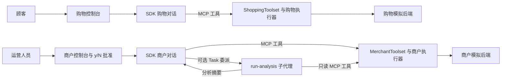

# Commerce Agents：两个业务 Agent 的实现

[Commerce Agents](https://github.com/anthropics/commerce-agents) 是 Anthropic 的商务 Agent 参考项目。它提供两个面向不同用户的助手：购物 Agent 帮顾客选商品、改购物车、交接结账；商户 Agent 帮运营人员分析经营数据、提出变更，并在批准后应用。

这组文章以 **Claude Agent SDK 的两套控制台实现**为主线，它们复用零售示例的业务后端。读完应当能顺着代码回答：**怎样配置 SDK、怎样把业务函数注册为工具、怎样发送和接收对话，以及购物或改价在哪里真正发生。**

先分清运行入口：`shopping-agent/runtime-agent-sdk/main.py` 与 `merchant-agent/runtime-agent-sdk/main.py` 使用 SDK；`examples/retail/api/` 的网页 API 使用 Messages API，由项目自己推进模型循环；`managed-agents/` 则用于托管平台部署。正文会说明差异，不把网页卡片、控制台批准和托管平台能力混成同一套实现。

## 两篇案例各自讲什么

| 文章 | 贯穿任务 | 重点源码 |
| --- | --- | --- |
| [购物 Agent：用 SDK 完成选购与加购](./01-shopping-agent.md) | 搜索耳机，选定商品后加入购物车 | `ClaudeAgentOptions` 配置、进程内 MCP 工具、Skill、`ClaudeSDKClient` 调用、业务检查和结果收集 |
| [商户 Agent：用 SDK 暂存、批准并应用改价](./02-merchant-agent.md) | 暂存耳机改价，控制台批准后应用；按需启用经营分析 | 商户工具注册、预览数据、批准标记与第二次 SDK 对话，以及 `AgentDefinition` 子代理 |

购物篇讲清 SDK 和业务工具如何连接，商户篇在此基础上展开审批与可选子代理。共享机制在案例用到时解释，不需要先读完一组框架专题。

## 怎样边读文章边看源码

在编辑器中打开 Commerce Agents 源码仓库，按[购物篇的跟读路线](./01-shopping-agent.md#source-reading-route)走完一次查询与加购，再按[商户篇的跟读路线](./02-merchant-agent.md#source-reading-route)追踪暂存、批准和应用，按需再看分析子代理。两篇都先讲用户要完成的操作，再用时序图和源码路线建立整体流程，接着展开 SDK 装配、对话调用与业务执行，异常和扩展放在主流程之后。路线表列出具体文件、可搜索的函数和每一步应确认的行为；正文源码片段用于对照关键分支，完整调用关系仍在原文件里看。

阅读时始终追踪四样东西：**`client.query()` 的输入与接收结果、工具名与参数、toolset 的会话 `state`、后端真正发生的写入。** 例如加购时，看商品 ID 怎样从搜索结果进入状态，再怎样通过检查写入购物车；商户改价时，看 `change_id` 怎样从暂存记录一路传到控制台批准和应用方法。

项目通过工具名动态分派调用。在工具定义上使用“查找引用”，不一定能找到实际执行函数。遇到 `mcp__storefront__add_to_cart`，先从 SDK 注册的 handler 进入 toolset，再到角色执行器的 `handlers()` 找 `add_to_cart`；SDK 的分析则沿 `agents` 字典找到 `run-analysis` 子代理定义。两篇正文会指出这些跳转。

## SDK、业务工具和两个角色怎样连接

这里的**宿主**是读取用户输入、配置 SDK 并处理返回结果的 Python 控制台。`ClaudeSDKClient` 是 SDK 的异步对话客户端，启动 Claude Code CLI 承接模型与工具循环；项目把工具注册为进程内 MCP 服务，实际业务函数仍在宿主进程执行。MCP（模型上下文协议）用于把这些工具暴露给 Agent。



`ShoppingToolset` 与 `MerchantToolset` 分别保存一段业务会话的身份、状态、执行器和展示数据。两个 SDK 控制台默认各自创建模拟后端，互不调度，也不会自动共享商品改动；要让商户改价影响购物查询，需要宿主连接同一个业务系统。零售网页示例则在一个 API 入口中把同一个 `MockRetail` 商店对象交给两个角色，已经具备这种联动。

SDK 商户分析默认关闭，开启后由 `AgentDefinition` 声明子代理并通过内置 `Task` 委派。它返回摘要，没有 Messages API 分支的 `submit_analysis` 校验与自动指标卡片；商户篇会具体解释配置与返回边界。

## 仓库目录与包结构

这是一个把多个 Python 包和示例应用放在一起的仓库。**Python 部分有七个独立包：一个共享包，购物与商户各三个包。** 包定义分别放在各目录的 `pyproject.toml`，根目录的 `requirements.txt` 通过本地路径把它们连接起来。阅读时要区分角色目录、可安装的包，以及真正接收请求的应用入口。

下面只展开理解两个案例需要的目录，省略各包内的测试、文档和其他模块：

```text
commerce-agents/
├── commerce-common/
│   ├── pyproject.toml
│   └── commerce_common/          # 两种角色共用的执行、状态辅助与事件机制
├── shopping-agent/
│   ├── core/shopping_agent/      # 购物业务类型、后端接口、提示词和工具执行器
│   ├── runtime-messages-api/
│   │   └── shopping_agent_runtime/  # 自行推进模型与工具循环
│   ├── runtime-agent-sdk/
│   │   └── shopping_agent_sdk/   # 接入 Claude Agent SDK
│   ├── managed-agents/           # 托管部署清单、提示词文件与 MCP 服务脚本
│   └── skills/                   # 购物流程说明，多个运行方式共用
├── merchant-agent/
│   ├── core/merchant_agent/      # 商户业务工具、变更账本和规则检查
│   ├── runtime-messages-api/
│   │   └── merchant_agent_runtime/  # 主循环与分析子循环
│   ├── runtime-agent-sdk/
│   │   └── merchant_agent_sdk/   # 接入 Claude Agent SDK
│   ├── managed-agents/           # 商户托管部署与 MCP 服务脚本
│   └── skills/                   # 分析、定价、库存等业务流程说明
├── examples/
│   ├── demo_common/              # 示例共享的 Python 宿主、会话与 HTTP 路由
│   ├── web-shared/               # 示例共享的前端事件处理、组件与交互
│   ├── retail/
│   │   ├── api/                  # 零售 Agent 装配、模拟后端与 API 入口
│   │   ├── storefront-web/       # 顾客购物界面
│   │   └── merchant-web/         # 商户运营界面
│   ├── travel/                   # 旅行示例
│   ├── telecom/                  # 电信示例
│   ├── entertainment/            # 票务示例
│   └── package.json              # 组织示例前端的 npm workspace
├── plugins/commerce-builder/     # 辅助开发的 Claude Code 插件与操作说明
├── tests/                        # 跨包、跨接入路径的测试
├── scripts/                      # 安装、部署等辅助脚本
└── docs/                         # 后端接入、部署与安全边界说明
```

### 七个 Python 包怎样对应源码

安装时的发行包名使用连字符，Python 导入名使用下划线，而且有些名字并非直接替换连字符就能得到。例如 `shopping-agent-core` 安装后导入的是 `shopping_agent`。下表按各包 `pyproject.toml` 中的名称与打包目录核对。

| 包所在目录 | 发行包名 → Python 导入名 | 负责什么 |
| --- | --- | --- |
| `commerce-common/` | `commerce-common` → `commerce_common` | 工具统一分派、消息与事件协议、Skill 加载、记忆、展示管线，以及运行时共用的辅助实现 |
| `shopping-agent/core/` | `shopping-agent-core` → `shopping_agent` | 商品与购物车类型、商店后端接口、购物提示词、工具定义、来源检查和执行器 |
| `shopping-agent/runtime-messages-api/` | `shopping-agent-runtime` → `shopping_agent_runtime` | 提供 `ShoppingAgent`，组装模型请求、推进工具循环并输出事件 |
| `shopping-agent/runtime-agent-sdk/` | `shopping-agent-sdk` → `shopping_agent_sdk` | 把购物工具和会话接到 Claude Agent SDK，由 SDK 承接模型循环 |
| `merchant-agent/core/` | `merchant-agent-core` → `merchant_agent` | 商户数据类型、后端接口、提示词、工具执行器、待审变更账本与规则检查 |
| `merchant-agent/runtime-messages-api/` | `merchant-agent-runtime` → `merchant_agent_runtime` | 提供 `MerchantAgent` 主循环，以及 `run_analysis` 背后的独立分析循环 |
| `merchant-agent/runtime-agent-sdk/` | `merchant-agent-sdk` → `merchant_agent_sdk` | 把商户工具接到 Claude Agent SDK，并承接该路径的状态与批准控制 |

仓库内部依赖的方向很明确：**两种角色的 core 都依赖 `commerce-common`；每种 runtime 都依赖对应角色的 core 和 `commerce-common`。** 两个 core 没有互相依赖，core 也不依赖上层 runtime。是否共享业务数据由宿主装配决定，不由这几条包依赖决定。

这也解释了为什么不能只在 `core/` 中找完整 Agent。SDK 控制台从 `shopping_agent_sdk` 或 `merchant_agent_sdk` 导入 `make_options` 和 `run_turn`，它们把 core 的业务工具接到 SDK；网页入口则从 `shopping_agent_runtime` 导入 `ShoppingAgent`，由该包自行推进模型请求。商户的 Messages API 分支同样有自己的循环，位于 `merchant_agent_runtime/analysis.py` 的分析实现也不被 SDK 子代理调用。

### 运行时之外的目录怎样参与案例

`managed-agents/` 不在上述七个安装包之中。它保存平台部署用的 `agent.yaml`、系统提示词，以及连接业务工具的 MCP 服务脚本。MCP（模型上下文协议）用于把工具暴露给外部 Agent；这些脚本继续调用 core 中的执行器，模型循环由托管平台承接。角色下的 `skills/` 保存按需读取的业务说明，也不是额外的 Python 包。

`examples/` 把这些 Python 包接成能交互的应用。`retail/api/main.py` 负责选择配置、后端和记忆存储，再借助 `demo_common` 提供聊天、会话与按钮路由；商品搜索和改价的模拟数据实现也在零售 `api/` 中。因此追踪“哪句代码真的修改商品”，最终会从核心工具执行器进入示例后端。

前端由 `examples/package.json` 的 npm workspace 管理，即在一处组织多个 JavaScript 包及其本地依赖。零售的购物和商户界面是两个 Next.js 应用，都依赖 `web-shared`；它处理 Agent 事件和共用交互，Python 的 `demo_common` 则处理服务端会话与请求。`plugins/commerce-builder/` 提供搭建、扩展和编写评测的开发说明，不进入在线购物或改价的调用链。

两篇案例集中阅读 **Agent SDK 运行时**。沿 `runtime-agent-sdk/main.py → make_options 与 run_turn → MCP handler → core 执行器 → 具体后端` 跟完调用，再用 Messages API 分支对照上下文、展示与批准差异。需要托管部署或更换行业后端时，再查 `docs/deployment.md`、`docs/backends.md` 和 `docs/safety.md`。

## 接入 OpenAI 兼容中转：本地扩展

如果中转服务只有 OpenAI Chat Completions 接口，需要使用项目自行管理模型循环的 `runtime-messages-api`。本地源码新增了 `commerce-common/commerce_common/model_client.py`：`OpenAICompatibleClient` 将提示词、工具定义和工具结果转换成 Chat Completions 请求，再把返回的 `tool_calls` 转回现有执行器使用的消息格式。购物、商户、商户分析和记忆提取共用这层适配。

在源码仓库根目录 `.env` 中填写以下配置，启动现有零售网页 API 即可使用；模型需要支持函数工具调用。

```dotenv
COMMERCE_MODEL_PROVIDER=openai
OPENAI_BASE_URL=https://relay.example/v1
OPENAI_API_KEY=replace-with-your-relay-key
OPENAI_MODEL=your-tool-capable-model
MERCHANT_ANALYSIS_CODE_EXECUTION=0
```

可用 `SHOPPING_MODEL`、`MERCHANT_MODEL`、`MERCHANT_ANALYSIS_MODEL` 和 `MEMORY_MODEL` 覆盖各用途模型。完整接入说明在源码仓库的 `docs/model-relays.zh-CN.md`，离线验证在 `tests/test_model_relays.py`。

这项扩展走网页案例的运行时。正文讲解的 Claude Agent SDK 控制台仍依赖 Anthropic 兼容接口；不能给 CLI 填一个 `/chat/completions` 地址就直接使用。适配器当前等待上游完整响应后再输出项目事件，保留工具执行、来源检查和商户批准，但不提供上游逐 token 流式输出，也不接入 Anthropic 托管搜索和代码执行。

## 版本与验证范围

项目为 `anthropics/commerce-agents`，三个核心包版本均为 **`0.1.0.dev0`**。源码按本地快照 **`87e4f91617d0e42dd9c998ae9167d4c21836e2fd`** 核对；这是本地仓库提交号，未确认为上游提交，不能据此构造 GitHub 永久链接。本地分析目录为 `D:/open_code/ai-native/commerce-agents-main`，正文源码路径均相对此目录。

SDK 依赖按根目录 `requirements.txt` 的 **`claude-agent-sdk==0.2.139`** 分析。`Task`、`PostToolBatch` 等名称对应这份版本的调用方式，不据此推断其他 SDK/CLI 版本的所有行为。

上面的中转适配属于本地工作区后续扩展，不属于该快照的原始实现。两篇 SDK 案例仍按快照讲解，工具链与批准方式不应和本地新增的 Chat Completions 路径混读。

代码块摘录实际文件，保留执行语句，原英文注释译为中文，删节处注明。中文对话用于串联调用关系，不是实际模型运行记录；默认意图规则中的英文关键词也不自动具有中文匹配能力。两篇案例的原始走读只静态核对源码与测试；后续中转扩展执行了离线协议测试和业务回归，未调用真实中转模型，也未执行站点构建。
