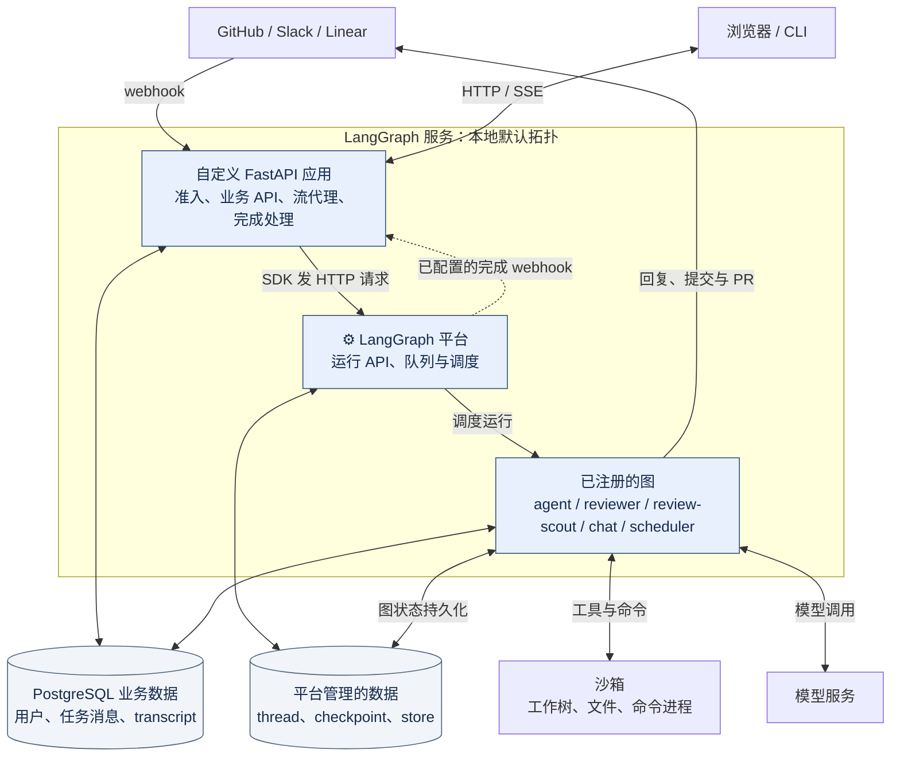
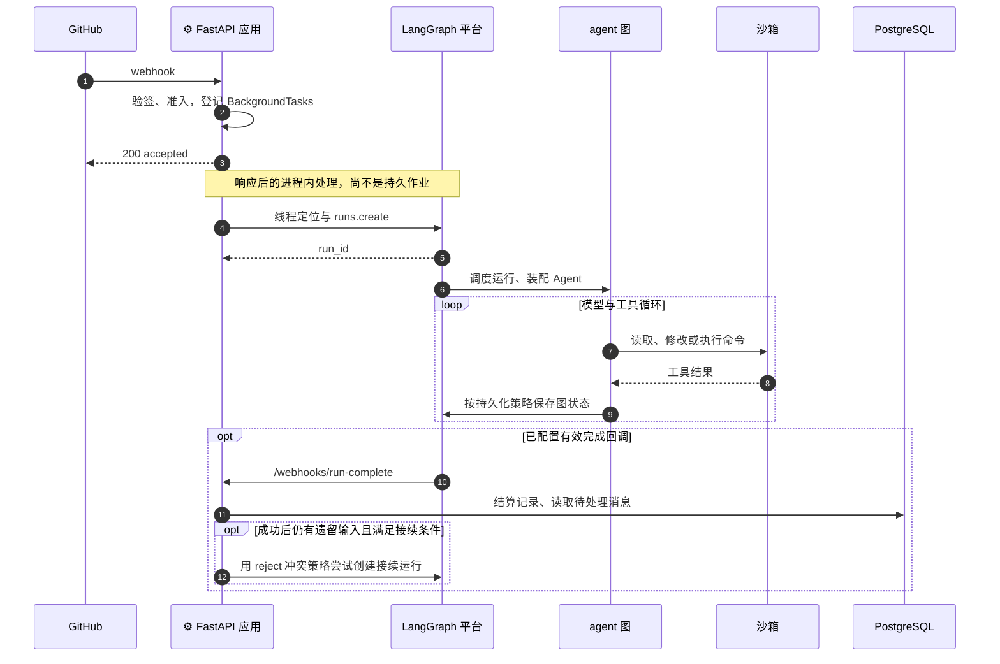

# 00：Open SWE 的整体架构与异步执行模型

> 总体架构。先建立系统边界与异步运行模型，再进入编码主线。

Open SWE 是面向工程团队的编程 Agent。它从 GitHub、Slack 或网页接收代码任务，在隔离环境中调查仓库、修改文件、执行验证，通过 PR 交付结果。本系列关注支撑这些动作的工程实现：请求如何进入系统，Agent 怎样装配，长任务由谁驱动，后续消息怎样接回原来的工作。

本篇先建立整体架构，再沿一次请求走到运行和续接。后续专题分别展开身份、状态、工具、中间件与沙箱的实现。源码基线为 Open SWE `0942b41561df` 及已记录的本地工作树，依赖 `deepagents==0.7.21`；提交与本地修改的区别见[源码基线](../source-baseline.md)。

## 一、系统由哪些部分组成

### 1、HTTP 应用与执行图挂在同一服务上

`langgraph.json` 决定平台加载哪些图，以及挂载哪个 HTTP 应用。图是平台可以调度的执行入口；HTTP 应用负责外部请求与业务 API。

```json title="langgraph.json（仅保留 graphs 与 http 字段）"
{
  "graphs": {
    "agent": "openswe.graphs.agent:traced_agent",
    "reviewer": "openswe.graphs.reviewer:traced_reviewer_agent",
    "review-scout": "openswe.graphs.review_scout:traced_review_scout",
    "chat": "openswe.graphs.chat:traced_chat_agent",
    "scheduler": "openswe.graphs.scheduler:get_scheduler"
  },
  "http": {
    "app": "openswe.webapp:app"
  }
}
```

`openswe/webapp.py` 再导出 `openswe/api/app.py` 创建的 FastAPI 应用，并没有另起一个服务器。应用组装 webhook、控制台 API、沙箱工具与远端运行时路由，末尾挂载控制台静态资源。`openswe/server.py` 则负责 Agent 装配，文件名里的 server 不代表它自己监听端口。

下面画的是本地默认运行方式：LangGraph 服务加载自定义应用与图，应用通过 SDK 的 HTTP 客户端向平台提交运行。`LANGGRAPH_URL` 默认指向本机服务，此时请求经 TCP 回环返回同一服务；配置成其他地址时，调用边界也会改变。图中的存储框表示数据归属，不表示一定部署为两台数据库。



这个注册表不足以证明生产环境只有一个进程。副本数、平台队列的部署方式、数据库拓扑仍由部署配置决定。源码明确施加的是**每个服务进程共用一个事件循环**，后面会解释原因。

### 2、五个图的职责不同

| 图 | 工程职责 | 专题 |
| --- | --- | --- |
| `agent` | 装配编码 Agent，调用工具调查、修改与交付代码 | [02：Agent 装配](../01-coding-agent/02-deep-agent-assembly.md) |
| `reviewer` | 独立执行 PR 审查，保存并发布发现 | [11：机器审查](../03-review-and-merge/11-reviewer.md) |
| `review-scout` | 为审查生成变更导读 | [11：机器审查](../03-review-and-merge/11-reviewer.md) |
| `chat` | 承接 PR 问答，不承担编码任务 | [11：机器审查](../03-review-and-merge/11-reviewer.md) |
| `scheduler` | 按任务字段分发确定性后台工作，如命令监看、清理和定时计划 | [06：执行协调](../01-coding-agent/06-delegation-and-continuation.md) |

这五个图不是依次执行的流水线，也不是五个独立进程。一次编码请求通常进入 `agent`；审查和定时任务有自己的触发入口。`scheduler` 的分发不需要模型判断。

Reviewer 还支持可选的 Managed Deep Agents 远端运行方式：运行与检查点在远端部署，远端通过本服务的 `/remote-runtime/mcp` 使用审查工具。这是另一条执行路径，不应混进默认编码任务的拓扑。

### 3、沙箱承担工作环境，数据库承担业务记录

编码任务的仓库、分支、未提交修改和命令进程在沙箱中。应用保存线程与沙箱的绑定，并在后续运行中重新连接。独立 worker 可以共享宿主沙箱，所以“独立任务”不等于“独立 Git 工作树”。

PostgreSQL 保存用户、任务消息、审查记录和 transcript（可回查的会话事件记录）等应用数据。平台管理 thread、检查点和 Store。两边共同支撑任务，但不会自动形成一个跨系统事务：写入数据库、启动运行、修改沙箱文件和推送 GitHub，各有自己的成功与失败边界。

## 二、应用与框架怎样分工

Open SWE 的主要工作在模型循环之外，也通过工具和中间件进入循环内部。它需要把请求身份、仓库权限、模型设置、工作环境与交付规则转换成一次运行的配置。

| 层次 | 提供什么 | Open SWE 在哪里接入 |
| --- | --- | --- |
| Open SWE 应用 | 渠道准入、身份与权限、沙箱绑定、PR 交付、审查和任务消息 | 路由、业务服务、工具与自定义中间件 |
| Deep Agents | `create_deep_agent()` 工厂，把模型、工具、后端和子 Agent 组织成执行图 | `build_agent()` 根据本次运行配置选择并组装参数 |
| LangChain | 消息、模型、工具与中间件接口 | 模型路由、工具定义、模型调用前后及工具调用钩子 |
| LangGraph 与 Agent Server | 图执行、检查点，以及平台侧的线程、运行 API、调度与事件流 | 通过 SDK 创建运行、选择冲突策略、读取状态和订阅事件 |

这里的 Backend 是文件操作与执行环境的接口。模型调用文件工具时，后端决定操作落在什么位置；它与保存对话检查点的存储系统职责不同。Middleware（中间件）则是在模型或工具调用前后执行的扩展逻辑，例如补充输入、限制工具、记录调用和检查运行条件。

`openswe/server.py::build_agent()` 把本次模型、已授权工具、子 Agent、技能目录、后端和中间件传给 `create_deep_agent()`。因此追踪应用怎样约束 Agent，应从这次装配进入，再追各个钩子；不需要在本系列重新讲一遍框架的通用循环。具体装配见 [02](../01-coding-agent/02-deep-agent-assembly.md)，钩子地图见 [03](../01-coding-agent/03-middleware.md)。

有些规则只是通过系统提示告诉模型，例如调查仓库的顺序；另一些由代码强制检查，例如工具授权和敏感推送审批。读源码时要分清这两种约束，不能把提示词要求写成系统保证。

## 三、一次请求怎样变成一次运行

先区分两个对象：**thread 是持续保存上下文的任务线程，run 是在线程上执行的一次运行。** 一个代码任务可以经历多次 run。检查点保存图执行状态，后续运行据此接上上下文；它不保存整个沙箱的文件快照。

### 1、接收请求与提交运行之间有交接窗口

以 GitHub Issue 中的修复请求为例。路由读取原始请求体验签，检查事件类型与准入条件，再把处理函数交给 FastAPI 的 `BackgroundTasks`。这是响应之后仍在当前进程内执行的后台处理，不是平台持久作业。

后续处理确定线程身份、工作空间和凭据范围，构造消息与运行配置，再经统一分发函数提交给平台。因此收到 `200 accepted` 只表示入口接受了事件，不证明平台已经创建运行。**由这段时序可以推导：进程在响应后、提交前退出，尚未提交的处理不受平台检查点保护。** 渠道身份与线程定位的调用链见 [01](../01-coding-agent/01-input-thread-and-workspace.md)。

### 2、统一分发函数设置运行契约

`openswe/dispatch.py::create_durable_run()` 汇总运行配置、来源和调用标识，然后调用 SDK 的 `runs.create()`。核心参数如下；默认值来自函数签名，调用方可以覆盖。

```python title="openswe/dispatch.py::create_durable_run（参数组装节选）"
    create_kwargs: dict[str, Any] = {
        "input": input,
        "config": run_config,
        "metadata": run_config["metadata"],
        "multitask_strategy": multitask_strategy,
        "durability": durability,
        "if_not_exists": if_not_exists,
        "stream_mode": list(V3_RUN_STREAM_MODES),
        "stream_subgraphs": True,
        "stream_resumable": stream_resumable,
    }
    if COMPLETION_WEBHOOK_URL:
        create_kwargs["webhook"] = COMPLETION_WEBHOOK_URL
```

- `multitask_strategy` 默认 `interrupt`，决定同一线程已有运行时如何处理新运行。
- `durability` 默认 `sync`，要求图在继续下一步前完成检查点持久化。它约束图状态，不把外部 API 或文件修改变成事务。
- `if_not_exists` 默认 `create`，决定目标线程不存在时创建还是拒绝；它不是运行去重开关。
- `stream_resumable` 默认开启，配合事件通道和子图事件配置，让稍后接入的客户端能订阅运行过程。可回放范围仍受平台保留策略限制。
- `webhook` 只有在完成回调配置可用时才附加。运行结束与应用收到完成通知是两个独立事实。

这层封装让不同入口沿用相同的运行契约。具体编码步骤仍由 Agent 在模型与工具循环中决定，HTTP 处理器不等待整个编码任务结束。

### 3、平台运行与完成处理怎样衔接



图运行期间，工具调用访问沙箱和外部服务；平台记录图状态。完成后，配置好的 webhook 把终态送到 `handle_run_completion()`，由应用结算费用与会话轮次、处理 worker 回传，并在条件满足时拾取遗留输入。

回调要求配置密钥与可供平台访问的非回环地址，部署按注释要求使用绝对 HTTPS URL。不能把本地 SDK 的回环 HTTP 地址直接拿来充当完成回调地址：两条调用路径受到不同约束。没有配置回调时，普通运行仍可创建，但这些完成后处理不会因此自动发生；`spawn_worker` 对完成回调的要求更严格，缺配置时拒绝派生。

## 四、异步执行与任务续接

### 1、每个进程共用一个事件循环

仓库要求应用代码使用异步接口。除此之外，Open SWE 还强制关闭平台的独立 job 事件循环配置。原因在 `openswe/utils/event_loop.py`：沙箱后端句柄按线程缓存于进程级注册表，后续 run 会复用它们。若对象绑定在循环 A，下次却从循环 B 使用，缓存就可能成为不可用资源。

```python title="openswe/utils/event_loop.py::pin_single_event_loop（节选，中间省略报错文本）"
    os.environ[ISOLATED_LOOPS_ENV] = "false"

    langgraph_config = sys.modules.get("langgraph_api.config")
    if langgraph_config is None:
        return

    if not hasattr(langgraph_config, ISOLATED_LOOPS_ENV):
        ...
        raise RuntimeError(msg)

    setattr(langgraph_config, ISOLATED_LOOPS_ENV, False)
    if getattr(langgraph_config, ISOLATED_LOOPS_ENV):
        ...
        raise RuntimeError(msg)
```

它先设置环境变量；平台配置已加载时，再改配置属性并读回验证。属性消失或写入不生效会抛错，避免带着不兼容的循环模型继续启动。

单事件循环允许多个任务在等待 I/O 时交替推进，不代表每次只运行一个任务。反过来，一个阻塞调用也会拖住同循环的其他工作。因此同步 SDK 的构造需要放到线程边界；提供方注册表按工厂类型选择调用方式：

```python title="openswe/sandboxes/providers/registry.py（工厂调用分支）"
    if inspect.iscoroutinefunction(factory):
        return await factory(sandbox_id)
    return await asyncio.to_thread(factory, sandbox_id)
```

异步工厂直接等待，同步工厂交给线程执行。当前工作树还把部分 Agent 建图移入 `asyncio.to_thread`，这属于[已记录的本地差异](../source-baseline.md)，不能直接归到固定提交的行为。

这个约束只覆盖单个进程。另一个副本不会自动拥有本进程的后端缓存；跨副本协调仍要依靠持久记录、锁和重新连接，不能靠单事件循环获得一致性。

### 2、运行、消息与定时触发分开管理

任务级异步还要回答：这次 run 结束后，谁保存未完成的事，谁再次触发执行？Open SWE 把这些职责分给不同机制。

| 机制 | 保存或执行什么 | 怎样推进 |
| --- | --- | --- |
| 平台运行队列 | 已提交的 run | 平台按线程状态和冲突策略调度 |
| 应用消息记录 | 用户追加输入、worker 消息、外部事件命中 | 忙时由模型前钩子读取；空闲时按各自条件新建 run |
| 沙箱后台命令 | 独立进程、状态文件和输出日志 | 回调或配置选定的轮询路径对账，再唤醒所属线程 |
| 平台 cron | 定时触发计划 | 按目标调用 `scheduler`，或直接唤醒 `agent` |

应用有进程内后台协程和业务待处理记录，但没有用这些表另造一套编码任务执行器。`thread_queued_message`、`TaskMessage` 和 `EventMatch` 记录的是待交给 Agent 的内容；真正执行模型循环的是平台调度的图。

业务 worker 也要与平台 worker 区分。`spawn_worker` 创建有独立 thread 和检查点的业务执行者，不意味着创建一个专用操作系统进程。`task` 工具的 fork 子 Agent 则在父级工具调用内返回结果。沙箱里的 `background_execute` 才启动脱离原会话的独立命令进程，它不会因图运行取消而自动停止。

这些路径没有统一的投递保证。追加消息删行与检查点写入分离，存在崩溃丢失窗口；任务消息有投递次数限制；后台命令在派发运行后、写完通知标记前退出，可能再次派发。稳定键能帮助去重，但不足以证明所有消息必达或外部动作恰好执行一次。载体、消费点和回执细节见 [06](../01-coding-agent/06-delegation-and-continuation.md)。

### 3、并发请求与结果回传

同一线程可能同时收到用户补充、worker 结果和后台命令通知。应用通过 `multitask_strategy` 选择冲突处理，平台执行策略：

| 策略 | 同线程已有运行时的处理 | 典型用途 |
| --- | --- | --- |
| `interrupt` | 中断已有运行，再处理新输入 | 需要立即介入的用户消息 |
| `enqueue` | 新运行等待，不打断已有运行 | 后台结果与排队跟进 |
| `reject` | 拒绝冲突的新运行 | 遗留消息拾取，避免与已存在的处理者争抢 |

这里的中断保留已持久化的图状态，但不能保证正在进行的工具动作没有副作用。`enqueue` 也不提供所有消息载体之间的全局顺序。`if_not_exists="reject"` 则只处理目标线程不存在的情况，与这张表里的冲突拒绝不同。

结果展示另走事件通道。平台事件流通过 `threads/proxy.py` 代理给客户端；应用的 transcript 路由还可以从 PostgreSQL 回放已保存的会话事件，再接实时更新。前者的保留与恢复由平台决定，后者依赖应用事件记录；未采集或未落盘的内容不能靠重连补齐。两条链的边界见 [09](../02-runtime-support/09-observability-and-validation.md)。

## 五、状态保存与恢复边界

### 1、恢复一次任务需要多处状态

| 位置 | 保存什么 | 不能替代什么 |
| --- | --- | --- |
| 平台 thread、元数据与 checkpoint | 对话、图状态、来源与资源绑定等索引 | 不能恢复未保存的沙箱文件或回滚 GitHub 动作 |
| 应用 PostgreSQL | 身份、任务消息、审查记录、transcript 等 | 不等于平台运行队列，也不自动保证消息已进入图 |
| 沙箱 | 仓库工作树、未提交修改、命令状态与日志 | 不是会话检查点；环境丢失后，未推送工作可能丢失 |
| GitHub | 远端分支、PR、审查与合并结果 | 不保存全部调查过程和沙箱临时文件 |
| 进程内缓存与监听任务 | 后端句柄、去重加速、连接与通知订阅 | 不提供跨副本持久性 |

检查点恢复依赖平台使用的存储后端及其持久化配置，不能仅凭 `durability="sync"` 就断言任意部署都能抵抗进程退出。业务表使用 PostgreSQL，也不代表平台的 thread 和 Store 自动获得同样的保存能力。具体存储与清理边界见 [08](../02-runtime-support/08-state-and-persistence.md)。

### 2、补偿只覆盖它实际检查的对象

**运行中断**后，新 run 可以沿已保存的线程状态继续。已写文件、已发请求与未完成的命令仍需各自核对，不能把重放检查点当成外部动作的回滚。

**沙箱不可达**时，编码任务不应静默换一个空环境。应用保留绑定并按错误类别处理，避免把未提交修改当成可以丢弃的临时数据。重新连接、恢复与重建条件见 [05](../01-coding-agent/05-sandbox-lifecycle.md)。

**完成回调未送达或未配置**时，依赖该入口的交接与拾取不会自动执行。沙箱命令对账只检查沙箱任务；`reconcile_stale_runs()` 只取消忙线程上超龄的 pending run，不补发完整的完成通知，也不处理所有卡住的模型调用。调度图存在这个分支，并不证明部署已经安排了触发它的 cron。

因此，源码里的“保存了待办”“派发了运行”“模型读到了消息”“用户收到了结果”需要分别核对。它们之间的交接点，才是判断重复、丢失和补偿范围的位置。

## 六、从架构进入源码

阅读顺序分成四部分；它描述怎样逐步理解系统，不表示程序依次执行所有专题。

| 部分 | 阅读顺序 | 作用 |
| --- | --- | --- |
| 总体架构 | 本篇 | 建立系统边界、运行模型和恢复边界。 |
| 编码主线 | 请求接入 → Agent 装配 → 中间件接入 → 上下文管理 → 沙箱生命周期 → 执行协调 → 代码交付 | 从请求读到 PR 交付；其中中间件是深入装配的机制专题。 |
| 支撑机制 | 状态与持久化 → 运行记录与结算 → 测试与评测 | 集中追查贯穿运行的保存、观察和验证机制。 |
| 协作扩展 | 机器审查 → 人工评审与合并 | 按需研究独立 Reviewer 与合并状态推进。 |

完整编号和专题入口见[系列导读](../index.md)。前面已经给出各机制的就地链接，不需要在首次阅读时逐个跳转。

从这套实现中可以借鉴的是统一分发入口和明确的状态归属：例如新增渠道仍复用 `create_durable_run()`，新增后台结果则要明确保存位置、消费入口与回执。若没有 Agent Server，就必须另行提供运行调度与持久化；若部署多个副本，也不能只复制单进程缓存方案。

本篇依据源码、配置与本地依赖核对调用关系，没有运行 Open SWE 服务或用故障实验验证线上恢复能力。

---

下一篇：[01：请求接入](../01-coding-agent/01-input-thread-and-workspace.md)。返回[系列导读](../index.md)。
