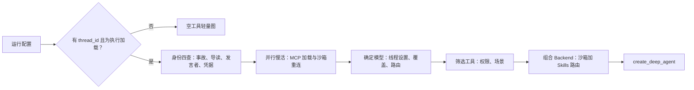

# 02：Agent 装配，怎样配置模型、工具与执行规则

> 编码主线的装配入口。先看模型、工具、后端与规则怎样接起来；后续专题再分别展开接入机制、上下文与沙箱。

[01](./01-input-thread-and-workspace.md) 讲一条请求怎样接入线程。本篇跟着 `build_agent()` 往下走：从一份运行配置出发，看模型、工具、文件后端和中间件怎样被装配成一张 Deep Agents 图。

装配进图的执行策略——模型出错回退、视觉替换、委派重试——也在这篇里讲清楚。代码取自本地工作树，基线与版本说明见[源码基线](../source-baseline.md)；代码块标题标注文件与函数，省略处用 `...` 标出。

## 全景：一次建图经过的路径



下面按这条链路的顺序走，每一步贴出关键源码。

## 一、工厂入口：加载和执行是两种建图

主图入口在 `langgraph.json` 里注册为 `openswe.graphs.agent:traced_agent`，就是 `get_agent()`。它把真正的建图包在 `aphase(thread_id, "factory.total")` 和 `shared_thread_reads()` 里——前者记录装配耗时，后者让同一线程的并发读取共享查询结果。真正干活的是 `build_agent()`。

函数一进来先设递归上限，然后做一个关键分流：

```python title="server.py::build_agent（入口）"
async def build_agent(config: RunnableConfig, *, tool_surface: ToolSurface | None = None) -> Pregel:
    """Get or create an agent with a sandbox for the given thread."""
    configurable = config.get("configurable") or {}
    cfg = RunConfig.parse(configurable)
    thread_id = cfg.thread_id

    config["recursion_limit"] = DEFAULT_RECURSION_LIMIT   # 9_999

    if thread_id is None or not graph_loaded_for_execution(config):
        logger.info("No thread_id or not for execution, returning agent without sandbox")
        graph: Pregel = await asyncio.to_thread(
            create_deep_agent,
            system_prompt="",
            tools=[],
            middleware=[
                AnthropicPromptCachingMiddleware(ttl="1h", unsupported_model_behavior="ignore")
            ],
        )
        return graph.with_config(bindable_config(config))
```

**没有线程 ID、或不是为执行而加载的，返回一张空工具的轻量图。** 判断标准是 `runtime/execution.py` 里的一个标志：

```python title="runtime/execution.py::graph_loaded_for_execution"
def graph_loaded_for_execution(config: RunnableConfig) -> bool:
    return RunConfig.from_config(config).get("__is_for_execution__") is True
```

为什么要区分？平台在读线程状态时也会加载图（比如 dashboard 打开一个会话），这类加载不执行任务，不需要沙箱和工具装配。把它们混为一谈，会在每次状态读取时白做一遍全量装配。

返回时的 `bindable_config()` 也有来历。平台传给工厂的 `configurable` 里带着自己的运行时键（`__pregel_` 开头），把它们绑到图上会让后续检查点序列化失败——读状态的运行时缺少序列化需要的字段，`GET /threads/{id}/state` 会直接 500。所以绑定时先剔掉这些键，LangGraph 每次调用时会自己重新注入。

## 二、执行分支：先查身份，慢活并行启动

进入执行分支后，工厂先做四次身份查询，再把两件最慢的事提前启动：

```python title="server.py::build_agent（身份与并行启动，节选）"
    incident_session: IncidentSession | None = None
    if cfg.source == "incidents_agent":
        incident_session = await load_incident_session(config)   # 事故会话
    guide = await ReviewGuideSession.get(thread_id)              # 审查导读会话
    if guide is not None and guide.closed:
        guide = None
    profile_login = await resolve_github_login(as_json_object(config))  # 本轮发言者
    credential_login = None
    credential_scope_known = False
    if not is_desktop_run(cfg):
        try:
            credential_login = await private_credential_login(config)   # 私有凭据归属
            credential_scope_known = True
        except Exception:
            logger.exception("Cannot resolve thread credential scope; omitting MCP tools")

    ...
    # MCP loading needs only who the run acts for and where, and it is the slowest
    # lookup here, so it overlaps the settings and access lookups below.
    mcp_tools_task = (
        asyncio.ensure_future(_run_mcp_tools(thread_id, credential_login, workspace))
        if not stop_summary_mode and not local_run and credential_scope_known
        else None
    )
    ...
    backend = get_cached_sandbox_backend(thread_id, reconnect=reconnect_backend)
    if tool_surface is None:
        backend.start()
```

四个查询各管一件事：

- **事故会话**：决定是否启用事故专用工具和更严的模型调用上限。
- **审查导读会话**：追加导读工具（已关闭的导读不追加）。
- **`profile_login`（本轮发言者）**：驱动授权和个人设置读取。
- **`credential_login`（私有凭据归属）**：决定个人 MCP、个人 Skills 是否可用。

**MCP 加载是这里最慢的查询，所以用 `ensure_future` 提前启动**，和后面的设置读取、权限解析重叠执行。注意加载条件：凭据范围无法确认时直接不加载（`credential_scope_known` 为假），但"确认了没有个人凭据"是另一回事——那种情况实例级和工作空间级 MCP 照常加载。

沙箱走 `get_cached_sandbox_backend()`，同一线程复用缓存的后端对象；`backend.start()` 让重连和后续装配步骤并行。唯一例外是 `tool_surface` 分支（给工具端点用的建图），它不提前启动。

整个工厂用 `factory.thread_settings`、`factory.settings_defaults`、`factory.tool_access`、`factory.graph_assembly` 等计时段包住各步骤，线上可以据此区分"查设置慢"还是"建图慢"。

**这些一次性建图成本还有一部分被挪到了进程启动时。** `warm_agent_build()` 在 `lifespan()` 里预热：

```python title="server.py::warm_agent_build"
async def warm_agent_build() -> None:
    """Pay a worker's one-time graph-building costs at startup instead of on its first run.

    That is every exported tool's schemas, plus whatever the first deep agent a
    process builds caches for the rest (deepagents scans installed packages once).
    """
    from langchain_core.language_models.fake_chat_models import FakeListChatModel

    import openswe.tools as tools

    functions = [getattr(tools, name) for name in tools.__all__]
    await asyncio.to_thread(warm_tool_schemas, functions, _tool_description_values())
    await asyncio.to_thread(
        create_deep_agent,
        model=FakeListChatModel(responses=[""]),
        system_prompt="",
        tools=apply_tool_descriptions(functions, _tool_description_values()),
    )
```

两件事：预热**每个工具的参数 schema**，再用假模型真建一次图——Deep Agents 第一次建图会扫描已安装的包，这笔钱付一次后全进程受益。启动时支付，第一次用户运行不再承担。

## 三、模型从哪里来

### 1、线程设置和当前发言者是两条线

模型选择的第一个原则写在工厂的注释里：

```python title="server.py::build_agent（模型设置的原则）"
    # `profile_login` is whoever sent the message that started this run; it drives
    # authorization. Personal integrations require verified private ownership.
    # Everything else comes from the thread's own settings, seeded from the first
    # sender's profile and frozen there afterwards.
```

**发言者决定权限，线程决定模型。** 模型、推理强度、子模型、路由开关、仓库说明都从线程已存设置恢复；恢复不到时才用工作区默认值兜底：

```python title="server.py::build_agent（线程设置恢复，节选）"
    (model_id, profile_effort), (subagent_model_id, subagent_effort) = model_defaults
    ...
    adaptive_model_routing = settings.model_routing_enabled if settings else False
    stored_model = thread_settings.get("model_id")
    if isinstance(stored_model, str) and not reset_model_selection:
        model_id = stored_model
        profile_effort = thread_settings.get("effort")
        subagent_model_id = thread_settings.get("subagent_model_id") or stored_model
        subagent_effort = thread_settings.get("subagent_effort")
        adaptive_model_routing = thread_settings.get("model_routing_enabled", False)
```

在这条恢复链上，还有几层覆盖，按优先级排：

1. **工作区默认模型对**是初值（`settings.default_model_pair("agent")`）。
2. **线程已存设置**覆盖初值。
3. **每请求覆盖**（`cfg.agent_model_id` / `cfg.agent_effort`）有条件地生效：模型必须在 `SUPPORTED_MODEL_IDS` 里，推理强度必须适配；explicit 选择或图片输入场景走不同分支。
4. **explicit 选择**直接关闭自适应路由；网页切回 Auto 且声明选择变化时走重置分支。
5. **事故会话**关闭路由，未指定模型时钉在 performance 档；`/oswe` 单问模式（一问一答，没有可路由的任务）也关闭路由。
6. **自适应路由开启**时，主模型先落到 fast 档——子模型原来与主模型相同的，一起落：

```python title="server.py::build_agent（Auto 先落 fast 档）"
    # Auto never falls back outside its tiers: an uncertain route uses Fast.
    if adaptive_model_routing and not slack_ask_mode:
        if (subagent_model_id, subagent_effort) == (model_id, profile_effort):
            subagent_model_id, subagent_effort = routing_defaults["fast"]
        model_id, profile_effort = routing_defaults["fast"]
```

图片触发的覆盖有个容易漏的分支：已有 `requested_model` 或正在重置选择、且覆盖原因是 `image_input` 时，覆盖先存进 `image_model_override`，等线程设置写回后才应用。不能概括成"图片覆盖都不写回"。

设置的写回顺序也有讲究——**先保存，再过 Fable 门**：

```python title="server.py::build_agent（先存后过门）"
    # Stored before the Fable gate so a deployment-wide toggle still applies on
    # every run rather than being frozen into the thread.
    resolved_settings: ThreadSettings = {...}
    ...
    await store_thread_settings(client, thread_id, {**thread_settings, **resolved_settings})
    ...
    model_id, profile_effort = gate_fable_model(
        model_id, profile_effort, fable_enabled=fable_enabled
    )
```

`gate_fable_model()` 是个部署级开关（`dashboard/options.py`）：关闭时把对应模型换成允许的替代模型。如果先过门再保存，被替换的模型就被冻结在线程设置里，部署开关再也管不了它了。

### 2、Auto 路由：先分桶，再分类

自适应路由不等于每轮都调分类器。第一步是一个确定性的线程分桶：

```python title="server.py::_model_routing_mode"
_MODEL_ROUTING_SPLIT = 0.5

def _model_routing_mode(thread_id: str) -> RoutingMode:
    digest = hashlib.sha256(thread_id.encode()).hexdigest()
    bucket = int(digest[:8], 16) / float(0xFFFF_FFFF)
    return "auto" if bucket < _MODEL_ROUTING_SPLIT else "fast"
```

线程 ID 的 SHA-256 前八位折算到 0–1，低于 0.5 的线程用 `auto`（走分类器），其余直接固定 `fast`。**同一个线程永远落在同一个桶里，这不是随机采样，而是一半线程根本不进分类器的灰度机制。**

进了 `auto` 桶的线程，每次模型调用经过 `ModelSelectionMiddleware`。选档的优先级链全部在 `select_route()` 里：

```python title="middleware/model_selection.py::select_route"
    async def select_route(self, state: ModelSelectionState) -> SelectedRoute:
        """Select the model route for a turn."""
        if requested_model := state.get("requested_model"):
            if self._requested_model_factory is not None:
                self.use_requested_model(requested_model, state.get("requested_effort"))
                return "default"
        if self._routing_mode is None:
            return "default"
        if model_route := state.get("model_route"):
            return normalize_route(model_route)
        if self._routing_mode == "fast":
            return "fast"
        messages = state.get("messages", [])
        task = _latest_human_task(messages)[-8_000:]
        return await _select_jev_route(task)
```

从上往下：状态里有显式请求的模型就直接用；路由没启用走 `default`；已有档位沿用不重判；固定 fast 桶直接返回；最后才调 Jev 分类器。`before_model` 把选好的档位写回状态，`wrap_model_call` 再把请求换到该档的模型对象上：

```python title="middleware/model_selection.py::awrap_model_call"
    async def awrap_model_call(self, request, handler) -> ModelResponse:
        route: PersistedRoute = request.state.get("model_route", "default")
        model = self._models.get(normalize_route(route)) or self._models["default"]
        return await handler(request.override(model=model))
```

分类器的输入是最近一条真实用户任务的末尾 8,000 个字符。`_latest_human_task()` 会优先识别 `kind="human"` 的输入信封、跳过机器生成的上下文块；没有信封时也能回退到普通 `HumanMessage` 文本。Jev 本身（`utils/jev.py`）有几个硬参数：

- 模型 `jev-1.13.0`，经网关时名称带 `typesafe/` 前缀，整体限时 **3 秒**（`JEV_TIMEOUT_SECONDS = 3.0`）。
- 置信度必须落在 **0.6–1.0** 之间才采纳，否则视为低置信度：

```python title="utils/jev.py::select_jev_choices（置信度门槛，节选）"
            answer = response.choices[question]
            decision.choice = answer.choice if answer.choice in spec.criteria else None
            decision.confidence = answer.confidence if isfinite(answer.confidence) else None
            if not 0.6 <= answer.confidence <= 1.0:
                decision.outcome = "low_confidence"
                decision.reason = "confidence_below_threshold_or_invalid"
            elif answer.choice in spec.criteria:
                decision.outcome = "accepted"
                results[question] = answer.choice
```

- 缺密钥、超时、异常、返回不合法的选项，结果都为空，路由回到 `default`（普通 Auto 分支的默认主模型已在工厂里落到了 fast 档）。

网页上让用户点选的"请求模型"（requested models）走另一条缓存：`use_requested_model()` 按 `(model_id, effort)` 缓存模型对象，创建时同时向回退层登记该对象的专用备用（后面第七节会看到这个登记怎么被用上）。

### 3、模型创建失败：占位而不是崩溃

模型对象不是总能创建成功（供应商配置缺失、密钥无效等）。工厂不让这类失败阻断建图：

```python title="server.py::_make_model_or_defer"
def _make_model_or_defer(model_id: str, *, use_gateway: bool, **kwargs: Any) -> BaseChatModel:
    try:
        return make_model(model_id, use_gateway=use_gateway, **kwargs)
    except Exception as e:
        logger.warning("Deferring model setup failure for %s", model_id, exc_info=True)
        return make_deferred_error_model(e, model_id=model_id)
```

占位对象是 `DeferredErrorModel`：`bind_tools()` 原样返回自己，真正调用时抛出保存的错误：

```python title="utils/deferred_model.py::DeferredErrorModel（节选）"
class DeferredErrorModel(BaseChatModel):
    """Model placeholder that raises a stored setup error on first invocation."""

    error_message: str
    model_id: str | None = None

    def bind_tools(self, tools: Any, **kwargs: Any) -> DeferredErrorModel:
        return self

    def _generate(self, messages, stop=None, run_manager=None, **kwargs):
        raise ValueError(self.error_message)
```

这样配置问题被推迟到第一次模型调用才暴露，错误消息里保留原异常的类型和文字。注意它只推迟、不修复，抛出的 `ValueError` 也不保证能触发第七节的回退（`ValueError` 不在可重试清单里）。

主模型、子模型、标题模型、路由档模型、请求模型各自独立创建，全走这个入口。

## 四、工具清单：两道权限检查加一层场景裁剪

### 1、Policy 声明权限，Access 判定

每个工具用 `@access(Policy(...))` 声明自己在哪能跑。两个数据类的全部语义如下：

```python title="tools/access.py::Policy 与 Access"
@dataclass(frozen=True)
class Policy:
    """Where a tool runs with full results, and what it returns to a sole writer."""

    trusted: Place            # anywhere / private / admin_thread / admin_surface
    actor: Actor = "anyone"   # anyone / owner / admin
    sole: Projection | None   # 共享线程单人写入时的结果投影；None = 干脆不可用
    direct: bool = False      # 要求人直接发起本轮


@dataclass(frozen=True)
class Access:
    """What the current run's actor may do in the current thread."""

    private: bool = False
    owner: bool = False
    admin: bool = False
    admin_thread: bool = False
    admin_surface: bool = False
    sole: bool = False
    direct: bool = False

    def mode(self, policy: Policy) -> Mode | None:
        if policy.direct and not self.direct:
            return None
        trusted = {
            "anywhere": True,
            "private": self.private,
            "admin_thread": self.admin_thread,
            "admin_surface": self.admin_surface,
        }[policy.trusted]
        if trusted and self._actor(policy.actor, sole=False):
            return "full"
        if policy.sole is not None and self.sole and self._actor(policy.actor, sole=True):
            return "sole"
        return None
```

判定结果三值：`full`（完整结果）、`sole`（单人写入时的投影结果）、`None`（拒绝）。

### 2、装配筛一道，调用再查一道

权限检查发生了两次，用的是同一套 `Access`。第一次在装配期，从候选清单里筛掉不可绑定的工具：

```python title="tools/access.py::permitted"
def permitted[T](tools: list[T], access: Access) -> list[T]:
    """The tools this run may bind; tools without a policy are unrestricted."""
    return [tool for tool in tools if (policy := policy_of(tool)) is None or access.mode(policy)]
```

第二次在每次调用时。`@access` 装饰器包裹工具函数，调用前重新解析权限：

```python title="tools/access.py::access（调用期复查，节选）"
        @functools.wraps(fn)
        async def guarded(*args: P.args, **kwargs: P.kwargs) -> R:
            applied = policy
            ...
            mode = (await resolve_access()).mode(applied)
            if mode is None:
                return cast(R, {"ok": False, "error": _REFUSED})
            result = await fn(*args, **kwargs)
            if mode == "full" or applied.sole is None:
                return result
            ...
            return cast(R, dict(applied.sole(result)))
```

**为什么要查两次？** 因为共享线程的"单人写入"状态可能在运行中途变化：第二个人发了言，依赖单人条件的工具就失效了，不必等下一次建图。`sole` 模式下的投影通常用 `ack()` 构造——只保留状态键和显式指定的字段，避免把完整的私有结果写进所有人可读的共享历史。

`sole` 判定本身（`sole_writer()`）的条件相当严：直接用户运行、公开且用户拥有的线程、参与者名单只有本人、参与者邮箱没有他人、Slack 写入者核实全部通过。读取不完整或达到消息上限时按"不是单人"处理；GitHub Issue 和 Linear 来源直接不满足——所以一个只有一位发言者的 Issue 线程，并不获得单人例外。

还有一个边界：线程元数据无效、或系统拥有的私有线程时，`resolve_access()` 返回全假的 `Access()`。这会拒绝需要 private/admin 条件的策略，但 `Policy(trusted="anywhere", actor="anyone")` 依然通过——全假不等于拒绝一切。

### 3、场景裁剪：静态清单再按运行条件收窄

权限筛选的输入是一个约 70 项的静态清单（`static_tools`），从 `http_request` 到 Slack 全家桶到管理员工具，其中不少条目本身就带条件：

```python title="server.py::build_agent（静态清单节选）"
    static_tools = [
        http_request,
        fetch_url,
        web_search,
        background_execute,
        ...
        *(
            [spawn_worker]
            if task_coordination and task_coordination.enabled and not task_coordination.is_worker
            else []
        ),
        ...
        *((cli_result,) if cli_result_required else ()),
        *((worktree_handoff,) if bridge_client == "desktop" and not stop_summary_mode else ()),
        ...
        *(
            (write_store_item, write_database_rows)
            if ENV.OPENSWE_ENV.optional() in {"preview", "staging"}
            else ()
        ),
        ...
    ]
    static_tools = permitted(static_tools, tool_access)
```

`permitted()` 之后再按场景收窄，主要分支一张表看清：

| 场景 | 裁剪 |
| --- | --- |
| 没有 Slack 上下文（自动化运行） | 移除线程型 Slack 工具；`schedule` 来源保留列频道、发频道消息两个 |
| 本地运行或无 Slack Bot 令牌 | 移除人工评审五件套（`request_human_review` 等） |
| 工作区未开启 expedited 评审 | 移除 `expedite_pr_approval`、`merge_expedited_pr` |
| 事故自动巡检（非显式请求） | 排除一批交互、委派、交付类工具 |
| 桌面运行 | 服务端工具收窄为 `http_request`、`fetch_url`、`web_search` 三个 |
| 停止摘要 | 只保留读 Slack 线程与回复 |
| 开启沙箱工具偏好 | `CURL_REPLACED_TOOLS` 改走沙箱端点，动态工具不直接对模型展示 |
| 客户端声明了工具 | 同名服务端工具被替代；客户端自有的文件、命令工具从模型集合剔除 |

举例看第一行的实现：

```python title="server.py::build_agent（Slack 裁剪示例）"
    if not _slack_tools_enabled(cfg):
        # An automation run has no Slack thread, but its prompt may ask it to
        # report to a channel.
        kept = (slack_list_channels, slack_post_message) if cfg.source == "schedule" else ()
        static_tools = [tool for tool in static_tools if tool not in slack_tools or tool in kept]
```

Deep Agents 还会在图里注入自己的内置工具（文件、命令、`task` 等），所以装配后再挂一层 `ExcludeToolsMiddleware`，在每次模型请求时按名称隐藏。默认排除集只有一项：`DEEP_AGENT_EXCLUDED_TOOLS = frozenset({"grep"})`；停止摘要、单问模式、事故各有扩展集。**这一层是请求可见性过滤，不是权限检查**——工具被隐藏不等于调用会被放行，那要靠前面 `access()` 的复查。

### 4、MCP：分层加载，同名覆盖

MCP 工具按实例、工作空间、个人三层加载，后层的同名连接覆盖前层：

```python title="server.py::_mcp_tools_for"
async def _mcp_tools_for(
    credential_login: str | None, workspace: str, managed_gateway: str | None
) -> list[Any]:
    """Load the run's MCPs by tier: instance, then workspace, then the user's own.

    A later tier's connection replaces a same-named one from the tier before. The
    workspace's LangSmith Managed Tools gateway comes last, used as the private owner.
    """
    sources = [instance_mcp_source(), workspace_mcp_source(workspace)]
    if credential_login:
        sources.append(user_mcp_source(credential_login))
        if managed_gateway:
            sources.append(managed_mcp_source(credential_login, managed_gateway))
    return await load_mcp_tools(*sources)
```

第二节说过加载的启动条件。装配点拿到的是工具对象本身；`DynamicToolMiddleware` 延后的只是完整工具定义对模型的暴露——按需展开机制见 [04](./04-context-skills-and-offloading.md)。

另有一个实验分支：MCP 工具不作为独立工具暴露，而是交给代码解释器按轮执行：

```python title="server.py::_mcp_code_mode（节选）"
    if local_run or not (tools or additional_tools):
        return None, tools
    thread = await read_thread(thread_id)
    launcher_login = thread_metadata(thread).get("owner_login")
    profile = await _cached_profile(launcher_login) if isinstance(launcher_login, str) else None
    if not profile or profile.get("experimental_mcp_ptc") is not True:
        return None, tools
    ptc_tools: list[str | BaseTool] = [tool for tool in tools if is_valid_ptc_tool_name(tool.name)]
    ptc_tools.extend(
        tool
        for tool in additional_tools
        if (tool if isinstance(tool, str) else tool.name)
        not in (DEEP_AGENT_TOOL_NAMES - {"read_file", "write_file"})
        | {"background_execute", "slack_reply", "slack_no_reply_needed", "cli_result"}
        and is_valid_ptc_tool_name(tool if isinstance(tool, str) else tool.name)
    )
    if not ptc_tools:
        return None, tools
    ordinary_tools = [tool for tool in tools if not is_valid_ptc_tool_name(tool.name)]
    return CodeInterpreterMiddleware(ptc=ptc_tools, subagents=False, mode="turn"), ordinary_tools
```

条件链条：本地运行不开、没有工具不开、线程所有者档案没开 `experimental_mcp_ptc` 不开。开了之后，名字合法的工具（加上 `read_file`/`write_file` 两个文件工具）交给 `CodeInterpreterMiddleware(ptc=..., subagents=False, mode="turn")`——**模型按轮写代码调用这些工具，而不是每次一个独立工具调用**；后台执行、Slack 回复、CLI 结果这类动作工具被明确排除在外，不能被代码解释器间接执行。剩下的普通工具照常返回。启用时这个中间件也会加进子 Agent 的排除名单（03 的 fork 一节会展开）。

### 4、沙箱工具端点：prefer_tools_in_sandbox 的另一条路

第二节表格里"开启沙箱工具偏好"那一行裁掉了一批工具，这里补全它们的去处。偏好开启时，一部分工具不再由模型直接调用，而是**在沙箱内部经服务端工具端点执行**——沙箱里的脚本带着一次性令牌调 `tools_base_url`，请求经凭据代理注入鉴权后回到服务端。令牌的发放有两种途径，按提供方分流：

```python title="sandboxes/tool_access.py::tool_proxy_rule（LangSmith：写进代理规则）"
    return {
        "name": TOOLS_RULE,
        "match_hosts": [urlsplit(url).hostname],
        "headers": [{"name": TOOLS_HEADER, "type": "opaque", "value": token}],
        "env_vars": env_vars,
    }
```

```python title="sandboxes/tool_access.py::provision_tool_url（其他提供方：落一个文件）"
async def provision_tool_url(thread_id: str, backend: SandboxBackendProtocol) -> None:
    if ENV.SANDBOX_TYPE.get() == "langsmith":
        return
    access = await issue_tool_access(thread_id, backend.id)
    if access is None:
        return
    url, token = access
    tokenized = f"{url}?{urlencode({'token': token})}"
    result = await backend.aexecute(
        f"set -e; umask 077; tools_url_tmp=$(mktemp {TOOLS_URL_FILE}.XXXXXX); "
        f'printf %s {shlex.quote(tokenized)} > "$tools_url_tmp"; '
        f'mv -f "$tools_url_tmp" {TOOLS_URL_FILE}'
    )
    if result.exit_code != 0:
        raise RuntimeError("Cannot provision sandbox tools URL")
```

LangSmith 把令牌写进出站代理的规则（`match_hosts` 精确到工具端点的主机，还可给沙箱配 `OPENAI_BASE_URL` 指向端点）；其他提供方在沙箱里执行一条命令，用 `mktemp` 加原子 `mv` 把带令牌的 URL 写进权限 077 的文件——05 的生命周期函数发布后端之后都会调它。模型侧的可见性见 04：偏好开启时 `DynamicToolMiddleware` 的 `model_visible` 为假，加载器不提供，模型通过 `catalog_tools()` 发现端点上的工具。端点路由本身的授权检查不在本篇范围。

## 五、文件与命令落到哪里：CompositeBackend

默认后端是按线程缓存的沙箱后端（`SandboxBackendProxy`），文件和命令操作默认都落沙箱。在此之上，`CompositeBackend` 把几类特殊路径分流出去：

```python title="server.py::build_agent（Skills 路由）"
    agent_backend: BackendProtocol = backend
    skill_routes: dict[str, BackendProtocol] = {
        BUNDLED_SKILLS_ROUTE: ReadOnlyBackend(
            await asyncio.to_thread(
                FilesystemBackend, root_dir=BUNDLED_SKILLS_DIR, virtual_mode=True
            )
        ),
    }
    if is_desktop_run(cfg):
        skill_routes[USER_SKILLS_ROUTE] = ReadOnlyBackend(StateBackend())
        skill_sources = [USER_SKILLS_ROUTE, BUNDLED_SKILLS_ROUTE]
        # The default backend is the user's project, so offloads would land in
        # their repository. Keep the agent's scratch files out of it.
        skill_routes.update(await desktop_artifact_routes(thread_id))
    else:
        skill_routes[ORGANIZATION_SKILLS_ROUTE] = skills_backend(None)
        skill_sources = [ORGANIZATION_SKILLS_ROUTE, BUNDLED_SKILLS_ROUTE]
        if credential_login:
            skill_routes[USER_SKILLS_ROUTE] = skills_backend(credential_login)
            skill_sources.insert(0, USER_SKILLS_ROUTE)
        # Offloaded images live in PostgreSQL so they can be read without the sandbox.
        skill_routes[BLOBS_ROUTE] = StoreBackend(
            store=ThreadBlobs(thread_id),
            namespace=lambda _runtime, thread_id=thread_id: blob_namespace(thread_id),
        )
    agent_backend = CompositeBackend(default=backend, routes=skill_routes)
```

路由表归纳：

| 路径 | 后端 | 说明 |
| --- | --- | --- |
| `/bundled-skills/` | 只读 `FilesystemBackend` | 内置 Skills，服务端文件系统 |
| `/organization-skills/` | `skills_backend(None)` | 云端组织 Skills |
| `/skills/` | `skills_backend(credential_login)` | 个人 Skills，有凭据归属才挂，且排最前 |
| `/blobs/` | `StoreBackend(ThreadBlobs)` | 卸载图片存 PostgreSQL，不依赖沙箱可达 |
| 桌面 `/skills/` 与产物路径 | 只读 `StateBackend` / 产物路由 | 桌面默认后端是用户项目仓库，草稿文件不能落进去 |

沙箱的创建、重连与恢复策略由 [05](./05-sandbox-lifecycle.md) 主讲。云端线程没有个人凭据归属时，还会挂 `WorkspaceSkillsMiddleware` 过滤旧检查点里的个人 Skill 元数据——历史文本清理由 04 讲。

## 六、create_deep_agent 拿到什么

万事俱备后，装配在一行调用里完成。看它实际收到什么：

```python title="server.py::build_agent（最终装配，节选）"
    async with aphase(thread_id, "factory.graph_assembly"):
        graph = await asyncio.to_thread(
            create_deep_agent,
            model=main_model,
            system_prompt="",
            tools=main_tools,
            subagents=[
                _general_purpose_subagent(
                    subagent_model,
                    tools=[
                        tool
                        for tool in static_tools
                        if _registered_tool_name(tool) != _registered_tool_name(save_user_settings)
                        and _registered_tool_name(tool) not in sandbox_only_tools
                    ],
                    ...
                    inherited_middleware_exclusions=(
                        check_message_queue_before_model.name,
                        deliver_event_matches_before_model.name,
                        model_selection.name,
                        *([mcp_ptc.name] if mcp_ptc is not None else []),
                    ),
                ),
            ],
            skills=skill_sources,
            backend=agent_backend,
            state_schema=DesktopAgentState if local_run else None,
            middleware=[...],
        )
        graph = graph.with_config(bindable_config(config))
```

值得注意的三点：

- **系统提示是空字符串。** 运行开始后 `PrepareAgentRunMiddleware` 才渲染真正的系统提示（工作目录、来源、参与者等运行时材料都在那时才有），见 [04](./04-context-skills-and-offloading.md)。
- **子 Agent 与主图不同装配**：用子模型；工具是静态清单去掉 `save_user_settings` 和沙箱专属工具；明确排除继承消息队列消费、事件交付和模型选型这几个中间件。
- **中间件列表的顺序就是模型请求的包裹顺序。** 与模型调用直接相关的一段在列表尾部：

```python title="server.py::build_agent（模型调用链）"
                    model_selection,
                    fallback_middleware,
                    *([image_fallback] if image_fallback else []),
                    *([dynamic_tool_middleware] if dynamic_tool_middleware else []),
                    *([mcp_ptc] if mcp_ptc is not None else []),
                    SanitizeFireworksMessagesMiddleware(),
                    SanitizeOpenAIResponsesMiddleware(),
                    SanitizeThinkingBlocksMiddleware(),
                    StableToolResultOrderMiddleware(),
                    ModelErrorMiddleware(),
                    # Innermost, so the deadline covers the provider call itself and a
                    # timeout escalates outward to the fallback model.
                    ModelCallTimeoutMiddleware(),
```

外层到内层：选型 → 回退 → 视觉替换 → 动态工具 → 消息清理与排序 → 错误记录 → 时限（最内层，贴着供应商调用）。整个列表还包含文件系统、准备运行、转录、工具错误、任务重试、守卫等中间件，各钩子的语义和父子图合并规则在 [03](./03-middleware.md) 展开。列表里还有 `ModelCallLimitMiddleware(run_limit=MODEL_CALL_RECURSION_LIMIT, exit_behavior="end")`，把整个运行封顶在 5,000 次模型调用（事故会话用更严的策略上限）。

## 七、模型调用出错时

### 1、回退层：主备交替，而不是一次切换

`ModelFallbackMiddleware` 包住模型调用。每次进入时先选好本次要用的备用对象：

```python title="middleware/model_fallback.py::awrap_model_call（选备用）"
        fallback_model = next(
            (
                fallback
                for primary, fallback in reversed(self._model_fallbacks)
                if primary is request.model
            ),
            self._fallback_model,
        )
        if fallback_model is None:
            return await handler(request)
```

比较用 `is`（对象同一性），不是模型名称。对象级登记来自第六节提过的 `requested_model_factory`——请求模型创建时调 `register_fallback()` 登记自己的专用备用；没有登记的模型（包括路由档模型）用默认备用。备用对象为空时直接透传，不做任何重试。

失败后的节奏是**主备交替**，不是一次性切换：

```python title="middleware/model_fallback.py::awrap_model_call（交替重试）"
        total_attempts = len(self._backoff_schedule) + 1
        ...
        for attempt in range(total_attempts):
            # Alternate: primary on even attempts, fallback on odd. If one
            # provider recovers first (or only one is down), we find it.
            use_fallback = attempt % 2 == 1
            attempt_request = request.override(model=fallback_model) if use_fallback else request
```

退避表和它的设计理由写在文件头：

```python title="middleware/model_fallback.py（退避表）"
# Seconds slept before each retry attempt (attempt 0 is the initial call).
# The first failover is immediate: a provider-specific outage should not delay
# the cross-provider retry. Later delays grow past the ~30s the gateway's 502
# page asks for.
DEFAULT_BACKOFF_SCHEDULE: tuple[float, ...] = (0.0, 5.0, 15.0, 30.0, 45.0)
```

六次尝试的完整节奏：

| 尝试 | 用哪个模型 | 之前等待 |
| --- | --- | --- |
| 1 | 主模型 | — |
| 2 | 备用模型 | 0 秒（立即切换） |
| 3 | 主模型 | 5 秒 |
| 4 | 备用模型 | 15 秒 |
| 5 | 主模型 | 30 秒 |
| 6 | 备用模型 | 45 秒 |

非零等待另加 0–25% 抖动。为什么交替而不是切换一次就完？主备可能走同一个 LLM 网关，网关挂了"跨供应商备用"也一起挂；退避拉过网关建议的 30 秒，才能扛过多分钟的网关抖动。SDK 自身还有 `max_retries`，所以这不是总运行时限。

什么算"暂时性错误"可以重试，判定集中在 `_should_fallback()`：

- **异常类型**：两家供应商的连接错误、超时、限流、服务端错误，`httpx2.TransportError`，以及 `TimeoutError`（这专门覆盖了最内层时限抛出的超时——换个供应商再试正是该做的）。
- **状态码**：408、409、425、429、500、502、503、504、529。
- **`ModelError`**：看 `is_retryable` 标志。
- **恰为 OpenAI `APIError`**：额外检查是否过载分类。

其他异常原样抛出。两个特殊出口：识别到"模型无权访问"（Anthropic/OpenAI 的 `model_not_available` 等错误码）时，直接返回一条解释性的 `AIMessage`，让用户知道要换模型而不是干等；六次全失败时默认返回供应商故障说明（`MODEL_OUTAGE_MESSAGE`，告诉用户进度已保存、几分钟后重新触发即可），`surface_outage_message=False` 时才重新抛出最后的异常。

### 2、视觉替换：换模型不换备用

纯文本模型收到图片消息时，`ImageModelFallbackMiddleware` 把模型换成视觉模型：

```python title="middleware/image_model_fallback.py"
    async def awrap_model_call(self, request, handler) -> ModelResponse:
        if any(request.model is model for model in self._text_only_models) and any(
            block.get("type") == "image"
            for message in request.messages
            for block in message.content_blocks
        ):
            request = request.override(model=self._fallback)
        return await handler(request)
```

登记表 `_text_only_models` 收的是"确认纯文本"的模型对象：主模型不支持图片时登记主模型，路由档和请求模型按能力逐个登记。

结合回退层的顺序（回退在外、视觉在内），有个关键行为：**备用对象在进入回退层那一刻就选好了，视觉替换不会反向改写它。** 第一次尝试可能被视觉层换成了视觉模型，但失败后的备用仍是进入时按主模型选定的那个。这也留了一个边界：如果备用模型本身不支持图片、又没进纯文本登记表，视觉层不会替它兜底——配置跨供应商备用时要确认输入能力相容。

### 3、时限与错误记录

`ModelCallTimeoutMiddleware` 用 `asyncio.wait_for()` 包住最内层调用，默认 900 秒，可用 `OPEN_SWE_MODEL_CALL_TIMEOUT_SECONDS` 配置（非法或非正值回默认）。它针对的是"供应商传输卡住但不抛异常"的情况；超时抛 `ModelCallTimeoutError`，继承自 `TimeoutError`，正好落进回退层的可重试清单——所以注释说时限放在最内层，让超时向外升级成"换供应商再试"。**这是每次尝试的时限**，不覆盖外层退避和全部工具执行。

`ModelErrorMiddleware` 在回退层内部，每次失败的尝试都会经过它：记录异常、有线程 ID 和分类码时把运行 ID、异常类型、分类码写进 `LAST_MODEL_ERROR_KEY` 元数据，然后原样抛出。记录失败只记日志，不吞异常。

### 4、历史消息的供应商兼容与顺序稳定

模型可能在供应商之间切换（回退、路由），历史消息里会留下上一家供应商的字段。三个清理中间件各管一家：

- **Fireworks**：移除助手消息 `additional_kwargs` 里遗留的 `function_call`。
- **Anthropic**：去掉内容为空的 `thinking` 块。
- **OpenAI**：`store=False` 时去掉没有 `encrypted_content` 的 `rs_` reasoning 项（这层复制并替换消息对象，前两层原地修改）。

三者都沿 `bound` 最多解开十层包装、确认模型类型后才处理。

`StableToolResultOrderMiddleware` 解决的是另一个问题，文件头的说明值得整段读：

```python title="middleware/stable_tool_order.py（模块说明）"
"""Order parallel tool results by their tool call.

Tool results from a parallel batch land in state in completion order, which is not
the order a later run reads them back in. The provider prompt cache is a byte
prefix match, so a single swapped pair invalidates every token after the earliest
parallel batch in the thread — tens of thousands of tokens re-prefilled on the
first model call of every new run.
"""
```

并行工具结果按完成顺序落进状态，下次运行读回的顺序可能不同；而供应商提示缓存是字节前缀匹配，一对结果换位，其后所有 token 都要重新 prefill——每个新运行的第一次模型调用可能为此多付几万个 token。这个中间件把每批并行结果按调用位置排回原序（未知 ID 排末尾，无变化时沿用原列表），纯粹为了缓存稳定，不改变工具执行顺序。

## 八、委派任务与工具错误

### 1、task 工具的重试

主图给 `task`（子 Agent 委派）单独挂了重试，参数是 `ToolRetryMiddleware(max_retries=2, initial_delay=1.0, max_delay=10.0)`：首次调用之外最多再试两次。什么错可重试由 `task_retry_on()` 决定：

```python title="middleware/task_retry.py::task_retry_on"
def task_retry_on(exc: Exception) -> bool:
    status = _status_code(exc)
    if isinstance(status, int) and (status in _RETRY_HTTP_STATUS_CODES or status >= 500):
        return True
    return exc.__class__.__name__ in _TRANSIENT_ERROR_NAMES or _is_httpx_transport_error(exc)
```

重试耗尽后，`task_on_failure()` 决定错误是回到模型还是继续抛：

```python title="middleware/task_retry.py::task_on_failure"
_RETURN_TO_MODEL_CODES = frozenset({"invalid_prompt", "context_length_exceeded"})
_RETURN_TO_MODEL_STATUS_CODES = frozenset({400, 422})

def task_on_failure(exc: Exception) -> str:
    error = _error_fields(exc)
    code = error.get("code")
    status = error.get("status_code")
    returnable = code in _RETURN_TO_MODEL_CODES or (
        code is None
        and error.get("type") == "invalid_request_error"
        and isinstance(status, int)
        and status in _RETURN_TO_MODEL_STATUS_CODES
    )
    if not returnable:
        raise exc
    return json.dumps(
        {"status": "failed", "source": "subagent", "error": error},
        sort_keys=True,
    )
```

这里有一个只看定义会误判的点：**框架的重试机制先用 `retry_on` 检查异常，不可重试就立即抛出，耗尽预算才会调用失败处理器。** 普通 400/422 不满足 `task_retry_on` 的判据，所以"400/422 转成 JSON 回给模型"这个分支，只在错误先被判定为可重试、且重试耗尽时才会到达。定义了处理分支，不等于调用链必然走到。

另外，重放 `task` 可能重复子任务已经做过的外部动作——模型调用重试和任务重放不是同一种安全性保证。

### 2、ToolErrorMiddleware：错误变成模型能读的消息

普通工具没有重试层，它们的异常由 `ToolErrorMiddleware` 统一处理。核心是三分支：

```python title="middleware/tool_error_handler.py::awrap_tool_call（节选）"
    async def awrap_tool_call(self, request, handler) -> ToolMessage | Command:
        started = monotonic()
        try:
            return await handler(request)
        except NodeCancelledError:
            raise
        except Exception as e:
            # The command never started, so nothing is known to be wrong with the
            # sandbox: ending the run here would turn a gateway blip into an
            # abandoned one.
            if is_transient_sandbox_error(e):
                return _transient_sandbox_tool_message(e, request)
            if not _is_sandbox_unreachable(e):
                return _generic_error_tool_message(e, request)
            ...
            await post_sandbox_unreachable_notification(...)
            # Every later sandbox call would hit the same dead backend and notify
            # again, so end the run here now that the user has been told once.
            raise
        finally:
            duration_seconds = monotonic() - started
            if duration_seconds > 5:
                logger.warning("Slow tool call", ...)
```

三种结局：

- **暂时性沙箱拒绝**：返回 `status="error"` 的工具消息，带 `recovery="sandbox_transient"` 和一句话说明——"命令根本没开始跑，什么都没发生"。模型可以安全地重试，不会误以为改动做了一半。
- **沙箱不可达**：先通知用户，然后**重新抛出**结束运行。后面每个沙箱调用都会撞同一个死后端、再通知一次，不如通知一次就停。判定很精确：连接错误算（服务器重载不算——它上面的命令还在跑），资源不存在只算沙箱本身（文件不存在不算）。
- **其他一切异常**：转成含异常类型、文字、工具名的 `status="error"` 工具消息，交给模型自己纠正。

取消（`NodeCancelledError`）继续抛出；调用超过 5 秒记慢调用警告。

最后提一句子图的回退。`task_retry.py` 的注释说"子 Agent 没有 fallback"，但按 Deep Agents 0.7.21 的 fork 合并规则（父级传入的中间件与子级声明按名称合并），Open SWE 没有把 `ModelFallbackMiddleware` 列进子级排除清单，所以子图实际会继承它——注释滞后于组合行为，以实际装配为准。父子图的完整差异见 [03](./03-middleware.md)。

## 九、工厂止于接线

回看全篇：工厂做的事是**接线**——查身份、定模型、筛工具、组后端、装中间件，然后把一切交给 `create_deep_agent`。它刻意不做两件事：

- **运行时材料不在这里。** 系统提示、工作目录、来源上下文由 `PrepareAgentRunMiddleware` 在运行开始后渲染（[04](./04-context-skills-and-offloading.md)）。
- **持久化与恢复不在这里。** 指纹、幂等、检查点恢复归 [08](../02-runtime-support/08-state-and-persistence.md)；沙箱恢复归 [05](./05-sandbox-lifecycle.md)。

所以回到同一个 Issue 的两次评论：线程里存的模型和仓库说明直接沿用，当前发言者的授权、草稿偏好、凭据范围每轮重新解析，沙箱按线程重连。是否重做运行准备，取决于准备指纹与已保存状态——不能凭"又建了一张图"判断。

---

上一篇：[01：请求接入](./01-input-thread-and-workspace.md)。下一篇：[03：中间件接入](./03-middleware.md)。返回[系列导读](../index.md)。
