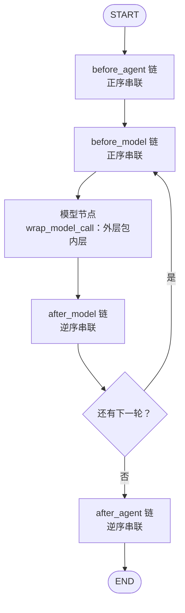

# 03：中间件接入：钩子、顺序与启用条件

> 编码主线中的机制专题。解释装配声明怎样进入执行图；中间件贯穿模型与工具调用，并非一次单独的执行阶段。

[02](./02-deep-agent-assembly.md) 展示了传给 `create_deep_agent()` 的中间件列表。但那份列表不是最终执行的栈——框架先拼自己的基础栈，再按名称把应用声明合进去，钩子再被编译成图节点。

本篇讲清这条链路：钩子挂在哪、顺序怎么定、哪些项按条件装配、fork 子图继承什么。应用代码取自 `openswe/server.py`，框架代码取自本机安装的 deepagents 0.7.21 与 langchain 1.4.4（版本与锁定说明见[源码基线](../source-baseline.md)）。

## 全景：中间件编译成图，不是回调列表



每个中间件节点都带着条件跳转边（`can_jump_to`）：`before_model` 可以直接跳到 `end` 结束运行，`after_model` 可以跳回 `model` 再来一轮。**所以这是一张图，不是固定管道**——某次运行实际走哪些节点，取决于每个钩子返回什么。

## 一、六种钩子各挂在哪

| 钩子 | 运行时机 | 主图上的真实成员 |
| --- | --- | --- |
| `before_agent` | 进入一次图调用时 | `PrepareAgentRunMiddleware`（运行准备）、`WorkspaceSkillsMiddleware`、`ReviewGuideMiddleware` |
| `before_model` | 每轮模型节点之前 | 队列与事件消费（`TaskCoordinationMiddleware`）、`refresh_github_proxy_before_model`、`ModelSelectionMiddleware`、`RequireCliResultMiddleware`、`ClientToolsMiddleware` |
| `wrap_model_call` | 包装模型请求与响应 | 选型、回退、视觉替换、动态工具、三个供应商清理层、稳定排序、错误记录、时限（02 第七节讲过的整条链） |
| `after_model` | 模型节点返回之后 | `RequireUserReplyMiddleware`、`ModelCallLimitMiddleware` |
| `wrap_tool_call` | 包装工具执行 | `ToolErrorMiddleware`、`ToolRetryMiddleware`（仅 task）、`ValidateImageReadsMiddleware`、`SubdirAgentsReadMiddleware`、PR 与推送守卫 |
| `after_agent` | 正常走到收尾路径时 | `record_run_usage`、`notify_step_limit_reached` |

两点容易误读：

- **`after_agent` 不是 `finally`。** 异常、取消、`jump_to` 跳过都会改变实际路径，它只在正常到达收尾时运行。
- **状态由 `state_schema` 加进图。** 每个中间件声明自己的状态键（准备标记、回复计数、路由档位等），合并与持久化语义各不相同，归属见 [08](../02-runtime-support/08-state-and-persistence.md)。

另外 Open SWE 的中间件基类统一设了 trace 脱敏：

```python title="middleware/trace.py"
SCRUBBED_TRACE_POLICY = TracePolicy(process_inputs=omit_payload)


class OpenSWEMiddleware[StateT: AgentState](AgentMiddleware[StateT]):
    trace_policy = SCRUBBED_TRACE_POLICY
```

这控制中间件输入在 trace 里的记录方式，不代表消息和工具结果自动脱敏。

## 二、最终栈的拼法：同名替换，新项插中段

Deep Agents 先拼自己的基础栈。主图这段是框架的核心逻辑（`create_deep_agent` 内部）：

```python title="deepagents/graph.py（基础栈构建，节选）"
    deepagent_middleware: list[AgentMiddleware[Any, Any, Any]] = []
    if skills is not None:
        deepagent_middleware.append(SkillsMiddleware(backend=backend, sources=skills))
    deepagent_middleware.append(
        FilesystemMiddleware(backend=backend, ...)
    )
    if inline_subagents:
        deepagent_middleware.append(SubAgentMiddleware(backend=backend, subagents=inline_subagents, ...))
    deepagent_middleware.extend([create_summarization_middleware(model, backend), PatchToolCallsMiddleware()])

    # Names of the core stack, captured before the tail is appended so new user
    # middleware can splice in ahead of the profile/prompt-caching/memory tail.
    _main_core_names = {m.name for m in deepagent_middleware}
    deepagent_middleware.extend(_profile.materialize_extra_middleware())
    append_prompt_caching_middleware(deepagent_middleware)
    if memory is not None:
        deepagent_middleware.append(MemoryMiddleware(...))
    ...
    deepagent_middleware.append(UnsupportedContentMiddleware())
    ...
    deepagent_middleware = _apply_custom_middleware(deepagent_middleware, middleware or [], core_names=_main_core_names)
```

结构是三段：**核心层**（Skills、Filesystem、SubAgent、Summarization、PatchToolCalls）→ **尾部层**（profile 附加项、提示缓存、Memory、UnsupportedContent）→ 应用声明最后合入。合并规则：

```python title="deepagents/graph.py::_apply_custom_middleware"
def _apply_custom_middleware(base, custom, *, core_names=None):
    """Merge custom middleware into the base stack by name.

    - If its `.name` matches a name still present in `base`: replace in-place,
      preserving stack order.
    - Otherwise: a brand-new entry lands after the last `core_names` member (so it
      precedes the profile/prompt-caching/memory tail), or at the end when
      `core_names` is unset.
    """
    ...
    for m in custom:
        if m.name in current_names:
            replacements[m.name] = m
        else:
            to_append.append(m)
    result = list(base)
    for i, m in enumerate(result):
        if m.name in replacements:
            result[i] = replacements[m.name]
    if to_append and core_names is not None:
        # Land new middleware after the last core entry, ahead of the tail.
        pos = max((i for i, m in enumerate(result) if m.name in core_names), default=len(result) - 1) + 1
        result[pos:pos] = to_append
    else:
        result.extend(to_append)
    return result
```

两条规则，两条后果：

- **同名项原位替换。** `ConversationOffloadingMiddleware.name` 返回 `SummarizationMiddleware`，所以 Open SWE 的卸载/摘要中间件替换的是核心摘要层，位置不变；`WorkspaceSkillsMiddleware` 同理替换 Skills 层。应用列表里写的 `FilesystemMiddleware` 和 Anthropic 缓存也是替换对应核心/尾部项，不会因为写在前面就跑到最外层。
- **新项插在最后一个核心项之后、尾部之前。** 所以 `ExcludeToolsMiddleware` 一定位于框架内置工具层之后（能隐藏内置工具），摘要替换层也仍在核心位置。

**不能拿应用声明列表逐行推导最终顺序，也不能拿它推导系统提示的拼接顺序**——提示拼装是另一条逻辑（见 [04](./04-context-skills-and-offloading.md)）。

## 三、钩子的连接方向：正序、逆序、内外

框架（langchain `agents/factory.py`）把钩子编译成图边。前置钩子按最终列表**正序**串：

```python title="langchain/agents/factory.py（before_model 链，节选）"
    if middleware_w_before_model:
        for m1, m2 in itertools.pairwise(middleware_w_before_model):
            _add_middleware_edge(
                graph,
                name=f"{m1.name}.before_model",
                default_destination=f"{m2.name}.before_model",
                model_destination=loop_entry_node,
                end_destination=exit_node,
                can_jump_to=_get_can_jump_to(m1, "before_model"),
            )
```

后置钩子（`after_model`、`after_agent`）按**逆序**串——列表里靠后的中间件先收到控制权。包装钩子（`wrap_model_call`、`wrap_tool_call`）则是列表靠前者包住靠后者：请求从外向内传，结果或异常从内向外返回。

这解释了一个反直觉现象：装了两个回复守卫时，**声明靠后的那个先经过 `after_model`**。它跳回模型再来一轮后，不能假定另一个守卫已经执行过。

## 四、条件项：什么运行装什么

02 第六节贴过完整装配列表。总在的之外，其余按条件加入：

| 中间件 | 装配条件 |
| --- | --- |
| `ClientToolsMiddleware` | `cfg.client_tools` 非空（客户端声明了工具） |
| `IncidentMiddleware` | 事故会话存在 |
| `ReviewGuideMiddleware` | 存在未关闭的审查导读会话 |
| `WorkspaceSkillsMiddleware` | 云端线程且无个人凭据归属 |
| `PullRequestCreationGuardMiddleware` | 非桌面运行 |
| `RequireCliResultMiddleware` | CLI 桥接且非停止摘要 |
| `TaskCoordinationMiddleware` | 存在任务协调上下文 |
| `spawn_worker` 工具 | 协调启用且本线程不是 worker |
| 队列消费、事件投递两个钩子 | 非停止摘要 |
| `refresh_github_proxy_before_model` | 非协调 worker（worker 由协调路径自己管代理） |

### 1、客户端工具：占位结果与条件跳转

客户端工具中间件值得完整看一遍，它是"占位结果 + 条件跳转"的典型实现：

```python title="middleware/client_tools.py（模块说明）"
"""Stop the run at calls to tools the Responses client runs itself.

A call gets a placeholder result, and the run ends before the next model call.
The client's real result arrives with the next run under the placeholder's
message id, replacing it in place.
"""
```

```python title="middleware/client_tools.py::ClientToolsMiddleware（节选）"
    async def awrap_tool_call(self, request, handler) -> ToolMessage | Command:
        name = request.tool_call["name"]
        call_id = request.tool_call["id"]
        if name not in self._names or not call_id:
            return await handler(request)
        return ToolMessage(
            content=prompt("client-tools/pending-result"),
            tool_call_id=call_id,
            name=name,
            id=ClientToolSpec.result_message_id(call_id),
            artifact={PENDING_ARTIFACT_KEY: True},
        )

    @hook_config(can_jump_to=["end"])
    async def abefore_model(self, state: AgentState, runtime: Runtime) -> dict[str, Any] | None:
        for message in reversed(state["messages"]):
            if not isinstance(message, ToolMessage):
                return None
            if isinstance(message.artifact, dict) and message.artifact.get(PENDING_ARTIFACT_KEY):
                return {"jump_to": "end"}
        return None
```

服务端不执行客户端工具：工具本体只会 `raise RuntimeError`，包装层截获调用、返回带待决标记的占位消息；下一次运行开始前发现待决结果，就跳到 `end` 结束本轮，等客户端带着真实结果（同消息 ID，原位替换）触发下一轮。这是一段交接协议，不是服务端代跑。

### 2、事故会话：提示之外的证据收集层

`IncidentMiddleware` 在模型请求和工具结果两侧同时工作。模型侧，每次调用先检查会话状态、从人类消息收集上下文证据，再把事故提示**追加**在系统提示之后（不替换）：

```python title="incidents/runtime.py::IncidentMiddleware（模型请求包装，节选）"
    async def awrap_model_call(self, request, handler) -> ModelResponse:
        await self.session.check()
        for message in request.messages:
            if isinstance(message, HumanMessage):
                context_evidence(message.text, self.session.collector)
        existing = request.system_message.text if request.system_message else ""
        prompt = self.session.prompt
        return await handler(
            request.override(
                system_message=SystemMessage(
                    content=f"{existing}\n\n{prompt}" if existing else prompt
                )
            )
        )
```

工具侧的 `_observe` 逐条检查结果：**失败结果记为证据缺口**（"Tool X did not confirm a successful result"），成功结果记为观察并附来源 URL（从结果的 `url`/`html_url`/`pr_url` 字段提取）。也就是说，事故报告的证据链是程序从工具结果里收集的，不是模型口头汇报的——模型说"我验证过"但工具结果失败时，缺口会留在记录里。

### 3、审查导读：每轮固定检出与视图维护

`ReviewGuideMiddleware` 的 `before_agent` 每轮重做四件事：读会话（已关闭就清空规则状态键）、取 PR 当前 head、把沙箱检出**钉**在 base/head 两个 SHA 上、刷新频道视图：

```python title="review_guide/middleware.py::abefore_agent（节选）"
        session = await ReviewGuideSession.get(self._thread_id)
        if session is None or session.closed:
            return {"review_guide_rules": ""}
        pr = session.pull_request
        head = await fetch_head(pr.owner, pr.repo, pr.number)
        if head is None:
            raise RuntimeError("review walkthrough could not read the pull request")
        checkout = await PinnedCheckout.locate(get_cached_sandbox_backend(self._thread_id), pr.repo)
        ...
        if await checkout.pin(
            full_name=pr.repo_full_name, pr_number=pr.number,
            base_sha=head.base.sha, head_sha=head.head.sha,
        ):
            await set_view(
                session.slack_channel_id, "diff",
                content=await checkout.diff(),
                base_branch=head.base.ref, head_branch=head.head.ref,
            )
```

检出被钉住后，导读期间的新推送不会让模型读到漂移的代码。两处刻意的失败处理：PR head 读不到直接抛 `RuntimeError`（导读没有可靠的基准就没法做）；钉住时发现提交已移动（`PlanMovedError`）不硬来，给模型一条"导读期间提交移动了"的消息让它停顿。Slack 展示失败（diff 视图、上下文栏）只记警告——展示降级不阻断导读本身。渲染好的规则存进 `review_guide_rules` 状态键，每轮模型调用追加。

## 五、fork 子图：继承父声明，按名称覆盖

02 里子 Agent 的配置是 `mode="fork"`。fork 的含义在框架的合并语句里：

```python title="deepagents/graph.py（fork 合并）"
            subagent_custom_middleware = list(spec.get("middleware", []))
            if is_forked and middleware:
                # `create_agent` rejects two middleware sharing a name, so a spec
                # entry replaces the inherited one in place rather than adding to it.
                subagent_custom_middleware = list({m.name: m for m in [*middleware, *subagent_custom_middleware]}.values())
            subagent_middleware = _apply_custom_middleware(
                subagent_middleware, subagent_custom_middleware, core_names=_subagent_core_names
            )
```

父图的整个应用声明先与子声明按名称合并（子项覆盖父项，保留名称位置），再合到子图自己的核心栈上。所以**子图不只有 `_general_purpose_subagent()` 里声明的那几项**，父图没被覆盖的声明全部继承。

Open SWE 用一个只有名字、没有钩子的空壳来"停用"继承项：

```python title="server.py::_DisableInheritedMiddleware"
class _DisableInheritedMiddleware(AgentMiddleware):
    def __init__(self, name: str) -> None:
        self._name = name

    @property
    def name(self) -> str:
        return self._name
```

`create_agent` 拒绝两个同名中间件，所以子声明里放一个同名空壳，合并后父项就被这个什么也不做的占位替换掉了。子 Agent 的完整声明：

```python title="server.py::_general_purpose_subagent（节选）"
    subagent: SubAgent = {
        "name": GENERAL_PURPOSE_SUBAGENT["name"],
        ...
        "mode": "fork",
        "model": model,
        "tools": list(tools),
        "middleware": [
            _DisableInheritedMiddleware(RequireUserReplyMiddleware.__name__),
            *(_DisableInheritedMiddleware(name) for name in inherited_middleware_exclusions),
            _SubagentToolGuard(),
            AnthropicPromptCachingMiddleware(ttl="1h", unsupported_model_behavior="ignore"),
            TranscriptMiddleware(),
            ...
            *guard_middleware,
            *([offloading] if offloading else []),
        ],
    }
```

排除名单（`inherited_middleware_exclusions`）在主图装配处传入：消息队列消费、事件投递、模型选型，启用代码解释器时再加它。**准备层不在排除名单里，但会自己跳过**：

```python title="middleware/prepare_run.py::abefore_agent（节选）"
    async def abefore_agent(self, state, runtime) -> dict[str, Any] | None:
        if state.get("_deepagents_forked_context"):
            return None
        ...
```

fork 运行带着 `_deepagents_forked_context` 状态标记进来，准备层看到就直接返回——父任务的环境已经建好，子任务不该重新建一遍。

子图的工具另有运行时守卫，拦的是父级专用工具（Slack、后台命令、线程管理、设置类，`slack_read_channel_messages` 是来源无关的例外）：

```python title="server.py::_SubagentToolGuard"
class _SubagentToolGuard(AgentMiddleware):
    async def awrap_tool_call(self, request, handler) -> ToolMessage | Command:
        if _is_subagent_excluded_tool(request.tool_call["name"]):
            return ToolMessage(
                content=prompt("tools/subagent-unavailable"),
                tool_call_id=request.tool_call["id"],
            )
        return await handler(request)
```

最后是被继承名单里两个值得注意的保留项：

- **`ModelFallbackMiddleware` 没有被排除**，子图经 fork 合并实际继承了模型回退。`task_retry.py` 里"子 Agent 没有 fallback"的注释与组合行为冲突，以实际装配为准（02 第八节提过）。
- **`RequireCliResultMiddleware` 也不在显式排除名单里**，不能笼统说"所有回复守卫都停用了"。

同名合并只保证每个名字留一个实例；未被覆盖的父声明对象不会深拷贝，子任务共享父对象的实例状态这一层，不因合并而隔离。

## 六、用这张地图查一个规则

查任何中间件行为，先回答三个问题：

1. **它挂在哪个钩子？** 状态节点（before/after）还是调用包装（wrap）——这决定它是图节点还是包裹层。
2. **当前运行条件装不装它？** 对照第四节的表和 02 的装配分支。
3. **合并与继承把它放在哪？** 同名替换保位置，新项插核心层之后；子图先继承再覆盖。

具体机制的实现归属：

- 准备指纹、检查点、状态键：[08 状态与持久化](../02-runtime-support/08-state-and-persistence.md)
- 模型路由、工具授权、Backend、模型与委派故障链：[02 Agent 装配](./02-deep-agent-assembly.md)
- 沙箱连接与恢复：[05 沙箱生命周期](./05-sandbox-lifecycle.md)
- 系统提示、目录规则、Skills、动态工具、摘要：[04 上下文管理](./04-context-skills-and-offloading.md)
- 队列、事件、回复守卫、委派协议：[06 执行协调](./06-delegation-and-continuation.md)
- PR 守卫、推送识别与审批：[07 代码交付](./07-pull-request-and-approval.md)
- 用量、限额通知、完成回调：[09 运行记录与结算](../02-runtime-support/09-observability-and-validation.md)

---

上一篇：[02：Agent 装配](./02-deep-agent-assembly.md)。下一篇：[04：上下文管理](./04-context-skills-and-offloading.md)。返回[系列导读](../index.md)。
