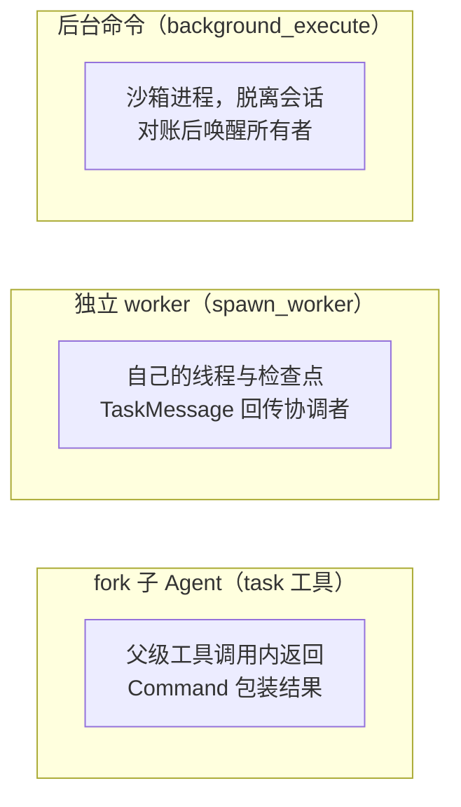

# 06：执行协调：任务怎样并行、等待与继续

> 编码主线中的长任务专题。以已有图和执行环境为基础，解释并行工作、结果交接与再次调度。

长测试、并行调查和外部 CI 都可能超出一轮对话；用户还可能在运行期间追加要求或停止工作。本篇沿这些等待对象说明：**谁继续执行，结果存在哪里，哪个入口把控制权交回协调线程。**

先区分三种并行工作，它们的关键差别是结果怎么回来：



后两种都能在发起运行结束后继续，但用不同的通知协议。源码基线见[源码基线](../source-baseline.md)。

后文几条交接链的载体不同，不能套用同一套交付保证：

| 载体 | 消费或触发入口 | 实际保证与边界 |
| --- | --- | --- |
| 平台运行队列 | 平台调度 run | `multitask_strategy` 处理同线程运行冲突，不给业务消息去重；`if_not_exists` 只决定线程缺失时是否创建线程 |
| `thread_queued_message` | 模型前钩子 | 按 `seq` 读取；有 `queue_id` 时按线程去重。超 100 条丢最旧，删行后到 checkpoint 前仍有丢失窗口 |
| `TaskMessage` | 模型前钩子，或新 run | 稳定 ID 与 checkpoint 回执；全部欠投消息都已尝试三次时不再主动建 run，创建失败也计次 |
| `EventMatch` | 模型前钩子，或新 run | 按 delivery 去重，只读取保留窗口内的欠投；同样限制主动建 run 的次数，没有 `TaskMessage.delivered_at` 回执字段 |
| 沙箱命令状态文件 | 回调、轮询或重新接入时对账 | `notify.claim` / `notify.done` 协调通知；run 派发与写入 done 分离，仍可能重送 |

这些机制分别控制重复、保留时间和重试预算，**不能合并成全局“至少一次”交付保证**。跨载体也没有统一的消息顺序。

## 一、两个约束先立好

**单事件循环。** `pin_single_event_loop()` 让服务进程内的队列任务共用事件循环，原因与同步调用边界见 [00 的第四节：异步执行与任务续接](../00-overview/00-project-and-frameworks.md#四异步执行与任务续接)。业务 worker 的独立 thread 是平台对话与检查点对象，不代表独占的操作系统线程；第八节的后台命令 runner 才是沙箱里的独立进程。

**模型调用限时。** 供应商传输卡住但不抛异常时，卡住的调用会阻止下一轮模型前钩子消费消息。02 讲过的时限层把它转成错误：

```python title="middleware/model_call_timeout.py（超时转错误）"
        try:
            return await asyncio.wait_for(handler(request), timeout=self._timeout_seconds)
        except TimeoutError as exc:
            logger.warning("Model call exceeded %ss deadline; aborting", self._timeout_seconds)
            raise ModelCallTimeoutError(
                f"Model call exceeded the {self._timeout_seconds}s deadline"
            ) from exc
```

`ModelCallTimeoutError` 继承 `TimeoutError`，落进模型回退层的可重试清单——所以超时的出路是"换供应商再试"，不是干等。前台命令的客户端期限与取消清理见 [05](./05-sandbox-lifecycle.md)。

## 二、运行创建与完成回调

`create_durable_run()` 的基础参数在 [01](./01-input-thread-and-workspace.md) 展开过。这里要区分两类约束：`multitask_strategy="interrupt"` 中断已有活动运行，`enqueue` 让新运行等待，`reject` 在冲突时拒绝新运行、不动已有运行。Slack 明确提及时选 `interrupt`，其余选 `enqueue`；完成回调拾取遗留输入时先查 pending，再用 `reject` 避免打断期间新启动的运行。TaskMessage/EventMatch 的 `enqueue` 路径还会先检查 busy，忙时只留记录，不立即创建排队 run。

`if_not_exists="reject"` 则是**线程不存在时拒绝创建**，与 run 去重或上述并发冲突无关。完成回调还要满足地址与密钥条件：

```python title="dispatch.py（完成回调的挂载条件）"
# FastAPI route the platform POSTs run completion/failure to. The platform
# rejects loopback webhooks (relative URLs / localhost) — they bypass auth via
# the in-process ASGI transport — so a loopback URL would 422 *every* run at
# create time. COMPLETION_WEBHOOK_URL must therefore be the deployment's
# absolute https URL (…/webhooks/run-complete). The route is fail-closed on
# RUN_COMPLETE_WEBHOOK_SECRET, so we only attach the webhook when the secret is
# set, appending it as ?token= so the route can verify the call came from us.
...
def _resolve_completion_webhook_url(base: str, secret: str | None) -> str | None:
    """Resolve the completion webhook URL, or None to attach no webhook.

    Degrades to None (with a warning) for a relative/loopback URL rather than
    letting a rejected webhook poison every ``runs.create``.
    """
    if not secret:
        return None
    if _is_loopback(base):
        ...
        return None
    if "?" in base:
        return base
    return f"{base}?token={secret}"
```

两个条件缺一不可：设置了 `RUN_COMPLETE_WEBHOOK_SECRET`，且回调地址是非回环的绝对地址。注释解释了为什么这么挑剔——平台有进程内 ASGI 传输，回环地址会绕开鉴权，平台直接拒绝；一个坏回调 URL 会毒死每一次 `runs.create`。**没挂回调时运行照常创建，只是完成后的续接入口少了**（第 9 节会看到后果）。`spawn_worker` 对这个条件更严格：回调不可用就拒绝派生。

平台回调 `/webhooks/run-complete` 后，`handle_run_completion()` 按顺序结算（费用遥测、transcript 轮次、worker 交接、遗留输入拾取），完整顺序见 [09](../02-runtime-support/09-observability-and-validation.md)。

## 三、fork：结果通过父工具调用返回

`task` 工具调起的 fork 子 Agent 在父级的这一次工具调用内完成。结果怎么回到父图，框架的包装函数一次说清：

```python title="deepagents/middleware/subagents.py（fork 结果包装）"
    def _return_command_with_state_update(result: dict, tool_call_id: str) -> Command:
        if "messages" not in result:
            raise ValueError(
                "CompiledSubAgent must return a state containing a 'messages' key. ..."
            )

        state_update = {k: v for k, v in result.items() if k not in _EXCLUDED_STATE_KEYS and k not in private_state_keys}

        structured = result.get("structured_response")
        if structured is not None:
            ...
        else:
            # Walk back to the last AIMessage with non-empty text. Anthropic
            # occasionally emits a trailing empty `end_turn` AIMessage after a
            # successful final tool call, which would otherwise be forwarded
            # as an empty ToolMessage.
            content = ""
            for msg in reversed(result["messages"]):
                if isinstance(msg, AIMessage):
                    text = msg.text.rstrip() if msg.text else ""
                    if text:
                        content = text
                        break

        return Command(
            update={
                **state_update,
                "messages": [ToolMessage(content, tool_call_id=tool_call_id)],
            }
        )
```

子图允许传递的状态字段被过滤后合并回父状态；**最终报告是关联当前工具调用 ID 的一条 `ToolMessage`**。这条路径不调用 `create_thread()`，也不经过完成 webhook。

应用侧的边界在 03 讲过：`_SubagentToolGuard` 拦掉后台命令、外部事件、线程管理类工具（这些异步后续动作留给主 Agent）；`_DisableInheritedMiddleware` 停用回复守卫、队列消费、事件投递、模型选型。**父级在等待 `task` 时没有新的模型调用**，所以补充消息不能靠父级钩子即时注入正在执行的 fork。fork 与父图共用沙箱和 Git 工作树——分支切换和同文件编辑会互相影响。

取消的传播有测试规格：子图节点取消向父级传播；父运行取消时取消正在等待的子图。

## 四、worker：先持久化身份，再派发独立运行

`spawn_worker()` 检查所有者授权、任务开关、完成回调与沙箱绑定——已有 task 的调用者必须是永久协调者，沙箱访客不能再派 worker；一次性 CLI bridge 直接拒绝（协调运行结束时 bridge 会关闭，worker 可能还没跑完）。

worker 的身份是确定性的：

```python title="tasks/service.py（worker ID）"
    worker_id = str(uuid5(NAMESPACE_URL, f"open-swe:task-worker:{actor.thread_id}:{request_id}"))
```

`request_id` 是注入的工具调用 ID——**同一次调用重放得到同一个 worker，换一个调用 ID 得到新 worker。** `Task.reserve_worker()`（实现见 08 的状态专题）在协调线程的 advisory lock 下创建或复用 task、核对 membership、预留 delegation；已有 worker 属于同一 task 时返回旧记录，不覆盖旧指令。

`launch_worker()` 创建平台线程：复制所有者、可见性、仓库、沙箱和令牌范围，设置 `sandbox_host_thread_id`。`create_thread(..., if_exists="do_nothing")` 之后还**读回 metadata 比较身份与权限字段**——防止复用同 ID 却不同归属的线程。worker 有自己的对话和检查点，但共用宿主的可变沙箱（接入授权见 [05](./05-sandbox-lifecycle.md)）。

初始指令按 `initial:{worker_thread_id}` 写成 TaskMessage 再尝试交付。启动错误截断到 2000 字符保存；权限错误和值错误标为不可重试，其他错误可重试——`control_worker(action="retry")` 重置初始消息的投递次数、再启动原 worker，不新建身份。

## 五、TaskMessage：保存 → 交付 → 消费 → 回执

TaskMessage 是 worker 与协调者之间的信件系统。保存时就带上稳定身份：

```python title="tasks/messages.py::record"
    async def record(self, session: AsyncSession) -> bool:
        cls = type(self)
        self.id = uuid5(
            NAMESPACE_URL, f"task-message:{self.task_id}:{self.thread_id}:{self.delivery_id}"
        )
        await session.execute(delete(cls).where(cls.delivered_at < func.now() - _RETAINED))
        recorded = await session.scalar(
            insert(cls)
            .values(...)
            .on_conflict_do_nothing(index_elements=["thread_id", "delivery_id"])
            .returning(cls.id)
        )
        return recorded is not None
```

ID 由 task、接收线程和 delivery ID 算出，`(thread_id, delivery_id)` 冲突时插入被忽略——**重复提交天然去重**。已交付记录保留七天。

交付的关键分支：

```python title="tasks/messages.py::deliver（节选）"
            delegation = await TaskDelegation.get(thread_id)
            if delegation is not None and delegation.cancelled:
                return False
            if strategy == "enqueue":
                thread = _Thread.model_validate(await client.threads.get(thread_id))
                if thread.status == "busy":
                    return False
            state = _ThreadState.model_validate(await client.threads.get_state(thread_id))
            owed = await cls.owed(thread_id, state.values.messages if state.values else [])
            if all(message.delivery_attempts >= _MAX_ATTEMPTS for message in owed):
                return False
```

锁内依次检查：worker 是否已取消 → `enqueue` 遇 busy 线程直接返回 false（内容留在业务表）→ 投递次数是否耗尽。接收者空闲时，先增投递次数，再以 `kind="task_message"` 创建 `agent` run 唤醒它。

接收者忙时由模型前钩子消费。回执的确认在读取端：

```python title="tasks/messages.py::owed"
    @classmethod
    async def owed(cls, thread_id: str, messages: Sequence[object]) -> list[Self]:
        delivered: list[UUID] = []
        for message_id in delivered_event_match_ids(messages):
            ...
            delivered.append(UUID(message_id))
        async with postgres.session() as session:
            await session.execute(
                update(cls)
                .where(
                    cls.thread_id == thread_id, cls.id.in_(delivered), cls.delivered_at.is_(None)
                )
                .values(delivered_at=func.now())
            )
            ...
            return list(await session.scalars(
                select(cls).where(cls.thread_id == thread_id, cls.delivered_at.is_(None))
            ))
```

消息进入图状态时带稳定 ID `event-match:{UUID}`；**下次从 checkpoint 看见这个 ID，才补记交付**。完整链是：**保存 TaskMessage → 忙时当前运行消费，空闲时创建 run → 消息进入接收线程状态 → 接收者下一轮处理 → 状态里出现稳定 ID 时补回执。** 协调者不必一直开着等待循环。

可靠性边界：投递次数在 run 创建之前提交，创建失败也消耗次数；新消息到达时一批旧消息可能被一同带入。稳定 ID 减少重复，不证明模型处理或外部副作用恰好一次。

## 六、worker_finished：回传某次 invocation 的结果

完成回调把终态 worker run 交给 `worker_finished()`。先查 membership：普通线程返回 false，worker 的 `success`、`error`、`timeout`、`interrupted` 才进入交接。**run 结束不删除 worker，也不把业务 task 标为已达成**——未取消的 worker 可以再接消息、再跑一轮。

`worker_result()` 优先取此次回调 payload 的最终助手答案；payload 没有，按此次 `invocation_id` 查历史，仍缺再按 `run_id` 查。它**不读线程最新 state**——避免把更晚一轮的结果误配给旧回调。结果最多 16,000 字符。

结果经 `notify()` 发往永久协调线程，delivery ID 是 `finished:{worker_thread_id}:{run_id}`——新 run 的完成产生新 delivery ID，不可按 worker ID 永久去重。worker 输出转义后放进 `untrusted-worker-output` 标签：这条经过服务鉴权的内部消息只证明来源与交付，内容仍是待验证的 agent 报告。重复完成回调沿同一 delivery ID 保存、插入被忽略。交接失败会使 webhook 失败，把重试权交回平台。

## 七、外部事件：另一条协议

`listen_events()` 为线程登记外部事件订阅（按来源、仓库、PR、事件类型、载荷过滤；默认七天、上限十四天、每线程最多五个）。调用链与 TaskMessage 平行：`EventLog.record()` 保存已核验事件 → `EventSubscription.deliver()` 匹配订阅 → `EventMatch.record()` 保存欠投 → 忙时模型前消费，空闲时创建 run。

两条协议在 worker 完成处相邻：

```python title="tasks/events.py::worker_finished（收尾）"
    delegation = await store.TaskDelegation.get(thread_id)
    if status != "interrupted" and delegation is not None and not delegation.cancelled:
        await TaskMessage.deliver_to(thread_id)
        await EventSubscription.deliver_to(thread_id, "enqueue")
    return True
```

注意这里的 `thread_id` 是刚结束的 **worker 自己**——`notify()` 已把结果送往协调者，这段只拾取 worker 自己欠收的任务消息与外部事件。两个消费者、两张数据库表，应独立观察。

与 TaskMessage 的差异：EventMatch 只读事件保留窗口内的欠投记录（当前配置两天）；订阅触发计数与插入共用事务，重复 delivery 不增计数；一次性订阅只允许第一次认领。`deliver_to()` 捕获异常记日志，不能视为必达通知。

### 后台事件交给谁：Slack 线程所有权协议

本篇反复出现"唤醒线程所有者"，这里把协议本身讲清。项目规则（`AGENTS.md`）：**只有拥有某个 Slack 频道线程的那个 Agent 才在该线程发言；后台工作不代发，而是把事件递给它**——必须行动或报告的用 `wake_thread_owner`，纯信息的用 `note_for_thread_owner` 排队。

```python title="slack/thread_owner.py::wake_thread_owner"
async def wake_thread_owner(channel_id: str, thread_ts: str, slack_user_id: str, event: str) -> str:
    """Start a run for the thread's owning agent, acting for ``slack_user_id``, about ``event``."""
    thread_id = await resolve_slack_thread_id(langgraph_client(), channel_id, thread_ts)
    ...
    started = await webhook.start_slack_run(
        SlackRequest(
            channel_id=channel_id,
            thread_ts=thread_ts,
            # After every message in the thread, so the agent reads all of them first.
            event_ts=f"{time.time():.6f}",
            user_id=slack_user_id,
            trigger_system=_BACKGROUND_EVENT,
            text=prompt("slack/thread-owner-event", event=event),
            ...
        ),
        repo,
    )
    if not started:
        raise ThreadOwnerWakeError(f"No run started for the agent of Slack thread {thread_ts}")
    return thread_id
```

要点：由频道和线程时间戳解析出线程（不是猜）；触发时间戳放在线程所有消息**之后**，Agent 会先读完上下文再行动；事件文本由提示词模板包装。启动失败抛错——调用方（比如 CI 监看）要据此重试。

信息型事件不启动运行，只排队：

```python title="slack/thread_notes.py::note_for_thread_owner"
async def note_for_thread_owner(channel_id: str, thread_ts: str, note: str) -> None:
    """Queue ``note`` for the thread's owning agent, if it has one, without starting a run."""
    thread_id = await lookup_slack_thread_id(langgraph_client(), channel_id, thread_ts)
    # The thread's own run caused this and already knows; queued after its last model
    # call, the note would start a follow-up run.
    if thread_id is None or thread_id == _running_thread_id():
        return
    if not await queue_message_for_thread(thread_id, [{"type": "text", "text": note}]):
        ...
```

注意那个自检：**如果这条信息就是线程自己当前运行产生的，直接丢弃**——排进队列反而会在它最后一次模型调用之后触发一次多余的后续运行。排进的消息走第九节的队列，由下一次运行的模型前钩子消费。

## 八、长命令：沙箱里继续，完成后唤醒

`background_execute()` 在沙箱里启动脱离会话的进程。runner 是一段生成的 Python 脚本，开头值得看：

```python title="tools/background_execute.py::_runner（脚本开头）"
        import base64, json, os, selectors, signal, subprocess, time

        root = {TASK_ROOT!r}
        task_id = {task_id!r}
        task_dir = os.path.join(root, task_id)
        state_path = os.path.join(task_dir, "state.json")
        output_path = os.path.join(task_dir, "output.log")
        stop_path = os.path.join(task_dir, "stop")
        command = base64.b64decode({encoded(command)!r}).decode()
        # Detach from the launching shell's session here rather than with
        # `setsid(1)`, which macOS does not ship.
        try:
            os.setsid()
        except OSError:
            pass
        try:
            os.remove(__file__)
        except OSError:
            pass
```

三个动作各有效果：`os.setsid()` 脱离启动会话（命令进程再以 `start_new_session=True` 启动，图取消不影响它）；删掉脚本自身；状态写在 `state.json`、日志写在 `output.log`、停止靠 `stop` 文件出现。默认期限 3600 秒、上限 86,400 秒；输出保留头尾各 512 KiB；状态更新用临时文件加 `os.replace()` 原子替换。停止文件出现或超时后向进程组发 SIGTERM、等两秒再 SIGKILL，状态分别记 stopped、timed_out；自然退出按退出码记 completed 或 failed。

启动侧：脚本通过原子 `mkdir` 取得启动锁（最多十次），沙箱已有四个 running 命令时拒绝——**这个限额按共享沙箱内的状态文件计数，worker 共用沙箱也共用限额**。超过五秒未更新的 running 记录可改为 lost；list 清理超过七天的终态目录。

完成的唤醒有回调与轮询两种（按触发者的 `experimental_background_callbacks` 选择，不互相兜底）。回调模式里 runner 用 curl POST 完成事件，重试延迟 0、5、15、30、60、120、300、300、300 秒；回调地址经 stdin 传给 curl（`-K -`），文件注入的令牌不会出现在 `ps` 里。路由对账仍有欠投通知时返回 503 让 runner 重送。runner 每 900 秒发 heartbeat 防止沙箱被闲置停止。

两种触发和沙箱重新接入（05 的对账）都走 `_reconcile()`：按 `owner_thread_id` 过滤共享沙箱的命令，对每个未通知的终态任务先取 `notify.claim`、派发携带状态与退出码的 enqueue run、成功后把 claim 改名 `notify.done`。**这里有明确的重复窗口**：run 已派发而 `notify.done` 未写成，后续对账会再派发——允许重送、尽力去重，不保证恰好一次。

## 九、用户追加消息与运行后的拾取

网页追加消息另存 `thread_queued_message` 表（一条一行、按自增 seq 排序、超 100 条丢最旧），不用 TaskMessage 的回执协议。两个入口：运行中的线程走 `steer_running_thread()`（记入已有会话轮次再排队，写入后复查原 run 是否还活着）；无开放轮次时走 `queue_follow_up_run()`（创建单独的 enqueue 后续 run，元数据 `queued_by` 记发送者）。

消费在模型前钩子 `check_message_queue_before_model()`：按发送者构造信封，全部构造成功才按主键删队列行。**删行与 checkpoint 写入是分开的两步**——中间崩溃可能丢失尚未持久化到图的消息。

成功运行最后一次模型调用后仍可能有遗留输入：完成回调会在线程没有 pending run 且 worker 未取消时，以 reject 尝试新建拾取运行。没有完成回调时这个入口不触发——消息等下一次运行。

## 十、凭据续期与回复收束

长运行还要保证后续工具能访问 GitHub。`refresh_github_proxy_before_model` 每次模型调用前检查：已记录的到期时间距当前不超过 **5 分钟**时刷新；到期时间未知但记录年龄达到 **50 分钟**才刷新——不是固定每五分钟刷一次。刷新失败只记 warning，运行继续。worker 用宿主的代理身份续期，所以不再装本线程的续期钩子。

回复收束由 `RequireUserReplyMiddleware` 守卫：只在 Slack 面且最后助手消息无工具调用时检查；满足条件的工具必须有成功结果。缺回复时追加系统提醒并 `jump_to="model"`，最多两次；超预算后尝试用 `slack_reply(..., "final")` 代发本轮最后的非空文本，没有文本只记 warning。守卫避免静默结束，不构成可靠交付保证。fork 用同名空壳停用它（结果交给父级）；CLI bridge 另有 `RequireCliResultMiddleware`，预算耗尽只记 warning、没有代发。

## 十一、定时唤醒、CI 监看与停止

自动计划、CI 监看和后台命令轮询可以由 `scheduler` 图触发。它只有一个 `launch` 节点，按 `task` 字段分发；没有匹配任务类型时再找 `schedule_id`，路由本身不经过模型判断：

```python title="scheduler.py::_launch（分发器，节选）"
    async def launch_once() -> dict[str, Any]:
        cfg = RunConfig.from_config(config)
        task = state.task or cfg.task
        if task == "reconcile":
            return {"result": await reconcile_stale_runs()}
        if task == "baby_sit":
            key = state.watch_key or cfg.watch_key
            if not key:
                return {"result": {"status": "missing_watch_key"}}
            return {"result": {"status": await evaluate_watch(key)}}
        if task == BACKGROUND_TASK_CRON_KIND:
            thread_id = state.thread_id or cfg.thread_id
            if not thread_id:
                return {"result": {"status": "missing_thread_id"}}
            return {"result": await monitor_background_tasks(thread_id)}
        if task in (WORKSPACE_REFRESH_TASK, LEGACY_REFRESH_TASK):
            ...
        if task == "session_cost":
            return {"result": await run_session_cost_refresh(state.model_dump(exclude_none=True))}
        if task == "agent_cost":
            return {"result": await run_agent_cost_refresh(state.model_dump(exclude_none=True))}
        if task == HUMAN_REVIEW_TASK:
            if not state.request_id or not state.step:
                return {"result": {"status": "missing_request"}}
            return {"result": await run_deadline(state.request_id, state.step)}
        ...
        return {"result": await launch_scheduled_agent_run(schedule_id, state.trigger_id)}
```

`launch_scheduled_agent_run` 启动用户计划的 Agent 运行；CI 评估、后台命令对账等分支也可能派发后续运行。调度器重试暂时性沙箱错误，耗尽后返回 `sandbox_unavailable`，其他异常仍会抛出。

**有分发分支，不等于已有定时计划。** 用户计划由 `schedules/store.py::_create_cron` 创建 cron；CI 监看由 `baby_sit.py::_create_watch_cron` 创建；后台命令只有选择轮询路径时才调用 `ensure_background_task_cron()`，任务清空后删除。下文的线程唤醒直接为 `agent` 图创建 cron，不经过 `scheduler`。`reconcile` 在本地源码中只找到调度分支，未找到对应 cron 创建者；是否启用、多久触发须另查部署配置，清扫范围见 [09](../02-runtime-support/09-observability-and-validation.md)。

**定时唤醒。** `schedule_thread_wakeup()` 安排线程未来 1–1440 分钟继续，触发时刻取整到 UTC 整分钟，以触发后 90 秒为 end time 创建直接面向 agent 图的 cron。预算按最近一条真实人类输入生成代号，两条用户消息之间最多十次；系统唤醒不刷新代号。worker 取消时删除它的唤醒计划。

**CI 监看。** `/baby-sit` 的评估函数把一次检查完整分类，判定本身值得看：

```python title="baby_sit.py::_evaluate_pull（节选）"
    checks = await CommitChecks.read(pull.repo, head_sha)
    if checks is None:
        return await _record_evaluation_error(watch, "CI status unavailable")

    watch.evaluation_errors = 0
    state, failures = aggregate_check_state(checks.runs, checks.statuses)
    if state == "pending":
        await WATCHES.save(watch)
        return state
    if state == "success":
        ...
        required = await RequiredCheck.for_branch(pull.repo, base_ref)
        if checks.unreported(required):
            await WATCHES.save(watch)
            return "pending"
        return await _finish_ready(watch)
    if state == "blocked":
        return await _finish_watch(
            watch,
            f"*`/baby-sit` needs owner triage:* {watch.pr_url} has terminal checks that "
            "are neither successful nor rerunnable failures.",
        )
    if watch.retry_count >= MAX_RETRIES_PER_HEAD:
        return await _finish_watch(
            watch,
            f"*`/baby-sit` stopped:* {watch.pr_url} is still failing after "
            f"{MAX_RETRIES_PER_HEAD} flaky reruns for `{head_sha[:12]}`.",
        )

    fingerprint = _failure_key(head_sha, watch.retry_count)
    dispatch_keys = list(watch.dispatch_keys)
    if fingerprint in dispatch_keys:
        await WATCHES.save(watch)
        return "duplicate"
```

四态的判定顺序：聚合还有未完成的检查 → `pending`；全部成功且**目标分支的必需检查都已出现**（缺报仍算 pending）→ 完成并通知；有终态但既不成功也不可重跑 → `blocked`，交给人分诊；失败且重跑预算耗尽 → 停止监看。剩下的才是"疑似偶发失败"：按 `head_sha + 重跑次数` 算派发指纹，已派发过就返回 `duplicate`——**同一个失败不会被重复唤醒两次**；派发异常则从 `dispatch_keys` 里撤回指纹，下次评估可再试。评估由每十分钟 cron 与 GitHub CI 事件共同触发，跨评估互斥用固定 ID 的 TTL 锁（五分钟）；提交 SHA 改变会重置重跑计数和派发键。**检查就绪只唤醒原线程，不等于自动合并**（合并见 [12](../03-review-and-merge/12-human-review-and-merge.md)）。

**停止。** `control_worker(action="cancel")` 取得 `event_match:{worker_id}` 数据库锁，标 cancelled、删外部订阅与命中、取消 pending/running runs，事务后再删 TaskMessage、结算被中断轮次、取消唤醒 cron。平台取消不是数据库事务的参与者——后续清理也可能失败，不是原子停止。已取消身份不能 retry，必须另建 worker。网页停止分页取消本线程的运行、保留其他发送者排队的运行；Slack 停止反应取消活动运行、清空网页追加队列再派 stop_summary。父线程 run 结束不会自动取消 worker，后台 runner 也不被这些停止动作杀掉。

---

---

上一篇：[05：沙箱生命周期](./05-sandbox-lifecycle.md)。下一篇：[07：代码交付](./07-pull-request-and-approval.md)。返回[系列导读](../index.md)。
