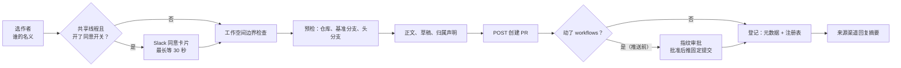

# 07：代码交付，怎样推送、审批并关联 PR

> 编码主线的交付环节。说明改动怎样成为远端分支与 PR；后续机器审查和人工合并属于可选协作扩展。

[06](./06-delegation-and-continuation.md) 解释任务怎样等待和续接。本篇转到代码交付：把沙箱工作树里的改动变成远端分支、GitHub PR 和线程中的交付记录。CI 监看可能在 PR 创建后触发，本目录的阅读顺序不限定它与交付动作的发生顺序。

以一个共享任务为例，改动已经准备好交付，线程中有请求者和补充要求的同事。Agent 要提交、推送、开 PR，再告诉发起者。如果这次还动了 `.github/workflows/ci.yml`，推送要先经人工批准。源码基线见[源码基线](../source-baseline.md)。

## 全景：一次交付的路径



注意顺序：工作流审批在**推送**之前，PR 创建在推送之后；上图把两道人工闸门画在同一张图里。

## 一、哪些靠提示词，哪些靠程序

交付的先后顺序写在系统提示的 `commit-pr.md` 里：先跑仓库的格式化和检查命令并复核 diff，再提交、`git push origin <分支>`、调 `open_pull_request`；PR 已存在时用 `gh pr edit` 更新，后续工作作为新提交追加；最后在来源渠道回复摘要（PR 链接 + diffstat，少于五个文件逐个列路径）。

提示词同时划了几条线：推送和 PR 都成功之前不发完成总结；给用户的链接只能是 PR URL；不自动把草稿转待审、不以自己的身份批准 PR；默认不强推，用户明确授权时用 `--force-with-lease`，已在远端的提交不 amend 不 rebase；工具失败后不改用别的创建方式，超时和 5xx 可原样重试一次。

**程序只检查其中一部分**：作者与访问检查、PR 创建守卫、工作流推送守卫、PR 事件后的线程状态更新。回复里是否真带了 PR 链接，没有程序验收。核对一次交付要对照远端提交、工具返回值和渠道里的实际回复。

## 二、PR 以谁的名义打开

### 1、选作者

```python title="credential_scope.py::pr_author_login"
async def pr_author_login(requested: str | None = None) -> str | None:
    """The account a PR is opened as: a named participant, or the run requester.

    In a shared, user-owned thread any login that has posted in it is honored,
    whoever or whatever started the run. Private threads stay pinned to their
    owner and system threads to the App, so neither can borrow an account.
    """
    cfg, metadata = await _thread_scope()
    owner = metadata.get("owner_login")
    has_owner = isinstance(owner, str) and bool(owner.strip())
    shared_user_thread = (
        metadata.get("visibility", "public") != "private"
        and metadata.get("owner_type") != "system"
        and (has_owner or metadata.get("owner_type") == "user")
    )
    if shared_user_thread and (participant := _requested_participant(requested, metadata)):
        return participant
    if (
        cfg.background_task_completion
        ...
    ):
        raise RuntimeError(
            "Background completion cannot identify the PR requester; pass `author` naming a "
            "thread participant"
        )
    if metadata.get("visibility", "public") == "private":
        return _private_owner_login(cfg, metadata)
    if metadata.get("owner_type") == "system":
        return None
    ...
```

四条分支：**共享用户线程**里调用方可指名一位发过言的参与者（不在参与者名单则报错），没指名就用本次运行发起人；**私有线程**固定所有者且要求本次由所有者发起；**system 线程**返回 `None` 改用 GitHub App 令牌；**后台命令完成触发的运行**分辨不出请求者，必须显式传 `author`。回到场景：周四的 PR 默认以周四同事的名义打开——本次运行由他的评论触发。

拿到登录名后取不到该人的 OAuth 令牌时抛 `GitHubUserAuthRequired`——模型面对的是"这个人需要重新授权"。

### 2、用户令牌不越过工作空间边界

用户 OAuth 令牌的访问范围可能比工作空间 GitHub App 的安装范围大。令牌类型是 user 且线程非私有时，工具先用 App 令牌分页读 `/installation/repositories` 确认目标仓库属于安装范围；查不到、读取失败、没有 App 令牌，都按"不属于"处理。

行为规格（测试断言）：公开线程所有者是 Alice、发起人是 bob、仓库不在工作空间内时，**没有任何 POST 发出，Alice 的令牌从未被使用**。测试注释写明原因——OAuth 令牌能访问的范围包括别人已经推送的分支。

### 3、共享线程里的同意

线程有多位参与者时，谁都能影响 Agent，所以"PR 以谁的名义打开"要那个人先表态。同意门是一串短路条件：

```python title="act_as/gate.py::require_consent"
async def require_consent(*, thread_id, token_kind, author, owner, repo, head, base, title) -> ActAsRefusal | None:
    """``None`` when the PR may open as its author; otherwise why not."""
    if token_kind != "user" or not thread_id:
        return None
    thread = await ThreadActAs.load(thread_id)
    if not thread.is_shared():
        return None
    login = await pr_author_login(author)
    if not login:
        return None
    person = await User.for_login("github", login)
    if person is None or not person.typed_preferences.experimental_act_as_approval:
        return None
    if person.typed_preferences.act_as_always_allowed:
        return None
    decision = thread.decision_for(login)
    if decision is not None:
        return _outcome(decision, login, token_kind)

    slack_user_id = person.slack_user_id
    if not slack_user_id:
        return _refusal(login, "unreachable", token_kind)
    request = await thread.request(login, owner=owner, repo=repo, head=head, base=base, title=title)
    if not request.notified:
        if not await _send_card(slack_user_id, request, thread_id):
            return _refusal(login, "unreachable", token_kind)
        await thread.mark_notified(request)
    return await _wait_for_answer(thread, request, token_kind)
```

**逐条看门槛**：bot 令牌直接过；非共享线程直接过；解析不出登录名直接过；这个人没开 `experimental_act_as_approval` 实验开关直接过；选过"始终允许"直接过；已有决定按决定返回。只有全部穿过，才向这个人发 Slack 私信卡片，工具在同一次调用里每 2 秒查一次决定、最长等 30 秒。

答复协议的细节：卡片回调把点击者的 Slack 身份映射为 GitHub 登录名、要求与被请求者相同；请求与决定写进独立的元数据键，更新请求不覆盖决定；等不到答复时写 `wake_on_answer=True` 再读一次（弥补答复先于唤醒标记写入的窗口），仍没有才返回 `pending`；批准和拒绝都作为新消息以 `enqueue` 送回原线程。决定按"线程 + 登录名"保存——**同一个人在同一线程批准一次，之后这个线程里以他名义的 PR 不再询问**；重新提交实验开关会清除"始终允许"。

## 三、创建一个 PR

### 1、先预检，再创建

`_preflight_pr_access()` 依次读三个 GitHub 接口：仓库、基准分支、头分支。三次分开，失败原因就能区分：

| 检查 | 状态码 | 含义与处理 |
| --- | --- | --- |
| 仓库 | 401（用户令牌） | 该人 GitHub 授权已撤销：标令牌为已撤销，提示重新登录 |
| 仓库 | 403 / 404 | 仓库访问问题 |
| 基准分支 | 404 | 基准分支不存在 |
| 头分支 | 404 | **头分支没推送** |
| 基准/头分支 | 401 / 403 | 访问失败 |

多数失败文本带两项事实：`Branch pushed: owner/repo:head (yes/no/unknown). PR created: no.`，加上 GitHub 原始响应的方法、地址、状态码和前 800 字符正文——模型和排查的人不必猜"分支推出去没有"。头分支带 `owner:` 前缀且不属于目标仓库时跳过头分支检查。

### 2、正文、草稿和归属声明

正文先补引用（`## References`）：Slack 来源总加线程永久链接；Linear 和 GitHub Issue 的引用只在 GitHub 确认仓库私有时才加，查询失败按公开处理。归属声明由 `_stamp_attribution_footer()` 放成正文最后一行（指向线程页面，写明模型与推理强度），已有的旧声明行被替换、不会并存。

草稿由 `_effective_draft()` 决定：发送者资料里的 `draft_prs` 偏好优先于工具参数，参数默认草稿。草稿转待审只有一条程序路径（`mark_pull_request_ready`，审查导览工具集引用，用请求者本人的 OAuth 令牌）——提示词禁止 Agent 自己做这件事。这条路径的实现是三步确认：

```python title="github/pull_request_actions.py::MarkReadyAction（节选）"
    async def perform(self, client, owner, repo, number) -> None:
        response, pull = await self._request(
            client, "GET", f"{GITHUB_API_BASE}/repos/{owner}/{repo}/pulls/{number}"
        )
        if not response.is_success:
            raise self._refusal(response, pull)
        node_id = pull.get("node_id")
        if not isinstance(node_id, str) or not node_id:
            raise HTTPException(502, self.invalid_response)
        if pull.get("draft") is False:
            return
        await self._mark_ready(client, node_id)

    async def _mark_ready(self, client, node_id) -> None:
        response, payload = await self._request(
            client, "POST", GITHUB_GRAPHQL,
            {"query": _READY_MUTATION, "variables": {"pullRequestId": node_id}},
        )
        ...
        ready = _node(payload, "data", "markPullRequestReadyForReview", "pullRequest")
        if ready is None or ready.get("isDraft") is not False:
            raise HTTPException(502, self.unconfirmed)
```

先读 PR 拿 GraphQL 的 `node_id`（REST API 的数字编号不能直接用于 GraphQL 变更），**已经是非草稿就静默返回**（幂等），然后走 GraphQL 的 `markPullRequestReadyForReview` 变更，最后**读回响应确认 `isDraft` 确实变成了 false**——GitHub 没确认就不算成功。

### 3、结果：新建、已存在、失败

POST 返回 201 时先登记（第五节）再返回 `created: True`。返回 422 时查同一头分支的已有 PR：

```python title="tools/open_pull_request.py（422 复用已有 PR）"
        if resp.status_code == 422:
            existing = await _find_existing_pr(client, token, owner, repo, head)
            if existing is not None:
                return {
                    "success": True,
                    "created": False,
                    "url": existing.get("html_url"),
                    "number": existing.get("number"),
                    "author": (existing.get("user") or {}).get("login"),
                    "token_kind": kind,
                }
```

这条路径不更新已有 PR 的标题正文，新说明被丢弃——所以提示词要求看到 `created=False` 就改用 `gh pr edit`。查不到已有 PR 时落入通用失败。

**失败后改走 shell 的路被程序拦住**：`PullRequestCreationGuardMiddleware` 检查 `execute` 和 `background_execute` 的命令，用 `shlex` 切词、递归展开 `bash -c`（最多三层），识别 `gh pr create`、带 POST 的 `gh api .../pulls`、带数据参数的 `curl` 指向 GitHub，返回不可恢复的错误码 `pr_creation_fallback_blocked`。`gh pr view/list/edit/comment` 不受影响。它保护常见交付路径，不能代替凭据与网络权限边界。

## 四、工作流文件的推送要先批准

`.github/workflows/` 里的文件控制 CI、能接触仓库密钥。`WorkflowPushGuardMiddleware` 在推送执行之前检查改动。

### 1、解析范围有意收窄

守卫只解析 `git [-C 目录] push [-u] origin <refspec>` 和前置一个 `cd 目录 &&` 的写法：

```python title="middleware/workflow_push_guard.py::_parse_push_args（节选）"
    set_upstream = False
    while tokens and tokens[0] in {"-u", "--set-upstream"}:
        set_upstream = True
        tokens = tokens[1:]
    if len(tokens) != 2 or tokens[0] != "origin":
        return None
```

只跳过 `-u`/`--set-upstream`，其余参数个数不是 2 就返回 `None`、推送直接放行。`--force-with-lease`、不带参数的 `git push`、多 refspec、链式命令都不在检查范围。

### 2、变更指纹与审批记录

解析成功后，守卫在沙箱里跑 git 命令算出要推送的范围（远端跟踪分支到该 SHA，或与 `origin/HEAD` 的共同祖先），范围内没有 `.github/workflows/` 文件就放行。有文件时构造指纹的载荷：

```python title="middleware/workflow_push_guard.py（指纹载荷）"
    fixed_refspec = f"{head}:refs/heads/{parsed.remote_ref}"
    fixed_args = ["push"]
    if parsed.set_upstream:
        fixed_args.append("--set-upstream")
    fixed_args.extend([parsed.remote, fixed_refspec])
    payload = {
        "repo": repo,
        "branch": branch_name,
        "base_sha": base_sha,
        "head_sha": head,
        "files": files,
        "diff": diff.output,
        "remote": parsed.remote,
        "local_ref": parsed.local_ref,
        "remote_ref": parsed.remote_ref,
        "fixed_refspec": fixed_refspec,
    }
```

指纹是这整个载荷的 SHA-256——**用完整 diff，不用截断后的预览**；包含头 SHA 和基准 SHA，所以分支前进之后即使新提交没碰工作流文件，指纹也会变、要重新批准。审批记录存在线程元数据的 `workflow_push_approvals` 里（每线程最多 20 条）：已有 `approved` 直接通过；否则登记 `pending` 并在有效 Slack 线程发带"批准并继续推送 / 取消推送"按钮的卡片，每个指纹只通知一次。除 `approved` 外的状态都返回工具错误，不执行推送。

批准有两个入口，检查强度不同：网页入口要求会话登录、同源请求和线程可操作检查；Slack 卡片入口验签后按频道和线程时间戳找线程，直接记录点击者的决定——**没有网页那套 promptable 检查，也没有"点击者必须等于被请求者"的比较**。存储函数只读写决定，不验证 actor；不能把 Slack 按钮描述成"仅线程所有者可批准"。

### 3、批准后推送固定的提交

上面载荷里的 `fixed_refspec` 就是关键：批准通过后，守卫把工具请求里的命令**替换成这条固定命令**再交给原处理器。等待审批期间分支又前进，推出去的仍是获批的那个 `head`（行为规格断言实际执行的是 `git -C /repo push origin aaaa…:refs/heads/feature` 形式）。

守卫放行（返回 `None`）的情形：命令不在解析范围、取不到沙箱后端、当前分支与远端分支名不符、git 检查失败、范围内没有工作流文件。变更已识别而审批存储失败时阻断——宁可停下也不带病推送。

## 五、线程怎样记住这个 PR，又怎样收尾

### 1、两处记录，写入失败只记日志

PR 创建成功后 `_record_pr_telemetry()` 做六件事：读 PR 详情记使用统计；首次创建记 LangSmith 反馈 `pr_opened` 并把线程标题改成 PR 标题；写线程元数据的 `pull_requests`（按仓库加编号整条替换）；写 PostgreSQL 注册表；Slack 代码频道更新上下文栏；concierge 私信线程则不写。注册表以"仓库 + 编号"为键，第一个写入的线程胜出（部分唯一索引保证），创建时的基准/头提交、模型、run ID 只写一次。

登记失败不让工具失败：

```python title="tools/open_pull_request.py（登记失败的捕获）"
    except Exception:
        logger.debug(
            "Failed to record PR usage for %s/%s#%s", owner, repo, pr_number, exc_info=True
        )
```

注释的理由：**PR 已经在 GitHub 上了，让工具因记录失败报错会丢掉 Agent 的工作成果**。代价是工具返回成功而本地登记可能不完整——恢复时要分别核对外部 PR、线程元数据和注册表（存储边界见 [08](../02-runtime-support/08-state-and-persistence.md)）。`link_pull_request`（接手已有 PR）走同一个登记函数，以 `record_opening=False` 调用，不改标题不记"新开"。

### 2、`resolves_thread` 决定能否自动收尾

`resolves_thread` 表示 PR 合并或关闭后线程是否可自动标为已解决；提示词要求没有已知后续 PR 时传 `true`，工具默认 `False`、不替调用者设置。注册表里这一列只增不减，线程元数据里则是整条替换——两处语义不完全一致，收尾判断读的是元数据。

PR 事件（`opened`/`closed`/`synchronize` 等）到来后，`update_agent_thread_pr_state()` 在线程的 PR 状态锁里更新状态并判断：

```python title="webhooks/common.py::update_agent_thread_pr_state（收尾判断）"
                if all_terminal:
                    if state_changed and metadata.get("resolved") is not True:
                        if resolves_thread:
                            # ……设 resolved、resolved_at_ms 和 auto_resolved_by_prs
                        elif not needs_attention:
                            metadata_update["attention_reason"] = _PRS_CLOSED_ATTENTION_REASON
```

**没有任何记录带 `resolves_thread` 时，线程只写 `attention_reason="prs_closed"` 提醒，等人决定。** 只有状态真正变化的那次事件触发判断，重复事件不会改写人工的"取消解决"；PR 重开时自动设的已解决和提醒被清除；人在线程里继续发言也会清除这两项（`upsert_agent_thread_metadata` 对 PR 关联线程取同一把锁）。

交付完成后各系统各自独立：PR 创建成功而渠道通知失败，交付物仍在；停止运行不回滚已推送的提交。Git、GitHub、线程存储和消息渠道之间没有事务。[06](./06-delegation-and-continuation.md) 的 CI 监看接手 PR 之后的等待；人工评审与合并见 [12](../03-review-and-merge/12-human-review-and-merge.md)。

---

---

上一篇：[06：执行协调](./06-delegation-and-continuation.md)。下一篇：[08：状态与持久化](../02-runtime-support/08-state-and-persistence.md)。返回[系列导读](../index.md)。
