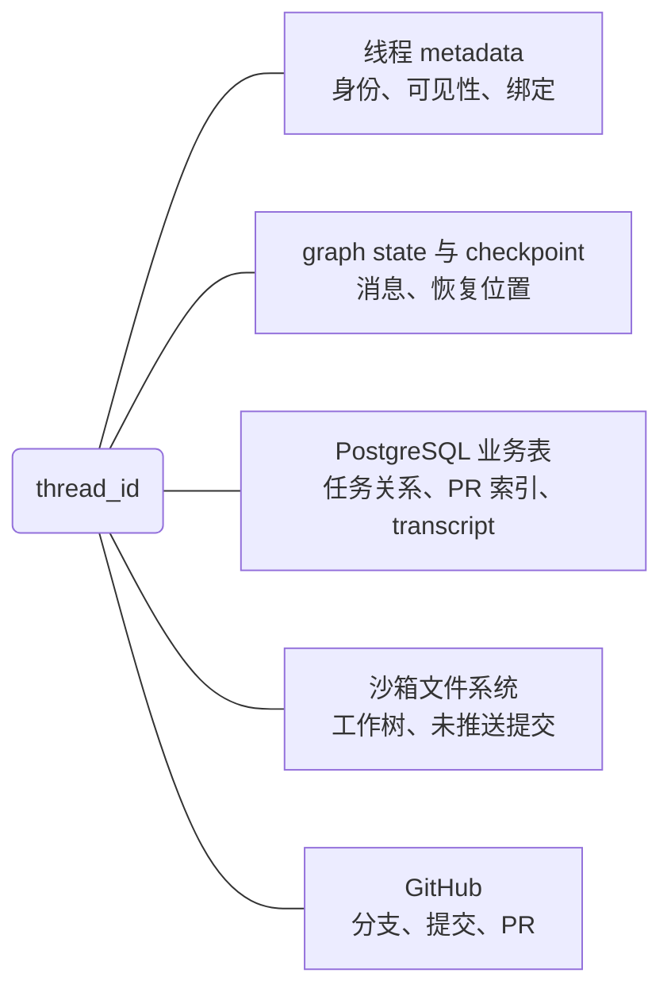

# 08：状态与持久化，对话、任务和工作成果分别存在哪里

> 支撑机制。状态保存贯穿请求、运行和交付，本篇集中追查存储与恢复边界，不代表交付之后才开始持久化。

Open SWE 在对话中接收任务，在沙箱里修改代码，再把分支和 PR 交付到 GitHub。一次运行结束后，对话可能继续，沙箱可能仍在，PR 也可能还没合并——**这几种生命周期不能合成一个"任务已保存"状态。**

本篇看状态到底存在哪几处、各自的写入与恢复边界。源码基线见[源码基线](../source-baseline.md)。

## 全景：状态分布在五处



- **LangGraph thread metadata**：身份、可见性、工作空间、模型选择、来源、沙箱绑定——跨运行信息。
- **graph state 与 checkpoint**：图执行所需的消息、状态字段和恢复位置。
- **PostgreSQL 业务表**：任务关系、PR 索引、transcript 事件。
- **沙箱文件系统**：仓库工作树、未推送的本地提交、工具产生的文件。
- **GitHub**：已推送的分支与已创建的 PR，实际状态的拥有者。

这些位置通过 ID 关联，**没有一份覆盖全部内容的"线程存档"**。metadata 里的 `sandbox_id` 只是资源绑定：这个字符串仍在，沙箱文件也可能已经不可达。

## 一、thread、run、task 是三个对象

thread 是持续存在的对话身份；run 是对 thread 发起的一次图执行；业务 task 是协调线程与 worker 线程之间的任务关系。同一个 thread 承接多次 run，一个 task 也可以关联多个 thread。

创建 thread 走 LangGraph SDK：

```python title="threads/creation.py::create_thread"
async def create_thread(
    client: LangGraphClient,
    thread_id: str,
    *,
    title: str,
    if_exists: Literal["raise", "do_nothing"],
    metadata: Mapping[str, object] | None = None,
) -> None:
    """Create a thread people can open; with ``do_nothing`` an existing thread keeps its metadata."""
    stamped = {**(metadata or {}), "title": _require_title(title)}
    stamped.pop(PREFER_TOOLS_IN_SANDBOX_KEY, None)
    owner_login = (OsweThreadMetadata.model_validate(stamped).owner_login or "").strip()
    if owner_login and await _owner_prefers_tools_in_sandbox(owner_login):
        stamped[PREFER_TOOLS_IN_SANDBOX_KEY] = True
    thread = await client.threads.create(thread_id=thread_id, if_exists=if_exists, metadata=stamped)
```

它不保存代码文件，也不往业务 task 表插记录。`if_exists="do_nothing"` 的约定是**已有线程保留原 metadata**；另一条 `ensure_titled_thread()` 路径只在 `title_locked` 不为真时更新系统生成的标题——人工改名因此能跨后续 run 保留。

还有一种容易混淆的 thread：

```python title="threads/creation.py::create_lock_thread"
async def create_lock_thread(client, thread_id, *, ttl_minutes, metadata=None) -> None:
    """Hold a short-lived, never-listed thread as a mutex; raises ``ConflictError`` while held."""
    ...
        await client.threads.create(thread_id=thread_id, if_exists="raise", ttl=ttl_minutes)
```

带 TTL 的短命线程，靠同 ID 创建冲突实现互斥，不代表任何对话。看到 thread 记录，要区分业务身份与基础设施锁。

业务 task 的关系存 PostgreSQL，不能从 thread metadata 推导：

```python title="tasks/store.py（Task 与 reserve_worker，节选）"
class Task(Base):
    __tablename__ = "task"

    title: Mapped[str]
    workspace_id: Mapped[UUID] = mapped_column(ForeignKey("workspace.id", ondelete="CASCADE"))
    coordinator_thread_id: Mapped[str | None] = mapped_column(default=None)
    id: Mapped[UUID] = mapped_column(primary_key=True, default_factory=uuid7)
    delegated: Mapped[bool] = mapped_column(default=False)

    @classmethod
    async def reserve_worker(cls, coordinator_thread_id, worker_thread_id, *, ...) -> tuple[Task, TaskDelegation]:
        async with postgres.session() as session:
            await session.execute(
                text("SELECT pg_advisory_xact_lock(hashtext(:key))"),
                {"key": f"task-delegation:{coordinator_thread_id}"},
            )
            ...
```

`task_membership` 把 thread 关联到 task 并区分 coordinator 与 worker；`task_delegation` 保存 worker 指令、模型与取消标记。`reserve_worker()` 在事务级 advisory lock 下检查成员关系再创建委派记录——这是业务身份的去重与归属约束，和 checkpoint 记录"执行到了哪里"是两个问题。worker 怎样派发与消费见 [06](../01-coding-agent/06-delegation-and-continuation.md)。

## 二、执行恢复靠 checkpoint，跨运行定位靠 metadata

`dispatch_agent_run()` → `create_durable_run()` 的参数（`multitask_strategy="interrupt"`、`durability="sync"`、`stream_resumable=True`）已在 [01](../01-coding-agent/01-input-thread-and-workspace.md) 展开。这里看恢复时的两条规则。

**规则一：系统启动的续运行从 metadata 重建配置，不继承内存对象。**

```python title="dispatch.py::follow_up_configurable"
def follow_up_configurable(metadata: Mapping[str, Any], thread_id: str) -> dict[str, Any]:
    """Config for a system-started run that continues a thread where its last run left off."""
    configurable: dict[str, Any] = {"thread_id": thread_id}
    for key in ("source", "repo", "github_login", "triggering_user_email"):
        value = metadata.get(key)
        if value is not None:
            configurable["user_email" if key == "triggering_user_email" else key] = value
    workspace = thread_workspace(metadata)
    if workspace is not None:
        configurable["workspace"] = workspace
        configurable["environment"] = workspace
    configurable.update(SourceContext.from_metadata(metadata).dump())
    return configurable
```

**规则二：沙箱绑定读实时线程，不读排队 run 的旧配置。**

```python title="sandboxes/state.py::get_sandbox_metadata"
async def get_sandbox_metadata(thread_id: str) -> dict[str, Any]:
    """Fetch sandbox metadata from the live thread.

    Never from the run config: a run queued before ``recreate_sandbox`` carries
    the sandbox the thread has since left.
    """
    # A failed lookup must not read as "unbound": the caller would create a
    # replacement and bind it over the thread's real sandbox.
    thread = await get_client().threads.get(thread_id)
    metadata = thread.get("metadata", {}) if isinstance(thread, dict) else {}
    return metadata if isinstance(metadata, dict) else {}
```

注释把两个陷阱都说透了：排队的 run 带的是旧沙箱；读取失败也不能当成"未绑定"，否则调用方会创建新沙箱盖掉线程真正的沙箱。

还有一个远端分支：启用 Managed Deep Agents 时，`dispatch.py` 用 `remote_client.runs.create()` 发起执行，本地 thread 只作为 webhook 和控制台读取的索引——run 与 checkpoint 都在远端部署。备份本地索引不等于备份远端执行状态。

## 三、准备标记为什么进图状态

准备工作可能已经取过凭据、渲染过提示词、建过工作目录。**这些完成标记只放 middleware 实例里的话，图重建一次就丢了**，所以要进图状态：

```python title="middleware/prepare_run.py::PrepareRunState"
class PrepareRunState(AgentState):
    run_prepared: NotRequired[Annotated[bool, OmitFromOutput, _take_latest]]
    run_prepared_for: NotRequired[Annotated[str, OmitFromOutput, _take_latest]]
    work_dir: NotRequired[Annotated[str | None, OmitFromOutput, _take_latest]]
    rendered_system_prompt: NotRequired[Annotated[str | None, OmitFromOutput, _take_latest]]
    requested_model: NotRequired[Annotated[str | None, OmitFromOutput]]
    ...
```

`OmitFromOutput` 不等于"不持久化"——它们仍是随 checkpoint 保存的图状态。跳不跳过准备，看指纹：

```python title="middleware/prepare_run.py::abefore_agent（节选）"
        if state.get("_deepagents_forked_context"):
            return None
        prepared_state = cast(PrepareRunState, state)
        fingerprint = self._prepare_fingerprint(prepared_state, runtime)
        if (
            prepared_state.get("run_prepared")
            and prepared_state.get("run_prepared_for") == fingerprint
        ):
            return None
        async with (aphase(...), shared_thread_reads()):
            updates = await self._prepare(prepared_state, runtime)
        return {"run_prepared": True, "run_prepared_for": fingerprint, **updates}
```

指纹由中间件类名、最后一条消息和准备配置组成；主 Agent 的指纹还包含 `invocation_id`（`dispatch.py` 会解析或生成它），所以**同一线程的下一次调用会重新准备**，不会因为历史状态里已有一个真值而永久跳过。

恢复边界在标记的落盘时刻：如果 `_prepare()` 的外部动作已经发生而 checkpoint 还没写入，重试会再做一次。基类注释明确要求子类保持幂等——标记只能减少重复准备，不能让外部副作用变成恰好一次。准备材料的内容见 [04](../01-coding-agent/04-context-skills-and-offloading.md)。

## 四、transcript：事件日志与投影

transcript 是另一组 PostgreSQL 数据。`transcript/engine.py` 把对话活动写成事件日志；`thread_turn`、`thread_message`、`thread_tool_call` 等表保存投影——从事件算出的查询结果。这里的 `open_swe.thread` 是应用表，不是 LangGraph 的 thread 对象，两个地方只是复用了 thread ID。

写入有两个入口。控制台创建线程时（`threads/runs.py`）先创建 LangGraph thread，再写 `ThreadCreated` 事件；图执行侧由 `TranscriptMiddleware` 收集消息、工具和轮次活动。后者不自动转换旧线程：没有事件日志但已有助手消息的旧线程继续沿用旧读取路径。

### 事件提交的原子性止于一个数据库事务

`append()` 是统一写入口，也是全篇最值得细读的代码：

```python title="transcript/engine.py::append（节选）"
    async with postgres.transaction() as conn:
        await conn.execute(
            text("SELECT pg_advisory_xact_lock(hashtext(:thread_id))"),
            {"thread_id": thread_id},
        )
        accepted = await _accepted_versions(
            conn, thread_id, [command.command_id for command in commands]
        )
        head = (
            await conn.execute(
                text("SELECT version FROM thread WHERE thread_id = :thread_id"),
                {"thread_id": thread_id},
            )
        ).scalar_one_or_none()
```

按 thread 加事务级锁，读已接受的命令回执与当前版本，**只给新命令分配递增版本**——重复命令返回原版本，同批次内的重复 ID 也不会追加第二次。事件、附件、工具输出、投影、命令回执在同一连接写入，随事务一起提交，再 `pg_notify` 通知订阅者。通知到达时，对应版本已经可读。

但图侧的采集还有更弱的一层。每次 run 有进程内队列和一个后台 writer：

```python title="middleware/transcript.py::_writer_loop"
async def _writer_loop(state: RunState) -> None:
    """The single writer for a run: batches queued commands into ``append`` calls."""
    queue = state.queue
    if queue is None:
        return
    while True:
        command = await queue.get()
        batch = [command]
        try:
            while len(batch) < _WRITER_BATCH:
                batch.append(queue.get_nowait())
        except asyncio.QueueEmpty:
            pass
        try:
            await append(state.thread_id, batch)
        except Exception:
            logger.warning("Transcript append failed", exc_info=True, ...)
        finally:
            for _ in batch:
                queue.task_done()
```

看 `finally`：**追加失败只记 warning，这批仍被标为处理完毕，没有重新入队。** 所以事件日志内部版本连续，同时可能遗漏尚未成功提交的活动——进程在提交前退出、或某批追加失败，都不能靠连续版本证明整次运行已被完整记录。

### 重建页面不等于重建执行现场

`transcript/rebuild.py` 在同一线程锁下删除投影、按事件重放——目标只是页面查询结果，不重新调用工具，不动图执行栈和沙箱工作树。附件与工具输出是日志的伴随数据：事件里放 ID 或预览，正文在 `thread_attachment` 和 `thread_tool_output`，后者受 256 KiB 字符上限约束。

读端 `_authorized_read()` 用 `REPEATABLE READ` 快照事务，授权判断和页面数据一次读取内一致。但它只读 PostgreSQL 的 metadata 镜像，不向 LangGraph 核验最新权限；镜像失败只记日志。**重复读快照保证镜像内部一致，不证明镜像等于上游最新状态**——这是明确的跨存储一致性边界。

## 五、blob 保存内容，沙箱和 GitHub 保存工作成果

消息状态可以只携带图片的引用。02 里见过 `/blobs/` 路由交给 `StoreBackend`，实际 store 是 PostgreSQL 表：

```python title="threads/blobs.py::ThreadBlob"
class ThreadBlob(Base):
    __tablename__ = "thread_blob"

    thread_id: Mapped[str] = mapped_column(primary_key=True)
    path: Mapped[str] = mapped_column(primary_key=True)
    value: Mapped[JsonObject] = mapped_column(JSONB)
```

**`StoreBackend` 名字不代表内容写进 LangGraph Store**——应用保留框架接口，改变了实际存储位置，所以读图片不依赖沙箱存活。`ThreadBlobs.abatch()` 把读取、写入、删除、搜索映射到这张表。`thread_blob` 与 transcript 的 `thread_attachment` 也不是一套数据：前者支撑模型消息里的卸载引用，后者支撑对话展示附件。

复制线程暴露了这个区别：私有续聊（`threads/handlers.py`）读原线程 state 的 messages，创建新线程，复制消息引用的 blob，再写入消息——只复制部分 metadata，排除沙箱、来源关联和运行状态。它是"以既有对话开启新执行环境"，不是任务快照克隆，已缺失的 blob 会被跳过。

代码成果另有保存链。未提交改动和未推送提交只在沙箱里，metadata 只记录怎么找到它。PR 创建后，GitHub 与应用索引也会分离：`open_pull_request` 先更新线程 PR metadata，再保存 `PullRequest` 与 `ThreadLink` 记录，**注册表写入失败只记 warning——此时 PR 已经存在于 GitHub**。恢复时"外部成果是否存在"和"本地是否正确登记"要分别核对：登记失败后重做外部写入会扩大不一致；控制台缺 PR 记录也不代表代码没交付。

## 六、保留、复制和删除没有统一的生命周期

`langgraph.json` 的保留配置中，checkpointer 配了 `default_ttl: 43200`（分钟）、每 60 分钟清扫、策略 `delete`。这是平台对 checkpoint 的清理配置，不能外推成所有数据同样保留——PostgreSQL 业务表、沙箱与 GitHub 不随它删除。

手工删除分阶段：先取消 metadata 指向的最近 run，删 LangGraph thread，再删 transcript；最后一步失败只记 warning，不回滚前面的平台删除。transcript 删除时级联删事件、轮次、消息，并**显式删除没有外键的命令回执**——回执遗留的话，同 ID 线程重建时会被错误去重。

图片 blob 不在这条级联里：`thread_blob.thread_id` 没有引用 transcript thread 的外键，删除链也没有调用 blob 删除。同理，这条链不关闭 PR、不销毁沙箱——删除对话不是撤销工作成果。

---

回到开头的问题。Open SWE 的持久化边界可以落成三个独立问题：**图还知道下一步做什么（checkpoint），对话与业务关系还能被正确读取（metadata 与业务表），已经产生的代码成果是否仍在（沙箱与 GitHub）。** 只有三者分别有证据，才能讨论任务能否继续——"状态已保存"这句话本身不构成证据。

---

上一篇：[07：代码交付](../01-coding-agent/07-pull-request-and-approval.md)。下一篇：[09：运行记录与结算](./09-observability-and-validation.md)。返回[系列导读](../index.md)。
