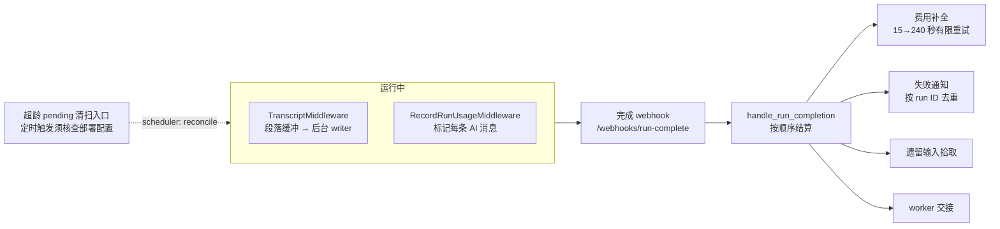

# 09：运行记录与结算：怎样确认任务做过什么

> 支撑机制。解释运行期间的采集、展示与完成后的结算；存储结构由状态篇主讲。

"运行结束"同时涉及几条不同的链：LangGraph 运行是否收到终态、transcript 是否写入、模型调用和费用是否归档、用户是否收到失败说明、成功之后到达的输入是否继续处理。**当前实现没有一张统一的运行表**，而是用运行元数据、模型消息、PostgreSQL transcript、分析事件和完成 webhook 互相对照。源码基线见[源码基线](../source-baseline.md)。

| 要回答的问题 | 主要证据 | 不能单独证明的内容 |
| --- | --- | --- |
| 运行调用了什么模型 | AI 消息的 usage、模型元数据、LangSmith root run | 子 Agent 总成本已合并 |
| 费用是否可见 | `run.cost_recorded` 事件、线程元数据、Slack 页脚 | LangSmith 不可用时的真实费用 |
| 用户是否知道失败 | 完成 webhook、渠道回复、去重元数据 | webhook 没接通时的通知 |
| 页面能否还原过程 | transcript 事件、投影、附件 | 沙箱文件、GitHub 副作用 |
| 成功后补充消息是否继续 | 完成 webhook、队列和 `reject` 接续 | webhook 未配置时的自动拾取 |

## 全景：记录发生在两条链上



## 一、transcript：可展示的过程

### 1、平台事件流与应用会话日志

平台运行事件和应用的 transcript 是两条链。`openswe/threads/proxy.py::stream_thread_events()` 在鉴权后向平台的 `/threads/{thread_id}/stream/events` 发起请求，逐块转发响应。代理自己不持久化这些字节；创建运行时的 `stream_resumable` 与平台保留策略决定平台流的恢复能力。

Transcript 则由应用存入 PostgreSQL，并提供按版本读取的接口。`openswe/transcript/routes.py::_stream()` 先订阅通知，再回放已有记录，随后读取新增版本：

```python title="openswe/transcript/routes.py::_stream（回放入口，节选）"
    async with listener.subscribe(thread_id) as notifications:
        replayed = await _replay(thread_id, after, session)
        if isinstance(replayed, str):
            yield _frame(replayed, "{}")
            return
        last_sent, replay = replayed
        for chunk in replay:
            yield chunk
        yield _frame("synchronized", "{}")
```

先订阅再回放，避免两者切换时遗漏通知。实时阶段根据版本从数据库继续读，每次查询重新检查访问权限；线程转为私有后，无权读者的流以 `revoked` 结束。慢客户端不会一直占住数据库快照。

因此，应用并非完全依赖平台回放。平台流反映运行事件，transcript 反映应用已经采集并保存的会话过程；它们都不能证明沙箱文件、外部动作和所有未落盘片段可完整恢复。持久化结构与 writer 失败窗口见 [08](./08-state-and-persistence.md)。

### 2、模型与工具事件怎样进入记录

`TranscriptMiddleware` 只为有 `run_id` 且符合 PostgreSQL transcript 条件的图运行建立 `RunState`，在模型流上收文本和 reasoning，按**段落边界**攒批写入。缓冲的参数与规则全在文件头的常量里：

```python title="middleware/transcript.py（缓冲常量与边界规则）"
PARAGRAPH_FLUSH_SECONDS = 0.4
HARD_FLUSH_CHARS = 24_000
TOOL_OUTPUT_CAP_BYTES = 256 * 1024
ERROR_TEXT_CAP = 2_000
_WRITER_BATCH = 32
# Model calls a middleware makes for its own bookkeeping (routing classifier,
# conversation offloading) are tagged out of the user-facing stream. Their
# tokens must not become transcript fragments.
_HIDDEN_TAGS = frozenset({"nostream", "langsmith:hidden"})
```

```python title="middleware/transcript.py::paragraph_boundary（文档字符串）"
    """The largest safe markdown flush offset in ``text`` (0 when there is none).

    Safe boundaries are the end of a blank line, the end of a closing code
    fence, and the start of a list item; offsets inside an open fence never
    qualify. The trailing partial line is never flushed, but a boundary in
    front of it is one once it has declared itself a list item.
    """
```

即：普通刷新至少间隔 0.4 秒、攒到 24,000 字符硬刷新、优先切在空行/代码围栏结束/列表项边界、**不把未写完的段落切出去**；writer 每批最多 32 条命令。带 `nostream`/`langsmith:hidden` 标签的内部调用（路由分类、卸载摘要）不成为用户看到的片段，但它们的 token 和费用仍然存在。

启用有门槛：首次使用 transcript 的线程先追加 `thread.created`，成功后才把 LangGraph metadata 标成 `transcript: v2`；没有 PostgreSQL、或已有助手消息但未迁移的旧线程，整次运行禁用这条路径——刻意避免 UI 切到没有事件行的读路径（08 讲过同一边界）。

## 二、分析事件：运行的终态与费用

产品分析链用稳定的伪匿名 ID 关联运行、线程、任务、用户、仓库和模型。`run.started` 事件里有个值得整段读的注释：

```python title="analytics/emitter.py::run_started（节选）"
        RunStartedPayload(
            configured_model_id=model_id,
            configured_effort=effort,
            # Configuration alone is not an observation; routing, fallback, and
            # subagents may execute other models. Effective attribution waits
            # for an authoritative provider signal and stays unknown here.
            effective_model_id=None,
            model_attribution_quality="configured" if model_id else "unavailable",
        ),
```

**"配置了哪个模型"和"实际用了哪个模型"被明确区分**：路由、回退、子 Agent 都可能换模型，effective 归因要等 provider 信号，启动时保持未知。所以"`run.started` 记了模型 X"不能推出"X 承担了全部调用"。

事件先入 PostgreSQL outbox（`event_id` 唯一插入），worker 抢占 pending 事件调 `ingest()`，成功 ack、失败指数退避、超限进 dead letter——**至少一次投递加幂等去重**，事务覆盖分析库内部，不含模型调用和外部副作用。

## 三、模型调用归因先写进消息

invocation ID 由 `prepare_run_config()` 统一准备（解析或生成，写入 configurable 和 metadata），每个运行的模型消息用它归因：

```python title="middleware/record_run_usage.py（消息标记）"
message.response_metadata = {
    **message.response_metadata,
    **({"open_swe_model_route": model_route} if model_route else {}),
    **(
        {"open_swe_invocation_id": invocation_id, "open_swe_run_id": invocation_id}
        if invocation_id
        else {}
    ),
}
```

汇总按 invocation ID 过滤 AI 消息、读 token 和模型名求和；provider 报了 `cache_read` 就从总数扣除。它只汇总主 Agent 的消息，不代表子 Agent 和沙箱成本。

一个重要语义：模型异常时先以 `error` 状态尝试结算再原样抛出；行为规格专门验证**主模型失败、备用模型成功时，最终终态是 `success`**——中间的失败重试不算运行失败。

## 四、费用：三层展示，有限重试

费用不从消息 token 估算，而是查 LangSmith：按 invocation ID 找 root run，再用 root trace 过滤线程统计。关键在新鲜度检查——统计接口的 `LAST_END_TIME` 不早于目标 root 的结束时间才接受 `TOTAL_COST`，**避免聚合未更新时把暂时的低值当成最终零费用**。4xx（除 408/429）视为不可用，网络错误返回 `None` 等下次。

补全的延迟序列是 `15、30、60、120、240` 秒（agent cost 与 Slack 会话费用共用），耗尽返回 `exhausted`，不是永久轮询。查到后发 `run.cost_recorded` 并把 `run_cost_usd:<invocation_id>` 写进线程 metadata。

Slack 展示是另一层投影：成功完成后调度 `session_cost_refresh` 任务，同时取整个会话费用和本次运行费用，精确定位 `channel_id/thread_ts/message_ts` **原地更新**那条回复的页脚；费用未就绪时保持"计算中"标记重试，耗尽清掉。

**"没有费用"至少三种含义**：LangSmith 尚未聚合、查询被拒或未配置、确实零成本。事件 payload 有 `complete`/`partial`/`unavailable` 和 `missing_reason`，报表对 NULL 与 unavailable 单独计数。沙箱占用、排队等待、人工返工不在这条模型费用链里——把 LangSmith cost 当任务总成本是错的。

## 五、完成 webhook 与失败通知

挂载条件（secret + 绝对非回环地址）在 [06](../01-coding-agent/06-delegation-and-continuation.md) 贴过。`handle_run_completion()` 的结算顺序：

1. 终态 usage 结算（从 payload 解出 invocation ID）。
2. 关闭仍开放的 transcript turn（与 middleware 用相同 turn 语义，谁先写谁生效，receipt 去重）。
3. 任务子线程调 `worker_finished()`；PR 主题触发 UI invalidation。
4. 成功运行检查遗留输入，必要时创建接续运行。
5. 按成功/失败/自动唤醒失败分支收尾。

`interrupted` 是**健康的交接状态**：普通 follow-up 用 `interrupt` 策略时旧运行被中断、新运行接手，不该给用户发失败消息——它作为终态进分析事件，但不进失败通知分支（那是 `{"error", "timeout"}` 的）。

失败通知按**运行 ID 去重**：保留最近 20 个已回复的 run ID；event-woken 或 task-message 运行连续失败超 3 次后抑制（用户主动启动的失败不受此限）；`step_limit` 映射成人类可读的原因。发送成功与写入去重标记是两个操作，中间有重复通知的窗口。

## 六、结束后还有三类工作要接住

**最后一次模型调用之后进来的消息。** 队列消费在模型前钩子里，运行已经没有下一次模型调用时就没人消费它。完成处理器在成功且非拾取运行时，以 `reject` 策略创建拾取运行——已有 pending run 时不新建（那个运行的首次模型调用会读同一队列）。失败运行不再拾取、拾取运行自己不清空也不递归——有限补偿。

**worker 上报。** 带任务 metadata 的终态调 `worker_finished()`（完整链见 [06](../01-coding-agent/06-delegation-and-continuation.md)）。`spawn_worker` 在创建时就要求完成 webhook 已配置——"子线程能运行"与"最终能报告"绑定在部署配置上。

**卡住的 pending 运行。** `scheduler` 提供 `task="reconcile"` 分支，但本地源码中未找到创建这条 cron 的调用。是否定期清扫、按什么频率清扫，取决于部署侧配置。它也不是完成回调丢失的通用补偿：

```python title="reconcile.py::reconcile_stale_runs（文档字符串译为中文）"
async def reconcile_stale_runs(*, max_age_seconds: int = 1800) -> dict[str, int]:
    """取消 busy 线程上超过 max_age_seconds 的 pending 运行。

    分页遍历 busy 线程，列出 pending 运行，并取消 created_at 早于阈值的项。
    每个线程的处理由 try/except 隔离，避免一个线程的错误中断整个扫描。

    返回计数：{"threads_checked", "stale_runs", "cancelled"}。
    """
```

这条扫描不处理 running 状态的慢调用、沙箱进程或 GitHub 请求，也不补发失败通知。它只清理符合条件的 pending 运行，不能据此认定用户已经收到失败说明。

## 七、验证要沿 ID 分别回查

一次可审计的运行至少涉及：

| ID | 用在哪 |
| --- | --- |
| `thread_id` | 会话、transcript、沙箱与来源的索引 |
| invocation ID | dispatch、AI 消息 metadata、LangSmith root run、分析 `run_id` 的关联键 |
| LangGraph `run_id` | 完成 webhook、turn 结算、失败回复、排队策略 |
| 分析 `event_id` / observation revision | outbox 去重、终态投影、费用最新值 |
| Slack `channel_id/thread_ts/message_ts` | 费用页脚是否更新到用户看到的回复 |

invocation ID 与 run_id 在应用层常取同值，但协议来源不同，不能混成一个平台唯一 ID。查"费用已记录"要同时确认终态事件、LangSmith trace 覆盖、`run.cost_recorded` 进了投影、Slack 已更新；查"任务完成"还要加 transcript turn、遗留队列、PR 外部对象——**任何单项成功都不代表其他项成功**。

---

---

上一篇：[08：状态与持久化](./08-state-and-persistence.md)。下一篇：[10：测试与评测](./10-testing-and-evaluation.md)。返回[系列导读](../index.md)。
