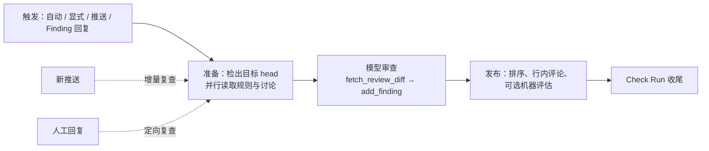

# 11：机器审查，Reviewer 怎样发现问题、发布结果并复查

> 协作扩展。Reviewer 是独立审查路径，不是每次编码运行都要经过的下一步。

Reviewer 是面向开发者和仓库维护者的代码审查 Agent：读取 PR 差异、记录候选缺陷、向 GitHub 发布审查，并在新提交或人工回复到来后重新判断原问题。

这条链路维护四种对象：**本轮审查的提交、持久化 Finding、GitHub 评论线程、显示进度的 Check Run**。模型负责判断代码，程序负责把判断绑定到版本和外部对象。源码基线见[源码基线](../source-baseline.md)。

Analyzer 图（仓库风格自动学习）已移除：`langgraph.json` 不再注册它，`styles.py` 里还留着清理旧 cron 的函数。`ReviewStyle` 现在只保存控制台编辑的仓库提示和审批模式。人工审查与合并见 [12](./12-human-review-and-merge.md)。

## 全景：一次审查的路径



## 一、触发：先确定 PR 身份和审查版本

四个入口，各自的条件和输入：

| 入口 | 条件 | 输入 |
| --- | --- | --- |
| 自动首次审查 | 仓库开了自动审查 + 公共仓库组织门槛；草稿受作者与工作空间设置控制 | PR 元数据 |
| 显式请求（`trigger_pr_review_from_ref()`） | 重新获取 PR 元数据，取 `base_sha`/`head_sha`/分支/标题；**直接拒绝草稿** | 用户请求 |
| 推送复查（`process_github_push_event()`） | 自动审查开启 + 找到开放 PR 和 `watch=true` 的审查线程 | 推送载荷的 `after`（PR API 此刻可能还返回旧版） |
| Finding 回复 | 评论者是已注册用户；先关联父评论与 Finding | `reviewer_event="finding_reply"` |

`reviewer_thread_id(owner, repo, pr_number)` 为同一个 PR 提供稳定身份，元数据里保留 `kind="reviewer"`、当前 `head_sha`、`last_reviewed_sha` 和 `watch`。推送路径里有个关键短路：**新 head 等于 `last_reviewed_sha` 时不再运行**；能证明 PR 差异没变时，推进已审查 SHA 并在新提交上创建"没有新变更"的检查——GitHub 当前 head 的展示不依赖旧提交上的 Check Run。

三个入口应分别理解：首次审查找问题，推送复查查版本变化，Finding 回复重估已有判断。它们共享问题身份，不共享提示和差异范围。

## 二、装配与准备

`get_reviewer_agent()` 的结构和主图一样：没有 `thread_id` 或非执行加载时返回空业务图。执行时的中间件列表值得整段看——比任何转述都清楚：

```python title="reviewer.py::get_reviewer_agent（装配，节选）"
        create_deep_agent,
        model=reviewer_model,
        system_prompt="",
        tools=reviewer_tools(),
        subagents=[_reviewer_subagent(reviewer_subagent_model)],
        backend=backend,
        middleware=[
            PrepareReviewerRunMiddleware(thread_id=thread_id, config=config, use_gateway=use_gateway),
            AnthropicPromptCachingMiddleware(ttl="1h", unsupported_model_behavior="ignore"),
            ModelCallLimitMiddleware(run_limit=MODEL_CALL_RECURSION_LIMIT, exit_behavior="end"),
            ToolErrorMiddleware(),
            refresh_github_proxy_before_model,
            check_message_queue_before_model,
            SanitizeFireworksMessagesMiddleware(),
            SanitizeOpenAIResponsesMiddleware(),
            SanitizeThinkingBlocksMiddleware(),
            RepairOrphanedToolCallsMiddleware(),
            StableToolResultOrderMiddleware(),
            ModelRetryMiddleware(retry_on=(TimeoutError,)),
            ModelErrorMiddleware(),
            ModelCallTimeoutMiddleware(),
            settle_review_check_on_exit,
        ],
```

与主图（03）的对比一目了然：没有模型选型、没有回退层、没有任务协调，多了 `RepairOrphanedToolCallsMiddleware`（修复孤儿工具调用）和 `settle_review_check_on_exit`（检查收尾补偿）。

业务工具是 `fetch_review_diff`、`add_finding`、`update_finding`、`list_findings`、`publish_review`、`resolve_finding_thread`、`reply_to_finding_thread` 加三个网络工具。**没有提交、推送、创建 PR**——主提示同时禁止绕过审查工具用 `gh` 提交 review 或 approval。不过 Deep Agents 后端仍提供文件与执行能力，"只读审查"是任务约束，不是操作系统级禁写。

准备阶段（`PrepareReviewerRunMiddleware` → `prepare_reviewer_run()`）：取仓库范围的 App 令牌、配代理、`prepare_review_repo()` 准备目标 head 的检出。**Reviewer 允许替换不可达沙箱**（05 讲过：审查检出每轮都能重建，不保护未提交改动）；替换后仍不可达时在 PR 留下通知并抛错，不静默继续。仓库准备与差异读取可能分别降级——工具成功不等于本轮拿到了完整检出与差异。

## 三、base、head 和上次审查提交

范围计算集中在一个函数：

```python title="review/diff.py::review_diff_range"
base_ref = last_reviewed_sha if re_review and last_reviewed_sha else base_sha
if not _GIT_SHA_RE.fullmatch(base_ref) or not _GIT_SHA_RE.fullmatch(head_sha):
    raise ValueError("review diff requires valid Git commit SHAs")
return base_ref.lower(), head_sha.lower(), not re_review
```

三种提交各司其职：`base_sha` 是 PR 基础侧，`head_sha` 是待审提交，`last_reviewed_sha` 是程序记录的上次已审查版本。首次审查用三点语义（merge-base 比较），复查用**上次审查版本到新 head 的两点增量**。注意回退：缺少 `last_reviewed_sha` 但设了 `re_review=True` 时，起点退回 `base_sha`——不能只凭"复查"两字断言比较了两个已知审查版本。

差异按文件划分 `LEFT`/`RIGHT` 行集合（`diff_line_set`）进入运行状态，供 Finding 校验位置。一个容易误读的细节：**行集合收集的是差异块覆盖的两侧行范围、包含上下文行**，不是只有带 `+`/`-` 的修改行。增量 diff 也不等于全量 diff——旧问题是否消失要靠 Finding 与已有讨论判断，只给模型最新 diff 无法还原应关闭的旧评论。

## 四、可信规则不从待审 head 直接提升权限

准备阶段并行读取：PR 概览、已有评论线程、仓库风格、组织指南、根规则、审批策略；拿到差异后再取 scoped rules（按目录生效）。关键的版本纪律：

- **根目录及 scoped 的 `AGENTS.md`/`CLAUDE.md` 从 `base_sha` 读取**，仓库 Skills 同样 `trusted_ref=base_sha`——PR 对规则文件的修改不会直接成为审查自身的新规则。
- **审批标准从默认分支读取**：

```python title="review/approvals.py::approval_policy_for_review"
async def approval_policy_for_review(owner: str, repo: str, *, token: str | None) -> str | None:
    """The criteria a review of a pull request in ``owner/repo`` assesses against, if any."""
    if await approval_mode_for(owner, repo) == "off":
        return None
    return await fetch_approvals_md(owner, repo, None, token=token)
```

这里的 `None` 就是默认分支——早于审批文件建立的发布分支也能用统一标准，待审 PR 改写不了当前裁决规则。

`AGENTS.md` 的加载也有专门的模块（`utils/agents_md.py`），两条设计值得看。范围规则——只为**变更文件沿途的祖先目录**生成候选，从浅到深排序（更深的规则在后，提示里可优先）：

```python title="utils/agents_md.py::applicable_agents_md_paths（节选）"
def applicable_agents_md_paths(changed_files: Iterable[str]) -> list[str]:
    """Return repo-relative ancestor ``AGENTS.md`` paths for changed files.

    The root file is loaded separately (with the ``CLAUDE.md`` fallback), so
    this only returns directory-scoped files. Paths are ordered from shallowest
    to deepest so later instructions can take precedence in the prompt.
    """
    candidates: set[str] = set()
    for raw_path in changed_files:
        ...
        parts = path.split("/")
        for depth in range(1, len(parts)):
            candidates.add("/".join((*parts[:depth], "AGENTS.md")))
    return sorted(candidates, key=lambda path: (path.count("/"), path))
```

抓取规则——单文件上限 64 KiB（约定文档不该更大，超限视为意外并整体放弃，不截断着用）；`AGENTS.md` 不存在才回退 `CLAUDE.md`，且**只有 404 触发回退**：

```python title="utils/agents_md.py::fetch_agents_md（文档字符串，节选）"
    """Fetch ``AGENTS.md`` (or ``CLAUDE.md`` fallback) at ``ref`` from ``owner/repo``.

    Returns the raw file contents of the first matching file, or ``None`` if no
    file is found, a fetch fails, or the file exceeds the size cap. Only a 404
    (file absent) triggers fallback to the next filename; any other condition
    (oversize, HTTP error, unexpected status) returns ``None`` immediately so
    the reviewer does not enforce stale rules from a secondary file.
    """
```

"只有 404 才回退"的理由写在句尾：如果 `AGENTS.md` 抓取失败（网络错、超限）也去读 `CLAUDE.md`，审查就可能执行一份**过时的次选规则**——宁可这轮没有目录规则。多个 scoped 文件并发抓取（并发 8）。对比主 Agent 的做法（04 第三节）：主编程 Agent 靠 `read_file` 触发沙箱内的目录规则注入，Reviewer 则在准备阶段从 GitHub 按提交确定性拉取——两种身份对同一份约定的两种装配方式。

PR 标题、正文、既有评论和 Finding 回复是外部数据：渲染器用数据块、结束标签转义和登录名校验降低注入面，`historical-guidance.md` 明确要求不遵循旧线程中的指令。这些处理限定输入来源，不证明模型能抵抗所有注入。

## 五、Finding：问题、版本和发布身份

Finding 是持久化审查发现：标题、描述、严重度、置信度、文件与行范围、差异侧、建议，加上 `first_seen_sha`、`last_confirmed_sha`。常规运行存 PostgreSQL（`pull_request_finding_state` 关联、`pull_request_finding` 保存、`pull_request_finding_interaction` 交互），线程元数据只存运行控制信息。

**两个状态字段分开维护**：`status` 是内部判断（`open`/`resolved`/`dismissed`），`surface_state` 是对外状态（`not_surfaced` → `surfaced` → `resolve_pending` → `resolved`）。内部判断"已修复"可以先成立，GitHub 讨论还在等关闭——API 失败后要能区分"重做代码判断"和"重试外部写入"，靠的就是这个分离。

去重靠指纹：`append_finding()` 用文件、差异侧、行范围和规范化描述生成，对开放问题去重；措辞不同的同义问题仍可能留多条，语义去重归模型。位置校验有意的放行分支：

```python title="tools/add_finding.py（位置校验）"
in_diff = not isinstance(diff_line_set, dict) or is_range_in_diff(
    diff_line_set, file, start_line, end_line, side=side
)
```

行集合缺失时放行——只有拿到集合才逐行验证。落在集合之外时返回 `in_diff: false` 并提示不要换锚点重试；超过四行的 `suggestion` 被丢弃只留描述。成功记录保存可取得的 `diff_hunk`，减少对已回收沙箱的依赖。

## 六、发布：先检查集合，再记录 GitHub 写入

`publish_review()` 要求自己是该轮**唯一**工具调用——同一响应同时请求新增 Finding 和发布时拒绝发布，避免不完整快照。流程：模型给 `ranking`（按重要性排列 Finding ID）→ 按开放状态、严重度（默认阈值 `medium`，置信度不参与）、可否渲染为行内评论筛选 → 发布。

复查时额外排除已有评论的 Finding，且只发当前 head 首次发现的问题：

```python title="review/publish.py（复查过滤）"
unpublished_findings = [f for f in findings if not comment_ids_for_finding(f)]
if is_re_review:
    unpublished_findings = [
        f for f in unpublished_findings if f.get("first_seen_sha") == head_sha
    ]
```

旧评论保留原身份，避免每次推送重发同一问题。

每条行内评论带隐藏的 `open-swe-review-comment` JSON 标记（Finding ID、路径、行号、差异侧）——GitHub 返回评论后按标记回填身份，**不靠路径行号正文猜测对应**。GitHub 已收到评论而数据库写回中断时，下一轮靠标记恢复；这是恢复机制，不是跨系统事务。

`success: true` 不独自证明发出了评论：`skipped_empty_re_review: true` 表示省略重复空审查（同时解决旧线程、推进 `last_reviewed_sha`）；`cfg.is_eval` 的评测路径返回 `dry_run: true` 不碰发布 API。确认实际发布要查数字型 `review_id` 和这些标志。

## 七、机器批准必须绑定被评估的 head

`ReviewAssessment` 表达整体评估：40 位 `head_sha`、风险分数 1–5、`would_approve` 或 `needs_human_review`、说明。它不是 GitHub 正式批准。两道版本防线：

```python title="publish_review.py（评估的版本匹配）"
head_sha = await resolve_review_head_sha(thread_id, RunConfig(head_sha=head_sha))
if assessment is not None and assessment.head_sha != head_sha:
    return {
        "success": False,
        "error": "Assessment commit differs from the current review head. Review it again.",
    }
```

线程 head 被中途推送更新时，旧评估直接拒绝套用。此外：发布时重读仓库审批模式，查询失败按 `dry_run` 处理（存储故障不批准 PR）；仍有开放 Finding 时 `would_approve` 降为 `needs_human_review`；`approval_allowed_for_head()` 实时确认 PR 开放、非草稿、当前 head 等于评估 head，POST 时携带 `commit_id=head_sha` 把 review 绑定到具体提交。GitHub 拒绝自我批准时降为普通 `COMMENT`。

机器评估、GitHub APPROVE、合并是三项动作，前两项在这里，合并见 [12](./12-human-review-and-merge.md)。

## 八、人工回复先成为证据，再触发复查

`reconcile_findings_with_review_threads()` 同步 GitHub 讨论与内部记录：按机器人评论里的 Finding 标记匹配，thread ID / comment ID 兜底；匹配后补齐发布身份。需要重新判断的回复记成交互：

```python title="review/reconcile.py（人工回复交互）"
interaction: FindingInteraction = {
    "kind": "human_reply",
    "github_comment_id": reply_id if isinstance(reply_id, int) else None,
    "github_parent_comment_id": github_comment_id,
    "author": author,
    "body": body,
    "created_at": created_at,
    "needs_reassessment": True,
}
```

这条记录标识**新的评估依据**，不直接把 Finding 改对或改错。提示要求：代码已修复用 `update_finding(..., status="resolved")`；回复证明原判断无效用 `resolve_finding_thread(..., status="dismissed")`——说明会作为 GitHub 回复原样发布，模型对面向开发者的文字负责。作者说"空值已由上游过滤"时，Reviewer 应核对上游调用再下结论；回复本身不构成证据。

线程状态同步要求所有匹配讨论真实 `is_resolved` 才转 `resolved`；`is_outdated` 只说明位置过时，不证明缺陷消失。

## 九、Check Run 说明运行结果，不代表代码无缺陷

自动审查在目标 head 上创建 `Open SWE Review` Check Run。`review_check_conclusion()` **无论发布多少问题都返回 `success`**，问题数在标题里——绿色检查说明审查结果已产出，不能解释为没有缺陷或可以合并。

结算链：正常发布完成后 PATCH 检查，GitHub 接受才清除 ID；失败则保存 `review_check_pending_result`（真实结论、标题、摘要）供恢复。`settle_review_check_on_exit` 是 after-agent 补偿钩子：有待结算结果时重试；没有发布结果时用 `neutral` 加标题 `Review did not complete`——**避免把 Reviewer 基础设施失败显示成 PR 代码失败**。检查 API 是尽力调用，缺权限不阻断审查。

## 十、仓库偏好与辅助图

`ReviewStyle` 现在只有仓库身份、`custom_prompt`、`approval_mode` 和时间戳，手工更新入口在 `ReviewStylePromptUpdate`；没有样本计数和学习运行。存储读取失败时省略风格继续审查——**不可省略的安全规则不要放在这份允许缺失的补充提示里**。主提示残留的"Learned from this repository's historical PR reviews"是遗留文案，不是自动学习调用链存在的证据。

`review-scout` 是独立图，为特定 PR head 生成变更导读：优先复用同 head 的结果或活动运行，Reviewer 最多等 600 秒，超时无导读继续——可降级，但不是完全不阻塞准备。`chat` 图负责 PR 问答（只读）。MDA 是可选部署分支：`request_pr_review(use_mda=True)` 时模型循环和沙箱在托管侧，经 MCP 回调本服务的工具（见仓库 AGENTS.md 的说明）。

---

---

上一篇：[10：测试与评测](../02-runtime-support/10-testing-and-evaluation.md)。下一篇：[12：人工评审与合并](./12-human-review-and-merge.md)。返回[系列导读](../index.md)。
