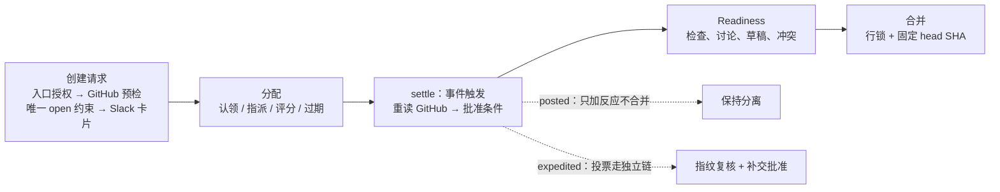

# 12：人工评审与合并，怎样从审查请求走到合并

> 协作扩展。人工请求与合并由自己的事件和条件推进，不把机器审查结束等同于人工批准。

Agent 生成代码、提交 PR，也负责把变更交给人审查、记录谁接手、条件满足后尝试合并。这一层连接 Slack、GitHub、PostgreSQL 和后台调度。**人的批准只是输入之一**，最终动作还受当前提交、检查状态、讨论线程和仓库规则约束。

先区分三种权限与判断：[07](../01-coding-agent/07-pull-request-and-approval.md) 的许可（谁能以谁的身份开 PR）不等于代码通过评审；[11](./11-reviewer.md) 的机器发现（或没发现问题）不等于合并条件满足。源码基线见[源码基线](../source-baseline.md)。

## 全景：一条评审请求的生命周期



## 一、请求先过入口授权，再成为业务记录

`request_human_review(pr_url, inline_summary, channel)` 先校验 URL 和非空摘要，再查仓库拒绝条件，最后进入 `standard.request_review()`。入口授权区分两种调用身份：MCP 调用者用自己的 GitHub 身份检查仓库访问；Agent 调用必须有线程，解析线程可用 token 再查仓库——检查的是"调用方能访问这个仓库"，不是"有写权限"。

真正创建前重读 GitHub 当前状态：**已合并、已关闭、草稿、冲突、失败的必需检查会阻止新请求**；PR 作者没有 Open SWE 账户也拒绝。仍在运行的检查和未解决的讨论线程不在此层拒绝——人可以先开始看，合并阶段再查阻塞项。目标频道来自显式 `channel` 或仓库 `.open-swe/settings.json` 的路由；解析不出频道就返回失败，不放一条无人可见的请求。

持久对象是 `HumanReviewRequest`：关联 PR，保存 `kind`、`state`、`head_sha`、请求者、Slack 消息位置。`HumanReviewParticipant` 把参与者绑到 `users.id`——**登录名和 Slack 名称可以变，参与关系不以展示名为主键**。一条 PR 同时只能有一条 `open` 请求（三种类型共用，数据库部分唯一索引保证），并发插入撞约束时读取已成功的那条。

保存后的顺序：先注册无人认领和自动合并两个期限任务，再发 Slack 卡片；调度或发卡失败会删除刚创建的请求——**有限补偿，不是跨数据库、调度、Slack 的事务**。

## 二、三种请求，三种结束方式

| 类型 | 来源 | 批准发生在哪 | 谁合并 |
| --- | --- | --- | --- |
| `standard` | Open SWE 发的评审卡 | GitHub | 后台 `settle()` 条件满足后主动合并 |
| `posted` | 人自己发的 PR 链接消息 | GitHub | 不合并，只跟踪状态加反应 |
| `expedited` | 小变更快速审批卡 | Slack 投票 → 以投票人身份提交 GitHub | 唤醒 Agent 走独立合并工具 |

分流写在执行入口，不是只写在文案里：

```python title="human_review/standard.py（结算入口的分流）"
if request.kind not in SETTLED_KINDS or request.state != "open":
    return True
```

`SETTLED_KINDS = ("standard", "posted")`——通用结算只处理这两种，expedited 走专用链。

这套等待**不是 LangGraph `interrupt` 暂停等人恢复**。期限任务用 `runs.create(None, "scheduler", after_seconds=...)` 排进 scheduler 图，到期后业务状态从 PostgreSQL 重读，无需恢复任何工具调用栈。需要模型判断（比如选下一位审查者）时再唤醒对应线程。

## 三、认领、分配和提醒

主动认领写 `review`；被指派者先 `picked`、接受后才转 `review`；作者不能审自己的 PR。选人不是每次都让模型从零判断，先有一层确定性计算：

```python title="human_review/picking.py::Candidate"
@dataclass(frozen=True, slots=True)
class Candidate:
    login: str
    owned: int
    touched: int
    open_reviews: int = 0

    @property
    def score(self) -> float:
        return (self.owned + self.touched) / (1 + self.open_reviews)

    @classmethod
    def rank(cls, candidates: list[Self]) -> list[Self]:
        """Best first; ties go to fewer open reviews, then ownership, then history, then login."""
        return sorted(
            candidates,
            key=lambda c: (-c.score, c.open_reviews, -c.owned, -c.touched, c.login.lower()),
        )
```

**评分 = （拥有的 CODEOWNERS 文件数 + 近期改过的文件数）÷（1 + 当前开放评审数）**——熟悉代码但正忙的人往后排。候选从代码所有者和近期作者中找，排除作者、机器人、未注册者和已退出自动分配的人；有可用时区时只在当地工作日 9–18 点选，没人上班就安排到最早工作时段（未知时区按随时可选处理）。

`_auto_assign()` 有三种结果：`Pick`（确定性采用）、`Wait`（等条件）、无候选。**期限到达或拒绝等携带触发条件的路径，会把候选作为建议交给线程 Agent 决定**——计算缩小范围，模型处理带业务上下文的指派，写入仍过工具的身份检查。`assign_human_reviewer` 还防"模型谎称人点名"：Agent 声称 `named_by_person=True` 时，工具重读触发本次运行的 Slack 消息，核对发送者、是否机器人、是否真提到目标人员。

过期不能只看时钟：`expire_picks()` 先查 GitHub，**已提交 review 的人视为接受**（包括只评论的）；没接受的人只有在存在替代候选时才释放，没人可替代保留原指派。被释放者标 `expired`，自动选人不会立刻又选回同一人。Snooze 后移接受期限；Decline 释放待接受指派并重选——**这些拒绝的是任务安排，不是对代码提交 `CHANGES_REQUESTED`**，两个状态机不能混。

提醒只面向 Agent 指派的人：本地工作日 9–18 点窗口累计两小时，发送前重查 PR 是否仍开放、该人是否已提交 review，行锁内检查提醒标记防重。

## 四、settle：重读外部事实，推进业务状态

`settle` 不是相信 webhook 里的批准字段就合并，而是**每次重新读取 GitHub**。触发它的三条路径：

| 路径 | 事件 |
| --- | --- |
| GitHub webhook | PR 重开、转草稿、ready、推送；review 的 submitted/dismissed |
| CI 事件 | 完成的 check 按携带的 PR 编号；完成的 commit status 扫描该仓库的开放请求（`pending` 不触发） |
| 定时任务 | 期限到期重读；`auto_merge` 直接调 `settle()` |

`latest_review_states()` 排除作者的 review 和 `COMMENTED`/`PENDING`，保留每人**最新有效**的批准、要求修改或撤销——后来的普通评论不会抹掉之前的 `CHANGES_REQUESTED`，后来的批准才更新立场。

standard 的批准等待规则整个函数就在这里：

```python title="human_review/standard.py::merge_wait"
approvers = {login.lower() for login, state in states.items() if state == "APPROVED"}
if not approvers:
    return "an approval on GitHub"
pending = [login for login in reviewers if login.lower() not in approvers]
deadline_passed = requested_at is not None and now >= requested_at + timedelta(
    hours=AUTO_MERGE_AFTER_HOURS
)
if pending and not deadline_passed:
    return "approval from " + ", ".join(f"@{login}" for login in pending)
return None
```

`AUTO_MERGE_AFTER_HOURS = 2`。规则读法：**没有任何批准时，无论等多久都不能通过**；有批准时，全部审查者批准可提前通过，否则请求创建满两小时后不再等每一位——**计时从请求创建开始**，不从最后一人加入或第一份批准开始。没在卡片报名的人的 GitHub 批准也计入。

进入等待前还有一次人员清理：批准已覆盖代码所有者区域（或取不到覆盖信息）时，释放 Agent 指派但尚未提交 review 的人——`merge_wait()` 收到的是清理后的名单，"必须等所有指派者批准两小时"不准确。

批准通过后仍要过 `Readiness.blockers`：开放状态、草稿、冲突、检查聚合、未上报的必需检查、未解决讨论、有效的修改要求。两小时时限只放宽等人，不移除阻塞项。机器 Reviewer 的状态这一层不凭空补：自己的 review/auto-fix check 从普通 CI 汇总中滤除，没有"必须已有机器审查"的独立判断（行为规格专门构造机器审查还在跑、普通检查已通过的场景，期望 readiness 可通过）。

## 五、posted：只跟踪，不接管

`posted.watch_post()` 从人的消息里解析唯一一条 PR 链接（多链接不建请求），验证发消息的人和 PR 作者有用户记录。上游只交符合条件的人类新消息——排除私信、代码频道、编辑消息、已提及 Agent 的消息，避免同一条消息既触发编程 Agent 又重复建评审请求。

posted 的结算要求至少一份 GitHub 批准加 CODEOWNERS 覆盖；**读取失败不把"无法确认"当已批准**。批准成立只写 `approved_at` 并加反应，请求仍 `open`——已批准的消息可以同时显示检查失败；批准失效清反应；GitHub 真合并后才写 `merged`。找人时钟 `ready_since` 要求检查聚合为 success 连续达标，重跑后完成时间晚于起点会重置。

## 六、合并：锁住本地请求，GitHub 校验提交与规则

standard 的临界区：

```python title="human_review/standard.py（合并临界区）"
async with HumanReviewRequest.locked(request.id) as (_, row):
    if row is None or row.state != "open":
        return True
    result = await merge_pull_request(
        row, snapshot.head_sha, snapshot.allowed_merge_methods, pull
    )
    if result.status != "merged":
        row.detail = result.message
```

`locked()` 是 `SELECT ... FOR UPDATE` 加重新填充：锁内再查本地请求是否仍开放，合并的网络调用也在锁内——撤卡或并发合并要等这把行锁。失败原因写 `detail` 并刷新卡片；成功后 `mark_merged()` 收尾。

两点边界：这把锁只保护 PostgreSQL 里这条请求，**不锁 GitHub PR**；锁内没有重读全部 approvals，合并用的是本次读取的 `snapshot.head_sha`。执行端取限定仓库和写权限的 App token，选择仓库允许的第一种合并方式（squash、merge、rebase），squash 路径执行 `pull.merge(sha=head_sha, method=method, ...)`——**传入 SHA 把动作绑定到检查过的提交**，此后 head 变化或分支保护拒绝都绕不过。成功调用在锁内、`mark_merged()` 在锁外，外部成功与本地记终态之间仍有窗口；后续 settle 会重读 PR 认领已发生的合并，但不承诺从不重复尝试。

## 七、expedited：投票绑定被展示的差异

expedited 不走 standard 结算。Slack 投票映射到已关联用户、查仓库写权限、拒绝作者自批；**草稿卡片要先由作者 Mark ready**，别人的批准替代不了这个动作。投票先存为参与者的 `approve`，再以投票人自己的 token 携带 `commit_id=head_sha` 提交 GitHub review——写 GitHub 失败时保留 Slack 票、后续可补交，两个状态独立。

唤醒后的合并入口先复核**差异指纹**：

```python title="expedited_review/merge.py::_merge_approved（指纹复核，节选）"
    files = await ChangedFile.of_pull(pull)
    if files is None:
        return MergeResult("error", "Could not read the pull request's changed files.")
    if not fingerprint_matches(files, approval.diff_fingerprint):
        verdict = assess_eligibility(files, approval.excluded_hunks)
        if isinstance(verdict, Ineligible):
            await ReviewCard(approval).retire(
                "superseded",
                "A later commit grew the diff past expedited review; votes were discarded.",
            )
            return MergeResult("invalidated", ...)
        if not keep_approval_reason.strip():
            return MergeResult("diff_changed", ...)
        kept = await _keep_approval(approval, pull, verdict.fingerprint, keep_approval_reason)
        if kept is None:
            return MergeResult("error", "Could not record why the approval was kept, ...")
        approval = kept
```

指纹覆盖**所评审的非测试、非生成文件差异**（含按 `APPROVALS.md` 排除展示的片段）——只改未展示的测试文件可以保留原票，不是"整个 PR SHA 从未变过"。差异变化后两个分支：变化使 PR 不再符合快速审批资格，请求标 `superseded` 并撤回 GitHub review；仍符合但没解释时返回 `diff_changed`，Agent 可重发卡或传 `keep_approval_reason`——**理由必须先发成 PR 评论才更新指纹**，评论失败不合并。保留批准的理由提供审计记录，但不是新的人工批准。

最终临界区比 standard 多一道 head 复核：

```python title="expedited_review/merge.py（head 复核）"
if await or_none(pull.head_sha()) != snapshot.head_sha:
    return MergeResult(
        "not_ready",
        "The pull request's head changed while it was being checked. Call "
        "`merge_expedited_pr` again.",
    )
```

锁内还再读未解决讨论、补交缺失或被 GitHub 撤为过期的批准，最后走共同的 `merge_pull_request()`——旧 head 上仍有效的 review 不重复提交。

## 八、失败边界

这套流程把"请求不存在 / 已结束 / 未批准 / 未就绪 / 差异变化 / GitHub 拒绝 / 网络失败"分开表达，不能统一处理成"等几秒再发同样的写入"：

- `settle()` 成功不等于已合并；GitHub 合并拒绝保存原因、保持请求开放，没有自动建立通用重试——后续 review、CI、PR 事件会再触发它。
- 人员调度各有五分钟重试（GitHub 不可读、提醒失败、部分唤醒失败），但局部重试不构成统一可靠队列。
- 关闭事件先重读 GitHub 当前状态，防迟到的关闭 webhook 结束已重开 PR 的请求；expedited 被撤下时尝试撤回已提交的 review，失败保留 ID 下次再试。
- 三个"拒绝"分别处理：拒绝合并不抹掉批准；拒绝认领不否决代码；`CHANGES_REQUESTED` 才进 readiness 的修改要求。

---

---

上一篇：[11：机器审查](./11-reviewer.md)。返回[系列导读](../index.md)。
