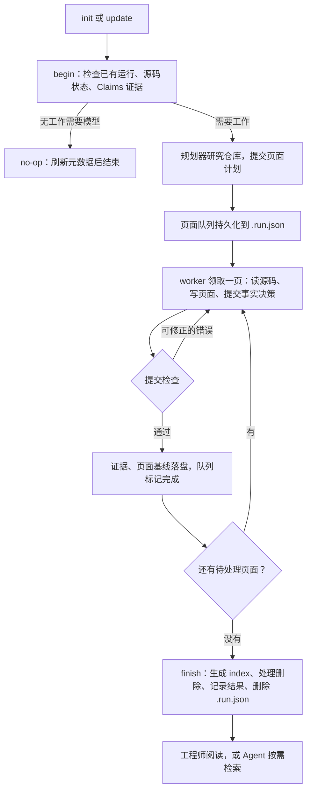

# 项目全景

这一篇回答四个问题：OpenWiki 产出什么东西、代码怎么分层、谁在驱动它运行、一次生成从头到尾经过哪些环节。之后的文章逐个环节展开。

## 产出什么：一个真实的 wiki 长什么样

以 Open SWE 仓库里实际生成的 `openwiki/` 目录为例：

```text
openwiki/
├── index.md                 # 根目录：声明 okf_version，列出所有页面与子目录
├── quickstart.md            # 入口页：阅读路线与导航
├── INSTRUCTIONS.md          # 用户写的项目要求（OpenWiki 只读，不重写）
├── .last-update.json        # 上一次整轮更新的全局记录
├── .claims/                 # 每页的事实证据记录，路径与页面一一对应
│   ├── quickstart.json
│   ├── testing/overview.json
│   └── ...
├── architecture/            # 领域目录，每个目录有自己的 index.md
│   ├── index.md
│   ├── overview.md
│   ├── agent-graph.md
│   └── ...
├── concepts/                # 模型与配置、状态、安全等概念页
├── workflows/               # 端到端工作流：建 PR、代码审查、调度……
├── operations/              # 配置、部署
├── integrations/            # 仪表盘、沙箱供应商、可观测性
└── testing/                 # 测试体系
```

三类东西混在同一个目录里，职责完全不同：

- **给人读的**：`quickstart.md` 和各领域页面。互相用 Markdown 链接引用，放在 git 里跟代码一起评审。
- **给程序用的**：`.claims/`、`.page-manifest.json`（逐页源码基线，这个仓库没提交它，真实样本见 [02](./02-generation-lifecycle.md)）、`.last-update.json`。它们是增量更新和失败恢复的依据，没有它们，每次 update 只能全量重写。
- **给导航的**：各级 `index.md`。由程序在收尾时确定性生成，模型不手写。

页面里的一个真实样本——`.claims/testing/overview.json` 开头一条事实：

```json
{
  "id": "claim_9a77e9c5301a46b8bbd02832b9de5a90",
  "statement": "The pytest unit suite runs in asyncio auto mode (asyncio_mode = \"auto\"), so async test functions and fixtures are awaited without any per-test asyncio marker.",
  "evidence": [
    {
      "resource": "repo://pyproject.toml",
      "version": "repo-file-v1:sha256:6a4ff3c5410f45c156688f8f18dee9c03925403a45b034352810673cc679ad98"
    }
  ]
}
```

一条 Claim 就是"一句话结论 + 它依据的源码文件及内容哈希"。`pyproject.toml` 以后变了，哈希对不上，这句话就会被排回工作队列。整套机制见 [04](./04-claims.md)。

## 两种模式

OpenWiki 有两条 Ingest 流水线，共享同一个 CLI：

| 模式 | 文档化对象 | 写到哪里 | 启动命令 |
| --- | --- | --- | --- |
| code（默认） | 当前 Git 仓库 | 仓库内 `openwiki/` | `openwiki --init` / `--update` |
| personal | 你连接的知识来源（Gmail、Slack、X、Hacker News、网页搜索……） | `~/.openwiki/wiki` | `openwiki personal --init` |

code 模式是本系列的主线：它有页面队列、Claims、逐页基线这些完整机制。personal 模式简单得多——连接器抓数据、Agent 综合成页面，没有 Claims——单独放在 [07](./07-personal-wiki-and-connectors.md)。

## 三种使用方式

**宿主 Agent 内（推荐）。** `openwiki integrations install claude`（或 codex、cursor 等）之后，在你的编程 Agent 里说"初始化这个仓库的 OpenWiki"。宿主用自己的模型和文件工具执行研究，OpenWiki 只提供生命周期工具和记账。这是官方设计的首选路径——复用宿主已认证的模型会话，不需要单独配 API key。安装机制与宿主契约见 [08](./08-host-integration-and-runtime.md)。

**独立 CLI。** `openwiki --init` 用 OpenWiki 自己的 Deep Agents 运行，需要配置模型供应商（支持 14 家）。适合定时任务和不想依赖宿主 Agent 的场景。

**CI 定时更新。** 仓库自带 GitHub Actions / GitLab CI / Bitbucket 的示例工作流，夜间检查代码变化，wiki 有更新就开一个文档 PR，可以配合 auto-merge。LangChain 2026 年 9 月发布的 Credit Genie 案例就是这么部署的：夜间任务生成文档 PR，自动审批合并，每日重建 GitHub Pages 门户供全团队搜索。

## 源码地图

`src/` 按职责分层，读代码时按这条线索走：

- `src/generation/` — **共享生命周期核心**。`repository-run.ts` 的 begin / submit / finish，页面队列，`.run.json` 与页面清单的读写。两条执行路径都调它。
- `src/agent/` — **原生执行者**。`repository-runner.ts` 装配规划器和页面 worker；`docs-only-backend.ts` 是带写权限检查的文件后端；`repository-prompts.ts` 是提示词。
- `src/claims/` — **证据层**。证据解析器（`evidence/repository/resolver.ts`）、预检（`brains/code/preflight.ts`）、存储（`brains/code/store.ts`）。
- `src/okf/` — **格式与收尾**。front matter 解析与修复、`index.md` 同步、来源戳记。
- `src/retrieval/` — **查询**。`wiki.ts` 的搜索与章节读取。
- `src/linking/` — **跨仓库工作区**注册表。
- `src/connectors/` + `src/ingestion/` — **personal 模式**的数据接入与综合。
- `src/integrations/` — **宿主集成**。MCP 协议定义、安装器、检索工具暴露。
- `src/cli/`、`src/setup/`、`src/telemetry/`、`src/visualize/` — 界面、配置向导、遥测、图可视化。

## 两条执行路径，一个核心

"谁来当模型"有两种答案，但记账的是同一套代码：

**原生路径**：`runOpenWikiAgent`（`src/agent/index.ts`）发现是仓库 init/update，进入 `runNativeRepositoryGeneration`。OpenWiki 自己创建 Deep Agent——一个规划器加每页一个 worker——跑完整个生命周期。

**宿主路径**：宿主 Agent（Claude Code、Codex……）通过 MCP 调用 OpenWiki 暴露的工具，自己扮演规划器和 worker。工具共十个（`src/integrations/core/protocol.ts`）：

```text
检索四个：openwiki_list_workspaces / openwiki_list_wikis /
          openwiki_search / openwiki_read
生成六个：openwiki_begin → openwiki_submit_plan → openwiki_next_page →
          openwiki_submit_page → … → openwiki_finish
          （另有按需的 openwiki_inspect_page_claims）
```

宿主只是换了"执行研究的大脑"，页面队列、Claims 验收、恢复、收尾全部由 OpenWiki 的共享核心强制执行。宿主想跳过某页的证据决策直接 finish，会被拒绝。

## 一次 init 的生命周期鸟瞰

把两条路径统一抽象，一次仓库生成是这样的：



分工原则贯穿全程：**模型负责语义判断**（写哪些页、页面说什么、证据指哪里），**程序负责记账与强制**（队列推进、落盘顺序、格式校验、收尾产物）。这个原则解释了后面所有的代码形状。

接下来两篇展开 Ingest：先看生命周期与持久化状态（[02](./02-generation-lifecycle.md)），再看规划器和页面 worker 这两个 Deep Agent 怎么装配（[03](./03-agents-and-tools.md)）。
