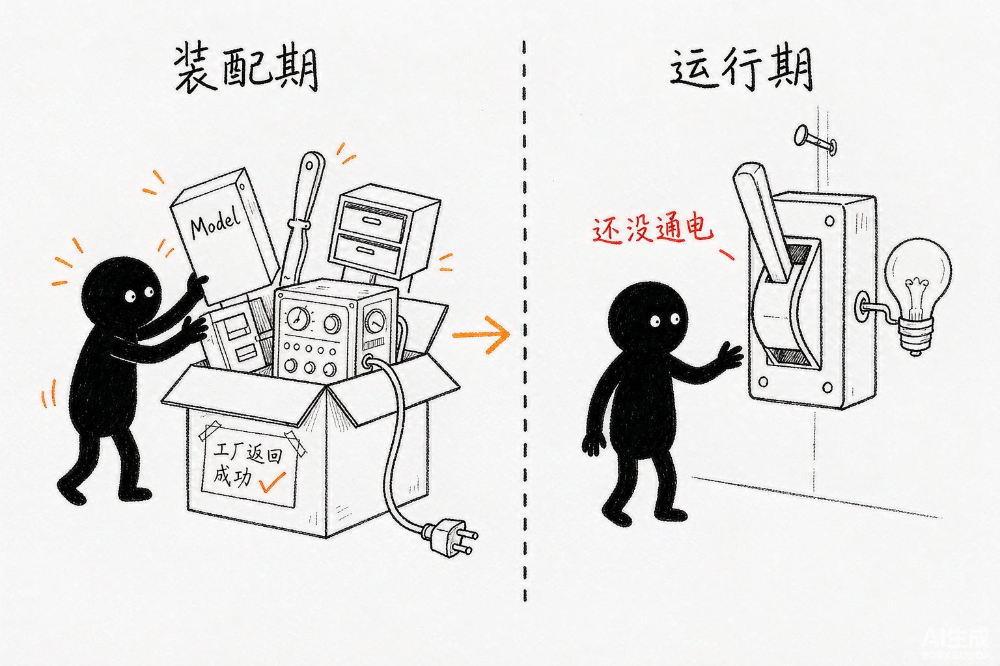
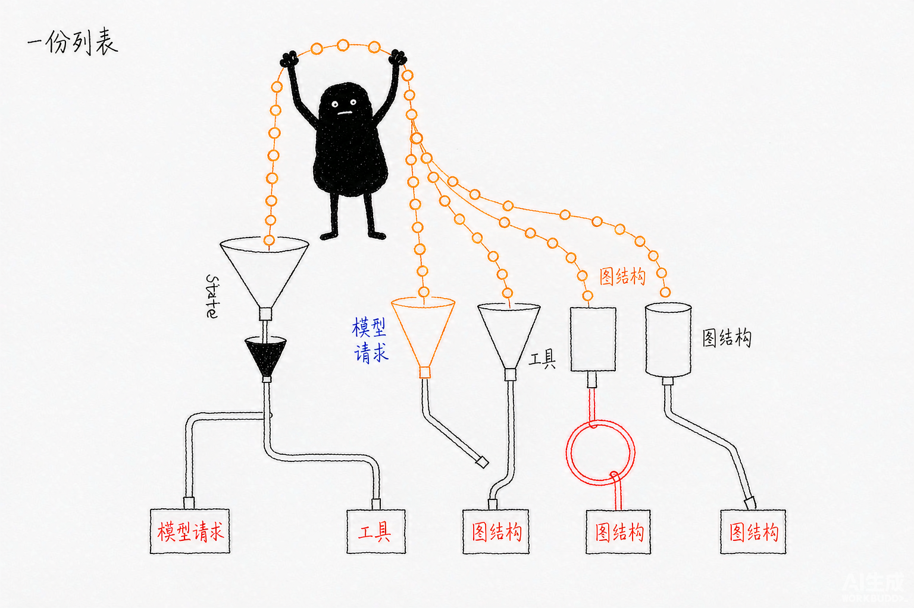
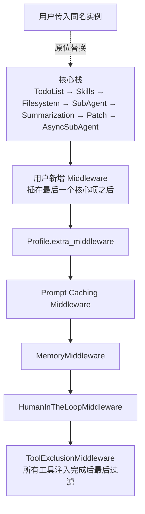

# Deep Agents 源码解析 01：`create_deep_agent()` 总装配

## 一、源码定位

> **阅读基线**：Deep Agents 0.6.12（`libs/deepagents/`）。
> 源码版本与路径约定见 [源码版本与路径约定](source-baseline.md)。
>
> - 主代理装配：`libs/deepagents/deepagents/graph.py` → `create_deep_agent()`
> - 模型解析与适配配置：`libs/deepagents/deepagents/_models.py` → `resolve_model()`；`libs/deepagents/deepagents/profiles/provider/provider_profiles.py` → `ProviderProfile`、`apply_provider_profile()`；`libs/deepagents/deepagents/profiles/harness/harness_profiles.py` → `_harness_profile_for_model()`
> - 受保护的脚手架中间件：`libs/deepagents/deepagents/graph.py` → `_REQUIRED_MIDDLEWARE`
> - 自定义中间件合并：`libs/deepagents/deepagents/graph.py` → `_apply_custom_middleware()`
> - 状态与私有字段：`libs/deepagents/deepagents/graph.py` → `DeepAgentState`、`create_deep_agent()`；`libs/deepagents/deepagents/middleware/_state.py` → `private_state_field_names()`
> - 子代理编译入口：`libs/deepagents/deepagents/middleware/subagents.py` → `_build_task_tool()`、`_compile_spec()`、`create_sub_agent()`
> - 最终 Agent 构造：`libs/deepagents/deepagents/graph.py` → `_normalize_system_prompt()`、`_assemble_prompt_parts()`、`create_agent()`

## 二、工厂输入怎样变成可运行的图

`create_deep_agent()` 是 Deep Agents 的装配入口，不负责执行任务。它把模型、工具、Backend、子代理、Middleware、State Schema 和运行参数整理成一套配置，最后交给 LangChain 的 `create_agent()` 构造标准 Agent 图。

从源码看，这个入口大致经过下面几个阶段：

```text
解析 model
  -> 查找 Harness Profile
  -> 改写工具描述并准备 Backend
  -> 分类同步、已编译和异步子代理
  -> 自动补齐 general-purpose 子代理
  -> 构造主代理核心 Middleware
  -> 插入用户 Middleware、Profile 扩展和运行期尾栈
  -> 收集 State Schema，计算父子代理的私有字段
  -> 组装静态 system prompt
  -> create_agent(...)
  -> 返回带运行配置的 CompiledStateGraph
```

读这篇时要一直区分两个时间点：

| 阶段 | 做什么 |
| --- | --- |
| 装配期 | 解析模型、创建 Middleware、准备工具、确定 State Schema 和静态提示词 |
| 运行期 | 执行模型和工具调用、注入 Skills/Memory、处理权限和中断、更新 State |

例如，`FilesystemMiddleware` 在装配期拿到 Backend 并注册文件工具；真正读写文件发生在图运行时。`MemoryMiddleware` 在装配期被加入栈，但记忆文件如何加载、如何写入 system prompt，也发生在运行期。

`CompiledStateGraph` 是已经确定节点、状态字段与执行边的可运行图。节点是模型调用、工具执行或中间件回调等工作单元；边决定下一步执行哪个单元。`State Schema` 则规定图保存哪些字段，以及字段更新怎样合并。调用 `invoke()`、`ainvoke()` 或流式入口时，这张图才开始处理用户任务。

因此，工厂返回成功只能说明装配完成。例如 `memory=["/AGENTS.md"]` 会让图具备“入口读取文件、模型调用前注入记忆”的步骤，但此时还没有执行这次任务的文件读取。模型客户端可以在装配时初始化，用户任务的模型推理仍发生在运行阶段。



*图：装配期把零件装好、贴上标签；机器还没通电，返回成功只说明装配完成。*

后续文章分别展开这些运行机制：

- 模型解析和两套 Profile，见 [02：模型解析与 Profile](./02-model-resolution-and-profiles.md)；
- `messages`、Reducer、`DeltaChannel` 和恢复，见 [03：状态、Reducer 与恢复](./03-state-reducers-and-recovery.md)；
- Backend，见 [04：Backend 接口与实现](./04-backend-protocol-and-implementations.md)；
- Middleware 的 Hook 和请求增量，见 [06：Middleware 增量总览](./06-middleware-increments.md)；
- Skills、Filesystem、SubAgent、Summarization、PatchToolCalls、异步 SubAgent 和 Memory，见 [07](./07-skills-middleware.md)、[08](./08-filesystem-middleware-and-permissions.md)、[09](./09-subagent-sync.md)、[10](./10-summarization-and-context-offloading.md)、[11](./11-patch-tool-calls.md)、[12](./12-async-subagent.md) 和 [13](./13-memory-middleware.md)。

## 三、解析模型，确定 Harness Profile

入口先保留调用者传入的模型标识，再把模型解析成 `BaseChatModel`：

```python
# 只有字符串形态的模型才留下 spec，供后面按名字匹配 Harness Profile
_model_spec = model if isinstance(model, str) else None

if model is None:
    model = _build_default_model()   # 未指定模型时退回 SDK 默认
else:
    model = resolve_model(model)     # 字符串走 spec 解析，模型实例原样返回

# Profile 匹配发生在模型解析之后：先拿到模型对象，再决定用哪套 Harness 策略
_profile = _harness_profile_for_model(model, _model_spec)
```

这里有两条模型路径：

- 传入字符串，例如 `"openai:gpt-5.5"`，交给 `resolve_model()` 创建模型；
- 传入已经构造好的 `BaseChatModel`，直接复用这个实例。

`model=None` 在当前版本仍会回退到 `ChatAnthropic(model_name="claude-sonnet-4-6")`，但这条默认模型路径已经标记为废弃，调用方应显式传入模型。

`ProviderProfile` 和 `HarnessProfile` 在这里分工：

| Profile | 解决的问题 | 生效位置 |
| --- | --- | --- |
| `ProviderProfile` | 模型客户端如何创建，例如初始化参数和 Provider 默认值 | `resolve_model()` 内部 |
| `HarnessProfile` | 模型进入 Agent 后使用什么提示词、工具描述、中间件和默认子代理 | `create_deep_agent()` 装配过程 |

`_harness_profile_for_model()` 找到的 Profile 会在后面多个阶段被消费：

- `tool_description_overrides` 改写工具描述；
- `base_system_prompt` 和 `system_prompt_suffix` 参与提示词装配；
- `extra_middleware` 增加模型相关中间件；
- `excluded_middleware` 过滤中间件；
- `excluded_tools` 在所有工具注入完成后统一过滤；
- `general_purpose_subagent` 控制默认子代理。

两套 Profile 的查找和合并规则见 [02：模型解析与 Profile](./02-model-resolution-and-profiles.md)。在本篇只需要记住：模型先被解析，Harness Profile 随后确定，后面的装配阶段都读取同一个 Profile。

## 四、准备工具和 Backend

模型和 Profile 确定后，入口准备用户工具和文件系统能力：

```python
# 复制用户工具，并应用 Harness Profile 的工具描述覆盖。
_tools = _apply_tool_description_overrides(
    tools,
    _profile.tool_description_overrides,
)

backend = backend if backend is not None else StateBackend()
```

这段代码没有移除任何工具。`tool_description_overrides` 只改工具给模型看的描述，不改工具实现，也不改变工具的执行逻辑。

还要区分两种“给模型加能力”的方式。`tools=` 传入的可调用对象只在模型选择使用它之后才被调用，它既不能改写工具列表，也不能改写提示词；Middleware 则能在模型调用前增删工具、改写请求、注入状态。`libs/ARCHITECTURE.md` 把这条区别列为扩展点的基本分界：想改变模型看到的请求面，要用 Middleware；只想增加一个被动能力，用 `tools=` 就够。

工具排除被故意放到后面，由 `_ToolExclusionMiddleware` 统一处理。这样做是为了同时过滤两类工具：

- 调用者通过 `tools=` 传入的工具；
- `FilesystemMiddleware`、`SubAgentMiddleware` 等运行期 Middleware 注入的工具。

默认 Backend 是 `StateBackend`。它把文件内容放进当前 Agent State，文件可以在同一个 thread 的多个回合中继续使用，但不会跨 thread 共享。换成 `FilesystemBackend`、`StoreBackend` 或组合 Backend 后，文件的持久化范围和安全边界才会改变。

这里的 Backend 只是被传给 Middleware。`create_deep_agent()` 不在装配期执行文件操作，读写动作由运行期的文件工具完成。Backend 的接口和实现见 [04：Backend 接口与实现](./04-backend-protocol-and-implementations.md)。

## 五、分类子代理，补齐默认委派能力

`subagents` 不是一类对象。入口先根据字段把它们分成三组：

| 类型 | 识别特征 | 处理方式 |
| --- | --- | --- |
| 声明式 `SubAgent` | 没有 `runnable` 和 `graph_id` | Deep Agents 补齐模型、工具、Backend 和 Middleware |
| `CompiledSubAgent` | 提供 `runnable` | 直接复用已经编译好的 Runnable |
| `AsyncSubAgent` | 提供 `graph_id` | 交给 `AsyncSubAgentMiddleware` 管理后台任务 |

源码判断顺序如下：

```python
inline_subagents: list[SubAgent | CompiledSubAgent] = []
async_subagents: list[AsyncSubAgent] = []

for spec in subagents or []:
    if "graph_id" in spec:
        async_subagents.append(cast("AsyncSubAgent", spec))
        continue
    if "runnable" in spec:
        inline_subagents.append(spec)
    else:
        # 声明式 SubAgent 会在这里补齐默认配置
        ...  # 省略：默认 Middleware、模型和 Prompt 的补齐逻辑，见本节下文
```

声明式同步子代理会重新解析自己的模型，并按自己的模型匹配 Harness Profile。它还会得到一套独立的 Middleware 栈，最后由 `create_sub_agent()` 调用 LangChain 的 `create_agent()` 构造子代理图。

这解释了一个容易忽略的事实：主代理的 Middleware 栈和子代理的 Middleware 栈不是同一个列表。它们可以共享 Backend，也可以共享某些配置，但每个子代理都有自己的模型、提示词、工具和中间件组合。

### 1. 默认 `general-purpose` 子代理

如果调用者没有提供名为 `general-purpose` 的同步子代理，且当前 Harness Profile 没有关闭它，入口会自动补上这个子代理：

```text
没有名为 general-purpose 的同步子代理
  + general_purpose_subagent.enabled 不是 False
  -> 创建默认 general-purpose spec
  -> 加入 inline_subagents
  -> SubAgentMiddleware 暴露 task 工具
```

默认子代理的主要作用是隔离上下文。主代理把复杂任务交给它，子代理在自己的上下文中完成多步工作，最后只向主代理返回一份结果，避免中间工具调用持续占用主代理的消息历史。

调用者有三种方式影响它：

- 传入同名同步子代理，替换默认版本；
- 通过 Harness Profile 修改它的描述或 system prompt；
- 设置 `general_purpose_subagent=GeneralPurposeSubagentProfile(enabled=False)`，并且不传同步 `subagents`，让主代理不暴露 `task` 工具。

不能只把 `SubAgentMiddleware` 写进 `excluded_middleware`。它和 `FilesystemMiddleware` 都是 Deep Agents 的必需脚手架，源码会拒绝移除配置。想隐藏工具，要使用 `excluded_tools`；想彻底没有 `task`，要关闭默认子代理并且不提供同步子代理。

## 六、构造主代理的核心 Middleware 栈

主代理的核心栈由 `create_deep_agent()` 按固定顺序创建：

| 顺序 | Middleware | 条件 | 负责什么 |
| --- | --- | --- | --- |
| 1 | `TodoListMiddleware` | 始终加入 | 提供任务清单能力 |
| 2 | `SkillsMiddleware` | `skills is not None` | 扫描技能元数据并注入索引，正文由文件工具按需读取 |
| 3 | `FilesystemMiddleware` | 始终加入 | 提供文件工具，并承接 Backend 和权限 |
| 4 | `SubAgentMiddleware` | 存在同步子代理 | 提供 `task` 和同步子代理调用入口 |
| 5 | `SummarizationMiddleware` | 始终加入 | 在上下文过长时压缩消息历史 |
| 6 | `PatchToolCallsMiddleware` | 始终加入 | 修复恢复后的悬空工具调用 |
| 7 | `AsyncSubAgentMiddleware` | 存在异步子代理 | 管理后台子代理任务 |

下面摘录主栈的装配过程，省略同步子代理部分，后文单独列出；类型与临时变量保留源码写法：

```python
deepagent_middleware: list[AgentMiddleware[Any, Any, Any]] = [
    TodoListMiddleware(),
]
if skills is not None:
    deepagent_middleware.append(SkillsMiddleware(backend=backend, sources=skills))
deepagent_middleware.append(
    FilesystemMiddleware(
        backend=backend,
        custom_tool_descriptions=_profile.tool_description_overrides,
        _permissions=permissions,
    )
)
# ……省略同步子代理中间件的创建与加入……
deepagent_middleware.extend(
    [
        create_summarization_middleware(model, backend),
        PatchToolCallsMiddleware(),
    ]
)
if async_subagents:
    # 异步表示非阻塞运行子代理；此处接入远端部署。
    deepagent_middleware.append(AsyncSubAgentMiddleware(async_subagents=async_subagents))
```

同步子代理有一个额外的装配约束：工厂需要保留中间件实例，在收集完整状态 schema 后回填私有字段集合。下面是中间这段源码，省略 `task_description` 参数及其说明：

```python
sub_agent_middleware: SubAgentMiddleware | None = None
if inline_subagents:
    sub_agent_middleware = SubAgentMiddleware(
        backend=backend,
        subagents=inline_subagents,
        # ……省略 task 工具描述覆盖参数……
        state_schema=state_schema,
    )
    deepagent_middleware.append(sub_agent_middleware)
```

`SubAgentMiddleware` 在构造 `task` 工具时编译声明式子代理并保存可运行对象。后续普通 `task` 调用选择并运行已有子图；请求动态输出 schema 时才有重新编译的分支。第 09 篇展开这个例外。

这些实例还会向 LangChain 提供状态字段和 hook。LangChain 分别收集入口回调、模型包装器和工具包装器，不能把装配表直接当成每轮执行顺序。例如 Patch 只在入口 hook 检查历史，不参与每轮模型包装。

`FilesystemMiddleware` 和 `SubAgentMiddleware` 是其中的硬约束：

- `FilesystemMiddleware` 承载内置文件工具和权限检查；
- `SubAgentMiddleware` 承载 `task` 工具和同步子代理调用。

它们被称为脚手架，是因为其他能力依赖它们继续工作。Profile 可以排除摘要、缓存等可选中间件，但不能静默移除这两个组件。

## 七、理解完整 Middleware 顺序



*图：同一份中间件列表，运行时被拆成 State、请求、工具、图结构等多条执行链。*

只看 `deepagent_middleware.append()` 容易得到一个误解：用户 Middleware 似乎是在所有尾栈都加入以后，才排在最末尾。源码的实际语义更精确。

先看装配阶段的调用顺序：

```text
核心 Middleware
  -> Harness Profile.extra_middleware
  -> Prompt Caching Middleware
  -> MemoryMiddleware
  -> HumanInTheLoopMiddleware
  -> 第一次应用 excluded_middleware
  -> 合并用户 middleware
  -> 第二次应用 excluded_middleware
  -> ToolExclusionMiddleware
```

用户 Middleware 的新增实例不会落在整个列表末尾。入口在构造尾栈之前保存核心中间件名称：

```python
_main_core_names = {m.name for m in deepagent_middleware}
```

随后 `_apply_custom_middleware()` 会按名称做两种处理：

```python
if m.name in current_names:
    # 同名中间件：替换原位置
    replacements[m.name] = m
else:
    # 新中间件：暂存，之后插入核心栈之后
    to_append.append(m)
```

当 `core_names` 存在时，新中间件会插入最后一个核心 Middleware 后面，因此主代理的有效顺序是：

```text
核心 Middleware
  -> 用户新增 Middleware
  -> Profile.extra_middleware
  -> Prompt Caching Middleware
  -> MemoryMiddleware
  -> HumanInTheLoopMiddleware
  -> ToolExclusionMiddleware
```

把上面两段合起来看，主代理的最终顺序是这样（虚线表示原位替换，不改变位置）：


同名替换则不同。比如用户传入一个名称仍为 `SummarizationMiddleware` 的实例，它会替换原来的摘要中间件，但位置仍然保持在核心栈中的原位置。

Profile 过滤会执行两次，原因是用户中间件可能替换或重新加入一个被 Profile 排除的名称。工具排除放在最后，是为了让所有工具注入逻辑先完成，避免自定义 Middleware 又把被禁止的工具暴露给模型。

这也是自定义 Middleware 最容易写错的地方。只知道“我把 Middleware 传进去了”还不够，还要确认它是在核心能力之后，还是在缓存、Memory 和人工审批之前观察请求。具体 Hook 行为见 [06：Middleware 增量总览](./06-middleware-increments.md)。

## 八、State Schema 不由 `graph.py` 手工拼成一张类

默认 State 是 `DeepAgentState`：

```python
class DeepAgentState(AgentState):
    """通过 DeltaChannel 降低 messages 的 Checkpoint 增长。"""

    messages: Required[
        Annotated[
            list[AnyMessage],
            DeltaChannel(
                _messages_delta_reducer,
                snapshot_frequency=50,
            ),
        ]
    ]
```

它继承 LangChain 的 `AgentState`，只对 `messages` 增加 `DeltaChannel`。消息仍然表现为 `list[AnyMessage]`，但 Checkpoint 可以按增量写入，并按相同的 Reducer 恢复。详细的数据结构见 [03：状态、Reducer 与恢复](./03-state-reducers-and-recovery.md)。

调用者也可以传入自己的 `state_schema`。在完成 Middleware 装配后，`create_deep_agent()` 会收集用户 Schema 和 Middleware Schema：

```python
# 用户 Schema 与各 Middleware 声明的 Schema 一并收集，最终由 create_agent() 合并
state_schemas = [state_schema] if state_schema is not None else []
state_schemas.extend(
    mw.state_schema
    for mw in deepagent_middleware
    if getattr(mw, "state_schema", None) is not None
)

# 扫出带 PrivateStateAttr 的字段，交给同步子代理做父子状态隔离
private_state_keys = private_state_field_names(*state_schemas)
if sub_agent_middleware is not None:
    sub_agent_middleware.private_state_keys = private_state_keys
```

这段代码的重点不是“手工合并出一个完整 State class”。`graph.py` 没有在这里动态创建新的 Schema 类型。它做的是：

- 收集所有可能声明 State 字段的来源；
- 扫描其中标记为私有的字段；
- 把私有字段名称交给 `SubAgentMiddleware`。

父代理调用子代理时，这些私有字段不会自动下传。这样可以让 Middleware 在主代理 State 中保存内部控制数据，同时避免把这些实现细节暴露给子代理。

函数末尾仍然把调用者传入的 `state_schema`，或者默认的 `DeepAgentState`，交给 `create_agent()`：

```python
state_schema=state_schema if state_schema is not None else DeepAgentState
```

所以这里要区分两件事：Middleware Schema 会参与 LangChain Agent 的状态装配，也会参与 Deep Agents 的私有字段扫描；`create_deep_agent()` 本身不负责把所有 Schema 拼成一个新的 Python 类。

## 九、组装静态 system prompt

system prompt 的静态部分由四段组成：

```text
prefix
  -> base
  -> suffix
  -> HarnessProfile.system_prompt_suffix
```

`system_prompt` 可以是字符串、`SystemMessage`，也可以是结构化配置。裸字符串会被归入 `prefix`，这是为了兼容旧语义：

```python
def _normalize_system_prompt(system_prompt):
    if system_prompt is None:
        return {}
    # 裸字符串和 SystemMessage 归入 prefix，保留旧版本的语义
    if isinstance(system_prompt, (str, SystemMessage)):
        return {"prefix": system_prompt}
    return system_prompt   # 已经是结构化配置，直接往下传
```

随后入口按下面的顺序收集内容：

```python
cfg = _normalize_system_prompt(system_prompt)
prompt_parts: list[str | SystemMessage] = []

prefix = cfg.get("prefix")     # ① 调用者前缀
if prefix is not None:
    prompt_parts.append(prefix)

# ② base 的三层来源：调用者指定 > Profile 提供 > SDK 默认
profile_base = (
    _profile.base_system_prompt
    if _profile.base_system_prompt is not None
    else BASE_AGENT_PROMPT
)
base = cfg.get("base", profile_base)
if base is not None:
    prompt_parts.append(base)

suffix = cfg.get("suffix")     # ③ 调用者后缀
if suffix is not None:
    prompt_parts.append(suffix)

# ④ Profile 后缀放在末尾；此处只做拼接，不裁决自然语言指令冲突
if _profile.system_prompt_suffix is not None:
    prompt_parts.append(_profile.system_prompt_suffix)
```

其中 `base` 有三层来源：

| 优先级 | 来源 | 语义 |
| --- | --- | --- |
| 1 | `system_prompt["base"]` | 调用方明确替换或删除默认主体 |
| 2 | `HarnessProfile.base_system_prompt` | 按模型替换 Deep Agents 默认主体 |
| 3 | `BASE_AGENT_PROMPT` | SDK 默认主体 |

`base=None` 有特殊含义：它会删除默认主体，而不是继续回退到 Profile 或 `BASE_AGENT_PROMPT`。因此下面几种写法的结果不同：

| 写法 | 结果 |
| --- | --- |
| `system_prompt="..."` | 自定义内容放在默认 base 前面 |
| `{"base": "..."}` | 用自定义内容替换默认 base |
| `{"base": None}` | 删除默认 base |
| `{"suffix": "..."}` | 把内容放在默认 base 后面 |

如果任意一段是 `SystemMessage`，`_assemble_prompt_parts()` 会返回新的 `SystemMessage`，并保留每个内容块中的 `cache_control`。直接把 `SystemMessage` 转成字符串会丢掉这些结构化标记。

这里组装的是静态提示词。Skills、Memory 和 Filesystem 等能力在运行期通过 Middleware Hook 注入动态内容，不能把它们全部理解成 `final_system_prompt` 这一个字符串。

Prompt Caching 相关的断点和缓存失效条件放在 [06：Middleware 增量总览](./06-middleware-increments.md) 中展开；缓存中间件本体的装配、门控和供应商插桩在 [17：Prompt Caching 中间件与供应商缓存断点](./17-prompt-caching.md) 中拆解。本篇只需要记住：提示词缓存依赖结构化内容块，Profile 的提示词后缀也会参与静态装配。

## 十、把配置交给 `create_agent()`

所有装配工作完成后，`create_deep_agent()` 不再自己构造图，而是把结果透传给 LangChain：

```python
return create_agent(
    model,
    system_prompt=final_system_prompt,   # 上面四段拼装完成后的静态提示词
    tools=_tools,                        # 用户工具，已应用 Profile 的描述覆盖
    middleware=deepagent_middleware,     # 核心栈 + 用户项 + Profile 扩展 + 尾部过滤
    response_format=response_format,
    context_schema=context_schema,
    checkpointer=checkpointer,
    store=store,
    debug=debug,
    name=name,
    cache=cache,
    # 没传 state_schema 时用 DeepAgentState，messages 上的 DeltaChannel 配置来自这里
    state_schema=state_schema if state_schema is not None else DeepAgentState,
).with_config(
    {
        # 提高图步数上限；该值不等于模型请求数、token 或金额预算
        "recursion_limit": 9_999,
        "metadata": {
            "ls_integration": "deepagents",
            "lc_versions": {"deepagents": __version__},
            "lc_agent_name": name,
        },
    }
)
```

这次调用交给 `create_agent()` 的内容包括：

- 已解析的模型；
- 静态 system prompt；
- 用户工具；
- 完整 Middleware 栈；
- response format、context schema 和 State Schema；
- Checkpointer、Store、调试开关和缓存配置。

`context_schema` 只是运行时 context 的类型契约。它不会在装配期提供具体上下文，实际值由调用方在 `invoke(context=...)` 时传入。

`cache=cache` 也要和 Provider Prompt Caching 区分开。它是传给 Agent 图执行层的缓存对象；Anthropic 或 Bedrock 的提示词缓存，则来自专门的 Prompt Caching Middleware。两个 `cache` 不在同一层。

`.with_config()` 还为返回的图设置了较高的 `recursion_limit`，并写入 Deep Agents 和 Agent 名称等元数据。到这里，`create_deep_agent()` 的工作结束，返回的是可执行的 `CompiledStateGraph`。

## 十一、工程判断

### 1. 适合使用 `create_deep_agent()` 的场景

任务需要多步规划、文件上下文、长对话摘要、子代理委派或人工审批时，直接使用 `create_deep_agent()` 可以复用完整脚手架。调用方主要配置模型、Backend、工具、子代理和权限，不需要重新实现这些基础能力。

### 2. 适合退回 `create_agent()` 的场景

如果只是一次模型调用、少量工具和简单的模型—工具循环，Deep Agents 的默认 Middleware 会带来不必要的工具、状态字段和运行期行为。这时直接使用 LangChain 的 `create_agent()` 更容易控制。

### 3. 源码阅读中最容易混淆的三件事

1. **装配和执行不是一回事。** `create_deep_agent()` 创建 Middleware，Middleware Hook 才在运行期修改请求和 State。
2. **调用顺序和最终 Middleware 顺序不是一回事。** 用户新 Middleware 会插入核心栈之后；同名 Middleware 则原位替换。
3. **`state_schema` 收集和 Schema 合并不是一回事。** `graph.py` 会扫描 Middleware Schema 计算私有字段，但最终 State Schema 仍由 `create_agent()` 接收和处理。

检查最终配置时，应分别查看模型对象、静态提示词、中间件名称与状态 schema。文件读取或模型调用失败属于后续运行路径，不能仅凭工厂已成功返回就排除 Backend、权限或模型服务的问题。

**相关测试**：`tests/unit_tests/test_graph.py` · `tests/unit_tests/test_models.py` · `tests/unit_tests/test_subagents.py`

## 十二、延伸阅读

**下层：LangChain / LangGraph**

- [LangChain 03：`create_agent()` 装配](../langchain/03-create-agent-assembly.md)——Deep Agents 装配完参数后交给谁，参数如何落到图上
- [LangGraph 02：StateGraph 构建与编译](../langgraph/02-stategraph-builder-and-compilation.md)——中间件列表怎样变成节点和边

**本系列**

- [02：模型解析与 Profile](./02-model-resolution-and-profiles.md)——装配第一步的模型与适配配置
- [06：中间件增量与装配顺序](./06-middleware-increments.md)——核心栈每一项的来源与顺序

**上层：方法论与案例**

- [应用案例 01：OpenWiki 02 Agent 装配](../../deepagents应用案例解析/openwiki/02-agent-assembly.md)——业务侧怎样复用这套装配入口
