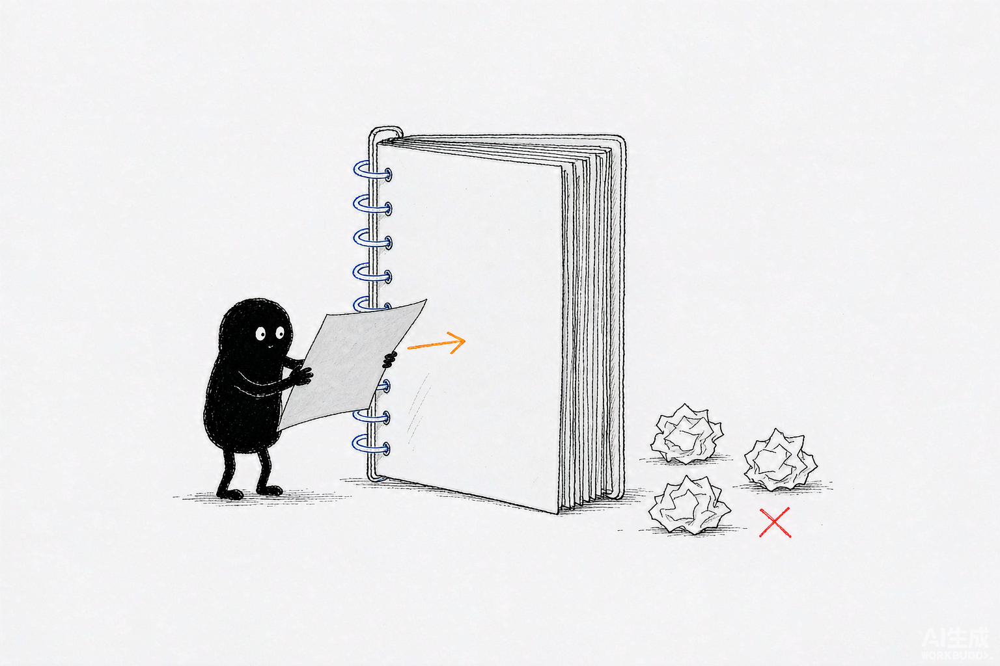
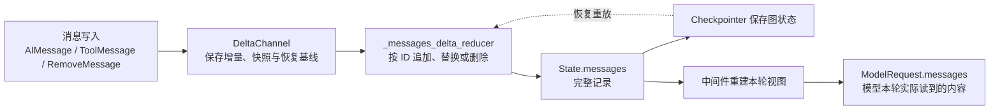
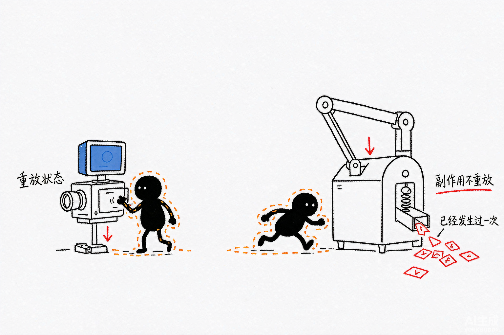

# Deep Agents 源码解析 03：State、Reducer 与恢复一致性

## 一、源码定位

> **阅读基线**：Deep Agents 0.6.12（`libs/deepagents/`）；LangGraph 1.2.10。
> 源码版本与路径约定见 [源码版本与路径约定](source-baseline.md)。
>
> - 默认消息状态：`libs/deepagents/deepagents/graph.py` → `DeepAgentState`
> - 消息批次合并：`libs/deepagents/deepagents/_messages_reducer.py` → `_messages_delta_reducer()`
> - 增量通道：`libs/langgraph/langgraph/channels/delta.py` → `DeltaChannel.update()`、`from_checkpoint()`、`replay_writes()`、`checkpoint()`
> - 消息 ID 预处理：`libs/langgraph/langgraph/pregel/_messages.py` → `ensure_message_ids()`
> - 父子状态隔离：`libs/deepagents/deepagents/middleware/_state.py` → `private_state_field_names()`；`libs/deepagents/deepagents/middleware/subagents.py` → `_validate_and_prepare_state()`、`_return_command_with_state_update()`
> - 悬空工具调用修补、大消息卸载与恢复：见 [11：PatchToolCalls](./11-patch-tool-calls.md) 和 [08：Filesystem 与权限](./08-filesystem-middleware-and-permissions.md)

## 二、消息写入、状态合并与检查点恢复

先明确四个对象。`State` 是图在各个节点之间传递和保存的数据，例如 `messages`、`files`；每个字段由一个 Channel（状态通道）管理。`Reducer` 是将旧值与新写入合并的函数；`Checkpointer` 是保存检查点并支持恢复的组件，保存范围还包括图继续执行所需的信息。

节点返回 `{"messages": [新消息]}` 时，并不是用这一条消息直接覆盖整个状态。图会把写入交给 `messages` 对应的 Channel，再按其合并规则处理。下面的 `DeltaChannel` 就是用于保存增量写入的 Channel。



*图：消息写入是往活页册里插一张新页，由 Channel 按 ID 合并，不整本重写。*

Deep Agents 的 `messages` 不是“每次都把完整列表写回 Checkpoint”的普通状态字段。它由两层协议共同管理：

```text
DeltaChannel
  -> 接收一批写入
  -> 决定是否整体覆盖
  -> 保存增量、快照和恢复基线

_messages_delta_reducer()
  -> 把消息写入转换成统一对象
  -> 按 ID 追加、替换或删除
  -> 处理 REMOVE_ALL_MESSAGES
```

实时执行和恢复执行会重复使用同一个 Reducer。只要 Reducer 是确定的、与批次划分无关，并且消息 ID 在持久化后保持稳定，原始执行和恢复重放就能得到同一份 `messages`。

这篇文章只回答 State 层的问题：消息如何进入状态，如何写进 Checkpoint，如何从 Checkpoint 恢复，以及历史改写为什么要在“全量重建”和“原位替换”之间做不同选择。Middleware 的装配见 [01：总装配](./01-create-deep-agent-assembly.md)，模型和 Profile 见 [02：模型解析与 Profile](./02-model-resolution-and-profiles.md)。

全文追踪的是下面这条链。左边是写入与合并，右边是恢复与视图重建，两条路径复用同一个 Reducer：


## 三、`DeepAgentState` 把消息字段换成了什么

### 1. 默认状态声明

`graph.py` 中的默认状态这样声明 `messages`：

```python
class DeepAgentState(AgentState):
    """为 messages 使用 DeltaChannel，将检查点增长从 O(N²) 降到 O(N)。"""

    # 只覆盖 messages：换成 DeltaChannel，把 checkpoint 增长从 O(N²) 降到 O(N)
    messages: Required[
        Annotated[
            list[AnyMessage],
            DeltaChannel(
                _messages_delta_reducer,   # 按消息 ID 合并的 Reducer
                snapshot_frequency=50,     # 快照频率参数；具体计数与触发由检查点流程决定
            ),
        ]
    ]
```

这里有两个层次：

| 层次 | 负责内容 |
| --- | --- |
| `messages: list[AnyMessage]` | Agent 运行时看到的完整消息列表 |
| `DeltaChannel(...)` | 这个字段怎样接收写入、保存和恢复 |

`DeltaChannel` 不改变业务代码看到的类型。模型和工具仍然读写消息列表，变化发生在 LangGraph 的 Channel 和 Checkpoint 层。

普通整值 Channel 会在每个 Checkpoint 中重复保存完整历史：

```text
第 1 次：保存 1 条消息
第 2 次：保存 2 条消息
第 3 次：保存 3 条消息
...
第 N 次：保存 N 条消息
```

对不断增长的消息列表来说，单个 Checkpoint 的值会随历史长度增长；所有 Checkpoint 累计保存的数据量则会出现重复累加。`DeltaChannel` 把每次写入和完整值拆开：通常只让 Checkpoint 保存一个占位值，恢复时再从快照或祖先写入重建状态。达到快照条件时，外层 Checkpoint 流程会写入一次完整 `_DeltaSnapshot`，避免每次恢复都从最早的写入开始重放。

### 2. `create_deep_agent()` 没有创建第二套 State

`create_deep_agent()` 的职责是准备 Deep Agents 的 Middleware、工具、Backend 和提示词，最终仍然调用 LangChain 的 `create_agent()`：

```python
return create_agent(
    model,
    system_prompt=final_system_prompt,
    tools=_tools,
    middleware=deepagent_middleware,
    response_format=response_format,
    context_schema=context_schema,
    checkpointer=checkpointer,
    store=store,
    debug=debug,
    name=name,
    cache=cache,
    state_schema=state_schema if state_schema is not None else DeepAgentState,
)
```

所以 State 的关系是：

```text
create_deep_agent()
  -> 组装 Deep Agents 专用 Middleware
  -> 默认使用 DeepAgentState
  -> 把 State Schema 交给 create_agent()
  -> 由同一张 Agent 图执行和持久化
```

调用方需要扩展 State 时，应继承 `DeepAgentState`：

```python
class ResearchState(DeepAgentState):
    page_url: str
    file_urls: list[str]


agent = create_deep_agent(
    model=model,
    state_schema=ResearchState,
)
```

这样 `messages` 字段上的 `DeltaChannel` 配置仍然存在。若从普通 `AgentState` 或自定义 TypedDict 重新声明整个状态，可能会丢掉这个 Channel 配置。

自定义状态字段还会和 Middleware 提供的 `state_schema` 合并。Deep Agents 随后会扫描这些 Schema 中带 `PrivateStateAttr` 的字段，交给 `SubAgentMiddleware` 做父子状态隔离，见“父子 Agent 的 State 如何隔离”一节。

## 四、`DeltaChannel` 管的是存储协议

Reducer 决定“新写入如何合并到当前值”；`DeltaChannel` 决定“这批写入什么时候交给 Reducer、如何形成 Checkpoint、恢复时从哪里开始重放”。两者不能互相替代。

| 方法 | 作用 |
| --- | --- |
| `update(values)` | 在正常执行中合并一个 super-step 的写入 |
| `from_checkpoint(checkpoint)` | 用快照、普通值或空基线初始化 Channel |
| `replay_writes(writes)` | 将祖先写入按顺序交给 Reducer，恢复当前值 |
| `checkpoint()` | 返回该 Channel 在 Checkpoint 中的存储表示 |

这里的 super-step 是 LangGraph 的图执行边界。一批写入可能来自多个节点，Channel 在这一轮结束时一次性处理；不要把它直接等同于一次模型调用或一次用户对话回合。

### 1. `update()`：正常执行如何合并

当前实现先检查这批写入里有没有 `Overwrite`：

```python
def update(self, values: Sequence[Any]) -> bool:
    if not values:
        return False

    # 一个 super-step 只允许一个 Overwrite，否则无法判断哪个覆盖生效
    overwrite_idx: int | None = None
    for i, v in enumerate(values):
        is_ow, _ = _get_overwrite(v)
        if is_ow:
            if overwrite_idx is not None:
                msg = create_error_message(
                    message="Can receive only one Overwrite value per super-step.",
                    error_code=ErrorCode.INVALID_CONCURRENT_GRAPH_UPDATE,
                )
                raise InvalidUpdateError(msg)
            overwrite_idx = i

    # 有 Overwrite：直接替换当前值，本批其余写入不再交给 Reducer
    if overwrite_idx is not None:
        _, overwrite_value = _get_overwrite(values[overwrite_idx])
        self.value = (
            _copy.copy(overwrite_value)
            if overwrite_value is not None
            else self.typ()
        )
        return True

    # 没有 Overwrite：把整批写入交给 Reducer 合并
    base = self.typ() if self.value is MISSING else self.value
    self.value = self.reducer(base, list(values))
    return True
```

这段代码分三种情况：

- 没有写入时直接返回；
- 发现 `Overwrite` 时，整体替换当前值，不调用 Reducer；
- 普通写入以当前值为基线，把整批写入交给 Reducer。

`Overwrite` 是 Channel 层的控制信号，最多允许一个出现在同一 super-step 中。它和 `RemoveMessage(id=REMOVE_ALL_MESSAGES)` 不是同一个概念：前者绕过 Reducer 直接替换 Channel 值，后者仍然作为一条消息写入交给 `_messages_delta_reducer()` 处理。

### 2. `replay_writes()`：恢复时如何重建

恢复时，Channel 先由 `from_checkpoint()` 得到一个基线，再调用 `replay_writes()` 应用这个基线之后的祖先写入：

```python
def replay_writes(self, writes: Sequence[PendingWrite]) -> None:
    values = [v for _, _, v in writes]
    if not values:
        return

    # 恢复时以最后一个 Overwrite 为基线，它之前的写入全部作废
    base = self.value
    start = 0
    for i, v in enumerate(values):
        is_ow, ow_value = _get_overwrite(v)
        if is_ow:
            base = _copy.copy(ow_value) if ow_value is not None else self.typ()
            start = i + 1

    # 只重放 Overwrite 之后的写入：这正是要求 Reducer 与批次划分无关的原因
    remaining = values[start:]
    self.value = self.reducer(base, remaining) if remaining else base
```

恢复逻辑会找到最后一个 `Overwrite`，把它当作新的基线，丢弃它之前的写入，只重放后面的内容。没有 `Overwrite` 时，就从 `from_checkpoint()` 提供的值继续合并。

这要求 Reducer 满足批次不变性：

```text
reducer(reducer(state, writes_a), writes_b)
  == reducer(state, writes_a + writes_b)
```

原始执行可能每个 super-step 调用一次 Reducer，恢复时则可能把多轮祖先写入合并成一批。如果两种批次划分会得到不同结果，恢复后的消息历史就会和原始执行不一致。

### 3. `from_checkpoint()`：三种恢复基线

```python
def from_checkpoint(self, checkpoint: Any) -> Self:
    new = self.__class__(
        self.reducer,
        self.typ,
        snapshot_frequency=self.snapshot_frequency,
    )
    new.key = self.key
    if checkpoint is MISSING:
        new.value = self.typ()          # ① 没有检查点：从空容器起步
    elif isinstance(checkpoint, _DeltaSnapshot):
        new.value = checkpoint.value    # ② 命中快照：直接以快照值作基线
    else:
        new.value = checkpoint          # ③ 普通值：当作完整值使用
    return new
```

| Checkpoint 内容 | Channel 的初始值 |
| --- | --- |
| `MISSING` | `self.typ()`，对 `messages` 来说是空列表 |
| `_DeltaSnapshot` | 直接使用快照中的完整值 |
| 普通值 | 直接使用该值，兼容旧格式 |

`checkpoint()` 本身始终返回 `MISSING`：

```python
def checkpoint(self) -> Any:
    return MISSING
```

这不表示状态没有保存。`DeltaChannel` 的约定是：普通 Checkpoint 不重复写完整累积值，外层流程在需要时直接把当前值包装为 `_DeltaSnapshot`；没有快照时，Checkpointer 保留祖先写入，恢复过程通过 `from_checkpoint()` 和 `replay_writes()` 重建当前值。

### 4. `snapshot_frequency=50` 的真实含义

`DeepAgentState` 把 `snapshot_frequency` 配成 50。这个值用于控制 Delta Channel 生成完整快照的频率，当前实现同时还受全局 super-step 上限约束。它不是“每 50 个 Agent 回合固定保存一次”的产品级语义，具体触发点由 LangGraph 的 Checkpoint 流程和 Channel 更新计数共同决定。

这个参数体现的是存储和读取之间的交换：

```text
快照更少
  -> Checkpoint 更小
  -> 恢复时需要重放更多写入

快照更频繁
  -> 存储更多完整值
  -> 恢复时重放距离更短
```

因此，`DeltaChannel` 解决的是长消息列表的 Checkpoint 增长问题，同时把一部分成本转移到了恢复读取。快照频率不能脱离线程长度、读取频率和存储成本单独评价。

## 五、`_messages_delta_reducer()` 如何合并消息

`DeltaChannel` 只负责调用 Reducer。真正决定消息追加、替换和删除语义的是 `_messages_delta_reducer()`：

```python
def _messages_delta_reducer(
    state: list[AnyMessage] | None,
    writes: list[list[AnyMessage]],
) -> list[AnyMessage]:
```

它的处理对象是“旧状态 + 一个 super-step 的多份写入”，粒度比单条消息更粗。

### 1. 输入先统一

源码先把嵌套写入展平，再把字典、字符串和元组等消息形态转换为 `BaseMessage`：

```python
# 嵌套写入先展平成一维列表
flat: list[Any] = []
for w in writes:
    if isinstance(w, list):
        flat.extend(w)
    else:
        flat.append(w)

# 旧状态里存的可能还不是消息对象，先统一转换成 BaseMessage
state_msgs = (
    state
    if state and isinstance(state[0], BaseMessage)
    else cast(
        "list[AnyMessage]",
        convert_to_messages(state or []),
    )
)
msgs = cast("list[AnyMessage]", convert_to_messages(flat))
```

这里有三个工程含义：

- 外层 `writes` 允许一个 super-step 带来多份消息写入，Reducer 先统一成一条消息序列；
- 通过 API 或 Checkpoint 读回的原始字典，也能在 Reducer 内转换成消息对象；
- `state=None` 被按空列表处理，兼容最早的 Checkpoint 没有显式写入 `messages=[]` 的情况。

Deep Agents 的实现没有处理 `BaseMessageChunk`。源码模块注释说明，Deep Agents 写入 `messages` Channel 的是完整消息对象，流式输出发生在输出事件侧，不会把消息块写入状态 Channel。

### 2. `REMOVE_ALL_MESSAGES`：从某个写入点开始重建

如果写入中出现：

```python
RemoveMessage(id=REMOVE_ALL_MESSAGES)
```

Reducer 会找到最后一个哨兵，清空旧状态，并丢弃哨兵之前的写入：

```python
# 找最后一个 REMOVE_ALL_MESSAGES 哨兵：它之前的写入都要丢弃
remove_all_idx = None
for idx, m in enumerate(msgs):
    if isinstance(m, RemoveMessage) and m.id == REMOVE_ALL_MESSAGES:
        remove_all_idx = idx

if remove_all_idx is not None:
    state_msgs = []                      # 旧状态整份清空
    msgs = msgs[remove_all_idx + 1 :]    # 只保留哨兵之后的写入
```

语义可以写成：

```text
旧 state
  + 哨兵之前的写入
  + REMOVE_ALL_MESSAGES
  + 哨兵之后的新消息
  => 只保留哨兵之后的新消息
```

这适合需要重新排列整份消息历史的场景，例如修补悬空的 tool call。单条删除或替换无法保证工具调用和工具结果重新成对排列，因此应该用“清空后按正确顺序回填”的方式处理。对应实现见 [11：PatchToolCalls](./11-patch-tool-calls.md)。

### 3. 普通写入：按 ID 追加、替换和删除

没有全量重建哨兵时，Reducer 用消息 ID 建立位置索引：

```python
result: list[AnyMessage | None] = []
index: dict[str, int] = {}      # 消息 ID -> 在 result 中的位置

for m in state_msgs:
    if m.id is not None:
        index[m.id] = len(result)
    result.append(m)

for msg in msgs:
    mid = msg.id
    if mid is None:
        result.append(msg)                  # 没有 ID：只能追加
    elif isinstance(msg, RemoveMessage):
        if mid in index:
            result[index[mid]] = None       # 删除：先置空，最后统一过滤
            del index[mid]
    elif mid in index:
        result[index[mid]] = msg            # 同 ID：原位替换
    else:
        index[mid] = len(result)
        result.append(msg)                  # 新 ID：追加

return [m for m in result if m is not None]
```

行为很明确：

| 写入消息 | 结果 |
| --- | --- |
| 没有 `id` | 追加 |
| `id` 不在当前状态中 | 追加 |
| `id` 已经存在 | 原位置替换 |
| `RemoveMessage(id=已有 ID)` | 删除目标消息 |
| 删除不存在的 ID | 静默忽略 |

删除时先把位置标记为 `None`，最后统一过滤。这样不会因为中途删除元素而让 ID 到位置的索引失效。删除不存在的 ID 也不报错，便于重放过程中遇到已经被全量重建丢弃的旧消息。

### 4. 用同一份消息列表观察追加、替换与恢复

下面用 `H1`、`A1`、`T1` 表示稳定的消息 `id`，不是工具调用 ID。初始状态为 `[H1("读报告"), A1("准备读取")]`：

| 按顺序到来的写入 | 合并后的状态 | 原因 |
| --- | --- | --- |
| 新消息 `T1("报告正文")` | `[H1, A1, T1]` | 新 ID 追加到末尾 |
| 同 ID 的 `A1("已发起读取")` | `[H1, A1的新内容, T1]` | 替换 A1 的内容，位置不变 |
| `RemoveMessage(id="T1")` | `[H1, A1的新内容]` | 删除消息 T1 |
| 重置标记，再跟 `H2、A2` | `[H2, A2]` | 丢弃旧列表，按新顺序重建 |

从保存了初始列表的快照恢复，再依次重放这些写入，应得到相同结果。这要求合并过程不重新生成随机身份。`ToolMessage.tool_call_id` 则负责将工具结果与模型提出的某次调用配对：同一个工具结果可以保留这个配对值，用自己的消息 `id` 更新正文。两种 ID 服务于不同协议，不能互换。

这里重放的是状态写入。恢复出 `T1` 或补齐一条工具消息，都不证明外部文件、数据库或远端任务已回滚；这些动作需要执行端自己的结果查询和去重机制。

## 六、消息 ID 是恢复一致性的前提

### 1. ID 由谁生成

`_messages_delta_reducer()` 不负责生成随机 ID。LangGraph 的 `ensure_message_ids()` 会在写入提交给 Checkpointer 之前处理消息对象和消息字典：

```python
def ensure_message_ids(value: Any) -> None:
    # 缺 ID 的消息在这里补齐，补 ID 发生在持久化之前；
    # 这样同一条消息在恢复重放时拿到同一个 ID，替换不会被误判成追加
    if isinstance(value, BaseMessage):
        if value.id is None:
            value.id = str(uuid4())
    elif isinstance(value, dict) and _is_message_dict(value):
        if not value.get("id"):
            value["id"] = str(uuid4())
    elif isinstance(value, list):
        for i, item in enumerate(value):
            if isinstance(item, BaseMessage):
                if item.id is None:
                    item.id = str(uuid4())
            elif isinstance(item, dict) and _is_message_dict(item):
                msg = convert_to_messages([item])[0]
                if msg.id is None:
                    msg.id = str(uuid4())
                value[i] = msg
```

生成时机很关键。Reducer 会在实时执行时运行，也会在恢复重放时再次运行。如果 Reducer 在每次运行时随机生成 ID，同一条消息在两次执行中就会变成两个不同的对象：

```text
原始写入：id = A
恢复重放：id = B
```

Reducer 看到 `A` 和 `B` 不相等，就会追加消息而不是替换消息，最终造成历史重复。因此，ID 必须在写入持久化前确定，并且随 Checkpoint 一起保留下来。

### 2. 更新和删除必须复用原 ID

下面两种写入的语义不同：

```text
带已有 ID 的新消息
  -> 替换原位置

没有 ID 或使用新 ID 的消息
  -> 追加到末尾
```

这条规则直接影响中间件写法：

- 新增消息可以不手工指定 ID，提交前会补齐 ID；
- 修改已有消息，必须保留原 ID；
- 删除消息，`RemoveMessage` 必须使用目标消息的原 ID；
- 从旧消息生成用于替换的副本时保留原 ID；若产生的是另一条独立消息，则应使用新 ID。

大消息卸载正是靠这条规则完成短消息替换，具体见 [08：Filesystem 与权限](./08-filesystem-middleware-and-permissions.md)。

Deep Agents 的回归测试覆盖了这些边界：

- `get_state()` 返回的消息必须有 ID；
- 字典形式的消息输入也要得到稳定 ID；
- 同一线程多次 `invoke()` 或 `ainvoke()` 后，原 HumanMessage 的 ID 不变；
- `state=None` 作为恢复基线时，Reducer 仍然可以正常处理消息。

## 七、全量重建和原位替换怎么选

两种改写方式都依赖消息 ID，但解决的问题不同。

### 1. 只修改一条消息：保留原 ID

例如，Filesystem Middleware 把过大的 `ToolMessage` 内容写入 Backend，再用一条短消息替换原结果。此时消息在历史中的位置和上下文关系都不变，只需要保留原 ID：

```text
原 ToolMessage(id="tool-1", content="完整结果")
  -> ToolMessage(id="tool-1", content="结果已写入文件 /path/to/result")
```

Reducer 会在原位置替换消息，后续消息的顺序不变。

### 2. 需要重新排列整份历史：`REMOVE_ALL_MESSAGES`

悬空工具调用修补可能需要同时改变 AI 工具调用、工具结果以及后续消息的顺序。此时逐条删除容易留下不合法的消息序列，应该提交：

```text
RemoveMessage(id=REMOVE_ALL_MESSAGES)
  + 按正确顺序排列的完整消息列表
```

Reducer 会丢弃旧状态和哨兵之前的写入，只保留新列表。

`Overwrite` 也能做 Channel 级整体替换，但它和 `REMOVE_ALL_MESSAGES` 的边界不同：

| 机制 | 所在层 | 是否经过消息 Reducer | 典型用途 |
| --- | --- | --- | --- |
| `Overwrite(value)` | `DeltaChannel` | 否 | 直接替换整个 Channel 值 |
| `REMOVE_ALL_MESSAGES` | `_messages_delta_reducer()` | 是 | 清空消息历史后按消息语义回填 |
| 原消息 ID | `_messages_delta_reducer()` | 是 | 在原位置替换单条消息 |

中间件如果需要保留消息合并、删除和恢复语义，通常应使用消息 Reducer 支持的写法，不要把 Channel 级 `Overwrite` 当成消息级删除的替代品。

## 八、父子 Agent 的 State 如何隔离

State 恢复一致性不只发生在单个 Agent 内。Deep Agents 通过 `task` 调用子代理时，还要避免把父代理的完整上下文和内部字段直接传进去。

### 1. 装配期收集私有字段

`create_deep_agent()` 会收集用户 State Schema 和 Middleware State Schema：

```python
state_schemas = [state_schema] if state_schema is not None else []
state_schemas.extend(
    mw.state_schema
    for mw in deepagent_middleware
    if getattr(mw, "state_schema", None) is not None
)
private_state_keys = private_state_field_names(*state_schemas)
if sub_agent_middleware is not None:
    sub_agent_middleware.private_state_keys = private_state_keys
```

`private_state_field_names()` 使用 `get_type_hints(..., include_extras=True)` 扫描 `PrivateStateAttr` 标记：

```python
def private_state_field_names(*state_schemas: type[object]) -> frozenset[str]:
    names: set[str] = set()
    for state_schema in state_schemas:
        # 单个 Schema 解析失败就跳过，不让一个坏 Schema 拖垮整个装配
        with contextlib.suppress(Exception):
            hints = get_type_hints(state_schema, include_extras=True)
            for name, annotation in hints.items():
                if _has_marker(annotation, PrivateStateAttr):   # 只收带私有标记的字段
                    names.add(name)
    return frozenset(names)
```

私有字段清单在装配期确定，运行期由 `SubAgentMiddleware` 过滤父子传递的字段。上面还有一个失败分支：类型注解解析异常会被忽略，那个 schema 的标记可能未被收集。依赖字段过滤时，应核对最终集合，并避免通过任务描述或共享文件再次传入同一值。

### 2. 调用子代理时裁剪输入

`_validate_and_prepare_state()` 先排除框架约定的字段，再排除私有字段：

```python
# 先排除框架约定的字段
subagent_state = {
    k: v for k, v in runtime.state.items()
    if k not in _EXCLUDED_STATE_KEYS
}
# 再排除标记为私有的字段
subagent_state = {
    k: v for k, v in subagent_state.items()
    if k not in private_state_keys
}
# 消息从零开始：子代理只拿到任务描述，看不到父代理的历史
subagent_state["messages"] = [HumanMessage(content=description)]
```

当前 `_EXCLUDED_STATE_KEYS` 包含：

```python
{
    "messages",
    "todos",
    "structured_response",
}
```

子代理收到的是一条由任务描述构造的 `HumanMessage`，父代理的完整消息历史不在其中。`todos` 和 `structured_response` 也不会直接传递，因为它们没有适用于父子回写的明确 Reducer 语义。

### 3. 子代理返回时只回写公开字段

`_return_command_with_state_update()` 会过滤同一批字段，然后把子代理最终结果封装为一条 `ToolMessage`：

```python
# 回写父 State 时同样过滤私有字段，避免子代理内部字段泄漏出去
state_update = {
    k: v
    for k, v in result.items()
    if k not in _EXCLUDED_STATE_KEYS and k not in private_state_keys
}

# 子代理结果只以一条 ToolMessage 回到父 Agent，中间过程不展开
return Command(
    update={
        **state_update,
        "messages": [ToolMessage(content, tool_call_id=tool_call_id)],
    }
)
```

因此：

```text
父代理 -> 公开字段 + 任务描述
子代理 -> 独立消息历史；检查点行为取决于子图及父图配置
子代理 -> 公开字段更新 + 一条 ToolMessage
```

子代理的中间消息不会并入父代理的 `messages`。父代理看到子代理的方式，是一条工具结果消息，以及允许回写的公开状态字段。

## 九、恢复消息不等于外部动作只执行一次



*图：重放可以复原状态；信封在第一次就已经寄出去了。*

考虑这样一个故障窗口：退款接口已经成功，进程却在保存工具结果前退出。恢复出的 `messages` 缺少结果，只能证明本地记录不完整，不能据此判断退款尚未发生。

源码能证明的是消息状态的重建。`_messages_reducer.py:77-86` 按消息 ID 合并，其中已有 ID 的处理只是替换列表元素，不会查询支付流水。Reducer 负责合并值，检查点保存由持久化机制负责；未完成节点后续是否重新执行，还要追踪图的恢复执行链。

**工程建议**：外部写操作应在首次执行前持久化业务动作 ID，重试、恢复和重复投递复用同一 ID，并绑定规范化参数摘要。执行端用唯一约束或原子状态转换认领动作，保存可查询的结果；同 ID 携带不同参数时拒绝执行。“先查去重记录、发送、再记结果”仍有并发和崩溃窗口，不能据此保证副作用恰好执行一次。跨系统还需要执行端幂等支持、结果查询或补偿；恢复侧计数器只限制重试次数。

验收时，在「外部提交成功、ToolMessage 尚未落盘」处杀进程，并发投递两次恢复请求。检查外部流水仍只有一笔、结果可以查询、参数变化会被拒绝。只检查恢复后的消息没有重复，不足以通过验收。

## 十、按更新与恢复需求选择做法

| 场景 | 做法 | 理由 |
| --- | --- | --- |
| 恢复图的执行状态 | Checkpointer + 稳定的 `thread_id` | 检查点与增量写入共同重建状态；完整业务审计还需外部动作记录 |
| 写自定义 Reducer | 保证批次不变性与消息 ID 稳定 | 实时执行与恢复重放必须得到同一份 `messages` |
| 改动某几条历史消息 | 用原位替换 | 只需提交目标消息的更新，不必提交完整历史 |
| 历史结构整体变化 | 用 `REMOVE_ALL_MESSAGES` 全量重建 | 走同一套 Reducer 语义，顺序可控，代价是一次全量写入 |
| 恢复后消息顺序错乱 | 先查消息 ID 是否在持久化后保持不变 | ID 变化会把替换变成追加 |
| 子代理需要父级上下文 | 显式传入，或放共享 Backend | State 过滤只隔离消息与私有字段，子代理默认只收到任务描述构造的 `HumanMessage` |
| 多次调用恢复线程内文件 | StateBackend + Checkpointer + 同一 `thread_id` | 文件属于线程状态，不承诺任务结束自动清理 |
| 跨线程共享文件 | StoreBackend + 明确 namespace | 文件保留期限取决于 Store 和应用清理策略 |

`Overwrite` 适用于调用方已经准备好完整 Channel 值的情况，会绕过消息转换与合并；`REMOVE_ALL_MESSAGES` 适用于通过消息协议重建历史。选择依据是是否仍需要 Reducer 处理后续消息，不能把两者仅当成写法不同的同义操作。

**改造要点**：自定义 Reducer 必须满足 `reducer(reducer(state, a), b) == reducer(state, a + b)`。只要有一处依赖批次划分，恢复重放就会与实时执行分叉，而且分叉只在崩溃恢复后才暴露。

`PrivateStateAttr` 控制普通输入输出 schema，不等于禁止检查点保存字段。恢复后的消息配对、外部动作是否已提交，应分别核验；后者的验证位置见上一节。

**相关测试**：`tests/unit_tests/test_messages_reducer.py`。

## 十一、延伸阅读

**下层：LangChain / LangGraph**

- [LangGraph 01：State Schema、Channel 与 Reducer](../langgraph/01-state-schema-channels-and-reducers.md)——Channel 与 Reducer 的通用语义
- [LangGraph 06：Checkpoint、Store 与恢复](../langgraph/06-checkpoints-store-and-recovery.md)——检查点保存与重放的底层机制

**本系列**

- [10：Summarization 与上下文卸载](./10-summarization-and-context-offloading.md)——历史改写怎样不破坏可恢复性
- [11：PatchToolCalls](./11-patch-tool-calls.md)——恢复后消息协议的修补

**上层：方法论与案例**

- [Agent 系统设计 02：State 架构](../../../../notes/agent-system-design/02-state/agent-state-architecture.md)——状态外置与每轮重建视图的设计原则
