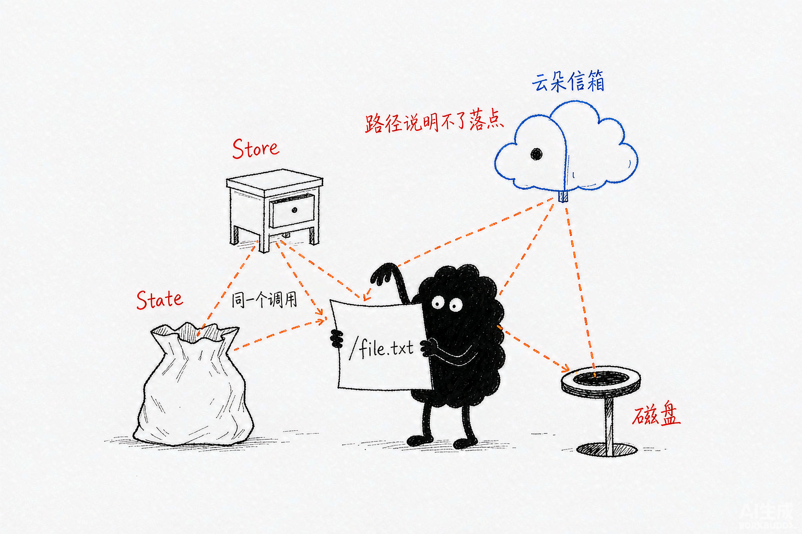
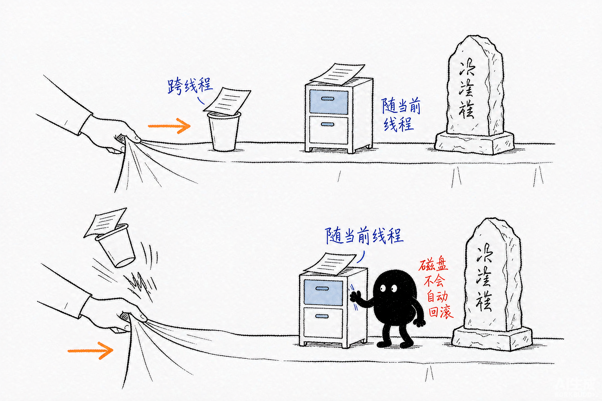
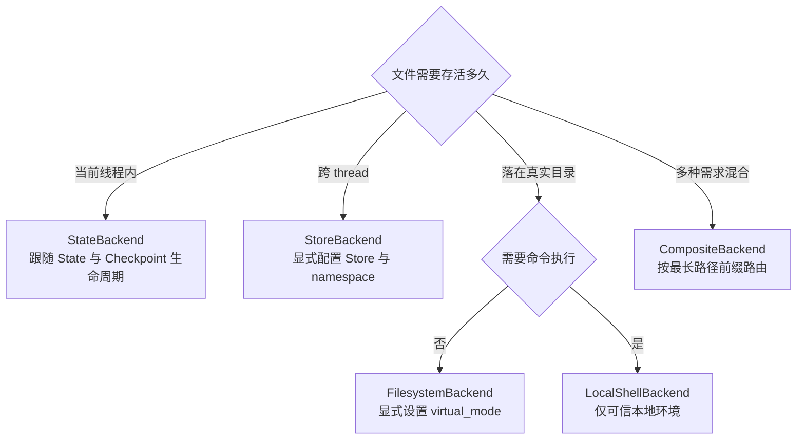

# Deep Agents 源码解析 04：Backend：存储与执行边界

## 一、源码定位

> **阅读基线**：Deep Agents 0.6.12（`libs/deepagents/`）。
> 源码版本与路径约定见 [源码版本与路径约定](source-baseline.md)。
>
> - Backend 选择与注入：`libs/deepagents/deepagents/graph.py` → `create_deep_agent()`（选择默认 Backend，通过 FilesystemMiddleware 接入 `create_agent()`）
> - Backend 配置与实例取得：`libs/deepagents/deepagents/middleware/filesystem.py` → `FilesystemMiddleware.__init__()`、`_get_backend()`（保存 Backend 配置，工具调用时取得具体实例）
> - Backend 接口与结果结构：`libs/deepagents/deepagents/backends/protocol.py` → `BackendProtocol`、`SandboxBackendProtocol`、`FileData`、`FileInfo`、`GrepMatch`、各类 `*Result`（统一文件操作接口和结果结构）
> - Backend 解析与可选能力：`libs/deepagents/deepagents/backends/protocol.py` → `_resolve_backend()`、`_supports_delete()`、`_method_accepts_max_count()`（解析 Backend、判断可选能力和兼容旧接口）
> - 状态读取的下层实现：`libs/langgraph/langgraph/pregel/_algo.py` → `local_read()`（LangGraph 1.2.10，读取当前任务待合并的更新）
> - State Backend：`libs/deepagents/deepagents/backends/state.py` → `StateBackend._read_files()`、`_send_files_update()`、`read()`、`write()`、`edit()`、`delete()`（把文件读写接到 LangGraph 的 `files` channel）
> - Store Backend：`libs/deepagents/deepagents/backends/store.py` → `StoreBackend._get_store()`、`_get_namespace()`、`read()`、`write()`、`edit()`、`delete()`（把文件映射成 Store 的 namespace 和 key）
> - 文件系统 Backend：`libs/deepagents/deepagents/backends/filesystem.py` → `FilesystemBackend._resolve_path()`、`read()`、`write()`、`edit()`、`delete()`（把虚拟路径解析成宿主机路径）
> - Shell Backend：`libs/deepagents/deepagents/backends/local_shell.py` → `LocalShellBackend.__init__()`、`id`、`execute()`（在文件能力之上增加宿主机 Shell 执行）
> - 复合 Backend：`libs/deepagents/deepagents/backends/composite.py` → `CompositeBackend.__init__()`、`_route_for_path()`、`read()`、`write()`、`grep()`、`glob()`、`execute()`（按路径前缀组合多个 Backend）

## 二、同一文件工具怎样连接不同存储

Backend 解决的是文件工具背后的四个问题：路径如何解释，内容存在哪里，文件活多久，以及是否允许执行命令。

```text
create_deep_agent()
  -> 选择 Backend
  -> 构造 FilesystemMiddleware(backend=...)
  -> 注册 ls/read_file/write_file/edit_file/delete/glob/grep
  -> 将包含 Backend 配置的中间件交给 create_agent()
  -> 返回可运行的 Agent 图
  -> invoke 时，文件工具通过中间件调用 Backend
```

BackendProtocol 统一文件工具的调用方式，却不替实现决定数据生命周期：

| 实现 | 文件落点 | 典型生命周期 |
| --- | --- | --- |
| `StateBackend` | LangGraph State 的 `files` channel | 当前 thread，随 checkpoint 恢复 |
| `StoreBackend` | LangGraph `BaseStore` | 可跨 thread，取决于 Store 实现 |
| `ContextHubBackend` | LangSmith Hub 仓库 | 可跨 thread，每次写入一次提交 |
| `FilesystemBackend` | 宿主机文件系统 | 由磁盘、挂载和清理策略决定，进程结束不自动删除 |
| `LocalShellBackend` | 宿主机文件系统 | 在 `FilesystemBackend` 基础上增加宿主机 Shell 执行 |
| `CompositeBackend` | 多个 Backend | 由路径路由决定 |

选 Backend 时，不要只看“能不能读写文件”。同一个 `write_file("/profile.md")`，可能把内容放进当前线程的 State、某个用户的 Store、宿主机磁盘，或者由路由转交给远程服务。可以先用下面四个问题缩小范围：

| 问题 | 优先考虑 | 需要额外确认 |
| --- | --- | --- |
| 只在当前任务中保存草稿和中间结果？ | `StateBackend` | 是否配置了 Checkpointer，以及是否需要跨次运行恢复 |
| 需要跨 thread 共享用户记忆？ | `StoreBackend` | namespace 隔离方式和 `BaseStore` 的真实持久化能力 |
| 需要修改本地项目文件？ | `FilesystemBackend` | `virtual_mode`、进程用户权限、符号链接和回滚方案 |
| 既要混合存储，又要命令执行？ | `CompositeBackend` + 合适的 default | 文件路由不影响 `execute()`，命令始终由 default 执行 |

以 `/profile.md` 为例，路径字符串并不包含“是否持久化”的答案。`StateBackend` 将它作为 `files` 字段中的键，读写跟随当前图状态；`StoreBackend` 将它映射到 namespace（命名空间，用来分组和隔离记录）与 key，持久性由 Store 决定；`FilesystemBackend` 则解析到文件系统中的目标。



*图：同一个 write_file("/profile.md")，四个投递口对应四种落点。*

这也决定了恢复边界：检查点可以恢复 State 中的文件值，却不会把已经写入磁盘或 Store 的文件自动恢复到旧版本。需要“任务失败后撤销文件修改”时，必须先确定文件落在哪个 Backend，再选择版本保存或补偿方案。



*图：纸杯随桌布走，石碑留在原地；检查点恢复不了磁盘上的旧版本。*

## 三、Backend 如何进入 Agent

### 1. 默认使用 `StateBackend`

`create_deep_agent()` 没有收到 `backend` 时，源码直接创建 `StateBackend()`：

```python
backend = backend if backend is not None else StateBackend()
```

这个对象不会直接出现在模型的工具描述里。它先被传给 `FilesystemMiddleware`：

```python
FilesystemMiddleware(
    backend=backend,
    custom_tool_descriptions=_profile.tool_description_overrides,
    _permissions=permissions,
)
```

FilesystemMiddleware 再把 Backend 方法包装成模型可调用的文件工具。工具调用拿到 `ToolRuntime` 后，才通过 `_get_backend()` 解析具体 Backend，然后调用 `read()`、`write()` 等方法。

最终 `create_deep_agent()` 把中间件、工具、State schema、checkpointer 和 store 交给 LangChain 的 `create_agent()`：

```python
return create_agent(
    model,
    system_prompt=final_system_prompt,
    tools=_tools,
    middleware=deepagent_middleware,
    response_format=response_format,
    checkpointer=checkpointer,
    store=store,
    state_schema=state_schema if state_schema is not None else DeepAgentState,
)
```

这里的分工很明确：

- `FilesystemMiddleware` 决定模型能看到哪些文件工具，以及怎样处理工具输入输出；
- Backend 决定文件内容如何读写；
- `create_agent()` 负责把这些能力接入 LangChain 的 Agent 图。

### 2. 实例是主路径，工厂仍保留兼容

`backend=` 参数直接传 Backend 实例，省略时默认 `StateBackend()`：

```python
backend = StateBackend()
# 或 backend = StoreBackend(namespace=..., store=...)
```

当前源码仍接受 Backend 工厂，例如 `lambda rt: StoreBackend(...)`，`_resolve_backend()` 会在工具调用时用运行时对象解析它。官方文档把工厂形式列为迁移项，新的代码更适合直接传实例，再让 Backend 在运行期通过 `get_store()`、`get_runtime()` 等入口获取上下文。

`StoreBackend` 是一个常见例子：它可以在构造时传入显式 `store`，也可以保留 `store=None`，在 LangGraph 图执行期间通过 `get_store()` 取得当前 Store。Backend 工厂并不是 StoreBackend 获取运行时上下文的唯一方式。

### 3. Backend 不管权限和业务事实

Backend 负责“内容存在哪、怎么读回来”，它不负责权限。按运行期信息选择 namespace 或路径，不等于证明调用者有权访问某个对象。权限仍应由可信身份、租户和业务服务校验；Filesystem 的 `permissions` 只约束内置文件工具，Backend 本身不会替业务 API 自动做权限判断。

也不要把实时业务事实放进 Backend 的长期命名空间后就停止查询。订单状态、库存数量和退货资格仍应由业务工具访问权威服务；Backend 更适合保存政策文件、Skill、交接材料和大工具结果。

## 四、BackendProtocol 统一了什么

### 1. 接口通过继承关系识别能力

源码定义的是：

```python
class BackendProtocol(abc.ABC):
```

`BackendProtocol` 继承 `abc.ABC`（抽象基类），区别于 `typing.Protocol` 那种结构化协议。自定义 Backend 必须显式继承 `BackendProtocol`，否则 `_resolve_backend()` 不会把它识别为 Backend 实例：

```python
class CustomBackend(BackendProtocol):
    ...
```

`BackendProtocol` 中的大部分方法没有加 `@abstractmethod`。源码注释说明，这是为了避免新增接口时立即破坏只实现部分能力的旧 Backend。没有覆盖的方法会沿用默认实现，真正调用时再抛出 `NotImplementedError`。

删除能力就是这种设计的例子：

```python
def _supports_delete(backend: BackendProtocol) -> bool:
    return type(backend).delete is not BackendProtocol.delete
```

这里判断能力的依据是“子类是否覆盖方法”，不实际调用 `delete()`。`FilesystemMiddleware` 会根据这个结果决定是否让模型看到 `delete` 工具。

`SandboxBackendProtocol` 也是继承关系：

```text
BackendProtocol
└── SandboxBackendProtocol
    └── LocalShellBackend / BaseSandbox 子类
```

所以自定义执行 Backend 应该继承 `SandboxBackendProtocol` 或 `BaseSandbox`。只实现一个同名 `execute()` 方法，但不继承这个 ABC，`supports_execution()` 仍可能判定它不具备执行能力。

认识了这个类的继承结构，再看它统一了哪些数据和方法：

### 2. 文件数据统一为 `FileData`

当前文件内容使用 `FileData` 表示：

```python
class FileData(TypedDict):
    content: str
    encoding: str
    created_at: NotRequired[str]
    modified_at: NotRequired[str]
```

`encoding` 通常是：

- `utf-8`：`content` 是普通文本；
- `base64`：`content` 是二进制内容的 Base64 字符串。

Backend 不负责把内容格式化成模型最终看到的文本。比如行号、长行拆分、工具消息格式由 FilesystemMiddleware 处理；Backend 只返回原始内容和分页信息。

### 3. 文件操作统一为结构化结果

`read()` 返回 `ReadResult`：

```python
@dataclass
class ReadResult:
    error: str | None = None
    file_data: FileData | None = None
    total_lines: int | None = None
    start_line: int | None = None
    end_line: int | None = None
    next_offset: int | None = None
```

文本读取可以只返回一个窗口。`ReadResult.__post_init__()` 会校验分页字段：

- `start_line` 和 `end_line` 必须成对出现；
- `1 <= start_line <= end_line`；
- `total_lines` 不能小于 `end_line`；
- `next_offset` 必须等于 `end_line`。

这组校验防止 Backend 返回一个看似成功、但下一次读取会跳过内容的分页结果。

写入、编辑和删除分别返回：

```python
@dataclass
class WriteResult:
    error: str | None = None      # 常见业务错误由该字段表达；不排除实现抛出异常
    path: str | None = None       # 实际写入的规范化路径

@dataclass
class EditResult:
    error: str | None = None
    path: str | None = None
    occurrences: int | None = None   # 替换次数，模型据此判断要不要 replace_all

@dataclass
class DeleteResult:
    error: str | None = None
    path: str | None = None
```

一次操作失败通常把错误写入 `error` 字段。能力不存在则是另一类情况：基类中的 `delete()` 默认抛出 `NotImplementedError`，表示这个 Backend 没有实现删除能力。

异步方法通常由同步方法包装，返回同一套结构化结果：

```python
async def aread(
    self,
    file_path: str,
    offset: int = 0,
    limit: int = 2000,
) -> ReadResult:
    return await asyncio.to_thread(self.read, file_path, offset, limit)
```

`StoreBackend` 是例外，它直接使用 Store 的异步 API，避免把异步调用再转进线程。

### 4. 数据与结果两类对象

Backend 方法之间传递的对象分成数据和结果两类，再细分如下：

| 层次 | 类型 | 用途 |
| --- | --- | --- |
| 文件内容 | `FileData` | 内容、编码和时间元数据 |
| 条目数据 | `FileInfo`、`GrepMatch` | 目录项或搜索命中的单条记录 |
| 操作结果 | `LsResult`、`ReadResult`、`WriteResult`、`EditResult`、`DeleteResult`、`GrepResult`、`GlobResult`、`ExecuteResponse` | 表示成功、错误、分页、退出码或截断状态 |
| 批量传输结果 | `FileUploadResponse`、`FileDownloadResponse` | 逐个表示上传或下载是否成功 |

当前方法和结果的对应关系是：

| 方法 | 返回值 | 关键字段 |
| --- | --- | --- |
| `ls()` | `LsResult` | `entries: list[FileInfo]` |
| `read()` | `ReadResult` | `file_data`、分页字段、`error` |
| `write()` | `WriteResult` | `path`、`error` |
| `edit()` | `EditResult` | `path`、`occurrences`、`error` |
| `delete()` | `DeleteResult` | `path`、`error` |
| `grep()` | `GrepResult` | `matches: list[GrepMatch]`、`truncated` |
| `glob()` | `GlobResult` | `matches: list[FileInfo]`、`truncated` |
| `upload_files()` | `list[FileUploadResponse]` | 每个文件的 `path`、`error` |
| `download_files()` | `list[FileDownloadResponse]` | 每个文件的 `path`、`content`、`error` |
| `execute()` | `ExecuteResponse` | `output`、`exit_code`、`truncated`，仅限 `SandboxBackendProtocol` |

`write()` 的语义是创建或覆盖文件。`read()` 返回 `ReadResult`，行号格式由 FilesystemMiddleware 添加；`grep()` 的 `pattern` 是字面量、`glob` 参数只过滤文件路径，`max_count` 是所有文件合计的匹配上限，达到上限后标记 `GrepResult.truncated=True`。

旧代码里的 `ls_info()`、`grep_raw()`、`glob_info()`、`files_update` 和 `read() -> str` 属于兼容或旧版本写法。新 Backend 应实现当前的 `ls()`、`grep()`、`glob()` 和结构化结果，不应围绕旧返回值重新设计。


*图：面板上空着的按钮位不出现；Backend 不支持的能力，工具不会进请求。*

## 五、StateBackend：文件进入当前线程的 State

### 1. 它没有自己的文件字典

`StateBackend` 通过 LangGraph 配置中的读写回调访问 `files` channel：

```python
def _read_files(self) -> dict[str, Any]:
    config = self._get_config()
    read = config["configurable"][CONFIG_KEY_READ]
    fresh = True
    return read("files", fresh) or {}

def _send_files_update(self, update: dict[str, Any]) -> None:
    config = self._get_config()
    send = config["configurable"][CONFIG_KEY_SEND]
    send([("files", update)])
```

`fresh=True` 请求在当前 Channel 值上应用当前任务已经排队的写入，再返回读取结果。LangGraph 的 `local_read()` 从 `task.writes` 收集这些更新；它不承诺同一 super-step 中的其他并行任务即时可见。文件更新通过 `CONFIG_KEY_SEND` 排队，再由图在状态合并边界处理。因此“同一任务写后再读”和“两个并行工具读写同一文件”不能用同一个可见性假设。

### 2. 写入、编辑和删除如何落到 State

写入会先读取当前文件，保留已有元数据，再发送新的 `FileData`：

```python
files = self._read_files()
existing = files.get(file_path)
new_file_data = (
    update_file_data(existing, content)
    if existing is not None
    else create_file_data(content)
)
self._send_files_update({file_path: self._prepare_for_storage(new_file_data)})
return WriteResult(path=file_path)
```

编辑先从 State 取出文件，把 `FileData` 转成文本，调用字符串替换逻辑，再发送更新。`replace_all=False` 时，旧字符串不存在或出现多次都会返回错误。

删除会找出精确路径和所有子路径，再把这些 key 的值更新为 `None`：

```python
base = file_path.rstrip("/")
prefix = base + "/"
to_delete = [
    key for key in files
    if key == base or key.startswith(prefix)
]
self._send_files_update(dict.fromkeys(to_delete, None))
```

因此 StateBackend 的目录是由路径前缀模拟出来的。

### 3. 生命周期

StateBackend 的文件属于当前 Agent State：

- 同一个 `thread_id` 配合 Checkpointer，可以在后续运行中恢复；
- 不同 thread 不共享；
- 同步子代理接收经筛选的状态字典，返回时通过 `Command` 回写允许传播的字段；默认文件字段可随这条链传递，但父子并非共享完整消息 State，具体筛选规则见 [09](09-subagent-sync.md)；
- 没有 LangGraph 执行上下文时，`StateBackend` 不能直接读写；
- 预置文件应放进 `invoke()` 输入的 `files`，不要在图外直接调用 `write()`。

它适合任务草稿、中间产物和当前对话的临时文件，不适合跨会话共享的用户记忆。

## 六、StoreBackend：文件进入持久化 Store

### 1. 文件映射为 namespace + key

`StoreBackend` 把一个文件表示为：

```text
namespace = ("user-123", "filesystem")
key       = "/preferences.md"
value     = {"content": "...", "encoding": "utf-8", ...}
```

Store 可以通过构造函数传入，也可以在图执行期间由 `get_store()` 取得：

```python
def _get_store(self) -> BaseStore:
    if self._store is not None:
        return self._store            # 构造时显式传入的 Store 优先
    try:
        return get_store()            # 否则取当前图执行期的 Store
    except (RuntimeError, KeyError):
        # 脱离图执行又没传 Store 时，给出可操作的报错而不是裸异常
        msg = (
            "StoreBackend must be used inside a LangGraph graph execution "
            "(e.g. via create_deep_agent), or initialized with an explicit "
            "store: StoreBackend(store=my_store)"
        )
        raise RuntimeError(msg) from None
```

没有显式 Store 且不在 LangGraph 执行上下文中时，源码会抛出清晰的 `RuntimeError`。因此使用 `StoreBackend` 时，`create_deep_agent(store=...)` 和 Backend 的 Store 来源必须对应上。

### 2. namespace 决定隔离范围

新接口通过 namespace 工厂从 `Runtime` 读取身份或运行信息：

```python
StoreBackend(
    store=store,
    namespace=lambda rt: (rt.server_info.user.identity, "filesystem"),
)
```

每个 namespace 组件都会经过 `_validate_namespace()` 校验，禁止空字符串和可能参与通配查询的字符。namespace 的作用是隔离不同用户、助手或业务空间；文件路径本身仍作为 Store key 保存。

没有显式 namespace 时，源码还保留基于 `assistant_id` 的旧解析逻辑，但这一分支已经标记为弃用。当前签名仍允许 `namespace=None`，只是多用户部署不应依赖这条兼容路径，建议显式设置 namespace。三种常见隔离模式：

| 模式 | namespace 工厂 | 隔离范围 |
| --- | --- | --- |
| 按用户 | `lambda rt: (rt.server_info.user.identity,)` | 每个用户独立存储 |
| 按助手 | `lambda rt: (rt.server_info.assistant_id,)` | 同一助手的所有用户共享 |
| 按会话 | `lambda rt: (rt.execution_info.thread_id,)` | 一次对话内隔离 |

可以组合多个组件（如 `(user_id, thread_id)`）做更细的作用域，或追加 `"filesystem"` 后缀消除同作用域下多个 Store namespace 的歧义。namespace 组件只允许字母数字、连字符、下划线、点、`@`、`+`、冒号和波浪号，通配符被拒绝。

### 3. 读写和递归删除

写入围绕 `store.get()` 和 `store.put()`：

```python
# Store 没有部分更新接口，写入必须整项替换：先读旧值再合并
existing = store.get(namespace, file_path)
if existing is not None:
    existing_file_data = self._convert_store_item_to_file_data(existing)
    file_data = update_file_data(existing_file_data, content)
else:
    file_data = create_file_data(content)

store.put(
    namespace,
    file_path,
    self._convert_file_data_to_store_value(file_data),
)
```

编辑和读取先取出对应 key，再复用与 StateBackend 相同的文件格式和字符串替换语义。

删除需要搜索 namespace 下的条目，找出精确 key 和 `file_path + "/"` 前缀的 key，然后用 `store.batch()` 写入删除标记：

```python
items = self._search_store_paginated(store, namespace)
to_delete = [
    key for item in items
    if (key := str(item.key)) == base or key.startswith(prefix)
]
store.batch([PutOp(namespace, key, None) for key in to_delete])
```

它能模拟目录递归删除，但成本取决于 Store 的搜索和分页能力。

### 4. 生命周期取决于 Store 实现

`StoreBackend` 本身只规定如何访问 `BaseStore`，不承诺跨进程或跨重启持久化：

- `InMemoryStore` 可以在当前进程中跨 thread 共享，进程重启后丢失；
- 数据库或托管 Store 才能提供更长的持久化生命周期；
- namespace 解决数据隔离，Store 实现解决数据保存。

不要把 `StoreBackend` 和“数据库持久化”直接画等号。

## 七、ContextHubBackend：文件进入 LangSmith Hub 仓库

`ContextHubBackend` 是跨线程持久化的另一条路：不依赖 LangGraph Store，把文件存进 LangSmith Hub 的 agent 仓库（`backends/context_hub.py`）。传仓库标识（`"owner/name"`）构造：

```python
backend = ContextHubBackend("my-agent")
```

它的行为围绕「本地缓存 + Hub 提交」两个动作：

- **首次使用惰性拉取**：`_load_tree()` 调 `pull_agent()` 把仓库文件树拉到内存缓存；仓库不存在（`LangSmithNotFoundError`）按空仓库处理，首次写入可以创建它。
- **写入是提交**：`write()`/`edit()` 先确保缓存已加载（拿到当前 commit hash），再调 `push_agent(files=..., parent_commit=...)` 推一个提交，成功后才更新 commit hash 和缓存。它用乐观父提交，每次基于最新已知的 commit。如果别的写入者先推进了仓库，这次提交会失败，需要重新拉取再重试。
- **linked skill 仓库**：agent 仓库可以链接多个 skill 仓库（`get_linked_entries()` 返回路径到仓库的映射），链接的 skill 出现在挂载目录的 `/skills/` 下，可以独立版本化、跨 agent 复用。

`read()` 从缓存读；`edit()` 复用与其它 Backend 相同的字符串替换语义；`upload_files()` 只接受 UTF-8 文本，非 UTF-8 文件按路径返回 `invalid_path` 拒绝。

它适合「没有单独接 LangGraph Store、又要跨线程持久文件」的 LangSmith 原生工作流；代价是每次写入都是一次 Hub 提交，且依赖 `LANGSMITH_API_KEY`。

## 八、FilesystemBackend：文件直接落到宿主机

### 1. `_resolve_path()` 决定路径语义

`FilesystemBackend` 的核心是把 Backend 路径解析为真实 `Path`：

```python
def _resolve_path(self, key: str) -> Path:
    if self.virtual_mode:
        # 虚拟模式：key 一律当 root 下的相对路径，先挡住 .. 和 ~
        vpath = key if key.startswith("/") else "/" + key
        if ".." in vpath or vpath.startswith("~"):
            raise ValueError("Path traversal not allowed")

        full = (self.cwd / vpath.lstrip("/")).resolve()
        # 解析后再确认没跳出 root：软链接也可能把路径带出去
        try:
            full.relative_to(self.cwd)
        except ValueError:
            raise ValueError(
                f"Path:{full} outside root directory: {self.cwd}"
            ) from None
        _raise_if_symlink_loop(full)
        return full

    # 非虚拟模式：绝对路径直接用，相对路径按 cwd 解析，不做 root 约束
    path = Path(key)
    if path.is_absolute():
        _raise_if_symlink_loop(path)
        return path
    resolved = (self.cwd / path).resolve()
    _raise_if_symlink_loop(resolved)
    return resolved
```

这里的两种模式必须分开理解：

| 模式 | `/note.md` 的含义 | `root_dir` 的作用 |
| --- | --- | --- |
| `virtual_mode=True` | 映射到 `root_dir/note.md` | 虚拟根，解析结果必须留在其中 |
| `virtual_mode=False` | 按真实绝对路径解释 | 只影响相对路径，绝对路径可绕过 `root_dir` |

源码还会检查解析后的路径是否越出根目录，以及符号链接循环。虚拟模式下，返回给模型的路径也会通过 `_to_virtual_path()` 隐去宿主机真实根目录。

### 2. 读写副作用是真实的

`read()` 通过 `os.open()` 读取文件；文本按 UTF-8 处理，二进制内容转成 Base64。`write()` 和 `upload_files()` 会创建父目录、截断旧文件并写入新内容。`edit()` 直接在宿主机文件上做精确字符串替换。`delete()` 递归删除真实路径。

因此 `FilesystemBackend` 的风险来自真实文件系统副作用：

- 文件内容可能包含密钥、配置和用户数据；
- 写入和删除通常不可自动回滚；
- 进程拥有的文件权限决定 Agent 实际能访问什么；
- `virtual_mode=True` 只限制文件方法的路径，不限制其他命令执行能力。

如果只需要当前线程文件，使用 `StateBackend` 更容易控制边界；如果要让本地开发 Agent 修改项目目录，才考虑 `FilesystemBackend`，并配合人工审批和敏感目录治理。

## 九、LocalShellBackend：FilesystemBackend 加上宿主机 Shell

`LocalShellBackend` 继承文件系统实现，并声明命令执行能力：

```python
class LocalShellBackend(FilesystemBackend, SandboxBackendProtocol):
```

文件方法沿用 `FilesystemBackend` 的路径解析，命令则通过 `subprocess.run(..., shell=True)` 在宿主机执行。`root_dir` 设置工作目录，`virtual_mode` 约束文件方法；这两个参数都不会把 Shell 的权限限制为某个虚拟目录。

这也解释了为什么 Composite 把它放在 default 时可以暴露 `execute`：能力探测按 `SandboxBackendProtocol` 的继承关系识别。只把它挂在一个文件路由下，不会让命令跟着该路由走。执行、超时与输出捕获的具体过程见 [05](05-backend-sandbox-and-isolation.md)。

## 十、CompositeBackend：按路径组合多个 Backend

### 1. 路由规则

构造函数保存默认 Backend 和路由，并按前缀长度倒序：

```python
self.default = default
self.routes = routes
self.sorted_routes = sorted(
    routes.items(),
    key=lambda x: len(x[0]),
    reverse=True,
)
```

`_route_for_path()` 返回三个值：

```text
目标 Backend、传给目标 Backend 的路径、命中的路由前缀
```

例如：

```text
外部路径：/memories/user.md
路由前缀：/memories/
目标 Backend：StoreBackend
内部路径：/user.md
```

最长前缀优先，所以 `/memories/project/` 会优先于 `/memories/`。

### 2. 文件操作会剥离和恢复前缀

`read()`、`write()`、`edit()`、`delete()` 先用 `_get_backend_and_key()` 选择 Backend，再把剥离前缀的路径传进去。写入成功后，Composite 把外部路径恢复到结果中：

```python
backend, stripped_key = self._get_backend_and_key(file_path)
res = backend.write(stripped_key, content)
if res.path is not None:
    res.path = file_path
return res
```

根目录的 `ls()`、`grep()` 和 `glob()` 会聚合默认 Backend 与所有路由 Backend，并把子 Backend 返回的路径重新映射到外部命名空间。批量上传和下载会先按 Backend 分组执行，再恢复调用者原始顺序。

这使得同一个 Agent 可以把：

```text
/draft.md              -> StateBackend
/memories/profile.md   -> StoreBackend
/workspace/app.py      -> FilesystemBackend
```

放在一个文件命名空间里。

### 3. 删除能力是 Composite 的特殊点

Composite 自己覆盖了 `delete()`，所以 `_supports_delete()` 会认为它支持删除工具。真正路由到某个 Backend 后，如果子 Backend 没有实现删除，Composite 捕获 `NotImplementedError` 并返回 `DeleteResult(error=...)`。

这和直接使用不支持删除的 Backend 不同：后者会在工具可见性判断阶段被识别为不支持。

### 4. `execute()` 不参与路径路由

Composite 的文件操作按路径分流，但 `execute()` 永远交给 `default`：

```python
def execute(
    self,
    command: str,
    *,
    timeout: int | None = None,
) -> ExecuteResponse:
    # Composite 的文件操作按路径分流，命令执行永远交给 default
    if isinstance(self.default, SandboxBackendProtocol):
        # 旧 Backend 的 execute() 可能不接受 timeout，先探测再决定怎么调
        if timeout is not None and execute_accepts_timeout(type(self.default)):
            return self.default.execute(command, timeout=timeout)
        return self.default.execute(command)
    msg = (
        "Default backend doesn't support command execution (SandboxBackendProtocol). "
        "To enable execution, provide a default backend that implements SandboxBackendProtocol."
    )
    raise NotImplementedError(msg)
```

因此，把 `/workspace/` 路由给一个文件 Backend，不会让命令自动在 `/workspace/` 对应的 Backend 中执行。Composite 是否拥有命令执行能力，只取决于 `default` 是否实现 `SandboxBackendProtocol`。命令执行和真正隔离放到 05 篇展开。

### 5. `artifacts_root` 决定内部文件落点

`CompositeBackend` 还有一个容易被忽略的参数：

```python
CompositeBackend(
    default=StateBackend(),
    routes={"/workspace/": FilesystemBackend(...)},
    artifacts_root="/",
)
```

`FilesystemMiddleware` 会根据 `artifacts_root` 生成大工具结果和对话历史的路径，例如 `/large_tool_results/` 和 `/conversation_history/`。这些路径同样会经过 Composite 的路由规则。把 `artifacts_root` 设为某个路由前缀，等于把中间产物也交给该路由对应的 Backend；默认值 `/` 则通常让它们走 `default`。

因此，Composite 的路由表不只是“业务文件的目录映射”。它还可能决定大工具结果和被卸载的对话历史存到哪里。配置 `FilesystemBackend` 路由时，要确认内部产物是否应该落盘，以及它们是否需要跟随当前 thread 恢复。

### 6. 内部产物也需要检查路由

大工具结果与对话历史仍是路径对应的文件。默认 `artifacts_root="/"` 且没有命中专用路由时，它们交给 default；如果存在匹配 `/conversation_history/` 或其他产物路径的路由，就会进入相应 Backend。要把业务项目文件与内部产物分开，需检查最终生成的路径、最长匹配结果和存储保留策略，不能只看 default 的类名。

## 十一、从源码判断 Backend 选型




### 1. 需要当前线程内的临时文件

使用 `StateBackend`。它和 Agent State、Checkpointer 的生命周期一致，适合草稿、分析中间产物和当前任务的临时信息。内部产物未命中其他路由时也可进入 State；是否落盘以及保存多久，还取决于 Checkpointer 和清理策略。

### 2. 需要跨 thread 的文件

使用 `StoreBackend`，建议显式配置 Store 和 namespace。`namespace=None` 仍是兼容用法，但会退回基于 `assistant_id` 的旧逻辑。不要只看类名判断是否持久化，要继续检查注入的 `BaseStore` 实现。

### 3. 需要修改本地项目目录

使用 `FilesystemBackend`，明确设置 `virtual_mode`，并限制进程用户可见的文件范围。虚拟路径只做路径映射，不构成操作系统权限。

### 4. 需要本地 Shell 和文件操作

使用 `LocalShellBackend` 只适合可信的本地开发 CLI、个人开发环境或受控 CI。它同时拥有真实文件写入和宿主机命令执行，人工审批不能替代操作系统隔离。

### 5. 需要混合存储

使用 `CompositeBackend`，逐条确认路径前缀、最长匹配规则和 default Backend。若还需要 `execute()`，命令只能由 default Backend 承担。

## 十二、扩展 Backend 时必须保持的契约

扩展 Backend 时，应保留三类契约：方法签名与结果类型、可选能力的识别方式，以及文件路径在包装前后的含义。接口有同名方法，不代表框架一定把它识别为同一种能力。

删除能力的实际判断来自 `backends/protocol.py`：

```python
def _supports_delete(backend: BackendProtocol) -> bool:
    return type(backend).delete is not BackendProtocol.delete
```

它检查具体类是否覆盖 `delete`，不会发起一次删除试探。Composite 覆盖了这个方法，所以模型可以看到删除工具；路由目标仍可能返回“不支持”。如果给 Backend 加一层包装却漏掉这项转发，工具可见性就可能改变。

执行能力由 `filesystem.py` 的 `supports_execution()` 判断：

```python
def supports_execution(backend: BackendProtocol) -> bool:
    if isinstance(backend, CompositeBackend):
        return isinstance(backend.default, SandboxBackendProtocol)
    return isinstance(backend, SandboxBackendProtocol)
```

因此，可执行 Backend 的包装类需要保留对应继承关系、`id` 与 `execute()` 契约。异步方法、批量传输、搜索、递归删除也要逐项考虑：只拦截 `write()`，不会自动约束上传或 Shell 写文件。是否强制统一权限，应按应用暴露的全部访问入口判断。

实现校验应关注可观察行为：写后读取是否一致、分页是否连续、失败结果是否保留原因、路由返回路径是否仍属于外部命名空间。线程或任务并发修改同一记录时，还需检查底层的并发控制；`store.get()` 后接 `store.put()` 本身没有提供比较版本再提交的保证。

## 十三、工程判断

Backend 选型至少确定三件事：文件落点、身份作用域和恢复方式。`StateBackend` 适合随线程保存的草稿；`StoreBackend` 适合共享命名空间下的文件；`FilesystemBackend` 直接修改指定文件系统。Composite 可以组合它们，但不会自动让不同存储参与同一个事务。

例如一次任务同时把草稿写进 State、把配置写到磁盘，之后回退图检查点，只会恢复 State 一侧的值。需要一致回退时，应保存文件版本或设计补偿动作。多租户访问也应由可信身份与授权规则控制，thread 和 namespace 只是状态、记录的组织方式。

相关测试见 `libs/deepagents/tests/unit_tests/backends/`。命令执行的权限、进程生命周期和输出上限继续见 [05](05-backend-sandbox-and-isolation.md)。

## 十四、延伸阅读

**下层：LangChain / LangGraph**

- [LangChain 10：工具注入](../langchain/10-tool-injection.md)——工具怎样进入 Agent，Backend 能力的消费方

**本系列**

- [05：Backend 沙箱与隔离](./05-backend-sandbox-and-isolation.md)——命令执行能力与真正隔离的差别
- [08：FilesystemMiddleware 与权限](./08-filesystem-middleware-and-permissions.md)——Backend 之上的工具层与权限判断

**上层：方法论与案例**

- [Agent 系统设计 05：工作区与沙箱](../../../../notes/agent-system-design/05-action/agent-workspace-sandbox.md)——存储位置与执行环境该在哪一层隔离
