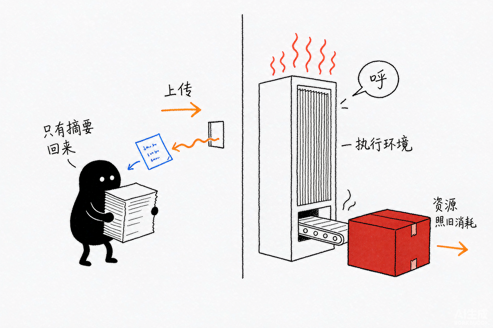

# Deep Agents 源码解析 05：Backend：命令执行与沙箱边界

## 一、源码定位

> **阅读基线**：Deep Agents 0.6.12（`libs/deepagents/`）。
> 源码版本与路径约定见 [源码版本与路径约定](source-baseline.md)。
>
> - Sandbox 接口与结果类型：`libs/deepagents/deepagents/backends/protocol.py` → `SandboxBackendProtocol`、`ExecuteResponse`、`ExecuteOffloadResult`、`FileUploadResponse`、`FileDownloadResponse`、`execute_accepts_timeout()`（定义命令执行和文件传输能力）
> - 沙箱基类：`libs/deepagents/deepagents/backends/sandbox.py` → `BaseSandbox.execute()`、`read()`、`write()`、`edit()`、`delete()`、`_write_preflight()`（用执行环境派生文件操作）
> - 输出卸载与文件传输：`libs/deepagents/deepagents/backends/sandbox.py` → `execute_with_offload()`、`_edit_via_upload()`、`upload_files()`、`download_files()`（处理大编辑负载、输出卸载和宿主应用与沙箱之间的文件传输）
> - 大输出捕获：`libs/deepagents/deepagents/backends/sandbox.py` → `_build_capture_execute_cmd()`、`_parse_capture_execute_output()`（在执行环境内捕获大输出）
> - 宿主机 Shell：`libs/deepagents/deepagents/backends/local_shell.py` → `LocalShellBackend.__init__()`、`execute()`（直接在宿主机运行 Shell）
> - LangSmith 沙箱：`libs/deepagents/deepagents/backends/langsmith.py` → `LangSmithSandbox.__init__()`、`execute()`、`read()`、`write()`、`upload_files()`、`download_files()`（用远端 SDK 实现 Sandbox Backend）
> - execute 工具能力判断：`libs/deepagents/deepagents/middleware/filesystem.py` → `supports_execution()`、`_unsupported_tools_and_execution_state()`、`_create_execute_tool()`（判断 Backend 能力并控制 `execute` 工具）
> - 捕获输出解析：`libs/deepagents/deepagents/middleware/filesystem.py` → `_resolve_capture()`、`_interpret_capture_output()`（确认捕获文件与执行环境同源，并生成模型可读结果）

## 二、执行能力、文件操作与环境隔离

Deep Agents 把“可以执行命令”和“命令运行在什么安全环境”拆成了不同层次：

```text
SandboxBackendProtocol
  -> 声明 Backend 有 execute()

BaseSandbox
  -> 复用 execute() 和文件传输能力
  -> 派生 read/write/edit/delete/grep/glob

具体 Backend + 部署环境
  -> 决定命令实际运行在哪里
  -> 决定文件、网络、进程和资源是否隔离
```

`SandboxBackendProtocol` 不是容器，`BaseSandbox` 也不是隔离器。真正的隔离来自容器、虚拟机、远程执行服务、操作系统权限、网络策略和资源生命周期。

读这篇源码时，可以先把问题分成四层：

| 要回答的问题 | 应该看哪里 | 不能直接推出的结论 |
| --- | --- | --- |
| Backend 有没有 `execute()`？ | `SandboxBackendProtocol`、`supports_execution()` | 不代表已经隔离 |
| 文件操作如何实现？ | `BaseSandbox`、`upload_files()`、`download_files()` | 不代表文件只在工作区内 |
| 大输出如何返回？ | `execute_with_offload()`、`_resolve_capture()` | 不代表命令消耗的资源变少 |
| 命令实际在哪里运行？ | 具体 Backend 和 Provider 部署配置 | 不能只从类名判断安全性 |


*图：能发出命令和已经被隔离是两回事——按钮好按，围栏有没有围住要看部署环境。*

## 三、一次脚本执行涉及两个文件空间

假设应用持有 `analyze.py`，希望模型在远端环境执行它。文件先通过 `upload_files()` 进入执行环境，随后 `execute()` 在那个环境中运行命令；需要把生成的文件交回应用时，再调用 `download_files()`。只有两端共享存储时，才可能省去传输，不能因为路径名字相同就假定文件已在执行端。

`BaseSandbox` 提供文件操作的通用实现：它把读写、搜索等操作转换成执行环境中的命令或文件传输。具体子类仍要实现如何执行、如何传输以及环境身份。这样新增远端服务时可以复用文件工具，但容器权限、网络访问和资源限制仍取决于该服务。

`LocalShellBackend` 的命令就在应用所在的宿主机执行；换成远端 Backend，命令才会沿相应客户端进入远端。大输出卸载只减少传回模型的文本量，不会减少命令已经使用的 CPU、内存或外部副作用。



*图：宿主和执行环境是两个文件空间——文件要上传过去，大箱子留在执行端，传回来的只有一张摘要纸条。*

## 四、`SandboxBackendProtocol` 只增加命令执行

类名里的 `Protocol` 是「统一接口约定」的意思，不是 Python 的 `typing.Protocol`：`BackendProtocol` 实际是 `abc.ABC`（抽象基类，带 `# noqa: B024`，方法用 `raise NotImplementedError` 而不是 `@abstractmethod`），靠 `isinstance()` 做名义判断。`SandboxBackendProtocol` 继承它，新增 `id` 和 `execute()`：

```python
class SandboxBackendProtocol(BackendProtocol):
    @property
    def id(self) -> str:          # 沙箱实例标识，用于跨调用定位同一个执行环境
        raise NotImplementedError

    def execute(                   # 唯一的命令执行入口，文件操作都可以由它派生
        self,
        command: str,
        *,
        timeout: int | None = None,
    ) -> ExecuteResponse:
        raise NotImplementedError
```

`ExecuteResponse` 的字段很少：

```python
@dataclass
class ExecuteResponse:
    output: str
    exit_code: int | None = None
    truncated: bool = False
```

它表达：

- `output`：标准输出和标准错误合并后的文本；
- `exit_code`：命令退出码；
- `truncated`：返回结果是否被 Backend 的输出上限截断。

接口没有规定：

- 命令是否在容器或虚拟机中运行；
- 是否禁止访问宿主机文件；
- 是否关闭网络；
- 是否限制 CPU、内存、磁盘和子进程；
- 超时后是否一定能杀掉整个进程树。

判断一个类是否“支持执行”，看的是它是否满足接口。判断它是否“安全”，还要继续读具体实现和部署配置。

### 1. `timeout` 是兼容参数，不是完整资源治理

Middleware 需要兼容旧 Backend，因此用 `execute_accepts_timeout()` 检查具体 `execute()` 是否接受 `timeout`：

```python
@lru_cache(maxsize=128)
def execute_accepts_timeout(cls: type[SandboxBackendProtocol]) -> bool:
    try:
        sig = inspect.signature(cls.execute)
    except (ValueError, TypeError):
        return False
    return "timeout" in sig.parameters
```

这个函数解决的是调用兼容问题：旧实现不接受新关键字时，调用方就不传它。它不保证：

- 超时能终止命令创建的所有子进程；
- 已经消耗的 CPU、内存和磁盘会被回收；
- 命令不会在超时后继续由远端服务运行。

具体效果由 Backend 的执行服务决定。

## 五、`BaseSandbox`：以执行环境为原语派生文件工具

`BaseSandbox` 的类注释已经给出实现关系：

- `ls()`、`grep()`、`glob()`、`read()` 通过 `execute()` 在目标环境运行脚本；
- `write()` 通过 `upload_files()` 传输内容；
- `edit()` 根据 `old_string + new_string` 的大小选择内联脚本或临时文件上传；
- 子类主要实现 `execute()`、`upload_files()`、`download_files()` 和 `id`。

这套设计把“远程环境差异”压缩到命令执行和字节传输两处，上层文件工具仍然使用同一套 `BackendProtocol` 结果类型。

从继承关系看，`BaseSandbox` 并没有把远程执行服务抽象成一套更大的生命周期接口。它要求子类提供几个无法由基类推导的能力：

下面只列出类中与 Provider 实现直接相关的抽象方法，方法体已省略：

```python
class BaseSandbox(SandboxBackendProtocol, ABC):
    @property
    @abstractmethod
    def id(self) -> str:          # 子类必须给出沙箱实例标识
        ...

    @abstractmethod
    def upload_files(             # 宿主与沙箱之间的文件传输，由子类按实现的协议完成
        self,
        files: list[tuple[str, bytes]],
    ) -> list[FileUploadResponse]:
        ...

    @abstractmethod
    def download_files(
        self,
        paths: list[str],
    ) -> list[FileDownloadResponse]:
        ...
```

`execute()` 是从 `SandboxBackendProtocol` 继承的抽象能力，`BaseSandbox` 自己显式要求子类实现 `id`、`upload_files()` 和 `download_files()`。`ls()`、`grep()`、`glob()`、分页读取、写入前的目录预检和编辑脚本都由基类复用这几项能力。实现一个新 Provider Backend 时，先设计命令执行、字节上传、字节下载和实例标识即可，文件工具的共同语义由 `BaseSandbox` 负责维持。

### 1. `read()`：在目标环境内分页

`BaseSandbox.read()` 构造读取脚本并交给 `execute()`：

```python
def read(
    self,
    file_path: str,
    offset: int = 0,
    limit: int = 2000,
) -> ReadResult:
    result = self.execute(_build_read_cmd(file_path, offset, limit))
    return _parse_read_output(result.output, file_path)
```

目标环境内的脚本负责：

- 按 `offset` 和 `limit` 读取文本窗口；
- 判断文本或二进制；
- 二进制转成 Base64；
- 对文本输出设置约 `500 KiB` 上限；
- 返回 `total_lines`、`start_line`、`end_line` 和 `next_offset`。

文件内容不会先完整下载到 Agent 进程。分页和大文件的第一层控制发生在执行环境内部，随后才通过 Backend 返回结构化结果。

### 2. `write()`：目录预检与正文传输分开

基类写入分两步：

```python
preflight_error = self._write_preflight(file_path)
if preflight_error is not None:
    return preflight_error

responses = self.upload_files(
    [(file_path, content.encode("utf-8"))]
)
```

`_write_preflight()` 通过执行环境创建父目录；正文由 `upload_files()` 传输，不拼接进 Shell 参数。这样可以避开命令参数长度限制，也减少正文经过多层 Shell 转义。

如果子类覆盖 `write()`，源码要求保留 `_write_preflight()` 的行为。`LangSmithSandbox.write()` 就是这个模式：目录预检仍由基类完成，正文改用 SDK 的原生写接口放进请求体。

### 3. `edit()`：小负载内联，大负载上传

源码用 UTF-8 字节数判断编辑负载：

```python
# 编辑走内联还是走上传，取决于 old/new 两段文本的 UTF-8 字节数
payload_size = (
    len(old_string.encode("utf-8"))
    + len(new_string.encode("utf-8"))
)

if payload_size <= _EDIT_INLINE_MAX_BYTES:
    return self._edit_inline(       # 小改动：直接把文本拼进命令
        file_path,
        old_string,
        new_string,
        replace_all,
    )

return self._edit_via_upload(       # 大改动：先上传文件再执行，避免命令行超长被截断
    file_path,
    old_string,
    new_string,
    replace_all,
)
```

当前 `_EDIT_INLINE_MAX_BYTES` 为 `50_000`：

- 小负载：把参数编码后交给沙箱内 Python 脚本，在目标环境内完成替换；
- 大负载：把 old/new 字符串上传为临时文件，再让目标环境内脚本读取并修改目标文件；
- 目标文件本身始终留在执行环境，不会因为大编辑被下载到 Agent 进程。

脚本还处理模型看到的 LF 与文件实际 CRLF 之间的差异，并尽量保持原文件的换行风格。这属于文件操作兼容逻辑，不是权限或隔离逻辑。

### 4. `delete()`：转义路径不等于限制路径

基类删除先探测目标，再执行递归删除：

```python
quoted = shlex.quote(file_path)
exists = self.execute(f"test -e {quoted} || test -L {quoted}")
if exists.exit_code is not None and exists.exit_code != 0:
    return DeleteResult(error=f"Error: '{file_path}' not found")

result = self.execute(f"rm -rf {quoted}")
```

`shlex.quote()` 只保证路径作为一个 Shell 参数传递，避免空格和元字符破坏命令结构。它不保证路径位于某个根目录，也不阻止当前执行环境访问其他资源。`rm -rf` 还可能在中途失败前已经删除部分内容。

## 六、宿主应用与沙箱之间的文件传输

### 1. `upload_files()`、`download_files()` 是跨边界端点

当 Agent 进程和执行环境不共享文件系统时，相同路径字符串不会让文件自动出现在两端。Backend 需要把宿主应用中的字节传到沙箱，也需要把沙箱中的字节传回宿主应用：

```text
宿主应用
  -> Backend.upload_files([(sandbox_path, bytes), ...])
  -> Provider SDK / HTTP API
  -> 沙箱文件系统

宿主应用
  <- Backend.download_files([sandbox_path, ...])
  <- Provider SDK / HTTP API
  <- 沙箱文件系统
```

接口中的返回值支持批量操作和部分成功：

```python
@dataclass
class FileUploadResponse:
    path: str
    error: FileOperationError | str | None = None

@dataclass
class FileDownloadResponse:
    path: str
    content: bytes | None = None
    error: FileOperationError | str | None = None
```

`responses[i]` 对应输入中的第 `i` 个文件。单个文件失败不会自动抛出异常，调用方应检查每项的 `error`。这对批量上传项目文件、批量下载构建产物很重要：一次权限错误不会抹掉其他成功结果。

这两个端点不是模型默认可见的文件工具。FilesystemMiddleware 提供 `read_file`、`write_file`、`edit_file`、`delete`、`ls`、`glob`、`grep` 和 `execute`，其中部分工具按 Backend 能力过滤；`upload_files()` / `download_files()` 更适合由 Backend 内部、Provider 适配器或自定义工具调用。

### 2. `write()` 与原生文件传输的关系

`BaseSandbox.write()` 把文本编码成 UTF-8 字节，再调用 `upload_files()`：

```python
preflight_error = self._write_preflight(file_path)
if preflight_error is not None:
    return preflight_error

responses = self.upload_files(
    [(file_path, content.encode("utf-8"))]
)
```

文件正文没有进入 Shell 命令参数。`_write_preflight()` 只负责在沙箱内创建父目录，真正的内容传输由 Provider 实现完成。

`LangSmithSandbox.write()` 覆盖了基类实现，但保留了相同的父目录预检；正文改用 Provider SDK：

```python
preflight_error = self._write_preflight(file_path)
if preflight_error is not None:
    return preflight_error

self._sandbox.write(file_path, content.encode("utf-8"))
return WriteResult(path=file_path)
```

这样做是为了避免大文本进入 `execute()` 请求体，减少 Shell 参数长度和多层转义带来的限制。

### 3. `read()` 不一定调用 `download_files()`

“读取文件给模型看”和“把原始文件下载到宿主应用”是两条不同路径：

```text
read_file("/app/main.py")
  -> 可能在沙箱内执行分页脚本
  -> 返回 ReadResult
  -> 模型看到指定行窗口

download_files(["/app/main.py"])
  -> Provider 原生传输完整 bytes
  -> 宿主应用得到 FileDownloadResponse
```

`BaseSandbox.read()` 通过 `execute()` 在沙箱内分页，只回传请求窗口。`LangSmithSandbox.read()` 则覆盖了这个方法，直接调用 Provider SDK 取得 bytes，再在 Backend 内复刻文本分页、二进制 Base64 和输出上限语义。

因此，不能从“Backend 支持下载”推断“模型每次 read_file 都会下载完整文件”。模型文件读取通常仍受分页和预览大小控制；原始 bytes 下载更适合宿主服务处理附件、构建产物或需要交给其他系统的文件。

### 4. 大编辑只传输修改负载

当 `old_string + new_string` 超过内联阈值时，`BaseSandbox._edit_via_upload()` 上传两个临时文件：

```text
宿主应用
  -> upload_files(old_tmp, new_tmp)
  -> 沙箱内脚本读取 old/new
  -> 沙箱内脚本修改 target
  -> 清理 old_tmp/new_tmp
```

目标文件没有离开沙箱。这里的文件传输承担的是“把编辑参数送进去”，不是把整个目标文件搬到 Agent 进程。Provider 需要保证临时文件上传和后续 `execute()` 看到同一个沙箱文件系统，否则编辑脚本无法读取刚上传的内容。

## 七、LocalShellBackend 的宿主机执行路径

`LocalShellBackend` 继承 `FilesystemBackend` 并实现 `SandboxBackendProtocol`，核心执行代码是：

```python
result = subprocess.run(
    command,
    check=False,
    shell=True,
    capture_output=True,
    stdin=subprocess.DEVNULL,
    text=True,
    timeout=effective_timeout,
    env=self._env,
    cwd=str(self.cwd),
)
```

这段代码决定了它的真实语义：

- `shell=True`：命令字符串由系统 Shell 解释；
- `cwd=self.cwd`：只设置当前工作目录；
- `env=self._env`：控制传给进程的环境变量；
- `timeout`：交给 `subprocess.run()`；
- 没有容器、虚拟机、chroot、网络命名空间或资源控制。

### 1. 构造参数的实际边界

| 参数 | 实际作用 | 不提供的能力 |
| --- | --- | --- |
| `root_dir` | 文件方法的根目录和 Shell 当前工作目录 | 不改变进程的真实根文件系统 |
| `virtual_mode` | 只改变文件方法的路径解析 | 不限制 `execute()` |
| `timeout` | 单次命令等待上限 | 不等于 CPU、内存和进程树限制 |
| `max_output_bytes` | 截断返回给上层的字符串 | 不限制命令继续产生输出 |
| `env` | 设置 Shell 环境变量 | 不构成权限隔离 |
| `inherit_env` | 是否继承父进程环境 | 不阻止命令访问宿主机资源 |

`virtual_mode=True` 只能让 `read_file("/a.txt")` 映射到 `root_dir/a.txt`，不能阻止：

```python
backend.execute("cat /etc/passwd")
backend.execute("curl https://example.com")
backend.execute("rm -rf /some/other/path")
```

这些命令能否成功，取决于当前用户和宿主机权限，而不是 `virtual_mode`。

### 2. 输出截断发生在命令执行之后

`LocalShellBackend.execute()` 拿到子进程结果后才按 `max_output_bytes` 截断：

```python
if len(output) > self._max_output_bytes:
    output = output[: self._max_output_bytes]
    output += f"\n\n... Output truncated at {self._max_output_bytes} bytes."
    truncated = True
```

它限制的是返回值大小，不是命令本身的输出行为。命令可能已经把更多内容写入管道、磁盘或网络，也可能继续消耗资源直到超时。

另需注意 `len(output)` 按 Python 字符计数，不是字节数。参数名叫 `max_output_bytes`，这一层实现按字符截断；对 UTF-8 多字节文本，实际保留的字节数可能大于设定值，追加的截断提示还会增加返回长度。这里不能按参数名称推导严格的字节上限。

`LocalShellBackend` 适合可信的本地开发 CLI、个人开发环境和受控 CI。多租户服务、不可信用户输入和不可信代码执行，需要真正隔离的远端 Backend。

## 八、FilesystemMiddleware 如何暴露 `execute`

Backend 支持执行，不代表模型一定能看到 `execute` 工具。FilesystemMiddleware 会在模型请求阶段检查能力：

```python
def supports_execution(backend: BackendProtocol) -> bool:
    if isinstance(backend, CompositeBackend):
        return isinstance(backend.default, SandboxBackendProtocol)
    return isinstance(backend, SandboxBackendProtocol)
```

Composite 只检查 `default`，因为它的 `execute()` 不按文件路径路由。

### 1. 模型请求前：过滤不可用工具

`_unsupported_tools_and_execution_state()` 会解析当前 Backend，并把不支持的 `execute` 或 `delete` 加入过滤集合：

```python
unsupported, execution_active, backend = (
    self._unsupported_tools_and_execution_state(
        tool_names,
        request.runtime,
    )
)
```

`_filter_unsupported_tools_and_apply_prompt()` 再把这些工具从当前模型请求的工具集合中排除。

这里排除的是**模型本轮可见的工具**。FilesystemMiddleware 实例、`self.tools` 中的工具对象和整个中间件栈仍然存在；下一次请求如果解析出的 Backend 能力变化，过滤结果可以重新计算。

### 2. 工具执行时：再次兜底

`_create_execute_tool()` 内部仍会解析 Backend 和检查能力：

```python
resolved_backend = self._get_backend(runtime)

# 执行入口再次校验能力，拒绝旧请求或直接调用中的不支持操作
if not supports_execution(resolved_backend):
    return ToolMessage(
        content=(
            "Error: Execution not available. This agent's backend "
            "does not support command execution (SandboxBackendProtocol)."
        ),
        name="execute",
        tool_call_id=runtime.tool_call_id,
        status="error",
    )
```

两次检查的职责不同：

- 模型请求前过滤：让模型不要选择当前不可用的工具；
- 工具执行时兜底：防止动态 Backend、旧请求或直接工具调用绕过能力判断。

这仍然只是能力控制，不是安全隔离。能力检查可以隐藏不支持的 `execute`，工具排除等其他配置也可能隐藏它；工具可见只说明当前请求允许模型选择该工具，不证明执行环境已隔离。

## 九、大输出卸载：把完整结果留在执行环境

命令输出过大时，Deep Agents 可以让完整输出留在沙箱文件系统，只把预览返回给模型。这个机制处理的是传输量和上下文大小，不改变命令权限。

### 1. `execute_with_offload()` 的两条路径

```python
def execute_with_offload(
    self,
    command: str,
    capture_path: str,
    *,
    max_inline_bytes: int,
    max_capture_bytes: int | None = None,
    timeout: int | None = None,
) -> ExecuteOffloadResult:
    use_timeout = timeout is not None and execute_accepts_timeout(type(self))
    if not self.enable_capture_offload:
        # 未开启源端捕获：按原样执行，由具体 Backend 返回输出
        result = (
            self.execute(command, timeout=timeout)
            if use_timeout
            else self.execute(command)
        )
        return ExecuteOffloadResult(offloaded=False, response=result)

    # 开启卸载：把命令包一层重定向到沙箱内文件，只带回少量内联输出
    wrapper = _build_capture_execute_cmd(
        command,
        capture_path,
        inline_budget=max_inline_bytes,
        max_capture_bytes=max_capture_bytes,
    )
    result = (
        self.execute(wrapper, timeout=timeout)
        if use_timeout
        else self.execute(wrapper)
    )
    return _parse_capture_execute_output(
        result.output,
        backend_truncated=result.truncated,
    )
```

`enable_capture_offload` 默认是 `False`。关闭时，命令原样执行，Backend 将结果交给上层；该结果可能已被 Backend 或传输层截断。后续通用卸载只能保存收到的内容，不能找回已被丢弃的输出。

开启时，`_build_capture_execute_cmd()` 生成一个 Shell 包装器：

```text
执行原命令
  -> 合并 stdout/stderr
  -> 写入 capture_path
  -> 输出不超过 inline budget：直接返回
  -> 输出超过 inline budget：返回头尾预览，完整内容留在 capture_path
```

捕获文件有默认的 `10 * 1024 * 1024` 硬上限。超过上限时，文件本身也不完整，`ExecuteResponse.truncated` 会被标记。

### 2. 为什么要单独保存退出码

如果直接把命令输出接到管道，Shell 可能把管道最后一个命令的退出码当成整个命令结果。捕获包装器因此把原命令退出码写到 `.ec` 文件，再读取回来：

```sh
{ ( eval "$__da_cmd" ); echo "$?" > "$__da_ecf"; } 2>&1 \
  | { head -c __MAXBYTES__ > "$__da_f"; cat > /dev/null; }
```

`cat > /dev/null` 用来排空超过捕获上限的剩余输出，减少写端因管道提前关闭收到 `SIGPIPE` 的机会。源码再由 `_parse_capture_execute_output()` 读取首行元数据：

```text
<sentinel> <exit_code> <offloaded> <capped>
<inline output or head/tail preview>
```

如果 Backend 传输层已经把包装器输出截断，元数据可能丢失。源码会回退为普通 `ExecuteResponse`，不会为了重新取得元数据而重跑命令，因为重跑可能产生第二次副作用。

### 3. `_resolve_capture()` 为什么要求同源

捕获流程是：

```text
execute(wrapper)
  -> capture_path 写入执行环境
  -> read_file(capture_path)
  -> 模型按需读取完整输出
```

因此执行命令和读取 `capture_path` 必须看到同一个文件系统。FilesystemMiddleware 的 `_resolve_capture()` 会检查：

- Backend 本身是否是 `BaseSandbox`；
- Composite 的 `default` 是否是执行 Backend；
- `capture_path` 是否会被路由到其他 Backend。

如果捕获路径被路由到 Store 或另一个文件系统 Backend，Middleware 不会启用源端捕获，而是回退到普通执行和通用消息处理。

### 4. `LangSmithSandbox` 为什么可以开启

`LangSmithSandbox` 继承 `BaseSandbox`，并设置：

```python
class LangSmithSandbox(BaseSandbox):
    enable_capture_offload = True
```

这是因为它连接的 LangSmith Sandbox 镜像提供了捕获包装器需要的 POSIX Shell 和基础命令。它还覆盖：

- `execute()`：调用远端 SDK；
- `read()`：用 SDK 读取并在本地复刻分页语义；
- `write()`：用 SDK 请求体传输正文，避免大内容进入 Shell 命令；
- `id`：返回远端 Sandbox 名称。

远端 SDK 解决的是连接方式，不自动替代网络、权限、资源和生命周期配置。

## 十、什么才是“真正的沙箱”

可以把源码中的机制按安全强度拆成几层：

| 层次 | 源码提供的内容 | 没有提供的内容 |
| --- | --- | --- |
| `SandboxBackendProtocol` | `execute()` 能力和结果结构 | 任何隔离 |
| `BaseSandbox` | 统一文件操作和传输逻辑 | 缩小 Shell 权限 |
| `virtual_mode` | 文件方法的路径边界 | 进程、网络、资源隔离 |
| `timeout` | 等待或执行服务的时间上限 | 完整进程树和资源治理 |
| `max_output_bytes` | 返回值截断 | 限制命令继续生成输出 |
| capture-at-source | 减少输出回传和模型上下文占用 | 改变命令能访问什么 |
| 容器、VM、远程执行服务 | 隔离基础和生命周期 | 仍需要正确配置权限、网络和资源 |

真正用于不可信代码执行的环境，至少还要检查：

- 执行进程是否与宿主机隔离；
- 文件系统是否只暴露工作区；
- 网络是否默认关闭或按白名单开放；
- CPU、内存、磁盘、进程数量是否有硬上限；
- 超时是否能终止整个任务；
- 沙箱是否按任务创建和销毁；
- 输出、日志和环境变量是否可能泄露敏感信息。

沙箱内的代码仍能使用执行身份获准访问的资源。若不可信内容诱导模型读文件或发送网络请求，能否成功取决于挂载、凭证和出站策略。框架的 Backend 接口不配置这些条件。

有凭证的业务操作可以由宿主侧工具完成，让执行环境只接触必要输入与产物。必须向沙箱提供凭证时，权限范围、有效期和可访问服务需要由部署方限定；这属于部署设计，不能从 `BaseSandbox` 的继承关系推出。

## 十一、两种 Agent 与沙箱的集成模式

沙箱运行的是代码，但 Agent 框架可以放在沙箱里，也可以放在宿主服务里。位置不同，会改变凭证、状态、通信和部署成本。

### 1. 模式一：Agent in sandbox

```text
用户 / 宿主入口
  -> 沙箱内 Agent 服务
       -> LLM Provider
       -> 本地 FilesystemMiddleware
       -> 本地 Shell / 文件系统
```

Agent 框架、中间件、工具和执行代码都在沙箱内。对 Agent 来说，代码和工作文件接近同一台机器上的本地开发环境，很多操作不需要在每次工具调用时跨网络传输。

代价也由这个位置决定：

- 需要为 Agent 框架和依赖构建沙箱镜像；
- 需要提供 HTTP、WebSocket 或 Provider 约定的通信层；
- Agent 直接调用模型时，API Key 可能进入沙箱；
- thread 状态、记忆和日志如何保存，需要在沙箱内外重新设计；
- 沙箱销毁会同时影响 Agent 进程和沙箱内的临时状态。

这种模式适合必须复现完整本地运行环境、且 Provider 已经妥善处理通信和凭证注入的场景。它的核心取舍是：减少 Agent 与沙箱之间的文件和调用往返，换来更高的镜像和运行时耦合。

### 2. 模式二：Sandbox as tool

```text
用户
  -> 宿主 Agent 服务
       -> LLM、记忆、调度和 checkpointer
       -> LangSmithSandbox / 其他 Sandbox Backend
            -> 远程 Shell 和沙箱文件系统
```

LLM 循环、Middleware、记忆和任务调度留在宿主服务，`execute()`、`read()`、`write()` 通过 Provider SDK 调用远程沙箱。当前源码中的 `LangSmithSandbox` 就是这种适配方式：它包装一个已有的 Provider Sandbox 对象，把远端执行和文件传输实现成 `BaseSandbox` 所需的 Backend 接口。

```python
class LangSmithSandbox(BaseSandbox):
    enable_capture_offload = True    # 启用大输出卸载：输出先落沙箱内文件

    def __init__(self, sandbox: Sandbox) -> None:
        # 只包装调用方传入的实例，不负责创建、认领或销毁沙箱
        self._sandbox = sandbox

    def execute(
        self,
        command: str,
        *,
        timeout: int | None = None,
    ) -> ExecuteResponse:
        effective_timeout = timeout if timeout is not None else self._default_timeout
        result = self._sandbox.run(command, timeout=effective_timeout)

        output = result.stdout or ""
        if result.stderr:
            output += "\n" + result.stderr if output else result.stderr

        return ExecuteResponse(
            output=output,           # stdout 与 stderr 已合并，调用方无法再区分两者
            exit_code=result.exit_code,
            truncated=False,         # 这一层不自己截断，截断交给上层处理
        )
```

这种模式的优势是：

- Agent 逻辑可以在宿主服务中快速迭代；
- API Key、thread 状态、记忆和调度可以留在沙箱外；
- 一个宿主 Agent 可以按任务创建或并行管理多个沙箱；
- 沙箱故障或销毁不会自动丢失宿主侧的 Agent 状态；
- Provider 可以独立负责镜像、网络、资源和生命周期治理。

代价集中在跨边界通信：

- `execute()` 有远程调用延迟；
- 文件输入要通过 `upload_files()` 传入；
- 文件输出或构建产物要通过 `download_files()` 取回；
- 沙箱路径、Agent 路径和宿主临时目录需要显式映射；
- 超时、重试、断线和沙箱回收都要由宿主服务处理。

这里的“宿主侧状态”和“沙箱侧状态”不是同一份状态：

| 状态 | 保存位置 | 作用域由谁决定 |
| --- | --- | --- |
| 对话消息、图状态、checkpointer、Store | Agent 宿主服务 | LangGraph 的 thread、store namespace |
| 工作文件、进程、安装的依赖和命令产物 | Provider 沙箱 | Provider 创建的 Sandbox 实例及其生命周期 |
| 两者的绑定关系 | 宿主服务中的 Backend 实例 | 应用决定按用户、会话、任务还是一次调用绑定 |

`LangSmithSandbox.__init__()` 接收的是一个已经创建好的 `Sandbox` 对象，`id` 只返回它的名称；这段适配代码没有创建、复用、暂停或销毁沙箱的逻辑。应用需要自己决定沙箱的生命周期：

- 按调用创建：隔离最清楚，但每次任务都要承担启动成本；
- 按会话复用：适合多轮编码任务，但必须处理文件残留和跨任务污染；
- 按用户或项目复用：减少创建次数，但隔离责任更重；
- 沙箱销毁后重建：宿主 Agent 状态仍可保留，但未上传或未下载的工作文件会随 Provider 沙箱一起消失。

因此，`Sandbox as tool` 的关键在于把**宿主 Agent 状态**和**沙箱工作状态**分别管理，再用 Sandbox ID、路径映射和 `upload_files()` / `download_files()` 建立它们之间的边界；把远程 Shell 包成一个类只是第一步。

### 3. 两种模式的边界对比

| 模式 | Agent 在哪里 | 文件如何跨边界 | 状态与生命周期 | 代价与适用条件 |
| --- | --- | --- | --- | --- |
| Agent in sandbox | Agent 框架和工具都在沙箱内 | 多数文件操作在沙箱内完成；宿主提交输入或取回产物时仍可调用 Provider 原生传输 | Agent 状态和工作文件通常绑定同一运行环境 | 需要构建镜像和通信层；模型凭证可能进入沙箱；适合必须复现完整运行环境的场景 |
| Sandbox as tool | LLM 循环、记忆和调度在宿主；执行工具调用远程沙箱 | 宿主文件通过 `upload_files()` 上传，产物通过 `download_files()` 下载；命令和 `read_file` 通过 Backend 请求远端执行 | 宿主可保留 Agent 状态，沙箱按调用、会话或任务管理 | 有 API 延迟和文件传输成本；需要处理路径映射、超时、重试和沙箱回收 |

选择时先看谁持有状态和凭证，再看文件传输量。需要把 Agent 当作长期运行服务时，`Sandbox as tool` 更容易把 Agent 状态与一次性执行环境分开；必须让 Agent 和代码运行在同一镜像中时，才考虑 `Agent in sandbox`。

## 十二、沙箱实例要绑定任务，不能只换一个线程 ID

“什么才是真正的沙箱”检查清单里的「沙箱是否按任务创建和销毁」，核心是宿主服务怎么持有和复用沙箱实例。`LangSmithSandbox` 只包装调用方提供的实例（`backends/langsmith.py:55-67`）：

```python
def __init__(self, sandbox: Sandbox) -> None:
    self._sandbox = sandbox
    self._default_timeout: int = 30 * 60

@property
def id(self) -> str:
    return self._sandbox.name
```

这里没有按 `thread_id` 创建、认领或销毁沙箱的逻辑。应用可以按线程、会话、任务或项目复用实例，但不存在由这个 Backend 保证的默认作用域。两个线程传入同一个 `Sandbox` 对象，仍会修改同一份文件。

常见两种复用粒度：

| 复用粒度 | 分配方式 | 状态持久性 | 主要风险 |
| --- | --- | --- | --- |
| 按任务或线程 | 每个任务独占一个沙箱，首次运行创建、后续轮次复用 | 同一任务内持久，任务结束或 TTL 过期销毁 | 启动成本；忘记销毁会持续计费 |
| 按用户或助手 | 同一用户的所有任务共享一个沙箱 | 文件、已装包、克隆仓库跨任务保留 | 跨任务污染、残留文件和并发覆盖 |

沙箱的费用与保留行为取决于提供商。应用应记录实例归属，并定义任务结束、空闲超时和恢复失败时的回收策略。TTL（资源有效期）只有在执行服务实际支持并配置后才生效，Backend 适配器不会自行提供它。

两个任务同时修改共享文件时，路径权限允许访问并不能防止覆盖；还需由资源分配或存储并发控制处理。**工程建议**：为独立任务分配独立沙箱或工作副本，在可信服务端保存租户、任务与 Sandbox ID 的绑定；共享代码由单一合并入口检查基线版本和冲突。Git worktree 可以隔开工作目录，仍共享宿主机权限和网络，不能代替安全沙箱。必须共享的数据由工具内部执行条件更新；不要持有数据库锁等待模型推理或人工审批。

验收时让两个任务同时修改各自的 `/workspace/progress.json`，确认读不到对方结果；再故意把它们绑定到同一实例，确认应用拒绝冲突任务或显式串行化。杀掉占用者后还要检查资源能否回收、旧任务能否继续写入；仅给租约设过期时间，不能阻止暂停后恢复的旧进程写入，必要时由存储端校验递增的 fencing token（隔离旧持有者的令牌）。

作用域的选择不在 `BaseSandbox` 源码里，而在调用方怎么复用沙箱实例。框架只接收传入的 Backend，不替应用决定一个沙箱该活多久、给谁使用。

## 十三、选型判断

### 1. 可信本地开发

可以使用 `LocalShellBackend`，但要把它看作“宿主机 Shell Backend”，配合人工审批、独立开发用户和敏感目录治理。

### 2. 需要远端执行

实现 `BaseSandbox` 子类，把 `execute()`、文件上传下载和 `id` 接到容器、VM 或远程执行服务。隔离策略放在执行服务，而不是放在类名里。

### 3. 命令输出很大

确认执行环境支持捕获包装器、`capture_path` 与执行命令同源，再开启 `enable_capture_offload`。捕获机制只解决输出传输，不解决命令权限。

### 4. 只需要文件工具

优先使用 `StateBackend`、`StoreBackend` 或 `FilesystemBackend`，不要为了使用 `read_file` 而给 Agent 增加 Shell 执行能力。

## 十四、工程判断

05 篇的源码结论是：

- `SandboxBackendProtocol` 只表示 Backend 有 `execute()`；
- `BaseSandbox` 让远端文件操作复用同一个执行原语；
- `LocalShellBackend` 明确运行在宿主机，不提供沙箱隔离；
- FilesystemMiddleware 只负责能力过滤和调用兜底；
- capture-at-source 只降低大输出的传输和上下文成本；
- 真正隔离由执行环境和部署策略提供。

### 1. 怎么用

| 场景 | 选择 | 理由 |
| --- | --- | --- |
| 本地开发 CLI、个人脚本 | `LocalShellBackend` | 信任边界就是本机用户 |
| CI 中跑受控任务 | `LocalShellBackend` + 独立用户 | 任务可信，但仍需限制进程权限 |
| 不可信代码、多租户 | `BaseSandbox` 子类接远端容器/VM | 隔离责任在执行服务，不在类名 |
| 只需要文件工具 | `StateBackend` / `StoreBackend` | 不引入 `execute` 能力，减少攻击面 |

**避免使用**：不可信输入不要直接交给 `LocalShellBackend`；`virtual_mode` 只约束文件工具的路径解析，`execute()` 仍按宿主机用户权限运行。**改造要点**：覆盖 `BaseSandbox.write()` 时应保留 `_write_preflight()` 创建父目录及报告错误的语义。它不是 `read()` 的检查，也不提供路径授权；源码明确说明预检与实际写入分属两次 Backend 调用，仍有检查后资源发生变化的时间窗口。

04 篇解释文件存储和路由，05 篇解释命令执行和隔离，两篇的 Backend 交集只保留必要的接口边界。

**相关测试**：`libs/deepagents/tests/unit_tests/backends/` · `libs/deepagents/tests/integration_tests/`

## 十五、延伸阅读

**下层：LangChain / LangGraph**

- [LangGraph 11：预建工具层](../langgraph/11-prebuilt-tool-layer.md)——工具节点与执行环境的连接方式

**本系列**

- [04：Backend 接口与实现](./04-backend-protocol-and-implementations.md)——六种 Backend 的存储与能力边界
- [08：FilesystemMiddleware 与权限](./08-filesystem-middleware-and-permissions.md)——`execute` 工具怎样暴露给模型

**上层：方法论与案例**

- [Agent 系统设计 05：工作区与沙箱](../../../../notes/agent-system-design/05-action/agent-workspace-sandbox.md)——沙箱实例与任务生命周期的绑定
- [Agent 系统设计 05：权限与后置条件](../../../../notes/agent-system-design/05-action/agent-permission-and-postconditions.md)——能力接口为什么不能替代安全边界
