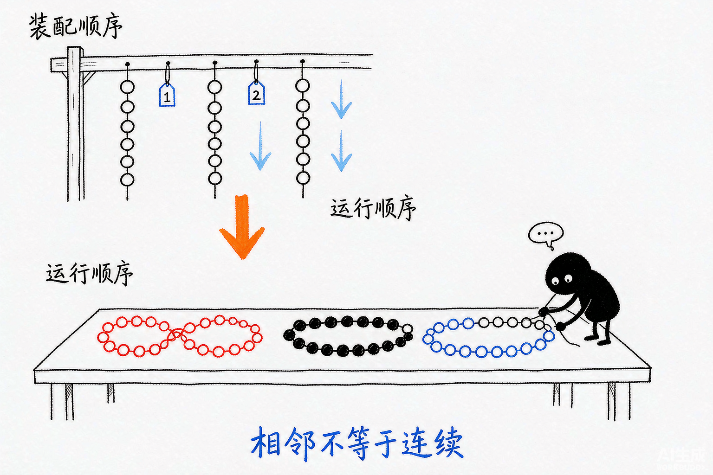
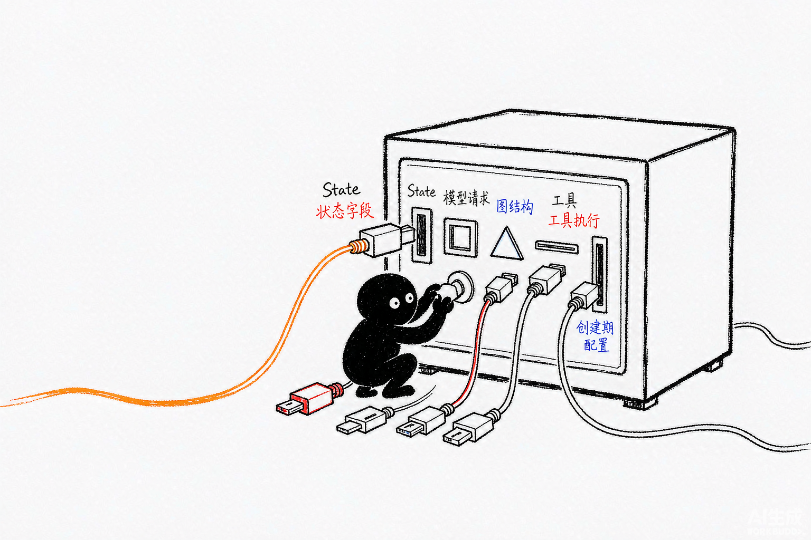
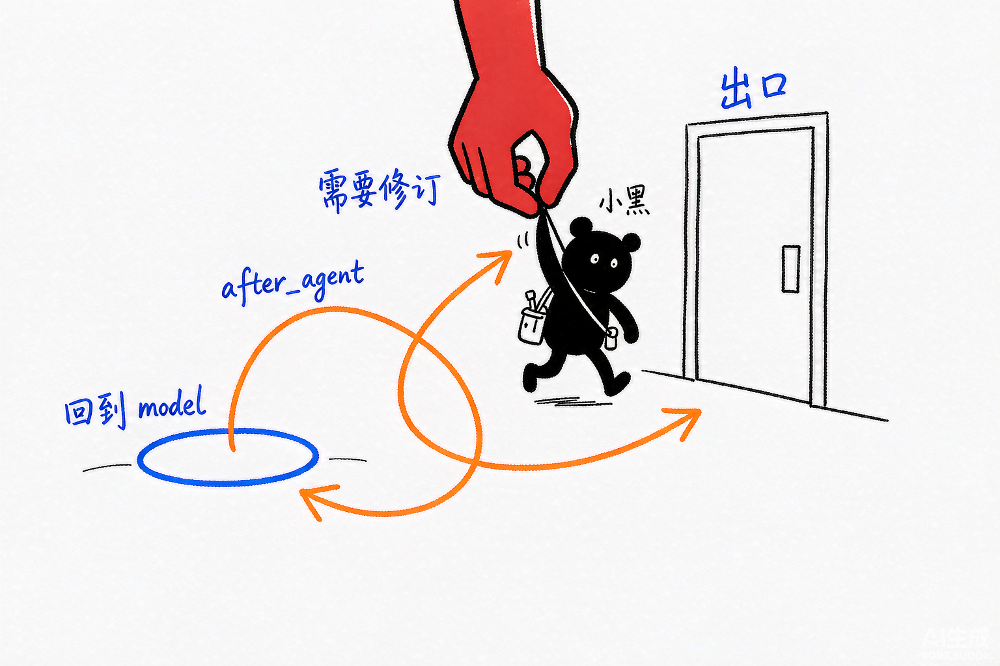

# Deep Agents 源码解析 06：Middleware 的增量与装配顺序

## 一、源码定位

> **阅读基线**：Deep Agents 0.6.12（`libs/deepagents/`）；LangChain 中间件编排以 `libs/langchain_v1/` 的实现为准。
> 源码版本与路径约定见 [源码版本与路径约定](source-baseline.md)。
>
> - Deep Agents 总装配：`libs/deepagents/deepagents/graph.py:376-1042` → `create_deep_agent()`、`_apply_custom_middleware()`、`_append_prompt_caching_middleware()`、`_merge_fs_interrupt_on()`
> - LangChain Agent 图构造：`libs/langchain_v1/langchain/agents/factory.py:984-1114`、`1566-1749` → 工具收集、Hook 收集、包装器组合和图边连接
> - 请求与响应对象：`libs/langchain_v1/langchain/agents/middleware/types.py:85-267` → `ModelRequest`、`ModelResponse`、`ExtendedModelResponse`
> - 主代理内建 Middleware：`libs/deepagents/deepagents/middleware/` → `filesystem.py`、`skills.py`、`memory.py`、`summarization.py`、`subagents.py`、`patch_tool_calls.py`
> - 工具过滤：`libs/deepagents/deepagents/middleware/_tool_exclusion.py:31-65` → `_ToolExclusionMiddleware`
> - 文件权限到 HITL 的转换：`libs/deepagents/deepagents/middleware/_fs_interrupt.py` → `_build_interrupt_on_from_permissions()`、`_FS_TOOL_PATH_ARGS`
>
> 官方对照：
>
> - [Deep Agents customization：Full stack](https://docs.langchain.com/oss/python/deepagents/customization#full-stack)
> - [LangChain middleware：Execution order](https://docs.langchain.com/oss/python/langchain/middleware/custom#execution-order)
> - [Deep Agents context engineering](https://docs.langchain.com/oss/python/deepagents/context-engineering)
> - [Deep Agents subagents](https://docs.langchain.com/oss/python/deepagents/subagents)

## 二、装配列表怎样变成多条执行链

Deep Agents 的 Middleware 有两个容易被混淆的顺序：

1. **装配顺序**：`create_deep_agent()` 把哪些 Middleware 放进哪一套列表，以及 `middleware=` 如何替换或插入。
2. **运行顺序**：LangChain `create_agent()` 从这份列表中分别抽取 `before_*`、`wrap_*`、`after_*`，再把它们接成图节点或包装器链。

同一份列表不会原样变成一条流水线。三个中间件的实现方式可以说明这一点：

- `PatchToolCallsMiddleware` 只实现 `before_agent()`；
- `MemoryMiddleware` 主要实现 `before_agent()` 和 `wrap_model_call()`；
- `FilesystemMiddleware` 同时提供工具、模型包装和工具包装。

它们在列表中相邻，不代表每一轮都会按同一条路径连续执行。



*图：装配顺序是一串珠子；运行顺序是被重新编成的几条长短不一的链。*

可以把一个 Middleware 看成一次或多次增量：

| 增量面 | LangChain 装配入口 | 结果 |
| --- | --- | --- |
| State | `state_schema`、`before_agent()`、`before_model()` | 增加状态字段，或更新消息和运行状态 |
| 模型请求 | `wrap_model_call()` | 修改 `ModelRequest`，例如 system message、工具列表、模型和参数 |
| 工具执行 | `tools`、`wrap_tool_call()` | 注册工具，或包住工具执行前后的处理 |
| 图结构 | `before_*`、`after_*` | 增加节点和边，参与循环、跳转和收尾 |
| 创建期配置 | `create_deep_agent()` 内部逻辑 | 合并 Profile、权限、缓存和子代理配置，还没有进入运行时 |



*图：一个中间件的改动落在五个增量面，各有各的接口。*

读源码时不要只问“有哪些中间件”。更有效的顺序是：

```text
create_deep_agent()
  -> 这份 Middleware 被放入哪一套列表
  -> create_agent()
  -> 它实现了哪些 Hook
  -> Hook 修改了 State、请求、工具还是图
  -> 这一改动如何影响下一层
```

`AgentMiddleware` 是扩展 Agent 的基类：实例可以提供工具、状态字段，以及在特定时机被调用的 hook。`ToolNode` 是执行模型所选工具、收集工具结果的图节点。`before_agent` 这样的节点式 hook 和 `wrap_model_call` 这样的函数包装器，进入执行链的方式不同。

以配置了 Memory 的文件读取任务为例：入口 hook 将文件快照写入 State；模型节点构造 `ModelRequest`，包装器把快照加入系统消息；模型返回带读取请求的 `AIMessage`，图转到 ToolNode；文件结果成为 `ToolMessage` 写入消息历史，再进入下一轮模型调用。`request.override()` 只调整某一轮请求副本，hook 返回的状态更新才交给图合并保存。

模型循环通常回到 `before_model`，不会每轮从 `before_agent` 重新开始。`after_agent` 也不保证执行后立刻结束：Rubric 等中间件可以返回跳转要求修订。理解这些边之后，才能判断某个 hook 的执行次数。



*图：走到出口不等于结束；评分不通过会被拉回 model 重做。*

## 三、LangChain 如何把 Middleware 变成 Agent 图

### 1. `create_agent()` 先收集增量

`create_agent()` 不要求每个 Middleware 都实现完整功能。它会分别读取各个实例暴露的属性和 Hook。

工具先被收集到 `ToolNode`。下面是 `factory.py` 的真实代码摘录，省略了结构化输出等无关分支：

```python
middleware_tools = [t for m in middleware for t in getattr(m, "tools", [])]   # ① 中间件注册的工具

# 收集实现同步或异步工具调用包装 hook 的中间件
middleware_w_wrap_tool_call = [
    m
    for m in middleware
    if m.__class__.wrap_tool_call is not AgentMiddleware.wrap_tool_call
    or m.__class__.awrap_tool_call is not AgentMiddleware.awrap_tool_call
]

# 需要在客户端执行的工具必须注册到 ToolNode
available_tools = middleware_tools + regular_tools    # ② 中间件工具与调用方工具一起进 ToolNode

tool_node = (
    ToolNode(
        tools=available_tools,
        wrap_tool_call=wrap_tool_call_wrapper,
        awrap_tool_call=awrap_tool_call_wrapper,
    )
    if available_tools or wrap_tool_call_wrapper or awrap_tool_call_wrapper
    else None      # 既没有工具也没有包装器时，ToolNode 整块不生成
)

if tool_node:
    default_tools = list(tool_node.tools_by_name.values()) + built_in_tools
else:
    default_tools = list(built_in_tools)
```

这段代码解释了两个边界：

- `middleware.tools` 是工具注册增量，最终会进入 `ToolNode`；
- `wrap_tool_call` 是工具执行包装增量，它不会自动注册工具。

`FilesystemMiddleware` 同时拥有文件工具和工具包装，所以既影响模型能看到的工具，也影响工具结果如何回到 State。`_ToolExclusionMiddleware` 没有 `tools`，只在模型请求阶段过滤工具，因此它不会删除 `ToolNode` 中的工具实例。

随后，`create_agent()` 按 Hook 类型建立独立列表：

```python
# 四类 Hook 各自成链：同一个中间件可以同时出现在多条链里
middleware_w_before_agent = [
    m
    for m in middleware
    if m.__class__.before_agent is not AgentMiddleware.before_agent
    or m.__class__.abefore_agent is not AgentMiddleware.abefore_agent
]

middleware_w_before_model = [
    m
    for m in middleware
    if m.__class__.before_model is not AgentMiddleware.before_model
    or m.__class__.abefore_model is not AgentMiddleware.abefore_model
]

middleware_w_after_model = [
    m
    for m in middleware
    if m.__class__.after_model is not AgentMiddleware.after_model
    or m.__class__.aafter_model is not AgentMiddleware.aafter_model
]

middleware_w_after_agent = [
    m
    for m in middleware
    if m.__class__.after_agent is not AgentMiddleware.after_agent
    or m.__class__.aafter_agent is not AgentMiddleware.aafter_agent
]
```

模型包装器则被组合成一个函数。`_chain_model_call_handlers()` 的实现明确写着：列表中的第一个 Handler 是最外层。

```python
# 从右向左组合：外层包住内层，列表首项成为最外层
composed_handler = compose_two(handlers[-2], handlers[-1])
for h in reversed(handlers[:-2]):
    composed_handler = compose_two(h, composed_handler)
```

当每层都向内调用一次 handler 时，列表 `[A, B, C]` 的嵌套关系如下：

```text
wrap_model_call:
  A -> B -> C -> model
  model -> C -> B -> A

wrap_tool_call:
  A -> B -> C -> tool
  tool -> C -> B -> A
```

包装器也可以直接返回响应，跳过后续调用，或为重试多次调用 handler。因此，一次 model 节点执行不必然等于一次供应商请求。`ExtendedModelResponse` 附带的状态更新还由包装链归集后交给图，不能靠修改请求副本来代替。

### 2. Hook 顺序和图边顺序

LangChain 会为真正实现了 Hook 的 Middleware 创建节点。入口节点和循环节点的选择也在 `factory.py` 中明确区分：

```python
# 入口节点只跑一次：优先 before_agent，其次 before_model，都没有就直接进模型
if middleware_w_before_agent:
    entry_node = f"{middleware_w_before_agent[0].name}.before_agent"
elif middleware_w_before_model:
    entry_node = f"{middleware_w_before_model[0].name}.before_model"
else:
    entry_node = "model"

# 循环入口排除 before_agent：它只在整场开始时执行一次
if middleware_w_before_model:
    loop_entry_node = f"{middleware_w_before_model[0].name}.before_model"
else:
    loop_entry_node = "model"

# 循环出口每一轮都会经过，after_model 链挂在这里
if middleware_w_after_model:
    loop_exit_node = f"{middleware_w_after_model[0].name}.after_model"
else:
    loop_exit_node = "model"
```

这解释了官方文档中的执行规则：

| Hook | 执行顺序 | 执行频率 |
| --- | --- | --- |
| `before_agent` | Middleware 列表正序 | 进入一次 Agent 时 |
| `before_model` | Middleware 列表正序 | 每次模型循环 |
| `wrap_model_call` | 列表正序进入，逆序返回 | 每次模型调用 |
| `wrap_tool_call` | 列表正序进入，逆序返回 | 每次工具调用 |
| `after_model` | Middleware 列表逆序 | 每次模型响应 |
| `after_agent` | Middleware 列表逆序 | Agent 结束时 |

`itertools.pairwise()` 只负责把同一类 Hook 的相邻节点连接起来。例如 `[A, B, C]` 的 `before_agent` 会得到 `A.before_agent -> B.before_agent -> C.before_agent`。它不负责包装器嵌套，也不改变 Middleware 的注册顺序。

### 3. `ModelRequest` 和 `ModelResponse` 是请求边界

`ModelRequest` 是一次模型调用的请求快照，`messages` 明确不包含 `system_message`：

```python
@dataclass(init=False)
class ModelRequest(Generic[ContextT]):
    model: BaseChatModel
    messages: list[AnyMessage]  # 历史消息，不含系统提示
    system_message: SystemMessage | None                            # 系统提示单独成一个字段
    tool_choice: Any | None
    tools: list[BaseTool | dict[str, Any]]                          # 本轮可见工具，可被中间件改写
    response_format: ResponseFormat[Any] | None
    state: AgentState[Any]
    runtime: Runtime[ContextT]
    model_settings: dict[str, Any] = field(default_factory=dict)    # 透传给 provider 的额外设置
```

`ModelRequest.override()` 通过 dataclass 的 `replace()` 返回新请求对象，适合替换本轮的字段。它不会深拷贝所有消息和工具；若直接修改嵌套列表或消息对象，仍可能影响共享引用。下面摘录实现，省略兼容参数处理：

```python
def override(self, **overrides: Unpack[_ModelRequestOverrides]) -> ModelRequest[ContextT]:
    """使用指定字段的覆盖值创建新的请求对象。"""
    # ... 处理 system_prompt 兼容逻辑
    return replace(self, **overrides)
```

`model_node()` 在包装器链最内层才把 system message 和普通消息合并后调用模型：

```python
messages = request.messages
if request.system_message:
    messages = [request.system_message, *messages]

output = model_.invoke(messages)
```

因此：

```text
State
  -> ModelRequest.state / messages / system_message
  -> wrap_model_call 链
  -> model.invoke()
  -> ModelResponse
  -> State 更新
```

`ModelResponse` 保存模型产生的消息和可选的结构化结果。`ExtendedModelResponse` 还可以带一个 `Command`，让 `wrap_model_call()` 在返回模型结果的同时提交额外 State 更新。它与模型消息并列，是模型响应旁边的一条 State 更新通道。

## 四、Deep Agents 的 Middleware 是怎样增量装配的

### 1. 主代理先建立核心栈

`create_deep_agent()` 的主代理构造从 `TodoListMiddleware` 开始：

```python
deepagent_middleware: list[AgentMiddleware[Any, Any, Any]] = [
    TodoListMiddleware(),
]

if skills is not None:
    deepagent_middleware.append(SkillsMiddleware(backend=backend, sources=skills))   # 条件项

deepagent_middleware.append(
    FilesystemMiddleware(
        backend=backend,
        custom_tool_descriptions=_profile.tool_description_overrides,
        _permissions=permissions,
    )
)

# 同步子代理是有条件项；这里留下引用，后面还要回填 private_state_keys
sub_agent_middleware: SubAgentMiddleware | None = None
if inline_subagents:
    sub_agent_middleware = SubAgentMiddleware(
        backend=backend,
        subagents=inline_subagents,
        task_description=_profile.tool_description_overrides.get("task"),   # Profile 可改写 task 描述
        state_schema=state_schema,
    )
    deepagent_middleware.append(sub_agent_middleware)

# 摘要与修补无条件加入
deepagent_middleware.extend(
    [
        create_summarization_middleware(model, backend),
        PatchToolCallsMiddleware(),
    ]
)

if async_subagents:
    deepagent_middleware.append(
        AsyncSubAgentMiddleware(async_subagents=async_subagents)
    )
```

当相应参数全部启用时，主代理核心栈是：

```text
TodoListMiddleware
  -> SkillsMiddleware
  -> FilesystemMiddleware
  -> SubAgentMiddleware
  -> SummarizationMiddleware
  -> PatchToolCallsMiddleware
  -> AsyncSubAgentMiddleware
```

这七个位置承担的增量不同：

| Middleware | 主要增量 |
| --- | --- |
| `TodoListMiddleware` | 注册 `write_todos`，维护任务清单 |
| `SkillsMiddleware` | 发现 Skill 元数据，并在模型请求中展示索引 |
| `FilesystemMiddleware` | 注册文件工具，解析 Backend，过滤不支持的工具，并处理文件工具调用 |
| `SubAgentMiddleware` | 注册 `task`，把同步子代理编译为可调用的任务类型 |
| `SummarizationMiddleware` | 在模型包装阶段压缩历史、卸载大内容并处理上下文超限重试 |
| `PatchToolCallsMiddleware` | 在 Agent 入口修补悬空的 `AIMessage.tool_calls` |
| `AsyncSubAgentMiddleware` | 注册异步子代理的后台任务工具 |

这里的箭头只表示**列表中的装配位置**。例如 `PatchToolCallsMiddleware` 并不会在每个模型调用前包住 `SummarizationMiddleware`，因为它没有 `wrap_model_call()`，只有 `before_agent()`。

### 2. Profile、缓存、记忆和工具排除属于尾部增量

核心栈建立后，源码按下面的顺序追加尾部能力：

```python
# 在追加尾部中间件之前，记录核心栈的名称
# 先记下核心栈的名字，后面用它判断新中间件该插在哪
_main_core_names = {m.name for m in deepagent_middleware}

deepagent_middleware.extend(_profile.materialize_extra_middleware())   # Profile 扩展
_append_prompt_caching_middleware(deepagent_middleware)                # 供应商缓存断点

if memory is not None:
    deepagent_middleware.append(
        MemoryMiddleware(
            backend=backend,
            sources=memory,
            add_cache_control=True,     # 记忆注入后打缓存断点，变化被隔离在断点之后
        )
    )

# 文件权限与调用方配置合并成最终的 HITL 条件
main_interrupt_on = _merge_fs_interrupt_on(
    _build_interrupt_on_from_permissions(permissions or []),
    interrupt_on,
)
if main_interrupt_on is not None:
    deepagent_middleware.append(
        HumanInTheLoopMiddleware(interrupt_on=main_interrupt_on)
    )
```

随后才处理 Profile 排除、自定义 Middleware 和最终的工具排除：

```python
# Profile 排除执行两次，中间夹着自定义中间件的合并：
# 用户中间件可能又把某个被排除的名字加回来
deepagent_middleware = _apply_excluded_middleware(
    deepagent_middleware,
    _profile,
    matched_classes=_main_matched_classes,
    matched_names=_main_matched_names,
)

deepagent_middleware = _apply_custom_middleware(
    deepagent_middleware,
    middleware or [],
    core_names=_main_core_names,     # 新项插入核心栈之后，同名则原位替换
)

deepagent_middleware = _apply_excluded_middleware(
    deepagent_middleware,
    _profile,
    matched_classes=_main_matched_classes,
    matched_names=_main_matched_names,
)

if _profile.excluded_tools:
    deepagent_middleware.append(
        _ToolExclusionMiddleware(excluded=_profile.excluded_tools)
    )
```

主代理的最终相对顺序可以写成：

```text
核心栈
  -> middleware= 中的新 Middleware
  -> Profile.extra_middleware
  -> Provider Prompt Caching
  -> MemoryMiddleware
  -> HumanInTheLoopMiddleware
  -> _ToolExclusionMiddleware
```

其中每一项都是条件性的。`middleware=` 中与现有 `.name` 相同的实例会原位替换；新名称的实例插入最后一个核心 Middleware 之后，因此位于 Profile、Prompt Caching、Memory 和 HITL 之前。

源码用两次 `_apply_excluded_middleware()` 不是重复劳动。第一次先移除默认项，第二次防止自定义 Middleware 把被排除的名称重新装回去。`excluded_tools` 则必须最后追加，否则后续 Middleware 可能再次把同名工具放进 `request.tools`。

### 3. 为什么 Memory 位于 Prompt Caching 之后

`_append_prompt_caching_middleware()` 先追加 Provider 的缓存适配器，`MemoryMiddleware` 再追加动态记忆：

```text
列表顺序：
  Prompt Caching -> Memory

wrap_model_call 请求方向：
  Prompt Caching -> Memory -> model
```

这样 Provider 缓存中间件先处理稳定的 system prompt 和工具定义，再由 Memory 在内层追加会变化的记忆块。Memory 内容更新时，静态前缀仍有机会保持稳定。`MemoryMiddleware(add_cache_control=True)` 还会在 Anthropic 请求的动态记忆块上设置自己的缓存断点。

缓存中间件本体的可选依赖探测、模型门控和 Bedrock 的 cachePoint 插桩，在 [17：Prompt Caching 中间件与供应商缓存断点](./17-prompt-caching.md) 中展开。

这三种机制要分开：

| 机制 | 负责什么 | 不负责什么 |
| --- | --- | --- |
| Provider Prompt Caching Middleware | 按供应商协议给请求设置缓存标记 | 不保存 Memory 文件 |
| `MemoryMiddleware` | 读取文件并将内容注入请求 | 不自动判断哪些信息值得保存 |
| `cache=cache` | 交给 LangGraph 的图执行缓存 | 不是 Provider Prompt Cache |

### 4. 文件权限不是另一个文件专用循环

文件权限的 `mode="interrupt"` 在创建期被转换成通用 HITL 配置：

```text
FilesystemPermission(mode="interrupt")
  -> _build_interrupt_on_from_permissions()
  -> _merge_fs_interrupt_on()
  -> HumanInTheLoopMiddleware(interrupt_on=...)
```

`_fs_interrupt.py` 负责判断一个文件工具调用是否命中受保护路径，`FilesystemMiddleware` 负责工具层的权限检查，`HumanInTheLoopMiddleware` 负责暂停与恢复。三者不是同一个类，也不在同一个 Hook 中完成全部工作。

用户显式传入的 `interrupt_on` 会覆盖权限转换产生的同名配置。HITL 需要 checkpointer 保存中断前的状态，否则无法可靠恢复。

## 五、同一个“增量”在运行时会改什么

### 1. Skills：State 保存索引，ModelRequest 展示索引

`SkillsMiddleware` 的发现过程写入 `skills_metadata`，但不会把所有 `SKILL.md` 正文塞进 State 或 system message：

```text
before_agent()
  -> Backend.ls() / download_files()
  -> 解析 frontmatter
  -> State["skills_metadata"]

wrap_model_call()
  -> 读取 State["skills_metadata"]
  -> request.override(system_message=...)
```

模型命中 Skill 后，才通过 `read_file` 读取完整 `SKILL.md`。`scripts/`、`references/` 和 `assets/` 仍留在 Backend 中，只有 Skill 正文要求读取或执行时，模型才会继续调用文件工具。

详细的发现、读取和脚本执行链见 [07：SkillsMiddleware：发现、读取与脚本执行](./07-skills-middleware.md)。

### 2. Memory：入口加载快照，请求阶段注入文本

`MemoryMiddleware` 使用自己的 `MemoryState`：

```python
class MemoryState(AgentState):
    memory_contents: NotRequired[
        Annotated[dict[str, str], PrivateStateAttr]
    ]
```

它的运行路径是：

```text
before_agent()
  -> Backend.download_files(sources)
  -> State["memory_contents"]

wrap_model_call()
  -> _format_agent_memory()
  -> append_to_system_message()
  -> request.override(system_message=...)
```

`memory_contents` 是当前 State 中的快照。模型调用期间通过 `edit_file` 修改 Backend 文件，不会自动刷新这份快照；是否在下一轮重新读取，取决于 State 是否重新进入没有 `memory_contents` 的 Agent 入口。

详细边界见 [13：MemoryMiddleware 与长期上下文装配](./13-memory-middleware.md)。

### 3. Filesystem：工具注册、请求过滤和工具执行

`FilesystemMiddleware` 的增量比 `MemoryMiddleware` 更宽：

```text
FilesystemMiddleware
  -> tools: ls/read_file/write_file/edit_file/glob/grep/...
  -> wrap_model_call: 过滤不支持的 execute/delete，追加文件工具说明
  -> 工具函数: validate_path、权限检查、Backend 调用
  -> wrap_tool_call: 处理过大的工具结果和文件卸载
```

`execute` 的可见性还取决于 Backend 是否实现 `SandboxBackendProtocol`。模型请求中没有 `execute`，不代表工具实例从所有内部结构中消失；它表示本轮模型不会被提供这个工具。

文件工具、权限和执行边界见 [08：FilesystemMiddleware：工具、权限与运行时边界](./08-filesystem-middleware-and-permissions.md)。

### 4. PatchToolCalls：直接修补消息 State

`PatchToolCallsMiddleware` 不进入模型包装链。它在 Agent 启动时找出没有对应 `ToolMessage` 的工具调用，并提交消息 State 更新：

```python
if not any(
    tool_call["id"] is not None
    and tool_call["id"] not in answered_ids
    for msg in messages
    if isinstance(msg, AIMessage)
    for tool_call in (*msg.tool_calls, *msg.invalid_tool_calls)
):
    return None

return {"messages": [RemoveMessage(id=REMOVE_ALL_MESSAGES), *patched_messages]}
```

这里修改的是消息历史本身。模型下一次看到的消息列表会包含补齐后的 `ToolMessage`，而不是只在某一个 `ModelRequest` 副本中临时加一段文本。

### 5. ToolExclusion：只改模型的工具视图

`_ToolExclusionMiddleware` 的核心代码只有几行：

```python
def wrap_model_call(
    self,
    request: ModelRequest[Any],
    handler: Callable[[ModelRequest[Any]], ModelResponse[Any]],
) -> ModelResponse[Any]:
    # 只在模型请求这一层过滤：工具实例仍在 ToolNode 里，只是本轮模型看不到
    if self._excluded:
        filtered = [
            t for t in request.tools
            if _tool_name(t) not in self._excluded
        ]
        request = request.override(tools=filtered)   # override 生成请求副本，不改 State
    return handler(request)
```

它不会：

- 从 Middleware 列表中移除 `FilesystemMiddleware` 或 `SubAgentMiddleware`；
- 删除 `ToolNode` 中的工具实例；
- 修改 State；
- 把一个普通 Backend 变成沙箱。

因此：

```text
excluded_tools={"task"}
  -> 模型请求中没有 task
  -> SubAgentMiddleware 仍然存在
  -> task 的注册和执行代码仍在图中
```

## 六、主代理、通用子代理和声明式子代理不是一套栈

### 1. 主代理

主代理的完整相对顺序如下，条件项用括号标出：

```text
TodoList
  -> Skills（配置 skills 时）
  -> Filesystem
  -> SubAgent（存在同步子代理时）
  -> Summarization
  -> PatchToolCalls
  -> AsyncSubAgent（配置 async_subagents 时）
  -> middleware= 中的新项
  -> Profile.extra_middleware
  -> Provider Prompt Caching
  -> Memory（配置 memory 时）
  -> HumanInTheLoop（配置 interrupt_on 或权限中断时）
  -> ToolExclusion（配置 excluded_tools 时）
```

主代理拥有完整 Harness 能力，所以它可能同时有 `task`、文件工具、Memory、Skills 和异步子代理工具。

### 2. 默认 `general-purpose` 子代理

Deep Agents 会在没有显式同名子代理且 Profile 没有关闭时自动生成 `general-purpose`。它使用独立的 `gp_middleware`：

```python
# 通用子代理使用独立栈：没有 SubAgent，也没有 AsyncSubAgent
gp_middleware: list[AgentMiddleware[Any, Any, Any]] = [
    TodoListMiddleware(),
    FilesystemMiddleware(
        backend=backend,
        custom_tool_descriptions=_profile.tool_description_overrides,
        _permissions=permissions,
    ),
    create_summarization_middleware(model, backend),
    PatchToolCallsMiddleware(),
]

# Skills 在子代理栈里排在 Filesystem 之后，与主代理的顺序不同
if skills is not None:
    gp_middleware.append(
        SkillsMiddleware(backend=backend, sources=skills)
    )

gp_middleware.extend(_profile.materialize_extra_middleware())
_append_prompt_caching_middleware(gp_middleware)
```

它的核心顺序是：

```text
TodoList
  -> Filesystem
  -> Summarization
  -> PatchToolCalls
  -> Skills（主代理传入 skills 时）
  -> Profile.extra_middleware
  -> Provider Prompt Caching
```

GP 子代理有三个边界：

- 它没有 `SubAgentMiddleware`，不会因为主代理能委派任务就自动形成递归的 `task` 栈；
- 它没有主代理的 `MemoryMiddleware`，Memory 不会整体复制进去；
- 主代理的 `middleware=` 不会全部继承，只筛选出名称命中 GP 原始槽位的实例，并按名称原位替换。

源码的继承筛选是：

```python
_gp_original_name_to_index = {
    m.name: i
    for i, m in enumerate(gp_middleware)
}

_gp_inheritable = [
    m
    for m in (middleware or [])
    if m.name in _gp_original_name_to_index
]

gp_middleware = _apply_custom_middleware(
    gp_middleware,
    _gp_inheritable,
)
```

所以，主代理里新增一个名称为 `RequestAuditMiddleware` 的 Middleware，不会自动出现在 GP 子代理；只有替换 GP 已有槽位的同名实例，才会沿着这条继承路径进入。

GP 子代理的 `interrupt_on` 不是直接复制主代理的 HITL 实例。源码先把权限和用户配置合并进 `general_purpose_spec`，之后由 `create_sub_agent()` 编译这个 spec：

```python
interrupt_on = spec.get("interrupt_on")
if interrupt_on:
    middleware.append(
        HumanInTheLoopMiddleware(interrupt_on=interrupt_on)
    )
```

### 3. 声明式 `SubAgent`

声明式子代理由 `create_deep_agent()` 先处理 spec，再由 `create_sub_agent()` 调用 `create_agent()` 编译。它的初始列表来自下面这段源码：

```python
# 声明式子代理同样有一套独立栈，用的是子代理自己的 Profile 与权限
subagent_middleware: list[AgentMiddleware[Any, Any, Any]] = [
    TodoListMiddleware(),
    FilesystemMiddleware(
        backend=backend,
        custom_tool_descriptions=_subagent_profile.tool_description_overrides,   # 子代理自己的 Profile
        _permissions=subagent_permissions,
    ),
    create_summarization_middleware(subagent_model, backend),   # 用子代理自己的模型算阈值
    PatchToolCallsMiddleware(),
]

# 子代理的 Skill 必须显式声明，不继承主代理的 skills 配置
subagent_skills = spec.get("skills")
if subagent_skills:
    subagent_middleware.append(
        SkillsMiddleware(
            backend=backend,
            sources=subagent_skills,
        )
    )

_subagent_core_names = {m.name for m in subagent_middleware}
subagent_middleware.extend(
    _subagent_profile.materialize_extra_middleware()
)
_append_prompt_caching_middleware(subagent_middleware)
```

初始装配顺序是：

```text
TodoList
  -> Filesystem
  -> Summarization
  -> PatchToolCalls
  -> Skills（spec 显式声明 skills 时）
  -> Profile.extra_middleware
  -> Provider Prompt Caching
```

然后源码依次应用 Profile 排除和 `spec.middleware`：

```python
subagent_middleware = _apply_excluded_middleware(
    subagent_middleware,
    _subagent_profile,
    matched_classes=_subagent_matched_classes,
    matched_names=_subagent_matched_names,
)

subagent_middleware = _apply_custom_middleware(
    subagent_middleware,
    spec.get("middleware", []),
    core_names=_subagent_core_names,
)

subagent_middleware = _apply_excluded_middleware(
    subagent_middleware,
    _subagent_profile,
    matched_classes=_subagent_matched_classes,
    matched_names=_subagent_matched_names,
)
```

这里有一个容易写错的顺序：

- `spec.middleware` 中的同名实例原位替换；
- 新名称实例插入最后一个核心 Middleware 之后；
- 因此新实例位于 Profile.extra 和 Prompt Caching 之前，不是追加到 Prompt Caching 之后；
- `excluded_tools` 在此之后追加；
- `interrupt_on` 在 `create_sub_agent()` 中再追加 `HumanInTheLoopMiddleware`。

声明式子代理的最终形态通常是：

```text
核心栈
  -> spec.middleware 中的新项
  -> Profile.extra_middleware
  -> Provider Prompt Caching
  -> ToolExclusion（配置 excluded_tools 时）
  -> HumanInTheLoop（子代理拥有 interrupt_on 时）
```

主代理的 `skills` 不会自动进入声明式子代理。只有 spec 显式声明 `skills`，这个子代理才会获得自己的 `SkillsMiddleware` 和独立的 Skill State。官方文档把这条规则称为 Skills inheritance：默认 GP 子代理继承主代理 Skills，自定义子代理不继承。

### 4. `CompiledSubAgent` 是已装配好的边界

如果 spec 中包含 `runnable`，Deep Agents 将其当作 `CompiledSubAgent` 使用：

```python
if "runnable" in spec:
    # 已编译的子代理直接使用
    inline_subagents.append(spec)
```

它不会再为这个 runnable 重新添加 `TodoListMiddleware`、`FilesystemMiddleware`、Profile 或 Prompt Caching。调用方已经拥有这个子图的完整装配权，也要自己承担它的 State、权限和上下文边界。

## 七、关闭、排除和替换分别表达什么

### 1. 创建参数控制是否加入

创建参数控制某个能力是否进入装配分支：

| 能力 | 关闭方式 |
| --- | --- |
| Skills | `skills=None` |
| Memory | `memory=None` |
| 异步子代理 | 不传 `async_subagents` |
| 主代理 HITL | 不传 `interrupt_on`，权限中也不使用 `mode="interrupt"` |
| 默认 GP 子代理 | Profile 中设置 `general_purpose_subagent.enabled=False`，且不传同步子代理 |

`memory=[]` 与 `memory=None` 也不同：前者仍会创建 `MemoryMiddleware`，后者不创建。

### 2. `excluded_middleware` 移除 Middleware

`HarnessProfile.excluded_middleware` 在装配阶段按类或公开名称匹配 Middleware。被移除的实例不会参与任何 Hook，也不会进入最终的 `create_agent()` 调用。

Filesystem 和 SubAgent 是 Deep Agents 的受保护脚手架：

- `FilesystemMiddleware` 承载内建文件工具、Backend 和文件权限；
- `SubAgentMiddleware` 承载 `task` 工具和同步子代理。

如果不需要 `task`，应关闭默认 GP 子代理，而不是用 `excluded_middleware` 删除 `SubAgentMiddleware`。

### 3. `excluded_tools` 只过滤模型请求

```python
HarnessProfile(
    excluded_tools=frozenset({"grep", "task"}),
)
```

它只让最终模型请求看不到 `grep` 和 `task`。工具注册、Middleware 实例、Backend 和 ToolNode 仍然存在。这个配置适合“保留 Harness 结构，但限制模型可用工具”的场景。

### 4. `middleware=` 增加或原位替换

`middleware=` 是增量入口，不是删除入口：

```python
deepagent_middleware = _apply_custom_middleware(
    deepagent_middleware,
    middleware or [],
    core_names=_main_core_names,
)
```

`_apply_custom_middleware()` 的规则是：

```text
同名：
  替换原实例，保留原位置

新名称：
  插入最后一个 core_names 成员之后
  位于 Profile、Prompt Caching、Memory、HITL 之前
```

这允许调用方替换一个默认实现，例如用自定义的 `SummarizationMiddleware` 实例覆盖默认摘要配置；也允许在核心能力之后增加审计、限流或请求改写。但它不应该被用来伪造“移除某个默认能力”。

## 八、把装配顺序还原成一次请求

假设主代理启用了 Skills、Memory、同步子代理、文件权限审批和 `excluded_tools={"task"}`。下面分开看入口、模型调用和工具调用，避免把不同 Hook 拼成一条假流水线。

### 1. Agent 入口

```text
START
  -> 实现 before_agent 的 Middleware，按列表正序
  -> before_model 节点，按列表正序
  -> model
```

这一步可能发生：

- `SkillsMiddleware` 扫描来源并把 `skills_metadata` 写入 State；
- `MemoryMiddleware` 从 Backend 读取记忆文件并把 `memory_contents` 写入 State；
- `PatchToolCallsMiddleware` 为悬空工具调用补齐 `ToolMessage`。

只有实现了 `before_agent()` 的 Middleware 才会进入这条路径。`FilesystemMiddleware` 不会因为它出现在核心栈里，就自动拥有一个 `before_agent` 节点。

### 2. 一次模型调用

`create_agent()` 先用当前 State 构造 `ModelRequest`，再执行 `wrap_model_call` 链：

```text
ModelRequest
  -> 核心栈中实现 wrap_model_call 的 Middleware
  -> Profile.extra_middleware
  -> Provider Prompt Caching
  -> Memory
  -> HumanInTheLoop 中实现模型包装的部分
  -> ToolExclusion
  -> model.invoke()
  -> ModelResponse
  -> 包装链逆序返回
```

真实链条会跳过没有实现对应 Hook 的 Middleware。`PatchToolCallsMiddleware` 不在其中；它只在 Agent 入口修补 State。

`ToolExclusion` 放在列表尾部，所以它看到的是前面所有工具注入和工具改写后的 `request.tools`，最后再把被排除的名称过滤掉。这就是“工具过滤必须晚于工具注入”的源码原因。

### 3. 工具调用

如果模型返回 `AIMessage.tool_calls`，图会根据消息状态转到 `tools` 节点：

```text
model
  -> after_model（如果有，按列表逆序）
  -> tools
  -> wrap_tool_call 链
  -> ToolNode / 具体工具
  -> ToolMessage
  -> before_model（下一轮）
```

文件权限的 `deny` 检查发生在 Filesystem 工具函数内部；`interrupt` 则由 HITL 中间件在工具调用边界暂停。审批恢复后，工具仍会回到 Filesystem 的权限检查路径，不能把“已经审批”理解成绕过文件权限。

如果模型没有工具调用，图通常沿着 `after_model` 和 `after_agent` 进入收尾；若 hook 返回跳转指令，则按指令继续执行。`after_model` 和 `after_agent` 各自按列表逆序执行。

## 九、工程上怎么判断一个 Middleware 应该放在哪里

### 1. 先看它修改的对象

| 需求 | 更合适的 Hook | 判断 |
| --- | --- | --- |
| 进入一次运行时加载 State | `before_agent` | 适合 Memory、启动检查和恢复修补 |
| 每轮模型调用前根据 State 改提示 | `before_model` 或 `wrap_model_call` | 需要区分 State 更新和请求副本 |
| 想在模型前后都包住调用 | `wrap_model_call` | 列表前项是外层 |
| 想包住工具执行和结果 | `wrap_tool_call` | 只会进入工具调用路径 |
| 想在结束时保存或清理 | `after_agent` | 按列表逆序收尾 |
| 需要提供新工具 | `middleware.tools` | 工具会进入 `ToolNode` |
| 需要改变创建期权限或子代理配置 | `create_deep_agent()` | 这是装配期逻辑，不是运行时 Hook |

### 2. 再看它依赖谁

几个源码约束值得直接记住：

- 需要看到所有工具注入结果的过滤器，要放在工具注入 Middleware 之后；
- 需要基于 State 生成请求的 Middleware，通常拆成 `before_agent` 加 `wrap_model_call`；
- 会改变动态 system prompt 的 Middleware，应该关注 Provider Prompt Caching 的外层位置；
- 需要给子代理独立能力的配置，应该进入子代理自己的 spec，而不是假设主代理栈会自动复制；
- 已经编译的 `CompiledSubAgent` 不要再次套一层默认 Harness。

### 3. 最后检查它是否跨越了状态边界

`request.override()` 只改变当前模型调用看到的请求；返回 State 更新或 `before_agent()` 返回字典，才会影响后续图状态。两者都能让模型“看到更多内容”，但生命周期不同：

```text
request.override(...)
  -> 当前模型调用有效
  -> 不自动写入消息 State

return {"some_state": value}
  -> 交给 LangGraph reducer 更新 State
  -> 可能影响后续轮次和 checkpoint
```

这也是为什么 `SkillsMiddleware` 和 `MemoryMiddleware` 都分成“加载 State”和“注入请求”两段，而不是在一个 Hook 里把所有内容直接拼进 prompt。

## 十、按修改对象选择扩展位置

接入一个新能力前，先判断它是否需要介入模型的选择过程。固定工具直接通过 `tools=` 传入即可；只有需要额外状态、动态提示词或调用拦截时，才需要中间件。

| 需求 | 最小接入位置 | 需要验证的结果 |
| --- | --- | --- |
| 增加固定工具 | 工厂 `tools=` | 工具是否注册，并出现在最终可见集合中 |
| 每轮按身份调整工具 | `wrap_model_call` | 传给 handler 的 `request.tools` 是否正确；执行端授权另行检查 |
| 记录工具执行结果 | `wrap_tool_call` 中 handler 返回之后 | 成功、错误和 Command 三种返回是否都被处理 |
| 保存影响后续轮次的数据 | 节点式 hook 返回更新，或 `ExtendedModelResponse.command` | 数据是否进入正确 State 字段并按 Reducer 合并 |
| 进入任务时加载文件快照 | `before_agent` | 已有状态是否导致跳过加载；恢复位置是否会经过入口 |

例如预算包装器直接返回兜底响应时，后面的 Memory 注入和实际模型调用可能都不发生；如果收尾的 Rubric 又要求修订，图仍可能再次进入模型节点。判断“这个中间件能结束任务”需要同时检查返回值和后续图边，不能只看它位于列表中的位置。

中间件名称还决定工厂合并时的替换位置。自定义同名实例会占据原槽位，新名称实例进入核心栈之后。对模型请求包装器，前项先看到请求、后项先看到返回值；对节点式 hook，仍应按 `before_*`、`after_*` 各自的边检查。

对应测试位于 `libs/langchain_v1/tests/unit_tests/agents/test_factory.py` 与 `libs/deepagents/tests/unit_tests/test_graph.py`。排查时记录进入 hook 的状态、交给 handler 的请求和返回的状态更新，三者分别观察。

## 十一、延伸阅读

**下层：LangChain / LangGraph**

- [LangChain 04：中间件控制面](../langchain/04-middleware-control-plane.md)——Hook 类型与执行顺序的底层定义
- [LangChain 06：中间件总览](../langchain/06-middleware-overview.md)——LangChain 内置中间件清单，本篇增量的对照组

**本系列**

- [07：SkillsMiddleware](./07-skills-middleware.md)——按需加载类中间件怎么写
- [13：MemoryMiddleware](./13-memory-middleware.md)——常驻注入类中间件与按需类的区别

**上层：方法论与案例**

- [Agent 系统设计 03：上下文管理](../../../../notes/agent-system-design/03-view/agent-context-management.md)——中间件为什么是上下文装配的主要落点
