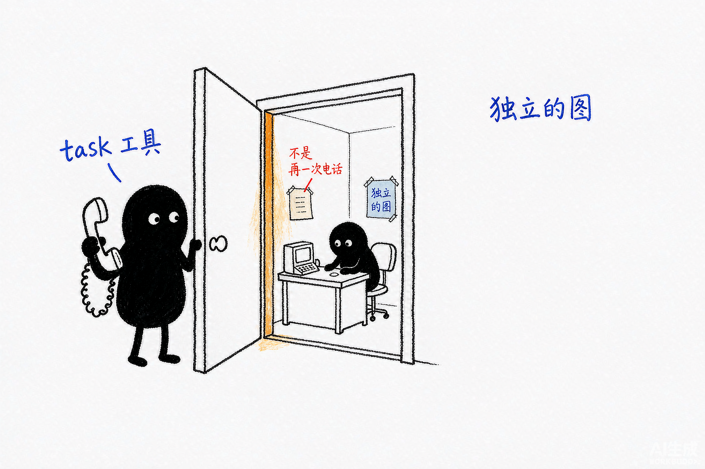
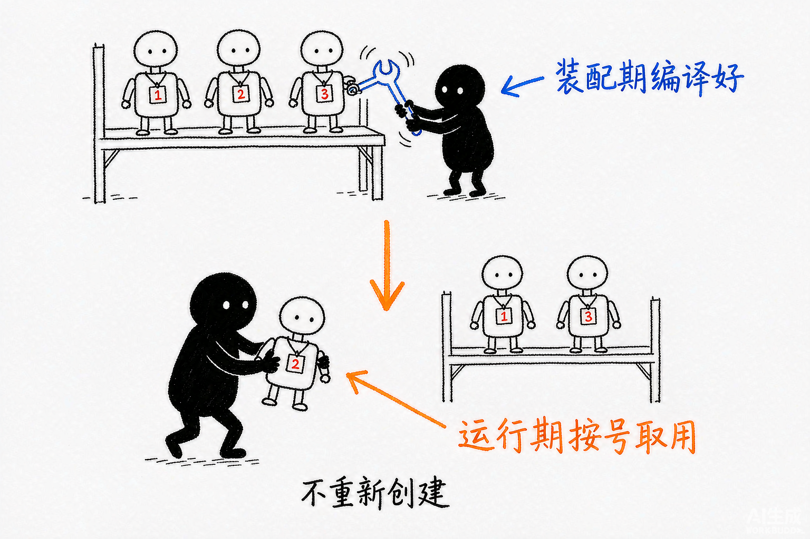

# Deep Agents 源码解析 09：同步 SubAgent：装配、上下文隔离与结果回写

## 一、源码定位

> **阅读基线**：Deep Agents 0.6.12（`libs/deepagents/`）。
> 源码版本与路径约定见 [源码版本与路径约定](source-baseline.md)。
>
> 主代理装配子代理：`libs/deepagents/deepagents/graph.py` → `create_deep_agent()`
>
> 子代理声明类型：`libs/deepagents/deepagents/middleware/subagents.py` → `SubAgent`、`CompiledSubAgent`
>
> 同步中间件构造：`libs/deepagents/deepagents/middleware/subagents.py` → `SubAgentMiddleware.__init__()`、`private_state_keys`
>
> task 工具构造与执行：`libs/deepagents/deepagents/middleware/subagents.py` → `_build_task_tool()`、`_compile_spec()`、`task()`、`atask()`
>
> 声明式子代理编译：`libs/deepagents/deepagents/middleware/subagents.py` → `create_sub_agent()`
>
> 子代理输入 State：`libs/deepagents/deepagents/middleware/subagents.py` → `_validate_and_prepare_state()`
>
> 子代理结果回写：`libs/deepagents/deepagents/middleware/subagents.py` → `_return_command_with_state_update()`
>
> 私有 State 字段收集：`libs/deepagents/deepagents/middleware/subagents.py` → `private_state_keys`；`libs/deepagents/deepagents/middleware/_state.py` → `private_state_field_names()`

同步 SubAgent 的核心是把一个独立 Agent 图包装成 `task` 工具。把它理解成“在父 Agent 里再调用一次模型”，会漏掉子代理自带的模型、提示词、工具和 State：

```text
create_deep_agent()
  -> 构造 SubAgentMiddleware
  -> SubAgentMiddleware.__init__() 创建 task 工具
  -> create_agent() 汇总 middleware.tools

父 Agent 模型
  -> 生成 task(description, subagent_type)
  -> task() 选择子代理 runnable
  -> 准备新的子代理 State
  -> 同步 invoke 子代理
  -> 提取最终结果
  -> Command 写回父 Agent 的 ToolMessage
```



*图：task 是委派入口；门后是另一间完整的办公室——独立的模型、提示词、工具和 State。*

这里的“创建子 Agent”和“调用子 Agent”是两个阶段，不能都归到 `task` 工具上：

```text
装配阶段：
SubAgent spec
  -> create_sub_agent()
  -> create_agent()
  -> 得到子 Agent runnable
  -> 保存到 subagent_graphs

运行阶段：
父 Agent 模型
  -> 调用 task(subagent_type, description)
  -> 选择已经准备好的 runnable
  -> invoke 子 Agent
  -> 把结果写回父 Agent
```



*图：机器人提前编译好挂上编号；运行时只取用，不重新创建。*

`task` 是模型可调用的委派入口，不是每次调用都重新创建一套 Agent。它之所以设计成工具，是因为父 Agent 的模型只能通过工具调用表达“我要把这项工作交给某个子 Agent”；工具函数再负责选择 runnable、准备独立 State、执行子 Agent，并把结果包装成 `ToolMessage` 返回。

子代理只在当前 `task` 调用期间运行，完成后把一次结果交回父 Agent。它不会自动拿到父 Agent 的完整消息历史，也不会把每个中间工具结果都展开到父 Agent。

## 二、委派的输入、运行与返回契约

同步子代理被建模成 `task` 工具：装配期把子代理 spec 编译成独立 runnable，运行后把允许传播的状态字段写回父 Agent。消息结果优先取 `structured_response`，否则取最后一条非空 AIMessage 文本，再包装成 ToolMessage。

父子之间是 State 隔离；文件、凭证和 Backend 能力仍由子代理自己的配置决定，委派不额外带来资源隔离。

同步调用占住父 Agent 当前循环，适合短而明确的委派；长时间运行或跨请求管理的任务交给异步子代理。

## 三、这篇要回答的设计问题

读这篇源码时，可以先抓住四个问题：

| 问题 | 负责回答的源码位置 |
| --- | --- |
| `task` 工具什么时候出现？ | `create_deep_agent()`、`SubAgentMiddleware.__init__()` |
| 父 Agent 到底把什么交给子 Agent？ | `_validate_and_prepare_state()` 和嵌套 Runnable 的 runtime/config |
| 子 Agent 的中间过程为什么不会回到父 Agent？ | `_return_command_with_state_update()` |
| 什么情况下不该使用同步子代理？ | `task()` 的同步 `invoke()` 与异步子代理的职责边界 |

同步调用只适合父 Agent 需要立即拿到结果的任务。同步 task 也可由工具执行层并行调度，但父调用仍等待这批委派结束；跨请求管理的远程任务见 [12：异步 SubAgent](./12-async-subagent.md)。

### 1. 一次委派中，父子消息怎样变化

假设父状态包含十条对话消息和普通业务字段 `project_id`，模型发起调用 ID 为 `call_review` 的 `task`，描述为“检查报告中的引用”。`Runnable` 是可通过 `invoke()` 调用的执行对象，此处指选中的子 Agent 图。

| 阶段 | 子 Agent 收到或生成什么 | 父 Agent 保存什么 |
| --- | --- | --- |
| 准备输入 | 筛选允许传入的字段；`messages` 换成一条任务描述 | 原有对话及这次 `task` 调用 |
| 子图运行 | 自己的模型消息和工具结果不断累积 | 等待该工具调用结束 |
| 子图返回 | 提供最终状态；提取结构化结果或最后一条非空 AI 文本 | 增加配对 `call_review` 的 ToolMessage，并合并允许回写的状态字段 |

`Command` 是交给图执行器的更新指令。工具返回 `Command(update=...)` 后，父状态各字段按自己的合并规则更新；不是把子图的整个消息列表复制回去。子图读取共享 Backend 产生的资源访问，也不会因消息列表分开而自动隔离。

## 四、`create_deep_agent()` 什么时候装配同步 SubAgent

主代理的核心装配顺序是：

```text
TodoListMiddleware
  -> SkillsMiddleware（配置 skills 时）
  -> FilesystemMiddleware
  -> SubAgentMiddleware（存在同步子代理时）
  -> SummarizationMiddleware
  -> PatchToolCallsMiddleware
```

`SubAgentMiddleware` 只有在 `inline_subagents` 非空时才加入。`inline_subagents` 可能来自两种来源：

- 用户传入的同步 `SubAgent` 或 `CompiledSubAgent`；
- `create_deep_agent()` 自动加入的 `general-purpose` 子代理。

默认的 `general-purpose` 子代理会自动加入，除非 Profile 将 `general_purpose_subagent.enabled` 设为 `False`，或者用户已经提供了同名的同步子代理。完全不想要 `task` 工具时，需要同时满足：

```text
general-purpose 子代理关闭
  + 没有传入同步 subagents
  -> inline_subagents 为空
  -> 不构造 SubAgentMiddleware
  -> 主代理没有 task 工具
```

如果只是不想让模型看到 `task`，可以使用 `Profile.excluded_tools`；这会隐藏工具，但不会移除 `SubAgentMiddleware` 实例。装配和工具可见性的区别见 [06：中间件增量与装配顺序](./06-middleware-increments.md)。

关闭子代理不要走 `excluded_middleware` 去移除 `SubAgentMiddleware`：它是同步子代理的必备脚手架，写进排除列表会直接抛 `ValueError`。

关掉委派能力的唯一正路是 `general_purpose_subagent=GeneralPurposeSubagentProfile(enabled=False)`，再配合不传任何同步 `subagents`。

## 五、两种子代理输入

### 1. `SubAgent`：声明如何装配 Agent

声明式 `SubAgent` 是一个配置字典，描述如何装配一套新的 Agent。它是框架在装配阶段交给 `create_sub_agent()` 的输入，不是运行时传给 `task` 后才开始解析的任务对象：

| 字段 | 作用 | 未提供时 |
| --- | --- | --- |
| `name` | `task` 选择子代理时使用的名称 | 必填 |
| `description` | 写入 `task` 工具说明，帮助父 Agent 做路由 | 必填 |
| `system_prompt` | 子代理自己的系统提示词 | 必填，不继承主代理 |
| `model` | 子代理使用的模型 | 继承主代理模型 |
| `tools` | 子代理可用工具 | 继承主代理工具；一旦指定则整体覆盖 |
| `middleware` | 子代理追加或替换的 Middleware | 不继承，默认空 |
| `interrupt_on` | 子代理内部的人工审批配置 | 继承主代理，可覆盖 |
| `skills` | 子代理自己的 Skill 来源 | 不继承 |
| `permissions` | 子代理文件权限 | 继承主代理；一旦指定则整体替换 |
| `response_format` | 子代理结构化输出格式 | 不继承 |

`create_sub_agent()` 本身要求 `model` 和 `tools` 存在。通过 `create_deep_agent()` 使用声明式 spec 时，`graph.py` 会先补齐默认模型、工具、Profile Middleware 和权限，再把处理后的 spec 交给它。

所以 `SubAgent` 描述的是“要准备什么样的子 Agent”，`task` 的 `subagent_type` 描述的是“这一次要调用哪一个已经准备好的子 Agent”。

这些字段的继承规则在 `graph.py` 里对应三种不同的 `spec.get()` 写法，不是统一的「有就用自己的、没有就用父的」：

```python
subagent_model = spec.get("model", model)                          # 省略即继承父模型
subagent_permissions = spec.get("permissions", permissions)        # 省略即继承，指定则整体替换
subagent_tools = spec.get("tools") if "tools" in spec else tools   # 省略即继承，指定则整体覆盖
subagent_interrupt_on = spec.get("interrupt_on", interrupt_on)     # 省略即继承，指定则覆盖
subagent_skills = spec.get("skills")                               # 完全不继承
subagent_middleware = spec.get("middleware", [])                   # 完全不继承，默认空
```

三类行为：`model`/`permissions`/`interrupt_on` 省略即继承父值；`tools` 省略即继承、一旦指定整体覆盖（不做并集）；`skills`/`middleware`/`response_format` 完全不继承。`system_prompt` 更特殊，它是必填字段，子代理必须自己提供，不会回退到主代理提示词。

继承里最容易踩的是 `tools` 的整体覆盖：给子代理写一个工具清单，得到的是「只有这些工具」，不是「父工具 + 这些工具」。子代理若需要主代理的某个工具，必须显式再写一遍。

### 2. `CompiledSubAgent`：直接提供可运行对象

`CompiledSubAgent` 已经包含 `runnable`：

```python
{
    "name": "researcher",
    "description": "Researches a topic and returns findings.",
    "runnable": compiled_agent,
}
```

它必须返回包含 `messages` 的 State。父 Agent 依靠这个字段提取结果；如果还要返回自定义 State 字段，需要由调用方自己保证 runnable 的 State schema。

对于 `CompiledSubAgent`，`_compile_spec()` 不会重新创建 `TodoListMiddleware`、`FilesystemMiddleware` 或 Profile Middleware，只通过 `with_config()` 添加运行名称和 metadata：

```python
compiled = cast("CompiledSubAgent", spec)
# 调用方编译好的 runnable 只补元数据，不会被 Deep Agents 重新装配
runnable = compiled["runnable"].with_config(
    {
        "metadata": {"lc_agent_name": spec["name"]},   # 追踪时用来区分父子运行
        "run_name": spec["name"],
    }
)
return {
    "name": spec["name"],
    "description": spec["description"],
    "runnable": runnable,
}
```

`CompiledSubAgent` 已经是调用方负责的 Agent。它不会因为被 `create_deep_agent()` 注册，就自动获得 Deep Agents 的默认中间件。

## 六、声明式子代理怎样交给 `create_agent()`

这条链分成两段。`graph.py` 先准备子代理的配置和 Middleware，`create_sub_agent()` 再调用 `create_agent()` 生成 runnable；之后 `SubAgentMiddleware` 才把这些 runnable 暴露给父 Agent 的 `task` 工具。

### 1. `graph.py` 先准备子代理 Middleware

用户传入声明式 spec 后，`create_deep_agent()` 先解析模型和 Profile，再创建子代理自己的基础栈：

```python
subagent_permissions = spec.get("permissions", permissions)
# 声明式子代理有一套独立栈，用的是子代理自己的 Profile 与权限
subagent_middleware = [
    TodoListMiddleware(),
    FilesystemMiddleware(
        backend=backend,
        custom_tool_descriptions=_subagent_profile.tool_description_overrides,
        _permissions=subagent_permissions,
    ),
    create_summarization_middleware(subagent_model, backend),   # 用子代理自己的模型算阈值
    PatchToolCallsMiddleware(),
]

# 子代理的 Skill 必须显式声明，不继承主代理的 skills 配置
subagent_skills = spec.get("skills")
if subagent_skills:
    subagent_middleware.append(
        SkillsMiddleware(
            backend=backend,
            sources=subagent_skills,
        )
    )
```

随后还会处理：

```text
子代理基础 Middleware
  -> 子代理 Skills
  -> 子代理 Profile.extra_middleware
  -> Provider Prompt Caching
  -> Profile.excluded_middleware
  -> spec.middleware 合并
  -> 再次执行 Profile.excluded_middleware
  -> Profile.excluded_tools
```

这里的 `spec.middleware` 不是替换整套默认栈。名称匹配已有 Middleware 时原位替换，新名称 Middleware 插入核心栈之后、Profile 和缓存尾部之前。子代理自己的栈里不会再装 `SubAgentMiddleware`，因此不会自动拥有 `task` 工具；同步委派入口只挂在父 Agent 上。

### 2. `create_sub_agent()` 最终调用 `create_agent()`

`graph.py` 完成子代理 spec 处理后，`_compile_spec()` 调用：

```python
return {
    "name": spec["name"],
    "description": spec["description"],
    "runnable": create_sub_agent(
        spec,
        state_schema=state_schema,
        response_format=response_format,
    ),
}
```

`create_sub_agent()` 的职责很窄：

```python
# ……省略 model/tools 必填校验、模型解析和 HITL 装配……
selected_response_format = response_format if response_format is not None else spec.get("response_format")
create_agent_kwargs: dict[str, Any] = {
    "system_prompt": spec["system_prompt"],
    "tools": spec["tools"],
    "middleware": middleware,
    "name": spec["name"],
    "response_format": selected_response_format,
}
if state_schema is not None:
    create_agent_kwargs["state_schema"] = state_schema

return create_agent(model, **create_agent_kwargs)
```

片段保留了参数字典的条件组装。显式传入 state_schema 时才会传给子图；未传时沿用 LangChain 工厂的默认 schema，不能假设主图的全部状态声明已被复制。职责分别是：

- `graph.py` 负责 Deep Agents 默认 Middleware 和 Profile；
- `create_sub_agent()` 负责把已经准备好的 spec 交给 LangChain `create_agent()`；
- `create_agent()` 负责把子代理真正编译成独立图。

因此，`create_sub_agent()` 是“声明式 spec 到 LangChain Agent”的转换点，不是 `SubAgentMiddleware` 的运行时工具函数。运行时真正被调用的是已经编译好的 runnable。

## 七、`SubAgentMiddleware.__init__()` 如何创建 `task`

`SubAgentMiddleware` 构造时接收一组已经准备好的 subagent spec：

```python
def __init__(
    self,
    *,
    backend,
    subagents,
    system_prompt=TASK_SYSTEM_PROMPT,
    task_description=None,
    private_state_keys=None,
    state_schema=None,
):
    super().__init__()

    if not subagents:
        raise ValueError("At least one subagent must be specified")

    self._backend = backend
    self._subagents = subagents
    self._private_state_keys = private_state_keys or frozenset()
    self._state_schema = state_schema
    self.subagent_names = frozenset(
        spec["name"] for spec in subagents
    )   # 模型可以委派的名字集合

    # task 工具在构造阶段就建好，运行期只做选择
    task_tool = _build_task_tool(
        self._subagents,
        task_description,
        private_state_keys=self._private_state_keys,
        state_schema=self._state_schema,
    )

    self.tools = [task_tool]
```

`_build_task_tool()` 会先对声明式 spec 调用 `_compile_spec()`，把它们编译成 runnable，再按 `name` 建立 `subagent_graphs`。因此，`task` 工具和子 Agent runnable 在中间件初始化阶段就已经准备好；模型后面只是通过参数选择其中一个。

这里有一个容易误读的地方：`task` 不是“创建子 Agent 的工具”，也不是在 `wrap_model_call()` 中注册的。

`AgentMiddleware.tools` 会被 LangChain `create_agent()` 汇总进工具节点，所以 `task` 在 Middleware 构造阶段就已经成为可执行工具。`wrap_model_call()` 只追加系统提示词：

```python
def wrap_model_call(self, request, handler):
    if self.system_prompt is not None:
        new_system_message = append_to_system_message(
            request.system_message,
            self.system_prompt,
        )
        return handler(
            request.override(
                system_message=new_system_message
            )   # 只改请求副本
        )
    return handler(request)
```

这两个职责要分开：

| 实现 | 负责什么 |
| --- | --- |
| `__init__()` | 编译或接收子 Agent runnable，并创建 `task` 工具 |
| `wrap_model_call()` | 告诉模型有哪些子代理、何时使用 `task` |
| `task()` | 选择并运行已经准备好的子代理 |
| `_ToolExclusionMiddleware` | 在最终模型请求中隐藏 `task` |

`task_description` 可以覆盖工具说明。源码不会强制检查自定义文本是否包含 `{available_agents}`；如果省略这个占位符，工具仍然会注册，但模型看不到运行时生成的子代理名称和描述。除非你在自定义文本里自己维护这份列表，否则应保留占位符。

## 八、一次 `task` 调用如何运行

父 Agent 的模型生成类似调用：

```python
task(
    subagent_type="researcher",
    description="分析这组三方 API 的差异，返回一份对比表。",
)
```

LangChain 工具节点会把 schema 参数和 `ToolRuntime` 注入到 `_build_task_tool()` 内部的 `task()` 函数。同步执行顺序是：

```text
task()
  -> 检查 subagent_type
  -> 检查 tool_call_id
  -> _select_subagent()
  -> _validate_and_prepare_state()
  -> subagent.invoke()
  -> _return_command_with_state_update()
  -> 父 Agent 收到 ToolMessage
```

### 1. 先选择 runnable

`_select_subagent()` 根据 `subagent_type` 找到已经编译好的 runnable：

```python
# 构造 task 时准备常规调用的子图；动态响应 schema 另有重编译分支
compiled_subagents = [
    _compile_spec(spec)
    for spec in subagents
]
subagents_by_name = {
    spec["name"]: spec
    for spec in subagents
}
subagent_graphs = {
    spec["name"]: spec["runnable"]
    for spec in compiled_subagents
}
```

普通调用直接复用 `subagent_graphs[subagent_type]`。如果当前运行配置携带 `__deepagents_subagent_response_format`，则会重新调用 `_compile_spec()`，为声明式 `SubAgent` 生成带动态结构化输出格式的 runnable。

`CompiledSubAgent` 不能走这条动态重编译路径。它已经是固定 runnable，运行时传入新的 `response_format` 会抛出错误。

### 2. 校验类型和调用 ID

如果模型传入不存在的 `subagent_type`，工具返回可用类型列表；如果缺少 `tool_call_id`，源码直接抛出 `ValueError`。调用 ID 是父 Agent 将结果写回对应 AIMessage 工具调用的必要条件。

### 3. 同步调用子代理

同步函数的核心代码是：

```python
subagent, subagent_state = _validate_and_prepare_state(
    subagent_type,
    description,
    runtime,
)

subagent_config = {
    "configurable": {
        "ls_agent_type": "subagent",    # 只补追踪标记，其余配置由 LangGraph 自动传播
    }
}

with _subagent_tracing_context():
    result = subagent.invoke(      # 同步阻塞：父 Agent 停在这里等结果
        subagent_state,
        subagent_config,
    )

return _return_command_with_state_update(
    result,
    runtime.tool_call_id,
)
```

子代理运行是同步的。父 Agent 当前的 ToolNode 会等待 `invoke()` 返回，之后才把工具结果交还给模型。

父配置中的 callbacks、tags 和 configurable 会由 LangGraph 的运行时配置传播；源码只额外写入 `ls_agent_type="subagent"`，用于追踪子代理运行。

这段阻塞调用对流式输出的影响（token 如何穿透、子代理流如何单独消费）在 [18：流式输出与子代理流](./18-streaming-output.md) 中展开。

## 九、父子 Agent 的上下文传播不是一条链

同步子代理调用里有两条传播链，不能用“子代理继承了父 Agent 上下文”一句话概括：

```text
State 链：
父 Agent State
  -> _validate_and_prepare_state()
  -> 移除 messages、todos、structured_response 和私有字段
  -> 子代理 State

Runtime 链：
父图 Runtime.context
  -> LangGraph 嵌套图的 ambient runtime/config
  -> 子代理 Runtime.context
  -> 子代理 ModelRequest.runtime / ToolRuntime.context
```

源码调用子代理时没有显式传入 `context`：

```python
subagent_config: RunnableConfig = {
    "configurable": {"ls_agent_type": "subagent"}
}

result = subagent.invoke(
    subagent_state,
    subagent_config,
)
```

这不是遗漏。`subagent_state` 只负责传递经过筛选的 State；父图的 callbacks、tags、metadata、configurable 和运行时依赖由 LangGraph 在嵌套 Runnable 调用中从 ambient parent config/runtime 继承。

源码注释也说明，父配置会自动进入子代理，显式重复传递会造成 tags 等字段重复合并。

两条链的可见性不同：

| 数据 | 子代理是否自动拿到 | 进入子代理的方式 |
| --- | --- | --- |
| 父 Agent 的完整 `messages` | 否 | 被 `_EXCLUDED_STATE_KEYS` 排除，改用任务描述生成新的 `HumanMessage` |
| 父 Agent 的普通自定义 State | 通常是 | 复制到 `subagent_state`，除非字段属于私有 State |
| 父 Agent 的 `todos`、`structured_response` | 否 | 固定排除 |
| `Runtime.context` | 是，针对嵌套同步图 | 通过 LangGraph ambient runtime 传播，不是 State 字段 |
| 父 Agent 的 Memory 正文 | 不一定 | 只有它存在于可共享 State、共享 Backend，或子代理自己装配 Memory 时才可见 |

`Runtime.context` 会传播，也不等于子代理模型会自动看到市场和客户信息。子代理只有在自己的 Middleware、模型请求 Hook 或工具中读取 `runtime.context`，才能使用这些值；如果没有代码读取，它们不会进入子代理的 system message。

同步嵌套调用拿到的是同一份父 context。若不同子代理需要不同配置，可以使用带子代理名前缀的扁平键（如 `researcher:max_depth`），也可以在 context 类型中直接声明各自的字段。

工具若要判断当前调用来自哪个子代理，可以读取 `runtime.config` 的 `metadata["lc_agent_name"]`。这个值由装配阶段的 `with_config()` 写入（见“CompiledSubAgent：直接提供可运行对象”中的代码），声明式子代理也会获得同样的标识；流式事件和 LangSmith 追踪可以据此区分父子运行。

### 1. 声明式、Compiled 和远程子代理的差异

三种子代理形态的上下文边界并不相同：

| 形态 | State 传播 | context 传播 | 需要业务侧额外处理什么 |
| --- | --- | --- | --- |
| 声明式 `SubAgent` | Deep Agents 过滤后传入 | 同步嵌套图沿 ambient runtime 传播 | 在子代理自己的工具或 Middleware 中读取 context |
| `CompiledSubAgent` | 由调用方提供的 runnable 决定可接受字段 | 运行时通常仍沿嵌套调用传播 | 调用方自己保证 runnable 的 `state_schema`、`context_schema` 和工具契约兼容 |
| `AsyncSubAgent` | 主 Agent 只保存远程任务索引 | 不跨远程服务自动传播 | 将必要的市场、租户或用户引用显式交给远程任务 |

`CompiledSubAgent` 不会因为被注册到 `SubAgentMiddleware` 就自动获得主 Agent 的 `state_schema` 或 Deep Agents 默认中间件。它能不能消费自定义 State、能不能按类型读取 Context，取决于调用方编译它时的配置。

异步子代理跨越了服务边界，本地 `runtime.context` 不会自动出现在远程 Agent 中。

跨服务传播需要业务接入层显式设计：把经过校验的业务参数交给远程任务，把租户身份放进可信认证上下文，或让远程服务根据可信身份重新构造自己的 `Runtime.context`。

不要把原始客户凭证直接拼进自然语言任务描述。具体的启动、查询、更新和取消流程留给第 12 篇。

## 十、子代理拿到什么 State


*图：只有盖了章的字段能出房间；文件和钥匙都留在屋里。*

`_validate_and_prepare_state()` 不复制父 Agent 的完整消息历史，而是从父 State 中筛选可共享字段：

```python
# 先排除框架约定的字段
subagent_state = {
    key: value
    for key, value in runtime.state.items()
    if key not in _EXCLUDED_STATE_KEYS
}

# 再排除标记为私有的字段
subagent_state = {
    key: value
    for key, value in subagent_state.items()
    if key not in private_state_keys
}

# 消息从零开始：子代理只拿到任务描述，看不到父 Agent 的历史
subagent_state["messages"] = [
    HumanMessage(content=description)
]
```

固定排除字段是：

```python
_EXCLUDED_STATE_KEYS = {
    "messages",
    "todos",
    "structured_response",
}
```

结果是：

- 父 Agent 的完整对话历史不会自动进入子代理；
- 子代理以一条新的 `HumanMessage` 作为任务输入；
- 父 Agent 的 `todos` 不会被子代理直接复用；
- 父 Agent 的 `structured_response` 不会作为子代理的既有结果；
- 其他没有被标记为私有的自定义 State 字段仍可能传入。

这里的“独立 State”不是完全没有共享。文件 Backend、Store 和普通自定义 State 是否共享，取决于装配配置。消息历史和 Deep Agents 内部状态会被明确隔离。

**源码事实**：`_validate_and_prepare_state()`（`libs/deepagents/deepagents/middleware/subagents.py:658-669`）新建字典并筛掉固定排除字段与私有字段，随后用任务描述建立新的 `HumanMessage`。这是浅层字段筛选，没有深拷贝所有值，也没有为子代理创建进程、文件系统或凭证隔离。普通自定义 State 仍可下传；`_return_command_with_state_update()`（同文件613行）还会把未排除字段回写父 State。共享 Backend、Store 和外部工具仍须各自控制访问和并发。

## 十一、`private_state_keys` 如何建立边界

主代理装配完成自己的 State schema 后，`graph.py` 会收集带有 `PrivateStateAttr` 的字段：

```python
private_state_keys = private_state_field_names(
    *state_schemas
)

if sub_agent_middleware is not None:
    sub_agent_middleware.private_state_keys = private_state_keys
```

`private_state_keys` 的 setter 会重新构建 `task` 工具，使后续调用使用最新排除集合：

```python
@private_state_keys.setter
def private_state_keys(self, value):
    self._private_state_keys = value
    # 排除集变了必须重建 task 工具，否则运行期仍用旧集合
    task_tool = _build_task_tool(
        self._subagents,
        task_description=self._task_description,
        private_state_keys=value,
        state_schema=self._state_schema,
    )
    self.tools = [task_tool]
```

setter 重建工具是因为 `_build_task_tool()` 的内部函数捕获了构造时的排除集合；只修改中间件属性不会更新原闭包。该重建还会重新准备声明式子图，因此装配中可能多次经过编译，不能把它描述为整个工厂严格只编译一次。

需要分清两个边界：

```text
private_state_keys
  -> 控制 State 字段是否跨越父子 Agent

Backend / permissions
  -> 控制父子 Agent 是否共享文件和文件访问范围
```

私有 State 不会自动隔离文件。父子 Agent 使用同一个 Backend 时，仍可能看到同一组文件，具体能否访问由 FilesystemMiddleware 和 Backend 决定。

## 十二、子代理结果如何回到父 Agent

`_return_command_with_state_update()` 返回的是 `Command`，而不是把子代理完整 State 直接塞回父 Agent：

```python
# 子代理必须返回带 messages 的 State，否则无法构造 ToolMessage
if "messages" not in result:
    raise ValueError(
        "CompiledSubAgent must return a state "
        "containing a 'messages' key."
    )

# 回写父 State 前同样过滤：框架字段与私有字段都不出去
state_update = {
    key: value
    for key, value in result.items()
    if key not in _EXCLUDED_STATE_KEYS
    and key not in private_state_keys
}
```

子代理的可共享 State 字段会进入 `state_update`。`messages`、`todos`、`structured_response` 和私有字段不会按普通 State 字段回写。

### 1. 结构化结果优先

如果子代理返回了 `structured_response`，源码会优先把它序列化成 JSON：

```python
structured = result.get("structured_response")
if structured is not None:
    if hasattr(structured, "model_dump_json"):
        content = structured.model_dump_json()
    elif dataclasses.is_dataclass(structured) and not isinstance(structured, type):
        content = json.dumps(dataclasses.asdict(structured))
    else:
        content = json.dumps(structured)
```

父 Agent 收到的是 JSON 文本形式的 `ToolMessage`，不是直接共享子代理的结构化对象。

`response_format` 是打开这条路径的开关，接受 Pydantic 模型、`ToolStrategy(...)`、`ProviderStrategy(...)` 或原始 schema（与 `create_agent` 一致，源码 `subagents.py` 的 `SubAgent` TypedDict 里字段注释也如此）。

返回状态中有非空 `structured_response` 时优先序列化；否则倒序寻找最后一条非空 AI 文本。配置 `response_format` 通常用于生成这个结构化字段，但最终分支检查的是实际返回值，而非只看配置是否存在。

需要父代理程序化处理结果，或把结果交给下游工具时，结构化输出比自由文本更稳定。结构化输出要求 `deepagents>=0.5.3`，本文基线 0.6.12 已满足。

### 2. 没有结构化结果时取最后一条非空 `AIMessage`

没有 `structured_response` 时，源码从结果消息尾部向前找一条有文本的 `AIMessage`：

```python
content = ""
for msg in reversed(result["messages"]):
    if isinstance(msg, AIMessage):
        text = msg.text.rstrip() if msg.text else ""
        if text:
            content = text
            break
```

倒序查找是为了跳过部分模型在最后一次工具调用后追加的空 `AIMessage`。父 Agent 最终收到：

```python
Command(
    update={
        **state_update,
        # 子代理结果只以一条 ToolMessage 回到父 Agent，中间过程不展开
        "messages": [
            ToolMessage(
                content,
                tool_call_id=tool_call_id,
            )
        ],
    }
)
```

父 Agent 看到的是一条与原始 `tool_call_id` 对应的工具结果。子代理的中间思考、工具结果和过程消息不会全部展开到父 Agent 对话中。

## 十三、同步 SubAgent 的边界

### 1. 新任务描述不等于所有状态都重置

默认委派输入会用一条任务描述替换父消息列表，普通 task 调用不把上次子代理对话原样接续。但其他业务字段、Backend 文件和 Store 仍可能在多次委派间传递；自行编译的 runnable 还可能带自己的持久化逻辑。因此应明确本次输入、产物路径和返回格式，不能将这条消息隔离规则扩大为“子代理完全无状态”。

### 2. Skills 不会自动从主代理复制

声明式子代理只有在 spec 自己提供 `skills` 时，`graph.py` 才会为它加入 `SkillsMiddleware`。主代理的 Skills 配置不会因为存在 `task` 调用就自动注入到任意声明式子代理。

自动创建的 general-purpose 子代理是一个特殊路径：它使用主代理的 `skills` 配置。不能把这个特例推广到所有自定义子代理。

### 3. 权限是子代理自己的装配配置

声明式子代理显式提供 `permissions` 时，使用自己的完整规则；未提供时才继承父规则。审批配置也会在子代理 spec 内合并，子代理可以拥有与父代理不同的 `interrupt_on`。

### 4. `CompiledSubAgent` 的能力由调用方负责

已经编译好的 runnable 不会自动获得 Deep Agents 的 Filesystem、Summarization、PatchToolCalls 或 Skills。需要这些能力时，必须在编译 runnable 时自行装配。

### 5. 同步执行会阻塞父 Agent 当前循环

父 Agent 会等待子代理 `invoke()` 完成后再继续。适合需要立即拿到结果、希望隔离上下文的独立任务；长时间远程任务应使用异步 SubAgent，避免占住当前执行链。

## 十四、使用落点：什么时候委派、怎么让委派生效

源码边界前面已经讲完，这里补三个使用层面的判断，每个都对应源码里的某个机制。

### 1. 什么时候该用、什么时候不该用

子代理解决的是上下文隔离（context quarantine）：中间工具调用留在子代理内部，主代理只收最终结果。适合多步任务、需要专门指令或工具、需要不同模型能力、想让主代理专注高层协调；不适合简单单步任务、需要保留中间上下文、委派开销大于收益的场景。

### 2. 怎么让子代理被正确调用

主代理靠 `description` 决定什么时候委派，这一行写得好不好直接决定子代理会不会被用起来。要写具体、动作导向：

- `"Analyzes financial data and generates investment insights with confidence scores"` 有用；
- `"Does finance stuff"` 没用。

两个子代理职责接近时，用 description 拉开差异（`quick-researcher` 对 `deep-researcher`），否则主代理会选错。

另一个抓手是主代理自己的 `system_prompt`：明确写「复杂任务用 `task()` 委派」，比只靠 description 暗示更可靠。

### 3. 返回值也要控制，否则上下文照样膨胀

隔离只挡得住中间过程，挡不住子代理的返回值。子代理若把原始数据、中间计算、工具输出全吐回来，主代理上下文一样会爆。两个配合手段：

- 在子代理 `system_prompt` 里写死返回格式（只返回摘要、置信度、下一步，禁止原始数据）；
- 大结果先写到文件（如 `/data/raw_results.txt`），只把分析摘要带回主代理。

前者是提示词约定，后者靠 Filesystem 的 Backend 能力（见 [08：Filesystem 与权限](./08-filesystem-middleware-and-permissions.md)）。

观察子代理进度可以使用 `stream_events` 的 `subagents` 迭代器。每个 handle 暴露 `.name`、`.messages`、`.tool_calls`、`.output`，配合“父子 Agent 的上下文传播不是一条链”一节讲的 `lc_agent_name`，就能在流式事件和 LangSmith 追踪中区分主代理与子代理。

## 十五、工程判断

同步 SubAgent 可以看成四个明确边界：

```text
create_deep_agent()
  -> 准备子代理 spec 和默认 Middleware

SubAgentMiddleware.__init__()
  -> 创建 task 工具并登记到 self.tools

task()
  -> 用任务描述创建独立 State
  -> 同步 invoke 子代理 runnable

_return_command_with_state_update()
  -> 提取结构化结果或最后一条非空 AIMessage
  -> Command 写回父 Agent
```

源码阅读时最容易混淆的地方有三个：

- `wrap_model_call()` 负责子代理提示词，不负责执行子代理；
- `create_sub_agent()` 负责把声明式 spec 交给 `create_agent()`，默认 Deep Agents Middleware 由 `graph.py` 预先装配；
- State 过滤只隔离消息和标记为私有的字段，文件隔离仍要看 Backend 和权限。

### 1. 怎么用

| 场景 | 是否适合同步子代理 | 理由 |
| --- | --- | --- |
| 明确的子任务，父代理等结果继续 | 适合 | 调用即返回，结果直接进父 State |
| 子任务需要几十轮工具调用 | 慎用 | 占住父代理当前循环，阻塞主流程 |
| 跨请求管理的长任务 | 不适合 | 用 [12：异步 SubAgent](./12-async-subagent.md) 的远程任务 |
| 子代理写共享文件 | 可用，须加权限 | State 隔离不含文件隔离，Backend 仍共享 |

**避免使用**：不要靠子代理隔离不可信代码——`_validate_and_prepare_state()` 是浅层字段筛选，不创建进程或凭证隔离。**改造要点**：子代理的 `structured_response` 不会回写父 State（在 `_EXCLUDED_STATE_KEYS` 中），需要结构化结果时用 `result["structured_response"]` 在 `task()` 返回前自行处理，或让子代理把结果写进 Backend 文件。

**相关测试**：`libs/deepagents/tests/unit_tests/test_subagents.py`、`libs/deepagents/tests/integration_tests/test_subagent_middleware.py`

## 十六、延伸阅读

**下层：LangChain / LangGraph**

- [LangGraph 05：子图与跨图控制](../langgraph/05-subgraphs-and-cross-graph-control.md)——子图的状态隔离与结果回写

**本系列**

- [12：异步 SubAgent](./12-async-subagent.md)——同一委派目标的另一套生命周期管理
- [22：动态子代理与 QuickJS 代码工作流](./22-dynamic-subagents-and-quickjs-workflows.md)：在 JavaScript 中复用 task 工具，以及与普通工具路径不同的状态回传和审批边界。
- [06：中间件增量与装配顺序](./06-middleware-increments.md)——子代理栈与主代理栈的差异

**上层：方法论与案例**

- [Agent 系统设计 04：多 Agent 编排](../../../../notes/agent-system-design/04-decision/agent-multi-agent-orchestration.md)——什么时候该拆子代理，边界画在哪
