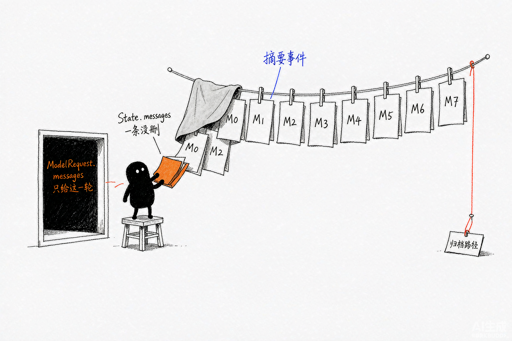
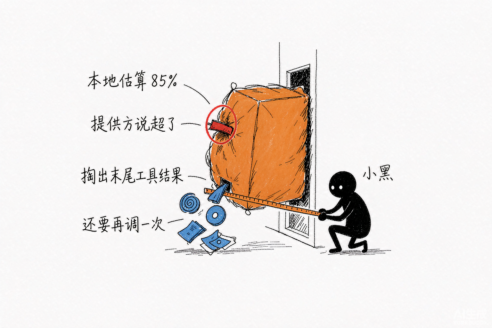
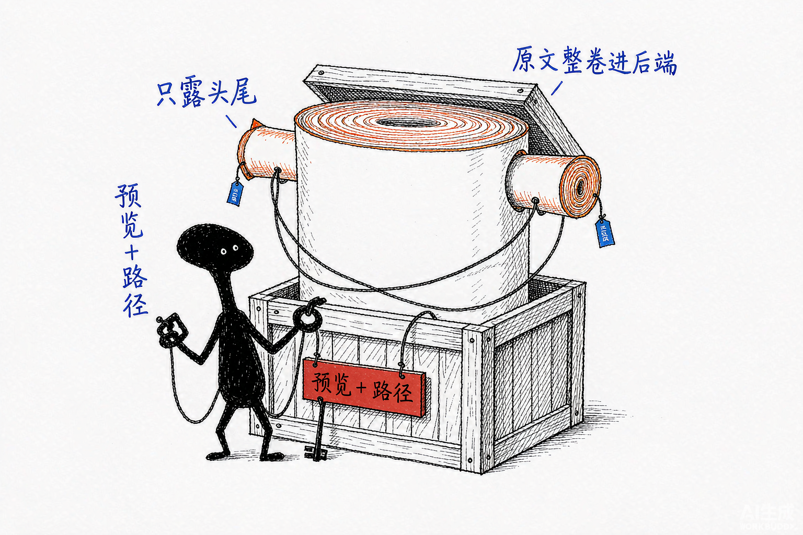
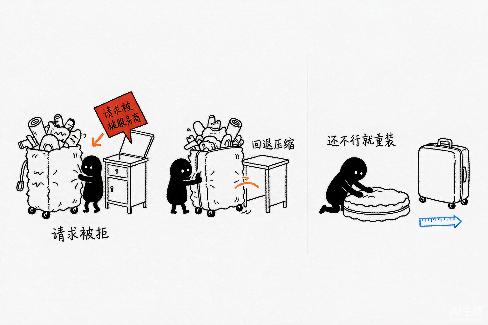

# Deep Agents 源码解析 10：上下文压缩与卸载

## 一、源码定位

> **阅读基线**：Deep Agents 0.6.12（`libs/deepagents/`）。
> 源码版本与路径约定见 [源码版本与路径约定](source-baseline.md)。
>
> 主代理装配：`libs/deepagents/deepagents/graph.py` → `create_deep_agent()`、`create_summarization_middleware()`
>
> 摘要核心实现：`libs/deepagents/deepagents/middleware/summarization.py` → `_DeepAgentsSummarizationMiddleware.__init__()`、`wrap_model_call()`、`awrap_model_call()`、`_get_effective_messages()`、`_apply_event_to_messages()`、`_compute_state_cutoff()`、`_truncate_args()`、`_offload_inline_media()`、`_offload_to_backend()`、`_create_summary()`、`_build_new_messages_with_path()`
>
> LangChain 的阈值判断：`langchain/libs/langchain_v1/langchain/agents/middleware/summarization.py` → `_should_summarize()`、`_should_summarize_based_on_reported_tokens()`、`_get_profile_limits()`、`_determine_cutoff_index()`、`_find_token_based_cutoff()`
>
> 主动压缩工具：`libs/deepagents/deepagents/middleware/summarization.py` → `SummarizationToolMiddleware.__init__()`、`_is_eligible_for_compaction()`、`_run_compact()`、`_arun_compact()`、`_build_compact_result()`
>
> 溢出回退：`libs/deepagents/deepagents/middleware/_overflow_clip.py` → `_clip_overflow_tail()`、`_aclip_overflow_tail()`、`_slice_read_file_tm()`
>
> 大工具结果卸载：`libs/deepagents/deepagents/middleware/_message_eviction.py` → `_create_content_preview()`、`_offload_tool_message_content()`
>
> 文件中间件的输入与结果处理：`libs/deepagents/deepagents/middleware/filesystem.py` → `FilesystemMiddleware.__init__()`、`_check_eviction_needed()`、`_build_truncated_human_message()`、`_evict_and_truncate_messages()`、`_process_large_message()`、`wrap_model_call()`、`wrap_tool_call()`

这篇只讨论一个问题：对话变长后，Deep Agents 如何减少模型本轮需要读取的内容，同时保留恢复原文的路径。

阅读源码时要先区分两份消息。下表也可以作为全文的阅读路线：

| 问题 | 对应机制 |
| --- | --- |
| State 中的原始消息会不会被直接删除？ | `_summarization_event` 记录摘要、切点和归档路径，模型请求使用另一份有效消息视图 |
| 一条超大的工具结果和一段过长的历史，分别怎么处理？ | FilesystemMiddleware 的结果卸载、SummarizationMiddleware 的历史摘要 |
| 本地 token 估算不准，provider 仍拒绝请求怎么办？ | `ContextOverflowError` 触发溢出回退 |
| 模型能不能主动结束当前阶段、压缩旧上下文？ | `SummarizationToolMiddleware` 注册的 `compact_conversation` |

`state["messages"]` 是图状态里的消息记录，`ModelRequest.messages` 是当前这一轮真正交给模型的消息列表。在本文基线版本的正常摘要路径中，主要改造的是第二份：`wrap_model_call()` 先用 `request.override(messages=...)` 生成本轮请求副本，模型调用完成后，再通过 `Command(update=...)` 保存摘要事件。

下一轮请求读取这个事件，重新构造“摘要消息 + State 中尚未被覆盖的尾部消息”。只有进入溢出回退时，源码才可能额外用 `Command` 更新已经被裁剪的尾部工具消息。

## 二、保留执行记录，压缩本轮工作视图

正常历史摘要改变本轮模型请求视图，并把摘要事件写回 State；被摘要的消息仍保留在 State 中，配置 Checkpointer 后可随状态保存。工具结果卸载、超大用户消息处理和溢出回退还可能改写消息，需分别看各自的状态更新。

三类压缩各管一段：FilesystemMiddleware 卸载单条大结果，SummarizationMiddleware 摘要历史，`ContextOverflowError` 触发的溢出回退处理 provider 拒绝。

代价是多出摘要事件、切点和归档路径这类派生状态；每次压缩之后都要确认模型还能通过哪条路径找回原文。



*图：正常历史摘要用事件重建模型视图；原始消息保留在 State，配置 Checkpointer 后可保存。归档是否成功需单独检查。*

## 三、装配位置与整体分层

### 1. 摘要中间件位于主代理核心栈中

`create_deep_agent()` 构造主代理中间件时，会把摘要中间件放在文件工具和同步子代理之后，`PatchToolCallsMiddleware` 之前：

```python
deepagent_middleware.extend(
    [
        create_summarization_middleware(model, backend),
        PatchToolCallsMiddleware(),
    ]
)
```

相关的主代理顺序可以简化为：

```text
TodoListMiddleware
  -> SkillsMiddleware（配置 skills 时加入）
  -> FilesystemMiddleware
  -> SubAgentMiddleware（存在子代理时加入）
  -> SummarizationMiddleware
  -> PatchToolCallsMiddleware
  -> AsyncSubAgentMiddleware（配置异步子代理时加入）
  -> Profile 扩展中间件
  -> Prompt Caching Middleware
  -> MemoryMiddleware（配置 memory 时加入）
  -> HumanInTheLoopMiddleware（配置审批时加入）
  -> ToolExclusionMiddleware（配置 excluded_tools 时加入）
  -> create_agent(...)
```

`PatchToolCallsMiddleware` 虽然紧邻摘要中间件，但它使用 `before_agent()`；摘要主要使用 `wrap_model_call()`。列表上的相邻关系不等于两个 Hook 会按同一条调用链依次执行。

### 2. 上下文压缩有六条处理路径

Deep Agents 没有一个统一的「压缩函数」。源码按处理对象和触发入口拆成六条路径：

| 路径 | 处理对象 | 触发位置 | 压缩动作 |
| --- | --- | --- | --- |
| 工具参数截断 | 较早消息中的 `write_file`、`edit_file` 参数 | 模型调用前 | 超长字符串替换为开头 20 个字符和截断提示，只改请求副本 |
| 工具结果卸载 | 工具返回的超大 `ToolMessage` | 工具调用后 | 原文写入 `/large_tool_results/...`，消息改成 head + tail 预览 |
| 输入消息卸载 | 最新的超大 `HumanMessage` | 模型调用前 | 原文写入 `/conversation_history/<uuid>.md`，请求使用预览 |
| 自动历史摘要 | 较早的对话消息 | 模型调用前 | 旧消息归档并交给摘要模型，模型使用摘要和近期消息 |
| 溢出回退 | provider 拒绝后的上下文 | 模型调用失败后 | 裁剪末尾工具结果，摘要并重试模型调用 |
| 主动压缩 | 当前会话历史 | `compact_conversation` 工具被调用后 | 复用摘要引擎，保存 `_summarization_event` |

按运行时入口可以归为四类：

1. **模型调用前**：工具参数截断、输入消息卸载、自动历史摘要；
2. **工具调用后**：FilesystemMiddleware 卸载超大工具结果；
3. **模型调用失败后**：`ContextOverflowError` 启动溢出回退；
4. **模型主动调用工具**：`compact_conversation` 触发主动压缩。

文件工具自己的分页和结果数量限制属于工具内部的结果控制，不是另一套全局摘要机制。比如 `read_file` 使用 `offset`、`limit`，`ls`、`glob`、`grep` 也会限制结果规模。

## 四、构造阶段：默认阈值和归档位置

### 1. Deep Agents 在 LangChain 摘要实现外面增加 Backend 能力

`_DeepAgentsSummarizationMiddleware.__init__()` 先创建 LangChain 的摘要辅助实例：

```python
# 先创建 LangChain 自带的摘要中间件，Deep Agents 只在外层加归档与摘要事件逻辑
self._lc_helper = LCSummarizationMiddleware(
    model=model,
    trigger=trigger,        # 触发阈值：比例或绝对 token 数
    keep=keep,              # 压缩后保留的比例或条数
    token_counter=token_counter,
    summary_prompt=summary_prompt,
    trim_tokens_to_summarize=trim_tokens_to_summarize,
    **deprecated_kwargs,
)
```

随后，Deep Agents 保存 Backend、摘要事件和归档路径。阈值判断、切点选择、消息分区和摘要生成委托给 `_lc_helper`；历史归档、媒体路径转换和 State 事件由 Deep Agents 包装层完成。

### 2. 默认值由模型 Profile 决定

`create_summarization_middleware()` 调用 `compute_summarization_defaults(model)`。模型存在 `profile["max_input_tokens"]` 时，默认配置是：

```python
{
    "trigger": ("fraction", 0.85),     # 有模型 profile 时：占用 85% 触发
    "keep": ("fraction", 0.10),        # 压缩后保留最近 10%
    "truncate_args_settings": {        # 工具参数截断用另一套阈值
        "trigger": ("fraction", 0.85),
        "keep": ("fraction", 0.10),
    },
}
```

这里的 `fraction` 是上下文窗口比例：

- `("fraction", 0.85)`：达到最大输入 token 的 85% 时触发；
- `("fraction", 0.10)`：摘要后保留最近 10% 的上下文。

没有最大输入 token 信息时，源码使用固定数量：

```python
{
    # 拿不到模型最大输入 token 时，退回固定条数而不是比例
    "trigger": ("tokens", 170000),
    "keep": ("messages", 6),
    "truncate_args_settings": {
        "trigger": ("messages", 20),
        "keep": ("messages", 20),
    },
}
```

这里的单位分别是：

- `tokens`：绝对 token 数；
- `messages`：绝对消息条数；
- `fraction`：模型最大输入 token 的比例。

因此，`("messages", 6)` 表示保留 6 条消息，`("fraction", 0.10)` 表示保留上下文窗口的 10%，不是 0.1 条消息。

触发配置支持三种条件：

- 单个 tuple，例如 `("tokens", 100000)`；
- dict，dict 内多个条件是 AND；
- list，list 中多个子句是 OR。

### 3. Backend 路径

摘要中间件根据 Backend 的 `artifacts_root` 计算路径前缀：

```python
self._history_path_prefix = f"{_root}/conversation_history"
self._large_tool_results_prefix = f"{_root}/large_tool_results"
```

默认路径是：

```text
/conversation_history/<thread_id>.md
/large_tool_results/<tool_call_id>
```

它们都是 Backend 的逻辑路径，最终存储位置由 Backend 决定。

## 五、模型调用前：先构造有效消息

### 1. 摘要事件不直接替换原始消息

正常摘要完成后，State 中保存的是 `_summarization_event`，完整消息列表仍留在检查点里：

```python
class SummarizationEvent(TypedDict):
    cutoff_index: int
    summary_message: HumanMessage
    file_path: str | None
```

三个字段分别是：

- `cutoff_index`：原始 State 消息列表中的绝对切点；
- `summary_message`：摘要内容以及可选历史路径；
- `file_path`：完整历史的归档路径，归档失败时为 `None`。

下一轮请求进入 `_get_effective_messages()`，由 `_apply_event_to_messages()` 重建有效消息：

```python
result: list[AnyMessage] = [summary_msg]
result.extend(messages[cutoff_idx:])
return result
```

假设 State 中有：

```text
[M0, M1, M2, M3, M4, M5, M6, M7]
```

摘要事件记录 `cutoff_index=5`，摘要消息为 `S1`，模型下一轮看到：

```text
[S1, M5, M6, M7]
```

`M0` 到 `M4` 仍在 State 中，并没有被这次摘要删除。只有 Backend 归档成功、`file_path` 有效且文件仍可访问时，模型才可以沿路径重新读取。归档失败时摘要仍可能成功，因此“有摘要”和“可回读原文”必须分别判断。

接着模型生成新消息 `M8`，图将它追加到原始状态，得到 `[M0, …, M8]`；下一次请求根据同一个事件重建 `[S1, M5, M6, M7, M8]`。摘要 `S1` 存在于事件记录中，作为模型视图的前缀使用，不需要每轮追加到原始消息历史里。

三处数据各有用途：State 保存执行记录，`_summarization_event` 保存重建视图所需的摘要和切点，Backend 归档向文件工具提供可回读的原文。只删除原始历史会破坏第一处；只保存原始历史又不能降低模型本轮的输入长度。

### 2. 连续摘要要修正切点

第二次摘要时，有效列表的第 0 项是摘要消息，不对应原始 State 的真实消息：

```text
[S1, M5, M6, M7, M8, M9]
```

如果这次在有效列表索引 3 处切分，真正要归档的是 `S1、M5、M6`。`_compute_state_cutoff()` 使用：

```python
return prior_cutoff + effective_cutoff - 1
```

本例中 `prior_cutoff=5`、`effective_cutoff=3`，新绝对切点为 `7`。下一轮应看到 `[S2, M7, M8, M9]`，而不是从原始 State 的第 3 条消息重新开始。

`-1` 用来抵消有效列表开头那条摘要消息。归档时，`_filter_summary_messages()` 还会排除之前生成的摘要消息，避免重复保存。

### 3. 模型调用前的轻量参数截断

`wrap_model_call()` 先计算消息、系统提示和工具 schema 的 token 数：

```python
total_tokens = self._count_tokens(
    effective_messages,
    request.system_message,
    request.tools,
)
```

如果 `truncate_args_settings` 达到阈值，`_truncate_args()` 只处理旧消息区域中的 `write_file`、`edit_file`：

```python
if tool_call["name"] in {"write_file", "edit_file"}:
    truncated_call = self._truncate_tool_call(tool_call)
```

超过 `max_length` 的字符串参数变成：

```text
原字符串前 20 个字符 + ...(argument truncated)
```

它通过 `msg.model_copy()` 创建新的 `AIMessage`，只改变当前 `ModelRequest`，不改 State，也不写 Backend。这个步骤结束后，中间件会重新计数，再判断是否进入完整摘要。

### 4. 最新超大 `HumanMessage` 的卸载

FilesystemMiddleware 也会在模型调用前处理最新的超大 `HumanMessage`：

```text
最新 HumanMessage 超过 50000 token
  -> 原文写入 /conversation_history/<uuid>.md
  -> 给消息加 lc_evicted_to 标记
  -> 当前请求使用 head + tail 预览
```

这里的「最新」是消息列表位置，不是用户最近一次发言的抽象概念。`_check_eviction_needed()` 实际检查的是：

```python
messages[-1]
```

并且这条消息必须同时满足：

- 类型是 `HumanMessage`；
- 没有 `lc_evicted_to` 标记；
- 文本长度超过 `human_message_token_limit_before_evict`，默认值为 50000 token。

例如用户把一个很大的日志文件直接粘贴进来，模型调用前的消息可能是：

```text
AIMessage(...)
ToolMessage(...)
HumanMessage(content="<很长的日志文本>")
```

这时最后一条是超大的 `HumanMessage`，FilesystemMiddleware 会把它写入 Backend，并让模型看到预览。

如果消息列表最后一条是 `ToolMessage`，即使前面有一条很大的 `HumanMessage`，这一轮也不会再次扫描那条旧用户消息。已经带有 `lc_evicted_to` 的消息也不会重复上传。

写入成功后，源码用同一个消息 ID 把带路径标记的副本更新回 State；下一轮请求根据标记生成预览。原始文本仍可通过 Backend 路径读取，模型不需要把整段内容再次放回上下文。

## 六、自动历史摘要：切分、归档、生成摘要


*图：长卷切段、旧段入袋，留在桌上的只有一页摘要。*

### 1. 上下文占用检测分两层

Deep Agents 和 LangChain 都参与了检测，但两者做的不是同一件事。

**第一层是模型调用前的本地预估。**

`wrap_model_call()` 调用 `_count_tokens()`，对当前请求的系统消息、对话消息和工具 schema 进行计数：

```python
total_tokens = self._count_tokens(
    effective_messages,
    request.system_message,
    request.tools,
)
```

默认使用 LangChain 的近似 token counter；如果自定义 counter 支持 `tools` 参数，工具 schema 也会纳入统计。随后，Deep Agents 把计数交给 LangChain 的 `_should_summarize()`，按配置检查：

- 消息条数是否达到 `("messages", N)`；
- 估算 token 是否达到 `("tokens", N)`；
- 估算 token 是否达到 `max_input_tokens * fraction`。

LangChain 还会检查最近一条匹配当前 provider 的 `AIMessage` 是否带有 `usage_metadata["total_tokens"]`。如果 provider 已经报告的 token 数达到阈值，即使本地重新估算的数量偏小，也会触发摘要。

**第二层是模型提供方的真实校验。**

如果本地预估没有触发摘要，Deep Agents 仍然会把请求交给模型。模型适配器和 provider 会按照自己的 tokenizer、工具 schema 规则和隐藏 token 计算上下文大小。

请求超过真实限制时，模型调用抛出 `ContextOverflowError`，Deep Agents 在 `wrap_model_call()` 中捕获它，转入溢出回退。

所以，源码里的阈值检测是「提前预估」，不是 provider 最终确认的上下文占用。两层之间出现差异时，provider 的拒绝结果优先，溢出回退负责补救。



*图：估算用本地软尺，真正的门框在 provider 那边；被拒后要掏出末尾工具结果再调一次模型。*

### 2. 未达到阈值时先正常调用

如果 `_should_summarize()` 返回 False，源码先把轻量截断后的请求交给模型：

```python
try:
    return handler(request.override(messages=truncated_messages))
except ContextOverflowError:
    overflow_triggered = True
```

本地 token 计数是估算值。provider 仍可能因为工具 schema、隐藏 token 或消息格式差异拒绝请求，这个异常会进入“上下文溢出后的回退压缩”一节所述的处理链。

### 3. 达到阈值后确定切点

`_determine_cutoff_index()` 决定切点，`_partition_messages()` 返回：

```text
messages_to_summarize
preserved_messages
```

切点不能拆散工具调用协议：

```text
AIMessage(tool_calls=[...])
  -> ToolMessage(tool_call_id=...)
```

如果保留窗口落在 `ToolMessage` 上，切分逻辑会向前移动，避免只保留工具结果而丢掉对应的 `AIMessage`。

切点小于等于 0 时，源码不强行摘要，直接使用当前消息调用模型。

### 4. 归档旧消息

自动摘要会先把要摘要的消息写入 Backend。`_offload_to_backend()` 将消息转换为 XML 格式，追加到：

```text
/conversation_history/<thread_id>.md
```

已有历史通过 `download_files()` 读取原始文本，再用 `edit()` 追加；不用 `read()`，因为 `read()` 返回的内容可能带行号，而 `edit()` 需要原文。

归档失败返回 `None`，摘要仍会继续生成，但摘要消息不会提供完整历史的恢复路径。

### 5. 内联媒体转换为路径

`_offload_inline_media()` 在归档和摘要前处理 `data:` 图片、音频和视频：

1. 解码 `data:` URL；
2. 用原始 bytes 的 SHA-256 前 16 位去重；
3. 上传到 `/conversation_history/media/<hash>.<ext>`；
4. 把内联数据改成路径引用；
5. 解码或上传失败时写入失败占位符。

摘要模型得到的是路径引用，不是原始 base64 数据。摘要提示词会告诉模型如何保留这些引用，后续可以通过 `read_file` 读取。

同步路径是：

```text
_offload_inline_media()
  -> _offload_to_backend()
  -> _create_summary()
```

异步路径在媒体处理完成后，用 `asyncio.gather()` 并发归档和生成摘要。

### 6. 生成摘要消息

`_build_new_messages_with_path()` 生成一条 `HumanMessage`：

```text
The full conversation history has been saved to /conversation_history/<thread_id>.md

A condensed summary follows:
<summary>
...
</summary>
```

如果归档失败，消息只保留摘要文本，不附带一个无法确认存在的路径。

## 七、摘要结果如何回到下一轮请求

自动摘要会把摘要消息和保留消息交给当前模型：

```python
modified_messages = [*new_messages, *preserved_messages]
response = handler(request.override(messages=modified_messages))
```

`ExtendedModelResponse` 是“模型响应 + 图更新指令”的返回容器。模型调用完成后，中间件用它同时交回本次模型响应和 `Command`；后者要求图保存摘要事件：

```python
return ExtendedModelResponse(
    model_response=response,
    command=Command(update=update),
)
```

正常摘要的 `update` 只包含 `_summarization_event`。下一轮由 `_apply_event_to_messages()` 再次生成：

```text
[summary_message, *state["messages"][cutoff_index:]]
```

摘要消息不会直接追加到原始 `state["messages"]`。正常路径保存摘要事件，溢出回退还可能提交尾部工具消息替换。这个提交发生在下游模型调用返回之后：

```python
response = handler(request.override(messages=modified_messages))

update: dict[str, Any] = {"_summarization_event": new_event}
if new_state_tail:
    update["messages"] = list(new_state_tail)
```

顺序带来一个实际边界：Backend 归档已经完成，后续摘要生成或模型调用仍可能失败。若函数未返回状态更新，不能仅凭归档文件存在就认定新摘要事件已写入图状态；反过来，`file_path=None` 时又可能成功保存摘要事件。存储写入、摘要生成和状态提交并不处于同一个事务。

## 八、工具调用后的大结果卸载

这条路径来自 `FilesystemMiddleware`，不是自动摘要的一部分。工具执行完成后，`wrap_tool_call()` 才检查结果：

```python
tool_result = handler(request)

# 没配阈值，或这个工具在不卸载的白名单里，直接返回原结果
if (
    self._tool_token_limit_before_evict is None
    or request.tool_call["name"] in TOOLS_EXCLUDED_FROM_EVICTION
):
    return tool_result

# 超过阈值才写入 Backend，把完整结果换成预览加恢复路径
return self._intercept_large_tool_result(
    tool_result,
    request.runtime,
)
```

### 1. 它具体怎么改 `ToolMessage`

`_process_large_message()` 先提取文本内容，并用字符数近似 token 数：

```python
if len(content_str) <= NUM_CHARS_PER_TOKEN * self._tool_token_limit_before_evict:
    return message, False
```

超过阈值后，`_offload_tool_message_content()`：

1. 把完整文本写到 `/large_tool_results/<tool_call_id>`；
2. 用 `_create_content_preview()` 生成开头和结尾预览；
3. 把原文本换成「结果过大提示 + 恢复路径 + 预览」；
4. 保留消息 ID、tool call ID 和非文本内容块。

`ls`、`glob`、`grep`、`read_file`、`write_file`、`edit_file`、`delete` 被排除在通用卸载之外，因为它们已有分页、结果限制或短确认结果。



*图：原文进 `/large_tool_results/`，消息体换成头尾预览加恢复路径，模型可以按路径把原文读回来。*

## 九、上下文溢出后的回退压缩



*图：箱子被退回来先压缩；还压不进，就换更大的箱子重装。*

溢出回退的入口是 provider 抛出的 `ContextOverflowError`：

```text
本地估算未达到阈值
  -> 先请求模型
  -> provider 抛 ContextOverflowError
  -> 裁剪保留区末尾工具结果
  -> 摘要旧消息
  -> 重试模型
```

### 1. 只裁剪保留区末尾的连续工具结果

`_clip_overflow_tail()` 只检查 `preserved_messages` 末尾是否是一批连续 `ToolMessage`，并且这批消息的 token 数达到由 `keep` 推导出的阈值。

它不会把所有工具结果都改写，只检查保留区末尾的连续工具消息。这是一条有限回退路径，不能保证解决系统提示词、工具 schema 或其他大消息造成的溢出。切点不大于 0 时会重新调用原视图；压缩后的下游调用若再次抛错，当前函数也没有无限重试循环。

### 2. `read_file` 结果保留原路径

如果 ToolMessage 对应的调用是 `read_file`，`_slice_read_file_tm()`：

- 保留结果开头约 4000 个字符；
- 追加完整文件原路径；
- 提示模型用 `read_file(offset, limit)` 分页读取。

原文件已经在 Backend 中，所以不用重复写入 `/large_tool_results/...`。

### 3. 其他工具结果写入恢复文件

其他 ToolMessage 使用 `_offload_tool_message_content()`：

```text
/large_tool_results/<tool_call_id>
```

替代消息包含文件路径、head + tail 预览和省略行数。替代消息保留原 `tool_call_id` 和消息 ID，随后通过 `Command(update={"messages": new_state_tail})` 覆盖 State 中对应的原消息。

Backend 写入失败时保留原消息，不生成虚假的恢复路径。

## 十、主动 `compact_conversation`

自动摘要之外，源码还提供一个工具，让模型在合适的时机主动压缩对话：

```python
create_summarization_tool_middleware(
    model=model,
    backend=backend,
)
```

factory 会创建摘要引擎，再用 `SummarizationToolMiddleware` 包住它。工具层注册 `compact_conversation`，并默认向系统提示词追加使用建议。

`SummarizationMiddleware` 会在模型调用前自动判断阈值；`SummarizationToolMiddleware` 只提供工具，只有工具真的被调用时才压缩。

### 1. `_run_compact()` 的实际顺序

```text
读取 State 中的 messages 和 _summarization_event
  -> _apply_event_to_messages()
  -> _is_eligible_for_compaction()
  -> _determine_cutoff_index()
  -> _partition_messages()
  -> _create_summary()
  -> _offload_to_backend()
  -> _build_compact_result()
```

### 2. 工具注册不等于立即压缩

`SummarizationToolMiddleware.__init__()` 只创建一个 `StructuredTool`，放入 `self.tools`：

```python
self.tools: list[BaseTool] = [self._create_compact_tool()]
```

模型下一轮请求能看到这个工具后，才可能生成对应的 tool call。工具没有参数，调用本身只表达「现在压缩上下文」，具体压缩多少由当前消息和 `keep` 配置决定。

### 3. `_is_eligible_for_compaction()` 先做资格判断

工具调用进入 `_run_compact()` 后，源码先读取：

```python
messages = runtime.state.get("messages", [])
event = runtime.state.get("_summarization_event")
effective = s._apply_event_to_messages(messages, event)
```

资格判断使用 `effective` 消息。自动摘要阈值的一半是工具的资格门槛：

```text
trigger=("tokens", 170000)
  -> 约 85000 token 后允许主动压缩

trigger=("messages", 20)
  -> 约 10 条消息后允许主动压缩

trigger=("fraction", 0.85)
  -> 达到模型最大输入 token 的约 42.5% 后允许主动压缩
```

字典形式的一个触发子句要求其中条件全部满足，多个子句之间仍按 OR 处理。使用 `fraction` 时如果模型没有 `max_input_tokens`，资格判断无法计算，工具返回「Nothing to compact」。

### 4. 通过后如何生成压缩结果

`_run_compact()` 只取切点之前的消息：

```python
cutoff = s._determine_cutoff_index(effective)
to_summarize, _ = s._partition_messages(effective, cutoff)
summary = s._create_summary(to_summarize)
file_path = s._offload_to_backend(backend, to_summarize)
```

同步路径先生成摘要，再归档旧消息；摘要生成抛出异常时进入工具错误分支；归档失败则返回 `file_path=None`，摘要仍然可以保存到 State，但不提供历史恢复路径。

`_build_compact_result()` 写入：

- `_summarization_event`：摘要消息、绝对切点和归档路径；
- `messages`：一条与当前工具调用对应的确认 `ToolMessage`。

摘要消息不会直接追加到原始 `messages`。下一轮 `wrap_model_call()` 再根据事件构造：

```text
summary_message + state["messages"][cutoff_index:]
```

主动压缩的效果从下一次模型调用开始生效。异步 `_arun_compact()` 使用同样的切分和 State 更新，只替换为异步摘要和归档调用；它不会自动轮询或等待后台任务。

主动压缩复用摘要引擎，但不会经过自动路径的 provider 溢出回退，也不会自动执行历史摘要路径里的内联媒体预处理。

## 十一、Summarization 与 FilesystemMiddleware 的边界

两者都可能把内容写入 Backend，但对象和触发点不同：

| 机制 | 主要 Hook | 处理对象 | 主要恢复方式 |
| --- | --- | --- | --- |
| `SummarizationMiddleware` | `wrap_model_call()` | 旧对话消息 | 摘要消息 + `/conversation_history/...` |
| `FilesystemMiddleware` 的大结果处理 | `wrap_tool_call()` | 工具刚返回的巨大结果 | 预览 + `/large_tool_results/...` |
| `FilesystemMiddleware` 的请求处理 | `wrap_model_call()` | 过大的输入消息 | 当前请求预览 + 文件路径 |

数据流可以这样看：

```text
工具执行完成
  -> FilesystemMiddleware 发现结果过大
  -> 卸载工具结果
  -> 模型收到预览和恢复路径

多轮对话持续增长
  -> SummarizationMiddleware 检查有效消息列表
  -> 归档较早对话
  -> 模型收到摘要和近期消息
```

遇到「模型看不到完整内容」时，先看对象：

- 早期对话变成摘要，查 `_summarization_event` 和 `/conversation_history/...`；
- 工具刚返回的内容被缩短，查 `_message_eviction.py` 或 `_overflow_clip.py`；
- 文件读取本身分页，查 `FilesystemMiddleware` 的 `read_file` 实现。

**相关测试**：`libs/deepagents/tests/unit_tests/middleware/test_summarization_middleware.py`、`libs/deepagents/tests/unit_tests/middleware/test_summarization_factory.py`、`libs/deepagents/tests/unit_tests/test_eviction_replay.py`、`libs/deepagents/tests/integration_tests/test_filesystem_middleware.py`

## 十二、工程判断

调整压缩策略时，先确认压力来自哪里。大工具结果优先看卸载阈值；历史累积优先看 trigger 与 keep；系统提示词或工具 schema 过大，则不能指望只摘要旧消息解决。

| 调整对象 | 可能收益 | 必须一起观察 |
| --- | --- | --- |
| 降低历史摘要 trigger | 更早留出输入空间 | 摘要调用次数、费用、遗漏事实与任务正确率 |
| 缩小保留窗口 keep | 减少近期原文占用 | 工具配对边界是否完整、近期任务细节是否仍足够 |
| 降低工具结果卸载阈值 | 减少单次结果占用 | 模型是否增加多次回读、归档存储和权限是否可用 |
| 缩小 Memory 或工具描述 | 减少历史切分无法移走的部分 | 常驻规则与工具选择能力是否退化 |

需要可回读原文时，应把归档成功、媒体是否完整和路径可访问作为独立检查。否则摘要即使生成，也可能只剩不可追溯的压缩文本。保留完整图状态有利于恢复，但不等于模型能够通过文件工具直接读取检查点里的历史。

自定义历史重排还会影响绝对切点。若另一中间件删除或插入了摘要覆盖区内的消息，应同时校正或重建 `_summarization_event`，不能继续沿用旧 cutoff。修改单条结果、整体重建消息与只改本轮视图，应分别遵循 [03](03-state-reducers-and-recovery.md) 的状态合并规则。

## 十三、延伸阅读

**下层：LangChain / LangGraph**

- [LangChain 09：上下文与隐私](../langchain/09-context-and-privacy.md)——LangChain 侧的上下文处理与裁剪

**本系列**

- [03：状态、Reducer 与恢复](./03-state-reducers-and-recovery.md)——完整记录与模型视图分离的前提
- [08：FilesystemMiddleware 与权限](./08-filesystem-middleware-and-permissions.md)——单条大结果卸载的落点

**上层：方法论与案例**

- [Agent 系统设计 03：上下文压缩](../../../../notes/agent-system-design/03-view/agent-context-compression.md)——压缩策略与可恢复性的取舍
- [Agent 系统设计 03：上下文管理](../../../../notes/agent-system-design/03-view/agent-context-management.md)——分层预算与触发阈值两种思路
