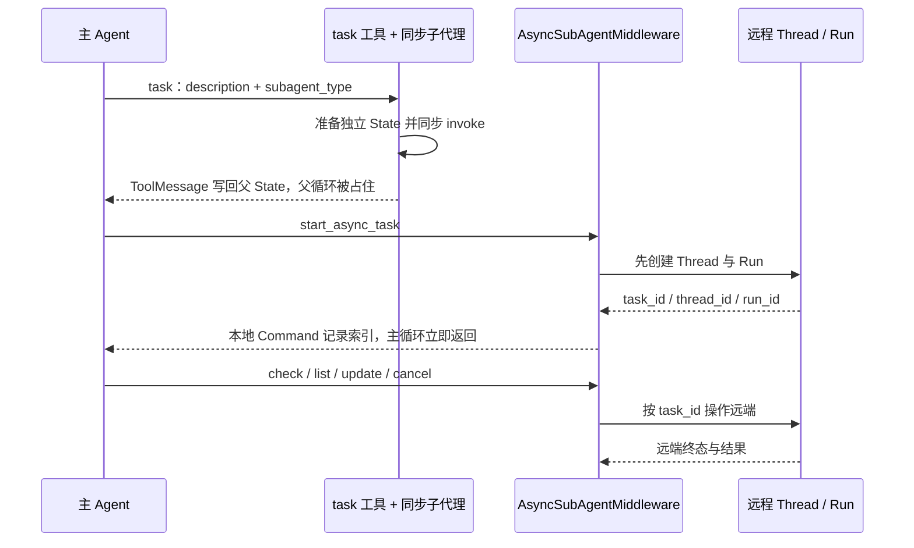

# Deep Agents 源码解析 12：异步子代理任务生命周期

## 一、源码定位

> **阅读基线**：Deep Agents 0.6.12（`libs/deepagents/`）。
> 源码版本与路径约定见 [源码版本与路径约定](source-baseline.md)。
>
> - 主代理装配：`libs/deepagents/deepagents/graph.py` → `create_deep_agent()`
> - 异步中间件：`libs/deepagents/deepagents/middleware/async_subagents.py` → `AsyncSubAgentMiddleware.__init__()`、`wrap_model_call()`、`awrap_model_call()`
> - 任务状态：`libs/deepagents/deepagents/middleware/async_subagents.py` → `AsyncTask`、`AsyncSubAgentState`、`_tasks_reducer()`
> - 工具构造：`libs/deepagents/deepagents/middleware/async_subagents.py` → `_build_async_subagent_tools()`、`_build_start_tool()`、`_build_check_tool()`、`_build_update_tool()`、`_build_cancel_tool()`、`_build_list_tasks_tool()`
> - 启动任务：`libs/deepagents/deepagents/middleware/async_subagents.py` → `start_async_task()`、`astart_async_task()`
> - 查询任务：`libs/deepagents/deepagents/middleware/async_subagents.py` → `check_async_task()`、`acheck_async_task()`、`list_async_tasks()`、`alist_async_tasks()`
> - 更新和取消：`libs/deepagents/deepagents/middleware/async_subagents.py` → `update_async_task()`、`aupdate_async_task()`、`cancel_async_task()`、`acancel_async_task()`
> - 客户端缓存：`libs/deepagents/deepagents/middleware/async_subagents.py` → `_ClientCache._cache_key()`、`get_sync()`、`get_async()`
> - 相关测试：`libs/deepagents/tests/unit_tests/test_async_subagents.py`

## 二、一个远端任务需要三种身份

异步子代理把一次子代理执行提升为一个可以跨多次主 Agent 请求管理的远程任务，把同步 `task` 工具改成 `async def` 达不到这个效果。

主 Agent 本地保存任务索引，远程服务保存真正的执行状态：

| 信息 | 保存位置 | 作用 |
| --- | --- | --- |
| `task_id` | 主 Agent 的 `async_tasks` State | 后续工具查找任务的主索引，当前实现中等于 `thread_id` |
| `thread_id` | 远程服务，同时复制到本地 State | 标识远程会话线程，更新任务时保持不变 |
| `run_id` | 远程服务，同时复制到本地 State | 标识当前一次执行，更新任务时替换 |
| `status` | 本地缓存和远程 Run | 本地是最近一次已知状态，实时值需要重新查询 |

启动、查询单个任务、列出任务、更新和取消共五个工具，围绕同一份调用方任务索引协作。

正文沿着源码的数据流推进：

```text
create_deep_agent()
  -> 识别 AsyncSubAgent 配置
  -> 创建 AsyncSubAgentMiddleware
  -> create_agent() 收集中间件工具和 State schema
  -> 主 Agent 调用 start_async_task
  -> 远程服务创建 Thread 和 Run
  -> 本地 State 保存 AsyncTask
  -> 后续调用 check / list / update / cancel
```

这里的“异步”指主 Agent 启动远程 Run 后立即结束这次工具调用，不等待远程 Run 完成。远程任务仍然持续运行，主 Agent 通过保存下来的 `task_id` 再次访问它。

本文所说的 Agent Protocol，是远程 Agent 服务暴露的一组统一接口约定。源码通过 LangGraph SDK 调用这些接口创建 Thread、启动 Run、查询状态和读取结果；远程服务可以是 LangGraph/LangSmith Deployment，也可以是兼容这套协议的自托管服务。

`Thread` 是保存远端对话状态的会话容器；`Run` 是在这个 Thread 上发起的一次执行。假设启动得到 `Thread=T1`、`Run=R1`，主 Agent 保存 `task_id=T1`。后续 `update_async_task` 在同一个 T1 上提交新输入并创建 R2，所以任务 ID 不变，索引中的当前 Run 改为 R2。

启动工具返回的 `ToolMessage` 只表示启动请求已经获得响应。与它一起返回的 `Command` 是状态更新指令，由图把任务索引写入 `async_tasks`。远端随后完成 R1，并不会主动改写这份 State；主 Agent 必须走查询路径才能获得更新。保存索引失败、远端响应丢失和结果读取失败，也因此是三个不同的故障窗口。

## 三、这篇要回答的设计问题

阅读这段源码时，需要同时看三条边界：

- **控制边界**：中间件只把五个任务管理工具接入主 Agent，不负责远程 Agent 的内部执行；
- **状态边界**：`async_tasks` 只保存远程任务索引和最近状态，不是远程服务的事实副本；
- **时间边界**：启动返回“Run 已创建”，不是“任务已完成”；状态和结果必须在后续查询中读取。

本地 State 更像控制面索引，不是远程任务的事实来源。这个选择允许主 Agent 立即返回、稍后继续管理任务，但也要求每次查询都处理远程失败、状态过期和本地回写顺序。

## 四、它如何进入主 Agent

### 1. `subagents` 中用什么区分异步 SubAgent

`create_deep_agent()` 接收的 `subagents` 同时支持声明式同步 SubAgent、已经编译好的 SubAgent，以及远程异步 SubAgent。源码通过 `graph_id` 区分异步规格：

```python
inline_subagents: list[SubAgent | CompiledSubAgent] = []
async_subagents: list[AsyncSubAgent] = []
for spec in subagents or []:
    if "graph_id" in spec:
        async_subagents.append(cast("AsyncSubAgent", spec))
        continue
    if "runnable" in spec:
        inline_subagents.append(spec)
    else:
        # 这里继续处理声明式同步 SubAgent
        ...
```

一个异步规格至少包含以下字段：

```python
{
    "name": "researcher",
    "description": "负责远程研究任务",
    "graph_id": "research_agent",
    "url": "<REMOTE_AGENT_URL>",
}
```

- `name` 是主 Agent 调用工具时使用的类型名；
- `description` 会进入工具描述和系统提示词，帮助模型判断什么时候委派；
- `graph_id` 是远程服务中要运行的 Agent 或 graph，必须是远程服务能够识别的 graph 名或 assistant ID；
- `url` 指向 Agent Protocol 服务。省略时，异步客户端可以使用本地 ASGI transport；
- `headers` 用于传递自定义请求头。

`graph_id` 不是本地同步 SubAgent 的 `name` 替代品。它告诉远程服务运行哪个 graph，`name` 则是本地任务工具识别的异步 Agent 类型。`url` 和 `headers` 决定客户端连接哪个服务以及如何附带认证信息。

### 2. 主栈中的实际位置

当前源码把主 Agent 的核心中间件按下面的顺序累积：

```text
TodoListMiddleware
  -> SkillsMiddleware（配置 skills 时）
  -> FilesystemMiddleware
  -> SubAgentMiddleware（存在同步 SubAgent 时）
  -> SummarizationMiddleware
  -> PatchToolCallsMiddleware
  -> AsyncSubAgentMiddleware（存在异步 SubAgent 时）
  -> Profile.extra_middleware
  -> Prompt Caching Middleware
  -> MemoryMiddleware（配置 memory 时）
  -> HumanInTheLoopMiddleware（配置 interrupt_on 或权限中断时）
  -> _ToolExclusionMiddleware（配置 excluded_tools 时）
```

异步中间件是在 `create_deep_agent()` 已经加入摘要和工具调用修补中间件之后追加的：

```python
deepagent_middleware.extend(
    [
        create_summarization_middleware(model, backend),
        PatchToolCallsMiddleware(),
    ]
)

if async_subagents:
    deepagent_middleware.append(
        AsyncSubAgentMiddleware(async_subagents=async_subagents)
    )
```

这段代码只负责把中间件实例放进列表。真正把这组中间件交给 LangChain Agent 的地方仍然是函数末尾的 `create_agent()`：

```python
return create_agent(
    model,
    system_prompt=final_system_prompt,
    tools=_tools,
    middleware=deepagent_middleware,
    response_format=response_format,
    context_schema=context_schema,
    checkpointer=checkpointer,
    store=store,
    debug=debug,
    name=name,
    cache=cache,
    state_schema=state_schema if state_schema is not None else DeepAgentState,
)
```

因此，异步 SubAgent 不是独立于主 Agent 的第二套执行图。`AsyncSubAgentMiddleware` 作为中间件进入 `create_agent()`，它的工具、提示词和 State 扩展都由同一个 Agent 装配过程接管。

## 五、中间件初始化时做了什么

### 1. `__init__()` 校验配置并创建工具

`AsyncSubAgentMiddleware.__init__()` 做三件事：

1. 拒绝空的异步 Agent 列表；
2. 拒绝重复的 `name`；
3. 调用 `_build_async_subagent_tools()` 创建五个工具。

```python
def __init__(
    self,
    *,
    async_subagents: list[AsyncSubAgent],
    system_prompt: str | None = ASYNC_TASK_SYSTEM_PROMPT,
) -> None:
    super().__init__()
    if not async_subagents:
        raise ValueError("At least one async subagent must be specified")

    names = [a["name"] for a in async_subagents]
    dupes = {n for n in names if names.count(n) > 1}
    if dupes:
        raise ValueError(f"Duplicate async subagent names: {dupes}")

    self.tools = _build_async_subagent_tools(async_subagents)
```

五个工具分别对应任务生命周期：

| 工具 | 作用 | 是否创建新的远程 Run |
| --- | --- | --- |
| `start_async_task` | 新建 Thread 并启动首个 Run | 是 |
| `check_async_task` | 查询指定 Run 的状态和结果 | 否 |
| `list_async_tasks` | 批量列出任务并刷新状态 | 否 |
| `update_async_task` | 在原 Thread 上发送新指令 | 是 |
| `cancel_async_task` | 取消当前 Run | 否 |

工具不是在 `wrap_model_call()` 中动态添加的。它们在初始化时挂到中间件的 `self.tools`，`create_agent()` 装配中间件时读取这些工具。这个区分很重要：工具的存在属于 Agent 装配阶段，模型请求 Hook 只负责在请求中补充使用说明。

### 2. `wrap_model_call()` 只追加系统提示词

初始化时，源码把默认工作流和可用异步 Agent 的名称、描述拼进 `self.system_prompt`：

```python
if system_prompt:
    agents_desc = "\n".join(
        f"- {a['name']}: {a['description']}"
        for a in async_subagents
    )
    self.system_prompt = (
        system_prompt
        + "\n\nAvailable async subagent types:\n\n"
        + agents_desc
    )
```

同步和异步模型请求分别进入 `wrap_model_call()` 或 `awrap_model_call()`。两者都只做同一件事：通过 `append_to_system_message()` 把这段说明追加到当前系统消息，再交给下一个 Handler。

```python
def wrap_model_call(self, request, handler):
    if self.system_prompt is not None:
        new_system_message = append_to_system_message(
            request.system_message,
            self.system_prompt,
        )
        return handler(request.override(system_message=new_system_message))
    return handler(request)
```

这段 Hook 不启动远程任务，也不查询任务状态。模型产生工具调用后，LangChain 的工具执行流程才会进入五个工具对应的函数。

## 六、`async_tasks` 为什么要放进 State

### 1. `AsyncTask` 保存的是远程任务索引

异步任务真正运行在远程 Agent Protocol 服务中。主 Agent 本地至少要记住以下关系：

```text
task_id
  -> thread_id
  -> 当前 run_id
  -> agent_name
```

源码用 `AsyncTask` 表示这条索引：

```python
class AsyncTask(TypedDict):
    task_id: str
    agent_name: str
    thread_id: str
    run_id: str
    status: str
    created_at: str
    last_checked_at: str
    last_updated_at: str
```

在当前实现中，`task_id` 与创建出来的 `thread_id` 相同：

```python
task_id = thread["thread_id"]
```

这三个 ID 的分工不同：

- `task_id` 是主 Agent 后续工具调用使用的索引；
- `thread_id` 标识远程服务上的会话线程，后续更新和查询都需要它；
- `run_id` 标识这个 Thread 上某一次具体执行。任务更新后，`task_id` 和 `thread_id` 不变，`run_id` 换成新 Run。

`status` 是本地最后一次已知状态，不是远程服务器主动推送过来的实时值。想得到实时状态，仍要调用查询工具。

### 2. `AsyncSubAgentState` 扩展主 Agent State

中间件声明了自己的状态字段：

```python
class AsyncSubAgentState(AgentState):
    async_tasks: Annotated[
        NotRequired[dict[str, AsyncTask]],
        _tasks_reducer,
    ]
```

`create_agent()` 会收集中间件提供的 State schema，并把 `async_tasks` 合并进主 Agent State。这样，工具在执行时可以通过 `ToolRuntime.state` 找回任务：

```python
tasks: dict[str, AsyncTask] = runtime.state.get("async_tasks") or {}
tracked = tasks.get(task_id.strip())
```

如果只把 `task_id` 放在上一条 `ToolMessage` 里，后续就只能从消息文本中猜任务；现在它是结构化 State，工具可以按 key 精确定位，也能随 checkpoint 一起保存和恢复。

任务索引独立于模型的消息视图。正常摘要并不删除全部原始 ToolMessage，但模型下一轮可能只看到摘要，不能保证仍记住准确 task_id。`list_async_tasks` 读取 `async_tasks` 字段，因此无需从摘要文本中猜测任务身份。索引能否跨请求恢复，仍取决于主图的状态持久化配置。

### 3. `_tasks_reducer()` 是覆盖式合并

```python
def _tasks_reducer(
    existing: dict[str, AsyncTask] | None,
    update: dict[str, AsyncTask],
) -> dict[str, AsyncTask]:
    merged = dict(existing or {})
    merged.update(update)
    return merged
```

这个 Reducer 的语义是：

```text
旧任务表
  + {task_id: 新任务记录}
  -> 保留其他任务
  -> 覆盖同一个 task_id
```

它不是消息追加，也不是整张任务表替换。多个异步任务可以并存；启动、查询、更新或取消某个任务时，只提交对应的 `{task_id: task}`，其他任务继续保留。

## 七、启动任务：先远程成功，再写本地 State

### 1. `_build_start_tool()` 绑定了同步和异步实现

`_build_async_subagent_tools()` 把配置转换成 `agent_map`，创建一个共享的 `_ClientCache`，再构造五个 `StructuredTool`：

```python
def _build_async_subagent_tools(
    agents: list[AsyncSubAgent],
) -> list[StructuredTool]:
    agent_map = {a["name"]: a for a in agents}
    clients = _ClientCache(agent_map)
    ...
    return [
        _build_start_tool(agent_map, clients, launch_desc),
        _build_check_tool(clients),
        _build_update_tool(agent_map, clients),
        _build_cancel_tool(clients),
        _build_list_tasks_tool(clients),
    ]
```

每个工具都同时提供 `func` 和 `coroutine`。模型执行同步 Agent 时使用同步函数；异步 Agent 调用时使用对应的协程函数。两套实现的远程步骤相同，只是 SDK 调用是否使用 `await` 不同。

### 2. `start_async_task()` 的执行顺序

同步版本的核心逻辑是：

```python
error = _validate_agent_type(agent_map, subagent_type)
if error:
    return error

spec = agent_map[subagent_type]
try:
    client = clients.get_sync(subagent_type)
    thread = client.threads.create()
    run = client.runs.create(
        thread_id=thread["thread_id"],
        assistant_id=spec["graph_id"],
        input={"messages": [{"role": "user", "content": description}]},
    )
except Exception as e:
    return f"Failed to launch async subagent '{subagent_type}': {e}"
```

执行顺序不能调换：

```text
校验 subagent_type
  -> 获取远程客户端
  -> 创建 Thread
  -> 在 Thread 上创建 Run
  -> 远程调用成功
  -> 生成 AsyncTask
  -> Command 写入 State 和 ToolMessage
```

Thread 是远程对话容器，Run 是在这个容器中执行一次 Agent。源码先拿到 Thread ID，才能把 Run 绑定到正确的 Thread。

### 3. 远程成功后才生成 `AsyncTask`

远程 Run 创建成功后，源码才组装本地任务记录：

```python
task_id = thread["thread_id"]
now = datetime.now(UTC).strftime("%Y-%m-%dT%H:%M:%SZ")
task: AsyncTask = {
    "task_id": task_id,
    "agent_name": subagent_type,
    "thread_id": task_id,
    "run_id": run["run_id"],
    "status": "running",
    "created_at": now,
    "last_checked_at": now,
    "last_updated_at": now,
}
```

然后通过 `Command` 同时更新两个 State 通道：

```python
return Command(
    update={
        "messages": [
            ToolMessage(msg, tool_call_id=runtime.tool_call_id)
        ],
        "async_tasks": {task_id: task},
    }
)
```

`ToolMessage` 让当前模型循环知道工具已经返回，并拿到完整的 `task_id`；`async_tasks` 则让后续工具可以结构化查询任务。

如果创建 Thread 或 Run 失败，函数直接返回错误字符串，不写入新的 `async_tasks`。这避免在没有取得成功响应时主动写入 running 索引；它不能证明远端没有接受请求。

**源码事实**：`start_async_task()`（`libs/deepagents/deepagents/middleware/async_subagents.py:295-324`）依次创建远程 Thread、Run，拿到返回后才生成本地 `Command`。两个远程请求与本地 checkpoint 不在同一事务里：Thread 创建成功而 Run 创建失败会留下无本地索引的 Thread；远程 Run 已接受、响应丢失时，本地可能只拿到错误字符串。因此“未写本地 State”不能反推“远程没有开始执行”。恢复时先向远端查询业务动作是否发生，再决定重试、认领任务或人工处理。

### 4. “立即返回”不等于任务完成

`runs.create()` 返回的是远程 Run 已经被创建，而不是 Run 已经执行结束。工具随后返回 `Launched async subagent`，主 Agent 可以继续处理当前对话。

源码通过系统提示词约束模型：

```text
启动后立即把 task_id 告诉用户并停止；
不要紧接着调用 check_async_task；
只有用户要求状态或结果时才查询。
```

这是 Agent 工作流约定，代码层面没有轮询锁。工具本身允许再次调用，是否立即查询取决于模型是否遵守提示词。

## 八、查询任务：用远程状态覆盖本地缓存

### 1. `check_async_task()` 先从 State 取任务

查询工具不会接受任意 Thread/Run ID 直接访问远程服务，而是先调用 `_resolve_tracked_task()`：

```python
def _resolve_tracked_task(
    task_id: str,
    runtime: ToolRuntime,
) -> AsyncTask | str:
    tasks = runtime.state.get("async_tasks") or {}
    tracked = tasks.get(task_id.strip())
    if not tracked:
        return f"No tracked task found for task_id: {task_id!r}"
    return tracked
```

因此，`check_async_task` 使用的是 `start_async_task` 返回的完整 `task_id`。任务不在当前主 Agent State 中时，即使远程服务上存在同名 Thread，也不会被当作当前 Agent 负责的任务。

### 2. 先查 Run，再在成功时查 Thread

拿到本地索引后，源码查询当前 Run：

```python
client = clients.get_sync(task["agent_name"])
run = client.runs.get(
    thread_id=task["thread_id"],
    run_id=task["run_id"],
)
```

只有当 Run 状态是 `success` 时，源码才继续读取 Thread 的 `values`：

```python
if run["status"] == "success":
    thread = client.threads.get(thread_id=task["thread_id"])
    thread_values = thread.get("values") or {}
```

`_build_check_result()` 根据 Run 状态构造返回内容：

- `success`：从 Thread 的 `values["messages"]` 取最后一条消息作为结果；
- `error`：读取远程 Run 的 `error` 字段；
- 其他状态：只返回状态和 `thread_id`。

成功任务没有消息时，源码返回 `"(completed with no output messages)"`，避免把空列表误解成远程调用失败。

### 3. 查询结果同时回写 State

查询不会只返回一段工具文本，还会调用 `_build_check_command()` 生成 `Command`：

```python
updated_task = AsyncTask(
    task_id=task["task_id"],
    agent_name=task["agent_name"],
    thread_id=task["thread_id"],
    run_id=task["run_id"],
    status=result["status"],
    created_at=task["created_at"],
    last_checked_at=now,
    last_updated_at=last_updated_at,
)
```

随后把 JSON 结果写进 `ToolMessage`，把新任务记录写进 `async_tasks`。状态变化时更新 `last_updated_at`；仅仅查询但状态没有变化时，只更新 `last_checked_at`。

查询 Run 失败时，工具返回错误字符串，不生成这次 State 更新。旧的本地状态会保留，不能把网络错误直接写成 `error`。

### 4. `list_async_tasks()` 有两级状态处理

列表工具的实现和单任务查询不完全相同：

```text
读取本地 async_tasks
  -> 按本地缓存 status_filter 筛选
  -> 为筛选后的任务获取实时状态
  -> 生成列表文本
  -> 批量回写更新后的任务记录
```

`_filter_tasks()` 使用的是 State 中的缓存状态，实时查询发生在筛选之后。因此，如果调用：

```text
list_async_tasks(status_filter="running")
```

一个任务在调用方缓存中仍是 `running`，但远端已经变成 `success`，它会先被筛选出来，再在输出中显示为 `success`。相反，缓存中已经是 `success` 的任务不会因为远端状态变化重新进入 `running` 筛选。

`_fetch_live_status()` 对 `cancelled`、`success`、`error`、`timeout`、`interrupted` 这些终态跳过远程请求；非终态才向远程服务刷新状态。异步列表版本会用 `asyncio.gather()` 并发刷新多个任务。

## 九、更新任务：保留 Thread，替换 Run

### 1. `update_async_task()` 不创建新的 task_id

更新工具先从 State 找出旧任务，然后在同一个 Thread 上创建新 Run：

```python
run = client.runs.create(
    thread_id=tracked["thread_id"],
    assistant_id=spec["graph_id"],
    input={"messages": [{"role": "user", "content": message}]},
    multitask_strategy="interrupt",
)
```

`multitask_strategy="interrupt"` 要求远程服务中断同一 Thread 上正在执行的旧 Run，再启动新的 Run。新 Run 仍然使用原 Thread，因此远程 Agent 能看到该 Thread 的历史和追加的 follow-up 指令。

本地索引更新为：

```text
task_id：不变
thread_id：不变
run_id：替换成新 Run
status：running
created_at：保留
last_updated_at：刷新
```

源码对应的任务记录是：

```python
task: AsyncTask = {
    "task_id": tracked["task_id"],
    "agent_name": tracked["agent_name"],
    "thread_id": tracked["thread_id"],
    "run_id": run["run_id"],
    "status": "running",
    "created_at": tracked["created_at"],
    "last_checked_at": tracked["last_checked_at"],
    "last_updated_at": now,
}
```

它没有在工具函数内部检查旧任务是否一定处于 `running`。系统提示词把更新定位为“给运行中的任务发送新指令”，但最终能否更新仍由远程 Run API 和服务端状态决定。

如果远程创建新 Run 失败，工具返回错误字符串，旧的 `run_id` 保留。只有新 Run 创建成功后，才通过 `_tasks_reducer()` 覆盖同一个 `task_id`。

## 十、取消任务：远程成功后标记本地终态

`cancel_async_task()` 的流程比更新简单：

```text
从 async_tasks 找到任务
  -> 用 thread_id 和 run_id 请求远程取消
  -> 远程取消调用成功
  -> 本地 status 改为 cancelled
  -> 更新 last_checked_at 和 last_updated_at
```

核心调用是：

```python
client.runs.cancel(
    thread_id=tracked["thread_id"],
    run_id=tracked["run_id"],
)
```

远程请求成功后，源码才构造 `status="cancelled"` 的 `AsyncTask` 并通过 `Command` 写回 State。取消失败时直接返回 `Failed to cancel run`，不会把本地任务提前标记为已取消。

这里的“成功”只表示取消请求没有抛出异常。源码没有在取消后再次调用 `runs.get()` 校验远程最终状态；如果业务需要强一致的最终状态，仍应随后调用 `check_async_task`。

**源码事实**：`cancel_async_task()`（同文件623-645行）在取消API未抛异常后就写入 `cancelled`；`_fetch_live_status()` 会跳过这类缓存终态，随后 `list_async_tasks` 也不会再次确认。需要确认停机时应显式 `check_async_task`，并独立查询已发生的业务副作用；取消请求不会回滚退款或文件写入。

## 十一、客户端缓存与连接边界

### 1. 一个中间件实例共享一组客户端

`_build_async_subagent_tools()` 只创建一个 `_ClientCache`，五个工具共用它：

```python
clients = _ClientCache(agent_map)
```

缓存分为同步和异步两张表：

```python
class _ClientCache:
    def __init__(self, agents):
        self._agents = agents
        self._sync = {}
        self._async = {}
```

这样不会在每次工具调用时重新构造 SDK 客户端。同步工具只取 `_sync`，协程工具只取 `_async`。

### 2. 缓存键包含 URL 和请求头

```python
def _cache_key(
    self,
    spec: AsyncSubAgent,
) -> tuple[str | None, frozenset[tuple[str, str]]]:
    return (
        spec.get("url"),
        frozenset(_resolve_headers(spec).items()),
    )
```

同一个 URL 使用不同认证头时，会得到不同缓存项，避免错误复用客户端。`_resolve_headers()` 默认补充：

```python
headers["x-auth-scheme"] = "langsmith"
```

如果配置中已经明确提供同名请求头，源码保留用户配置，不覆盖它。

### 3. `url=None` 只适用于异步客户端路径

`get_async()` 允许 `url=None`，交给 LangGraph SDK 使用本地 ASGI transport：

```python
return get_client(
    url=spec.get("url"),
    headers=_resolve_headers(spec),
)
```

`get_sync()` 则明确拒绝 `url=None`：

```python
if spec.get("url") is None:
    raise ValueError(
        f"Async subagent '{name}' has no url configured. "
        "ASGI transport (url=None) requires async invocation."
    )
```

所以省略 `url` 并不表示同步和异步调用都能连接本地服务。只有 Agent 的协程工具路径可以使用这种 transport；同步调用必须提供明确的远程 URL。

## 十二、失败处理和状态边界

这套实现把远程动作和本地 State 更新放在一个明确的先后关系中：

| 操作 | 远程动作 | 远程失败时的本地结果 |
| --- | --- | --- |
| 启动 | 创建 Thread，再创建 Run | 不新增 `async_tasks` |
| 查询 Run | 获取当前状态 | 保留旧 State，返回错误字符串 |
| 查询成功结果 | 读取 Thread values | 状态仍可写回，结果使用空消息兜底 |
| 更新 | 在原 Thread 创建新 Run | 不替换旧 `run_id` |
| 取消 | 取消当前 Run | 不写入 `cancelled` |
| 列表刷新 | 获取多个任务的实时状态 | 单个任务失败时回退到缓存状态 |

列表刷新和单任务查询的失败策略略有不同：`list_async_tasks()` 的 `_fetch_live_status()` 会在获取实时状态失败时返回任务原来的缓存状态，因此仍能生成列表并回写 `last_checked_at`；`check_async_task()` 获取 Run 失败时直接返回错误字符串，不写入一次不完整的查询结果。

这套策略把调用方收到的响应写成缓存，不提供两端一致性事务。取消响应可能早于远端完全停机，列表刷新失败又可能保留旧值；最终状态与可用产物仍需明确查询。

## 十三、与同步 SubAgent 的边界




同步 `SubAgentMiddleware` 的 `task` 工具会在当前 Agent 调用中等待子 Agent 返回结果；异步中间件则把远程 Run 的引用写入 `async_tasks`，立即把控制权交还给主 Agent。

两者的差异可以压缩成一张表：

| 维度 | 同步 `task` | 异步任务工具 |
| --- | --- | --- |
| 执行模型 | 父 Agent 阻塞等待子代理完成 | 立即返回 `task_id`，父 Agent 继续 |
| 并发 | 可并行但阻塞 | 并行且不阻塞 |
| 中途改任务 | 不支持 | `update_async_task` 发 follow-up 指令 |
| 取消 | 不支持 | `cancel_async_task` 取消运行中的任务 |
| 会话状态 | 默认 task 以新描述开始；可共享业务字段和 Backend | 在远端 Thread 上保存会话，更新创建新 Run |
| State 重点 | 子 Agent 调用上下文 | `async_tasks` 任务索引 |
| 适合场景 | 需要马上拿到子任务结果 | 长耗时、并发或需要中途接管的任务 |

异步工具并不会把远程 Agent 的完整消息 State 同步到主 Agent。主 Agent 本地只保存 ID、状态和时间戳；成功结果要到 `check_async_task()` 查询时，才从远程 Thread 的最后一条消息读取。

## 十四、连接、缓存与并发操作的排查顺序

`_ClientCache` 缓存连接客户端，任务身份保存在 State；二者生命周期不同。`url=None` 的进程内传输只适用于源码支持的异步客户端路径，同步工具路径要求显式 URL。使用进程内传输还需要可用的同部署运行环境，仅省略地址并不能创建远端服务。

查询失败时应按所处阶段定位：

| 现象 | 检查顺序 | 不宜直接推断 |
| --- | --- | --- |
| 找不到 task_id | 当前线程是否恢复、async_tasks 是否含完整 ID、索引是否提交成功 | 不一定是模型选错任务，也可能是 State 不在当前线程 |
| 启动报错后远端仍有任务 | Thread/Run 创建响应与远端记录 | 报错不等于远端回滚，立即重试可能重复启动 |
| 列表显示旧状态 | 是否命中缓存终态、实时查询是否失败 | last_checked_at 更新不保证此次取得了新远端状态 |
| success 却没有输出 | Thread values 是否读取成功、是否有消息 | Run 成功不保证产物可读取或满足业务要求 |
| 更新后结果与预期 Run 不符 | 索引 run_id、Thread 最新 values、并发更新顺序 | 从 Thread 读出的最新值不天然等于不可变的某次 Run 产物 |

`_tasks_reducer()` 以 task_id 覆盖整条记录，没有比较 Run 代次或版本。同一任务上的查询、更新、取消若并发提交，应由调用方串行协调或增加版本校验；否则较旧操作生成的记录可能覆盖新记录。这是根据覆盖式合并推导出的接入约束。

远端并发额度和 worker 配置属于部署层，本文的五个工具不负责扩容。应通过部署日志区分请求未被接受、已排队和已运行，而不是仅通过主 Agent 的自然语言输出判断。

## 十五、测试如何验证这项机制

当前版本的核心测试集中在：

```text
libs/deepagents/tests/unit_tests/test_async_subagents.py
```

测试结构和源码的生命周期基本一一对应：

| 测试类 | 主要验证 |
| --- | --- |
| `TestAsyncSubAgentMiddleware` | 空配置、重复名称、五个工具和系统提示词 |
| `TestResolveHeaders` | 默认认证头、用户自定义请求头和显式覆盖 |
| `TestTasksReducer` | 新任务写入、同任务覆盖、其他任务保留 |
| `TestLaunchTool` | 远程 Thread/Run 创建成功后生成 `Command` 和 `AsyncTask` |
| `TestCheckTool` | running、success、error 状态及成功结果读取 |
| `TestUpdateTool` | 同一 `task_id` 和 `thread_id` 下替换 `run_id` |
| `TestListTasksTool` | 实时状态刷新、终态跳过查询、缓存状态筛选 |
| `TestCancelTool` | 远程取消成功后写入 `cancelled` |
| `TestUnknownTaskId` | 不在当前 State 中的任务返回错误 |
| `TestLaunchErrorHandling`、`TestCheckEdgeCases` | SDK 失败、空结果和 Thread 读取失败时的边界行为 |

异步工具路径还由 `TestAsyncTools` 覆盖，确认 `coroutine` 使用异步 SDK，并返回与同步路径一致的 `Command` 结构。

这些测试覆盖客户端响应到工具返回值的映射，不等于两端提交原子性测试。尤其是远端接受请求后响应丢失、Command 已生成但尚未持久化的窗口，需要额外的故障注入与对账。

## 十六、工程判断

远端子代理适合需要跨主 Agent 请求继续管理的任务。启动工具只等待服务接受启动，不等待任务完成；后续查询、更新和取消都依赖保存下来的索引。因此应用至少需要定义索引持久化、未知结果处理和任务回收策略。

“取消已确认”“远端已停止”“结果已取回”“业务产物通过”应分别记录。当前 cancelled 缓存会让列表跳过刷新，需要确认终态时应显式查询；查询也不能回滚已经发生的文件或业务写入。

短任务若必须立即取得结果，远端生命周期管理可能增加不必要的连接与状态成本。需要长期运行、跨请求查询或独立部署时，则应把 Thread/Run 与业务任务身份关联起来。第 [21 篇](21-production-failure-validation.md) 的启动响应丢失场景用于检查这一边界。

## 十七、延伸阅读

**下层：LangChain / LangGraph**

- [LangGraph 05：子图与跨图控制](../langgraph/05-subgraphs-and-cross-graph-control.md)——跨执行单元的边界控制
- [LangGraph 06：Checkpoint、Store 与恢复](../langgraph/06-checkpoints-store-and-recovery.md)——远程任务索引与本地检查点的分工

**本系列**

- [09：同步 SubAgent](./09-subagent-sync.md)——同一问题的同步解法，两者边界对照
- [22：动态子代理与 QuickJS 代码工作流](./22-dynamic-subagents-and-quickjs-workflows.md)：一次 eval 内的并发编排，与远程任务生命周期的区别。

**上层：方法论与案例**

- [Agent 系统设计 04：多 Agent 编排](../../../../notes/agent-system-design/04-decision/agent-multi-agent-orchestration.md)——远程任务的生命周期该由谁持有
