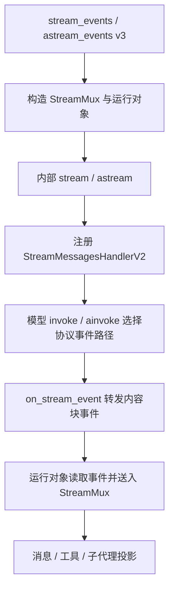

# Deep Agents 源码解析 18：流式输出与子代理流

## 一、源码定位

> **阅读基线**：Deep Agents 0.6.12（`libs/deepagents/`）；LangChain 1.3.14、LangChain Core 1.5.1、LangGraph 1.2.9。
> 源码版本与路径约定见 [源码版本与路径约定](source-baseline.md)。
>
> - Deep Agents 装配：`libs/deepagents/deepagents/graph.py` → `create_deep_agent()`
> - 同步 / 异步入口与装配：`langgraph/pregel/main.py` → `stream_events()` / `astream_events()`、`_pregel_stream_v3()` / `_apregel_stream_v3()`
> - 模型节点与变换器注册：`langchain/agents/factory.py` → `_execute_model_sync()` / `_execute_model_async()`、`create_agent()`
> - 模型协议事件：`langchain_core/language_models/chat_models.py` → `_should_use_protocol_streaming()`、`_iter_v2_events()` / `_aiter_v2_events()`；`langgraph/pregel/_messages.py` → `StreamMessagesHandlerV2`
> - 运行对象与订阅队列：`langgraph/stream/run_stream.py` → `GraphRunStream` / `AsyncGraphRunStream`；`langgraph/stream/stream_channel.py` → `StreamChannel`
> - 版本与状态输出契约：`langgraph/pregel/main.py` → `_output()`、`_defaults()`；`langgraph/pregel/_io.py` → `map_output_values()`；`langchain_core/runnables/base.py` → 经典 `astream_events()`
> - 消息与工具投影：`langgraph/stream/transformers.py` → `MessagesTransformer`；`langgraph/prebuilt/_tool_call_transformer.py` → `ToolCallTransformer`
> - 子代理调用与识别：`libs/deepagents/deepagents/middleware/subagents.py` → `task()` / `atask()`、`_compile_spec()`；`langchain/agents/_subagent_transformer.py` → `SubagentTransformer`
> - 同步 / 异步接线测试：`libs/deepagents/tests/unit_tests/test_deep_agent_streaming.py`
> - 经典接口消费示例：`libs/code/deepagents_code/client/non_interactive.py` → `_stream_agent()`、`_process_stream_chunk()`

下文 `deepagents/…` 对应 SDK 包内路径 `libs/deepagents/deepagents/…`；`langchain/…`、`langgraph/…` 和 `langchain_core/…` 分别表示对应依赖的包内路径。方法签名与返回契约均按上述版本解释。

本文以 Event Streaming 的 `stream_events(..., version="v3")` 为主线，对照同步与异步源码。LangGraph `1.2.9` 将 v3 标记为 `experimental`，接入时应固定依赖，并核对接口签名与返回契约。

先用一次“读取报告并回答”的执行区分三个对象：`run` 代表整场图运行，消息句柄代表其中一次模型输出，工具句柄代表实际的一次工具执行。句柄是继续读取过程与结果的入口，取得它时，内容可能还没生成完。

| 执行推进到哪里 | 流中看到什么 | 应用怎样理解 |
| --- | --- | --- |
| 第一次模型调用 | 一条消息句柄，逐渐出现 `read_file` 参数 | 模型正在提出工具调用，文件还不一定读完 |
| 工具节点执行 | 工具句柄及完成结果 | 这是实际读取的执行过程；结果随后进入图状态 |
| 第二次模型调用 | 另一条消息句柄，逐渐生成回答 | 同一场运行产生了第二条模型消息 |
| 图流结束 | 当前运行的输出状态及中断信息 | 可能正常结束，也可能暂停等待审批，需要结合终态判断 |

投影是将同一条底层事件流按用途整理出的读取视图。`chat.tool_calls` 展示模型生成的调用参数，`run.tool_calls` 展示工具执行；订阅两者不会额外执行一遍工具。消息流也不保证每条模型消息都是最终答案，应用应区分中间说明、工具调用和最终交付。

## 二、从业务需要的返回值选择读取入口

通常接入应用时，先确定要拿到的值，再决定读取哪个入口。v3 的运行对象只是整场执行的访问入口；迭代出的消息句柄、工具句柄还需要继续读取，不能把它们直接当作最终字符串。

下表中 `run` 是本次运行，`chat` 是从 `run.messages` 取得的一条模型消息句柄，`call` 是从 `run.tool_calls` 取得的一次工具执行句柄。

| 需要的内容 | 同步读取 | 异步读取 | 返回值的含义 |
| --- | --- | --- | --- |
| 创建一次流式运行 | `agent.stream_events(inputs, version="v3")` | `await agent.astream_events(inputs, version="v3")` | 运行对象，保存为 `run` |
| 主代理的模型消息 | 迭代 `run.messages` | 异步迭代 `run.messages` | 一次模型调用对应一个消息句柄，整场任务可能有多次模型调用 |
| 仅正文增量 | 迭代 `chat.text` | 异步迭代 `chat.text` | 每项是新增的 `str`，适合直接更新正文 |
| 某条消息的完整文本 | `str(chat.text)` | `await chat.text` | 一条模型消息的全文，不是整场任务最终状态 |
| 某条完整模型消息 | `chat.output` | `await chat.output` | `AIMessage`，可读取文本、工具调用和用量信息 |
| 模型生成的工具参数 | 迭代 `chat.tool_calls`；完成后 `.get()` | 异步迭代 `chat.tool_calls`；完成后 `await chat.tool_calls` | 过程是参数片段，汇总值是完整工具调用列表 |
| 实际工具执行 | 迭代 `run.tool_calls` | 异步迭代 `run.tool_calls` | 工具句柄；过程读 `call.output_deltas`，终态读 `call.output` / `call.error` |
| 子代理过程 | 迭代 `run.subagents` 后读取 `sub.messages` 等 | 对应异步迭代 | 按子运行分组，不混入主代理正文 |
| 图状态快照 | 迭代 `run.values` | 异步迭代 `run.values` | 当前状态值，通常含消息历史，不能作为文本增量追加 |
| 最终图状态 | `run.output` | `await run.output()` | 本次运行结束后的状态；不是默认的一段答案字符串 |

`run.output` 是根作用域最近一次 values 事件携带的数据；没有收到这类事件时可能为 None。流因人工审批中断而结束时，它也可能返回暂停点的状态，所以“拿到 output”本身不表示业务已经完成。

只需要最终结果时，可以直接使用 `agent.invoke()` / `await agent.ainvoke()`，再从返回状态中提取业务需要的字段，无须建立流消费者。需要过程与最终结果时，先消费过程，再读取 `run.output` 或 `await run.output()`。

### 1. 控制消费内容：选择投影和字段

只展示主代理正文，就消费 `run.messages` 中每条消息的 `chat.text`；需要工具执行卡片，再消费 `run.tool_calls`；需要子代理工作区，再消费 `run.subagents`。多个投影应及时订阅，后文分别分析同步 `interleave()` 与异步并发读取。

这个选择控制应用读取和展示什么。它不会禁止模型调用工具，也不会关闭子代理执行。只消费 `run.messages` 时，图仍可执行工具与子代理，只是应用没有展示相应投影。最终发给浏览器或业务调用方的返回体，也由应用从这些值中选取和组织。

### 2. 控制事件来源：经典接口用模式，v3 用变换器声明

经典 `stream_mode` 决定图发出哪类事件：`messages` 是消息，`updates` 是节点状态更新，`values` 是状态快照，`tools` 是工具执行，`custom` 是自行发送的业务进度。

v3 不接受 `stream_mode`，它根据已注册变换器的 `required_stream_modes` 决定底层通道。默认提供消息、工具、子代理与状态等读取入口。需要 `custom` 或节点 `updates` 时，可以从 `langgraph.stream` 导入 `CustomTransformer` / `UpdatesTransformer`，通过入口参数 `transformers=[...]` 追加，再读取 `run.custom` / `run.updates`。

`transformers` 在这里是追加配置，不是只保留所列事件的白名单。消费投影决定本地读取哪些条目，注册变换器决定还需要哪些底层通道；这两处选择发生在不同阶段，后文会对照装配源码解释。

### 3. 控制状态返回字段：使用 `output_keys`

如果关心“最终状态只返回 messages，不返回其他状态字段”，可以在 v3 入口传 `output_keys=["messages"]`。它通过 `**kwargs` 进入底层 `stream()` / `astream()`，用于选择状态输出字段；并不会把 `run.messages` 改成只输出最终回复，也不会过滤模型内容块。

`langgraph/pregel/main.py:2565` 的 `_defaults()` 对参数做默认处理与校验：

```python
if output_keys is None:
    output_keys = self.stream_channels_asis
else:
    validate_keys(output_keys, self.channels)
```

状态快照在 `langgraph/pregel/_io.py:100` 的 `map_output_values()` 中按这些字段读取。`GraphRunStream._observe_event()` 记录根运行最新的 `values`，所以字段选择也影响最终的 `run.output`。建议使用字段列表保留字典形状；选择 `messages` 返回的是该状态字段中的消息列表，通常包含历史，不是最后一条消息的文本。

`output_keys` 选择输出字段，不修改内部状态定义、checkpoint 内容或模型可见上下文。不要把它当作跨消息、工具、状态所有通道的统一过滤器。

### 4. 控制模型答案结构：使用 `response_format`

如果需要的是固定字段的业务结果，应在 `create_deep_agent(response_format=...)` 配置结构化输出 schema（字段结构与类型约束）。LangChain 解析和校验后把结果写入状态的 `structured_response`，调用方再取这个字段。

`langchain/agents/factory.py:1193` 中，供应商结构化输出解析成功后的返回语句是：

```python
return {"messages": [output], "structured_response": structured_response}
```

这里控制的是模型答案的结构；`version` 控制流接口契约，`output_keys` 控制状态返回字段。即使只想得到 `structured_response`，也需要先配置并成功生成结构化输出，单独改变流版本或筛选字段不会创建这个业务结果。

同步与异步的以上返回语义对应，但执行能力仍受工具实现约束。`langchain_core/tools/structured.py:99` 的同步分支在工具没有 `func` 时抛出 `NotImplementedError`；异步分支可以在没有 `coroutine` 时通过线程调用同步实现。取消使用 `run.abort()` / `await run.abort()`，也可用对应的同步 / 异步上下文管理器。

## 三、v3 如何装配底层图流与读取对象

`create_deep_agent()` 在 `deepagents/graph.py:1030` 将模型、工具和中间件交给 LangChain 的 `create_agent()`，返回编译后的图。LangChain 编译时注册工具与子代理的流变换器；变换器负责把底层事件归集成可读取的对象。

源码：`langchain/agents/factory.py:1795`，`graph.compile()` 参数节选，补充中文注释。

```python
transformers=[
    ToolCallTransformer,  # 按工具调用 ID 维护执行过程与结果
    SubagentTransformer,  # 按运行路径与名称识别子代理
    *middleware_transformers,
    *(transformers or ()),
],
```

调用同步 `stream_events(version="v3")` 后，LangGraph 进入 `_pregel_stream_v3()`，创建 `StreamMux`。这是按命名空间分发事件的组件，运行时还会加入消息、状态与生命周期等变换器。

`langgraph/pregel/main.py:3545` 起，`_pregel_stream_v3()` 的尾部如下；省略前面的分发器构造。

```python
graph_iter = iter(
    self.stream(
        input,
        patch_configurable(config, {CONFIG_KEY_STREAM_MESSAGES_V2: True}),
        stream_mode=_collect_stream_modes(mux),
        subgraphs=True,
        version="v2",
        interrupt_before=interrupt_before,
        interrupt_after=interrupt_after,
        control=control,
        **kwargs,
    )
)
return GraphRunStream(graph_iter, mux)
```

异步 `_apregel_stream_v3()` 使用相同的变换器集合，将分发器设为 `is_async=True`，改调 `self.astream(...)`，返回 `AsyncGraphRunStream`。同步 / 异步图流分别是 `GraphRunStream` / `AsyncGraphRunStream` 的底层输入。

这里有三项决定消费方式的配置：

- `_collect_stream_modes(mux)` 按变换器声明收集所需通道，调用方不再手动列出 `messages`、`tools` 等模式。
- `subgraphs=True` 让子图事件进入分发器，再按运行路径归属到父图或子图的读取对象。
- `CONFIG_KEY_STREAM_MESSAGES_V2` 启用内容块协议；内层 `version="v2"` 则统一图流事件的外层包装。它们不是同一层的版本号。

**v3 不接受调用方传入 `stream_mode` 或 `subgraphs`。** `main.py:387` 的 `_reject_v3_invariant_kwargs()` 在同步和异步入口都会检查这两个参数，传入就抛 `TypeError`。迁移旧代码时，应删除这两个参数，改用 `run.messages`、`run.tool_calls`、`run.subagents` 选择要消费的内容。



## 四、模型 `invoke()` 与 `ainvoke()` 都走协议事件路径

LangChain 的模型节点仍然获取完整回复。`factory.py:1419` 的 `_execute_model_sync()` 调用 `model_.invoke(messages)`，`:1467` 的 `_execute_model_async()` 调用 `await model_.ainvoke(messages)`。v3 改变的是这两个调用内部生成和转发事件的路径。

内层图流看到了前面的协议开关，会注册 `StreamMessagesHandlerV2`。该处理器实现 `_V2StreamingCallbackHandler` 标记，模型基类 `BaseChatModel` 通过 `_should_use_protocol_streaming()` 检测它。

源码：`langchain_core/language_models/chat_models.py:606` 起，省略后面的供应商能力与禁用选项检查，原注释译为中文。

```python
# 只有安装了 v2 消息协议处理器，才选择这条路径
handlers = run_manager.handlers if run_manager else []
if not any(isinstance(h, _V2StreamingCallbackHandler) for h in handlers):
    return False
```

同步 `_generate_with_cache()` 和异步 `_agenerate_with_cache()` 都优先检查这个条件，满足后进入协议事件分支。经典的 `_should_stream()` / `on_llm_new_token()` 分支位于其后，不能拿它解释 v3 的主要调用链。

### 1. 供应商片段如何转成协议事件

同步 `_iter_v2_events()` 优先使用供应商原生 `_stream_chat_model_events()`；未实现时，使用 `chunks_to_events()` 把 `_stream()` 返回的片段转换成消息开始、内容块增量、消息结束等事件。异步 `_aiter_v2_events()` 对应使用异步原生接口，或由 `achunks_to_events()` 转换 `_astream()` 的片段。

两条路径的分发循环如下，分别来自 `chat_models.py:678` 与 `:709`，省略事件生成器的选择代码。

```python
for event in event_iter:
    stream.dispatch(event)  # 更新模型调用内部的消息累积器
    run_manager.on_stream_event(event)  # 同步通知图流回调
    yield event
```

```python
async for event in event_iter:
    stream.dispatch(event)
    await run_manager.on_stream_event(event)  # 等待异步回调完成
    yield event
```

`stream` 在这里是模型调用内部的 `ChatModelStream` 或 `AsyncChatModelStream`，用于累积完整回复。模型节点拿到的完整消息来自这个累积器的 `output_message`；用于外部显示的协议事件则沿回调进入图流。v3 这条路径不再使用经典分支的 `generate_from_stream(iter(chunks))` 合并方式。

接入自定义模型时，应检查对应同步 / 异步事件源是否可用。仅更换调用方法不会把一个只支持异步的供应商实现变成同步实现；缓存命中或完整消息降级也可能产生完整消息对应的事件，不代表供应商正在逐段生成。

### 2. 图回调如何避免一条回复出现两次

`StreamMessagesHandlerV2.on_stream_event()` 位于 `langgraph/pregel/_messages.py`。以下为方法主体，原注释译为中文：

```python
if meta := self.metadata.get(run_id):
    # 在消息开始时记录 ID，避免节点返回完整 AIMessage 后又重复发送。
    # 否则同一回复会分别通过流式事件和节点输出进入消息投影。
    if event.get("event") == "message-start":
        self._streamed_run_ids.add(run_id)
        msg_id = event.get("message_id")
        if msg_id:
            self.seen.add(msg_id)
    v2_meta = {**meta[1], "run_id": str(run_id)}
    self.stream((meta[0], "messages", (event, v2_meta)))
```

处理器保留命名空间，并补充模型调用的 `run_id`。后续 `MessagesTransformer` 据此把同一次模型调用的事件交给同一个消息句柄；`message-start` 创建句柄，后续事件填充内容并结束消息。

`MessagesTransformer.process()` 只接收当前作用域的消息，工具结果也被排除在模型消息投影之外。因此，`run.messages` 用于当前代理的模型回复，子代理消息从 `sub.messages` 读取，工具执行结果从 `run.tool_calls` 读取。沿用经典接口中“从 messages 里识别所有 ToolMessage”的消费方式，会漏掉 v3 的工具结果。

## 五、同步与异步运行对象怎样驱动事件分发

v3 的“投影”是从同一次运行中提取某类内容的读取视图。它们共享底层图流，读取任一投影都会推动事件分发；并不是每个 `run.messages` 或 `run.subagents` 都启动一遍图。

同步 `GraphRunStream._pump_next()` 位于 `langgraph/stream/run_stream.py:107`。下面截取其 `try` 分支主体，省略结束与错误处理：

```python
part = next(self._graph_iter)
event = convert_to_protocol_event(part)
self._observe_event(event)
self._mux.push(event)
return True
```

同步消费在调用线程拉取底层事件，并交给分发器。取得 run 对象后，还要迭代它的投影或读取最终状态，才能持续推动这条流；同步 v3 没有另起一个线程替消费端自动读完整场运行。

异步 `AsyncGraphRunStream._apump_next()`（同一文件 `:391`）处理相同的数据流，但使用条件变量协调多个消费者，确保同一时刻只有一个任务推进底层异步迭代器。其他消费者等待新事件到达后再读取自己的队列。因此可以并发读不同投影，不应自行并发调用底层迭代器的 `__anext__()`。

### 1. 最终结果读取也会继续执行图

同步 `run.output` 是属性，它调用 `_drive_until_done(self._pump_next)`；异步 `run.output()` 是方法，内部 `await _adrive_until_done(self._apump_next)`。两者都会继续消费到运行结束，再返回最终状态，源码分别位于 `run_stream.py:169` 与 `:511`。

如果先读取最终结果再开始订阅过程投影，事件可能早已被分发。需要展示过程时，应先消费过程，再获取最终状态；不能把 `run.output` 当作一个随时读取、不会推动执行的普通字段。

模型消息有独立的全文读取方式：同步 `str(chat.text)`、异步 `await chat.text`。它们只等待这条模型消息，不等价于读取整场运行的最终状态。同步阻塞等待和异步等待都可能推迟其他内容的显示，选择哪种 API 取决于宿主执行方式，不能仅凭“要实时输出”就选择异步。

## 六、工具与子代理如何形成独立句柄

### 1. 工具句柄由实际执行事件创建

`chat.tool_calls` 表示模型正在生成工具参数；`run.tool_calls` 中的 `ToolCallStream` 表示实际执行的一次工具调用。后者由 `ToolCallTransformer` 维护，工具开始时创建，后续事件按 `tool_call_id` 更新。

源码：`langgraph/prebuilt/_tool_call_transformer.py:97` 起，省略后面的完成与错误分支。

```python
if event_type == "tool-started":
    stream = self._new_stream(
        tool_call_id,
        data.get("tool_name", ""),
        data.get("input"),
    )
    self._active[tool_call_id] = stream
    self._log.push(stream)
elif event_type == "tool-output-delta":
    stream = self._active.get(tool_call_id)
    if stream is not None:
        stream._push_delta(data.get("delta"))
```

`tool-finished` 填充最终 `output`，`tool-error` 填充 `error`。`completed` 只说明已进入终态，业务成功还要检查错误、返回状态或进程退出码。

部分输出仍需要工具主动发送。`ToolRuntime` 是工具执行时注入的上下文对象，其 `emit_output_delta()`（`langgraph/prebuilt/tool_node.py:1732`）是同步方法，在同步与异步工具中都直接调用，无须 `await`：

```python
def emit_output_delta(self, delta: Any) -> None:
    writer = _tool_call_writer.get()  # 取得当前工具调用的输出出口
    if writer is None:
        return
    writer(delta)
```

v3 自动订阅工具变换器所需通道，但不会改写工具内部实现。例如 `deepagents/backends/local_shell.py:327` 的 `execute()` 使用 `subprocess.run(..., capture_output=True)`，等进程结束才整理 stdout 与 stderr。要实时显示命令输出，需要改造后端或工具，逐段读取并显式发送。

业务进度可以继续通过 `runtime.stream_writer(payload)` 发到 `custom` 通道，调用同样不加 `await`。Deep Agents 的 `RubricMiddleware._emit()` 在 `deepagents/middleware/rubric.py:698` 发送自评开始 / 结束事件；这是自定义业务事件，不能当作某次工具调用的 `output_deltas`。

上述版本的 v3 默认变换器集合没有订阅 `custom`。需要这类事件时，可从 `langgraph.stream` 导入 `CustomTransformer`，在同步或异步 v3 入口通过 `transformers=[CustomTransformer]` 追加，再消费 `run.custom`。该类在 `langgraph/stream/transformers.py` 声明 `required_stream_modes=("custom",)`，使前面的 `_collect_stream_modes()` 包含此通道。仅改读原始事件流，也不会自动补上未订阅的通道。

### 2. `task()` 与 `atask()` 分别调用同步和异步子代理

Deep Agents 的 `SubAgentMiddleware` 通过 `task` 工具委派本地子代理。`subagents.py:671` 的 `task()` 与 `:699` 的 `atask()` 共享输入准备和结果回写，分别使用下面两段调用；省略前置校验，父配置传播的原注释译为中文。

同步分支：

```python
# 父运行的回调与配置自动传播，子代理绑定配置在冲突时仍优先。
# 不显式重复转发，以免 tags 等信息重复；这里只添加追踪标记。
subagent_config: RunnableConfig = {"configurable": {"ls_agent_type": "subagent"}}
with _subagent_tracing_context():
    result = subagent.invoke(subagent_state, subagent_config)
return _return_command_with_state_update(result, runtime.tool_call_id)
```

异步分支：

```python
# 父运行的回调与配置按同样规则传播；这里只添加子代理追踪标记。
subagent_config: RunnableConfig = {"configurable": {"ls_agent_type": "subagent"}}
with _subagent_tracing_context():
    result = await subagent.ainvoke(subagent_state, subagent_config)
return _return_command_with_state_update(result, runtime.tool_call_id)
```

工具注册同时传入 `func=task` 和 `coroutine=atask`。两条路径都依靠继承的回调发送子代理事件，无须在 `task` 内手动再转发片段。v3 已在内部开启子图事件，不需要额外添加 `subgraphs=True`。

`SubagentTransformer` 结合嵌套运行路径与 `lc_agent_name` 创建子代理句柄。声明式子代理通过 `create_agent(name=...)` 获得名称；预编译子代理在 `subagents.py:563` 的 `_compile_spec()` 中通过 `with_config()` 补上名称。句柄的 `name` 是角色标签，`path` 区分运行实例，`cause` 可以关联触发它的工具调用 ID。

子代理结束后，`_return_command_with_state_update()` 将结构化结果或最后一条非空模型回复包装成父图 `ToolMessage`。过程展示与父图结果回写仍是两条路径，不能把子代理回复和父图工具结果无条件拼在同一条正文中。远程异步子代理另有任务查询和恢复流程，见 [12：异步 SubAgent](./12-async-subagent.md)。

## 七、多路消费：同步用 interleave，异步并发读取

同步和异步投影都使用 `StreamChannel` 保存待消费条目。`langgraph/stream/stream_channel.py:120` 的 `push()` 主体如下，省略文档字符串：

```python
if self._subscribed:
    if self._closed:
        raise RuntimeError("Cannot push to a closed StreamChannel")
    stamp = self._mux._next_push_seq() if self._mux is not None else 0
    self._items.append((stamp, item))
if self._wire_fn is not None:
    self._wire_fn(item)
```

`iter()` / `aiter()` 才算订阅，访问属性不算。如果先读完主消息，再读子代理投影，期间产生的子代理句柄可能没有被保存。官方页面中的单投影片段适合说明各自用法；在上述版本中，同时需要多个投影时，应按下面的方式组织消费，不能直接把多个循环依次拼接。

### 1. 同步：`interleave()` 先订阅，再按到达顺序返回条目

`GraphRunStream.interleave()` 位于 `run_stream.py:205`。它在推进底层流之前注册所有指定通道，再比较各队列头部的序号，取出最早到达的条目。以下是官方 [LangChain Event Streaming](https://docs.langchain.com/oss/python/langchain/event-streaming#multiple-projections) 的同步消费示例；`agent`、`input` 由外层准备：

```python
stream = agent.stream_events(input, version="v3")

for name, item in stream.interleave("messages", "tool_calls", "values"):
    if name == "messages":
        print(item.text)
    elif name == "tool_calls":
        print(item.tool_name, item.input)
    elif name == "values":
        print(item)
```

这里合并的是消息句柄、工具句柄和状态条目的到达顺序。`print(item.text)` 会读取该条消息全文，适合按整条消息展示；需要文字增量时迭代 `item.text`。但在某个句柄内部持续读取，也会推迟外层处理其他句柄。需要保留跨代理、跨工具的逐事件交错时，同步也可以直接 `for event in stream` 消费原始协议事件。

### 2. 异步：多个投影共享同一个事件分发过程

仓库 `libs/deepagents/tests/unit_tests/test_deep_agent_streaming.py:249` 的测试验证了主消息和子代理并发消费。以下截取测试主体，省略断言；辅助函数构造带一个 `researcher` 子代理的真实图，使用模拟模型：

```python
agent = _build_agent_with_one_subagent()
run = await agent.astream_events({"messages": [HumanMessage(content="go")]}, version="v3")

subagent_names: list[str] = []
parent_message_count = 0

async def drain_subagents() -> None:
    async for sub in run.subagents:
        subagent_names.append(sub.name)
        # 消费子投影，继续驱动子运行的事件分发
        async for _ in sub.messages:
            pass

async def drain_messages() -> None:
    nonlocal parent_message_count
    async for _ in run.messages:
        parent_message_count += 1

await asyncio.gather(drain_subagents(), drain_messages())
```

同一测试文件 `:311` 起还有同步用例，直接调用 `agent.stream_events(..., version="v3")`，验证消息 / 工具 / 子代理投影存在，以及同步子代理句柄完成后的名称和状态。两种接口提供相同类别的事件；应按宿主和工具的同步 / 异步能力选择消费方式。

上面的异步测试只有一个子代理。多个子代理同时输出时，还应及时为各自的内部投影取得迭代器并组织消费，不能等前一个读完才处理后一个。`StreamChannel` 通常只允许一个消费者，多读者使用同步 `tee()` 或异步 `atee()`。

已取得的模型消息句柄有自己的内容缓冲，不应把它与图投影队列混为一谈。当前 `StreamChannel.maxlen` 尚未限制队列长度，已订阅但长期不读仍会积压。同步和异步接入都需要控制应用发送队列，并在提前退出时使用对应的取消或上下文清理方法；取消不能撤销已经发生的外部副作用。

## 八、方法名与版本共同决定返回契约

**`stream()` 的 v2 与 `stream_events()` 的 v2 属于不同接口，返回的数据也不同。** 版本号本身不能说明会拿到什么，应连同方法名一起看：

| 接口与版本 | 调用方实际拿到什么 | 怎样选择返回内容 |
| --- | --- | --- |
| `stream()` / `astream()`，v1 | 一串图输出；每项是原始 `data` 或元组，取决于模式列表和子图配置 | `stream_mode` 选择消息、状态更新、自定义进度等通道 |
| `stream()` / `astream()`，v2 | 一串统一字典，包含 `type`、`ns`、`data`；部分模式有额外字段 | 同样用 `stream_mode`；v2 主要统一外层包装 |
| `astream_events()`，v1 | 一串回调事件字典，含 `event`、`name`、`run_id`、`data` 等；`parent_ids` 为空 | 按 `include_names` / `include_types` / `include_tags` 等筛选调用事件 |
| `astream_events()`，v2 | 仍是回调事件字典，补充父调用链 `parent_ids`，支持自定义回调事件 | 继续按调用名称、类型、标签筛选，适合已有的调用过程集成 |
| `stream_events()` / `astream_events()`，v3 | 先取得运行对象；从它读取消息、工具、子代理、状态等投影，也可以直接迭代协议事件 | 选择要消费的投影，再选择对象中的文本、参数、结果等字段 |

源码依据分别是 `langgraph/pregel/main.py:4184` 的 `_output()`，以及 `langchain_core/runnables/base.py` 的 `astream_events()` 事件定义与版本分发。该版本已将旧回调 v1 标记为弃用。旧回调 v2 的 `on_custom_event` 也不能与图流的 `custom` 字典包装混为一谈。

上述版本的同步 `stream_events(version="v1"/"v2")` 会落到基类并抛出 `NotImplementedError`；旧回调接口应使用异步 `astream_events()`。v3 提供独立的同步实现。公开入口默认版本仍是 v2，所以同步新代码尤其需要显式写 `version="v3"`。

源码中的 `StreamMessagesHandlerV2` 又属于内部消息协议层。它是 v3 运行时选用的处理器，不是上表里某个公开 v2 接口的别名。

## 九、经典 stream / astream 保留在哪些场景

经典接口仍适合维护已有按 `stream_mode` 分发的集成。当前仓库命令行的 `_stream_agent()`（`libs/code/deepagents_code/client/non_interactive.py:980`）就是这样的消费方，不能从这份应用代码反推官方新应用的推荐入口。

```python
async for chunk in agent.astream(
    stream_input,
    stream_mode=["messages", "updates", "custom"],
    subgraphs=True,
    config=config,
    context=context,
    durability="exit",
):
    _process_stream_chunk(chunk, state, console, file_op_tracker)
```

同步经典入口是 `agent.stream(...)`，使用同样的模式和子图参数，直接 `for` 消费。经典 v1 的外层结构随单模式 / 模式列表、是否开启子图而变化；经典 v2 统一为带 `type`、`ns`、`data` 的字典。

这条路径的模型消息主要通过 `StreamMessagesHandler.on_llm_new_token()` 转发 `AIMessageChunk`；v3 则使用协议事件和投影对象。`stream(version="v2")` 的字典包装、`stream_events(version="v2")` 的经典回调事件，以及 `stream_events(version="v3")` 的运行对象，是三种不同契约。

迁移时，应一起调整入口、参数和消费逻辑：删除 v3 不接受的 `stream_mode` / `subgraphs`，将模型消息、工具结果和子代理输出分配给对应投影，再核验多路订阅、异常与取消行为。原命令行 `_process_stream_chunk()` 在 `:811` 还主动丢弃非主图命名空间；若新界面需要子代理过程，不能保留这个过滤规则后又期待子代理内容出现。

持久化仍由图执行状态负责。`DeepAgentState.messages` 的 `DeltaChannel` 降低 checkpoint 写入成本，不记录每次显示增量；需要刷新后重放过程时，应用应额外保存展示事件。v3 提供更明确的消费对象，不会自动承担应用的事件存储与网络重连。

## 十、流结束后怎样判断完成、中断与失败

流消费者需要完成两项工作：展示过程，以及判断这次运行为什么结束。前面介绍的消息与工具投影解决前一项，运行对象记录的输出、异常和中断信息解决后一项。

`GraphRunStream._observe_event()` 在 `langgraph/stream/run_stream.py` 中只观察根作用域的 values 事件。下面保留方法主体：

```python
if event["method"] != "values":
    return
params = event["params"]
if params["namespace"] != self._scope_list:
    return
self._latest = params["data"]
interrupts = params.get("interrupts", ())
if interrupts:
    self._interrupted = True
    self._interrupts.extend(interrupts)
```

`_latest` 保存输出状态，`_interrupted` 与 `_interrupts` 另外记录是否发生中断及其载荷。子图自己的 values 不会在这里直接覆盖主图输出。例如文件写入等待审批时，界面应展示待审批动作；把最后一条模型文本直接标成“完成”，会把暂停误报为成功。

同步读取 `run.output`、`run.interrupted`、`run.interrupts`，异步对应 `await run.output()`、`await run.interrupted()`、`await run.interrupts()`。这些访问会继续驱动底层图流直至结束，并传播已记录的异常，不是无副作用的即时状态查询。若先读取它们，再订阅过程投影，期间产生但未订阅的条目可能已经丢失。

因此，一次消费的顺序应是：先取得所需投影的迭代器，再处理消息、工具和子代理事件，流结束后检查异常与中断，最后从返回状态提取业务结果。若用户提前离开，通过 `abort()` 或上下文管理器清理运行；已提交的外部任务还需由对应服务确认取消。

网络连接和图运行也要分开管理。图检查点支持状态恢复，不保存界面收到的每个文字增量。需要刷新后重放时，应用保存展示事件及其顺序；恢复执行则沿检查点与中断恢复机制进行。两者共用任务标识，但不应把重放旧事件变成重新执行工具。

## 十一、延伸阅读

**下层：LangChain / LangGraph**

- [LangGraph 08：Stream 系统](../langgraph/08-stream-system.md)——图层的流式输出与多种 stream mode

**本系列**

- [09：同步 SubAgent](./09-subagent-sync.md)——本地委派、配置传播与结果回写
- [12：异步 SubAgent](./12-async-subagent.md)——远程任务的查询与生命周期
- [03：状态、Reducer 与恢复](./03-state-reducers-and-recovery.md)——完整消息保存与恢复

**上层：方法论与案例**

- [Deep Agents Streaming](https://docs.langchain.com/oss/python/deepagents/streaming)——官方推荐新应用使用 Event Streaming
- [LangChain Event Streaming](https://docs.langchain.com/oss/python/langchain/event-streaming)——消息、工具、同步 interleave 与异步并发消费
