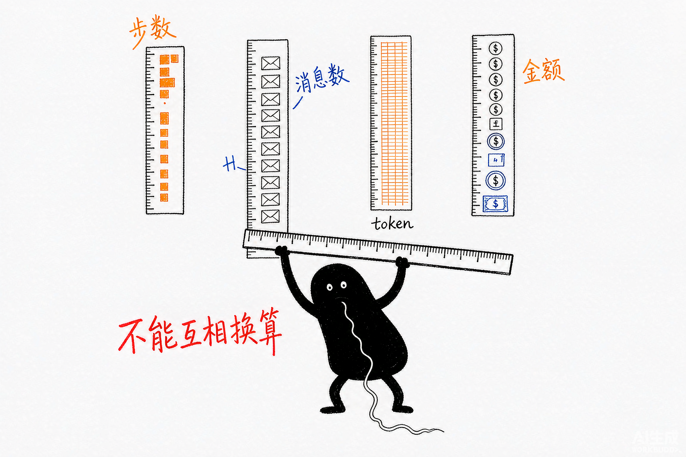
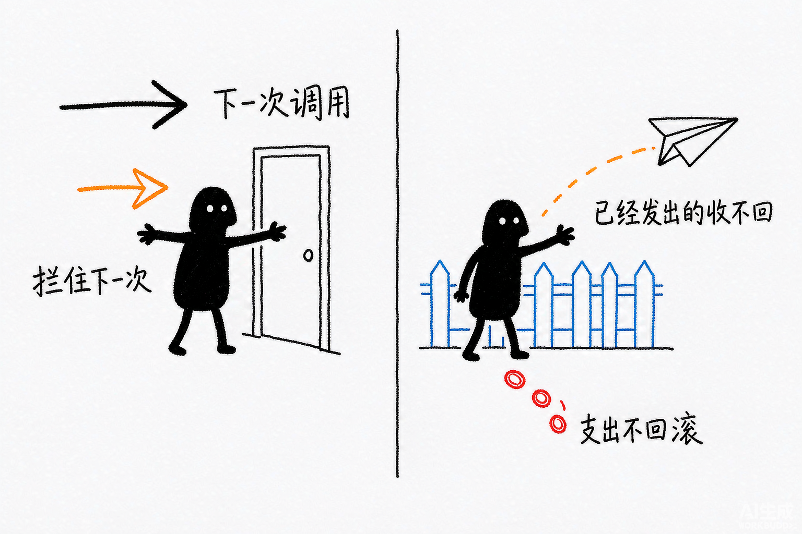

# Deep Agents 源码解析 19：循环预算与终止控制

## 一、源码定位

> **阅读基线**：Deep Agents 0.6.12（`libs/deepagents/`）。
> 源码版本与路径约定见 [源码版本与路径约定](source-baseline.md)。
>
> - 图深度配置：`libs/deepagents/deepagents/graph.py:1045` → `create_deep_agent()` 返回前的 `.with_config()`
> - 工厂入口参数表：`libs/deepagents/deepagents/graph.py:376` → `create_deep_agent()` 签名
> - 默认提示词中的软约束：`libs/deepagents/deepagents/graph.py` → `BASE_AGENT_PROMPT`
> - Profile 专属预算中间件：`libs/deepagents/deepagents/profiles/harness/_nvidia_nemotron_3_ultra.py:990` → `NemotronProgressBudgetMiddleware`
> - 动作指纹与预算轴常量：同文件 456-461、860-884、969-1010
> - 修复风险判定：同文件 888 → `_repair_loop_risk()`，被 1336 / 1582 / 1690 三处守卫共用
> - 运行内验收：`libs/deepagents/deepagents/middleware/rubric.py` → `GraderResponse`、`_TERMINAL_RESULTS`、`max_iterations`

## 二、先区分计量单位和停止位置

Deep Agents 的通用默认栈没有统一的时间、token 或金额预算。工厂把图步数上限设为 9_999；这个上限仍会终止过深的图执行，但不能据此判断任务是否已经超时或超支。Nemotron Profile 另有消息计数守卫，不能把它当作所有模型的默认行为。

本文沿四个入口追踪终止行为；它们约束的对象不同：

```text
模型自觉停下（BASE_AGENT_PROMPT 软约束，不强制）
  +
调用方覆盖图深度（.with_config(recursion_limit=...)，要自己设）
  +
Profile 专属预算中间件（本文分析 Nemotron 实现）
  +
Rubric 运行内验收（评分与修订有上限，业务交付仍需核验）
```

业务需要的预算单位和覆盖范围由调用方确定。默认图深度较大，且不检查业务进度；无人值守任务应另外定义允许的消耗和终止后的交付状态。

同一任务可能同时出现“图只走了几步”“模型已经发送多次请求”“远端工具仍在运行”。图步数计算调度，消息计数计算已经写入历史的消息，时间和金额则跨越主模型、辅助评分、重试与子任务。它们没有固定换算比例。

因此，“拒绝下一次模型调用”和“终止已经发出的命令”需要不同控制。前者可以在模型入口检查；后者必须由执行端支持超时或取消。Rubric 的评分次数上限又只约束评分循环，不能代替主任务的总预算。



*图：步数、消息数、token、金额是四把刻度不同的尺子，互相换不出对方。*

## 三、工厂只配置图步数上限

`create_deep_agent()` 在返回编译后的图之前，固定套一层运行时配置：

```python
    return create_agent(
        model,
        system_prompt=final_system_prompt,
        tools=_tools,
        middleware=deepagent_middleware,
        response_format=response_format,
        context_schema=context_schema,
        checkpointer=checkpointer,
        store=store,
        debug=debug,
        name=name,
        cache=cache,
        state_schema=state_schema if state_schema is not None else DeepAgentState,
    ).with_config(
        {
            "recursion_limit": 9_999,
            "metadata": {
                "ls_integration": "deepagents",
                "lc_versions": {"deepagents": __version__},
                "lc_agent_name": name,
            },
        }
    )
```

`recursion_limit` 是 LangGraph 的图执行步数上限，超限抛出 `GraphRecursionError`。这里显式设为 9_999，所以分析此工厂的行为时，应以绑定值和调用方覆盖值为准。

这个配置为长任务保留了较大的图执行空间，但不说明某个具体任务需要多少步。模型、工具和节点式 hook 都可能参与调度；包装器中的摘要调用又可能在一个节点内部发生，不能把图步数直接换算为模型请求数。

9_999 仍然是有效的上限。若图持续循环且没有遇到其他结束、异常或中断条件，会在达到上限后报错；一个阻塞中的工具则可能在消耗很少图步数时就超出业务允许的时间。

工厂签名没有任务级 `max_turns`、超时或金额参数。调用方可以通过返回图的配置覆盖步数，也可以使用 `middleware` 扩展实际调用边界；这与一个直接接受任务总预算并自动分配给所有子任务的接口不同。

:::note 工程判断
图深度适合限制循环长度，但部署方还需要确定任务级时间与费用上限。例如同样 80 个图步数，轻量查询和包含远端执行的任务可能耗时、费用都不同。工厂的默认值不能替代这些业务预算；覆写图配置之后，仍需检查模型和工具各自的消耗。
:::

## 四、提示词、调用配置与结束评分分别控制什么

### 1. 模型自觉：提示词里的软约束

`BASE_AGENT_PROMPT` 用措辞劝模型自己管理循环：

```text
When things go wrong:

- If something fails repeatedly, stop and analyze *why* — don't keep retrying the same approach.
- If you're blocked, tell the user what's wrong and ask for guidance.
```

同一段还要求“Keep working until the task is fully complete”，只在任务完成或真的卡住时才交还控制权。

提示词约束和代码熔断的可靠性不在一个量级。模型可以忽略它，也可以把“分析原因”理解成换个参数再试一次。提示词能降低空转概率，不能作为终止依据。

### 2. 调用方覆盖图深度

`.with_config()` 的返回值仍然是可配置的图，调用方可以再套一层覆盖：

```python
agent = create_deep_agent(model="provider:main-model", tools=tools)
agent.invoke(
    {"messages": [{"role": "user", "content": task}]},
    config={"recursion_limit": 60},
)
```

这是直接覆盖工厂运行配置的入口，只覆盖“图步数”一个轴。其他计量需要另行接入中间件或外部执行控制。

### 3. 运行内验收：Rubric

`RubricMiddleware`（见 [14](14-rubric-self-evaluation-loop.md)）在 Agent 自然结束时调用独立 grader，按 rubric 判定输出是否达标。后文继续分析它的评分次数与任务总预算有何区别。

## 五、Nemotron Profile 的预算中间件

Nemotron Harness Profile 为该模型装配消息数量与重复调用守卫。它提供了一个具体例子：怎样在模型包装器中决定是否继续调用下游。

`NemotronProgressBudgetMiddleware` 位于 `profiles/harness/_nvidia_nemotron_3_ultra.py`，文档字符串写明用途：

```python
class NemotronProgressBudgetMiddleware(AgentMiddleware):
    """在 Ultra3 专属工具循环耗尽上下文前停止它。"""
```

它只在 Nemotron 的 Harness Profile 下被装配，不进入其他模型的主代理栈。

### 1. 三条预算轴

```python
_MAX_MODEL_CALLS = 16
_MAX_TOOL_RESULTS = 48
_MAX_REPEATED_TOOL_CALLS = 3
```

`wrap_model_call` 在每次调用模型前检查，任一超限就直接短路：

```python
    def _exceeded_reason(self, messages: list[Any]) -> str | None:
        ai_count = _ai_message_count(messages)
        if ai_count >= self.max_model_calls:
            return f"{ai_count} model turns"
        tool_count = _tool_message_count(messages)
        if tool_count >= self.max_tool_results:
            return f"{tool_count} tool results"
        repeats = _max_consecutive_repeated_tool_call_count(messages)
        if repeats >= self.max_repeated_tool_calls:
            return f"{repeats} repeated identical tool calls"
        return None
```

前两条统计消息数量：本次检查窗口中已有 16 条 AIMessage 或 48 条 ToolMessage 时，不再调用下游模型。第三条检查连续相同的工具签名，下一段展开。

16 条 AIMessage 与 9_999 个图步数属于不同单位，不能直接比较额度大小。文档字符串说明守卫针对 Ultra3 Profile，但不能据此推断所有任务都会空转，或第 17 次调用必然没有价值。这些阈值是该实现的默认策略，迁移到其他模型和任务前应重新评测。

计数对象是 `AIMessage` 与 `ToolMessage`（`_ai_message_count` / `_tool_message_count`，`859-864`），不是每次 provider 网络请求。一次模型输出可以包含多个工具调用，工具批次执行完后才在下次模型入口检查，因此 48 不是逐个工具调用前的严格准入限额。`_messages()` 优先读取 `request.state["messages"]`，取不到列表时才回退到请求消息；不能笼统认为请求视图摘要后计数就会清零，也不能把这个消息窗口当作完整的费用账本。

### 2. 动作指纹：连续相同签名

```python
def _tool_call_signature(call: ToolCall) -> str:
    name = call.get("name", "")
    args = call.get("args") or {}
    return f"{name}:{json.dumps(args, sort_keys=True, default=str)}"


def _max_consecutive_repeated_tool_call_count(messages: list[Any]) -> int:
    max_count = 0
    last_sig: str | None = None
    current_count = 0
    for call in _iter_tool_calls(messages):
        sig = _tool_call_signature(call)
        if sig == last_sig:
            current_count += 1
        else:
            last_sig = sig
            current_count = 1
        max_count = max(max_count, current_count)
    return max_count
```

签名包含工具名和排序后的参数 JSON。工具名与参数相同的连续调用会累加；换参数后签名不同，连续计数重新开始。因此它不会把不同参数的合理查询当作同一次动作重复，但也识别不了靠变参掩盖的空转。其他消息总量限制仍可能终止这类任务，不能据此断言整个预算中间件都会失效。

计数只看**连续**重复，累计重复不触发。`read_file(a) → read_file(a) → read_file(a)` 触发；`read_file(a) → read_file(b) → read_file(a)` 不触发。这个选择偏向减少误杀，代价是漏掉交替式空转。

计数的范围也被收窄过：

```python
def _messages_since_last_user(messages: list[Any]) -> list[Any]:
    for index in range(len(messages) - 1, -1, -1):
        message = messages[index]
        if isinstance(message, HumanMessage) and getattr(message, "name", None) not in _INTERNAL_MESSAGE_NAMES:
            return messages[index:]
    return messages
```

`wrap_model_call` 传入的是 `_messages_since_last_user(...)` 的结果。遇到新的、未被内部名称排除的 HumanMessage，计数窗口便移到该消息之后；旧消息没有被删除。用户补充一句“继续处理”也可能开启新窗口，但仍属于同一个业务任务，因此这个窗口不等于任务总预算。

:::note 工程判断
连续签名检测适合发现重复动作。若要判断是否推进，应观察业务状态：例如待核验文件数量是否减少、测试失败数是否下降、要求交付的内容是否补齐。对不断追加的消息历史做哈希，每轮都会变化，不能据此证明任务取得进展。
:::

### 3. 超限后的兜底是总结，不是抛错

预算超限后，中间件不调用下游 handler，而是返回一条不带工具调用的 AIMessage：

```python
    @staticmethod
    def _fallback(messages: list[Any], reason: str) -> AIMessage:
        return AIMessage(
            content=_budget_fallback_text(messages, reason),
            name=_BUDGET_GUARD_SOURCE,
            response_metadata={"nemotron_progress_budget_reason": reason},
        )
```

`_budget_fallback_text` 会从已有工具结果里挑出“有信息量”的条目（`_budget_result_is_informative`）、按工具名和内容去重、最多保留 12 条（`_MAX_BUDGET_RESULTS`），拼成一段类似下面的文本：

```text
Using the tool results gathered so far:
- read_file: ...
- grep: ...
```

这条消息的 `name` 是常量 `_BUDGET_GUARD_SOURCE = "nemotron_progress_budget"`。同文件的 `_is_final_answer()`（795 行）明确把带这个来源的消息排除在“最终回答”之外，其他守卫中间件不会把预算兜底误当成模型自己给出的结论。超限原因写进 `response_metadata`，调用方可以取出来做观测。

这会阻止当前包装器继续调用下游模型，但不是强制终止整张图。后续结束 hook 仍可能运行，Rubric 也可能要求修订。调用方应检查 `response_metadata` 中的预算原因，并结合最终评分和产物状态判断是否交付；只有文本返回，无法证明正常完成。

### 4. 一整套守卫共用修复风险判定

预算中间件不是单点。同文件还有一个更严格的判定：

```python
_MAX_REPAIR_MODEL_CALLS = 8
_MAX_REPAIR_TOOL_RESULTS = 28


def _repair_loop_risk(messages: list[Any]) -> bool:
    return (_ai_message_count(messages) >= _MAX_REPAIR_MODEL_CALLS
            or _tool_message_count(messages) >= _MAX_REPAIR_TOOL_RESULTS)
```

`_repair_loop_risk` 被三个守卫中间件共用：`FollowupDisciplineMiddleware`（1336 行）、`EntityResolutionGuardMiddleware`（1582 行）、`FinalAnswerGuardMiddleware`（1690 行）。这三个中间件分别处理“该追问时别硬答”、“实体没解析清楚别往下走”、“该交最终答案时别再调工具”，触发条件都包含“窗口中已有 8 条 AIMessage 或 28 条 ToolMessage”。

同一 Profile 还通过 `ModelRateLimitRetryMiddleware` 处理模型限流重试。一次模型节点执行因此可能包含多次网络尝试，而最终只产生一条 AIMessage；这也是消息计数不能代替请求计费的具体原因。

:::note 工程判断
Profile 适合携带与模型行为相关的修复策略；应用总预算则应保持自己的口径。替换模型可能同时换掉 Profile 的守卫集合，如果金额或截止时间是业务要求，就不能只依赖模型专属配置。调用方显式添加的中间件仍可提供独立限制。
:::

## 六、Rubric 的评分次数与任务总预算

`RubricMiddleware` 在主 Agent 自然结束后按任务标准评分。这里的终态指评分机制是否继续修订，不等于外部业务目标已达成：

```python
GraderVerdict = Literal["satisfied", "needs_revision", "failed"]

_TERMINAL_RESULTS: frozenset[RubricResult] = frozenset(
    {"satisfied", "max_iterations_reached", "failed", "grader_error"})
```

只有 `needs_revision` 会让循环继续：反馈作为一条带来源标记的 `HumanMessage` 注入主消息链，然后 `jump_to=“model”` 让主 Agent 继续修订。`failed`、`grader_error` 和达到上限的 `max_iterations_reached` 都不再由 Rubric 请求修订。

评分尝试次数的默认上限是 3；每次评分之间，主 Agent 仍可能执行多轮模型与工具调用：

```python
        max_iterations: int = 3,
```

把 Rubric 和 Nemotron 预算放在一起，分工如下：

| 机制 | 防什么 | 触发位置 | 超限行为 |
| --- | --- | --- | --- |
| `NemotronProgressBudgetMiddleware` | 消息过多或连续相同工具调用 | 每次模型调用前 | 返回兜底 AIMessage，跳过下游模型 |
| `RubricMiddleware` | 自然结束时仍未满足评分标准 | Agent 自然结束时 | 未达标且仍有次数时请求修订，默认最多评分 3 次 |

两者不互相替代。Rubric 验收的是调用方写进 `state["rubric"]` 的任务标准；没有 rubric 时它跳过评分，但图仍可能受其他结束 hook、异常或中断影响。主 Agent 如果一直不自然结束，也就到不了这次评分。

## 七、已有计数与任务预算之间还差什么

从本文的工厂和两个中间件出发，可以把已有计数与业务要求逐一对应：

| 已有观测或限制 | 实际覆盖什么 | 不能直接推出什么 |
| --- | --- | --- |
| recursion_limit | 当前图执行的步数 | 墙钟时间、金额、远端任务已停止 |
| Nemotron 消息窗口 | 最近用户消息之后的 AIMessage、ToolMessage 和连续签名 | 全部网络重试、辅助调用与跨请求任务的消耗 |
| Rubric max_iterations | 当前评分运行的尝试次数 | 两次评分之间主 Agent 的调用次数或费用 |
| 模型响应 usage 与追踪记录 | 已报告的调用用量和过程 | 派发前已有足够余额，或所有子任务已纳入同一账本 |
| Backend 的单操作限制 | 相应命令、遍历或输出的资源上限 | 整棵任务树的总额度和业务完成状态 |

通用工厂没有把这些记录汇总为任务级持久预算，并自动为并行子任务预留额度。若应用需要这个保证，应定义独立的业务任务 ID，将主模型、重试、摘要、grader 和子任务关联起来。具体部署平台已有的超时、取消或计费设施可以复用，但要核对它们的覆盖范围。

业务进度又是另一份证据。请求次数下降不代表产物更正确，参数不同也不代表完成了新工作；进度检查应绑定任务所要求的状态变化。

## 八、上生产时怎么补

**按任务形态设置图深度。** 先测量正常任务需要的图步数，再确定异常循环的上限。下面的 80 仅演示配置入口，不是通用推荐值：

```python
result = agent.invoke(
    {"messages": [{"role": "user", "content": task}]},
    config={"recursion_limit": 80},
)
```

**在实际调用边界检查预算。** Nemotron 的实现可用于理解“下一次模型调用前拒绝继续”的做法，但计数范围应按业务选择：最近一次用户请求的额度不能替代整个任务树的额度。返回兜底消息或抛出可识别异常都需要调用方定义处理方式；共享费用账本和阻塞工具的超时控制应接在能覆盖这些操作的位置。

图步数、请求次数、token 和金额应分别定义计量口径，不能只声明一个 `max_cost_usd`：

- 图步数是运行时限制，由 `recursion_limit` 或调用方配置控制；
- 请求次数按实际模型调用累计，重试和 grader 调用也要记；
- token 按供应商 usage 记录输入、输出及缓存分类；
- 金额按实际模型、价格版本、计费单位和工具费用结算。

没有 usage 时应标记未知或保守估算，不能记成 0。一次请求返回后检查余额只能阻止后续调用，不能撤销本次支出；并发子任务还可能同时占用剩余额度。要求严格金额上界时，应在派发前原子预留可执行的最大额度，限制单次输出，结算后释放余额；远端取消也要确认，已发生支出和副作用不会回滚。若无法约束单次最大支出，必须公开允许的超支窗口。

预算用尽、grader 出错、产物未通过、用户取消和正常完成应是可区分的终止原因。对每个原因断言后续模型请求和工具请求是否停止、现有产物是否保留、外部任务是否仍在运行；不要只看最终 AIMessage 有无文本。



*图：门口拦得住下一次调用；已经飞出去的命令和已经滚出去的支出，够不着也收不回。*

## 九、按计量范围选择护栏

图步数、消息数量和账单费用是不同的计量对象。选型时应写清楚预算属于本次请求、整个会话，还是包含子代理的任务树；然后确认摘要调用、重试和并行任务是否进入同一账本。

| 场景 | 需要补什么 | 理由 |
| --- | --- | --- |
| 交互式助手 | 合理图步数上限；按需求补调用超时、取消与费用限制 | 用户在场不会自动限制单次慢调用或费用 |
| 无人值守任务 | 外部期限控制、费用预算与明确的终止状态 | 模型入口 hook 无法中断已经阻塞的工具或网络调用 |
| 成本敏感任务 | 调用前预留额度，调用后按 usage 结算 | 图步数与费用没有固定换算关系；重试和辅助模型调用也应计入 |
| 多代理任务 | 子任务限额与任务树共享账本 | 各分支都没超过自身上限，总费用仍可能超支 |
| 非 Nemotron 模型 | 按任务需求显式接入预算中间件 | 不会自动获得该 Profile 的守卫；调用方配置的其他约束仍然有效 |

可以借鉴 Nemotron 将终止原因写入 `response_metadata` 的做法，但计数窗口和终止方式不能直接照抄。最近用户消息后的窗口适合请求级消息预算；跨请求任务应使用独立账本。返回兜底文本、抛出异常或暂停任务，也应按调用方如何处理“预算耗尽”来选择。Rubric 可能在后续继续验收，因此模型调用短路不等于整个应用已停止。

故障注入与验收范围见 [21：故障路径与边界验证](21-production-failure-validation.md)。

## 十、延伸阅读

**下层：LangChain / LangGraph**

- [LangChain 07：调用治理](../langchain/07-call-governance.md)——调用侧的预算与限流
- [LangGraph 03：Pregel 超步与调度](../langgraph/03-pregel-supersteps-and-scheduling.md)——`recursion_limit` 实际约束的是哪一层

**本系列**

- [01：`create_deep_agent()` 总装配](./01-create-deep-agent-assembly.md)——默认配置里为什么没有通用预算
- [14：Rubric 自评循环](./14-rubric-self-evaluation-loop.md)——运行内验收承担的终止责任

**上层：方法论与案例**

- [Agent 系统设计 04：Agent 大脑](../../../../notes/agent-system-design/04-decision/agent-brain.md)——终止权交给模型还是交给工程
