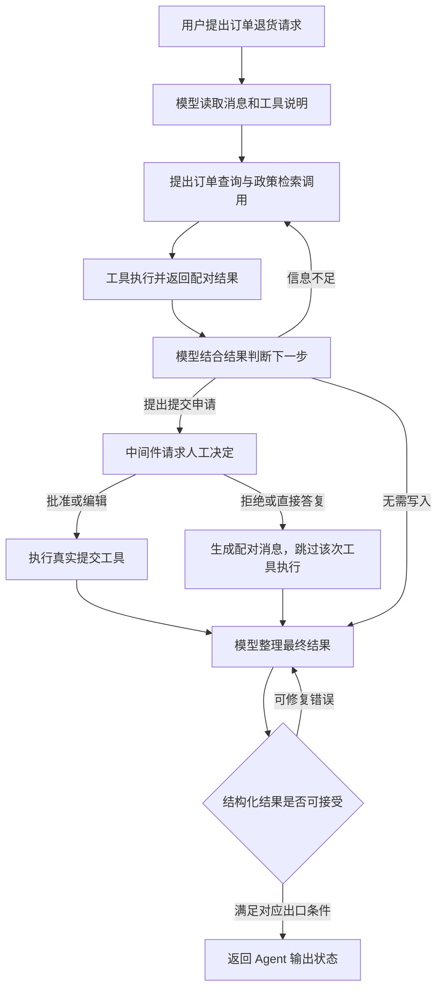

# LangChain 源码解析 00：一次 Agent 请求怎样完成

LangChain 为应用提供模型、消息、工具与检索组件，并用 `create_agent()` 将它们组装成标准 Agent：模型根据请求和已有结果决定下一步，应用工具执行实际操作，中间件在指定位置加入检查与控制。

理解它的源码，可以从一项完整任务开始：**用户询问订单能否退货，并希望在符合条件时提交申请。** Agent 需要查询订单与政策，对写入操作取得人工决定，再返回处理结果。读清这条链路，才能判断模型回答、工具调用和业务完成分别发生在哪里。

> 本系列固定分析 LangChain `1.3.7`、langchain-core `1.4.6`，提交 `76c32db9b38dfc287c958dc2a914d4834f022c1c`。依赖版本、固定源码与测试证据见[源码基线](./source-baseline.md)。订单、工具名和返回结果是说明性场景，不是本次运行的应用或真实交易。

## 一、把用户请求变成可执行任务

### 1、模型决定调用什么，工具决定实际能做什么

假设应用注册了 `lookup_order`、`search_return_policy` 和 `submit_return` 三个工具，分别查询订单、检索政策和提交申请。工具说明与参数 Schema 告诉模型有哪些可用动作；鉴权、数据读取和业务写入由工具实现负责。

模型可以提出“查询这个订单”的请求，但返回一个工具名并不会直接访问数据库。LangChain 先将请求表示成带名称、参数和调用 ID 的 tool call，再交给工具执行入口。

工具也不能只相信模型给出的用户身份。调用方应通过可信运行上下文提供身份，执行端核对订单归属；模型输出的参数只是执行输入的一部分。

### 2、应用设置审批和输出约定

应用可以配置 `HumanInTheLoopMiddleware`，即在指定工具调用前请求人工决定的中间件。它观察模型已经提出的工具名和参数，再通过 LangGraph 的中断协议暂停、恢复。

本例假设对 `submit_return` 要求审批，查询工具无需审批。人工批准后仍由真实工具提交申请；人工拒绝时，框架生成与原调用配对的结果消息，让模型解释未执行的原因。

如果调用方还需要字段稳定的结果，可以传入 `response_format`，要求 Agent 产出处理状态、说明和申请编号等结构化数据。字段合法不证明申请真的已写入，应用仍需核对工具结果与业务服务。

## 二、一次请求怎样走完模型—工具循环

下图是本例一条可能的业务路径。是否先查订单、是否同时查询政策，由模型输出与应用约束决定；图不是强制每次执行完全相同顺序的脚本。



图中结构化修复依赖具体输出策略及错误配置，并非所有错误都会自动回到模型。同步与异步执行、中断和失败也有各自退出路径，详见后续专题。

### 1、调用前：工厂只装配执行规则

`create_agent()` 归一化模型、工具与响应格式，收集中间件，构造状态结构、节点和边，再调用 `graph.compile()`。返回的是 `CompiledStateGraph`，即已经可以执行的图对象。

这个阶段不会因为注册了 `submit_return` 就提交申请。模型与工具调用发生在之后的 `invoke`、`stream` 或相应异步入口中。[03](./03-create-agent-assembly.md)集中解释这次装配。

### 2、运行中：消息记录决定下一步

输入通常带有用户消息。模型节点根据当前 State 构造 `ModelRequest`，它是本轮模型调用的请求对象，包含消息、工具、系统提示、模型设置和运行上下文。

模型返回 `AIMessage`。如果其中有未处理的业务工具调用，条件边把它们派发到工具节点；结果通过 `ToolMessage` 的 `tool_call_id` 与原请求配对。下一轮模型再读取这些结果。

固定提交的 `factory.py` 中，`_make_model_to_tools_edge` 先筛选待执行调用，关键片段如下，省略前面的显式跳转和空消息处理：

```python
pending_tool_calls = [
    c
    for c in last_ai_message.tool_calls
    if c["id"] not in tool_message_ids and c["name"] not in structured_output_tools
]
```

已配对结果的调用，以及用于结构化输出的特殊工具，都不属于这份普通工具待办集合。因此人工拒绝也必须维持消息配对，而不能只从列表里删除一条请求。

### 3、返回后：框架结果与业务完成需要分别验收

正常完成时，调用方得到 Agent 输出状态，通常包含 messages；结构化输出成功时还包含 `structured_response`。

“图已返回”“有一份格式正确的结果”“退货申请已提交”是三项不同事实。工具可能返回失败消息，人工可能拒绝动作，模型也可能对结果理解错误。应用应以工具及业务系统提供的明确状态验收写入，而不能仅搜索最终回答中的“成功”。

## 三、同一请求中有四份需要区分的数据

| 数据位置 | 本例中的内容 | 谁负责改变 |
| --- | --- | --- |
| Agent State | 用户消息、模型工具请求、工具结果、结构化输出和必要业务字段 | 图节点与中间件提交更新，LangGraph 合并 |
| ModelRequest | 本轮真正送给模型的消息、系统提示、工具集合与设置 | 模型节点构造，模型包装器可以改写 |
| 运行上下文与资源 | 已认证用户、数据库客户端、Store、工具运行信息 | 应用提供，节点和工具读取 |
| 外部业务系统 | 订单记录、退货申请及其提交结果 | 真实工具调用及业务服务 |

上下文压缩可能只改本轮请求，也可能重写消息状态；事件脱敏又作用于对外流。它们不会自动删除所有历史副本，更不会撤销已经提交的业务动作。[05](./05-state-graph-runtime.md)按同一请求追踪这些数据，[09](./09-context-and-privacy.md)再解释治理策略。

## 四、中间件怎样进入这条链路

`AgentMiddleware` 是 LangChain 的扩展协议，一个实例可以同时提供图节点 hook、调用包装器、状态字段、工具和事件转换器。

本例可以在模型调用前检查轮次限额，用包装器重试失败请求，在模型提出写入后进入审批，并在输出时处理敏感信息。这些动作插入的位置不同，不能只按列表顺序画成一串普通函数。

| 扩展位置 | 本例用途 | 对应文章 |
| --- | --- | --- |
| `before_model / after_model` | 检查轮次、记录结果、对工具请求审批 | 04、07、08 |
| `wrap_model_call` | 重试、模型回退、本轮请求改写 | 04、07、09 |
| `wrap_tool_call` | 单次工具执行的检查、重试或替代结果 | 04、07、11 |
| 中间件声明的工具与状态 | 加入计划工具、会话资源等能力 | 06、10 |
| 流事件转换器 | 处理对外暴露的流式内容 | 05、09 |

重试包装器可能多次调用内层 handler，而图上的模型轮次计数只记录一轮正常返回。一次 Agent 请求因此不等于一次供应商请求，计量和成本需要按实际执行层次判断。

## 五、源码包怎样对应到执行职责

| 仓库路径 | 发布包与职责 | 在本例中负责什么 |
| --- | --- | --- |
| `libs/core/` | `langchain-core`：模型、消息、工具、Runnable 等协议 | 表示工具调用、封装工具输入输出 |
| `libs/langchain_v1/` | `langchain`：标准 Agent 工厂与中间件 | 组装循环、接入审批和请求治理 |
| `libs/langchain/` | `langchain-classic`：兼容实现与部分检索组件 | 本系列 12–13 涉及的部分检索链与算法 |
| `libs/text-splitters/` | 文本切分器 | 政策材料切分与来源信息传递 |
| `libs/partners/` | 部分服务商集成，其他集成另有仓库 | 将统一模型或存储协议接到具体服务 |
| `libs/standard-tests/` | 集成行为的标准测试 | 核对适配器应遵循的协议 |

LangGraph 提供底层调度、状态与恢复，LangChain 负责标准 Agent 的装配和组件协议，Deep Agents 再加入文件、技能、子代理等长任务能力。具体调用链要按各自版本核对，不能从框架名称推导某个应用已经启用了全部能力。

## 六、按当前问题选择阅读路线

理解标准 Agent，建议走 **00 → 03 → 04 → 05**。遇到不熟悉的消息或工具类型时回查 02，再按需要进入治理专题；无需先读完全部 Runnable 实现。

研究组件组合，走 **00 → 01 → 02**。LCEL（LangChain 表达式组合方式）适合把明确的处理步骤连接起来；是否使用标准 Agent，取决于是否需要模型在工具循环中决定下一步。

政策检索从 [12](./12-rag-components-and-retrieval.md) 和 [13](./13-advanced-retrieval-techniques.md)进入；结构化结果从 [14](./14-structured-output-and-repair.md)进入。需要自定义图拓扑、研究检查点或节点取消时，转到 [LangGraph 系列](../langgraph/index.md)。

## 七、源码与证据入口

- [`create_agent` 与路由](https://github.com/langchain-ai/langchain/blob/76c32db9b38dfc287c958dc2a914d4834f022c1c/libs/langchain_v1/langchain/agents/factory.py)：工厂、模型请求、工具派发与循环出口。

- [消息与工具协议](https://github.com/langchain-ai/langchain/blob/76c32db9b38dfc287c958dc2a914d4834f022c1c/libs/core/langchain_core/messages/ai.py)：模型响应中的工具调用；工具结果类型位于相邻 `tool.py`。

- [中间件接口](https://github.com/langchain-ai/langchain/blob/76c32db9b38dfc287c958dc2a914d4834f022c1c/libs/langchain_v1/langchain/agents/middleware/types.py)：扩展点、请求和响应对象。

本次是固定源码和测试断言解读，没有执行订单示例、调用模型或访问真实业务系统。
