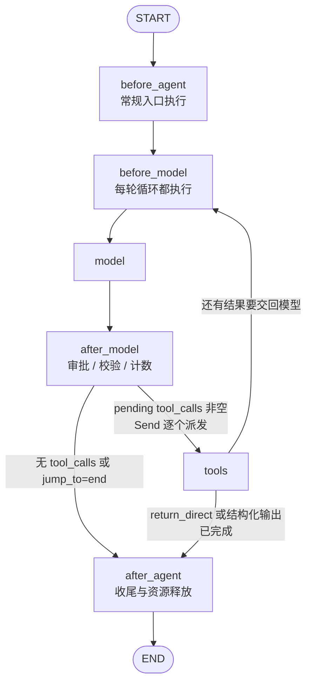

# LangChain 源码解析 03：`create_agent()` 如何组装 Agent 图

> 固定提交与已阅读测试见[源码基线](source-baseline.md)。

**源码定位**

> **阅读基线**：`langchain` 1.3.7、`langchain-core` 1.4.6（仓库快照 `langchain-core==1.4.6-2-g76c32db9b3`）。
> 源码路径相对 LangChain 仓库根目录；版本与阅读路线见 [系列导读](index.md)。
>
> **本篇范围**：只沿 `create_agent()` 的装配期主线，从输入参数一路看到 `graph.compile()`。Middleware 的调用栈见 [04：Middleware 执行边界](./04-middleware-control-plane.md)；State Schema 和图状态边界见 [05：State、Graph 与运行时边界](./05-state-graph-runtime.md)。
>
> **核心包与路径**：
>
> 1. `langchain.agents.factory`：`libs/langchain_v1/langchain/agents/factory.py`
>    - **主线文件**：`create_agent()` 在这里完成输入归一化、工具准备、Middleware 收集、Schema 合并、节点和边的装配，最后调用 `graph.compile()`。
>    - `_resolve_schemas()`：调用状态 Schema 合并逻辑；具体字段可见性见 05。
>    - `_handle_model_output()`：把模型返回转换成消息更新和可选的结构化结果。
>    - `_get_bound_model()`：根据工具和 `response_format` 生成本轮真正调用的模型对象。
>    - `_build_commands()`：把模型结果和 Middleware 附加更新转换成图更新。
>    - `_make_model_to_tools_edge()`、`_make_tools_to_model_edge()`：定义模型—工具循环的退出和回环条件。
> 2. `langchain.agents.structured_output`：`libs/langchain_v1/langchain/agents/structured_output.py`
>    - **作用**：定义 `AutoStrategy`、`ProviderStrategy`、`ToolStrategy` 等响应策略。03 只说明它们如何改变模型绑定和循环出口，不展开 Schema 解析细节。
> 3. `langchain.tools.tool_node`：`libs/langchain_v1/langchain/tools/tool_node.py`
>    - **作用**：这是兼容性导入层，只重导出 `InjectedState`、`ToolCallRequest` 等 LangGraph prebuilt 类型。`create_agent()` 不经过这个文件，而是直接从 `langgraph.prebuilt.tool_node` 导入 `ToolNode`；`wrap_tool_call` 的控制边界见 04。
> 4. `langchain.chat_models.base`：`libs/langchain_v1/langchain/chat_models/base.py`
>    - **作用**：`init_chat_model()` 把模型字符串归一化为 Chat Model；provider SDK 不属于本篇主线。
> 5. LangGraph 依赖包：`langgraph`
>    - **作用**：`create_agent()` 导入 `StateGraph`、`END`、`START`、`Send`、`Command` 等 API 完成建图和编译。这里只看 LangChain 调用了什么，不追踪 LangGraph 内部实现。

本篇沿总览的订单处理案例看装配：应用交入订单查询、政策检索、提交申请工具，以及审批与输出约定，工厂把它们变成可执行规则。此时订单尚未查询、人工尚未审批，业务工具也尚未运行。

## 一、先看工厂产出什么

`create_agent()` 接收模型、工具、Middleware、状态 Schema 和运行配置，返回一张已经编译的 `CompiledStateGraph`。中间经过的是几组可以在源码中定位的装配动作：

```text
输入参数
  → 归一化模型、工具和响应格式
  → 拆解 Middleware 的工具、Hook、包装器和状态 Schema
  → 注册 model、tools 及 Middleware 节点
  → 添加模型—工具循环和退出条件
  → graph.compile()
  → CompiledStateGraph
```

装配期决定图的形状，执行期才真正调用模型和工具。运行时，模型节点构造 `ModelRequest`，通过 `_get_bound_model()` 绑定本轮模型，再由条件边决定结束、进入工具节点，还是回到模型：

```text
model
  ├─ 没有待处理的 tool_calls → exit
  └─ 有待处理的 tool_calls → tools → model
```

后文始终区分两个时间点：装配期决定节点、工具、状态字段和边；执行期消费这些装配结果。这样读工厂代码时，不会把“创建节点”和“调用模型”混成同一个动作。

## 二、入口参数：工厂先确定 Agent 的边界

`create_agent()` 的签名已经暴露了 Agent 的主要扩展面：

model 和 tools 可以按位置传入，其余参数为仅限关键字参数。返回的是已编译的 CompiledStateGraph，类型参数描述内部状态、运行时 Context、输入与输出；它不是尚未编译的 StateGraph 构建器。

初读先看三组配置：模型与工具决定可调用能力，中间件与状态决定扩展位置，保存器等参数决定运行时服务。完整类型和默认值可按需展开。

<details>
<summary>完整参数类型、默认值与容器形式</summary>

下表对应该版本工厂签名，按参数解释装配职责：

| 参数 | 实现中的类型 | 默认值 |
| --- | --- | --- |
| `model` | `str \| BaseChatModel` | 无默认值，必填 |
| `tools` | `Sequence[BaseTool \| Callable[..., Any] \| dict[str, Any]] \| None` | `None` |
| `system_prompt` | `str \| SystemMessage \| None` | `None` |
| `middleware` | `Sequence[AgentMiddleware[StateT_co, ContextT]]` | `()`，空元组 |
| `response_format` | `ResponseFormat[ResponseT] \| type[ResponseT] \| dict[str, Any] \| None` | `None` |
| `state_schema` | `type[AgentState[ResponseT]] \| None` | `None` |
| `context_schema` | `type[ContextT] \| None` | `None` |
| `checkpointer` | `Checkpointer \| None` | `None` |
| `store` | `BaseStore \| None` | `None` |
| `interrupt_before` | `list[str] \| None` | `None` |
| `interrupt_after` | `list[str] \| None` | `None` |
| `debug` | `bool` | `False` |
| `name` | `str \| None` | `None` |
| `cache` | `BaseCache[Any] \| None` | `None` |
| `transformers` | `Sequence[TransformerFactory] \| None` | `None` |

这里的容器类型也有含义：

- `Sequence[...]` 表示调用方可以传列表、元组等序列；工厂主要按顺序遍历，不要求一定是 `list`；
- `list[str]` 用在 `interrupt_before` 和 `interrupt_after`，因为它们最终是要交给编译图的节点名集合；
- `type[ResponseT]` 表示可以直接传一个结构化输出 Schema 类型；
- `dict[str, Any]` 在 `tools` 中代表 provider 原生工具定义，在 `response_format` 中则是原始 JSON Schema；工厂会把后者包成 `AutoStrategy`，二者不是同一种字典。

</details>

### 1、参数归一化：入口形态 → 内部统一结构

签名中的默认值只是入口形态。`create_agent()` 进入函数体后，先把几个可选参数转换为后续代码统一使用的结构。

**`model`：字符串变成模型对象**

```python
# 字符串模型标识只在工厂入口解析一次。
# 后续 model 节点统一接收 BaseChatModel。
if isinstance(model, str):
    model = init_chat_model(model)
```

所以 `model="openai:..."` 和直接传 `ChatOpenAI(...)`，最终都会汇合到同一个模型对象变量。

**`tools`：`None` 变成空列表**

```python
# 没有工具时使用空列表，后面的列表推导不再处理 None。
if tools is None:
    tools = []
```

之后工厂再按数据形态拆分：

```python
# 字典是 provider 原生工具定义，不由本地 ToolNode 执行。
built_in_tools = [tool for tool in tools if isinstance(tool, dict)]

# BaseTool 和普通 callable 属于客户端工具候选。
regular_tools = [tool for tool in tools if not isinstance(tool, dict)]
```

built_in_tools 进入本轮模型绑定；regular_tools 与 Middleware 工具合并后创建 ToolNode。服务端工具和客户端执行入口由此分开。

**`system_prompt`：字符串变成 `SystemMessage`**

```python
system_message: SystemMessage | None = None
if system_prompt is not None:
    if isinstance(system_prompt, SystemMessage):
        system_message = system_prompt
    else:
        system_message = SystemMessage(content=system_prompt)
```

后续 `ModelRequest` 中始终使用 `SystemMessage | None`，不再保留字符串分支。

**`response_format`：裸 Schema 先变成 `AutoStrategy`**

```python
if response_format is None:
    initial_response_format = None
elif isinstance(response_format, (ToolStrategy, ProviderStrategy, AutoStrategy)):
    # 已经明确指定策略，保留原策略对象。
    initial_response_format = response_format
else:
    # 裸 Schema 暂时保留"自动选择 provider/tool 策略"的意图。
    initial_response_format = AutoStrategy(schema=response_format)
```

如果需要提前计算结构化输出工具，工厂还会把 `AutoStrategy` 暂时转换为 `ToolStrategy` 做工具绑定准备；真正调用模型时，仍可能根据模型能力切换为 `ProviderStrategy`。

**其余 `None`：表示不启用对应能力**

这些参数不会在入口被替换成复杂对象，而是原样传到图创建或编译阶段：

```text
state_schema=None → 后面使用 AgentState
context_schema=None → StateGraph 不增加用户自定义 Runtime.context Schema
checkpointer/store/cache=None → 编译图不启用对应的持久化、跨 thread 存储或缓存
interrupt_before/after=None → 不额外配置节点级中断
debug=False → 不开启调试输出
name=None → 不设置用户自定义 Agent 名称
transformers=None → 不追加用户自定义 Transformer
```

`middleware=()` 稍有不同：它不仅表示"不启用 Middleware"，还直接决定后续 `middleware_tools`、各类 Hook 列表、包装器列表和 `middleware_transformers` 是否为空。

这些参数大致分成四组：

| 参数组 | 代表参数 | 装配期决定什么 |
| --- | --- | --- |
| 调用对象 | `model`、`system_prompt` | 模型节点使用什么模型和系统消息 |
| 行为扩展 | `tools`、`middleware` | 工具节点、Hook 节点和包装栈 |
| 状态协议 | `response_format`、`state_schema`、`context_schema` | State、输入输出边界和结构化结果 |
| 运行配置 | `checkpointer`、`store`、`cache`、`interrupt_*` | 编译后的图具备哪些运行能力 |

工厂的作用是把这些入口形态归一化为后续节点可以直接消费的对象。

## 三、入口参数如何进入模型调用

这一阶段先看 `system_prompt` 如何进入模型调用链，以及用户工具如何被拆成客户端工具和 provider 原生工具。

### 1、system_prompt 的传递路径

```text
create_agent(system_prompt=...)
  → 保存为 system_message
  → ModelRequest.system_message
  → _execute_model_sync()
  → [system_message, *request.messages]
  → model.invoke(messages)
```

`system_prompt` 不会直接写进 `AgentState["messages"]`。它作为模型调用配置单独保存，直到真正调用模型时才拼到消息列表最前面。这样处理有三个直接结果：

- State 中的对话历史不混入每次调用都相同的系统消息；
- Middleware 可以在一次模型调用前通过 `ModelRequest` 改写系统消息；
- 工具循环回到模型时，工厂可以用同一个系统消息重新组装本轮模型输入。

## 四、为结构化结果预留工具与出口

`response_format` 在装配期就参与图构造。裸 Schema 会被包成 `AutoStrategy`；工厂为可能使用的工具策略准备结构化工具绑定，供后续模型调用与结果解析使用。

这些工具用于表达最终结果，不是订单查询或提交申请的业务函数。工厂把它们单独保存在 `structured_output_tools`，避免路由误把它们当成普通业务待办。

| 装配结果 | 运行时用途 |
| --- | --- |
| 初始响应策略 | 每轮模型调用据此确定最终绑定方式 |
| 结构化工具绑定 | 解析模型给出的结构化工具参数 |
| `structured_response` 字段 | 保存解析成功后的结构化对象 |
| 对应条件边 | 按待处理工具与结构化结果决定继续或结束 |

装配期准备候选，不表示自动策略已经永久选定。中间件可以替换本轮模型或响应格式，所以实际绑定仍发生在模型调用时。策略选择、解析失败、修复消息和重试预算集中到 [14：结构化输出与修复](./14-structured-output-and-repair.md)。

## 五、Middleware 如何进入工厂

工厂不会在这里执行 Middleware，而是把同一个实例拆成几类能力，分别接入工具节点、图节点、模型包装栈和 State Schema：

```text
middleware
  ├─ middleware_tools         → 注入 available_tools，与用户工具一起进入 ToolNode
  ├─ before_agent / after_agent  → 注册为入口与结束阶段节点，显式跳转可改变执行次数
  ├─ before_model / after_model  → 注册为循环节点，每轮模型调用前后都执行
  ├─ wrap_model_call         → 组合为洋葱 handler，由模型节点在调用前逐层包装
  ├─ wrap_tool_call          → 传入 ToolNode，在工具执行前后逐层包装
  └─ state_schema / transformers → 分别进入 State 合并和编译期事件扩展
```

每类节点型 Hook 都同时检查同步和异步方法；例如 `before_model` 的判断是：

```python
if (
    m.__class__.before_model is not AgentMiddleware.before_model
    or m.__class__.abefore_model is not AgentMiddleware.abefore_model
):
    ...
```

两个版本都继承默认实现时，工厂才不增加该 Hook 节点。`wrap_model_call` 和 `wrap_tool_call` 也按同步、异步版本分别收集并组合。Hook 内部的洋葱顺序、`ModelRequest` 替换和 `jump_to` 跳转见 [04：Middleware 执行边界](./04-middleware-control-plane.md)。

Middleware 工具收集完成后，工具节点才真正创建。存在工具包装器时，即使初始工具列表为空也会保留 ToolNode，供动态工具的执行入口使用。工具声明和执行如何配合见 [11](11-tool-dynamics.md)。

```python
available_tools = middleware_tools + regular_tools  # 合并中间件与用户的客户端工具
tool_node = (
    ToolNode(tools=available_tools,
             wrap_tool_call=wrap_tool_call_wrapper,
             awrap_tool_call=awrap_tool_call_wrapper)
    if available_tools or wrap_tool_call_wrapper or awrap_tool_call_wrapper
    else None
)
```

## 六、合并 State Schema

Middleware 可以往 State 里加字段（如调用限额中间件的计数），调用方也可以通过 `state_schema` 声明字段。合并顺序决定了最终谁赢：

```python
base_state = state_schema if state_schema is not None else AgentState
state_schemas: list[type] = [*(m.state_schema for m in middleware), base_state]
resolved_state_schema, input_schema, output_schema = _resolve_schemas(state_schemas)
```

Middleware Schema 在前，基础 Schema 在后；内部同名字段按实际遍历顺序覆盖。输入、输出 Schema 各自过滤字段声明，不能推断后加的私有标记会删除此前公开的同名字段；重复类型还会按字典 key 合并。具体算法与边界见 [05](05-state-graph-runtime.md)。

## 七、注册图节点和确定生命周期位置

### 1、固定节点与扩展节点

工厂的图至少围绕两个固定节点装配：

```text
model
tools（存在客户端工具或工具包装器时）
```

Middleware 的 `before_*` / `after_*` 会被注册成命名节点，例如：

```text
MyMiddleware.before_agent
MyMiddleware.before_model
MyMiddleware.after_model
MyMiddleware.after_agent
```

模型节点同时挂同步和异步实现：

```python
graph.add_node(
    "model",
    RunnableCallable(model_node, amodel_node, trace=False),
)

if tool_node is not None:
    graph.add_node("tools", tool_node)
```

这里的重点不是 LangGraph 如何执行节点，而是工厂在编译前决定了图上有哪些名字和位置。

### 2、一次性入口和循环入口分开

工厂会分别计算：

```text
entry_node       一次 Agent 运行的入口
loop_entry_node  每轮模型循环的入口
loop_exit_node   每轮模型循环的出口
exit_node        整次运行的最终出口
```

典型拓扑是：

```text
START
  → before_agent
  → before_model
  → model
  → after_model
       ├─ tools → before_model
       └─ after_agent → END
```

上面是最小形态。把 Middleware 节点、工具回环和退出条件都画进来，带工具的 Agent 拓扑是这样：



两条常规回环都接回循环入口：有 before_model 时先经过它，否则进入 model。需要写回 State 的调用前逻辑可放在 before_model；只改本次请求视图可放在 wrap_model_call。after_agent 适合自然结束后的处理，但不是 try/finally，异常、中断或取消时不能依赖它必然释放资源。

before_agent 不在常规工具回环中；before_model 每次走到模型入口时执行，但包装器内部重试 handler 不会自动再走一次 before_model。结束 hook 若请求回到模型，after_agent 也可能多次执行。

## 八、模型节点：State → 模型调用 → 结果

模型节点负责把当前 State 转成一次模型调用，再把结果写回图状态。它的内部流程分两层：

**外层：Middleware 包装判断。** 如果没有 `wrap_model_call` 中间件，直接走 `_execute_model_sync()`；有的话进入洋葱栈——Middleware 可以在 `handler(request)` 前后插入逻辑，并通过 `request.override()` 替换允许覆盖的请求字段。

```python
# 无中间件：直通。
if wrap_model_call_handler is None:
    model_response = _execute_model_sync(request)
    return _build_commands(model_response)

# 有中间件：洋葱栈。
result = wrap_model_call_handler(request, _execute_model_sync)
return _build_commands(result.model_response, result.commands)
```

**内层：`_execute_model_sync()` 三步走：**

```python
# ① 绑定模型：策略 + 工具 + 模型设置 → 可调用的 model_ 对象。
model_, effective_response_format = _get_bound_model(request)

# ② 组装消息：system_message 在真正调用前才拼到消息列表最前面。
messages = request.messages
if request.system_message:
    messages = [request.system_message, *messages]

# ③ invoke + 结果处理：model_ 遵循 Runnable 协议（见 01 篇）。
output = model_.invoke(messages)
handled_output = _handle_model_output(output, effective_response_format)
```

模型节点完成请求和结果转换后，条件边接管后续路由。

中间件改写系统消息是常见操作。下面这个例子只改当前这一次调用，不会污染 Agent State：

```python
request = request.override(
    system_message=SystemMessage(content="本次调用使用的临时规则")
)
return handler(request)
```

`_handle_model_output()` 在 ③ 之后根据策略做结果分发：`ProviderStrategy` → 解析 `structured_response` 写入 State；`ToolStrategy` → 解析特殊工具调用，回灌带 `tool_call_id` 的 `ToolMessage`；无策略 → 直接返回消息更新。

## 九、模型节点保留运行时绑定入口

`_get_bound_model()` 定义在工厂内部，实际由每次模型调用执行。它读取本轮 `ModelRequest`，检查工具执行入口，确定输出策略，再把工具与模型设置绑定到请求。

订单流程中，第一次模型调用可能只需要只读工具，后续中间件可能调整模型或可见工具。若把绑定误解为只在 `create_agent()` 执行一次，就无法解释这些动态行为。

`_handle_model_output()` 随后把模型消息转换为局部 State 更新；结构化解析成功时，还加入 `structured_response`。返回值经模型节点交给图合并，工厂闭包里没有另一份独立对话历史。

动态工具的声明与真实执行需同时具备，见 [11](./11-tool-dynamics.md)；结构化输出的 Provider、Tool 与 Auto 策略细节见 [14](./14-structured-output-and-repair.md)。

## 十、工具节点：LangGraph 的 prebuilt 执行器

`tools` 节点使用的是 LangGraph prebuilt 的 `ToolNode`。工厂直接从 `langgraph.prebuilt.tool_node` 导入它，并将 available_tools 和 wrap_tool_call 包装器交给它：

```python
tool_node = ToolNode(
    tools=available_tools,
    wrap_tool_call=wrap_tool_call_wrapper,
    awrap_tool_call=awrap_tool_call_wrapper,
)
```

ToolNode 负责分发工具并整理返回的 ToolMessage 或 Command，状态合并则由图运行时执行；工厂不参与单个工具的执行，但会在工具节点之后通过条件边读取 State，决定回到模型还是退出。03 对工具节点的装配职责到“创建 `ToolNode` 并注册为 `tools` 节点”为止：

- 具体执行链（`invoke → run → _run → _format_output`）见 [02：聊天模型、消息与工具](./02-core-abstractions.md)；
- `wrap_tool_call` 的拦截与工具结果改写见 [04：Middleware 执行边界](./04-middleware-control-plane.md)。

## 十一、条件边把模型和工具接成循环

工厂根据是否有工具节点、结构化输出和生命周期 hook，安装相应的边。这里解释装配选择；一次请求中的消息变化交给 [05](./05-state-graph-runtime.md)。

| 条件 | 安装的主要路由 | 决定什么 |
| --- | --- | --- |
| 存在工具节点 | `_make_model_to_tools_edge`、`_make_tools_to_model_edge` | 未配对业务工具派发，工具后回模型或结束 |
| 没有普通工具节点，但有结构化工具 | `_make_model_to_model_edge` | 结构化结果未生成时继续调用模型 |
| 没有上述循环需求 | 模型或结束 hook 接出口 | 普通单轮结果如何返回 |

实际图还受中间件 hook 和 `jump_to` 影响，不能把这些分支当成所有 Agent 共用的一张固定图。

有业务工具时，路由先找出没有配对结果的普通调用，再按调用拆成工具任务。以下是 `factory.py` · `_make_model_to_tools_edge` 的两个相邻阶段，中间只省略源码注释：

```python
pending_tool_calls = [
    c
    for c in last_ai_message.tool_calls
    if c["id"] not in tool_message_ids and c["name"] not in structured_output_tools
]

# 待处理调用逐项派发；ToolNode 执行时从通道读取运行状态，
# 因此不再把完整 State 塞进每一个 Send。
if pending_tool_calls:
    return [Send("tools", [tool_call]) for tool_call in pending_tool_calls]
```

`Send` 是 LangGraph 的动态任务派发对象。这里每项只带一个工具调用；这与手工把一整个调用批次放进同一个 ToolNode 任务不同。底层恢复粒度要结合对应 LangGraph 版本判断。

待处理普通工具的分支位于 `structured_response` 结束检查之前。即使模型同一轮给出结构化结果，只要还有普通工具待办，也不能仅靠结构化字段结束。相反，审批拒绝产生配对 ToolMessage 后，该次调用不再派发，路由可以回到模型解释结果。

工具执行后的出口还考虑 `return_direct` 等条件。最简的“有调用就执行、没有就结束”适合建立第一印象，真实路由应回到这三个函数逐项核对。

## 十二、编译并返回图

工厂最后把运行能力作为参数交给 `graph.compile()`：

```python
# 编译期只负责把持久化、中断、缓存和事件转换配置传下去。
config: RunnableConfig = {"recursion_limit": 9_999}
config["metadata"] = {"ls_integration": "langchain_create_agent"}

return graph.compile(
    checkpointer=checkpointer,
    store=store,
    interrupt_before=interrupt_before,
    interrupt_after=interrupt_after,
    debug=debug,
    name=name,
    cache=cache,
    transformers=[
        ToolCallTransformer,
        SubagentTransformer,
        *middleware_transformers,
        *(transformers or ()),
    ],
).with_config(config)
```

编译结束时有几件事需要留意：

- `create_agent()` 返回的是编译后的图，不是模型包装器；
- `checkpointer`、`store`、`cache` 和 `interrupt_*` 在这里被传下去；
- `recursion_limit` 是图执行步骤的兜底，不是模型调用次数；
- `transformers` 是注册到编译图流式事件基础设施的扩展，不是图节点，也不是 Middleware Hook；
- Transformer 不参与 State 的 reducer 或节点更新；它处理的是运行时对外复用的流事件通道；
- 内置 Transformer 和 Middleware 自带 Transformer 的具体装配位置放在 06 篇。

## 十三、完整流程回放

以总览的“查询订单与政策，按决定提交申请，再返回处理结果”为例，装配和执行应分开观察：

| 阶段 | 工厂或运行时做什么 | 此时尚未发生什么 |
| --- | --- | --- |
| 装配 | 初始化模型、登记查询与提交工具、准备处理结果策略及审批 hook，编译节点与边 | 没有查询、审批或提交业务动作 |
| 第一次模型节点执行 | 根据当前请求绑定工具与策略，模型提出订单与政策查询 | 工具函数尚未执行 |
| 条件路由与工具执行 | 未配对调用进入 ToolNode，结果以 ToolMessage 回到 State | 查询成功不代表退货申请已提交 |
| 再次模型节点执行 | 模型消费工具与审批结果，按有效策略整理结构化数据 | schema 通过不代表答案事实正确 |
| 结束阶段 | 满足路由结束条件，经过配置的结束 hook，返回输出状态 | 不会自动发布答案或提交外部业务结果 |

response_format 改变的是模型绑定、结果解析和循环出口；调用方仍从返回状态中读取 structured_response。checkpointer 只是在编译时接入持久化能力，真正保存状态发生在运行期间。

源码中的 model_to_tools、tools_to_model 和 model_to_model 分别处理工具派发、工具后的回环和无普通工具时的结构化重试。它们与 Middleware 的跳转共同决定实际执行路线，因此“模型没有 tool_calls 就结束”只适合解释最简循环。

## 十四、扩展点选择与后续阅读

新增能力时先选择它影响的对象：临时模型参数交给请求包装器，需要保存的数据放进 State schema，可独立调用的动作注册为工具，超出标准循环的节点拓扑则交给 LangGraph。

后续 [04](04-middleware-control-plane.md) 追踪同一轮调用中的 hook 与包装器顺序，[05](05-state-graph-runtime.md) 解释更新怎样进入 State、哪些字段会输出，以及恢复能保证什么。
