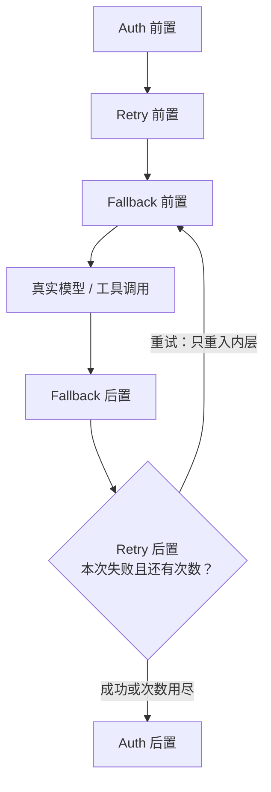

# LangChain 源码解析 04：Middleware 的执行边界

## 一、源码定位

> **阅读基线**：`langchain` 1.3.7、`langchain-core` 1.4.6（仓库快照 `langchain-core==1.4.6-2-g76c32db9b3`）。
> 源码路径相对 LangChain 仓库根目录；版本与阅读路线见 [系列导读](index.md)。
>
> **本篇范围**：专门解释 Middleware 的对象模型、Hook 分类、调用顺序、请求/响应对象、状态扩展和有限跳转。`create_agent()` 的完整装配过程见 [03：`create_agent()` 如何组装 Agent 图](./03-create-agent-assembly.md)；State Schema 的合并和图状态边界见 [05：State、Graph 与运行时边界](./05-state-graph-runtime.md)。
>
> **核心包与路径**：
>
> 1. `langchain.agents.middleware.types`：`libs/langchain_v1/langchain/agents/middleware/types.py`
>    - `AgentMiddleware`：Middleware 的协议和默认 Hook。
>    - `ModelRequest`：模型调用的请求快照；`ToolCallRequest` 从 LangGraph prebuilt 工具节点 API 导入并作为工具包装协议使用。
>    - `ModelResponse`、`ExtendedModelResponse`：模型结果和附加 State 更新。
>    - `hook_config()`、`before_model()`、`wrap_model_call()` 等装饰器：把普通函数转换成 Middleware 实例或添加 Hook 元数据。
> 2. `langchain.agents.factory`：`libs/langchain_v1/langchain/agents/factory.py`
>    - `_chain_model_call_handlers()`、`_chain_tool_call_wrappers()`：组合包装器。
>    - Middleware Hook 收集、节点创建和 `jump_to` 条件边。
> 3. `langchain.tools.tool_node`：`libs/langchain_v1/langchain/tools/tool_node.py`
>    - **作用**：这是兼容性导入层。`types.py` 实际直接从 `langgraph.prebuilt.tool_node` 导入 `ToolCallRequest`；本篇只借此确认它来自 LangGraph 的 prebuilt 工具节点协议。
>    - 确认 `wrap_tool_call` 包住的是一次工具执行，而不是整个工具调用批次。
> 4. 内置 Middleware：`libs/langchain_v1/langchain/agents/middleware/`
>    - `model_retry.py`、`model_fallback.py`、`model_call_limit.py`
>    - `tool_retry.py`、`human_in_the_loop.py`、`pii.py`、`todo.py`
>    - 用真实实现验证 Hook 选择，而不是只记接口名称。
> 5. LangGraph 依赖包：`langgraph`
>    - Middleware 通过 LangChain 工厂接入节点、条件边和中断 API。
>    - 本篇只确认使用了哪些 API，不追踪 LangGraph 包内部实现。
>
## 二、先看一轮调用怎么走

这篇要回答一个具体问题：同一个 Middleware 为什么既能出现在 Agent 图里，又能包住一次模型或工具调用？

答案取决于它插入的位置。一次带工具的运行可以先压缩成下面这条链：

```text
Agent State
  → before_agent / before_model       图节点
  → model 节点
      → wrap_model_call(request, handler)
          → ModelRequest → 模型 → ModelResponse
  → after_model                       图节点
  → tools 节点
      → wrap_tool_call(request, handler)
  → 回到 before_model
```

图节点 Hook 看到的是 State 和 Runtime，可以提交状态更新，也可以通过有限的 `jump_to` 影响后继节点。包装型 Hook 看到的是一次调用的请求对象和下一个 `handler`，可以改写请求、重复调用、短路执行，或处理返回结果。

`ModelRequest`、`ModelResponse` 和 `ExtendedModelResponse` 是模型包装器使用的数据协议。它们分别描述调用输入、调用结果和附加 State 更新。图的下一步怎么走，则由模型节点之后的条件边和 Hook 节点决定，不能把响应对象当成图路由对象。

读源码时，顺序也应跟着这条链走：先看 `AgentMiddleware` 提供哪些扩展面，再看生命周期 Hook 如何进入图，接着看 `wrap_model_call` 和 `wrap_tool_call` 如何组成调用栈，再回到请求、响应、State 和路由的边界。

## 三、`AgentMiddleware` 是什么

`AgentMiddleware` 是这些扩展面的协议容器。一个实例可以同时声明状态字段、客户端工具、生命周期 Hook、模型/工具包装器和流事件转换器，工厂会把它们接到不同的运行位置。

| 声明或方法 | 工厂接入位置 | 处理对象 |
| --- | --- | --- |
| state_schema | 内部、输入和输出 Schema | 状态字段及合并规则 |
| tools | ToolNode | 模型可以请求的客户端工具 |
| before_agent、before_model、after_model、after_agent | 图节点 | State 与 Runtime |
| wrap_model_call、wrap_tool_call | 节点内的 handler 栈 | 一次模型或工具调用 |
| transformers | 编译图的事件扩展 | 支持该扩展的事件流 |

工厂因此会先收集 Middleware，再分别决定图拓扑和调用栈。

## 四、节点型 Hook：有图位置的生命周期逻辑

生命周期 Hook 是工厂直接注册到图里的节点。它们决定一个 Middleware 在 Agent 运行的哪个阶段看到 State，以及它能否影响后继节点。

### 1. Hook 的生命周期

四个节点型 Hook 覆盖的范围不同：

```text
before_agent  常规运行入口，不在工具回环中
before_model  每轮调用模型前执行
after_model   每轮模型调用后执行
after_agent   自然结束阶段，返回模型后可能再次进入
```

这里的 A、B、C 指的是 **三个 Middleware 实例**，不是三个 Hook：

```python
middleware = [A(), B(), C()]  # 按注册顺序排列
```

假设 A、B、C 都实现了对应 Hook，一次完整运行的顺序可以展开成：

```text
首次进入 Agent：
  A.before_agent
    → B.before_agent
      → C.before_agent
        → A.before_model
          → B.before_model
            → C.before_model
              → model
            ← C.after_model
          ← B.after_model
        ← A.after_model

如果 model 请求工具：
  tools
    → A.before_model
      → B.before_model
        → C.before_model
          → model
        ← C.after_model
      ← B.after_model
    ← A.after_model

Agent 最终结束：
  C.after_agent
    → B.after_agent
      → A.after_agent
        → END
```

上述顺序假设没有显式跳转、恢复重放或异常。before_model 和 after_model 围住一次模型节点执行；包装器内部重试不会重新经过这些节点。after_agent 可以请求回到模型，因此未必只执行一次，也不能替代异常清理用的 finally。多个 Middleware 组合时，`before_*` 按注册顺序进入，`after_*` 按反向顺序退出。这个顺序描述的是图节点之间的生命周期关系，不能和后面的包装器嵌套顺序混用。

### 2. 工厂如何判断 Hook 是否存在

工厂不会为每个 Middleware 都注册一组空节点，而是比较类方法是否覆盖了父类默认实现：

```python
# 只收集真正重写了 before_model 或其异步版本的 Middleware。
middleware_w_before_model = [
    m
    for m in middleware
    if m.__class__.before_model is not AgentMiddleware.before_model
    or m.__class__.abefore_model is not AgentMiddleware.abefore_model
]
```

这段判断有两个结果：

- 只继承默认方法，不会新增节点；
- 只实现同步或异步版本，也会进入收集列表；工厂仍只注册一个图节点。

真正创建节点时，工厂把同步和异步实现放进同一个可执行节点：

```python
# 同步和异步实现挂在同一个图节点上，由执行路径选择对应版本。
before_node = RunnableCallable(
    sync_before,
    async_before,
    trace=False,
)
graph.add_node(
    f"{m.name}.before_model",
    before_node,
    input_schema=resolved_state_schema,
)
```

节点名使用 `{middleware_name}.{hook_name}`，这样既能在图中定位，也能避免和 `model`、`tools` 冲突。

### 3. 节点型 Hook 的返回值

节点型 Hook 的返回值决定它提交哪些状态更新，以及是否发出控制信号：

```python
# 节点型 Hook 可以返回 State 更新、控制指令或 None。
dict[str, Any] | Command[Any] | None
```

这里的 `dict` 是**局部 State 更新**，不是完整 State：

```python
def before_model(self, state, runtime):
    # 只提交本次 Hook 新增或修改的字段。
    return {"model_calls": state.get("model_calls", 0) + 1}
```

没有返回的字段会继续交给图状态协议保留和合并。节点更新如何进入下一节点、`messages` 如何使用合并元数据，见 [05：节点如何更新 State](./05-state-graph-runtime.md#七节点如何更新-state)。

它可以：

- 更新计数、摘要、权限等 State；
- 写入 `jump_to`，请求 `create_agent()` 预先装配的有限路由；
- 返回 `None`，表示不改变 State。

`Command` 是 LangGraph 节点通用的返回协议；工厂不会像处理 `ExtendedModelResponse.command` 那样检查节点型 Hook 返回的 `Command`。本篇不把 `Command(goto=...)` 当作 `create_agent()` 的 Middleware 路由接口，因为它要和图已有的静态、条件边一起理解。需要在 Agent 生命周期中表达“结束、回模型、进工具”时，应使用下面的 `jump_to` 约定并声明 `can_jump_to`。

## 五、包装型 Hook：调用面上的拦截器

生命周期 Hook 处理图上的位置；需要围住一次具体调用时，则进入包装型 Hook。

### 1. `wrap_model_call` 拿到什么

模型调用是第一条包装路径。

模型包装器接收 `ModelRequest` 和下一个 handler：

```python
# handler 代表下一层 Middleware 或真实模型；
# 是否调用、调用几次由当前 Middleware 决定。
def wrap_model_call(self, request, handler):
    response = handler(request)
    return response
```

`handler` 可以被：

- 调用一次：普通包装；
- 调用多次：重试或多次尝试；
- 不调用：缓存命中、短路或降级；
- 调用前后改写：更换模型、修改提示词、修改工具集合或改写结果。

它的控制范围是“一次模型调用”，不是整个 Agent 图。`handler` 每调用一次，都会重新进入内层包装器和 `_execute_model_*()`；因此外层的重试会重新执行内层策略。内层 `ExtendedModelResponse.command` 交还给外层 handler 时会先拆成 `ModelResponse`，但组合器会暂存该命令。最终模型节点收到的命令按内层在前、外层在后的顺序排列。外层重试时，组合器会清空上一尝试暂存的内层命令，所以只保留最后一次尝试的结果。

### 2. `wrap_tool_call` 拿到什么

同样的组合思想也用于工具执行，只是请求对象和短路结果不同。

工具包装器同样接收请求和下一个执行函数：

```python
# 工具包装器可以在真实工具执行前做权限、审批和参数检查。
def wrap_tool_call(self, request, handler):
    check_permission(request)
    return handler(request)
```

它可以实现：

- 工具调用前的权限判断；
- 工具执行重试；
- 工具结果缓存；
- 返回人工决定生成的 `ToolMessage`，或直接短路；
- 工具错误转换。

但它只控制一个 `ToolCallRequest`。模型同时返回三个工具调用时，三个调用如何派发由图路由决定，包装器不会接管整个批次。

## 六、多个包装器如何组成洋葱调用栈

无论包装模型还是工具，多个 Middleware 都会按同一套顺序组合。

假设：

```python
middleware = [Auth(), Retry(), Fallback()]
```

工厂把列表中的第一个 Middleware 放在最外层：

```text
Auth.wrap(
  Retry.wrap(
    Fallback.wrap(
      model_or_tool
    )
  )
)
```

`_chain_tool_call_wrappers()` 的核心组合方式是从右向左折叠：

```python
# 第一个 Middleware 位于最外层，最后一个最靠近真实模型或工具。
result = wrappers[-1]
for wrapper in reversed(wrappers[:-1]):
    result = compose_two(wrapper, result)
```

因此列表顺序会改变实际语义：

- 限额统计覆盖的是一次调用还是所有重试；
- 脱敏发生在缓存前还是缓存后；
- fallback 是等 retry 用尽后触发，还是每次尝试都可能触发；
- 工具权限检查是否覆盖模拟结果和缓存命中。

把"进入"和"返回"两段拆开画，顺序的后果才看得清。以 `Retry` 为例——它重试时只重入自己内层的 `handler`，外层不会被重新执行：



若计数逻辑写在自定义包装器中，置于 Retry 外层会只计一次，置于其内层则每次重入都计数。但内置 ModelCallLimitMiddleware 使用 before_model/after_model 节点；调整它与 Retry 的列表顺序，不会把节点变成包装器，也不会自动统计每次网络重试。Fallback 与 Retry 都属于包装器，嵌套关系才直接决定先重试当前模型还是先尝试备用模型。

修改 Middleware 顺序时，要把调用前和调用后的路径都画出来。

## 七、`ModelRequest`：一次模型调用的快照

包装器要改写模型调用时，操作入口就是这份请求快照。

`ModelRequest` 把模型调用所需的信息集中在一个对象里：

| 字段 | 作用 |
| --- | --- |
| `model` | 当前模型 |
| `messages` | 不含系统消息的对话消息 |
| `system_message` | 当前系统提示词 |
| `tools` | 当前模型可见工具 |
| `tool_choice` | 工具选择策略 |
| `response_format` | 结构化输出策略 |
| `state` | 完整 Agent State |
| `runtime` | 运行时上下文 |
| `model_settings` | 额外模型参数 |

工厂单独传递配置中的 system_message，不会主动从 state["messages"] 删除用户自行加入的 SystemMessage；如果两边都放了系统消息，最终请求可能同时包含它们。state 和 runtime 则随请求一起传入包装器。前者是本次调用要处理的对话消息，后两者让包装器可以读取图状态和运行时上下文。

工厂在模型节点中创建它：

```python
# 当前 State 和装配期默认值组成一次模型调用的请求快照。
request = ModelRequest(
    model=model,
    tools=default_tools,
    system_message=system_message,
    response_format=initial_response_format,
    messages=state["messages"],
    tool_choice=None,
    state=state,
    runtime=runtime,
)
```

工厂在真正调用模型时才把 `system_message` 放到 `messages` 前面。Middleware 可以用 `override(system_message=...)` 改写本次调用的系统提示词，但不应该把临时提示词写进 `state["messages"]`。

### 1. 用 `override()` 生成新请求

快照可被包装器层层传递，因此改写请求时要避免原地污染上游看到的对象。

`ModelRequest` 支持直接赋值，但源码已经把这种方式标记为弃用。推荐使用：

```python
# 用新请求快照更换模型和系统消息，不原地污染上一层包装器的请求。
new_request = request.override(
    model=fallback_model,
    system_message=SystemMessage(content="备用提示词"),
)
```

`override()` 返回新对象，保留原请求快照。这样做的价值是：

- 重试可以从同一个原始请求开始；
- 外层 Middleware 不会意外看到内层对请求的原地修改；
- 多个包装器之间的请求变更更容易追踪。

这里的“不可变”是推荐的使用模式，不是 Python 层面的绝对冻结。`override()` 内部调用 `dataclasses.replace()`，属于**浅复制**：它会替换传入字段，但未替换的 `messages`、`tools`、`state`、`model_settings` 仍与原请求共享引用。要修改消息或工具集合，应先创建新列表再传给 `override()`；不要把 `request.messages.append(...)` 当成不会影响外层请求的操作。直接属性赋值同样仍可发生，但会产生弃用警告。

## 八、`ModelResponse`、`ExtendedModelResponse` 与 State 更新

请求穿过包装栈后，工厂会把返回值转换成图状态更新。

模型包装器可以返回三种形态：

```python
# 包装器可以返回完整响应、简单 AIMessage 或附带额外命令的响应。
ModelResponse
AIMessage
ExtendedModelResponse
```

其中：

- `ModelResponse` 携带消息和可选的 `structured_response`；
- `AIMessage` 是简单场景的快捷返回；
- `ExtendedModelResponse` 还可以携带一个额外 `Command`。

```python
@dataclass
class ModelResponse(Generic[ResponseT]):
    result: list[BaseMessage]
    structured_response: ResponseT | None = None
```

这里的 `result` 是消息列表，不应简单假设为一条纯文本 `AIMessage`。使用结构化输出时，结果里还可能包含用于协议闭环的 `ToolMessage`；中间件如果重建 `ModelResponse`，必须同时保留消息序列和 `structured_response`。

`ExtendedModelResponse` 的关系是“包一层附加更新”，不是另一种模型消息：

```python
@dataclass
class ExtendedModelResponse(Generic[ResponseT]):
    model_response: ModelResponse[ResponseT]
    command: Command[Any] | None = None
```

工厂会把 `model_response` 继续转换成 `messages` / `structured_response` 更新，再把 `command` 作为额外 State 更新应用。messages 按消息 ID 合并；其他字段遵循各自的通道和 Reducer 规则。保留命令顺序不等于保证普通字段能按顺序覆盖，同一步的多次写入可能冲突。

`_build_commands()` 会拒绝这个 `Command` 的 `goto`、`resume` 和 `graph` 字段，只允许附加 `update`。多个包装器都返回命令时，工厂按**内层在前、外层在后**保留它们；`messages` 依照 reducer 追加，普通非 reducer 字段同时写入则可能触发同一步更新冲突。

模型结果最后由工厂转换成图更新：

```text
ModelResponse
  → messages 更新
  → structured_response 更新
  → Middleware 附加 Command
  → 图状态合并
```

包装器返回结果时不能破坏消息协议，尤其不能丢失工具调用对应的消息和 ID。

## 九、`jump_to`：声明有限目的地的控制流约定

除了由模型结果驱动默认循环，生命周期 Hook 还可以通过 State 发出有限的路由信号。

`jump_to` 是 `AgentState` 的临时字段，不是任意节点跳转 API。需要让节点按这个约定跳转时，应在节点型 Hook 上声明可达目的地：

```python
class StopWhenFull(AgentMiddleware):
    # 声明这个 Hook 节点需要登记的条件边目的地。
    @hook_config(can_jump_to=["end", "model"])
    def before_model(self, state, runtime):
        if reached_limit(state):
            return {"jump_to": "end"}
        return None
```

工厂随后只为**该 Hook 节点**把声明转换成有限条件边：

```text
没有 jump_to → 默认后继
jump_to="model" → 模型节点
jump_to="tools" → 工具节点
jump_to="end" → 最终出口
```

有三个边界：

1. 使用 `{"jump_to": ...}` 时，没有声明 `can_jump_to` 的 Hook 只能走默认后继；
2. `can_jump_to` 是图装配期的目的地声明，`jump_to` 的取值应与声明保持一致；
3. `jump_to` 通过 State 传递，属于本轮控制信号，不是长期业务数据。

`_add_middleware_edge()` 本身不会把 `jump_to` 的值与 `can_jump_to` 再逐项比较。`can_jump_to` 用来声明该节点的条件边目的地；未知字符串会因 `_resolve_jump()` 返回 `None` 而走默认后继。`"model"`、`"tools"`、`"end"` 这类框架可识别但未声明的值不属于受支持用法，不能依赖其运行结果。它也不是跨图的通用权限系统，模型出口的 `_make_model_to_tools_edge()` / `_make_model_to_model_edge()` 只按 `jump_to` 的值解析，不读取 Hook 的 `can_jump_to` 元数据。

jump_to 使用 EphemeralValue 通道，供当前更新后的路由与后续读取使用，在下一次没有该字段写入的更新步清除；它不是 Python 读取一次即删除的变量。PrivateStateAttr 使其在默认输入、输出 Schema 中省略。若需求是“模型调用失败后换一个模型”，使用 `wrap_model_call`；若需求是“本轮状态满足条件后结束”，使用节点型 Hook 加 `jump_to`。

## 十、装饰器为什么能生成 Middleware

前面使用的 Hook 装饰器之所以能参与图装配，是因为它们会生成真正的 Middleware 实例。

`@before_model`、`@after_model`、`@wrap_model_call` 等装饰器不是简单的函数别名。以 `@before_model` 为例，源码会根据同步/异步函数动态构造一个 `AgentMiddleware` 子类实例：

```python
# 装饰器在运行时动态创建 Middleware 子类，
# 同时把状态 Schema、工具和 Hook 实现挂到新类上。
return cast(
    "AgentMiddleware[StateT, ContextT]",
    type(
        middleware_name,
        (AgentMiddleware,),
        {
            "state_schema": state_schema or AgentState,
            "tools": tools or [],
            "before_model": wrapped,
        },
    )(),
)
```

因此装饰器可以同时携带：

- Hook 实现；
- 自定义状态 Schema；
- 额外工具；
- `can_jump_to` 元数据；
- Middleware 名称。

适合用装饰器的场景是单个简单 Hook。`@wrap_model_call` 和 `@wrap_tool_call` 也会生成同类实例，但它们只安装被装饰函数对应的同步或异步包装方法，不会自动补齐另一条包装执行路径。需要多个 Hook、复杂状态或多个工具时，直接继承 `AgentMiddleware` 更容易维护。

## 十一、Middleware 还有三个扩展面

Hook 解决执行时机，Middleware 还可以从 State、工具和流事件三个方向扩展 Agent。它们进入主执行线的位置不同，排查问题时不要混在一起看。

### 1. `state_schema`

State 字段适合保存需要跨节点读取的运行信息：

适合放：

- 模型或工具调用计数；
- 摘要状态；
- Todo 列表；
- Middleware 内部的临时账本。

字段最终会参与 Agent State 合并，具体输入输出可见性见 05。

### 2. `tools`

如果扩展需要让模型主动调用能力，则把工具注册在 Middleware 上：

Middleware 可以注册额外客户端工具。它们和用户传入的客户端工具一起进入工具节点。

注意区分：

- `tools` 是预注册工具；
- 运行时动态工具需要由包装器处理；
- 动态工具并不自动绕过权限、来源和参数校验。

### 3. `transformers`

State 和工具进入主执行线，流式输出则有独立的处理入口。

`transformers` 不是另一类“隐藏的 Middleware Hook”，也不是 State 更新函数。它处理的是**图运行过程中产生、准备交给调用方的流式事件**。

一次运行可以拆成两条线：

```text
主执行线
  State → before_model → model → after_model → tools → 下一轮
  这里决定模型是否继续、工具是否执行、State 如何更新

流式观察线
  节点运行事件 / 模型消息块 / 工具事件
    → Transformer → stream()、stream_events() 等对外通道
  这里决定调用方在流式接口中看到什么
```

两条线可能观察同一轮运行，但职责不同：

| 机制 | 处理对象 | 能否改变下一步图执行 |
| --- | --- | --- |
| `before_model` / `after_model` | 图 State | 可以通过状态更新或 `jump_to` 影响 |
| `wrap_model_call` | 一次 `ModelRequest` | 可以重试、改请求或短路模型调用 |
| `wrap_tool_call` | 一次 `ToolCallRequest` | 可以重试、改参数或短路工具执行 |
| `transformers` | 流式事件 | 不直接改变图边和 State |

`PIIMiddleware` 为什么同时使用 Hook 和 Transformer？它用 `before_model` 处理用户输入和可选的工具结果，用 `after_model` 处理 AI 消息；若启用输出或工具结果处理，还会注册 Transformer，避免流式消费者先于 State 更新看到未脱敏内容。两条线并非下面这样的严格串行关系：

```text
State 执行线
  用户输入 → before_model → model → after_model → tools → 下一轮

流式观察线
  model / tools / values 事件 → PII Transformer → 调用方
```

选型可以直接按这三条判断：

- 要按 State 改变后续图路由：用节点 Hook；要跳过当前模型 handler，也可以在包装器中短路；
- 要修改模型本次请求：用 `wrap_model_call`；
- 要处理调用方通过流式接口看到的事件：才考虑 Transformer。

在 `create_agent()` 中，Transformer 工厂会在编译阶段注册，并在每次运行时创建对应实例。它不是 `graph.add_node()` 添加的图节点，也不会出现在 `before_model: A → B → C` 这样的 Hook 链里。

## 十二、真实 Middleware 应该怎么读

接口分类落到具体实现时，最容易混淆的是“一个 Middleware 同时占用多个扩展面”的情况。

建议用“能力 → Hook → 数据位置”的方式读内置实现：

| 实现 | 主要 Hook | 观察重点 |
| --- | --- | --- |
| `ModelRetryMiddleware` | `wrap_model_call` | handler 多次调用和异常边界 |
| `ModelFallbackMiddleware` | `wrap_model_call` | 更换 request.model 的时机 |
| `ModelCallLimitMiddleware` | `before_model` + `after_model` | 前者检查上限并可写入 `jump_to="end"`，后者递增 run/thread 计数 |
| `ToolRetryMiddleware` | `wrap_tool_call` | 单次工具重试，不控制并行批次 |
| `HumanInTheLoopMiddleware` | `after_model` + `interrupt()` | 在工具节点前收集待审批调用，按决定改写 tool calls 或补入人工 `ToolMessage` |
| `PIIMiddleware` | `before_model` + `after_model` + Transformer | 分别处理输入/工具结果、AI 输出和对外流事件 |
| `TodoListMiddleware` | `state_schema` + `wrap_model_call` + `after_model` | 注入 todo 提示词与工具，并拒绝同一轮多个 `write_todos` 调用 |

不要先按文件名背功能。先确认它需要图节点、调用包装器、State 字段还是事件转换器。

## 十三、同步与异步要分开看节点和包装器

同步和异步路径需要分开检查。节点 Hook 与包装 Hook 的回退规则并不一致。

源码分别定义了：

```text
before_model / abefore_model
after_model  / aafter_model
wrap_model_call / awrap_model_call
wrap_tool_call  / awrap_tool_call
```

**节点型 Hook** 由 `RunnableCallable` 执行。同步调用只会运行同步函数；异步调用优先运行异步函数，节点没有异步函数时会回退到同步函数。因此，一个只实现 `before_model` 的 Middleware 可以在 `ainvoke()` 中执行同步 Hook；一个只实现 `abefore_model` 的 Middleware 在 `invoke()` 中没有同步函数，会失败。

**包装型 Hook** 由工厂分别组合同步和异步 handler 栈。`ainvoke()` 不会把 `wrap_model_call` 自动包装成 `awrap_model_call`，`invoke()` 也不会等待 `awrap_tool_call`。`AgentMiddleware` 的默认另一侧实现会抛 `NotImplementedError`，这正是只有单侧包装器时跨执行路径失败的原因。

实现时至少检查：

- 同步、异步两条包装栈是否都已实现；
- 重试与 fallback 是否在异步路径正确 `await`；
- 两条路径返回的 State 更新和 `ToolMessage` 配对信息是否一致；
- 外部模型、工具客户端和资源释放逻辑是否与所选调用方式匹配。

## 十四、落地时的边界

扩展点应由要改变的数据与时机决定。计数、计划和跨轮判断需要 State 更新；临时模型选择或上下文裁剪可以只改 ModelRequest；一个工具的授权与重试在 wrap_tool_call 中执行；流式展示另查事件通道。

同一次图节点内，handler 可以被调用零次或多次。例如重试包装器两次调用模型，after_model 仍只观察最后交回图的一次结果。需要统计费用时，应另外记录真实模型尝试与用量，不能用图节点次数代替。

保留状态更新和外部副作用的区别也很关键。组合器丢弃失败尝试暂存的 Command，不会回滚该尝试已经调用的外部服务。工具重试与恢复要复用业务动作身份，由执行服务判断是否已经提交。

## 十五、排查时先定位扩展面

排查顺序问题时，先把图节点链和包装器调用栈分开：列表顺序分别作用于两者，重试只重入它的内层 handler。请求被意外改写时，检查是否修改了 override 浅复制后仍共享的消息对象。

状态没有保留时，检查返回的局部更新是否声明在 Schema 中、使用了哪个 Reducer；工具结果无法配对时，核对 tool_call_id；流式输出与最终状态不一致时，检查具体接口是否消费了已注册的 Transformer，不能假定所有流入口都有相同处理。

内置实现见 [06](06-middleware-overview.md)，重试组合见 [07](07-call-governance.md)，审批协议见 [08](08-human-in-the-loop.md)。
