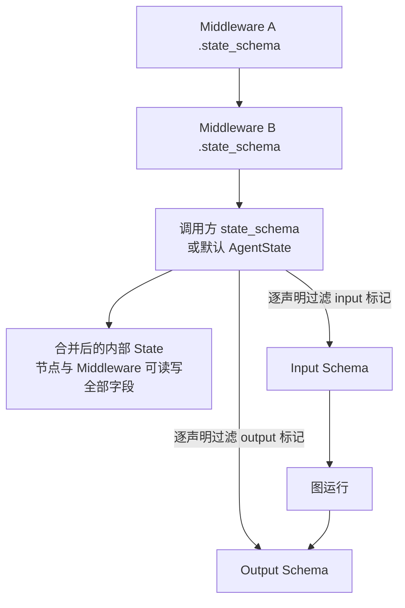

# LangChain 源码解析 05：State、Graph 与运行时边界

**源码定位**

> **阅读基线**：`langchain` 1.3.7、`langchain-core` 1.4.6（仓库快照 `langchain-core==1.4.6-2-g76c32db9b3`）。LangGraph 作为 `langchain` 的依赖包使用。
> 源码路径相对 LangChain 仓库根目录；版本与阅读路线见 [系列导读](index.md)。
>
> **本篇范围**：专门解释 LangChain 侧 Agent State 如何定义、合并并交给 LangGraph 建图。LangGraph 只作为被导入和调用的依赖包出现，不追踪其仓库内部实现；03 讲工厂如何组装 Agent 图，04 讲 Middleware 的执行边界。
>
> **核心包与路径**：
>
> 1. `langchain.agents.middleware.types`：`libs/langchain_v1/langchain/agents/middleware/types.py`
>    - `AgentState`、`_InputAgentState`、`_OutputAgentState`
>    - `OmitFromSchema`、`OmitFromInput`、`OmitFromOutput`、`PrivateStateAttr`
>    - **作用**：定义默认状态和可见性标记。`_InputAgentState`、`_OutputAgentState` 主要用于工厂的泛型标注；实际传给图的输入、输出 Schema 由工厂动态合成。
> 2. `langchain.agents.factory`：`libs/langchain_v1/langchain/agents/factory.py`
>    - `_resolve_schemas()`
>    - `StateGraph(...)` 初始化
>    - `model_to_tools`、`tools_to_model` 条件边
>    - `checkpointer`、`store`、`cache`、`interrupt_*` 传入 `graph.compile()`
>    - **作用**：把 LangChain 侧的状态协议、节点和运行参数交给 LangGraph 依赖包。
> 3. LangGraph 依赖包：`langgraph`
>    - **作用**：提供 `StateGraph`、`Send`、`Command`、`END` 等 API，承接建图、路由和编译。
>    - **阅读方式**：只确认 LangChain 如何导入和调用这些 API；不把 LangGraph 包内部源码作为本系列阅读范围。
> 4. LangGraph Checkpoint 依赖包：`langgraph-checkpoint`
>    - **作用**：通过 `checkpointer` 参数提供状态持久化和恢复能力。
>    - **阅读方式**：只看 LangChain 如何传入它，不展开 Saver 的具体实现。

## 一、一次订单请求怎样改变消息与待办

沿总览的说明性场景，用户希望先判断能否退货，再决定是否提交申请。本节假定使用工具策略生成最终结构化结果，且提交工具需要审批。下面的调用 ID 用于解释消息配对，不是真实运行日志。

`HumanMessage` 表示用户输入；`AIMessage` 是模型响应，可包含工具调用；`ToolMessage` 携带某次调用的结果，通过 `tool_call_id` 指回请求。消息自身的 id 用于消息合并，工具调用 id 用于请求与结果配对，两者不要混淆。

| 阶段 | 新增或修订的消息 | 尚待执行的业务调用 | 下一步 |
| --- | --- | --- | --- |
| 用户输入 | HumanMessage：查询订单并判断能否退货 | 无 | 创建本轮 ModelRequest |
| 第一次模型返回 | AIMessage：`c_order` 查订单，`c_policy` 查政策 | 两项 | 路由按调用派发工具 |
| 查询结果返回 | 两条 ToolMessage，分别配对 `c_order`、`c_policy` | 无 | 模型读取订单与证据 |
| 模型提出提交 | AIMessage：`c_return` 调用提交工具 | 一项 | after_model 审批 hook 暂停 |
| 人工批准 | 保留调用；编辑时更新其参数 | `c_return` | 执行真实提交工具 |
| 人工拒绝，作为另一分支 | 增加拒绝的 ToolMessage，配对 `c_return` | 无 | 跳过该次提交，回模型解释 |
| 批准分支提交完成 | ToolMessage 配对 `c_return`，携带服务结果 | 无 | 模型整理处理状态 |
| 模型按工具策略输出结果 | 特殊结构化工具调用 `c_result` | 不属于普通业务待办 | 工厂解析字段并产生配对消息 |
| 解析成功 | messages 更新，`structured_response` 写入 | 无 | 按对应结束条件返回 |

批准和拒绝是两个互斥分支，不是同一次请求先批准后拒绝。查询结果只说明查到了信息，提交工具结果才涉及申请是否建立；结构化输出还可能在后续解析时失败。

### 1、State 里有的内容，不一定全部原样送给模型 {#message-request-state}

模型节点从 State 取 messages，连同系统提示、工具和设置构造 ModelRequest。请求包装器可以为本轮裁剪工具、编辑上下文或换模型；只有相应节点显式提交状态更新时，这些变化才按状态协议进入后续图执行。

| 同一时点 | State 中的记录 | 本轮模型请求 | 外部系统 |
| --- | --- | --- | --- |
| 查询前 | 用户需求 | 系统提示、用户消息、可用工具 | 订单仍在原服务中 |
| 查询后 | 工具结果消息 | 选择后的历史与工具结果 | 查询通常不产生申请 |
| 拒绝后 | 原调用和配对拒绝消息 | 模型可解释未执行原因 | 该次提交工具没有执行 |
| 提交后 | 带申请编号或错误的结果消息 | 模型根据结果生成答复 | 服务可能已经产生写入 |

“临时请求改写”描述的是框架预期接口，不应被理解为任意可变 Python 对象都有深拷贝隔离。中间件应通过支持的请求覆盖与状态返回协议操作，避免无意原地修改共享消息。

### 2、审批拒绝为什么仍然保留工具请求

`factory.py` 的路由取出最近模型消息及相关工具消息，再按 `tool_call_id` 判断哪些调用已经得到结果。拒绝分支保留原调用，同时补一条配对结果，后续模型能够读到“提出过什么、为何没有执行”。

这条协议不会查询业务数据库。若工具已提交申请、还没有可靠保存 ToolMessage 就失败，消息记录仍可能不足以确认真实结果。业务幂等与结果查询见文末，底层持久化见 LangGraph 系列的对应版本说明。

## 二、先画出 State 的边界

这里的 State 不是模型上下文的另一个名字。它是图节点之间共享的数据协议，同时决定哪些数据能进入 Agent、哪些数据只在图内流转、哪些结果最终返回给调用方：

```text
调用输入
  → Input Schema
  → 内部 Agent State
  → 节点更新与 Reducer 合并
  → Output Schema
  → 调用结果
```

LangChain 负责定义字段、可见性和更新协议，再把它们交给 LangGraph 建图和执行。本文只追踪 LangChain 如何做这件事，不展开 LangGraph 内部的调度实现。

## 三、默认 Agent State 有什么

默认状态定义在 `middleware/types.py`：

```python
class AgentState(TypedDict, Generic[ResponseT]):
    # 对话和工具协议的主状态，使用消息合并器处理节点更新。
    messages: Required[Annotated[list[AnyMessage], add_messages]]
    # 只服务当前图路由，不作为输入输出暴露。
    jump_to: NotRequired[
        Annotated[JumpTo | None, EphemeralValue, PrivateStateAttr]
    ]
    # 结构化结果由 Agent 产出，调用者不需要把它作为输入传回。
    structured_response: NotRequired[
        Annotated[ResponseT, OmitFromInput]
    ]


class _InputAgentState(TypedDict):
    # 输入侧只接受消息；内部控制字段由工厂和 Middleware 产生。
    messages: Required[Annotated[list[AnyMessage | dict[str, Any]], add_messages]]


class _OutputAgentState(TypedDict, Generic[ResponseT]):
    # 输出保留消息和结构化结果，不暴露内部跳转信号。
    messages: Required[Annotated[list[AnyMessage], add_messages]]
    structured_response: NotRequired[ResponseT]
```

`AgentState` 是默认的内部状态基类；`_InputAgentState` 和 `_OutputAgentState` 只是工厂泛型中使用的默认形状。`create_agent()` 不会直接把这两个私有类型传给 `StateGraph`，而是结合 Middleware 和调用方的 `state_schema` 动态生成 `input_schema`、`output_schema`。

默认字段各自承担一项职责：

| 字段 | 作用 | 默认可见性 |
| --- | --- | --- |
| `messages` | 保存用户消息、模型消息和工具结果 | 输入输出都可见 |
| `jump_to` | Middleware 请求有限路由 | 内部字段 |
| `structured_response` | 保存结构化输出 | 不作为输入，作为输出 |

### 1、`messages` 是协议字段

`messages` 使用 `add_messages` 作为字段元数据。对 LangChain 侧来说，重要结论是：

- 节点返回 `{"messages": [...]}` 是一次局部更新；
- 它不等于在节点里重新赋值整个对话列表；
- 工具结果必须和原始工具调用保持 `tool_call_id` 配对；
- Middleware 不应通过拼接字符串模拟工具协议。

消息具体如何合并由 LangGraph 依赖包提供的 `add_messages` 处理。本文只关注 LangChain 为什么把它声明在 `AgentState` 上。

### 2、`jump_to` 是控制字段，不是业务状态

`jump_to` 同时携带：

```python
# EphemeralValue 表示临时值；PrivateStateAttr 表示不暴露给调用方。
EphemeralValue
PrivateStateAttr
```

这表达了两个意图：

- 它服务当前路由，不应该像消息历史一样持续累积；
- 它只供图内部使用，不应该暴露给 Agent 调用方。

jump_to 的 Hook 使用方式和目的地声明见 [04](04-middleware-control-plane.md)；can_jump_to 是装配信息，不是业务权限白名单。

### 3、`structured_response` 是输出字段

结构化结果需要在图内部暂存，但调用方通常只希望从输出中读取它。因此它使用 `OmitFromInput`：

- 内部 State 保留；
- 输入 Schema 隐藏；
- 输出 Schema 保留。

这比把结构化结果塞回最后一条文本消息更稳定，也让调用方不需要重新解析模型文本。

## 四、State 如何形成三套 Schema

默认 State 只是内部字段的起点。工厂还要把它拆成三套边界不同的 Schema：

```text
内部 State Schema
  节点和 Middleware 实际可以读写的全部字段

Input Schema
  调用者允许传入的字段

Output Schema
  调用者可以从 Agent 结果中读取的字段
```

三套 Schema 不能简单共用一个 `TypedDict`。内部控制字段、结构化结果和 Middleware 私有账本，往往不应该同时出现在输入和输出中。工厂通过 `_resolve_schemas()` 生成三套 `TypedDict`，并把自定义 Middleware 与应用 `state_schema` 中符合可见性规则的字段合并进去。

一次调用经过的边界可以画成：

```text
调用输入
  → Input Schema 过滤
  → 内部 State
  → Output Schema 过滤
  → 调用结果
```

三套 Schema 从同一组类型声明分别生成；下图展示共同的数据来源，具体过滤顺序由下一节的 _resolve_schema 决定：



内部 State 的同名字段采用后遍历的定义。输入、输出 Schema 则各自边遍历边过滤，并非对最终内部 Schema 做一次筛选；后面的省略标记不会删除已收录的同名字段。下一节用实际分支解释这个区别。

<details>
<summary>进阶阅读：同名字段与输入输出可见性如何合并</summary>

下面两节解释 Schema 的逐声明合并，适合排查私有字段和同名覆盖。初读可先跳到“节点如何更新 State”，需要自定义状态时再回来核对。

## 五、Schema 的合并顺序

三套 Schema 来自同一组状态定义，但合并顺序会决定同名字段采用哪一个定义。工厂先选择基础状态：

```python
# 调用方显式传入的 state_schema 是基础 Schema；没传时使用 AgentState。
base_state = state_schema if state_schema is not None else AgentState
```

合并顺序如下：

```python
# Middleware Schema 先合并，基础 Schema 最后覆盖同名字段。
state_schemas: list[type] = [
    *(m.state_schema for m in middleware),
    base_state,
]

resolved_state_schema, input_schema, output_schema = _resolve_schemas(
    state_schemas
)
```

`_resolve_schemas()` 的核心规则是：

```python
# 同一组 Schema 分别生成内部 State、Input Schema 和 Output Schema。
def _resolve_schemas(schemas: list[type]) -> tuple[type, type, type]:
    schema_hints = {
        schema: _get_schema_type_hints(schema)
        for schema in schemas
    }
    return (
        _resolve_schema(schema_hints, "StateSchema", None),
        _resolve_schema(schema_hints, "InputSchema", "input"),
        _resolve_schema(schema_hints, "OutputSchema", "output"),
    )
```

内部 State 没有 omit_flag，同名字段由后遍历的定义覆盖。输入、输出分别调用 _resolve_schema，下面是实际收集字段的主体，省略最终 TypedDict 构造：

```python
all_annotations = {}
for hints in schema_hints.values():
    for field_name, field_type in hints.items():
        should_omit = False
        if omit_flag:
            metadata = _extract_metadata(field_type)
            for meta in metadata:
                if isinstance(meta, OmitFromSchema) and getattr(meta, omit_flag) is True:
                    should_omit = True
                    break
        if not should_omit:
            all_annotations[field_name] = field_type
```

关键在于最后只有赋值，没有删除。假设前一个 Middleware 将 audit_note 声明为普通字段，应用 Schema 后来为同名字段加上 PrivateStateAttr：内部 State 使用应用定义，但输入、输出遍历到私有声明时只是跳过，前面已收录的 audit_note 仍然存在。这是本快照的实现边界，不能将“应用 Schema 最后覆盖”推导为“应用私有标记必然隐藏所有同名字段”。

另外 schema_hints 以类型对象为字典 key，同一个类型重复出现会合并为同一项；覆盖值不会把 key 移到最后。通常各自定义 Schema 是不同类型，但排查重复注册时应以实际遍历顺序为准。敏感或内部字段宜使用明确归属的名称，并核对工厂生成的输入、输出 Schema。

## 六、字段可见性由注解决定

合并顺序确定字段定义后，注解中的可见性标记再决定字段能否穿过调用边界。源码定义了三个常用标记：

```python
@dataclass
class OmitFromSchema:
    # 两个标记分别控制字段是否从输入和输出 Schema 中剔除。
    input: bool = True
    output: bool = True


OmitFromInput = OmitFromSchema(input=True, output=False)
OmitFromOutput = OmitFromSchema(input=False, output=True)
PrivateStateAttr = OmitFromSchema(input=True, output=True)
```

在字段没有被其他 Schema 以可见形式重复声明时，三个标记的区别如下：

| 标记 | 内部 State | 调用输入 | 调用输出 | 用途 |
| --- | --- | --- | --- | --- |
| 无标记 | 保留 | 保留 | 保留 | 普通业务状态 |
| `OmitFromInput` | 保留 | Input Schema 会过滤该字段 | 保留 | `structured_response` |
| `OmitFromOutput` | 保留 | 保留 | Output Schema 会过滤该字段 | 只服务输入或内部流程的字段 |
| `PrivateStateAttr` | 保留 | Input Schema 会过滤该字段 | Output Schema 会过滤该字段 | `jump_to`、内部控制字段 |

这里的“隐藏”不只是序列化时少显示一个键。字段被 Input Schema 过滤后，即使调用方在 `invoke()` 输入中提交它，它也不会作为初始内部 State 传给节点；字段被 Output Schema 过滤后，内部 Middleware 仍可读写它，只是调用结果不包含它。`OmitFromInput` 字段也可以由 Middleware 在图内写入，随后出现在输出中。

这些标记控制普通输入与输出通道，不是数据保密机制。内部字段仍可能出现在检查点、调试读取、节点更新事件或应用日志中。涉及保密要求时，还应检查实际存储与输出接口，不能只验证 invoke 的返回字典。

</details>

## 七、节点如何更新 State

### 1、节点返回的是局部更新

边界确定后，节点只需要返回本次执行产生的局部更新：

`model_call_limit.py` 的 `ModelCallLimitMiddleware.after_model` 只提交计数字段。下面是该方法的真实返回语句，省略签名与文档字符串：

```python
return {
    "thread_model_call_count": state.get("thread_model_call_count", 0) + 1,
    "run_model_call_count": state.get("run_model_call_count", 0) + 1,
}
```

已有消息交给图状态协议保留，无需为了保留它们而把旧 messages 再提交一次。

返回完整 State 不是框架绝对禁止的操作，但会把所有字段再次作为写入提交，副作用更难判断：

- `messages` 会再次进入 `add_messages` 合并逻辑，并不是“原样保留”；
- 普通字段会再次按其 Channel 或 Reducer 规则写入；并行步骤中，无 Reducer 字段的多次写入还可能产生冲突；
- 读代码的人很难判断哪些字段是这次节点真正修改的。

### 2、三类节点返回形态

LangChain Agent 中常见的节点返回形态可以这样看：

| 节点 | 返回什么 | 更新内容 |
| --- | --- | --- |
| `before_*` / `after_*` | `dict`、`Command` 或 `None` | Middleware 的局部 State 更新或控制信号 |
| `model` | `list[Command]` | 模型消息、结构化结果和包装器附加更新 |
| `tools` | 工具结果消息或控制指令 | `ToolMessage`、工具产生的 State 更新 |

模型节点不会直接返回一个裸 `AIMessage` 给图，而是由工厂统一包装：

```python
def _build_commands(
    model_response: ModelResponse,
    middleware_commands: list[Command[Any]] | None = None,
) -> list[Command[Any]]:
    # 第一条 Command 承载模型节点自己的消息和结构化结果。
    state: dict[str, Any] = {"messages": model_response.result}

    if model_response.structured_response is not None:
        # structured_response 是独立状态字段，不塞进 messages。
        state["structured_response"] = model_response.structured_response

    # ……省略对附加 Command 的 goto、resume、graph 字段的拒绝检查……
    # Middleware 的附加 Command 保持为独立更新，交给后续状态协议处理。
    commands: list[Command[Any]] = [Command(update=state)]
    commands.extend(middleware_commands or [])
    return commands
```

这段代码说明了模型结果的状态流：

```text
AIMessage / ModelResponse
  → {"messages": [...]}
  → 可选的 {"structured_response": ...}
  → Command(update=...)
  → 交给图执行层合并
```

### 3、“更新”不等于“覆盖”

节点返回 `{"messages": [new_message]}` 时，LangChain 只声明了消息字段的局部更新。`messages` 字段上的 `add_messages` 元数据会告诉 LangGraph 依赖包如何合并它：

- 新消息通常追加到已有消息；
- 拥有相同消息 ID 时可以更新已有消息；
- 工具结果通过 `tool_call_id` 和模型工具调用配对。

对于自定义字段，是否追加、覆盖或使用 Reducer，取决于字段 Schema 的声明。文章在 LangChain 侧只关注“Reducer 元数据如何被声明”，不追踪依赖包内部的合并实现。

### 4、State 更新如何进入下一节点

一次节点执行可以画成：

```text
当前 State
  → 节点读取
  → 节点返回局部更新
  → 图执行层按字段规则合并
  → 新 State
  → 下一节点读取
```

Middleware 的 `before_model` 能更新计数，模型节点能追加消息，工具节点能追加 `ToolMessage`，原因相同：它们都遵守“读取 State，返回局部更新”的协议。

## 八、自定义状态放在哪一层

局部更新遵守同一套字段规则，自定义状态也应按归属放到合适的位置。有两种扩展 Agent State 的方式：

### 1、由 Middleware 携带状态

内置 `ModelCallLimitMiddleware` 将 `state_schema` 指向 `ModelCallLimitState`，由该类型声明 thread 和 run 两个计数字段；`after_model` 读取旧值并返回更新。字段、私有可见性和更新逻辑因此归在同一个中间件中，完整源码见 [07](07-call-governance.md)。

这种方式把状态字段和使用它的 Hook 放在一起，适合可复用能力。

### 2、由调用方传入 `state_schema`

应用可以扩展 `AgentState` 声明需要跨节点共享的业务字段，再通过 `create_agent(state_schema=...)` 传入该类型。例如订单任务中的 request_id 可以用于关联业务记录；字段声明本身不会执行身份鉴别或数据库查询。

这种方式适合应用层必须拥有的字段，但要注意它会覆盖同名 Middleware 字段的定义。

### 3、状态字段的选择原则

- 节点之间需要共享、并且属于本次 Agent 执行的数据，放 State；
- 只属于一个包装器内部的临时变量，放 Request 或局部变量；
- 跨多次会话共享的数据，使用 `store`；
- 需要作为运行时依赖传入但不应写入 State 的数据，使用 `context_schema`。

不要为了方便把所有数据都塞进 `messages`。消息字段承载的是对话和工具协议，不是通用的状态字典。

## 九、State Schema 交给图以后，由谁负责执行

工厂将内部、输入、输出和 context Schema 交给 `StateGraph`，再把 model、tools 与中间件 hook 注册为节点。这里的职责是定义可用字段和节点返回协议；字段怎样变成通道、什么时候提交一轮更新，是 LangGraph 的运行时职责。

不要把两个仓库的相似源码片段当成同一版本。当前 LangChain 锁文件使用 LangGraph `1.2.4`，相邻 LangGraph 系列使用 `1.2.10`；本篇只据 LangChain 源码确认调用和参数，内部机制的跨版本判断见[源码基线](./source-baseline.md)。

工厂装配和拓扑细节回看 [03](./03-create-agent-assembly.md)。下面继续沿运行中的 messages 判断下一步，而不重复编译调用。

## 十、模型—工具循环如何读 State

图已经确定节点和边后，循环是否继续仍要由当前 State 决定。模型出口的 `_make_model_to_tools_edge()` 按下面的优先级路由：

```python
# 1. Middleware 写入 jump_to 时，优先使用工厂可识别的有限跳转。
if jump_to := state.get("jump_to"):
    return _resolve_jump(
        jump_to,
        model_destination=model_destination,
        end_destination=end_destination,
    )

# 2. 从消息状态找到最近一轮模型输出及其工具结果。
last_ai_message, tool_messages = _fetch_last_ai_and_tool_messages(
    state["messages"]
)

if last_ai_message is None:
    # 没有模型消息时无法继续工具循环，结束。
    return end_destination

tool_message_ids = [m.tool_call_id for m in tool_messages]

if len(last_ai_message.tool_calls) == 0:
    # 模型没有请求工具，结束本轮循环。
    return end_destination

# 3. 只把尚未由 ToolMessage 配对完成、且不是结构化输出工具的调用派发到 tools。
pending_tool_calls = [
    c
    for c in last_ai_message.tool_calls
    if c["id"] not in tool_message_ids
    and c["name"] not in structured_output_tools
]

if pending_tool_calls:
    return [Send("tools", [tool_call]) for tool_call in pending_tool_calls]

# 4. 已得到结构化结果时结束；否则回模型处理人工注入或已完成的工具消息。
if "structured_response" in state:
    return end_destination

return model_destination
```

这里的路由规则比“有工具调用就进 tools，没有就结束”多两层边界：

- `jump_to` 优先于消息判断；
- 最后一条 `AIMessage` 决定本轮模型是否提出动作；
- 后续 ToolMessage.tool_call_id 表示调用已有协议结果，不证明外部业务动作成功；
- 未完成的普通工具调用被拆成多个 `Send("tools", [tool_call])`，分别派发给工具节点；
- 工具调用都已配对，但 State 还没有 `structured_response` 时，工厂会回到模型。这条边服务于人工注入的工具消息等场景，不应被简化成“工具调用完成就一定结束”。

工具出口还有一组独立判断：

```python
last_ai_message, tool_messages = _fetch_last_ai_and_tool_messages(state["messages"])

if last_ai_message is None:
    return model_destination

# 只看客户端工具；Provider 工具不注册在 ToolNode 中。
client_side_tool_calls = [
    c for c in last_ai_message.tool_calls if c["name"] in tool_node.tools_by_name
]
if client_side_tool_calls and all(
    tool_node.tools_by_name[c["name"]].return_direct for c in client_side_tool_calls
):
    return end_destination

if any(t.name in structured_output_tools for t in tool_messages):
    return end_destination

return model_destination
```

也就是说，工具节点完成后只有两类明确的直接退出条件：当前轮的客户端工具调用全部标记为 `return_direct=True`，或本轮工具消息中出现结构化输出工具名。后一个条件检查消息，不表示结构化工具由 ToolNode 执行；这类结果由工厂解析分支生成。其他情况回到循环入口，由 `before_model` 链或 `model` 继续处理结果。模型—工具循环之所以能够继续，不是因为节点里保留了一个 Python 列表，而是因为模型消息和工具消息共同形成了可判断的状态协议。

## 十一、运行服务与流式事件怎样接到状态旁边

`create_agent()` 把 checkpointer、Store、缓存和中断等配置交给编译图。它们有不同的数据职责，完整装配代码见 [03](./03-create-agent-assembly.md)。

| 能力 | 与当前请求的关系 | 不自动提供什么 |
| --- | --- | --- |
| checkpointer | 保存可恢复的图执行记录 | 外部申请与状态保存的联合事务 |
| Store | 节点主动读取跨会话资料 | 自动放进模型消息的长期记忆 |
| cache | 提供图缓存后端 | 所有 Agent 节点自动缓存，或业务写入去重 |
| context | 传递本次用户身份、依赖等 | 自动写入状态检查点 |
| transformers | 处理支持该扩展的对外事件流 | 自动改写 State 或路由 |

事件是第三个观察位置。订单结果可能已经出现在流中，而对应持久记录尚未完成保存；只对事件脱敏，也不代表状态里的原文已删除。State、ModelRequest 与流事件的治理细节集中在 [09](./09-context-and-privacy.md)。

## 十二、几个容易混淆的边界

### 1、State 与 `ModelRequest`

State 是节点之间共享的图数据；`ModelRequest` 是一次模型调用的输入快照。

```text
State
  → 可以跨模型调用和工具循环继续存在

ModelRequest
  → 只描述当前一次模型调用
  → 可以使用 override() 创建变体
```

不要把一次请求的临时改写直接写回长期 State。

### 2、State 与 Context

State 适合会被节点更新、合并和判断的数据。Context 适合调用开始时提供的运行时依赖，例如用户身份、租户配置或外部客户端。

### 3、State 与 Store

State 属于图状态，配置 Checkpointer 后可以沿同一 thread 跨多次调用保存；Store 提供应用主动访问的跨 thread 数据入口。需要跨对话共享的偏好适合 Store，需要恢复当前任务进度的数据适合 State；两者都不会仅因存在就自动进入模型请求。

### 4、`jump_to` 与图 API

Middleware 通过 `jump_to` 请求 `create_agent()` 约定的有限路由，取值是 `"model"`、`"tools"` 或 `"end"`。节点型 Hook 还应通过 `can_jump_to` 声明工厂需要为该节点装配哪些条件边。

`can_jump_to` 不是运行时逐项校验器。它用于图装配期声明目的地；`_add_middleware_edge()` 会按这份声明注册边，再由 `_resolve_jump()` 识别 `jump_to` 的值。未知值会回退到默认后继，框架可识别但未声明的值也不属于可依赖的行为。

`Command(goto=...)` 是 LangGraph 节点的更底层控制协议，要和图中已有静态边、条件边一起理解。它不是这个工厂约定下推荐的 Middleware 路由接口；需要在 Agent 生命周期中请求结束、回模型或进入工具节点时，使用 `jump_to` 并让声明与取值保持一致。

## 十三、恢复图状态与确认外部动作

用一次审批后的写入来检验状态设计：模型提出调用，after_model 可能中断；恢复后工具写入外部服务，再返回 ToolMessage。检查点可以保存图执行进度，但外部写入与保存消息不在同一事务中。

若外部写入已提交、图状态尚未持久化就失败，恢复时可能再次进入执行路径。messages 中有无结果不能代替业务查询，tool_call_id 也不天然是跨重启稳定的业务幂等键。重要写入需要在执行服务中识别同一动作并返回已有结果。

对普通字段，明确它是覆盖值还是累积值；对消息，独立新消息使用新的 ID，修正旧消息保留原 ID；对私有字段，核对最终输入、输出与可观察事件。状态协议定义清楚后，再配置 Checkpointer 和 Store，才能知道恢复的是哪份数据。

## 十四、按数据位置排查状态问题

先检查字段是否进入最终内部 Schema，再检查节点是否真的返回更新，接着查看 Reducer 如何合并，最后确认读取的是 invoke 输出、检查点还是模型请求。四个位置的内容本来就可能不同。

状态合并与通道见 [LangGraph 01](../langgraph/01-state-schema-channels-and-reducers.md)，检查点与恢复见 [LangGraph 06](../langgraph/06-checkpoints-store-and-recovery.md)，Middleware 返回协议见 [04](04-middleware-control-plane.md)。
