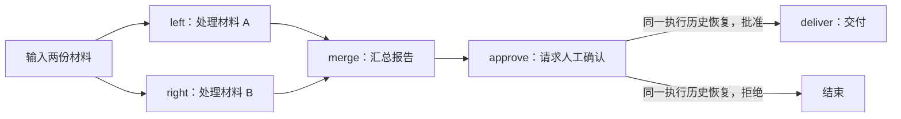

# LangGraph 源码 00：一次调用如何穿过图运行时

**源码定位**

> 快照身份与验证范围见[源码基线](./source-baseline.md)。源码节选以该快照为准，文中的应用示例不等于框架实现。

> **源码基线**：langgraph 1.2.10。以下路径相对于 LangGraph 源码仓库根目录，供查阅原实现。
>
> - 图构建：`libs/langgraph/langgraph/graph/state.py` → `StateGraph.compile()`、`CompiledStateGraph.attach_node()`。
> - 执行入口：`libs/langgraph/langgraph/pregel/main.py` → `Pregel.invoke()`、`Pregel.stream()`。
> - 轮次与提交：`libs/langgraph/langgraph/pregel/_loop.py` → `tick()`、`after_tick()`；`libs/langgraph/langgraph/pregel/_algo.py` → `apply_writes()`。
> - 临时通道：`libs/langgraph/langgraph/channels/ephemeral_value.py` → `EphemeralValue.update()`。

LangGraph 为有状态工作流提供执行运行时。应用定义哪些函数处理任务、如何衔接、哪些结果需要保存；框架负责把定义变成具体调用，合并更新，并在配置保存器后支持中断与恢复。节点可以调用模型，也可以只执行普通 Python 逻辑。

理解这套运行时，要能追踪一份结果的去向：它何时只是节点返回值，何时进入下一轮可读状态，何时有了可靠的恢复记录。本文先给出贯穿系列的工作流，再用单节点源码解释基本执行链。

## 一、工作流：并行整理材料，汇总后等待确认

假设团队要整理两份材料。left 和 right 各处理一份，merge 汇总报告，approve 请求人工确认，deliver 在批准后交付，拒绝则结束本次流程。应用负责材料处理与审批规则，LangGraph 负责这些步骤的执行与状态流转。



图中汇总要求两项处理都完成；两条箭头表达业务依赖，不表示随便添加两条普通边就自动获得屏障。对应的显式汇合编译在 [02](./02-stategraph-builder-and-compilation.md) 解释。

这是用于贯穿讲解的工作流推演，不是本次已执行的完整应用。01 的 left/right/merge 是它的并行部分；07 的审批小例子单独演示恢复协议；05 将固定的两份材料扩展为运行时才知道数量的任务。独立小例子保留，让每个机制可以单独理解。

| 业务时点 | 需要查清的运行时问题 | 主讲文章 |
| --- | --- | --- |
| left、right 同时产生 items 更新 | 结果如何合并，谁决定何时提交？ | 01、03 |
| left 成功，right 重试耗尽 | 哪些结果保留，恢复后谁会再运行？ | 04、06 |
| merge 已产生报告 | 报告已显示，是否就一定可靠保存？ | 03、06、09 |
| approve 等待人确认 | 本次调用怎样退出，下一次怎样找到原任务？ | 07 |
| 同样的材料再次处理 | 使用缓存与恢复旧任务有什么不同？ | 03、06 |

业务上的“完成”至少有三种含义：某项材料处理完成、报告进入已合并状态、交付动作在外部系统完成。后两项不能只根据某个节点结束事件推断。外部交付的幂等与验收还需应用负责。

## 二、先看我们自己写的代码

下面是完整应用示例，用来说明框架在什么位置接手工作；它不是 LangGraph 内部源码。

```python
from typing_extensions import TypedDict
from langgraph.graph import START, END, StateGraph

class State(TypedDict):
    count: int

def increment(state: State):
    return {"count": state["count"] + 1}

builder = StateGraph(State)
builder.add_node("increment", increment)
builder.add_edge(START, "increment")
builder.add_edge("increment", END)
graph = builder.compile()
result = graph.invoke({"count": 0})  # {"count": 1}
```

在这个例子里，`builder` 和 `graph` 是两个对象，职责不同。

| 你写的代码 | 此时框架在做什么 | increment 是否执行 |
| --- | --- | --- |
| `StateGraph(State)`、`add_node()`、`add_edge()` | 记下字段、函数和先后关系 | 否 |
| `graph = builder.compile()` | 把这些声明整理成可以运行的图，配好节点怎样取输入、何时运行、怎样处理返回值 | 否 |
| `graph.invoke({"count": 0})` | 接收这次输入，执行 increment，合并返回的更新，再交回结果 | 是 |

因此，读到编译源码中的 `attach_node()`，先把它理解为“装配已登记的节点”。真正调用 `increment` 要等到 `invoke()`。

## 三、compile 后的 graph 与 Pregel 是什么关系

`compile()` 返回的对象类型叫 `CompiledStateGraph`，直译就是“编译后的状态图”。它继承 `Pregel`，这个基类提供执行图的主要逻辑，包括 `invoke()` 和 `stream()`。

你调用的 `graph.invoke(...)` 使用的正是这套执行逻辑。阅读 StateGraph 的调用链时，可以把 Pregel 记作“可执行图共用的运行实现”。这里涉及类的继承关系，不需要想象调用时又把 graph 交给了一个独立的 Pregel 服务。

下面是对象关系示意，不是实现代码：

```text
builder：StateGraph 对象，记录你声明的节点和边
    │ compile()
    ▼
graph：CompiledStateGraph 对象
    └─ 继承 Pregel，获得 invoke / stream 等执行方法

调用 graph.invoke(...) 时
    ├─ Loop 管理这次调用的状态和执行轮次
    └─ Runner 执行每轮准备好的 task
```

源码 `libs/langgraph/langgraph/graph/state.py` 中，`CompiledStateGraph` 的类声明直接继承 `Pregel`；`invoke()` 的执行代码则位于 `pregel/main.py`。文件名变化对应的是实现所在位置，业务上仍在处理同一次 `graph.invoke(...)`。

## 四、节点和 task 有什么区别

`increment` 是你登记过的节点函数。框架准备调用它时，还要记下“这次给它什么输入、这次调用是什么身份、结果暂存在哪里”。这份具体调用记录叫 **task（任务）**，源码里的完整类型名是 `PregelExecutableTask`。

假设复用上面没有配置保存器的 graph，分别传入 `{"count": 0}` 和 `{"count": 10}`：

| 不变的定义 | 这次准备的调用 | 节点返回的更新 |
| --- | --- | --- |
| increment 节点 | 输入是 `{"count": 0}` 的一次 task | `{"count": 1}` |
| 同一个 increment 节点 | 输入是 `{"count": 10}` 的另一次 task | `{"count": 11}` |

两个调用使用同一份节点定义，各自有自己的输入和执行记录。同一节点也可以在图的循环中被多次调用，因此不能用节点名代替每次调用的身份。

后文的 `task.input` 就是这一次调用收到的输入；`task.writes` 是这次调用已经产生、等待框架处理的更新。这里的 task 既不等于线程，也不要求你使用 `@task` 装饰器。普通 StateGraph 节点运行时就会产生任务记录；装饰器是另一种编程入口，在第 10 篇介绍。

## 五、Loop 和 Runner 为什么分开

一个节点时，直接调用函数很容易。节点多起来，框架还要决定：哪些节点现在可以运行，能否同时运行，什么时候让后面的节点读到合并结果。

**Loop 管执行进度，Runner 管已经选出的这批调用。** 在源码里分别是 `PregelLoop` 和 `PregelRunner`。前者持有本次图调用的状态与轮次，后者执行任务、收集成功或失败的结果。

回到加一例子，这次 `invoke({"count": 0})` 可以按下面的过程理解：

| 时刻 | 框架负责的动作 | 业务数据在哪里 |
| --- | --- | --- |
| 接收输入 | 处理 START 入口，将 count=0 写入本次图状态 | 本次状态中的 count 为 0 |
| 准备调用 | Loop 按入口关系准备 increment 的 task | task 输入为 `{"count": 0}` |
| 执行函数 | Runner 调用 increment，收集返回更新 | `{"count": 1}` 暂存在任务结果中 |
| 本轮收尾 | Loop 将本轮更新合并到状态 | count 成为 1 |
| 检查后续 | 没有其他需要运行的节点 | graph 返回 `{"count": 1}` |

一批任务的“准备、执行、合并”称为一轮，英文叫 superstep（超级步）。先按“一轮”理解即可。START 的输入处理也有内部执行过程，上表把它合在第一行，没有把它当作业务节点。

这个分工解释了一个容易误判的现象：并行节点先返回结果，调用方可能已经看到它的事件，但后续正常节点要等这一轮状态合并后才能读取结果。同一轮的慢任务会影响汇合时间。节点应把输入视为只读，框架不会为任意可变 Python 对象提供深拷贝隔离。

<details>
<summary>对照源码：把三个动作对应到 tick、runner.tick 和 after_tick</summary>

`loop.tick()` 准备一轮任务，`runner.tick()` 执行它们，`loop.after_tick()` 合并更新。两个对象都有 tick 方法，但承担的动作不同。下面先看这三个调用，缓存匹配、事件输出和保存策略会在后续文章展开。

源码：`libs/langgraph/langgraph/pregel/main.py` → `Pregel.stream`（第 2964–2972、2984–2988 行节选；未展示部分省略）。

```python
# 准备这一轮要执行的节点调用；没有后续任务时结束。
while loop.tick():
    for task in loop.match_cached_writes():
        loop.output_writes(task.id, task.writes, cached=True)
    # 执行本轮还没有结果的任务。
    for _ in runner.tick(
        [t for t in loop.tasks.values() if not t.writes],
        timeout=self.step_timeout,
        get_waiter=get_waiter,
        schedule_task=loop.accept_push,
    ):

# ……省略中间实现……

    # 本轮结束后，再把收集的更新合并到状态。
    loop.after_tick()
    emit_graph_lifecycle_events(loop)
    # 同步持久化模式下，等本轮检查点写入完成。
    if durability_ == "sync":
        loop._put_checkpoint_fut.result()
```

`invoke()` 内部消费 `stream()` 的执行结果，所以只取最终值也会经过这里。片段中间省略的是事件输出等代码；正常轮次的状态合并发生在 `after_tick()`。

</details>

## 六、Channel 与 attach_node 怎样接到这个例子上

框架要保存 count，还要知道以后收到 `{"count": 1}` 应该覆盖旧值还是与旧值合并。负责“保存一个值并处理更新”的对象叫 **Channel（通道）**。在这里，先把它理解成带更新规则的存储位置，不要代入网络连接或消息队列。

`count: int` 没有指定合并函数，框架为它选择 `LastValue` 通道：没有新更新时保留旧值，一轮收到一份更新时替换旧值。并行两份更新怎样处理，第 01 篇再展开。

还有另一类数据是“increment 现在可以运行”的触发标记。它与业务值 count 分开保存，默认使用 `EphemeralValue` 通道。Ephemeral 表示短暂的：某轮没有新写入时，它会清掉旧值。这是按执行轮次处理的生命周期，与几秒后过期无关。

`attach_node()` 是编译阶段的内部方法。对于 increment，它会配好四件事：读取 count 作为输入，等待指向 increment 的触发标记，调用你提供的函数，以及收集函数返回的 count 更新。你在应用里使用 `add_node()` 登记函数，`compile()` 会调用这个内部方法完成装配。

<details>
<summary>对照源码：compile 怎样装配已登记的节点和边</summary>

下面的 `compiled` 就是即将返回给调用方的编译图。`attach_edge()` 把边转换成触发关系，`attach_branch()` 安装条件路由；这时还没有执行 increment。

源码：`libs/langgraph/langgraph/graph/state.py` → `StateGraph.compile`（第 1360–1362、1378–1388 行节选；未展示部分省略）。

```python
# 把入口和已登记的节点装配到可执行图中。
compiled.attach_node(START, None)
for key, node in self.nodes.items():
    compiled.attach_node(key, node)

# ……省略中间实现……

for start, end in self.edges:
    compiled.attach_edge(start, end)

for starts, end in self.waiting_edges:
    compiled.attach_edge(starts, end)

for start, branches in self.branches.items():
    for name, branch in branches.items():
        compiled.attach_branch(start, name, branch)

return compiled.validate()
```

</details>

## 七、thread、恢复和流式输出接在哪个位置

上面的 graph 没有配置保存器，每次调用都用传入的 count 开始。要让一次工作跨多次调用延续，需要 checkpointer（保存执行现场的组件）和 thread（关联这组执行历史的身份）。`thread_id` 是选择这份历史的配置键，与执行节点的操作系统线程无关。

例如接入保存器后，第一次调用把 count 从 0 改为 1；同一 thread 的后续新输入会先加载历史，再按字段规则应用输入。如果又显式传入 `count=10`，默认覆盖规则会先把 count 改成 10，increment 再得到 11。保存历史不等于忽略新输入，也不等于把每次输入自动累加。

| 用户看到的特性 | 接在这条执行线的哪里 | 需要追问的实现问题 |
| --- | --- | --- |
| 并行处理 | Loop 准备多份任务，Runner 执行，本轮结束后合并 | 同轮节点写同一个字段，怎样保留两份结果？ |
| 同一会话继续 | 进入 Loop 时，按 thread 读取检查点并应用本次输入 | 这次是在开始新工作，还是恢复未完成工作？ |
| 失败恢复 | 按任务身份找回已保存结果，再执行未完成任务 | 哪些函数已经有结果，哪些代码仍会重跑？ |
| 人工审批 | 节点产生暂停记录，下一次调用带回答重建执行 | 回答怎样找到原来的中断位置？ |
| 流式展示 | 执行与提交过程中输出事件 | 看到节点结果时，整轮是否已经提交、保存？ |

这些特性共用前面的任务、通道和轮次机制。理解“count 的返回值先暂存，再合并”，就能继续区分任务结果、图状态和已保存历史；三者在失败或暂停时尤其不能混为一谈。

回到材料整理流程：left 已完成、right 失败时，当前轮次还没有正常汇合；保存器中却可能已有 left 的成功写入。恢复要找回这份结果，再继续 right，而不是把“没有整轮成功”理解成“两项都没做过”。完整时间线见 [03 的结果提交图](./03-pregel-supersteps-and-scheduling.md#result-timeline)，保存条件见 [06](./06-checkpoints-store-and-recovery.md)。

模型生成的 token、工具进度、节点返回、轮次合并与检查点落盘分别处于不同位置。阅读后续篇章时，始终问“这段代码改变的是哪一份数据”，比仅记住 Loop、Runner、Channel 的名字更有用。

## 八、接下来按问题读，不必一次记住所有类名

如果现在能解释“定义节点 → 编译出 graph → 为某次调用准备 task → 执行 → 合并更新”，就可以继续阅读。后面的类名会在各自负责的问题里出现。

| 你想弄明白的问题 | 对应文章 |
| --- | --- |
| 节点返回字典后，字段到底怎么变 | [01 状态与通道](./01-state-schema-channels-and-reducers.md) |
| compile 给节点和边配了什么 | [02 图编译](./02-stategraph-builder-and-compilation.md) |
| 为什么这轮执行 A，下一轮执行 B | [03 执行循环](./03-pregel-supersteps-and-scheduling.md) |
| 选出的任务如何并发、失败和重试 | [04 任务执行](./04-pregel-task-execution.md) |
| 同一会话怎样跨多次调用保留状态，失败后怎样继续 | [06 Thread 与持久化](./06-checkpoints-store-and-recovery.md) |

失败恢复还需要记录当前状态和已完成任务的结果。先理解正常执行，再进入第 06 篇的检查点与恢复规则，会更容易区分“保存状态”和“保存一次调用的结果”。

<details>
<summary>需要找文件时：按执行职责看仓库</summary>

| 相对路径 | 承担的工作 | 需要区分的边界 |
| --- | --- | --- |
| `libs/langgraph/langgraph/graph/` | Schema 解析、图声明、节点和边的编译 | 不执行模型或工具策略 |
| `libs/langgraph/langgraph/channels/` | 保存字段值、合并更新、表达触发与屏障 | 通道更新规则不负责提交时机 |
| `libs/langgraph/langgraph/pregel/` | 准备任务、执行、重试、提交和恢复 | 不代替业务幂等与事务 |
| `libs/checkpoint/langgraph/checkpoint/` | 保存器与序列化协议 | 具体落盘能力取决于后端 |
| `libs/checkpoint/langgraph/store/` | 按命名空间保存跨执行业务数据 | Store 写入不随检查点回滚 |
| `libs/prebuilt/langgraph/prebuilt/` | 工具参数注入、执行、结果消息 | 工具内部并发不自动成为图任务 |
| `libs/langgraph/langgraph/func/` | 将函数入口和任务装饰器接到 Pregel | 与 StateGraph 共用运行时 |

SQLite、PostgreSQL 保存器负责将协议落到不同存储。SDK 与 CLI 面向远端调用和部署，不参与本文这条本地执行链。

LangChain 的 `create_agent()` 在这些机制上装配模型与工具循环；Deep Agents 的 `create_deep_agent()` 再加入文件、规划和上下文管理等能力。例如模型返回两个工具调用时，工具节点可以内部并行，也可以通过 `Send` 分成两个图任务；两者的恢复粒度不同，与调用的是哪家模型无关。

</details>
