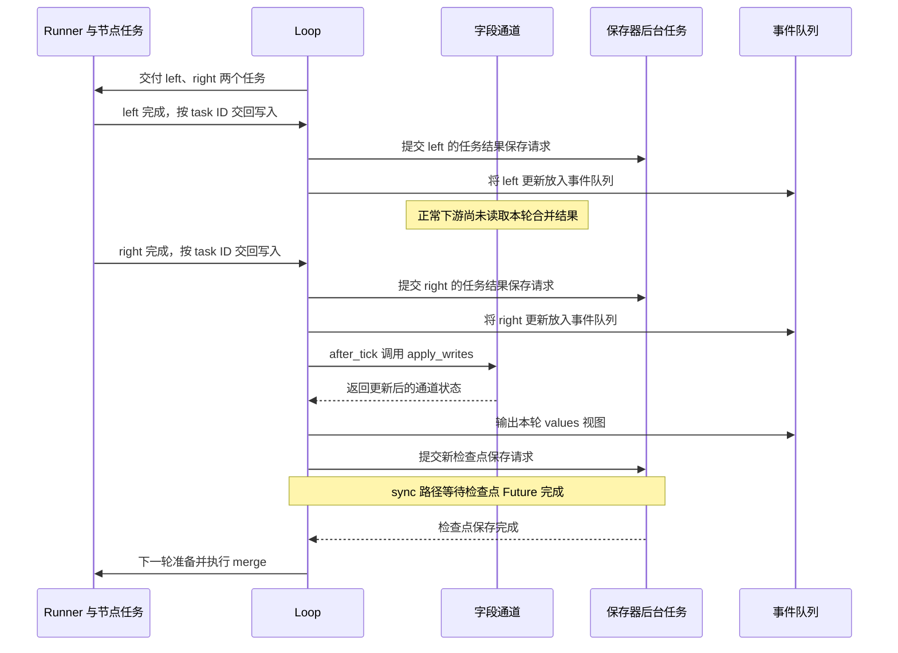

# LangGraph 源码 03：下一轮运行哪些任务，状态何时提交

**源码定位**

> 快照身份与验证范围见[源码基线](./source-baseline.md)。源码节选以该快照为准，文中的应用示例不等于框架实现。

> **源码基线**：langgraph 1.2.10。以下路径相对于 LangGraph 源码仓库根目录，供查阅原实现。
>
> - 主循环：`libs/langgraph/langgraph/pregel/main.py` → `Pregel.stream()`。
> - 轮次管理：`libs/langgraph/langgraph/pregel/_loop.py` → `PregelLoop.tick()`、`after_tick()`。
> - 任务与状态：`libs/langgraph/langgraph/pregel/_algo.py` → `prepare_next_tasks()`、`_triggers()`、`apply_writes()`。
> - 执行交接：`libs/langgraph/langgraph/pregel/_runner.py` → `PregelRunner.tick()`。
> - 协作式停止：`libs/langgraph/langgraph/runtime.py` → `RunControl.request_drain()`；`libs/langgraph/langgraph/pregel/main.py` → `Pregel.stream()`。

第 00 篇的加一图只需要执行一次 increment；图里出现两个可并行节点时，`invoke()` 就得反复决定“这一轮运行谁，什么时候让下游读取结果”。本篇解释这个决定过程。

`Pregel` 是编译图继承的执行实现；一次调用进入它的 `stream()` 后，会创建管理本次进度的 `Loop` 和执行节点调用的 `Runner`。Loop 持有当前状态、待执行工作和轮次。它的 `tick()` 准备一轮任务，`after_tick()` 在这一轮结束后合并更新。

每个 task 是某个节点带着本次输入的一次调用记录。例如 increment 节点加上 `{"count": 0}` 的输入，就对应这次要执行的工作；`PregelExecutableTask` 是源码中这份记录的类型名。节点函数具体怎样被执行、失败怎样处理，留给[第 04 篇](./04-pregel-task-execution.md)。

先跟完“准备调用 → 执行 → 合并”的正常过程，再看结果复用和停止分支。本文的 items 对应总览中并行处理的两份材料；状态表使用短标签 left、right，以便只观察调度行为。

## 一、从一次汇合看状态何时变化

沿用[第 01 篇的完整示例](./01-state-schema-channels-and-reducers.md)：START 同时指向 left、right，两个节点分别返回一项 items，merge 用 `add_edge(["left", "right"], "merge")` 等待两者。这里不改图，换成调度器的视角看同一次调用。

即使 left 先完成，right 也不会因此获得包含 left 的新输入；merge 更不能提前开始。业务依赖写在边上，节点返回只表示这次任务产生了一份结果。忽略接收输入的隐藏 START 轮次后，变化如下：

| 时刻 | 任务行为 | 已提交 items | 待合并写入 |
| --- | --- | --- | --- |
| 第 N 轮准备 | 为 left、right 构造输入 | `[]` | 空 |
| left 完成 | 返回 `["left"]` | `[]` | left 的结果 |
| right 完成 | 返回 `["right"]` | `[]` | 两个任务的结果 |
| 第 N 轮提交 | reducer 合并，屏障收齐名字 | `["left", "right"]` | 已用于合并 |
| 第 N+1 轮准备 | 构造 merge 的输入 | 合并后的列表 | 新一轮队列 |

表中的局部值只是输入和结果推演，不是框架伪代码。列表的应用顺序由任务路径排序确定，不能将它理解为请求完成顺序。

## 二、tick 准备哪些任务

`stream()` 调用 `loop.tick()`，后者先检查轮次上限，再调用 `prepare_next_tasks()`。任务主要有两个来源：

| 来源 | 任务种类 | 输入来源 |
| --- | --- | --- |
| 普通边、条件边或屏障通道变为可触发 | PULL（按触发关系准备的任务） | 从字段通道按节点输入结构读取 |
| `TASKS` 通道中的 `Send` | PUSH（主动派发的任务） | `Send.arg` 中的独立输入 |

`prepare_next_tasks()` 用上一轮更新的通道及 `trigger_to_nodes` 反向索引缩小候选节点范围。候选不等于必定执行，还需检查通道是否可读、版本是否比该节点上次读过的更新：

下段代码只回答“这个节点有没有尚未处理的新信号”。`proc.triggers` 是该节点等待的信号通道；`channels[chan]` 找到一个通道；`versions` 记录信号的新旧版本，`seen` 记录这个节点上次处理到了哪个版本。可以把版本理解为更新序号，而不是业务字段的值。

源码：`libs/langgraph/langgraph/pregel/_algo.py` → `_triggers`（第 1267–1277 行节选；未展示部分省略）。

```python
if seen is None:
    for chan in proc.triggers:
        if channels[chan].is_available():
            return True
else:
    for chan in proc.triggers:
        if channels[chan].is_available() and versions.get(  # type: ignore[operator]
            chan, null_version
        ) > seen.get(chan, null_version):
            return True
return False
```

`channel_versions` 记录通道当前版本，`versions_seen` 记录节点上次处理过的触发版本。只检查“通道里有值”会导致旧信号被反复消费；版本比较避免无新输入时再次运行。

用 left 的入口信号举例，下表的 v1、v2 只是表示新旧关系，真实版本格式由运行时和保存器决定：

| 检查时的情况 | `_triggers()` 判断 | 后续行为 |
| --- | --- | --- |
| 信号可读，left 从未读过 | 有新触发 | 准备 left 的任务 |
| 信号可读，当前 v1，left 已读 v1 | 没有更新 | 不因同一旧信号再运行 |
| 后续循环再次写信号，版本变为 v2 | v2 新于已读 v1 | 可以准备下一次 left 调用 |
| 临时信号已清空 | 不可读 | 即使留有版本记录也不触发 |

在 StateGraph 中，这里通常检查编译器生成的边信号，例如 `branch:to:left`。不是 items 一变，所有读取 items 的节点就自动运行；编译后的 triggers 才决定节点等哪些信号。

无任务时本轮循环结束。轮数超出限制时，`tick()` 将状态置为 `out_of_steps`，外层 `stream()` 抛出 `GraphRecursionError`。这里限制的是执行轮次，不是 Python 调用栈深度，也不是单个模型调用的 token 数。

准备出任务后，Loop 还会检查运行控制对象的 drain 请求和静态断点，再决定是否交给 Runner。协作式停止拦截的是下一轮执行，不会撤销刚刚完成轮次的提交；正常完成与停止请求同时出现时，无任务的完成判断优先。停止信号的检查位置，在本篇协作式停止一节展开；静态断点见[第 07 篇](./07-interrupts-and-command.md)。

## 三、主循环把尚无结果的任务交给 Runner

准备出的任务放在 `loop.tasks` 中。`t.writes` 保存一个任务已有的结果记录，`not t.writes` 筛出仍需执行的任务。代码还会先匹配缓存结果，再把剩余任务交给 Runner。本篇后文解释缓存；按原任务身份复用成功写入的恢复机制见第 06 篇。

下面的两个 tick 分属不同对象：`loop.tick()` 准备任务，`runner.tick(...)` 执行任务。

源码：`libs/langgraph/langgraph/pregel/main.py` → `Pregel.stream`（第 2964–2972 行节选；未展示部分省略）。

```python
while loop.tick():
    for task in loop.match_cached_writes():
        loop.output_writes(task.id, task.writes, cached=True)
    for _ in runner.tick(
        [t for t in loop.tasks.values() if not t.writes],
        timeout=self.step_timeout,
        get_waiter=get_waiter,
        schedule_task=loop.accept_push,
    ):
```

Runner 在任务完成时记录写入并输出事件。同轮兄弟任务仍读取各自准备时的输入；一个任务先完成，不会让其他任务立即读到它的新字段值。执行器怎样等待完成、处理失败和取消，见[任务执行篇](./04-pregel-task-execution.md)。

已有的成功写入或缓存结果都能让主循环跳过任务，但来源不同：前者来自同一执行现场的恢复，后者来自输入键匹配。任务已有结果之后，仍需参与本轮更新合并，不能直接等同于整轮已提交。

## 四、after_tick 合并写入并推进状态

Runner 先按任务 ID 记录结果，具体协议见[第 04 篇](./04-pregel-task-execution.md)。本轮任务正常收束后，`after_tick()` 调用统一提交：

源码：`libs/langgraph/langgraph/pregel/_loop.py` → `PregelLoop.after_tick`（第 691–698、713–718 行节选；未展示部分省略）。

```python
# 本轮任务完成后统一应用写入。
self.updated_channels = apply_writes(
    self.checkpoint,
    self.channels,
    self.tasks.values(),
    self.checkpointer_get_next_version,
    self.trigger_to_nodes,
)

# ……省略中间实现……

# 本轮写入已合并，清除待合并记录。
self.checkpoint_pending_writes.clear()
# 历史重放只在第一次 tick 强制重跑已有结果的任务。
self.is_replaying = False
# 为提交后的状态创建检查点。
self._put_checkpoint({"source": "loop"})
```

`apply_writes()` 按任务路径排序，更新节点已读版本，消费触发通道，再把业务写入按通道分组。通道的 `update()` 决定覆盖、合并或拒绝；没有新写入的临时通道也会收到空更新，以清除过期信号。暂时没有下一步任务时，还会通知支持 `finish()` 的通道，让延迟节点获得执行机会。

套回示例，left 的任务完成、items 变成合并后的列表、保存器写入检查点，是三个不同时间点：

| 位置 | 已完成什么 | 还不能据此断言什么 |
| --- | --- | --- |
| Runner 记录 left 的结果 | 得到 left 的更新，可能输出 updates 事件 | right 已成功、merge 已可运行 |
| `after_tick()` 应用本轮写入 | items 合并完成，下一轮可以读取 | 外部数据库中的检查点已保存成功 |
| 按持久化模式完成保存 | 保存器已有相应恢复记录 | 节点调用过的外部系统也参与了同一事务 |

“统一提交”表示正常调度的状态可见性边界，不是跨数据库的原子事务。reducer 抛错会中止本次推进，应用不应依赖失败调用留下的内存对象继续业务，而应依据保存器中可恢复的记录重新进入。


### 1、从节点结果到检查点保存的时间线 {#result-timeline}

下图描述 left、right 都成功的正常路径，假定配置了保存器并选择 `durability="sync"`。箭头中的保存请求表示交给后台保存路径，不表示该位置已经收到数据库成功回执；事件是否输出取决于所选 stream mode。



`Future` 是异步完成结果的句柄；这里的等待确认检查点保存任务结束。任务结果的 `put_writes` 与整份检查点的 `put` 是独立保存路径，不能从一张图推导出它们和外部业务系统共有一个事务。

`updates` 入队不证明保存成功，`values` 表示此处已形成合并视图，也不是数据库回执。外部消费者何时真正收到事件，还取决于主循环排空队列和消费端速度；图中的顺序表示生产位置，不承诺浏览器的到达时间。

`async` 模式不在这里等待同一个检查点 Future，后续执行可以与保存重叠；`exit` 模式将常规保存延后到退出等边界。这两种情况下，应按 [06](./06-checkpoints-store-and-recovery.md) 的保存条件判断恢复能力。

如果 right 失败且错误未被处理为正常结果，正常的 `after_tick` 提交链路不会完整走完。left 的成功写入仍可能已经保存；恢复与当前状态查询如何利用它，见 06 的仓库测试。

## 五、缓存命中怎样跳过执行，却仍参与状态合并

### 1、缓存键来自本次输入，不来自旧任务身份

`CachePolicy` 是节点缓存策略，指定 `key_func`（如何从输入生成缓存键）和 `ttl`（以秒计的缓存有效期）。节点还需使用实际的缓存后端；只有策略声明，不能凭空保存结果。

`prepare_single_task` 在准备普通任务时选择节点策略或图级策略，将节点输入 `val` 交给 `key_func`。缓存命名空间包含写入缓存类别、可识别的节点实现及节点名；输入键再经过哈希。Send 任务则根据 `packet.arg` 生成输入键。

这里没有自动把 thread_id、Runtime context 或 Store 的当前内容都混入输入键。若材料处理还取决于租户身份、提示词版本或外部资料版本，应用必须让缓存身份反映这些依赖，或对该操作关闭缓存。

### 2、命中后把保存的写入挂回新任务

源码：`libs/langgraph/langgraph/pregel/_loop.py` → `SyncPregelLoop.match_cached_writes`（第 1549–1562 行）。以下为完整方法，没有改写控制逻辑：

```python
def match_cached_writes(self) -> Sequence[PregelExecutableTask]:
    if self.cache is None:
        return ()
    matched: list[PregelExecutableTask] = []
    if cached := {
        (t.cache_key.ns, t.cache_key.key): t
        for t in self.tasks.values()
        if t.cache_key and not t.writes
    }:
        for key, values in self.cache.get(tuple(cached)).items():
            task = cached[key]
            task.writes.extend(values)
            matched.append(task)
    return matched

```

命中后扩充的是当前任务的 `writes`。主循环不再把它交给 Runner，但仍输出带缓存标记的更新，并在 `after_tick` 中让这些写入参与通道合并。

缓存没有直接覆盖整份 State。例如材料 A 的处理结果被复用，材料 B 仍需新执行，两项最终仍通过 items 的 reducer 合并。缓存也不等于外部动作去重：命中时节点函数可能完全不执行，未命中时仍可能因失败恢复再次执行。

### 3、有效期与失效由缓存后端承担

`SyncPregelLoop.put_writes` 将任务写入和策略中的 ttl 交给缓存后端。内存实现 `InMemoryCache.get` 在读取时检查到期时间，过期项删除；ttl 为 None 时没有时间到期条件，清理或进程退出仍会影响数据。

仓库测试 `test_in_one_fan_out_state_graph_waiting_edge_multiple` 同时覆盖启用和禁用缓存：相同查询再次执行时，启用缓存的 rewrite_query 调用计数保持为 2，禁用时累计为 4；清除缓存后再调用，计数重新增加。测试文件为 `libs/langgraph/tests/test_pregel.py`，第 2798 行起。本次阅读了断言，没有运行该测试。

| 对比项 | 任务结果恢复 | 节点缓存 |
| --- | --- | --- |
| 对应的问题 | 原来的工作做到哪里了？ | 这个输入是否已有可复用结果？ |
| 匹配依据 | 检查点上下文中的任务身份 | 缓存命名空间与输入键 |
| 是否需要恢复原 thread | 使用原执行现场 | 可以服务新的调用，取决于共享缓存与键 |
| 数据生命周期 | 保存器的历史与清理策略 | 缓存后端、ttl 与清理策略 |
| 是否消除外部副作用风险 | 否，动作与保存有故障窗口 | 否，命中和失效都需要业务判断 |

## 六、协作式停止在哪个轮次边界生效

`RunControl` 控制一次图运行；`request_drain()` 设置停止意图，让当前工作收尾后停止推进后续轮次。它不会直接取消正在运行的材料处理函数。

源码：`libs/langgraph/langgraph/pregel/_loop.py` → `PregelLoop.tick`（第 652–659 行，节选）：

```python
# 没有后续任务时，按正常完成退出。
if not self.tasks:
    self.status = "done"
    return False

if self.control is not None and self.control.drain_requested:
    self.status = "draining"
    return False

```

假设 left、right 正在执行时收到 drain：本轮仍需收束，正常成功时合并 items；下一次 tick 准备出 merge 后检查标志，不再交给 Runner。如果本来就没有后续任务，则按正常完成退出。外层清理与必要保存完成后，通过 `GraphDrained` 报告提前停止。

当前任务为了收尾仍可能调度函数式子任务。该路径不经过下一超级步的检查，因此不能把 drain 解释为“从收到请求起禁止一切新工具或子任务”。当前任务阻塞或失败，也会影响退出时间和最终原因。

仓库 `libs/langgraph/tests/test_runtime.py` 的 `test_run_control_request_drain_stops_future_steps` 检查提前退出时抛出 GraphDrained，`test_drain_requested_in_terminal_step_finishes_normally` 检查最后一步请求停止仍正常结束。测试定位与阅读边界见[源码基线](./source-baseline.md)。

本篇只负责说明调度检查的位置。任务取消与超时见 [04](./04-pregel-task-execution.md)，停止后的持久恢复见 [06](./06-checkpoints-store-and-recovery.md)，业务暂停和恢复值见 [07](./07-interrupts-and-command.md)，流的关闭见 [09](./09-stream-system.md)。
