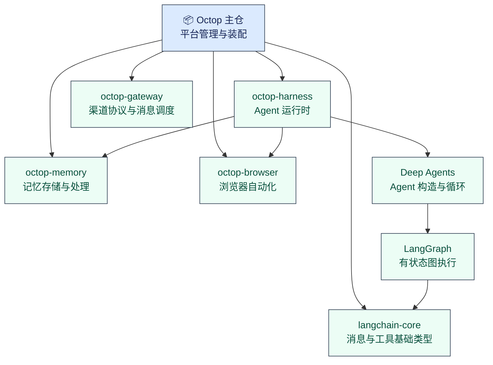
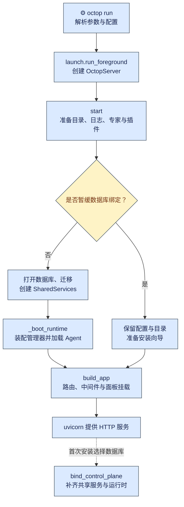
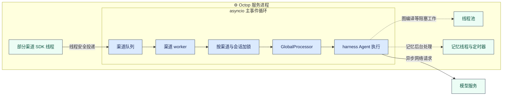

Octop 是面向家庭和小团队的自托管 AI 助手平台，由腾讯云以 MIT 协议开源。一个实例可以服务多个用户，每个用户可以配置多个 Agent，通过网页、命令行或即时通信（IM）渠道与它们对话，让它们调用工具处理任务。

本篇建立组件和运行地图：平台持有哪些对象，服务怎样启动，运行时由谁调用。单个实例的装配见 [01：Agent 装配与生命周期](./01-agent-lifecycle-and-providers.md)，单轮请求的执行见 [02：单轮任务执行](./02-agent-turn-execution.md)。

要理解这套平台，需要把五个仓库放在一起看：

- 主仓管理用户、配置、渠道路由和服务生命周期，`octop-harness` 封装 Agent 执行，`octop-gateway` 适配消息渠道，`octop-memory` 提供记忆存储与处理，`octop-browser` 提供浏览器自动化。本篇解释这些组件怎样接入主仓、怎样随服务启动，以及运行期间怎样共享状态和处理并发。

主仓源码基线为 [TencentCloud/Octop v1.0.2，commit `dd9dce47`](https://github.com/TencentCloud/Octop/tree/dd9dce47)。

## 一、从使用场景看 Octop 的整体形态

### 1、一个实例如何服务多个用户和多个 Agent

可以用一个小团队的使用方式理解 Octop：管理员维护一套服务和模型供应商配置，成员在各自账号下创建工作助手，再为助手配置工具、工作区和接入渠道。同一个用户可以拥有多个 Agent，一个 Agent 也可以承接多个会话。

这些关系由主仓管理。用户账号、Agent 配置、渠道配置和会话记录分别持久化；运行中的 Agent 实例由主仓的 `AgentManager` 管理，再交给 harness 执行模型与工具调用。`AgentManager` 是平台级注册表，负责把数据库中的 Agent 配置变成运行对象，具体状态变化见[01：Agent 如何启动、接入模型与重载](./01-agent-lifecycle-and-providers.md)。

多用户隔离还涉及资源所有权和访问检查。JWT（携带签名的身份令牌）负责认证，具体资源仍需检查所有权和访问权限。本篇只讨论这些检查与平台架构的关系。

### 2、网页、CLI 与 IM 渠道分别提供什么入口

网页面板提供配置管理和对话界面，HTTP API 提供程序调用入口，IM 渠道连接飞书、企业微信、QQ、Telegram 等平台。服务内部把网页对话和 CLI 对话也表示成渠道，复用消息处理逻辑。

这里需要区分客户端与服务端。网页代码在用户的浏览器中运行，服务进程负责托管静态文件并处理请求；CLI 是用户另行执行的命令，可以直接操作控制面数据、启动短命服务、连接外部系统，也可以通过专用回环通道维护已运行的 Octop。

因此，本文的「单进程」指 `octop run` 启动的平台服务：HTTP 服务、Agent 注册表、渠道管理和定时调度在其中协作。它不代表浏览器客户端、所有 CLI 命令和工具启动的外部程序都处在这个进程内。

### 3、服务部署在哪里，哪些数据需要持久保存

默认本地布局由主仓的 `PathLayout` 定义。这个路径对象从 `OCTOP_HOME` 或 `~/.octop/` 解析安装根目录，再给出配置、日志和 Agent 工作区的位置，见 `src/octop/infra/utils/paths.py:10`。默认控制面数据库是 SQLite，存放用户、渠道、Agent 等平台记录；控制面也可以配置为 PostgreSQL。

Agent 的工作区、记忆和会话执行状态另有各自的存储职责。工作区可以接入远端后端，模型和 IM 请求也会访问外部服务，不能把「自托管」概括成所有数据都只保存在一个本机文件里。文件空间与后端选择见[03：工作区与存储后端](./03-workspace-and-backend-abstraction.md)。

## 二、五个仓库怎样分工

### 1、主仓与四个组件包的职责

主仓通过 Python 包依赖接入四个组件。独立仓库和独立发布版本，并不要求把它们部署为四个服务。

| 组件 | 负责什么 | 主仓怎样使用它 | 详细拆解 |
| --- | --- | --- | --- |
| Octop 主仓 | 用户、配置、渠道路由、存储接线与服务生命周期 | 创建共享服务，装配各管理器，提供 API、面板与 CLI | 本篇及各主题篇 |
| octop-harness | Agent 运行时，对模型、工具、执行图与会话状态提供统一接口 | 把平台配置翻译成 harness 配置，注入工具和中间件 | [01](./01-agent-lifecycle-and-providers.md)、[07](./07-middleware-and-context-engineering.md) |
| octop-gateway | IM 协议适配、消息队列、会话串行与回复发送 | 注册渠道，并把统一消息交给主仓处理器 | [11](./11-im-gateway-message-pipeline.md)、[12](./12-stream-projection-and-rendering.md) |
| octop-memory | 长期记忆的存储、抽取、召回与维护 | 通过 harness 接入对话，同时提供平台侧维护与迁移入口 | [09](./09-memory-system.md) |
| octop-browser | 基于 CDP（Chromium 开发者工具协议）的浏览器自动化 | 接入浏览器工具，并提供会话管理和状态流接口 | [06](./06-execution-surfaces.md) |

### 2、组件依赖关系与 Deep Agents 所处的位置

主仓 v1.0.2 的依赖声明为 `octop-harness[all]>=1.0.4`、`octop-gateway>=1.0.3`、`octop-memory>=1.0.2` 和 `octop-browser>=1.0.0`，同时直接依赖 `langchain-core`。这些都是包安装关系，见 `pyproject.toml:13`。

harness 调用 Deep Agents 的 `create_deep_agent` 工厂来构造 Agent 执行图。Deep Agents 提供 Agent 循环等机制，LangGraph 提供有状态图执行与会话状态保存，harness 在外面组织模型、工具、记忆与运行生命周期。组件 checkout 中的调用位置为 `octop_harness/agent.py` 的 `_build_graph`，版本为 v1.0.5、commit `76cd38d`。

下面只画与本篇有关的依赖，箭头指向被依赖方：



按 gateway v1.0.3（`224ed07`）和 memory v1.0.2（`ed11d54`）的 `pyproject.toml`，gateway 的生产依赖以渠道 SDK 和网络库为主，LangChain 接入在开发或示例依赖中；memory 的 LangGraph 存储适配按可选依赖提供。它们可以服务不同宿主。主仓直接使用 `langchain-core`，所以更换 Agent 框架时仍需处理平台侧的消息类型等接点，不能只替换 harness 包名。

### 3、平台能力如何接入运行时组件

主仓把平台数据翻译成组件需要的配置。一个明确的交接点是 `AgentManager._build_harness_config()`：输入是数据库中的 Agent 记录，输出是 `HarnessAgentConfig`，后者是 harness 描述一个 Agent 所需配置的数据对象。

以下截取自 `src/octop/infra/agents/manager.py:4018`，保留原始字段写法，省略处已标明：

```python
harness_cfg = HarnessAgentConfig(
    name=_memory_namespace(row.agent_id),
    workspace_dir=harness_workspace,
    # （省略系统文件路径与默认模型解析）
    system_prompt=system_prompt,
    memory=memory,
    backend=harness_backend,  # 后端描述，或已创建的 OpenSandbox 沙箱后端实例
    mcp_server_configs=mcp_server_configs,
    tools=merged_tools or None,
    middleware=agent_middleware or None,
    # （省略技能、时区、媒体及其他配置字段）
)
```

这段代码把平台选择的工作区、记忆配置、工具列表和中间件交给运行时。中间件是在模型或工具调用前后介入执行的对象，例如主仓可以注入额度检查。配置本身不执行对话，后续由 harness 根据它创建 Agent。

渠道侧的方向相反：gateway 适配各平台消息，主仓的 `GlobalProcessor` 接收统一消息，再判断用户、Agent 和会话。`GlobalProcessor` 是平台消息处理器，包含需要平台仓储和权限信息的业务逻辑。gateway 因而可以复用到其他机器人，而用户归属与 Agent 选择规则仍留在 Octop。

## 三、主仓怎样组织和持有这些组件

### 1、API、CLI 与基础设施层的依赖方向

主仓将 HTTP 入口放在 `api/`，命令入口放在 `cli/`，业务管理与存储接线放在 `infra/`。HTTP 路由调用业务管理器；服务启动入口 `launch.py` 同时取得业务服务器与 HTTP 应用工厂，把两者接起来。

这种集中创建并连接对象的位置称为装配根。在本项目中，`launch.run_foreground()` 创建 `OctopServer`，等待它准备服务，再调用 `build_app(server)` 创建 FastAPI 应用。FastAPI 是处理 HTTP 路由和请求依赖的框架；它取得已经创建好的平台对象，不负责自行扫描和启动全部 Agent。

源码入口与调用关系可直接在 `src/octop/launch.py:57` 查看。主仓贡献者文档还规定了层间 import 方向，但本文以这些实际调用说明装配关系，不把文档约定当作已由架构测试强制的保证。

### 2、共享服务与运行时对象分别装什么

`OctopServer` 是管理平台启动和关闭的业务服务器。它持有两组对象：一组描述共享配置和持久层，一组记录正在运行的管理器。

| 对象 | 内容与用途 | 创建位置 |
| --- | --- | --- |
| `RepoBundle` | 数据库连接与各类仓储；仓储封装用户、Agent、渠道等记录的访问 | `infra/db/services.py` 的 `RepoBundle.from_pool()` |
| `SharedServices` | 路径、配置与仓储集合，供管理器共享 | `build_shared_services()` |
| `AppRuntime` | Agent 注册表、渠道、定时任务、用户、主动关怀和 Bridge 等运行对象 | `OctopServer._boot_runtime()` |
| `OctopServer` | 持有前两类服务及目录对象，协调启动、首次绑定和停止 | `launch.run_foreground()` 等宿主入口 |

`SharedServices` 的完整字段声明很短，来自 `src/octop/infra/db/services.py:99`：

```python
@dataclass(frozen=True)
class SharedServices:
    paths: PathLayout
    config: OctopConfig
    repos: RepoBundle
    # （省略向 repos 转发的只读属性）
```

构造函数接收已经打开的数据库、路径对象和配置，再通过 `RepoBundle.from_pool(db)` 创建仓储。各管理器取得同一组引用，路由不需要自己打开数据库。`frozen=True` 限制字段重新赋值；仓储仍然可以写数据库，它不保证所引用对象的深层不可变，也不自动提供线程安全。

共享服务与运行对象分开后，首次安装时可以只有配置和目录，稍后再建立数据库与运行时。已有运行时的数据库重绑则走另一条受限路径：`AppRuntime.replace_services()` 逐项更新管理器引用，并在版本化历史已开启时拒绝重绑。不能据此推导任意时刻换库都是原子操作。

### 3、启动入口怎样装配对象，路由怎样取得服务

`build_app(server)` 将业务服务器写入 `app.state.octop_server`。路由通过 FastAPI 的 `Depends` 声明依赖，请求到来时调用 `get_server()` 取回同一个对象。源码在 `src/octop/api/deps.py:69`：

```python
def get_server(request: Request) -> OctopServer:
    server: OctopServer = request.app.state.octop_server
    if not getattr(server, "_started", False):
        raise OctopError(ErrorCode.INTERNAL_ERROR, "server not started")
    return server
```

输入是 HTTP 请求，输出是装配根提供的 `OctopServer`；未启动时返回平台错误。业务路由随后从 server 访问共享仓储或运行时管理器。

`_started` 只说明服务器完成了对应启动阶段。首次安装的延迟绑定分支也会将它设为真，因此依赖数据库的入口还需要检查 `database_bound`；同文件的 `require_database()` 在尚未绑定时返回 503。这一层检查让安装向导与正常业务可以共用 HTTP 应用。

## 四、从 octop run 到服务可用

### 1、命令入口与配置解析

`pyproject.toml:97` 将 `octop` 命令映射到 `octop.cli.main:cli`。CLI 根命令使用 `_LazyCLI`，这是按需导入子命令模块的 Click 命令组；执行 `run` 时才加载 `cli/commands/run.py`。帮助文本来自命令注册表，无需导入每个子命令。

`run()` 解析监听地址的优先级为「命令行参数 > 环境变量 > 配置文件 > 默认值」。显式传入的 `--host` 或 `--port` 会写回配置文件，因此它们会影响后续启动。随后命令调用 `launch.run_foreground_blocking()`，由 `asyncio.run(run_foreground(...))` 建立异步运行入口。

整体装配流程如下。图中首次安装的数据库选择发生在 HTTP 已经可访问之后：



### 2、准备目录、数据库与共享服务

`OctopServer.start()` 从安装环境开始：创建根目录，应用环境文件，设置日志，读取配置，扫描专家与子 Agent 目录，并加载插件。插件渠道类型要在后续渠道注册前准备好。

数据库阶段见 `src/octop/infra/server.py:439`：

```python
if should_defer_control_plane_db(config, self.paths):
    self._started = True
    self._emit_wizard_password(user_count=0)
    logger.info("control-plane database deferred until setup wizard chooses a backend")
    return

# 数据库可绑定时，先迁移，再把仓储交给后续运行时。
db = open_database(config, self.paths)
run_migrations(db)
self.services = build_shared_services(db=db, paths=self.paths, config=config)
# （省略验证码初始化与 JWT 密钥准备）
await self._boot_runtime(config)
```

这个分支依赖配置和本地路径判断是否暂缓控制面数据库。暂缓时只完成安装前所需的准备，`services` 与 `app_runtime` 仍为空；常规分支则先迁移数据库结构，再创建仓储并启动业务运行时。后面的管理器因而可以按当前表结构读配置。

### 3、启动 Agent、渠道与定时任务

`_boot_runtime()` 的次序体现了对象之间的依赖。它先构造 Agent 注册表与轨迹服务，再启动 `Gateway`，随后创建定时任务管理器，把调度、团队处理器和审批会话存储等引用接回 Agent 注册表，才调用 `registry.boot()` 加载 Agent 实例。

`Gateway` 是主仓连接渠道包与平台消息处理器的管理对象。其 `boot()` 创建 `GlobalProcessor` 和 `ChannelManager`；后者是 gateway 包中负责渠道注册、队列和 worker 的调度器。主仓向它注册内建的 `WebSocketChannel`、`CliChannel`，并从数据库加载启用的 IM 渠道，源码见 `src/octop/infra/gateway/gateway.py:227`。

网页、CLI 与 IM 因而可以共用平台消息处理器。这个复用发生在对话处理入口，管理类 HTTP 请求仍由各自路由处理。

一个容易忽略的顺序是：渠道启动早于 Agent 实例批量加载。主仓在 `registry.boot()` 之后调用 `gateway.refresh_media_backends()`，补上依赖 Agent 的媒体后端引用，见 `src/octop/infra/server.py:600`。这说明启动中既有对象创建，也有依赖就绪后的回填，不能把它理解成任意顺序的一组构造函数。

用户管理、主动关怀调度及跨实例 Bridge 对象随后进入 `AppRuntime`。具体的 Agent 装配和消息流转分别归 [01：Agent 如何启动、接入模型与重载](./01-agent-lifecycle-and-providers.md)与 [11 篇](./11-im-gateway-message-pipeline.md)。

### 4、挂载 HTTP API 与网页面板

业务服务器准备好后，`launch.run_foreground()` 调用 `build_app(srv)`。应用工厂挂载异常处理、认证与安装阶段访问限制，以及各业务路由，再交给 uvicorn 提供 HTTP 服务。uvicorn 是运行这个 Python Web 应用的服务程序。

网页面板作为 SPA（单页应用）随主包携带静态产物。主仓构建配置将 `src/octop/dashboard/**/*` 列入 wheel（Python 安装包）产物；`build_app()` 仅在面板开关启用且 `dashboard/index.html` 存在时挂载页面，见 `src/octop/api/app.py:316`。

发布配置与运行检查由此衔接起来：主包提供服务代码、CLI 入口和预先生成的面板文件，四个组件包仍由包管理器按依赖安装。源码目录如果缺少面板产物，API 应用仍可创建，但页面挂载会被跳过。这是静态分支能证明的行为，本篇没有重新构建或检查 PyPI wheel 的实际内容。

挂载后的页面路由可回退到入口 HTML，缺失的哈希资源文件则返回 404，避免把 HTML 当成脚本返回；入口页面与哈希资源采用不同缓存策略。它们属于前端发布的配套处理，不改变平台对象的装配关系。

### 5、首次安装分支与关闭顺序

首次安装时，`launch` 从 `srv.config` 读取监听配置，允许尚未绑定数据库的 server 创建 HTTP 应用。用户在向导中选择数据库后，`bind_control_plane()` 重新读取配置，开库并迁移，创建 `SharedServices`，再调用 `_boot_runtime()`。此时补齐的是现有服务进程内的业务对象。

常规运行结束时，`launch` 的 `finally` 分支关闭记忆维护控制入口、取消启动期后台任务，并调用 `srv.stop()`。`OctopServer.stop()` 的具体顺序是停止主动关怀和 cron 调度、关闭渠道、关闭 Agent 注册表和用户运行对象，再处理历史存储与浏览会话；控制面数据库放在 `finally` 中关闭，见 `src/octop/infra/server.py:740`。

这套顺序把仍能产生任务的调度器和渠道放在 Agent 资源之前处理。源码显示了预定的清理顺序，但不能据此保证任一步骤异常时所有后续清理都成功，异常关闭仍需要运行测试验证。

## 五、服务运行后怎样处理并发

### 1、事件循环、线程与后台任务的分工

主仓 [ADR 001](https://github.com/TencentCloud/Octop/blob/dd9dce47/docs/adr/001-single-process-model.md) 记录了单进程、无外部任务队列的设计选择。维护者给出的负载假设是 Agent 经常等待模型和网络 I/O，可以用 asyncio 重叠这些等待，减少单独部署队列与 worker 服务的需求。

代码中的运行模型仍包含线程。`launch` 建立主事件循环，HTTP、消息处理、Agent 流式执行和调度任务在其中协作；harness 的 `acreate_agent()` 通过 `asyncio.to_thread` 把图编译交给线程，见 v1.0.5 的 `octop_harness/manager.py:274`。部分渠道 SDK 还有自己的回调线程或专用事件循环。gateway 使用 `call_soon_threadsafe` 将跨线程消息投递回事件循环。记忆维护还涉及后台线程与定时器。

以下用一条经过 gateway 队列的消息说明执行边界，图中的线程仍属于服务进程：



异步函数也可能调用同步代码。主仓 `SqlitePool` 使用同步 SQLite 连接，读写由可重入锁 `RLock` 保护，事务用 `BEGIN IMMEDIATE` 提前争取写锁，见 `src/octop/infra/db/pool.py:33`。这些措施处理访问与事务顺序，不会自动把数据库 I/O 变成异步操作。在事件循环中执行耗时同步工作，仍会拖慢其他任务。

### 2、消息排队与会话串行的边界

gateway 的队列按渠道组织，worker 消费消息时再按渠道与会话取得锁。同一会话的普通消息串行处理，不同会话可以重叠执行。这里的 worker 是 asyncio 消费任务，并非独立操作系统进程。

本节按 octop-gateway v1.0.3、commit `224ed07` 的 `ChannelManager` 核对，队列消费与锁键见 `octop_gateway/manager.py:708` 的 `_worker_loop()` 和 `_session_lock()`。队列和 worker 参数约束这条消息消费路径；控制消息存在特殊处理，其他 HTTP、cron 或直接 Agent 调用也有各自入口。因此，渠道 worker 数不能直接换算成整机并发上限，会话锁也不能泛化成所有调用共享的一把全局锁。

队列容量、批处理、会话锁键和中断旁路在 [11 篇](./11-im-gateway-message-pipeline.md)展开。本篇只保留它们对架构的影响：排队位置与串行范围明确，耗时调用可能占住当前消费任务，入口并发能力还要结合下游模型限流和任务耗时判断。

### 3、共享资源怎样随运行任务安全关闭

运行时资源可能同时被 Agent 调用和后台任务使用，关闭顺序因而是并发设计的一部分。记忆系统就是一个跨层例子：主仓停止 Agent 时，需要先让记忆后台维护静默，再关闭底层存储，避免后台线程继续访问已经释放的连接。

单个 Agent 的 `stop()` 先通过线程调用 `_quiesce_octop_memory()`，停止记忆中间件的后台入口并有界等待维护任务空闲，再调用 harness 的 `aremove_agent()` 释放资源，见 `src/octop/infra/agents/manager.py:1152`。helper 的注释记录了后台垃圾回收（GC）线程与 SQLite 连接关闭的竞争；它抑制部分关闭异常，维护等待也有时限，不能把预期顺序写成所有后台任务必然退出的保证。

整机关闭则由 `AgentManager.shutdown()` 调用 harness 管理器的 `aclose()`，没有逐个经过主仓的这个 helper。Agent 的记忆运行时仍会调用中间件 `shutdown()`，但路径与单个 Agent 停止不同。完整维护机制见 [09：记忆系统](./09-memory-system.md)；本篇没有复现关闭故障。

harness 的运行中调用计数、热重载等待和记忆维护实例复用也服务于资源生命周期，分别在 [01 篇](./01-agent-lifecycle-and-providers.md)与 [09 篇](./09-memory-system.md)分析。总览需要保留的约束是：一个对象即使从注册表移除，仍可能被正在执行的回合或后台线程引用，释放资源前必须处理这些使用者。

## 六、这套架构的收益、代价与适用边界

### 1、单进程部署减少了哪些运维工作

从上述装配方式可以推导，默认本地部署省去了单独维护任务队列和 Agent worker 服务的工作。控制面配置、运行对象和 HTTP 入口在一处启动，路径与仓储也由同一组对象提供。对于以模型等待和网络 I/O 为主的自托管助手，这是可以借鉴的部署取舍。

代价是共享事件循环和进程资源。同步数据库操作、文件处理或其他耗时工作若占住事件循环，会影响不相关会话；服务进程退出也会同时影响渠道连接、调度和运行中任务。复制这种架构时，需要检查阻塞工作放在哪里，以及重启后哪些状态能够重建。

本文没有压测证据，不给出用户数、并发 Agent 数或每分钟消息量的容量承诺。适用性应按任务耗时、同时活跃的入口、模型限流、存储延迟和故障隔离要求评估。

### 2、组件拆分带来了哪些复用收益和兼容成本

gateway 的协议适配可以交给其他消息处理函数使用，harness 可以脱离多用户平台创建 Agent，memory 和 browser 也各自提供接口。对另一个应用而言，这种拆分允许只选择需要的能力；主仓则通过配置、工具与中间件接入平台规则。

独立发布也增加版本组合的维护成本。首轮核验曾发现本地旧 `.venv` 的 harness 为 1.0.2，而主仓声明要求至少 1.0.4；主仓传入 `file_logging=False`，旧版构造函数不接受该参数。这个接口差异只说明两个实装快照不一致，不能把较新的组件 checkout 当成旧安装环境已经同步升级。

可借鉴的是显式配置对象与集中装配入口；迁移到自己的项目时，需要补上依赖锁定和关键接点的兼容验证。包能独立发布不代表任意版本可以混搭，组件支持可选依赖也不代表 Octop 主包已经把全部重依赖变成可选项。

### 3、哪些状态限制了多实例扩展

主仓可以选择 PostgreSQL 控制面，但数据库共享只解决一部分状态存储。`AppRuntime` 中的 Agent 注册表、渠道管理器和调度器仍由当前进程持有，gateway 队列与会话锁也在本进程内。

据此推导，多副本部署还需要处理 Agent 归属、渠道连接归属、定时任务重复执行、会话顺序和中断信号路由。仅增加 Web worker 数或替换数据库，无法自动获得这些协调机制。Bridge 提供的是实例互联能力，其行为见 [14 篇](./14-teams-delegation-bridge.md)，不能当作负载均衡与分布式调度已经成立的证据。

若目标是让多个实例共同消费任务，应重新设计任务队列、状态归属与故障恢复，再决定哪些对象需要移出进程。若只是减少单机上的 I/O 等待，现有异步模型可以继续使用，但仍需以实际负载验证收益。ADR 的扩展设想与当前已实现能力应分别理解。

[系列导读](./index.md) · 下一：[01：Agent 装配与生命周期](./01-agent-lifecycle-and-providers.md)
