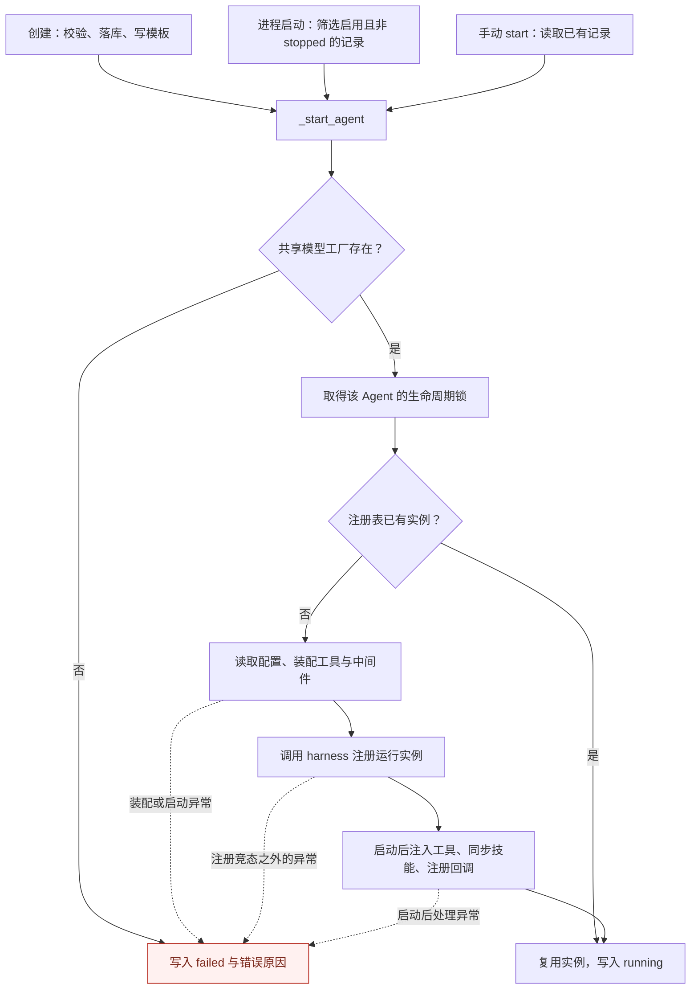

Octop 为用户保存多个 Agent 的配置，并把需要运行的 Agent 装入服务进程。用户创建一个 Agent、修改它使用的模型，或点击停止，都会改变配置与运行对象之间的关系。本篇追踪这些操作：配置怎样变成实例，模型在什么时候确定，重载时旧实例的资源怎样退出。

承接 [00：整体架构](./00-project-and-component-family.md)，本篇追踪配置与运行实例的生命周期；实例收到请求后的执行由 [02：单轮任务执行](./02-agent-turn-execution.md) 串联。工作区规则见 [03：工作区与后端](./03-workspace-and-backend-abstraction.md)，对话中的取消和审批见 [13：人机协作与会话控制](./13-session-control-slash-hitl-steer.md)。

本篇主仓源码为 Octop `v1.0.2`（`dd9dce47`）；组件内部实现重新核对至 octop-harness checkout `v1.0.5`（`76cd38d`），下文分别标明。主仓锁定的 harness 是 `1.0.4`，因此这些源码说明各自快照的行为，不代表两者已组合运行验证。旧实装 `1.0.2` 的历史证据不再与本篇组件片段混用，核验范围见第六节。

## 一、配置记录、运行实例和对话轮次

### 1、三个对象有不同的寿命

`agents` 表保存 Agent 的身份、所有权、配置和最近状态。`HarnessAgent` 是运行时对象，负责组织模型工厂、工作区、记忆与执行图。一次对话轮次则是使用这个对象处理请求的过程，可能包含多次模型调用和工具调用。

| 对象 | 主要标识与内容 | 何时存在 |
| --- | --- | --- |
| 配置记录 | `agent_id`、`user_id`、默认模型、系统提示、`config_json`、`last_state` / `last_error` | 创建后持久保存，停止实例不删除记录 |
| 运行实例 | 注册表中的 `HarnessAgent`，持有后端、执行图和资源引用 | 启动时构造，停止或重载时从注册表移除 |
| 对话轮次 | 某个会话线程上的一次请求及其执行 | 收到请求后开始，结束或取消后退出；一个实例可服务多个轮次 |

因此，数据库里能查到 Agent，不代表进程里已有实例；注册表里已有实例，也不保证下一次模型调用能成功。状态列描述管理器最近一次操作的结果，模型凭据是否有效、外部工具是否在线，还要在实际请求中判断。

一条 Agent 配置也不等于全部运行状态。工作区文件、记忆、checkpoint（执行图状态快照）和展示历史分别管理；进程重启后重新装配实例，不会自动重建原来的异步任务。状态恢复的完整边界见 [16 篇](./16-disconnect-reconnect-and-recovery.md)。

### 2、两个管理器各自负责什么

主仓 `AgentManager` 是平台的实例管理入口，读取数据库并执行创建、启动、停止和重载；harness 的 `HarnessAgentManager` 管理进程内注册表，并将配置交给 `HarnessAgent` 构造运行对象。

| 工作 | 主仓 `AgentManager` | harness `HarnessAgentManager` |
| --- | --- | --- |
| 保存与校验 | 读写 Agent 记录，处理配额、配置和状态 | 保存进程内注册项及附带元数据 |
| 启动装配 | 把数据库记录、平台工具和设置转换为配置 | 合并共享配置、构造实例、写入注册表 |
| 模型接入 | 转换 provider 记录，选择默认模型和路由候选 | 维护共享模型工厂，向实例注入工厂引用 |
| 停止与重载 | 决定哪些实例需要移除或重建，更新持久状态 | 移除注册项，调用实例关闭方法，构造替代实例 |

`HarnessAgentConfig` 是两层之间的主要装配对象，其中既有配置值，也可以包含工具、中间件和后端对象。主仓还会在启动后注入工具、注册回调、访问运行时属性。第五节讨论这些接口的兼容成本，不能把两层概括成只通过一份纯数据交换。

## 二、创建与启动：从配置到可调用实例

### 1、创建、进程启动和手动启动汇入同一条路径

主仓的 `src/octop/infra/agents/manager.py` 中，`create`、`boot`、`start` 都会进入 `_start_agent`，但前置工作不同。

- `create`（:727）校验名称、标识、配额与工作区范围，写入记录，准备专家或团队模板，然后启动。`defer_bootstrap=True` 时先保存 `starting` 并返回，后台任务继续装配；调用方拿到 `agent_id` 时实例可能还没准备好。
- `boot`（:603）先构造 harness 管理器，再串行读取启用且最近状态不是 `stopped` 的记录，逐个尝试启动。
- `start`（:1117）读取已有记录，传入 `init_workspace=False`，避免将手动启动再次当作默认工作区种子初始化。

主仓调用关系如下，图中的 harness 注册节点是组件调用边界：



创建涉及数据库、文件和运行实例，不是一个数据库事务就能覆盖的操作。`_abort_incomplete_create` 提供尽力清理，但 `create` 只在部分失败分支调用它；`_start_agent` 也会把异常转换为 `failed` 并返回 `None`。因此创建失败后可能保留记录供诊断，不能笼统地说任何失败都会完整回滚。

### 2、启动状态是怎样写入的

`_start_agent`（主仓 `manager.py:3190–3242`）先检查共享模型工厂，再取得每个 Agent 独立的生命周期锁。若实例已经注册，它直接复用，并将状态写为 `running`；否则生成配置包，注册实例，再做启动后处理。

下面截取实际的注册与状态提交部分。输入 `row` 是持久记录；输出 `entry.agent` 是运行对象。团队模板已经由主仓准备，因此这里不重复写入 harness 的默认种子：

```python
cfg, metadata, tags, user_display = self._agent_runtime_bundle(row)
# 团队宿主已由 seed_team_template 写好 AGENTS/SOUL/MEMORY。
# 不让 harness 先复制内置技能、随后又将其剥离。
seed_workspace = init_workspace and not is_team_agent(row)
entry = await self._harness_manager.acreate_agent(
    cfg,
    agent_id=row.agent_id,
    metadata=metadata,
    tags=tags,
    init_workspace=seed_workspace,
)
await self._post_start_agent(row, entry.agent, cfg, user_display=user_display)
self._repos.agent_repo.set_state(row.agent_id, "running", error=None)
```

正常路径在启动后处理返回后写入 `running`。异常路径会记录 `failed` 与格式化错误；若错误是重复注册竞态，且注册表中确实已有对象，则改为复用该对象。

`boot` 还为每个 Agent 的启动设置 60 秒等待超时。超时时如果已经能在注册表中找到实例，它仍写入 `running` 并继续装载下一项；找不到才写入启动超时错误。这进一步说明 `running` 不是对全部后置步骤或外部依赖的健康认证。60 秒限制也只是这次异步等待的超时设置，不能据此断言线程中的建图或外部初始化已经停止。

### 3、配置怎样装成运行对象

主仓 `_agent_runtime_bundle`（`manager.py:3579`）准备配置、元数据与标签，其中 `_build_harness_config`（:3722）负责主要转换。它除了读取默认模型、系统提示和后端，还把平台工具、中间件、MCP 配置、安全设置与记忆参数交给组件。

这里有些字段是活对象。例如 OpenSandbox 后端可能已经在准备工作区时创建，装配时复用该对象，避免再启动一个远端沙箱。工具列表也已经包含 cron、知识库或插件的具体实现，并非仅传工具名称。

组件侧以下行为按 **harness `v1.0.5`** 的 `octop_harness/agent.py:150–201` 与 `manager.py:146–190、274–291` 核对：

1. `acreate_agent` 用 `asyncio.to_thread` 调用同步创建过程，将建图工作移出事件循环。
2. `_register_agent` 合并共享 MCP 配置、应用安全策略，并构造 `HarnessAgent`。
3. 实例构造时解析工作区与后端，接入模型工厂、创建记忆运行时，然后编译执行图和初始化协议接口。
4. 按需写入工作区种子；如果模板、技能或子 Agent 定义确有新增或覆盖，再编译图，最后加入注册表。

种子写入发生在首次建图之后，所以注册过程可能编译两次。主仓返回实例后还会追加工具和技能，某些注入也会触发图刷新。这里应按实际阶段分析启动成本，不能把它理解成一次纯内存对象构造。

### 4、模板种子与首轮引导发生在不同时间

| 时机 | 主要动作 | 代码入口 |
| --- | --- | --- |
| 创建记录之后、启动之前 | 写专家模板或团队文件；远端易失后端另有启动后补种分支 | 主仓 `create`、`_seed_expert_template`、`seed_team_template` |
| harness 注册期间 | 按需写入组件默认模板、技能和子 Agent 定义 | harness `_register_agent` → `init_workspace` |
| 主仓启动后处理 | 注入连接器工具，同步平台内置技能和插件技能，安装引导完成回调 | 主仓 `_post_start_agent` |
| 对话完成首启引导后 | 恢复正式系统提示和默认记忆文件设置，安排图刷新 | 主仓 `_mark_bootstrap_graph_refresh_pending` |

对于尚未完成引导的普通专家，主仓装配时暂置 `system_prompt=None`、`memory=()`（`manager.py:3923–3927`）。这里的 `memory` 是交给图的记忆文件配置，不能解释为关闭整个结构化记忆系统。团队宿主不走这段首启抑制逻辑。

引导完成的回调先更新运行配置并登记待刷新标记；`stream`、`call`、`resume_hitl` 在调用前后尝试应用该标记（`manager.py:1854–1914、3304–3345`），避免在回调所在的流处理中立即重编译图。这是配置恢复与图生效之间的一次延迟交接。模板和技能从哪里来，见 [04 篇](./04-skills-experts-plugins.md)。

## 三、模型在启动和请求执行时分别怎样确定

### 1、provider 记录先转换成模型工厂配置

`ProviderStore` 是主仓读取和转换模型接入记录的组件。它把服务商地址、凭据和模型目录转换为 harness 的 `ProviderConfig`，不在此处实例化模型客户端。

`src/octop/infra/agents/providers/store.py:185–251` 的可用性过滤要求 provider 启用、地址与凭据非空，并至少有一个可聊天的模型。模型本身还要启用、有标识，并排除 embedding 和 rerank 类型。**这是配置检查，不会请求模型服务验证连通性。**

协议转换在同文件 `KIND_TO_PROTOCOL`（:20–26）中定义：

```python
KIND_TO_PROTOCOL: dict[str, str] = {
    "openai": "openai",
    "anthropic": "anthropic",
    "ollama": "openai",
    "azure": "openai",
    "gemini": "openai",
}
```

`build_harness_configs` 对未命中的 kind 也默认使用 `openai`。因此这条接入路径将 Ollama、Azure、Gemini 配置交给 OpenAI 协议客户端，不能据名称推断它们使用各家的原生 SDK。实际支持的模型能力还取决于服务端接口和模型配置。

### 2、启动配置的默认模型与本轮选模不能合并成一条规则

模型引用采用 `provider/model` 形式。启动装配时先找专家显式默认模型，再使用全局 active model 或第一个配置可用模型；这为运行实例及记忆辅助调用提供具体引用。逐轮入口会重新选模，并考虑请求覆盖、会话设置、用户偏好和健康状态。

| 选择时机 | 主要规则 | 是否使用运行时健康记录 |
| --- | --- | --- |
| 构建 `HarnessAgentConfig.default_model` | 专家显式默认 → 全局 active model → 第一个配置可用模型 | 此处不使用健康过滤 |
| 请求入口选模 | 本轮/会话覆盖 → 专家显式默认 → 用户偏好 → 全局兜底 | 自动选择的用户偏好和兜底会查询健康；显式选择另行处理 |
| 模型调用失败后 | 按路由模式决定是否跨模型切换，再筛选备选 | 查询并更新健康记录，同时检查视觉能力和上下文容量 |

专家默认模型解析的核心代码如下，来自 `ProviderStore.resolve_explicit_default_model`（`store.py:380–386`；省略函数签名与说明）。它只判断是否存在有效的显式选择，没有选择则返回 `None`：

```python
for candidate in (row.default_model, cfg.get("default_model")):
    if not isinstance(candidate, str):
        continue
    ref = candidate.strip()
    if ref and ref.lower() != "auto" and self.is_model_ref_usable(ref):
        return ref
return None
```

主仓 `_build_harness_config` 用这个结果或 `_resolve_configured_fallback_model_ref` 填写启动配置（`manager.py:4027–4030`）。其中失效的显式默认会退回 AUTO，不会仅因该引用失效而拒绝装配。

逐轮入口 `GlobalProcessor._resolve_harness_model_route`（`src/octop/infra/gateway/process/processor.py:542–597`）则先处理输入框或会话的模型覆盖，再处理专家默认、用户偏好和健康兜底。图片请求还可能升级为支持视觉输入的模型。通常它已经选出具体 `model`，并为自动路由附上 `octop_auto_route=True`；AUTO 不等于把模型字段留空，等到 harness 才开始选择。

### 3、健康记录与失败回退各解决什么问题

`ModelHealthRegistry` 保存进程内的失败与冷却状态，供后续选模和当前调用的故障切换使用。`resolve_fallback_model_ref`（主仓 `manager.py:1943–1951`）先检查配置兜底是否可路由，再扫描其他自动路由候选；全部不可用则返回 `None`。这里的「可路由」表示当前允许尝试，不是实时探测成功。

健康记录按模型和 provider 两个范围维护。鉴权、余额、限流类失败可能影响整个 provider；常见服务或网络错误影响单模型；上下文超限允许换模型，但不因此熔断。默认冷却档位为 60、300、900 秒，成功会清理相应状态，重启进程也会丢失这些记录（`src/octop/infra/agents/providers/health.py:60–185`）。

`SafeModelFailoverMiddleware` 是主仓包围模型调用的重试与切换中间件。装配时主仓关闭 harness 默认重试开关，再插入自己的实现，避免同一层重复安装（`manager.py:4068–4108`）。它有几条影响用户行为的约束：

- 显式路由重试当前模型，不跨模型切换；AUTO 路由在错误类型允许时尝试备选。视觉升级也可能把当前请求标记为自动路由，应以实际传入标记为准。
- 重试预算按候选模型分别使用。harness `v1.0.5` 默认配置为 2 次重试，不能理解为整个请求最多调用两次；客户端 SDK 的重试还可能增加实际请求数。
- 备选还要满足视觉需求与估算上下文容量，候选耗尽后抛出错误。
- 中间件没有检查「是否已输出首个 token」，也没有撤销已发送片段的实现，不能据此承诺部分输出后的无重复切换。

这里保留选择策略与行为边界；中间件的包装顺序和执行过程见 [07 篇](./07-middleware-and-context-engineering.md)。

### 4、模型客户端由共享工厂创建与缓存

harness `v1.0.5` 的 `ChatModelFactory` 是按引用创建 LangChain 模型客户端的工厂。它缓存客户端对象，不缓存回答；默认按模型引用索引，指定独立 SDK 重试参数时使用带参数的缓存键（`octop_harness/llm/factory.py:192–228`）。

Octop 在 `boot` 时把可用 provider 配置交给 harness 管理器，管理器将同一个工厂引用注入各 Agent。因此多个 Agent 可以共享模型客户端，单个实例关闭时不应关闭管理器拥有的工厂。

provider 变化时还有两步工作，不能合并为「改配置即可热更新」：主仓先重新读取全量可用 provider，同步共享工厂目录并清缓存；再按影响集合重建 Agent。当前同步实现会对所有可用 provider 调用 `add_provider`，不只清理变更项；Agent 重建范围则由变化参数决定（主仓 `providers/harness_factory.py:16–44`、`manager.py:1984–2058`；harness `manager.py:476–491`）。

## 四、停止与重载：旧实例如何退出

### 1、停止先移除入口，资源释放可能延后

主仓 `stop` 不删除 Agent 记录。它持有管理器锁和该 Agent 的生命周期锁，尝试让记忆维护退出，再调用 harness 移除实例，最终保存 `stopped`。

以下为主仓 `src/octop/infra/agents/manager.py:1158–1162` 的连续片段，省略外层取行与存在性校验：

```python
async with self._lifecycle_lock_for(agent_id):
    await asyncio.to_thread(self._quiesce_octop_memory, agent_id)
    await self._harness_manager.aremove_agent(agent_id)  # type: ignore[union-attr]
    self._bootstrap_known.pop(agent_id, None)
    self._repos.agent_repo.set_state(agent_id, "stopped", error=None)
```

`_quiesce_octop_memory` 针对后台维护与数据库关闭的交错问题：请求记忆中间件 shutdown，再等待维护空闲。shutdown 异常被抑制，空闲等待默认最多 5 秒，所以它是一道有界清理措施，不能证明后台活动已经全部排空（主仓 `manager.py:1164–1187、1263–1278`）。

harness **`v1.0.5`** 的 `aremove_agent` 先从注册表删除条目，再调用 `agent.aclose()`。如果仍有调用在运行，`aclose()` 只登记待关闭并返回；最后一个调用退出时，才再次进入关闭流程。其判断来自 `octop_harness/agent.py:993–1004`，下面省略日志：

```python
with self._lifecycle_lock:
    pending = self._in_flight
    if pending <= 0:
        return False
    self._close_pending = True
# （省略日志）
return True
```

因此，「不再能从注册表取得旧实例」和「旧实例的全部资源已释放」是两个时刻。在该组件版本中，停止方法返回也不必然表示在途回合已经结束。对话里的 `/stop` 是取消当前执行的控制入口，与卸载平台 Agent 的 `stop` 应分开理解。

### 2、重载按最新配置重建，并合并连续更新

主仓 `_reload_agent`（`manager.py:3515–3550`）重新读记录：若记录已删除、禁用或显式停止，就移除实例；否则生成最新配置，调用 `arebuild_agent`，再次执行启动后处理，再写入 `running`。重建失败写入 `failed`，不承诺原实例自动恢复可用。

`_schedule_reload` 与 `_reload_worker` 用 `_reload_dirty` 集合和每 Agent 的 worker 标记合并连续更新（`manager.py:3552–3573`）。正在重载时又来一次更新，只登记下一轮工作；worker 再读数据库配置。这减少重复启动，但没有把保存配置和运行实例替换变成一个原子操作，调用方仍需区分「保存成功」与「新配置已生效」。

组件侧，harness `v1.0.5` 的 `arebuild_agent` 用 `hold_shared_memory` 在移除和重建之间保留共享记忆资源引用。真实核心片段位于 `octop_harness/manager.py:328–336`：

```python
with hold_shared_memory(entry.config, getattr(entry.agent, "_workspace_path", None)):
    await self.aremove_agent(agent_id)
    return await self.acreate_agent(
        config,
        agent_id=agent_id,
        metadata=resolved_metadata,
        tags=resolved_tags,
        init_workspace=False,
    )
```

这段代码保护的是共享记忆资源在替换窗口内的寿命，没有把旧回合迁移到新图。结合前述延迟关闭，旧调用可能仍持有旧实例，新注册项则指向新实例。生命周期锁也不是对话执行锁，不能据此推断全部会话都已停止后才重建。

### 3、关闭哪些资源，哪些状态可以重新读取

harness `v1.0.5` 的 `aclose` 在可以释放时清理审批恢复的进程内配置、关闭自己拥有的模型工厂、关闭记忆运行时、释放独立 checkpointer 连接并关闭后端包装（`octop_harness/agent.py:1032–1048`）。共享模型工厂由管理器最终关闭；具体后端的 close 也不必然意味着删除外部持久资源。

checkpointer 的选择影响实例关闭时持有哪些资源。`_resolve_checkpointer`（同文件 :1867–1926）依次处理显式 `False`、显式实例、复用记忆运行时的 `Memory`，最后尝试创建 `AsyncSqliteSaver`。后者是 LangGraph 的异步 SQLite 状态保存器；缺少依赖或连接初始化失败时，这个解析函数会返回 `None`，不能把兜底视为必然建立。

默认 SQLite 文件通过 `_host_system_dir() / "checkpoints.sqlite"` 定位，系统目录会拼入 `system_files_path`。主仓新建 Agent 设置 `.octop` 前缀，因此常见落点是宿主工作区下的 `.octop/checkpoints.sqlite`，不是无条件落在工作区根目录。复用 `Memory` 时 checkpoint 与长期记忆可以同库，但仍有不同的数据语义，分别见 [09 篇](./09-memory-system.md)与 [08 篇](./08-versioned-history-and-trajectory.md)。

服务整体退出另走主仓 `shutdown` → harness 管理器 `aclose`，不逐个写入用户主动停止的状态。下次 `boot` 才能重新尝试装载这些记录；显式保存为 `stopped` 的实例则会被跳过。

## 五、两层管理的实际边界与工程取舍

### 1、可借鉴的是按持久配置重建实例

主仓处理用户和平台规则，组件组织模型、工作区与执行图，这使创建、进程启动和重载可以复用装配路径。若另一个系统也需要长期持有一组可配置 Agent，可以借鉴记录与实例分离、每 Agent 生命周期锁和连续更新合并的做法。

这个模式有明确适用条件：配置必须足以重新装配对象，运行中的临时状态也必须另有归属。Octop 的注册表、生命周期锁、重载任务和模型健康状态都在进程内；若多进程共同管理同一批记录，还需要协调实例归属、状态写入和配置更新，不能把这组锁当作跨进程保护。

### 2、应收紧的是运行期扩展接口

主仓与 harness 的接缝有三种，稳定性要求不同：

| 接缝 | 本篇核对到的例子 | 升级时需要确认 |
| --- | --- | --- |
| 构造配置 | `_build_harness_config` 传入模型引用、工具、中间件和后端 | 字段、类型、默认值与对象契约 |
| 运行期扩展 | `_post_start_agent` 注入连接器工具，设置 `on_bootstrap_complete` | 调用时机、是否重编译图、是否允许与回合交错 |
| 内部属性或方法 | 主仓修改 `agent._config`，调用 `_init_graph`，访问 `_memory_runtime` 做清理 | 组件内部结构和生命周期是否改变 |

主仓用 `_HARNESS_AGENT_CONFIG_FIELDS` 探测安装版本支持的配置字段，可以兼容部分字段差异；它无法覆盖内部方法变更，也无法证明回调和关闭时序兼容。工程上更适合把这些操作收敛成有契约的公开方法，例如「更新引导后配置并安排图刷新」，让宿主不必自行修改多个内部属性。

### 3、避免把状态字段和清理请求写成完成保证

这篇源码最需要保留的几个限制是：记录存在不等于实例可用，`running` 不等于依赖健康，保存配置不等于重载完成，从注册表移除也不等于资源已经释放。它们分别对应查询、启动、更新和停止时调用方需要处理的中间状态。

若借鉴这套设计，应在接口和观测信息中明确这些时刻。例如停止接口可以区分「已停止接收新请求」与「旧调用已排空」，重载操作可以暴露目标配置版本和当前实例版本。这里是根据源码行为提出的改造建议，不是 Octop 已有的完整状态协议。

## 六、版本证据与未核验范围

本次重写重新阅读了以下关键路径；路径均对应前述源码快照：

| 快照 | 核对内容 |
| --- | --- |
| Octop `v1.0.2` / `dd9dce47` | `src/octop/infra/agents/manager.py` 的创建、启动、种子、配置装配、回调、停止、重载与关闭；`providers/` 的配置转换、健康与工厂同步；`middleware/model_failover.py`；gateway 的逐轮选模与请求标记 |
| octop-harness `v1.0.5` / `76cd38d` | `octop_harness/manager.py` 的注册、移除、重建与共享工厂；`agent.py` 的构造、调用计数、延迟关闭与 checkpointer；`llm/factory.py` 和重试配置 |

本篇没有逐项比较主仓锁定的 harness `1.0.4` 与 checkout `1.0.5`，也未运行两者组合。旧实装 `1.0.2` 不接受 `file_logging` 的历史记录用于说明版本不匹配，不能据此推断锁定版本也有相同故障。

本轮只做源码阅读与文档静态检查。没有启动服务、调用模型、运行构建或运行时测试；启动超时后的线程行为、并发重载与旧回合交错、后台维护排空、流式部分输出后的故障切换，以及 PostgreSQL 部署下的资源释放效果，均未做实验验证。

上一：[00：整体架构](./00-project-and-component-family.md) · [系列导读](./index.md) · 下一：[02：单轮任务执行](./02-agent-turn-execution.md)
