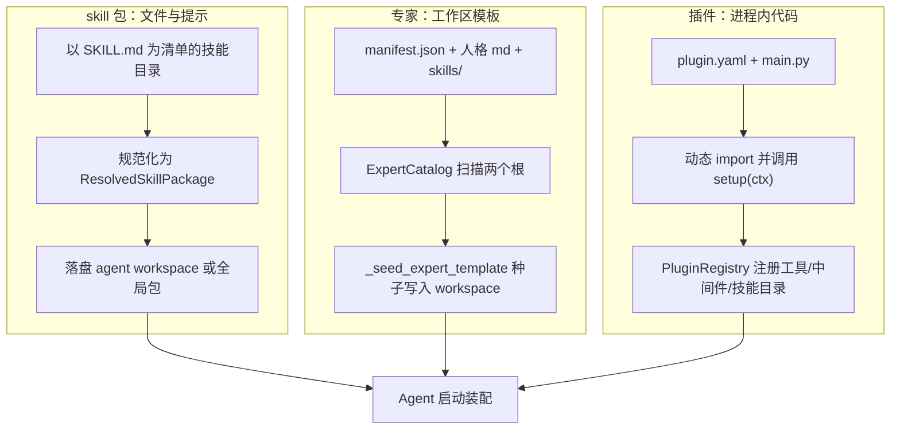
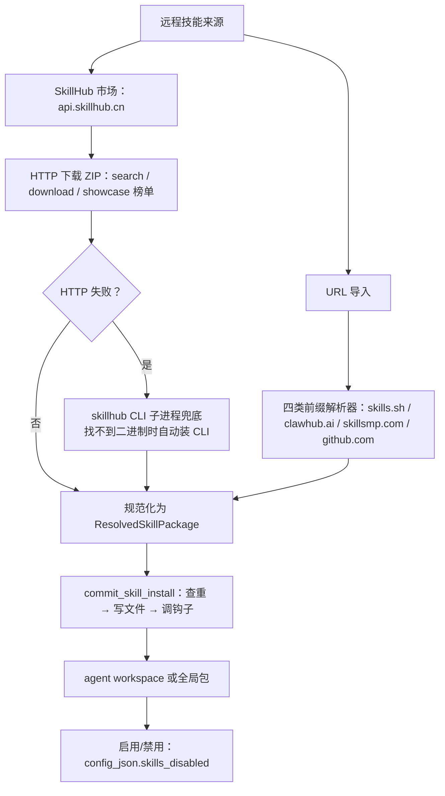
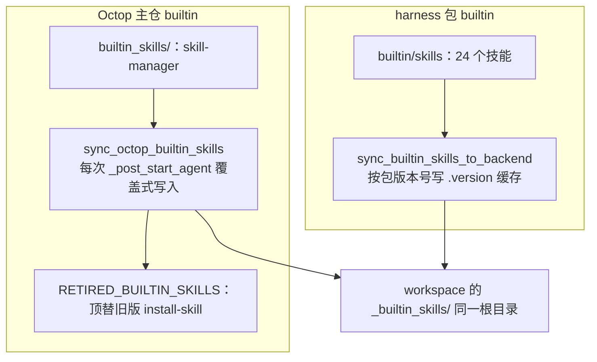

本篇拆解 Octop 的三种能力扩展机制：skill 包（一个以 `SKILL.md` 为清单的文件目录，靠提示词和文件资产扩展 Agent）、专家（experts，一组「人格 + 技能 + 子代理」的工作区模板，用来一键创建 Agent）与插件（plugins，进程内 Python 代码注册的工具，约 30 个随仓内置）。

[03：工作区与后端](./03-workspace-and-backend-abstraction.md) 已说明文件和执行空间。本篇解释技能与专家模板的来源、格式和分发，以及插件怎样注册工具。启动种子的写入时机见 [01：Agent 装配与生命周期](./01-agent-lifecycle-and-providers.md)，外部系统接入见 [05：外部工具接入](./05-connectors-and-mcp-gateway.md)。

主仓代码引用 `src/octop/...`，组件包引用 `octop_harness/...`（下文引用实装 1.0.2 源码；基线为主仓 v1.0.2，commit dd9dce47）。

## 一、三种机制总览

### 1、文件资产、实例模板与进程内扩展

Skill 以文件和提示组织任务方法，可以附带脚本；插件把代码工具、中间件、技能目录等注册进宿主；专家模板提供创建 Agent 时的初始工作区。三者有不同的装配契约，也能相互包含：插件可携带技能，专家模板可组合多份技能与子 Agent 定义。

| 维度 | skill 包 | 专家 | 插件 |
| --- | --- | --- | --- |
| 载体 | `skills/<slug>/SKILL.md` + 兄弟文件 | `library/<id>/`（manifest.json + 人格 md + skills/） | `plugin.yaml` + `main.py` + `ui/` |
| 装配点 | harness 图编译时把 `skill_paths()` 传给 deepagents Skills 中间件 | Agent 创建时一次性写入 workspace | 进程启动时动态 import，`setup(ctx)` 注册工具 |
| 生命周期 | workspace 文件 + `config_json.skills_disabled` 热开关 | 模板独立更新；创建后成为普通 Agent 与 workspace，不自动跟随模板 | `config.json` 全局开关 + 每 agent `config_json.plugins` 选择 |
| 分发 | 手工 / ZIP / URL / SkillHub（api.skillhub.cn）/ 全局包挂载 | 主仓 wheel 内置 + SkillHub skillset 市场 + 用户发布 | 仓内 bundled 目录复制 / URL / ZIP |
| 典型例子 | skill-manager、harness 自带 skill-creator | general-assistant、cvm-ai-doctor | weather、tetris |

三种机制的载体与装配流向可画成三条并行泳道，最终在启动装配处汇合：



注意汇合处的时序差异：专家种子是 create 流程里的一次性写入（harness start 之前），技能目录与插件工具则在每次 Agent 启动/重载时重新装配。

### 2、三个装配点各在哪一行

skill 的装配点在 harness：`octop_harness/agent.py:1254` 的 `_init_graph` 把 `self._workspace.skill_paths(extra=self._config.skills_dir)` 传给 `_build_graph`，Skills 中间件（Deep Agents 机制，框架侧归本站 Deep Agents 系列）扫描这些目录下的 `SKILL.md` 进系统提示。

专家的装配点在主仓 `src/octop/infra/agents/manager.py:3445` 的 `_seed_expert_template`，发生在 create 流程内、harness start 之前。

插件的装配点有两处：`src/octop/infra/server.py:427-432` 在服务启动时装载 `~/.octop/plugins/`，`manager.py:3827` 在每次构建 Agent 运行时包时调 `build_plugin_tools` 把启用的插件工具并进工具列表。

### 3、一次创建里三者如何叠加

从专家模板创建 Agent 时，先生成实例和工作区，再装配运行时，启动后补齐技能：

1. `POST /api/agents/from-expert/{id}` 解析专家目录，`AgentManager.create` 落 `agents` 表一行；
2. `_seed_expert_template` 把专家目录整体写入 workspace（专家层）；
3. 启动或重载构建 `HarnessAgentConfig` 时，`build_plugin_tools` 产出插件工具并入 `tools`，再交给 harness 构造运行时；
4. `_post_start_agent`（`manager.py:3244`）调用 `sync_octop_builtin_skills` 写入主仓内置技能，再由 `PluginManager.sync_skills_to_workspace` 补入启用插件的技能。

专家决定起点，技能在文件层持续演化，插件在代码层全局供给——后续各节按此展开。

## 二、Skill 包与 SkillHub

### 1、包结构：一切来源先规范化成 ResolvedSkillPackage

无论技能从哪来（手工创建、ZIP 上传、URL 导入、SkillHub 下载），主仓都先把它规范化成同一个不可变对象 `ResolvedSkillPackage`，再做唯一的落盘动作——这是整条 skill 链路的核心抽象。

`src/octop/infra/skills/skill_packages.py`：

```python
MAX_SKILL_FILES = 2_000
MAX_SKILL_BYTES = 64 * 1024 * 1024

@dataclass(frozen=True)
class ResolvedSkillPackage:
    """任何 skill 来源适配器产出的规范包。"""

    slug: str
    files: tuple[tuple[str, bytes], ...]
    source: str
    source_url: str = ""

    def workspace_uploads(self) -> list[tuple[str, bytes]]:
        return [
            (f"skills/{self.slug}/{relative_path}", content)
            for relative_path, content in self.files
        ]
```

`normalize_skill_files`（`skill_packages.py:68`）是校验单点：路径拒绝反斜杠、绝对路径、`..`、盘符前缀（Windows 下 `C:` 是穿越向量）；拒绝重复路径；总量封顶 2000 文件 / 64 MB；强制根目录存在 UTF-8 可解码的 `SKILL.md`（`skill_packages.py:92-99`）。

CLI 产出的本地目录走 `read_skill_directory`，额外拒绝 symlink 与非普通文件——压缩包里藏符号链接这条路被同时堵死。

### 2、安装管线：SkillInstallTarget 协议统一两个目的地

技能装进 agent workspace 还是装进全局包，共用同一条 `commit_skill_install` 管线，差别只在 target 协议的三个方法上。

`src/octop/infra/skills/install.py:29-36`：

```python
class SkillInstallTarget(Protocol):
    """已解析技能包的目的地（agent workspace 或全局包仓库）。"""

    async def skill_exists(self, slug: str) -> bool: ...
    async def write_files(self, slug: str, files: list[tuple[str, bytes]]) -> None: ...
    async def after_install(self, slug: str, *, enable: bool | None = None) -> None: ...
```

两个实现分别住在 `api/routers/skills.py:986`（`_AgentWorkspaceInstallTarget`，写 workspace 并在 `after_install` 里清 disabled）和 `api/routers/skill_packages.py:622`（`_PackageInstallTarget`，写磁盘包目录并刷新计数）。

`commit_skill_install`（`install.py:142-154`）只做三件事：查重（不覆盖则抛 `SkillAlreadyExistsError`）、写文件、调钩子。

SkillHub 来源的包在进入管线前还会被 `with_skillhub_presentation_metadata`（`install.py:44`）改写 `SKILL.md` frontmatter，把市场的展示名、图标、双语 label/summary 写进 `metadata.octop` 命名空间——slug 保持稳定，展示信息随包走。

展示元数据有一套独立的小规范（`src/octop/infra/skills/presentation.py`）：`apply_skill_presentation` 从 frontmatter 的 `metadata` 下读取 `octop`/`harness`/`lightclaw`/`orca`/`openclaw` 五个兼容命名空间（第 12 行，注释要求与 harness catalog 保持同步），提取 `display_name`、`emoji`、`icon_url` 与双语 `label`/`summary`；

不传 locale 时 `name`/`description` 保持 frontmatter 原值——它们同时是禁用匹配和聊天技能过滤的 key，改名会破坏身份。

这个函数被主仓两处 catalog 与 HTTP 层共用，harness 侧 `_summary_dict`（`octop_harness/skills/catalog.py:72`）实现了同一套解析，是「同一约定跨两个包实现」的又一个例子。

除市场来源外，管线还有两个入口共享同一校验：dashboard 编辑器手工创建/更新（`POST /api/agents/{aid}/skills` 与同路径 PUT，`api/routers/skills.py:879` 起——PUT 的 content-only 更新只重写 SKILL.md、保留兄弟文件，带 `files` 的整包替换则连目录一起换）与跨 Agent 拷贝（`copy_workspace_skill_to_workspace`，`skill_transfer.py:189`，经 workspace 抽象逐文件读写并检测目录环）。

CLI 场景则由 `read_cli_skill_install`（`skill_packages.py:164`）读取 skillhub CLI 的安装产物，它刻意不从请求 slug 推导路径、而是扫描安装根下唯一含 `SKILL.md` 的子目录，避免把用户输入拼进宿主路径。

### 3、启用/禁用落到哪：不是删文件，是 config 里的集合

skill 的「安装」是往 workspace 写文件，「启用/禁用」是改 `agent.config_json.skills_disabled` 字符串集合，删除是往 `SKILL.md` 写 `removed: true` 软删标记——三种操作对应三个不同的存储位置。

`api/routers/skills.py` 的模块 docstring（第 17-28 行）直接说明了设计：禁用端点切换 `skills_disabled` 列表并热同步 `HarnessAgentConfig.skills_disabled`，让 `SkillFilterMiddleware` 在每一轮把禁用技能从提示里剔除；删除之所以是软删，是因为底层协议没有 delete 语义，目录还得留在列表里、由前端过滤。

```python
@router.delete("/agents/{agent_id}/skills/{name}", status_code=204)
async def delete_skill(...):
    """经标记软删——理由见模块 docstring。"""
    ...
    err = await _aoverwrite_text(ctx.workspace, target, "---\nremoved: true\n---\n")
```

（`api/routers/skills.py:1149-1176`，省略权限校验与包写保护分支。）harness 侧的热同步入口是 `octop_harness/agent.py:334` 的 `set_skills_disabled`：不重编译图，直接更新配置并让文件访问守卫拦截禁用技能的 `skills/<slug>` 树。

禁用集合存的不只是 slug：`_skill_disable_keys`（`skills.py:1188-1210`）借 harness 的 `skill_identity_keys` 把 frontmatter 里的 `name`（展示名）一并算进 key——用户在 dashboard 看到的是展示名，禁用按哪个名字点都要命中。所有读取方（catalog、HTTP、harness 过滤器）统一以「slug ∪ 展示名」做匹配，这是 skill 身份模型里容易被忽略的一处约定。

### 4、目录发现：workspace 覆盖 builtin，skills_dir 追加

harness 按 `_builtin_skills` → `skills` → `skills_dir` 顺序扫描技能目录，后面的根在 slug 冲突时覆盖前面的——workspace 里的同名技能会遮蔽内置技能。

`octop_harness/skills/catalog.py:177` 的 `list_skill_summaries` 遍历 `workspace.skill_catalog_roots()`；根顺序定义在 `octop_harness/backends/workspace.py:1201-1232`。同一规则也保护 HTTP 层：`api/routers/skills.py:191-205` 的 `_resolve_skill` 按 `("workspace", "builtin")` 顺序解析。

主仓自己的 `workspace_catalog.py:131`（`list_workspace_skill_summaries`）是这套逻辑的宿主侧镜像，额外容忍 symlink 技能目录并支持 UTF-8 修复，供 offline 场景使用。

### 5、全局 skill 包：挂载是只读目录，拷贝有三档策略

全局包（`skill_packages` 表一行 + `~/.octop/skill-packages/<id>/skills/` 一棵目录树）有两种方式作用到 agent——「挂载」是把宿主绝对路径塞进 `HarnessAgentConfig.skills_dir` 让 harness 只读扫描，「拷贝」是把包内容复制成 workspace 里的独立快照。

挂载路径的校验在 `manager.py:2749` 的 `persist_skill_package_ids`：只有 `local_shell`/`filesystem` 后端且 `root_dir` 为 `/` 或恰为 agent workspace 根时才允许（`_backend_supports_host_skill_packages`，`manager.py:2690-2716`），否则抛 `SKILL_PACKAGE_BACKEND_UNSUPPORTED`。挂载成功后 `sync_skill_package_dirs`（`manager.py:2777`）热更新运行中 agent 的 `skills_dir`，不触发重建。

挂载的技能被写保护：`api/routers/skills.py:208-256` 的 `_guard_package_only_skill_write` 拒绝改写任何「仅由挂载包提供」的 slug。

拷贝策略（`skill_package_store.py:32` 的 `COPY_POLICIES = ("snapshot", "lock", "deny")`，对应 issue #770）里最特殊的是 `lock`：`skill_transfer.py:54-72` 的 `_stamp_locked_manifest` 在复制出的 `SKILL.md` frontmatter 上盖 `origin: <package_id>` + `locked: true` 水印，之后非包创建者（admin 除外）不能改写这份副本。快照式复制的冲突检查用 `SKILL.md` 是否 `removed` 判活，与软删语义闭环。

包本身还有两个权限维度：`can_download`（`allow_download` 列控制能否导出 ZIP，导出经 `skill_archive.py` 的 `build_skill_zip` 打成 dashboard 可再导入的格式）与 `can_mutate`（仅创建者与 admin）。创建者身份存 `created_by` 字符串化的 user id，与 `agents` 表的 `user_id` 整数外键不同——资源表公开 id 与内部整数的分界在这里同样适用。

### 6、SkillHub 与 URL 导入：一条 HTTP 主路，一条 CLI 兜底

主仓有两套互不相干的市场客户端——SkillHub（`api.skillhub.cn`，腾讯侧注册表）走直接 HTTP，skills.sh / clawhub.ai / skillsmp.com / github.com 四类 URL 走 `skills_hub.py` 的解析器；HTTP 失败时再落到 skillhub CLI 子进程兜底。

两条通道与兜底关系如下：



无论 HTTP 主路、CLI 兜底还是 URL 解析器，产物都先规范化为 `ResolvedSkillPackage` 再进入同一条安装管线；CLI 兜底在找不到 `skillhub` 二进制时会自动下载并执行官方安装脚本（`curl | bash` 模式）。

SkillHub 客户端（`src/octop/infra/skills/skillhub_market.py`）的端点是 search / download / 六种 showcase 榜单（第 35-44 行），下载的是 ZIP，`_validate_zip`（第 197-231 行）复用 `skillhub_common.py:10-15` 的限额：HTTP 响应 32 MB、zip 条目 2000、解压总量 64 MB、压缩比上限 100（zip 炸弹防御）、拒绝符号链接与加密条目，`parse_skillhub_package` 还要求根 `SKILL.md` 且自动剥掉单一顶层包装目录。

CLI 兜底在 `api/routers/skills.py:1257`：找不到 `skillhub` 二进制时，服务端会下载并执行官方安装脚本（`_SKILLHUB_INSTALL_URL`，第 82-84 行，指向腾讯云 COS 的 install.sh）自动装 CLI，再解析其纯文本输出。

URL 导入（`skills_hub.py`）的来源前缀白名单在第 43-48 行，可用环境变量 `OCTOP_SKILLS_IMPORT_URL_PREFIXES` 追加，且校验是 scheme + host + port 全等加路径前缀（`_url_matches_prefix`），不是简单字符串前缀。

GitHub 来源优先走 `raw.githubusercontent.com` 与整仓 archive（不耗 API 配额），需要枚举仓库树才回退 API 并要求 `GITHUB_TOKEN`；skillsmp 的 slug 是「owner-repo-skill」连字符串，带 token 时会逐个拆分点调 GitHub API 验证仓库存在来还原三元组（`_extract_skillsmp_spec`，`skills_hub.py:695-737`）。

### 7、与 harness 中间件的接点

把上面各条汇成一句话：主仓负责「包怎么来、落在哪、谁能改」，harness 只认最终的目录清单——`manager.py:4040-4041` 构建 `HarnessAgentConfig` 时填入 `skills_disabled`（用户禁用集 ∪ 已禁用插件的技能名）与 `skills_dir`（用户配置目录 + 挂载包目录），`_init_graph` 再据此让 Skills 中间件扫描。主仓到 harness 的接口只有这两个字段加 workspace 本身。

## 三、专家：人格与能力的组合

### 1、专家就是磁盘上的一个目录

专家 = `library/<id>/` 下的 `manifest.json` 元数据加一堆文件；它不是运行时实体，创建 Agent 时整个目录被复制进 workspace，此后专家目录与该 Agent 再无关联。

`src/octop/infra/agents/experts/catalog.py` 的模块 docstring（第 1-11 行）写得很直白：`prompt_files` 只是给 dashboard 的提示，人格文本实际从 workspace 读；欢迎语元数据在 seed 时把 manifest 副本写到 `.octop/manifest.json`（`WORKSPACE_MANIFEST_PATH`，第 32 行），这是聊天欢迎页的数据源。

manifest 承载双语 label/description/welcome、`quick_prompts`（欢迎屏快捷卡）、`task_examples`（任务页空态卡，数量规整为 3 或 6 张，`snap_task_examples`）。

以 `cvm-ai-doctor`（系统医生）为例，目录里是 `manifest.json` + `IDENTITY.md`/`SOUL.md`/`HEARTBEAT.md` 三个人格文件 + `skills/cvm-ai-doctor/`（带 scripts/references 的完整技能）。

### 2、ExpertCatalog：主库与市场缓存两个根

`ExpertCatalog`（`catalog.py:734`）启动时扫描两个根——wheel 内置的 `library/`（bundled）和 `~/.octop/expert_market/`（SkillHub 安装缓存），后者可解析、可建 Agent，但默认不出现在内置库列表里。

`server.py:419-423` 的接线：`ExpertCatalog(default_library_root(), extra_roots=[self.paths.expert_market_dir])`。

`refresh()`（`catalog.py:779`）要求每个子目录有可解析的 `manifest.json`，主库在 id 冲突时赢；`list_summaries()`（第 842 行）默认只返回 bundled id，市场缓存归 `/experts/hub` 面板。

这一分离让「内置专家」与「市场安装的专家」在同一张注册表里却有两个 UI 出口。

内置库 `experts/library/` 共 23 个目录，一段话概括：面向通用助手与个人生活（default、general-assistant、parenting-companion、meituan-living-assistant、productivity、design），面向运维与开发（cvm-ai-doctor、cvm-cluster-doctor、ops-engineer、engineering、ai-coding-coach、multi-agent-orchestrator、superpowers-methodology），面向信息订阅（news-trend、stock-assistant、karpathy-knowledge-base、clinical-learning-subscription），面向具体平台操作（office-automation、tencentcloud-api、wechat-ops、business-operations、cowork-plugin-management），加上 ai-safety-guardian 与方法论类条目。

目录里的 README 把这棵树定位成「只读打包内容——是数据，不是运行时代码」，扫描逻辑在父目录 `catalog.py`。其中 office-automation、cvm-ai-doctor 这类目录携带庞大的技能脚本树，是 wheel 体积的主要贡献者，也是系列排除逐文件解读的原因。

### 3、从专家到 Agent：种子写入与 01 篇的衔接

创建链路是 `POST /api/agents/from-expert/{expert_id}`（`api/routers/experts.py:841`）→ `build_create_spec_from_expert`（`catalog.py:893`，把 `template_name=expert_id` 和展示列一并装进 `AgentCreateSpec`）→ `AgentManager.create` 内调 `_seed_expert_template`（`manager.py:3445`）→ `seed_expert_directory`（`catalog.py:215-241`）把目录内全部文件经 `BackendWorkspace.aupload_many` 写入 workspace，并额外把 library 的 manifest 写到 `.octop/manifest.json`。

01 篇讲过的 `_post_start_agent` 后续步骤（Octop builtin skills 同步、插件技能同步）叠在这层种子之上。

默认专家 `general-assistant` 还承担新账号引导：setup wizard 与邀请兑换都经 `default_agent.py:48` 的 `bootstrap_default_agent` 给每个新用户配一个。

创建时还可以叠加一层「编排补丁」（composer）：`ComposerWorkspacePatch`（`experts/composer_files.py:53-59`）允许调用方在种子落盘后改写根级 md（`file_overrides`）、剔除部分文件（`omit_files`）、即时从 SkillHub 拉取补充技能（`hub_skills`），或从别的 Agent 拷贝现成技能（`ComposerSkillCopy`）；

补丁经 `AgentCreateSpec` 的 `workspace_initializer` 钩子在 create 流程内应用，路径校验限定根级 `*.md` 与 `skills/<slug>/...`、封顶 80 文件 / 单文件 1 MB（第 17-18 行）。这让「创建向导」能在不改专家目录的前提下按用户选择裁剪模板。

头像有一套独立的资产机制：bundled 专家的 SVG 画像放在 dashboard 静态目录 `dashboard/public/experts/avatars/`，`discover_bundled_avatar_ids`（`catalog.py:94`）以磁盘为准、找不到目录才回落到硬编码清单；

`resolve_expert_icon_url`（第 461 行）只在外链或已知 bundled id 时返回 URL，不为未知 id 编造 `/experts/avatars/<id>.svg`（那会在 UI 里 404）。SkillHub 场景专家复用 scene 画像，market_creation 创建成功后还会把远端 icon 物化到 workspace。

### 4、SkillHub skillset：把市场技能组合包装成专家

SkillHub 上的「skillset」是工作流提示加技能 slug 清单；Octop 不直接消费它，而是把它**物化成与内置专家同构的目录**，之后走完全相同的创建链路。

`experts/skillhub_market.py` 的模块 docstring（第 1-8 行）点明归一化目标：`manifest.json + SOUL.md + skills/<slug>/SKILL.md`。`install_skillset_template`（第 362 行，按 slug 加锁防并发）的完整流程：

1. 拉 skillset 元数据与 ZIP 包，解出 `manifest.json` 里的 `skillSlugs` 和工作流提示（`skillsets/<slug>.md`，`_parse_skillset_package` 第 597 行）；
2. `_write_expert_template`（第 676 行）合成专家目录：工作流提示本身写成 `skills/<slug>/SKILL.md`，`_expert_soul`（第 948 行）生成一份中文 SOUL.md，`_expert_manifest`（第 898 行）生成带 scene/quick_prompts/task_examples 的 manifest；
3. 逐个技能调 `skills/skillhub_market.py` 的下载器装进 `skills/`；
4. 原子替换到 `expert_market/skillhub-skillset-<slug>/`（前缀常量第 50 行），清掉暂存目录。

随后 `market_creation.py:239` 的 `create_agent_from_skillhub_skillset` 刷新 catalog、按 from-expert 建 Agent，并在后台跑一个 LLM 增强任务（`_enrich_agent_welcome_async`，45 秒超时，偏好名字含 flash/mini/haiku 等的轻量模型）改写该 Agent 自己的 `.octop/manifest.json` 欢迎卡——共享缓存目录保持确定性，LLM 产物只落在个体 workspace。

这个「确定性先行、增强异步补」的两段式让创建接口的延迟与上游模型解耦，失败也只是欢迎卡朴素一点，状态（pending/skipped/succeeded/failed）记在 agent config 里。

### 5、发布：从 workspace 白名单导出成可安装快照

专家的第三条分发渠道是用户自发布——把一个调教好的 Agent workspace 按白名单导出成 `~/.octop/published_experts/<id>/` 快照（`published_experts` 表一行），别的用户可从它创建 Agent。

`experts/publish.py` 的白名单很能说明「什么是专家资产」：可导出的只有根级人格 md（`_EXPORT_ROOT_MD`：SOUL/IDENTITY/USER/AGENTS/TOOLS/HEARTBEAT/PROACTIVE）、`skills/**`、`agents/*.md`（子代理）以及 `.octop/` 下的对应系统树（`_SEEDABLE_GLOB_PATTERNS`，第 55-61 行）；

运行时与隐私数据一律排除——`inbound`/`daily`/`uploads`/`sessions`/`media`/`logs`、`.env`、`credentials.json`、`memory.sqlite*`（`_EXCLUDED_PARTS`，第 27-42 行）。

导出用暂存目录加原子替换（`_replace_dir`），`.octop/` 前缀在快照里被剥掉还原成逻辑路径，manifest 由发布元数据重新生成而非复制 workspace 原件。

发布出去的快照经 `experts/published_creation.py` 反向消费：`POST /api/agents/{agent_id}/publish-expert` 把属主 Agent 的 workspace 快照成模板，`/experts/published/{id}/refresh` 用仍属主的源 Agent 替换快照，`/experts/published/{id}/install` 从不可变快照创建私有 Agent（`api/routers/experts.py:540-690`）——安装走的还是 `seed_expert_directory`，所以 SkillHub 市场、内置库、用户发布三条渠道在落盘后收敛到同一种目录形态、同一个种子函数。

slug 冲突由 `resolve_published_expert_slug`（`publish.py:86`）处理：显式 slug 被占用即拒绝，自动 slug 追加 `-2`/`-3` 后缀。

### 6、MBTI 人格：另一条改「它是谁」的路

专家模板不是唯一改「它是谁」的机制——MBTI 人格子系统（约 1,450 行：`persona/mbti_profiles.py` 596 行 + `persona/loader.py` 83 行 + `api/routers/mbti.py` 770 行）从**另一条通道**改同一件事：它渲染的人格文本最终写进 agents 表的 `system_prompt` **列**，而专家模板的人格（SOUL.md 等）是**工作区文件**——两条通道并存、互不覆盖。这是「Agent 是谁」的正确心智模型：系统提示层归 persona/explicit prompt，工作区文件层归专家四件套（经 deep agents 原生 MemoryMiddleware 注入，[07 篇](./07-middleware-and-context-engineering.md)的上下文来源图）。

数据侧是一份 16 型硬编码档案库（`_PROFILES` 字典逐个 `_r()` 注册）：`MBTIDimensions` 四轴各记「主极 + 百分比」（区间 50-85，如 `("I", 78)`）；`MBTIBehaviorMapping` 六个行为维度的双语指引（answer_style / casual_chat / conflict / creativity / emotion / planning，各有 `_zh` 版本）；`MBTIProfile` 每型带中英文名、**网络昵称**（INTJ 是「紫老头」）、双语摘要与描述词、维度、行为映射、UI 色彩与符号。渲染器 `render_persona_template`（`loader.py:20`）把档案拼成英文模板，留 `{agent_name}` / `{user_display}` / `{custom}` 三个占位符由 `PersonaLoader.render` 填充；没选类型时退回内置默认模板（一段「温暖、直接、务实」的通用人格）。

应用链有两个入口，汇到同一处。创建时 `persona_mbti` 列进 agents 表、`config["persona"] = code.upper()`（`manager.py:756-757`），CLI `--persona-mbti` 与 API create/patch 都收这个字段；运行时热改走 `apply_persona_mbti`（`manager.py:2582`）：渲染人格文本 → `persist_harness_config(persona_mbti=code, system_prompt=persona_text)` → `_schedule_reload` 热重载。`_build_harness_config` 直接拿 `row.system_prompt` 当模型系统提示（`manager.py:3923`），所以「应用人格」的真实动作就是改写系统提示列——01 篇讲过的 bootstrap 前压住 `system_prompt` 同样压制 persona。

互动测试是完整的 API 流程（`api/routers/mbti.py`）：`/current`（当前 Agent 的人格）、`/types` 与 `/types/{code}`（档案）、`/preview/{code}`（应用前预览渲染文本）、`/test/questions` + `/test/submit`（`_score_answers` 四轴计分，`auto_apply=true` 时顺手写入）、`/apply`（直接应用）。一个容易踩的 legacy 坑值得记录：`X-Octop-Agent-Id` 请求头**只在要写 Agent 的调用**（auto_apply / apply）上必需，纯答题是只读的、不需要 Agent 上下文（`mbti.py:687-706` docstring 明说）——AGENTS.md 专门点名过这个头是历史遗留。

与专家的选型关系可以一句话说清：专家是**一次性装配**人格 + 技能 + 子代理的模板（创建时落盘、之后与模板解耦），MBTI 是**运行时可热换的单变量人格开关**（改一列、热重载）——前者决定「它有什么」，后者微调「它怎么说话」。

### 7、子 Agent 目录：模板如何进入图内配置

主仓 `SubagentCatalog` 扫描 `subagents/library/<locale>/<division>/*.md`，以文件名作为 slug。选中的定义写入 Agent 工作区 `agents/`，这一步分发的是图内子 Agent 描述，并未创建一个独立的平台 Agent 实例。

harness checkout `1.0.5` 的 `HarnessAgent._resolve_subagents`（`agent.py:1688–1730`，本轮补核）在启用自动加载时合并工作区定义和配置覆盖，再过滤 MCP 工具与 `ask_user_question`。源码注释说明，图内子 Agent 不继承父级完整中间件与审批配置；这与拥有自身运行时、工作区和收件箱的平台 peer 是不同对象。关闭自动加载时有提前返回的配置路径，不能把该过滤描述成所有配置分支的统一保证。

目录的语言行为也独立于技能：中文占位名为 `TODO_TRANSLATE` 的定义被跳过，请求语言缺失时不跨语言补出该条目。子 Agent 如何调用、如何与 peer 和 Team 区分，交给 [14 篇](./14-teams-delegation-bridge.md)。

## 四、插件：轻量工具的注册

### 1、plugin.yaml 与动态加载：插件是进程内代码

插件是一个含 `plugin.yaml` 清单的目录，加载即执行 Python——harness `load_plugin_dir` 动态 import 入口模块并调用其 `setup(ctx)`，副作用是往进程级 `PluginRegistry` 里注册工具/中间件/技能目录。

`octop_harness/plugins/manifest.py:11` 定义 `PluginKind = Literal["tool", "skill", "hook"]`；

`loader.py:45-85` 的装载流程里有两个值得注意的细节：`requires` 里的 pip 依赖会被 `subprocess pip install` 装进**当前服务进程的环境**（`_install_requires`），以及插件模块以 `harness_plugin_<id>` 为名挂进 `sys.modules`、卸载时连同子模块一起摘除。

主仓 `PluginManager`（`src/octop/infra/agents/plugins/manager.py:293`）管磁盘与开关：安装目录 `~/.octop/plugins/`，全局开关写 `config.json` 的 `plugins.<id>.enabled`（合并写入且拒绝把损坏的 config.json 当空对象，防覆盖其他配置，issue #730）；`server.py:427-432` 在启动时 `seed_bundled` + `load_installed`。

bundled 目录（`plugins/bundled/`，27 个插件）是插件市场的当前形态：`list_market` 就是扫这棵仓内树，`install_from_market`（`manager.py:382`）只是把目录复制到 `~/.octop/plugins/` 再装载，注释明确「future: download a ZIP from a remote API」。

升级语义在 `plugins/seed.py:59`：seed **不**新装插件，只在仓内目录版本号更新时覆盖已安装副本并保留 enabled 标记；`list_market` 逐项比较 `version` 元组给出 `update_available`（`manager.py:337-380`）。版本比较按点分段转 int（`_version_tuple`），非数字段按 0 处理。

另有两条旁路安装：`install_archive` 接受本地 ZIP（逐条目做路径穿越检查、要求恰好一个含 `plugin.yaml` 的目录），`install_url`（`manager.py:716`）下载后走同一条 archive 管线，并把 GitHub `/blob/` 页面 URL 重写成 raw 地址——blob 页返回 HTML 而非 zip 是安装失败的最常见原因，错误信息里也直接提示了这一点。

装载本身有个针对 channel 类插件的热路径优化：`load_installed`（`manager.py:411-450`）每次重载前对 `kind: channel` 的插件计算目录内容指纹（排除 `__pycache__`/`.git`，`_channel_fingerprint`），指纹未变的 channel 插件直接沿用进程里旧的 `LoadedPlugin` 对象而不重新 import——IM 渠道插件持有长连接，盲目重载会掉线；工具类插件则始终重新装载。

### 2、注册成什么：StructuredTool 进 Agent 工具列表

以 weather 插件为例（`plugins/bundled/weather/`）：`plugin.yaml` 声明 `kind: tool`、`entry: main.py`、`requires: [httpx>=0.27]`、`group: lifestyle` 与可选 `ui` 块；`main.py` 末尾的注册只有几行：

```python
def setup(ctx: PluginContext) -> None:
    ctx.tool(
        "get_weather",
        get_weather,
        description="查询城市当前天气与未来几天预报。参数 city 为城市名（如 北京、Shanghai），"
        "days 为预报天数（1–7，默认 3）。",
    )
```

（`plugins/bundled/weather/main.py:207-215`。）`get_weather` 是普通 async 函数，内部用 httpx 调 Open-Meteo，返回值是一个统一的 JSON 信封：

```python
def _payload(renderer: str, data: dict[str, Any], text: str) -> str:
    return json.dumps(
        {"octop_ui": {"renderer": renderer, "version": 1}, "data": data, "text": text},
        ensure_ascii=False,
    )
```

（`plugins/bundled/weather/main.py:89-93`。）`text` 是给 IM 渠道看的纯文本摘要，`octop_ui.renderer` 指名渲染器，dashboard 拿 `data` 画卡片；错误也走同一信封（`error` 字段），所以工具「失败」对模型而言仍是一次正常返回。

它变成模型可调用工具的位置在主仓 `manager.py:3827-3830`：`build_plugin_tools`（`octop_harness/plugins/tools.py:57`）把 `PluginRegistry().all_tools()` 里启用的项包成 LangChain `StructuredTool`，再与 cron/knowledge/mobile 工具合并进 `HarnessAgentConfig.tools`（`manager.py:3899-3904`）。

### 3、默认开启与中文工具名清洗

两个主仓补丁决定了插件工具的最终形态。

其一是**默认开启**：harness 历史上要求 agent 显式 `enabled: true`，产品期望相反，于是 `plugin_tool_defaults.py:80` 的 `expand_plugin_tools_default_on` 在调 `build_plugin_tools` 前把所有已注册工具补成 `{"enabled": True}`——全局启用即对全部 Agent 生效，Agent 只能逐项 opt-out。

其二是**工具名清洗**：插件作者可用中文名注册（`ctx.tool("天气查询", fn)`），而多数 LLM API 只接受 `^[a-zA-Z0-9_-]{1,64}$`；

`plugin_tool_names.py:70` 的 `sanitize_plugin_tool_name` 把 CJK 转拼音（装了 pypinyin 时「天气查询」→`tianqichaxun`），原名以 `[原名: ...]` 前缀保留在 description 里，冲突加 `_2` 后缀，且清洗时避开 cron/knowledge 工具已占的名字（`manager.py:3843-3849`）。路由不受影响——ToolNode 匹配的是清洗后的暴露名。

工具的**每次调用配置**走另一条通道：dashboard 在 `config_json.plugins.<id>.tools.<name>.config` 里存的键值，由 `collect_plugin_tool_configs`（`octop_harness/plugins/tools.py:93`）在流式调用时展平塞进 `RunnableConfig.configurable.plugin_tool_configs`（`manager.py:3686-3698`），插件函数内部用 `get_tool_config(工具名)` 取回——配置随调用走而不是闭包捕获，同一插件实例可以按 Agent 给出不同的 API key 或参数。

### 4、插件还能带技能、中间件和 UI 卡片

`LoadedPlugin`（`octop_harness/plugins/registry.py:39-46`）除 `tools` 外还有 `middleware`（按 priority 排序织入 Agent 中间件链，`manager.py:3855`）与 `skills_dir`。

技能联动是双向的：Agent 启动后 `_post_start_agent` 调 `sync_skills_to_workspace`（`plugins/manager.py:774-809`）把启用插件的技能目录复制进 workspace 的 `skills/`（已存在即跳过）；反过来，禁用插件时其技能名并入 `skills_disabled`（`manager.py:3973-3982`），下一轮就从提示里消失。

UI 卡片是插件的第三类产物：`plugin.yaml` 的 `ui.entry` 指向前端 bundle，`ui/manifest.json` 里 `renderers` 把工具名映射到渲染器 id（weather 是 `weather_card` → `get_weather`），dashboard 经 `/api/plugins/{id}/ui/...` 拉取并在聊天里渲染工具返回的信封；`OctopUiOffloadMiddleware` 负责把 UI 载荷从模型上下文里卸载（07 篇范围）。

静态资产服务有专门的防穿越检查（`_resolve_plugin_asset`，候选路径逐一 `resolve()` 后要求仍在插件目录内）。

还有一处小的产品化细节：`PluginManager` 维护 `_tool_catalog`/`_skill_catalog` 两张缓存（`plugins/manager.py:299-301`），插件被全局禁用、从进程注册表卸载后，Admin 页仍能列出它注册过哪些工具与技能名——注册表是易失的，目录树与缓存才是「已安装插件」的事实来源。

## 五、三者的边界与重叠

### 1、harness 自带的技能与主仓生态的分层

技能资产分两层——harness 包自带 24 个技能（`octop_harness/builtin/skills/{en,zh}/`，apple-notes、docker-management、skill-creator、systematic-debugging 等），按包版本缓存同步进每个 workspace 的 `_builtin_skills/`；Octop 主仓另有一个自己的 builtin 层（`src/octop/infra/agents/builtin_skills/`），目前只有 skill-manager 一个技能。

`octop_harness/builtin/` 不止技能：`md_files/{en,zh}/` 是 workspace 初始化模板（AGENTS.md 等根级 markdown，`HarnessAgent.init_workspace` 消费）、`agents/` 只有一个 `general-purpose.md` 通用子代理、`tools/` 是 11 个内置 Python 工具模块（`web_fetch`、`web_search`、`memory_tools`、`media_generation`、`send_file`、`browser_use`、`desktop_screenshot`、`acp_runner`、`ask_user`、`env_file`、`current_time`）。

也就是说 harness 的「builtin」覆盖了模板、子代理、工具、技能四类资产，Octop 主仓的扩展机制只叠在其上补产品化的分发层。

harness 侧同步器是 `octop_harness/builtin/_sync.py:33` 的 `sync_builtin_skills_to_backend`：以包版本号为缓存键写 `_builtin_skills/.version`，zh 目录做文件级回退（只翻译 `SKILL.md`，scripts/references 继承 en）。

Octop 侧 `sync_octop_builtin_skills`（`builtin_skills/__init__.py:41`）在每次 `_post_start_agent` 时**覆盖式**写入（`OCTOP_BUILTIN_SKILLS_ROOT` 同样是 `_builtin_skills`），并用模板变量 `{{OCTOP_WORKSPACE}}`/`{{OCTOP_SKILLS}}`/`{{OCTOP_BUILTIN_SKILLS}}` 在写入时渲染出 agent 可见的虚拟路径；

`RETIRED_BUILTIN_SKILLS = ("install-skill",)` 表明 Octop 用自己的 skill-manager 顶替了 harness 旧版的 install-skill——两个 builtin 层写同一根目录，靠这个退役清单清理冲突。

两层各有一条同步线，关系如下：



注意两条线写的是同一个 `_builtin_skills/` 根：harness 侧的 zh 目录只回退翻译 `SKILL.md`（脚本资产继承 en），Octop 侧则每次启动整体覆盖写入。

skill-manager 本身值得一看，因为它展示了「技能作为产品入口」的形态：`SKILL.md`（`builtin_skills/skill-manager/SKILL.md`）声明对话内技能管理的全部规则，实际操作交给 `scripts/manage_skills.py` 的 list/inspect/install/remove/restore 子命令，支持 skillhub.cn 页面 URL、Git 仓库、压缩包等来源；其「安全边界」一节明说不执行、不 source 下载包中的代码。

与 harness 自带的 skill-creator（生成新技能）相比，skill-manager 管「装」，一个佐证是两者在生态里互补而非重复。

### 2、按装配需求选择机制

Skill 的提示层本身不提供代码执行引擎，但可携带由现有 shell 或文件工具调用的脚本。因此，是否能请求实时数据取决于执行环境、工具和权限，不能据此断言「Skill 无法联网」。插件的区别在于将函数直接注册为宿主工具，并可持有进程内状态或提供 UI 渲染器。

源码里的三个例子体现不同装配需求：`skill-manager` 把安装流程和行为约定写在技能中，再调用附带脚本；`weather` 直接注册异步查询函数并返回卡片信封；`cvm-ai-doctor` 用专家模板一次分发人格文件和诊断技能。它们体现当前实现的选择，不是三种机制互相替代的绝对能力上限。

MBTI 修改的是系统提示配置，专家模板还可提供 SOUL.md 等工作区文件。两处设置可能同时参与提示组装，变更时需要核对实际输入与覆盖关系；模板本身也不等同于 [14 篇](./14-teams-delegation-bridge.md) 中已经运行的独立专家 Agent。

### 3、重叠地带的仲裁规则

两处重叠有明确规则。技能目录冲突：harness catalog 后扫描的根覆盖先扫描的（workspace 遮蔽 builtin），HTTP 层同序；插件带的技能最终也落在 workspace `skills/` 下，所以插件技能同样能被用户技能遮蔽。

分发渠道重叠：SkillHub 同时是技能市场（`/skills/hub`）和专家市场（`/experts/hub`），实现却是两套独立客户端——技能走 `skills/skillhub_market.py`（按 slug 下载单包），专家走 `experts/skillhub_market.py`（skillset 元数据 + 组合下载），共用 `skillhub_common.py` 的主机与限额常量。

专家侧还有一层 5 分钟的进程内列表缓存（`_SKILLSET_LIST_CACHE_TTL_SECONDS = 300`，`experts/skillhub_market.py:56`）：skillset 列表接口默认每页 20 行且忽略 `limit` 参数（`_fetch_all_skillsets` 的 docstring，第 256-260 行），客户端要靠 `page` 翻页、上限 20 页才能拉全，缓存让市场页不至于每次点开都打满上游。

### 4、三种机制的热更新节奏对照

运行中改配置时三种机制的生效路径不同，排障时值得记住这张对照表（均为源码可证实）：

| 操作 | 生效方式 | 是否重建图 |
| --- | --- | --- |
| 技能 enable/disable | 热同步 `skills_disabled`，`SkillFilterMiddleware` 下一轮生效 | 否（`agent.py:334`） |
| 挂载/卸载全局包 | 热更新 `skills_dir`，catalog 重新扫描 | 否（`manager.py:2777`） |
| 插件全局开关 / 安装 / 卸载 | 写 `config.json` + 注册表 load/unload + `agent_registry.reload_all()` | 全量 reload（`plugins.py:294-297`） |
| 专家模板更新 | 无运行时路径——种子只在 create 时执行，已有 Agent 不跟随模板 | 不适用 |

表中的插件变更触发全量 reload，与其注册的工具需要重新装配有关；技能开关与目录更新有独立热更新入口，不能把所有扩展变更都归为重建执行图。模板更新不会自动传播到已创建 Agent，若要同步新内容，需要明确执行重新创建或对应刷新流程。

## 六、工程判断

### 1、值得照搬的模式

`SkillInstallTarget` 协议值得照搬：同一套校验、查重、落盘管线服务 agent workspace 与全局包两个目的地，新目的地只需实现三个方法。软删 `removed: true` 是在「底层协议无 delete」约束下的务实折衷，代价是目录永久留痕、所有读取方都要记得过滤。

中文工具名转拼音加原名标注（`plugin_tool_names.py`）解决了一个所有中文 Agent 产品都会撞上的 LLM API 限制，且不破坏路由与配置键。

全局包的 snapshot/lock/deny 三档拷贝策略把「共享」与「防篡改」拆成正交选项，lock 水印写在 SKILL.md frontmatter 里使策略随文件走、不依赖数据库。

专家市场的「物化成同构目录」也是好模式：SkillHub skillset 并没有被特殊对待，而是转成与内置专家相同的形态，后续创建、预览、发布全部复用——新增分发渠道时先把外部格式归一到内部单一形态，比在消费端到处加分支便宜得多。

### 2、需要改造或警惕的面

插件的 `requires` 直接 `pip install` 进服务进程环境，加上 `install_url` 接受任意 http(s) ZIP 并动态 import 执行——这两者组合等于「admin 权限即任意代码执行加依赖注入」。

虽然所有安装/卸载端点都挂 `require_permission("plugins")`，多用户实例里 admin 与普通用户共用一个 Python 进程，隔离完全依赖权限层；自部署且对外暴露的实例应考虑禁用 URL 安装或加签名校验。

SkillHub CLI 兜底的自动安装是 `curl | bash` 模式（下载 COS 上的 install.sh 执行），供应链面同样应进运营方的审计清单。

技能包校验挡住了文件系统攻击（穿越、symlink、zip 炸弹），但**内容安全是空白的**：`SKILL.md` 是提示词注入的理想载体，scripts/ 下的可执行文件会被模型在对话中主动运行——skill-manager 的文档自己也承认「安装表示部署内容，不代表已通过安全审计」。从不可信市场拉包进生产 Agent 前，需要自建一层内容审计，官方机制目前没有提供。

### 3、适用边界

全局 skill 包挂载依赖宿主绝对路径，被明确限制在 local 后端——Docker 沙箱、COS/S3、远端后端的 Agent 只能用拷贝式安装，做混合后端规划时要按此分配技能分发方式。

专家市场缓存（`expert_market/`）与发布快照（`published_experts/`）都是**主机级共享**的（无 per-user 隔离），单机多用户场景下任何登录用户都能从别人发布的专家创建 Agent，这在家庭/小团队定位下是特性，在更大规模下是隐私假设。

## 七、未核验范围

1. 未启动服务或执行任何安装流程，SkillHub / URL 导入 / 插件装载的运行时行为均为静态阅读推断。
2. `api.skillhub.cn`、clawhub.ai、skills.sh、skillsmp.com 各远端 API 的实际响应结构未验证——解析代码按宽松 schema 兼容多种字段名，真实字段以远端为准。
3. 插件 UI 的 dashboard 侧动态加载（如何执行 `ui/index.js`、renderers 注册表的生命周期）未深入，仅核验了 manifest 映射与静态资源路由。
4. `kind: channel` 的 IM 渠道插件与 `kind: hook`（middleware）插件的完整行为未展开，渠道注册归 11 篇与后续。
5. `experts/library/` 各专家携带的技能脚本内容本身未读（系列排除范围），只核验了目录结构与 catalog 机制。
6. deepagents Skills 中间件内部的渐进披露与提示拼接机制属框架侧，归本站 Deep Agents 系列，本篇只引用其扫描入口。
7. 三.6 的 MBTI 段按源码静态核验（主仓 `v1.0.2`）；互动测试的题目内容与 `_score_answers` 的逐题计分权重只核验了流程骨架与端点契约，题库文本未逐题读；人格模板为英文渲染（`summary_en`/`descriptors_en`），中文行为指引字段（`*_zh`）在 API 响应中的消费方式未追到前端。

上一：[03：工作区与后端](./03-workspace-and-backend-abstraction.md) · [系列导读](./index.md) · 下一：[05：外部工具接入](./05-connectors-and-mcp-gateway.md)
