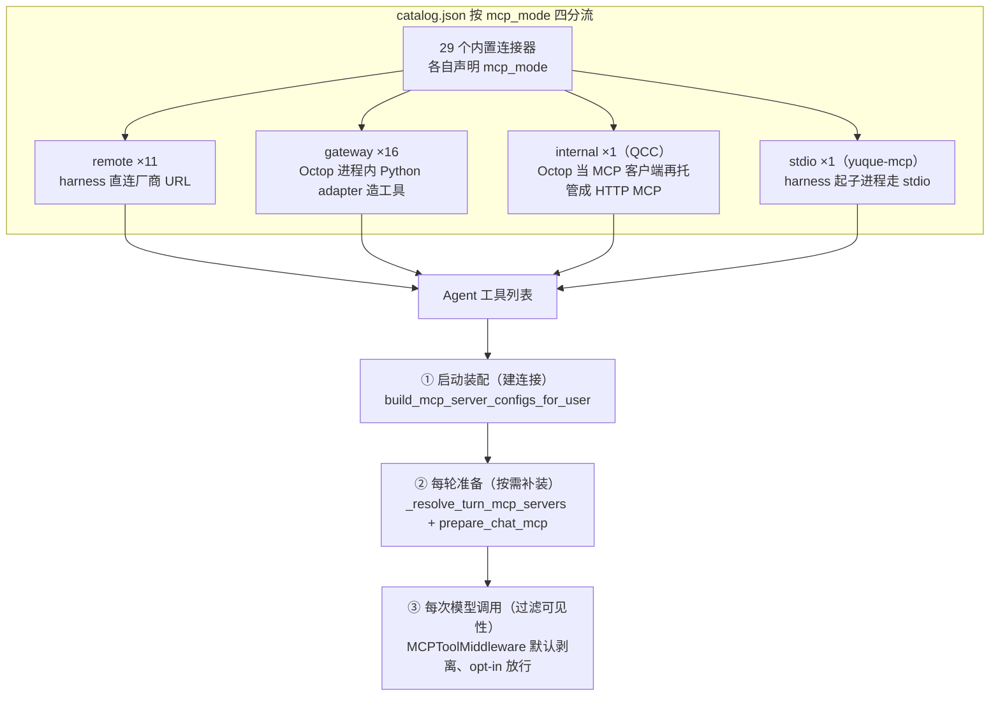
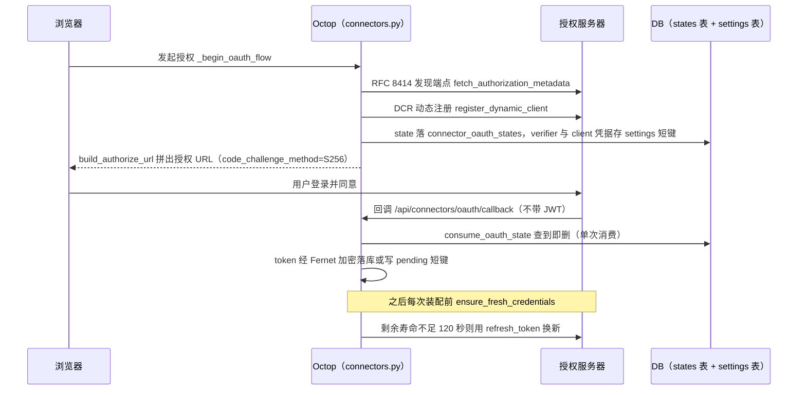
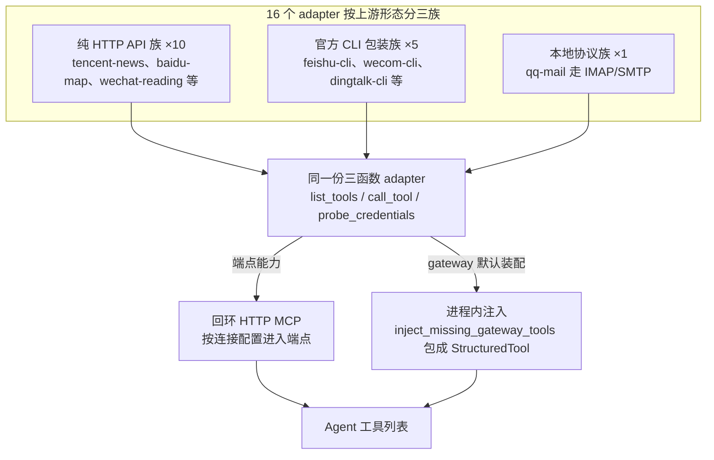

本篇拆解 Octop 的外部系统接入层：连接器目录（catalog.json，29 个内置连接器的元数据源）、OAuth 授权流与凭据加密、MCP 网关（MCP，Model Context Protocol，一种把工具列表与工具调用标准化为 JSON-RPC 的协议）的 adapter 架构，以及 Octop 自身对外暴露为 MCP server 的 `/api/mcp/agents`。

[04：能力装配](./04-skills-experts-plugins.md) 按文件、模板与代码注册区分扩展契约；本文沿连接器目录、OAuth、凭据、adapter 和工具装配，追踪外部系统怎样进入 Agent。第五节再解释外部 MCP 客户端怎样访问 Octop 的专家 Agent。

主仓代码引用 `src/octop/...`，组件包引用 `octop_harness/...`（下文引用实装 1.0.2 源码；基线为主仓 v1.0.2，commit dd9dce47）。

## 一、接入全景：四种 mcp_mode

### 1、目录先行：29 个连接器按 mcp_mode 四分流

Octop 对「外部系统怎么接入」的答案不是一个网关，而是**一个目录加四种模式**——每个连接器在 `catalog.json` 里声明 `mcp_mode`，装配代码按它分流。29 个内置连接器的分布是：`remote` 11 个、`gateway` 16 个、`internal` 1 个（企查查 QCC）、`stdio` 1 个（语雀官方 MCP）。

整条接入链路如下：



图尾的三级时序是本篇主线：工具「装进 Agent」不等于模型每次都看见——③ 级默认剥离所有 MCP 工具、逐调用 opt-in 放行（一-2 详述）。

`src/octop/infra/connectors/catalog.py:24` 定义了四个字面量类型，`catalog.py:96-113` 的三个谓词函数是全篇的分流开关：

```python
McpMode = Literal["remote", "gateway", "internal", "stdio"]

def is_inprocess_gateway(entry: ConnectorCatalogEntry) -> bool:
    """harness 注入 Python adapter 工具；配置仅保留名称占位。"""
    return entry.mcp_mode == "gateway"

def uses_internal_http_mcp(entry: ConnectorCatalogEntry) -> bool:
    """harness 从 /api/internal/mcp 加载 Octop 托管的 HTTP MCP。"""
    return entry.mcp_mode == "internal"
```

四种模式的语义（源码注释与 `docs/connectors.md` 一致）：

| mcp_mode | 语义 | 工具从哪来 | 代表 |
| --- | --- | --- | --- |
| `remote` | 厂商已提供 MCP 服务 | harness 直连厂商 URL，凭据放请求头 | tencent-docs、notion、dida365 |
| `gateway` | 厂商只有 HTTP API 或官方 CLI | Octop 进程内 Python adapter 造工具 | baidu-map、tencent-news、feishu-cli |
| `internal` | Octop 主动聚合上游 MCP | Octop 自己当 MCP 客户端，再托管成 HTTP MCP | qcc（企查查） |
| `stdio` | 厂商提供本地 CLI 版 MCP | harness 起子进程走 stdio | yuque-mcp（`npx yuque-mcp`） |

`custom-mcp` 是自定义连接配置入口，不属于上述四个 catalog 模式：用户自定义的 MCP server（`streamable_http` 或 `stdio`）不走 catalog，全部打包进一个 `kind="custom-mcp"` 的连接器行（见五-1）。

### 2、一条凭据变成工具列表的三级时序

外部工具进入 Agent 有三级时序——**启动装配**（建连接）、**每轮准备**（按需补装）、**每次模型调用**（过滤可见性），三级各有独立代码路径。

启动级在 `src/octop/infra/agents/manager.py:3929-3958` 的 `_build_harness_config`：非团队 Agent 构建配置时调 `build_mcp_server_configs_for_user`（`src/octop/infra/connectors/builder.py:572`）把该用户所有 active 连接器翻译成 harness 的 `mcp_server_configs`。

每轮级在 `src/octop/infra/gateway/process/processor.py:1640-1687` 的 `_resolve_turn_mcp_servers`：消息进来先 `merge_turn_mcp_servers` 合并本轮显式选择与 default_open 默认集，再调 `prepare_chat_mcp` 确保工具已装（见五-2）。

每次模型调用级在 harness 的 `MCPToolMiddleware`（`octop_harness/middleware/mcp_tools.py:22`）：**默认剥离所有 MCP 工具**，只有本轮 `configurable.mcp_servers` 或 `mcp_use_default=True` 才放行——MCP 工具是逐调用 opt-in 的，这是 README 看不到的关键设计。

这个三级结构也是本篇的路线图：二、三章讲凭据怎么进来、怎么存；四章讲 gateway/internal 两种模式的工具制造；第五节先讲自定义 MCP、按需装配与工具过滤，再讲 Octop 对外服务。连接器 OAuth 为外部账号授权，和平台登录属于两条身份链，不能混用。

## 二、连接器目录与 OAuth

### 1、catalog.json 是唯一元数据源

加一个 `remote` 模式的 MCP 连接器，在 Octop 里约等于**加一行 JSON**——`catalog.py` 只加载并校验 `catalog.json`，不再手写注册表（这是从早期手写 `_CATALOG` 演化来的，`docs/connectors.md` 明确记录了这次迁移）。

`catalog.json` 中 notion 的完整条目（源码可证实）：

```json
{
  "kind": "notion",
  "name": {"en": "Notion", "zh": "Notion"},
  "auth_kind": "oauth2",
  "mcp_mode": "remote",
  "oauth_issuer": "https://mcp.notion.com",
  "mcp_url": "https://mcp.notion.com/mcp",
  "mcp_user_agent": "octop-connector/0.1"
}
```

解析侧 `catalog.py:197-234` 的 `_parse_entry` 逐字段校验（缺字段、字面量越界、`credential_fields` 结构错都会在 import 时抛 `ValueError`），`catalog.py:255-257` 还拒绝重复 `kind`。

`_CATALOG = _load_catalog()` 在模块加载时执行——目录错了进程起不来，这是把配置错误前置到启动期的做法。

用户可见文案（name/description/auth_hint/字段标签）用 `LocalizedText`（`catalog.py:39-47`）支持 `{en, zh}` 双语，按 `Accept-Language` 解析。

`allowed_tools` 字段是目录级的工具白名单：tencent-weiyun 条目列出 12 个 `weiyun.*` 工具名，harness 加载后按此过滤（四-5 详述）。`oauth_issuer + mcp_url` 同时出现且 `auth_kind=oauth2` 时，该条目自动成为动态 OAuth 候选（`catalog.py:106-113` 的 `is_mcp_oauth_remote`）。

### 2、动态 OAuth：RFC 8414 发现 + DCR + PKCE

Octop 的 OAuth 不是为每家厂商写死 client_id，而是**标准协议栈自动协商**——RFC 8414（OAuth 授权服务器元数据发现）拿端点、RFC 7591 动态客户端注册（DCR，Dynamic Client Registration，向授权服务器在线注册一个临时 client）拿 client_id、PKCE（Proof Key for Code Exchange，RFC 7636，用一次性随机数代替客户端密钥防授权码劫持）保护授权码。

给 Notion 和给滴答清单接入走的是同一段代码。

`src/octop/infra/connectors/oauth/mcp.py:71-81` 先发现授权服务器元数据：

```python
async def fetch_authorization_metadata(issuer: str) -> dict[str, Any]:
    metadata_url = f"{issuer.rstrip('/')}/.well-known/oauth-authorization-server"
    await _ensure_mcp_oauth_url(metadata_url, issuer=issuer, field="issuer_metadata")
    r = await safe_request("GET", metadata_url, timeout=20.0)
    # （省略：校验 authorization_endpoint / token_endpoint 必填）
    return await _validate_metadata_endpoints(data, issuer=issuer)
```

`register_dynamic_client`（`mcp.py:84-111`）随后向元数据里的 `registration_endpoint` POST 注册请求，按服务器支持的认证方法选 `none` 或 `client_secret_post`；`build_authorize_url`（`mcp.py:114-136`）拼出带 `code_challenge_method=S256` 的授权 URL；`new_pkce_pair`（`oauth/pkce.py:16-18`）生成 64 字节随机 verifier。

整个流程没有一处硬编码的 client 凭据——`oauth/mcp.py` 模块 docstring 直言「加 Notion / Ardot / Linear 式连接器基本就是目录里一行」。

SSRF（Server-Side Request Forgery，诱使服务端访问内网地址的攻击）防护贯穿全程：`_ensure_mcp_oauth_url`（`mcp.py:46-59`）要求所有端点是 issuer 域名下的公网 HTTPS（`src/octop/infra/utils/ssrf_guard.py` 的 `validate_https_url` 拒绝私网/环回 IP 字面量，`host_allowed_for_issuer` 校验域名归属），DNS 解析后的 IP 也要复查（`validate_https_url_resolved`）。

所有出站请求走 `safe_request`，底层用 `PinnedIPTransport` 把连接钉在已校验的 IP 上防 DNS rebinding。

### 3、自定义 MCP 的 OAuth 发现：RFC 9728

对用户手填的任意 MCP URL，Octop 用 RFC 9728（Protected Resource Metadata）自动探测该 server 是否支持 OAuth、授权服务器在哪，而不是要求用户懂这些概念。

`src/octop/infra/connectors/oauth/discovery.py:143-219` 的 `discover_oauth_from_mcp_url` 三步走：先向 MCP URL 发一个无凭据的 `initialize` JSON-RPC，截获 401 响应头里 `WWW-Authenticate` 携带的资源元数据地址（`discovery.py:98-132`）；失败则按路径优先级猜 `/.well-known/oauth-protected-resource{path}`；拿到 PRM 文档后取第一个 `authorization_servers` 作为 issuer，再走二-2 的同一套发现 + DCR。

没有 `registration_endpoint` 的授权服务器直接判「不可用」——Octop 只支持能 DCR 的动态流，不做手工填 client_id 的静态流（`_AUTH_CODE_PASSTHROUGH_KINDS` 是空集，`oauth/registry.py:25`）。

环回/局域网 MCP URL 明确豁免：`discovery.py:36-38` 判定本地地址不做远端 OAuth 发现，与 `custom_mcp.py:118-166` 的 URL 校验策略一致——本地 MCP 允许 HTTP，公网 MCP 强制 HTTPS 加 SSRF 检查（「操作者故意把连接器指向本地 MCP server」是设计内的用法）。

### 4、state 一次性消费与无 JWT 回调

OAuth state 不是内存对象而是 `connector_oauth_states` 表里的行，回调时**单次消费后删除**——这让授权流在多 worker 或服务重启后依然成立。

发起侧 `src/octop/api/routers/connectors.py:212-275` 的 `_begin_oauth_flow`：生成 `token_urlsafe(24)` 的 state 和 ULID state_id，`create_oauth_state` 落库（`src/octop/infra/db/repos/connectors.py:249-265`），PKCE verifier 与 DCR 拿到的 client_id/secret 存进 settings 表的 `connector.oauth.ctx.{state_id}` 键（`oauth/registry.py:51-64`）。

回调 `GET /api/connectors/oauth/callback`（`connectors.py:1442`）**不需要 JWT**——浏览器跳转带不上 API token，合法性完全由一次性 state 保证：`consume_oauth_state`（`repos/connectors.py:267-275`）在事务里查到即删，重放第二次查不到。

成功后 token 写入 `connector.oauth.pending.{state_id}` 短键供前端轮询领取，或直接自动创建实例。

一个容易忽略的细节：`connectors.py:235-240` 对公网非环回地址强制 HTTPS 回调（`ErrorCode.CONNECTOR_OAUTH_HTTPS_REQUIRED`）——动态 OAuth 的授权服务器（如 Notion）会拒绝 HTTP redirect_uri，这条报错把「配证书」提前到用户第一次点授权按钮时，而不是在厂商页面上看到一个模糊的 invalid_redirect。

### 5、token 刷新与 QCC 的单飞锁

刷新不是定时任务而是**取用时惰性刷新**——每次装配前检查，剩余寿命小于 120 秒就用 refresh_token 换新。

`ConnectorService.ensure_fresh_credentials`（`src/octop/infra/connectors/service.py:145-172`）是通用路径：非 oauth2 直接返回；`expires_at` 还剩 120 秒以上直接返回；有 refresh_token 就 `refresh_oauth_credentials`（走同一 issuer 的 token_endpoint，`oauth/mcp.py:193-230`），成功后重新加密落库，失败则静默返回旧凭据。

自定义 MCP 的对应逻辑 `ensure_fresh_custom_servers`（`service.py:362-402`）多一步降级：刷新失败且已过期时，把该 server 标记 `oauth.required=true` 让 dashboard 弹重新授权，而不是让 Agent 拿着坏 token 反复失败。

QCC 是特例中的特例（`service.py:178-223`）：token 过期或上游返回 401 时按「被拒 token」强制轮换，整个刷新包在 per-instance 的 `asyncio.Lock` 里（`_QCC_LOCKS`，`service.py:56`），防止并发请求同时刷新把还在有效的 refresh_token 用废。

401 后重试一次的模式（`_qcc_request`）与注释「另一个请求可能已经轮换掉了被拒的 token」说明这是被真实并发踩过的坑。

把二-2 到二-5 串成一条时间线，动态 OAuth 的完整生命周期如下：



注意 DB 侧是两个存储：state 行在 `connector_oauth_states` 表、查到即删防重放；PKCE verifier 与 DCR 的 client 凭据则存 settings 表短键。

## 三、凭据加密

### 1、28 行的 Fernet 模块

连接器凭据全部经 Fernet（一种基于 AES-128-CBC + HMAC 的对称加密方案，`cryptography` 库提供，密文自带版本与时间戳）加密后存 `connectors.credential_blob`，加密实现只有一个 28 行的模块。

`src/octop/infra/connectors/crypto.py` 全文核心：

```python
_FERNET_KEY = "connector_fernet"

def _get_fernet(repo: SecretRepo) -> Fernet:
    raw = repo.get_or_create(_FERNET_KEY, Fernet.generate_key)
    return Fernet(raw)

def encrypt_credentials(repo: SecretRepo, payload: dict[str, Any]) -> bytes:
    f = _get_fernet(repo)
    return f.encrypt(json.dumps(payload, ensure_ascii=False).encode("utf-8"))
```

密钥存 `secrets` 表（KV 表）的 `connector_fernet` 键下，`SecretRepo.get_or_create`（`src/octop/infra/db/repos/secrets.py:20-34`）在事务内二次检查防并发重复生成。

加密粒度是**整库一把密钥、每个实例一个密文**：payload 是该实例的完整凭据 dict（token、refresh_token、expires_at、internal_token 等），`encrypt_and_store`（`service.py:114-143`）每次写入都把 `instance_id` 绑进 payload，并在 internal 模式下补发 `internal_token`。

密文里还带 `credential_expires_at` / `credential_rotated_at` 两个明文列（migration `013_connector_instances.sql:17-18`），供列表页免解密展示状态。

### 2、与 11 篇渠道明文凭据的对比

同一个进程、同一个数据库，渠道（channels）凭据明文、连接器（connectors）凭据密文——这不是不一致的 bug，而是**按数据敏感度和来源分层**的取舍，但边界没有文档化。

11 篇已核实：`channels.config_json` 直存 app_secret/token，创建路径只有 `json.dumps` 没有 encrypt 调用。连接器侧对比鲜明：`credential_blob` 是 BLOB 列，所有读写必经 `crypto.py`。

差异的合理解释（本站推论）：渠道凭据是**实例级平台凭据**（配置 Octop 这个进程本身），连接器凭据是**用户级个人授权**（每个成员各自的腾讯文档 token），后者在多用户共享一个实例时天然需要与 DB 备份隔离。

工程上的遗留问题同样真实：`SecretRepo.rotate`（`secrets.py:36-41`）存在但**没有任何调用方**（全仓 grep 无 `.rotate(` 命中），Fernet 密钥没有轮换路径；密钥与密文同库，防的是「拿到 DB 文件/备份但拿不到进程」的场景，进程被攻破则两者皆失。

### 3、internal_token：藏在密文里的回环令牌

gateway 与 internal 模式的每个实例在**创建凭据时同步生成一把 `internal_token`**，它既存在密文里，又出现在 harness 连 Octop 回环 MCP 的 URL query 上——是连接器安全模型里「谁知道令牌谁就是这条连接」的单点。

`new_internal_token`（`builder.py:92-94`）是 `secrets.token_urlsafe(32)`；`validate_create_credentials` 在 oauth2/gateway/internal/api_key/custom_fields 各分支都会补发（`builder.py:327-328` 等多处）。校验只有一处：`ConnectorService.verify_internal_token`（`service.py:633-638`）解密实例、比对明文令牌。

注意 `encrypt_and_store` 的保留逻辑（`service.py:124-134`）：internal 模式下编辑凭据时优先沿用已有 internal_token——避免每次改备注就使 harness 缓存的 URL 失效。这把令牌的泄漏面值得在六-3 讨论。

## 四、MCP 网关与 adapter

### 1、GatewayAdapter：三个函数换一个 MCP server

gateway 模式的接入协议收敛为**三个纯函数**——`list_tools`（静态工具清单）、`call_tool`（执行一个调用）、`probe_credentials`（验活），模块级函数即接口，没有基类、没有注册装饰器。

`src/octop/infra/connectors/gateway/registry.py:27-52`：

```python
class GatewayAdapter(Protocol):
    def list_tools(self) -> list[dict[str, Any]]: ...
    def call_tool(self, creds: dict[str, Any], name: str, args: dict[str, Any]) -> str: ...
    def probe_credentials(self, creds: dict[str, Any]) -> None: ...

_ADAPTERS: dict[str, GatewayAdapter] = {
    "agently-cli": agently_cli,
    "qq-mail": qq_mail,
    # （省略 12 行：qq-music、fliggy、baidu-map、ctrip-wendao、meituan-travel、
    #  yuandian、tencent-ima、tencent-news、wechat-reading、feishu-cli、
    #  wecom-cli、dingtalk-cli、obsidian-cli、weknora）
}
```

16 个 adapter（`gateway/adapters/` 目录 16 个模块加 `__init__.py`，合计约 3.6k 行）按上游形态分三族：纯 HTTP API 族（tencent-news、baidu-map、wechat-reading、qq-music、fliggy、ctrip-wendao、meituan-travel、yuandian、tencent-ima、weknora）、官方 CLI 包装族（feishu-cli 包装 `lark-cli`、wecom-cli、dingtalk-cli、agently-cli、obsidian-cli）、本地协议族（qq-mail 走 IMAP/SMTP）。

凭据不进 adapter 状态：每次 `call_tool(creds, ...)` 由调用方解密后传入，adapter 是无状态的纯翻译层。

### 2、79 行的 JSON-RPC 端点：handle_mcp_request

adapter 之上没有 MCP 框架——一个 79 行的模块（`gateway/protocol.py` 全文）手写了 MCP 需要的最小 JSON-RPC 面（initialize / tools/list / tools/call / ping），错误装进 `isError: true` 的正常响应。

`src/octop/infra/connectors/gateway/protocol.py:15-68`：`initialize` 返回 `serverInfo.name = f"octop-{kind}"`；`tools/list` 直调 `mcp_tools_for_kind(kind)`；`tools/call` 解包参数后调 `call_gateway_tool`，异常文本作为 `content[0].text` 返回（MCP 约定：工具业务错误不算协议错误）。

还有一个兼容垫片：参数若形如 `{"kwargs": {...}}` 则解包——LangChain 某些版本的 MCP 工具包装会把命名参数嵌进 kwargs 字段。

### 3、走读 tencent_news：外部 API 变成 MCP 工具 schema

一个典型 HTTP adapter 就是「一份手写的工具 JSON Schema + 一个分发函数 + 一次真实调用验活」，`tencent_news.py` 101 行展示了全部要素。

`src/octop/infra/connectors/gateway/adapters/tencent_news.py:15-32` 的工具声明：

```python
TOOLS: list[dict[str, Any]] = [
    {
        "name": "search_news",
        "description": "Search Tencent News articles by keyword",
        "inputSchema": {
            "type": "object",
            "properties": {
                "query": {"type": "string"},
                "limit": {"type": "integer", "description": "Max results, default 10"},
                "max_results": {"type": "integer", "description": "Alias of limit, default 10"},
            },
            "required": ["query"],
        },
    },
]
```

`call_tool`（`tencent_news.py:39-42`）只做名字分发；`search_news`（`tencent_news.py:55-96`）干翻译活：`limit` 夹在 1-50、拼 `Bearer` 头、构造厂商私有的分页 body、按 `base_rsp.code` 映射错误文案（4006 或含 "apikey" 的消息译成「API Key 无效」）、成功则 `json.dumps` 整包返回。

三处细节值得抄：其一，schema 同时收 `limit` 和 `max_results` 别名——模型经常猜错字段名，别名是零成本的容错；其二，`Caller-Skill` / `Skill-Request-Id` 头是为通过新版 API Key 校验仿照官方 CLI（≥1.0.14）加的，注释直接说明动机；

其三，`probe_credentials`（`tencent_news.py:99-101`）的实现是「真搜一条新闻」——上游没有廉价的验活端点时，用最小真实调用代替，dashboard「测试连接」按钮即走此路径（`probe.py:413-430` 对 gateway 模式先 probe 再 `tools/list` 返回工具预览）。

baidu_map（113 行）同构但展示了另一面：三个工具（`search_place` / `plan_direction` / `get_weather`）的 schema description 直接用中文写业务约束（「须同时提供城市 region」「如『从天安门到故宫怎么走』」）——工具 description 是给模型看的 prompt，中文上游就用中文写。

### 4、变体：CLI 包装族

当厂商不发 API 只发 CLI 时，Octop 的答案是**让官方 CLI 跑在主机上，adapter 把 MCP 调用翻译成子进程命令**——供应链责任从「Octop 实现 API 签名」转为「管理员装官方 CLI」。

`feishu_cli.py` 的五个工具（`doc` / `base` / `calendar` / `im` / `help`）不是细粒度 API，而是「域 + method」的门面：`doc` 工具的 `args.method` 收 `+search`、`+fetch` 这类子命令字符串，adapter 映射到 `lark-cli docs` 域（`feishu_cli.py:16-27` 的 `_DOMAIN_BY_TOOL`）。

子进程执行收敛在 `gateway/cli_runner.py:26-58` 的 `run_cli`：30 秒超时、输出捕获、失败时解析 CLI 的 JSON 错误负载。

`cli_runner.py:72-77` 藏着一个对抗性设计——CLI 报错里的「请运行 lark-cli login」类提示**永远不透传给模型**：

```python
# Never forward CLI "run xxx" hints to agents — they cause shell/auth loops.
if hint and any(
    name in hint.lower()
    for name in ("lark-cli", "wecom-cli", "agently-cli", "obsidian", "dws ")
):
    hint = ""
```

配套的是 `resolve_binary`（`cli_runner.py:15-23`）找不到命令时的报错文案：「请打开 Octop『连接器』抽屉，由管理员安装 CLI……**禁止在 Agent 终端中查找或安装该命令**」，以及 `feishu_cli.py:29-39` 两条写给模型的授权引导文案同样以「禁止建议、生成或执行任何终端命令」结尾。

这些防御的共同前提是：模型有终端工具，照抄错误提示会让它自己 `pip install` / `lark-cli login`，进入权限甚至安全循环——与 04 篇插件 `pip install` 的供应链风险是同一个威胁模型的两面。

### 5、进程内注入与回环 HTTP 的适用路径

主仓 `v1.0.2` 的 `build_mcp_server_configs_for_user` 对 gateway 模式放入无 transport 的空占位，启动后由 `inject_missing_gateway_tools` 注入 adapter 工具。回环 HTTP 端点仍存在，internal 模式使用这类托管端点；不能据此把 gateway 默认链描述成「HTTP 优先、注入兜底」。

adapter 既可由进程内工具调用，也可经 HTTP 端点服务；当前 gateway 装配选择前者：



`builder.py:599–609` 明确写出 gateway 不做 HTTP 预加载。注入函数会跳过已存在的同名前缀工具，这是去重条件，不能反推出所有工具此前都经历过 HTTP 尝试。

通道一是回环 HTTP。`builder.py:236-255` 的 `_build_gateway_spec` 生成的 harness spec 指向 `internal_mcp_url`（`builder.py:79-93`）：

```python
host = config.bind_host if config.bind_host not in ("0.0.0.0", "::") else "127.0.0.1"
return f"{scheme}://{host}:{config.port}/api/internal/mcp/{gateway_kind}/{instance_id}?token={token_q}"
```

端点实现在 `src/octop/api/routers/internal_mcp.py:50-96`：查实例 → `verify_internal_token` → `handle_mcp_request`（QCC 走专用分支），并用 `asyncio.to_thread` 把同步 adapter 挪出事件循环。

GET 分支（`internal_mcp.py:99-133`）是为了过 Streamable HTTP 客户端的握手校验：返回一条 priming SSE 事件后每小时 sleep 一次的保活流——「假 SSE」满足协议形状即可。

TLS 场景还有个务实补丁：回环 HTTPS 用公网域名证书时 `verify=False`（`builder.py:68-76`），否则自签/错配证书会让 harness 连不上自己。

通道二是进程内注入。`build_mcp_server_configs_for_user`（`builder.py:599-609`）给 gateway 连接器只放一个空占位 spec（无 `transport` 字段，harness 的 `_connection_spec_loadable` 会跳过预加载），真实工具在 Agent 启动后由 `inject_missing_gateway_tools`（`builder.py:665-733`）补：调 `build_gateway_langchain_tools`（`gateway/langchain.py:16-80`）把 `list_tools()` 的每个工具定义包成 LangChain `StructuredTool`——名字是 `{mcp_server_name}_{tool}`，`args_schema` 用 harness 的 `mcp_args_model` 从 inputSchema 动态建 Pydantic 模型——再 `agent.inject_mcp_tools(extra)`。

`inject_missing_gateway_tools` 的 docstring 仍沿用 “HTTP MCP load did not produce them” 表述，但调用方已选择空占位和进程内注入。这里以 `builder.py:599–609` 的实际分支与 `665–724` 的过滤、注入行为为准。每轮补装也可经 `_attach_gateway_tools` 原位完成，以避免不必要的 Agent 重建。

### 6、QCC：Octop 作为 MCP 客户端的聚合器

`internal` 模式目前只有 QCC 一个用户，它解决的问题是——上游本身是 MCP server 但凭据由 Octop 持有且需要刷新/裁剪，Octop 于是**面向上游当 MCP 客户端、面向 harness 当 MCP 服务端**，中间做聚合与命名空间。

`src/octop/infra/connectors/qcc.py:15-19`：一个授权对应五个固定资源 `company/risk/ipr/operation/executive`，URL 是 `https://agent.qcc.com/mcp/{name}/stream`。

`request_resource`（`qcc.py:73-95`）用官方 MCP SDK 的 `streamable_http_client + ClientSession` 建短会话（每次调用现建，注释说明这是为了让换存的 API key 立即生效），`follow_redirects=False, trust_env=False` 堵住带凭据的重定向。

服务端聚合在 `ConnectorService.handle_qcc_request`（`service.py:225-266`）：`tools/list` 并发请求五个资源、工具名加 `{resource}__` 前缀合并；`tools/call` 把 `company__get_x` 拆回资源与原名转发。裁剪同样在这一层：`PREFERRED_TOOL_SUFFIXES`（`qcc.py:24-33`）注释直言上游单资源可能吐 150+ 个近似重复工具，只放行白名单后缀。

异常统一吞成一句「check connection or authorize again」——注释说明上游异常可能携带凭据请求细节，不能原样回给模型。

## 五、自定义工具装配与对外 MCP 服务

### 1、自定义 MCP：一行打包与共享命名

用户自定义的 N 个 MCP server 不占 N 个连接器行——全部 server spec 打包进**一个** `kind="custom-mcp"` 行的加密 blob（`{"servers": {...}}`），对外再展开成虚拟实例。

`src/octop/infra/connectors/custom_mcp.py` 管全部规范化：server 名只许 `[A-Za-z0-9_-]` 且不得与内置连接器的 `mcp_server_name` 冲突（`custom_mcp.py:230-250`）；HTTP spec 经 `validate_mcp_http_url`（本地放行 HTTP、公网强制 HTTPS + SSRF，见二-3）；stdio spec 必须有 command。

共享机制：某个 server 标 `shared: true` 后，其他用户看到的名字是 `custom__{owner_instance_id}__{name}`（`custom_mcp.py:42-43`），天然全局唯一；OAuth token 由 `merge_preserved_oauth`（`custom_mcp.py:345-365`）保护——前端提交的 servers map 里任何 oauth 字段都会被剥掉再回填存量 token，防止前端回显造成 token 覆盖/泄漏。

喂给 harness 前 `harness_spec_for_server`（`custom_mcp.py:368-383`）剥掉 Octop 元数据键、给 streamable HTTP 注入 `Bearer` 头与双 Accept。

### 2、按需加载与用户级工具缓存

自定义 MCP 工具**不随 Agent 启动加载**——启动时只放空占位（`builder.py:627-637` 的 defer 注释），本轮真用到才加载，且同一用户同一 server 的工具在所有 Agent 间共享一份缓存。

`prepare_chat_mcp`（`manager.py:2254-2356`）是每轮装配的编排者，按缺失名单分三路：自定义 MCP 走 `_get_or_load_mcp_tools`（`manager.py:2156-2220`）——以 `(user_id, server_name, fingerprint)` 为键查 `self._mcp_tool_cache`，fingerprint 是 spec 连接字段的 sha256 前 16 位（`mcp_tool_cache.py:23-37`，只算 transport/url/headers/command/args/env，不含 enabled 等元数据；任一参与哈希的连接字段变化都会生成新指纹）；

未命中则加 per-server 锁调 harness `aload_mcp_tools` 单独加载这一个 server，产物经 `wrap_tools_for_shared_use`（`mcp_tool_cache.py:40-94`）包成带 `asyncio.Lock` 的 StructuredTool——该共享工具包装器选择序列化多 Agent 调用；这是本实现的并发约束，不代表 MCP 协议普遍禁止并发。

gateway 连接器走 `_attach_gateway_tools`（`manager.py:2444-2478`）原位注入不重建 Agent；其余内置连接器才走代价最高的 `reload_connectors`（刷新全部凭据 + `_reload_agent`）。

每轮合并的语义（`service.py:548-575` 与 `default_open.py:36-57`）区分了三个入口：dashboard 显式传 `apply_defaults=False`（完全尊重用户本轮勾选，可全关）；IM 传 `explicit=None`（落入 default_open 默认集——所以 IM 里「常开」连接器才有效）；cron 无勾选时跟默认、有勾选按勾选。

专家模板的 `extra_defaults` 只并入「仍然对该用户可用」的名字（`service.py:566-570`），模板不能授予用户没有的连接器。

### 3、每次模型调用的工具治理

工具装进 Agent 不等于模型每次都看见——harness 的 `MCPToolMiddleware` 默认剥光 MCP 工具，逐调用放行，还附带两项工程补丁：null 参数清洗与工具排序。

`octop_harness/middleware/mcp_tools.py:22-28` 的类 docstring 说得直白：默认（请求不带 `mcp_servers` / `mcp_use_default`）所有 MCP 工具从模型工具列表移除，调用方必须显式 opt-in。

放行时还有 `prioritize_active_mcp_tools`（`octop_harness/mcp.py:266-301`）把本轮活跃的 MCP 工具挪到非 MCP 内置工具之后、不活跃 MCP 工具之前——注释说明**部分 provider 会静默截断长工具列表**，排后面的 gateway 工具（点名 IMA）会被无声丢掉。

子代理图编译时则反向操作：`agent.py:1621-1660`（实装 1.0.2）用 `filter_tools_for_mcp_servers(active_servers=None)` 把 MCP 工具从每个子代理的继承工具集中剥掉——子代理不经过主图中间件，直接在编译期对齐「默认隐藏」的口径。

参数层的 `_McpArgsBase`（`octop_harness/mcp.py:106-121`）在验证前丢掉显式 null 并从 LLM 可见 schema 里抹掉 `anyOf: [T, null]`——注释点名 Notion 的 Zod schema 会拒绝显式 null，而模型惯于把可选参数填 null，这是踩坑后的针对性修复。

目录级 `allowed_tools` 与参数别名（tencent-docs 的 `query→search_key`）也在 harness 加载层执行（`octop_harness/mcp.py:182-246`，`tool_arg_aliases` 机制）。

### 4、/api/mcp/agents：Octop 自身作为 MCP server

`infra/agent_mcp/`（3 文件）把 Octop 的**已实例化的专家 Agent**（不是 04 篇的模板文件）反向暴露成 MCP server——外部 MCP 客户端（另一个 Agent 框架、编辑器）可以把整个 Octop 实例当工具用。

端点 `src/octop/api/routers/agent_mcp.py:33-65`：`POST /api/mcp/agents` 走标准 JWT 认证（与 internal_mcp 的 query token 不同，这是对外服务），复用同样的 session-id/协议版本头协商。

工具面只有三个（`infra/agent_mcp/protocol.py:28-82`）：`list_octop_experts`（列可访问专家）、`call_octop_expert`（发一条消息、可带 thread_id 续话）、`resume_octop_expert`（对挂起审批做 approve/edit/reject/respond 决策）。

工程上最有意思的是它**不新建执行路径**：`AgentMcpGatewayService.call_expert`（`infra/agent_mcp/service.py:57-90`）构造一条 `InboundMessage`（`channel_id="octop-agent-mcp"`，channel_type 为专门的 `CHANNEL_MCP`），直接丢给 `gateway.processor.iter_turn_chunks`——与飞书消息、dashboard 消息同一条管线。

线程隔离靠 `_require_mcp_thread`（`service.py:205-216`）强制「只有 MCP 建的线程能经 MCP 续」。

HITL（human-in-the-loop，工具调用前的人工审批）也完整保留：`_collect_result` 把事件流折叠成 `completed / approval_required / failed` 三态结果（`service.py:267-316`），`resume_octop_expert` 走 hitl coordinator 的 pending 记录（`service.py:92-129`）。

也就是说，外部调用方拿到的是与 IM 用户同级的对话能力，含审批闭环，而不是一个裸的 LLM 代理。

外部 MCP 调用沿本节的 JWT 身份与专属线程约束执行；[14 篇](./14-teams-delegation-bridge.md)的 Bridge 另有远端连接、发现和投影协议。二者都能触达远端能力，但不是同一条传输或身份链。

## 六、工程判断

### 1、照搬

**目录驱动的连接器元数据。** `catalog.json` + import 时严格校验 + Literal 枚举分流，让「新增一个厂商 MCP」从改代码降为改数据，且坏目录在启动期爆炸而非运行期。三函数 `GatewayAdapter` Protocol（`registry.py:27-32`）同样值得抄：无状态、凭据参数化、无注册框架，一个新 adapter 就是一个独立模块加一行字典。

**fingerprint 工具缓存与共享锁。** `(user_id, server, spec指纹)` 键 + per-server 加载锁 + 调用期序列化锁的三层结构（`manager.py:2149-2220`、`mcp_tool_cache.py`），避免重复加载，并按该适配器的共享会话约束串行调用。迁移时需要核对所用客户端是否也有同样的并发限制。

**一次性 state + 无 JWT 回调。** OAuth 回调落在 DB 行上单次消费（`repos/connectors.py:267-275`），天然支持重启与多 worker；把「授权结果待领取」也做成 settings 短键，前端轮询即可，不需要回调页持有任何凭据。

### 2、改造

**单密钥无轮换。** Fernet 密钥 `get_or_create` 之后永远不变，`SecretRepo.rotate` 无调用方；且密钥与密文同库。

改造点：给 secrets 表的行加版本号、密文里记录密钥版本、rotate 时批量重加密——`credential_rotated_at` 列已经是现成的审计位。若追求更高隔离，可用每实例派生密钥（HKDF from master + instance_id），改动量集中在 `crypto.py` 一个文件。

**回环 URL 带 query token。** `?token=xxx` 出现在 harness 的连接 URL 上，会被 access log、异常栈、代理日志捕获；`builder.py:527-552` 的 `_redact_mcp_configs_for_log` 说明作者意识到了（专门为日志打码 token=），但打码是自愿纪律而非结构保证。

可把凭据移到 `Authorization` 头并保留日志脱敏、身份验证与过期处理。`mcp-session-id` 只标识协议会话，不能单独替代认证；若绑定已认证会话，还需校验调用方与会话归属。

**渠道/连接器两套凭据策略并轨。** 三-2 的对比显示同一系统里明文与密文并存。改造方向是把 channels 迁到同一 Fernet 层——`crypto.py` 足够小，渠道侧需要的只是把 `json.dumps` 换成 `encrypt_credentials` 并处理存量数据迁移。

### 3、避免

**把 CLI 包装族的错误透传给模型。** `cli_runner.py:72-77` 主动过滤「请运行 xxx」提示是血泪经验：有终端工具的 Agent 会照抄提示自己装 CLI、自己跑授权，形成 shell/auth 循环。任何「包装外部 CLI 给 LLM 用」的设计都需要这一层提示清洗与「禁止建议终端命令」的工具 description。

**为聚合型 MCP 放行全量工具。** QCC 的 150+ 近似工具问题（`qcc.py:21-33`）靠白名单后缀裁剪；catalog 的 `allowed_tools` 与 harness 的加载期过滤是同一思想的通用化。接入不熟悉的 MCP server 时先 `tools/list` 看规模再定白名单，避免工具列表爆炸挤占上下文与触发 provider 截断。

**静态写死 OAuth client。** Octop 全线 DCR + PKCE、`_AUTH_CODE_PASSTHROUGH_KINDS` 留空，代价是只支持开了 DCR 的授权服务器。若你的上游不支持 DCR，正确做法是给 catalog 加静态 client 字段，而不是把 client_secret 硬编码进流程代码。

### 4、适用边界

当前装配面向单进程运行时：gateway 默认进程内注入，internal 托管端点依赖可达的本机 API；经 internal HTTP 调用同步 adapter 时，`asyncio.to_thread`（`internal_mcp.py:85`）将阻塞工作移出事件循环。用户级工具缓存也在进程内，多实例各自加载；fingerprint 只区分连接配置，不能独立保证分布式状态一致性。

Fernet 避免凭据以明文列保存，但密钥与密文同库时，完整数据库备份泄漏仍可能同时暴露两者。隔离效果取决于密钥的实际存放和访问边界，不能仅凭字段已加密就判断部署安全等级。

MCP 生态协议版本也在快速漂移：代码里 `MCP_PROTOCOL_VERSION = "2024-11-05"`（`protocol.py:12`）与回环端的 `SUPPORTED_PROTOCOL_VERSIONS` 协商并存，说明新客户端旧端点的兼容负担已经开始出现。

## 七、未核验范围

1. 未运行服务或测试，`catalog.json` 的 29 个条目与 `docs/connectors.md` 表格的一致性靠静态比对（kind/auth/mode 三字段全部吻合，`phase` 未逐条核对）。
2. harness 实装为 `.venv` 内 1.0.2；`MCPToolMiddleware` 的每调用过滤与 `agent.py` 子代理剥离逻辑只读了 middleware 与 agent 源码，未在运行时验证日志行为。
3. `gateway/adapters/` 16 个 adapter 中精读了 tencent_news、baidu_map、feishu_cli 与 wechat_reading 头部，其余（agently_cli、obsidian_cli、qq_mail、tencent_ima、weknora 等）仅确认符合三函数协议，未逐行核对上游 URL 与错误映射。
4. agently 邮件的写中断钩子（`manager.py:2464-2470` 的 `_agently_write_interrupts`）、飞书设备码登录（`gateway/feishu_user_auth.py`）细节未展开。
5. 主仓 `ThreadRegistry.CHANNEL_MCP` 的线程行为（与 IM 线程在配额/历史上的差异）依赖 11、08 篇的既有结论，未单独核验。
6. dashboard 前端的连接器管理页（轮询 `connector.oauth.pending.*` 的领取流程）只核对了后端键名，未读前端代码。

上一：[04：能力装配](./04-skills-experts-plugins.md) · [系列导读](./index.md) · 下一：[06：执行环境与工作台](./06-execution-surfaces.md)
