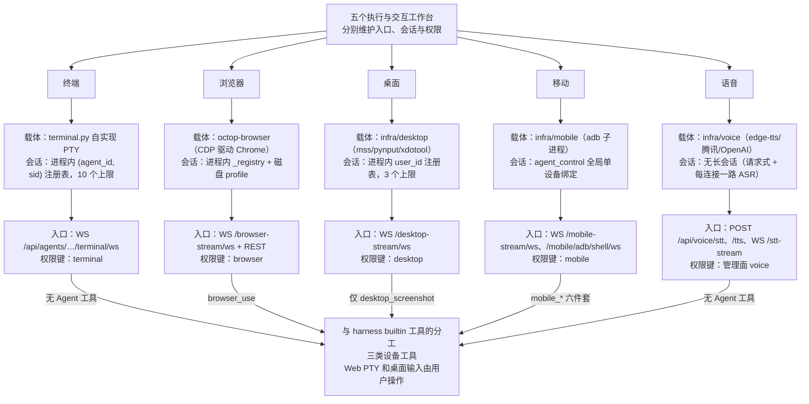
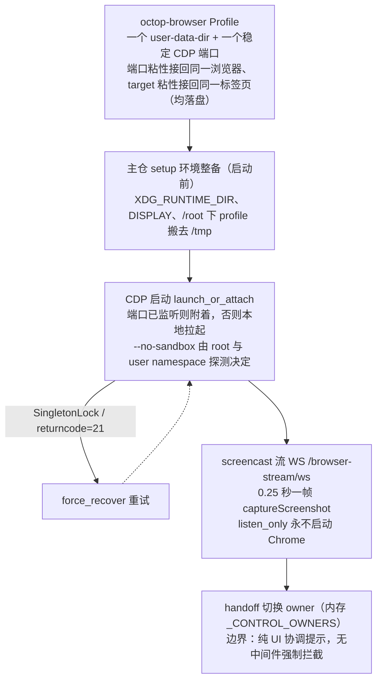

本篇拆解 Octop 的终端、浏览器、桌面、移动和语音工作台。这里同时存在 Agent 工具与用户界面：Agent 可执行后端命令、操作浏览器或手机，用户则可打开 Web 终端、控制桌面、接管设备和使用语音输入输出。

这些入口并不都位于回复事件流之后。Agent 工具在执行轮次中调用，Web PTY、远程桌面和语音还有独立的 HTTP/WebSocket 入口。本篇沿操作主体、身份、设备归属与会话寿命说明它们怎样协作。

[03：工作区与后端](./03-workspace-and-backend-abstraction.md) 解释文件后端，[04：能力装配](./04-skills-experts-plugins.md) 和 [05：外部工具接入](./05-connectors-and-mcp-gateway.md) 解释能力装配。本篇追踪具体操作落到哪里、由谁授权、会话由谁持有，并区分 Agent 工具与用户工作台。

基线：主仓 `v1.0.2`（commit `dd9dce47`，2026-10-23 核验）；实装 `octop-browser` 1.0.0、`octop-harness` 1.0.2（`.venv` 核验）。

一个先行的源码事实：任务常用的「harness 侧 browser_profile 中间件」在实装里并不存在——`octop_harness/middleware/` 没有该文件，profile 强制绑定中间件实际位于**主仓** `src/octop/infra/agents/middleware/browser_profile.py`（第三节第 4 小节展开）。

浏览器动作由组件包提供，用户 profile 绑定由主仓中间件改写；PTY 与移动设备控制另有主仓实现，不能把所有能力都归成同一层。

## 一、执行面全景

### 1、五个面的载体、会话与入口

五个工作台分别持有会话、路由与准入检查，下面先列服务入口，再区分 Agent 能力和人的操作：

| 面 | 能力载体 | 会话管理 | 主仓入口 | 权限键 |
| --- | --- | --- | --- | --- |
| 终端 | `api/routers/terminal.py` 自实现 PTY | 进程内 `(agent_id, sid)` 注册表，10 个上限 | `WS /api/agents/{id}/terminal/ws` | `terminal` |
| 浏览器 | `octop-browser` 包（CDP 驱动 Chrome） | octop-browser 进程内 `_registry` + 磁盘 profile | `WS /browser-stream/ws` + REST | `browser` |
| 桌面 | `infra/desktop/`（mss/pynput/xdotool） | 进程内 `user_id` 注册表，3 个上限 | `WS /desktop-stream/ws` | `desktop` |
| 移动 | `infra/mobile/`（adb 子进程） | `agent_control.py` 全局单设备绑定 | `WS /mobile-stream/ws`、`/mobile/adb/shell/ws` | `mobile` |
| 语音 | `infra/voice/`（edge-tts/腾讯/OpenAI） | 无长会话（请求式 + 每连接一路 ASR） | `POST /api/voice/stt`、`/tts`、`WS /stt-stream` | 管理面 `voice` |

五个面的载体、会话与入口收拢成一张全景图：



图中的工具映射只统计这五类工作台：浏览器、桌面截屏与移动控制有对应工具，Web PTY 和桌面输入面向用户。Agent 仍可通过 [03 篇](./03-workspace-and-backend-abstraction.md)的后端 `execute` 执行命令，不能从 Web PTY 未暴露工具推导出 Agent 不能操作 shell。

权限键来自 `src/octop/infra/users/permissions.py:119-122` 的 control 组：

```python
# src/octop/infra/users/permissions.py（节选）
"terminal": _p("terminal", "control", "工作台/终端", "Workbench / Terminal"),
"browser": _p("browser", "control", "工作台/浏览器", "Workbench / Browser"),
"desktop": _p("desktop", "control", "远程桌面", "Remote Desktop"),
"mobile": _p("mobile", "control", "远程手机", "Remote Phone"),
```

`control` 组不在新用户默认集合里（`BASELINE_PERMISSIONS` 只含 `settings` / `nav`），要管理员显式授予。语音不同：`voice` 是 admin 组键，管的是「语音模型配置页」，普通用户调用 `/api/voice/tts` 只需登录（`current_user`）。

图像/视频生成（`api/routers/media_generation.py`）不算本篇意义的执行面：源码定位是「instance-wide image and video generation settings」的管理 API——它配置的是云端生成服务（provider/base_url/model/api_key），产物不落在主机设备上。真正的调用在 harness 的 `builtin/tools/media_generation.py`，归 04 篇的工具清单。

### 2、与 harness 工具的分工

五个面里只有三个给 Agent 提供了工具：

| 工具族 | 位置 | 能力面 |
| --- | --- | --- |
| `browser_use` | `octop_harness/builtin/tools/browser_use.py`（实装 1.0.2） | 导航/DOM 树/点击/输入/滚动/截图/eval_js/标签页管理，20 个动作 |
| `desktop_screenshot` | `octop_harness/builtin/tools/desktop_screenshot.py`（实装 1.0.2） | 仅截屏，落 `{workspace}/outbound/screenshots/`，返回多模态块 |
| `mobile_*` 六件套 | 主仓 `src/octop/infra/mobile/tools.py` | 截屏/点击/滑动/启应用/UI 树 dump/喊人接管 |

移动工具的装配点在 `infra/agents/manager.py:3793-3801`：`capabilities.mobile.enabled` 为真且非团队宿主时，`build_mobile_tools(config, user_repo, paths)` 的产物与知识库工具、插件工具一起 `merged_tools.extend` 进 harness 实例——权限检查不是装配期的，工具内部每次调用实时查（四节 3）。

终端与桌面输入没有 Agent 工具——终端的 PTY 只给仪表盘用户用，Agent 执行命令走 03 篇拆过的 backend `execute`（沙箱 jail 内）；桌面输入注入同样只有仪表盘流能用，Agent 对桌面的全部能力是截一张图。

这个不对称是刻意的授权设计还是实现先后问题，源码没有注释说明，本站推论：更像「对话侧先给只读的观察，行动权留给人」。

### 3、操作身份、归属与会话寿命

| 入口 | 操作主体与身份 | 归属和许可 | 生命周期与接管 |
| --- | --- | --- | --- |
| 后端 execute | Agent 请求；执行身份由后端决定 | workspace 配置与执行环境，不等于独立 OS 用户 | 随后端运行时管理，见 [03 篇](./03-workspace-and-backend-abstraction.md) |
| Web PTY | 已登录用户；PTY 使用 Octop 进程用户 | terminal 权限、Agent 归属、会话属主检查 | 进程内会话，断开后保留 300 秒并有有限回放 |
| 浏览器 | 用户控制流与 Agent 工具 | user profile；工具参数由中间件绑定用户 | 磁盘 profile 可保留登录态，CDP 连接另有寿命 |
| 桌面 | 用户注入输入；Agent 工具仅截屏 | 登录与 desktop 准入，桌面会话按用户登记 | 输入仍作用于宿主显示环境，登记不等于 OS 隔离 |
| 移动 | 用户连接设备后，Agent 调用工具 | 每调用权限检查 + 进程级单槽设备绑定 | 绑定依赖活动控制会话；可请求人接管 |
| 语音 | 用户输入输出 | 普通调用登录校验；voice 管理键控制配置 | 请求式合成或每连接一路识别，不持有 Agent 执行轮次 |

这些许可解决不同问题：profile 选择限制浏览器使用哪个登录目录，设备绑定限制移动工具操作哪台手机，路由权限限制谁能访问入口。它们均不能独立证明多租户的 OS 隔离。移动绑定为主机级单槽，多个控制会话的覆盖行为需另外评估；桌面坐标夹取只避免越界输入，不是授权检查。

平台资源与权限检查由主仓各入口分别处理；断线、回放与进程重启的统一比较见[恢复专题](./16-disconnect-reconnect-and-recovery.md)。

## 二、终端命令

### 1、Web 终端的会话模型

Octop 的 Web 终端是一个自实现的两层 PTY 会话模型——PTY 进程属于「会话」，WebSocket 连接只是「订阅者」，断线后会话在宽限期内保活并可重连回放。`src/octop/api/routers/terminal.py` 顶部常量给出全部边界：

```python
# src/octop/api/routers/terminal.py（节选）
_MAX_SESSIONS = 10               # 进程级并发 shell 上限（重连不计新名额）
_MAX_SCROLLBACK_BYTES = 512 * 1024  # 回放环形缓冲上限
_DETACH_GRACE_SECONDS = 300.0    # 断线保活宽限期（扛住刷新/短暂断网）
```

会话注册表按 `(agent_id, sid)` 键控，注释明言「agent_id 是键的一部分，所以会话永远不会跨 Agent 泄漏」（`terminal.py:242-244`）。线协议是 JSON 文本帧，双向各三种核心消息：

```python
# src/octop/api/routers/terminal.py（模块 docstring，节选）
# 客户端 → 服务端：
#   {"type": "input",  "data": "ls\n"}
#   {"type": "resize", "cols": 100, "rows": 30}
#   {"type": "close"}                       # 立即销毁（跳过宽限期）
# 服务端 → 客户端：
#   {"type": "session", "session_id": ...}  # 仅持久会话
#   {"type": "history", "data": "<重连回放>"}  # 仅持久会话
#   {"type": "output",  "data": "<终端字节>"}
#   {"type": "exit",    "code": 0}
```

不传 `session_id` 则退回向后兼容的一次性 shell（WS 关闭即销毁）；传了才进入持久模式——这正是「刷新页面后终端还在」的实现基础。

核心授权链在 `terminal_ws`（`terminal.py:500`）：`?token=` 查询参数携带 JWT（浏览器无法在 WebSocket upgrade 上设置 Authorization 头），然后依次校验 `terminal` 权限 → Agent 归属（`assert_agent_owner`，管理员的旁路在内）→ 会话属主。属主检查在重连路径上再来一次：

```python
# src/octop/api/routers/terminal.py（terminal_ws 内，节选）
if existing is not None and not existing.closed:
    # 属主检查：只有会话创建者可以重连。
    if existing.user_id != user.id:
        wrong_owner = True
```

即同一个 `(agent_id, sid)`，B 用户拿不到 A 用户留下的 shell。

前端把「重连」当成一等状态机消费这个宽限期（`dashboard/src/pages/Control/Terminal/useTerminal.ts`）：意外断开进入 `reconnecting` 状态，指数退避重连——基数 1 秒、`2^attempt` 递增、15 秒封顶，最多 10 次（`:55-57` 三个常量）；连上后计数清零。两处抑制是刻意的：shell 正常退出（收到 `exit` 帧）不再重连（`:35` 的标记位）；连接时捕获的 agent 归属在重连间保持不变（`:31`），不会重连到别的 Agent 的 shell 上。

```typescript
// dashboard/src/pages/Control/Terminal/useTerminal.ts:220（节选）
function scheduleReconnect(session: TerminalSession) {
  clearReconnectTimer(session);
  if (session.reconnectAttempts >= MAX_RECONNECT_ATTEMPTS) { /* 封口 */ }
  const attempt = session.reconnectAttempts;
  session.reconnectAttempts += 1;
  setConnState(session, "reconnecting");
  const delay = Math.min(RECONNECT_BASE_MS * 2 ** attempt, RECONNECT_MAX_MS);
  session.reconnectTimer = setTimeout(() => { /* 重连 */ }, delay);
}
```

shell 本体在 `_spawn_pty_session`（`terminal.py:269`）里以 `posix_compat.openpty()` + `subprocess.Popen(..., preexec_fn=posix_compat.setsid)` 拉起，cwd 是 Agent 工作区的主机映射路径（工作区目录不存在时回退到用户主目录并告警，而不是失败）。

平台边界同样明确：`terminal_supported()` 要求 POSIX 且 `fcntl/pty/termios` 可导入，Windows 直接返回结构化错误「Use Linux or macOS, or run commands via the agent chat interface」。

### 2、execute_env：Agent 侧的 shell 执行身份

`src/octop/infra/agents/workspace/execute_env.py` 是 Agent（而非人类用户）执行命令的一面的起点。03 篇讲过它挂在 backend 解析链的末尾；本篇看它注入了什么：

```python
# src/octop/infra/agents/workspace/execute_env.py（节选）
_EXECUTE_BACKEND_KINDS = frozenset({"local_shell", "docker"})

def agent_execute_env_defaults(...)-> dict[str, str]:
    ...
    return {
        "OCTOP_AGENT_ID": agent_id,
        "OCTOP_AUTH_DIR": auth_env,
        "OCTOP_HOME": str(paths.root),
        "OCTOP_SKILLS_DIR": skills_env,
    }
```

只对 `local_shell` / `docker`（以及 `composite` 的 default 分支）注入，因为只有 `SandboxBackendProtocol` 后端有 `execute`。注入的四个变量给了 shell 里的脚本一套 Octop 身份：agent id、token 目录、`~/.octop` 根、技能目录。

关键细节在 `_agent_facing_auth_and_skills`：当 backend 是受限工作区（bwrap / 虚拟 rootfs），这些路径要换成 **Agent 视角**的路径（`/.octop/...`），否则 jail 里的技能脚本找不到自己的目录；非受限时用主机路径。

`local_shell` 默认 `inherit_env=True`。`root_dir` 与 `virtual_mode` 的文件路径语义不能单独证明 shell 已受操作系统沙箱隔离；命令可访问哪些资源，还取决于选定后端、进程身份和执行约束。Web PTY 与 Agent `execute` 是不同入口，需分别核对。

### 3、权限边界小结

终端面的授权是三层拼合：JWT（谁在连）→ `terminal` 权限键（能否用工作台）→ Agent 归属（能用哪个 Agent 的目录）。没有的一层是 OS 级隔离：PTY 以 Octop 进程用户身份运行，`terminal` 权限键是后端入口的角色权限检查，不创建独立 OS 身份。`terminal_context`（`terminal.py:445`）暴露 OS/发行版/shell/主机名给 AI 面板，同样走 `require_permission("terminal")`。

## 三、浏览器

### 1、octop-browser：CDP 会话与 profile 持久化

CDP（Chrome DevTools Protocol）是 Chrome 内建的调试协议，octop-browser 不经 Playwright 运行时、直接用它驱动真 Chrome。实装 1.0.0 的核心抽象是 `Profile`（`octop_browser/profile.py:33`）：一个 profile = 一个 Chrome `user-data-dir`（登录态、cookie 落在这里）+ 一个稳定 CDP 端口。端口分配跨进程稳定：

```python
# octop_browser/profile.py（ProfileManager._assign_port，节选，实装 1.0.0）
def _assign_port(self, name: str) -> int:
    ports = self._load_ports()
    existing = ports.get(name)
    if existing is not None:
        return existing          # 已有分配：端口粘住
    used_ports = set(ports.values()) | {p.cdp_port for p in self._profiles.values()}
    port = self._settings.cdp_port_start
    while port in used_ports:
        port += 1                # 从 9222 起找空位
    ports[name] = port
    self._save_ports(ports)      # 落盘 .octop-browser-profiles.json
    return port
```

端口粘性是「附着已有浏览器」的前提：新进程靠固定端口上的 `/json/version` 判断 Chrome 是否已在跑。

当前活跃标签页的 target id 持久化在 profile 目录的 `.octop-browser-target.json`，让短命进程（每次 CLI 调用一个进程）跨进程接回**同一个标签页**而不是随机附着到某个 `about:blank`（`profile.py:19-30` 注释明言此动机）。

标签页选择的完整优先级在 `cdp/launcher.py:618` 的 `get_page_ws_url`：缓存 target 存活则用之 → 第一个非 `about:blank` 页 → 任意页 → 一个页都没有时经 `/json/new` 建空白页，选中后回写 profile。

进程内会话注册表在 `octop_browser/tool_interface.py:17`：`_registry: dict[str, BrowserSession]`，键是 profile 名。`browser_tool()` 是给框架用的无状态入口，20 个动作（`_KNOWN_ACTIONS`）按 profile 路由、懒建会话，遇到「not connected」类错误会丢弃缓存会话重建一次（`tool_interface.py:186-199`）——CDP WebSocket 会死在 Python 对象脚下（浏览器崩溃、OOM），这是执行面代码反复防御的模式。

Chrome 启动逻辑在 `octop_browser/cdp/launcher.py:497` 的 `launch_or_attach`：CDP 端口已被监听则直接附着（跨进程共享一个 Chrome），否则本地拉起。

启动 flag 里有两处值得抄的工程判断：`--no-sandbox` 的条件化决策——root 运行或探测到内核不允许非特权 user namespace（用 `unshare(CLONE_NEWUSER)` 子进程探测并缓存结果，`launcher.py:315`）才加，可以用 `BROWSER_USE_NO_SANDBOX=0` 强制关掉；`--disable-crash-reporter` 专门处理 Chrome ≥128 在容器里因 crashpad 目录不可解析而整体退出的坑（`launcher.py:206-215` 注释）。

启动失败时把 Chrome 的 stderr 尾部带回异常消息，而不是让用户对着「did not start after N attempts」猜。

### 2、主仓 setup：启动前的环境整备

`src/octop/infra/browser/setup.py` 是主仓对组件包的「落地适配层」——AGENTS.md 规定 `api/routers/browser/` 只能留 Playwright 之外的 glue，环境修复全部集中在这里。

入口 `prepare_harness_profile_for_launch`（`setup.py:275`）按固定顺序整备：强制可写的 `XDG_RUNTIME_DIR`（Linux 上 Chrome 默认的 `/run/user/<uid>` 在 headless/root 环境常不可写）→ 解析 DISPLAY（有 Xvnc `:99` 活动套接字则注入让 Chrome 有头出现在远程桌面；陈旧的 `$DISPLAY` 若无对应套接字则**删除**，避免 Chromium 以有头模式启动即崩）→ 确认 profile 目录可写 → 若 CDP 端口已监听则**不动正在运行的浏览器** → 否则 `pkill` 残留的该 profile Chrome、清 Singleton 锁。

`/root` 路径的主动搬迁是最有腾讯云特色的一处：

```python
# src/octop/infra/browser/setup.py（_under_root_home docstring，节选）
# ``/root`` 之下、对 Chrome 不安全的路径（云镜）。
# Octop home（``OCTOP_HOME`` / ``~/.octop``）豁免，因此
# ``~/.octop/browser-profiles`` 的共享 profile 在 root 运行时保持原位。
```

云镜（YunJing，腾讯云主机安全 agent）常常放行 Python 的写、拒绝 Chrome 二进制的写，表现为莫名其妙的 `SingletonLock: Permission denied`；setup 对 `/root` 下的 profile 直接搬去 `/tmp/octop-browser-profiles-<uid>`。这套「探测 → 重建 → 搬迁」的三级回退（`ensure_profile_writable`，`setup.py:213`）以及失败特征串匹配（`returncode=21` / `ProcessSingleton` / `SingletonLock` 触发 `force_recover` 重试，见 `api/routers/browser/harness.py:163-176`）是长期运维打磨的产物，照搬价值高。

profile 的命名与归属在 `infra/utils/browser_media.py`：`user_browser_profile(user_id)` 返回 `f"user-{user_id}"`，profiles 根统一为 `~/.octop/browser-profiles`（`octop_browser_profiles_dir`，`browser_media.py:84`），并且当该目录为空而旧目录 `~/.harness-browser/profiles` 存在时做一次性搬迁——登录 cookie 跨升级存活。仪表盘用户和 IM 消息回合用同一个 id 体系：仪表盘用登录用户，IM 回合用 Agent 属主。

### 3、HTTP 面：screencast 流与控制权交接

`api/routers/browser/stream.py` 的 `WS /browser-stream/ws` 是「人看/人操作 Agent 的浏览器」的通道。

帧循环每 0.25 秒（约 4 fps）做一次 `Page.captureScreenshot`（JPEG 质量 80）推 base64 帧，同时每拍推 `session_update` + `tabs` 快照；`listen_only=1` 模式**永不启动 Chrome**、不抓帧，只轮询注册表推状态——状态页开着不会顺手拉起浏览器。

输入事件（click/dblclick/mousedown/mousemove/mouseup/scroll/type/tab 切换/resize）经 `_handle_client_event` 翻成 CDP `Input.dispatchMouseEvent` 与 `Emulation.setDeviceMetricsOverride`。

会话解析 `resolve_harness_session`（`harness.py:65`）有两条硬规则：profile 提示必须是具体的 `user-<id>`，空串或 `auto` **绝不**回退到别人的会话或 `default`；缓存会话先做健康检查（一发无副作用的 `Runtime.evaluate "1"`），死了就驱逐重开而不是交回去继续失败。Bridge 对端复用同一个 `run_browser_stream_session`（`stream.py:382`），本地面板与跨实例转发共享同一套 Chrome 生命周期。

控制权交接是内存级的协调提示：

```python
# src/octop/api/routers/browser/harness.py（节选）
# 这是 UI/协调提示：用户接管期间 Agent 暂停交互输入。
# 与活会话分开存储，因此接管在仪表盘刷新与 WS 重连后仍然存活。
_CONTROL_OWNERS: dict[str, str] = {}
```

`POST /browser/sessions/{id}/handoff` 把 owner 切到 `agent`/`user`。注意「协调提示」的字面含义：主仓没有任何中间件在 `browser_use` 工具调用上检查这个状态——接管靠模型遵循提示，不靠硬闸门。

`POST /browser/shutdown` 调 `browser_tool(action="close_session", kill=True)` 关掉本用户的 Chrome，cookie 留盘。

环境管理在 `browser/env.py`：`GET /browser/env-status` 探测系统 Chrome 或 Playwright Chromium（`find_chrome` 四级查找：环境变量覆盖 → 系统标准路径 → PATH → Playwright 缓存）；`POST /browser/install` 是 SSE 流，优先验证系统 Chrome，缺失才下载 Playwright Chromium。

`browser/uninstall.py` 只删 Playwright 装的 Chromium，明文承诺不动系统浏览器、不删 profile。

把组件包 profile、主仓 setup 与 HTTP 面串起来，一次浏览器会话的整条链路如下：



链路两端再次印证本章的分工：profile 与启动逻辑在 octop-browser，环境整备与流、交接在主仓。末端 handoff 是全链路唯一没有硬闸门的环节——下一节的中间件改写的是工具调用参数，并不检查接管状态。

### 4、BrowserProfileMiddleware：profile 强制绑定用户

浏览器面的 Agent 侧授权是一个主仓中间件完成的。`src/octop/infra/agents/middleware/browser_profile.py` 挂在 `wrap_tool_call` 上，对每个名为 `browser_use` 的工具调用重写参数：

```python
# src/octop/infra/agents/middleware/browser_profile.py（_bind_browser_profile，节选）
configurable = dict(get_config().get("configurable") or {})
user_id = parse_octop_user_id(configurable.get("user"))
if user_id is None:
    return ToolMessage(content=_MISSING_USER, ..., status="error")
args["profile"] = user_browser_profile(user_id)
return request.override(tool_call={**tool_call, "args": args})
```

模型传什么 `profile` 都会被覆盖为 `user-<id>`；回合上下文里没有用户 id 则整个工具调用以错误结束。

该中间件在 `infra/agents/manager.py:3888` 装配进每个 Agent 实例。

与 harness 的 `browser_use` 工具（`octop_harness/builtin/tools/browser_use.py`，实装 1.0.2）对照：harness 侧负责人体工学——动作别名归一（`goto`→`navigate` 等）、参数校验、每 profile 50 条环形历史（最近 20 条随每次结果回给模型当自上下文）、`navigate`/`new_tab` 先查已开标签页做 URL 规范化复用（精确匹配或同 host 根路径放行）、截图返回 `[image_block, text_block]` 多模态块。

主仓侧负责「谁的身份」。「能力归组件包、治理归平台壳」在这一个工具上完整成立。

octop-browser 还带三块配套能力，下一小节补充其接口与数据流：录制回放与技能生成（`record/` 子包，HTTP 面在 `api/routers/browser/record_replay.py`，`stop-and-generate-skill` 把录制变成技能脚本，衔接 04 篇）、MCP server（`octop_browser/mcp_server.py` 把动作暴露成 MCP 工具，衔接 05 篇）、空闲回收（`BROWSER_USE_IDLE_TIMEOUT_MINUTES`，Octop 用 `config.json` 的 `browser_idle_timeout_minutes` 统一下发）。

### 5、组件内部：CDP、元素引用与录制资产

本小节按组件 checkout `b3910fc`（`v1.0.0` 后 18 个提交）补充，区别于前文实装 `1.0.0` 的行号。这里追踪入口、会话与录制资产的关系，不将提交说明相近当作所有版本行为完全相同的证明。

**为什么 CDP 直连而不是 Playwright。** 运行时依赖只有 `websockets`/`pydantic`/`aiohttp`/`mcp` 四项——没有 playwright；Chromium 下载是**安装期**借 Playwright CDN 竞速镜像完成的子进程操作（`install.py` 625 行），安装期之后 playwright 完全退场，运行期协议层是 `cdp/client.py` **177 行自实现**的纯 asyncio CDP 客户端（只做协议收发，域逻辑上移各模块）。录制读取 CDP 事件，profile 管理 Chrome 进程，输入合成调用 `Input.dispatch*`。这些调用解释了当前实现如何组织；仅凭源码选择不能证明其他浏览器库无法实现同样需求。

**无状态入口与断线自愈。** `tool_interface.py` 的 `browser_tool(action, profile="default", ...)` 按 profile 名路由到 `BrowserSession`（模块级 `_registry`，不存在则惰性创建）。19 种动作（navigate/dom_tree/screenshot/click/type/fill/press/wait/select/scroll/hover/eval_js/标签页五件套等，外加 `close_session` 可选 `kill`）。自愈内建在入口：`_is_disconnected_error`（`tool_interface.py:83`）识别连接丢失后走"丢会话→重建→重试一次"，一次重试仍失败时继续返回错误。这恢复的是工具连接路径，不保证页面业务操作从中断处续接。`headless`/`mode` 只在首次创建时生效。返回统一 `ToolResult`，其中 **`estimated_tokens` 字段是"AI 友好"的具象**：每步工具结果自带 token 成本估计，Agent 与用量环都能感知浏览器动作的上下文代价。

**会话三件套：launcher / profile / idle。** `cdp/launcher.py`（712 行，最大单文件）管 Chrome 进程三态：launch（按 profile 独立 user-data-dir 与调试端口起进程）、**attach**（发现同 profile 在跑实例直接接管——重启会话不丢登录态的关键）、discover。

`ProfileManager` 把 profile 映射到 user-data-dir——登录态持久化就是 Chrome 自己的 profile 目录机制，包内只管隔离与复用。`idle.py` 按活跃度空闲收割浏览器进程：常驻浏览器是内存大户，这是自托管场景的必要节制，本篇三节主仓下发的超时配置即喂给它。

标签页语义的关键在 `switch_to_target`（`session.py:98`）：`Target.activateTarget` 只聚焦标签，CDP WebSocket 仍绑旧页——必须重连页面级客户端并失效 ref 缓存，选中的 target id 持久化到 profile。

**四级 DOM 与 ref 缓存。** `dom/builder.py:10` 把页面状态输出分四级：`minimal`（仅可交互元素——标签集 + ARIA role 集并集判定，div 拼的按钮也能标出）、`interactive`（+直接文本）、`full`（全树剔 script/style/svg 等）、`structured`（语义结构）。`dom/refs.py` 的 `RefCache` 做 ref→node_id 缓存：交互动作拿着上次 `dom_tree` 输出里的 ref 直接命中节点，页面没大变就不重抓全树——回答浏览器 Agent 的核心矛盾（页面状态大、模型窗口有限），分级而不是一味压缩。

**录制到 SKILL 的链路。** `record/`（12 文件，包内最大子树）是一条"人怎么做 → Agent 怎么重做"的完整链：`recorder.py`（CDP 事件流录制）→ `semantic.py`（原始事件→语义步骤，669 行最大模块）→ `store.py` 持久化 + `privacy.py` 脱敏 + `url_filter.py` → `replay.py` 用包内动作重放 → `skill_generator.py` 生成 "Codex/Claude-style SKILL.md" 接回 04 篇的技能系统——演示即编程（demo-to-skill）的最小闭环。`mcp_server.py`（535 行）另把全部动作暴露成 stdio MCP 工具。

包内判断精选：断线自愈藏进工具入口、`estimated_tokens` 进结果模型，都是低成本高回报的"AI 友好"样本；要小心的是 user-data-dir 是真实会话 cookie、`eval_js` 给任意 JS 执行——profile 必须当凭证保管（主仓的 BrowserProfileMiddleware 强制 per-user profile 正是配套），CDP 调试端口仅本机监听是底线假设。提交频率不能证明长期维护成本或协议稳定性，这里不据此作跨组件成本排序。

## 四、桌面与移动

### 1、桌面：双后端截屏与双后端注入

桌面面的每个动作都有两条后端路径，按「虚拟显示还是物理显示」选择。

截屏（`infra/desktop/capture.py`）：Linux 虚拟席位（VNC 的 `:1`、`:99` 等，`:0` 是物理屏）优先 ImageMagick `import` 命令，因为 TigerVNC 虚拟显示下 `mss` 会挂起或失败（`_prefer_import_capture`，`capture.py:89`）；否则用 mss（一个跨平台截屏库，按 `xgetimage`/`xlib`/`default` 三后端依次试）。

产物统一 JPEG 质量 80、base64 封装为 `CaptureFrame`。

输入注入（`infra/desktop/input.py`）同样二路：虚拟显示上有 `xdotool` 就走它（X11 自动化命令行工具），否则用 pynput（跨平台键鼠注入库）的 Mouse/Keyboard Controller。

每个动作内部先判 `_use_xdotool()` 再分派，键盘名做了两套映射表（DOM 风格 `Enter`/`ArrowUp` ↔ xdotool 的 `Return`/`Up` ↔ pynput 的 `Key.enter`）。

`run_desktop_action`（`input.py:435`）还封装了五个桌面预设动作（显示桌面/开菜单/关窗口/开终端/开文件管理器），Linux 版优先 spawn `xfce4-terminal`/`thunar` 等具体程序，失败再退回快捷键组合——预设动作暴露了这套虚拟桌面的默认发型是 XFCE 系。

会话治理（`infra/desktop/session.py`）与终端面同构但更紧：进程级注册表按 `user_id` 键控、全局并发 3 个、同用户新流直接顶替旧流（`supersede_user_stream`）。截屏与输入各有专用线程池（4/8 worker），经 `run_in_executor` 进 asyncio——注入是阻塞系统调用，绝不能占住事件循环。前端侧同样有自动重连（`dashboard/src/hooks/useDesktopStream.ts:36-37`）：指数退避 `1000 * 2^attempt`，最多 5 次，状态机含独立的 `reconnecting` 档；与终端不同这里没有封顶常量——5 次上限本身就是封顶（1s、2s、4s、8s、16s 后放弃）。

Linux 上这一切的前提是「虚拟桌面」栈：`infra/desktop/setup.py` 的安装脚本装出 Xvnc `:99` + openbox + 会话服务（systemd 三单元 `octop-desktop-{xvnc,openbox,session}`，运行脚本落 `/opt/octop-desktop`），D-Bus 会话地址写到 `/tmp/octop-desktop-dbus-env` 供 spawn 的程序继承。

安全检查有一处直接写进状态机：`vnc_listens_localhost_only()` 用 `ss`/`netstat` 查 5900 端口，VNC 若监听在非回环地址，状态返回 `needs_start` 并给出本地化错误——VNC 协议本身没有现代认证，暴露公网等于裸奔，setup 宁可不启动。

macOS 走 TCC 权限探测（屏幕录制/辅助功能），Windows 状态恒 `ready`。

### 2、移动：ADB 控制环与 H.264 流

ADB（Android Debug Bridge，安卓官方调试桥）是移动面的唯一通道，`infra/mobile/adb.py` 全部通过子进程调 adb 实现：发现（`PATH` 或 `ANDROID_HOME/platform-tools`，不猜 SDK 安装布局）、`adb connect` 到 TCP 端点（Redroid 云手机容器把 adb 映射到 `127.0.0.1:5555`）、截屏（先试 raw RGBA 解析——魔数搜索加宽高校验，失败退 PNG）、坐标注入（tap/swipe/keyevent）、文本输入（`input text` 的 shell 转义：空格变 `%s`，引号/反引号/美元符逐一反斜杠化）。

`capture_jpeg_frame` 返回四元组 `(jpeg, 流宽, 流高, 设备宽, 设备高)`——流端为省带宽降采样到 `max_side`，注入坐标必须按设备真实分辨率重算，两个尺寸分开返回就是这个用途。

流协议（`api/routers/mobile/stream.py` 的 `WS /mobile-stream/ws`）有个编解码协商：客户端偏好非 JPEG 时先起 H.264 任务，探测失败整体降级：

```python
# src/octop/api/routers/mobile/stream.py（mobile_stream_ws 内，节选）
prefer = str(start_msg.get("codec") or "jpeg").lower()
if prefer != "jpeg":
    first_frame = asyncio.Event()
    h264_task = asyncio.create_task(_stream_h264(websocket, device=device, ...))
    try:
        await asyncio.wait_for(first_frame.wait(),
                               timeout=_H264_PROBE_S + _H264_FIRST_FRAME_S)
        use_h264 = True
    except TimeoutError:
        use_h264 = False
    if use_h264:
        stream_task = h264_task
    else:
        h264_task.cancel()
        with contextlib.suppress(asyncio.CancelledError):
            await h264_task
        logger.info("mobile H.264 unavailable/stalled; falling back to JPEG (device=%s)", device)
```

H.264 路径用 `adb exec-out screenrecord --output-format=h264`（`adb.py:150` 的 `screenrecord_h264_args`，码率 2.5 Mbps、默认 `720x1600`）拉裸流，`infra/mobile/h264.py` 的 `AnnexBSplitter` 增量切 NAL 单元、从 SPS/PPS 合成 AVCDecoderConfigurationRecord 初始化段，供浏览器 MSE（Media Source Extensions）直接喂 `<video>`；JPEG 轮询默认 10 fps、质量夹在 30-95、长边默认 1080 上限 2160。

输入侧把浏览器 `KeyboardEvent.key` 映射成 Android keycode，旋转用 `settings put system user_rotation` 加锁重力感应，模拟器再补 `adb emu rotate`。

容器后端的安装链也值得记：`infra/mobile/docker_install.py` 供应商化的官方 get.docker.com 脚本（「绝不把网络直通 sh」），下载源用纯延迟竞速从官方 `download.docker.com` 与四个镜像里选最快的（无地域检测），腾讯云镜像仅做可达性探测，且只在全新安装后配置、绝不重启可能正在跑用户容器的 daemon。

后端选择在 `config.json` 的 `capabilities.mobile`（`physical`/`redroid`/`emulator`/`none`，安装期写入，`OCTOP_ENABLE_MOBILE` 可环境覆盖），`mobile_status` 据此给 `needs_device`/`needs_install`/`ready` 状态机。

另有一个 `WS /mobile/adb/shell/ws`：PTY 包 `adb shell` 的交互终端（`shell_ws.py:52`，POSIX only，`mobile` 权限）——终端面那套 PTY 代码在移动面的复刻。

### 3、agent_control：会话期设备绑定

移动面最有趣的设计是 Agent 权限的「会话期许可」模式。`infra/mobile/agent_control.py` 全文 57 行，是一个进程级全局状态：

```python
# src/octop/infra/mobile/agent_control.py（节选）
@dataclass(frozen=True)
class MobileAgentControl:
    """主机级 Remote Android Agent 绑定（一次只有一台活跃手机）。"""
    enabled: bool = False
    device: str | None = None
```

绑定由人开启：`mobile_stream_ws` 在流握手成功后调用 `set_mobile_agent_control(enabled=True, device=device)`（`stream.py:555`），流结束的 `finally` 里清除（`stream.py:645-646`）。

Agent 的六个工具（`infra/mobile/tools.py:22-27`：`mobile_screenshot`/`mobile_tap`/`mobile_swipe`/`mobile_launch_app`/`mobile_ui_dump`/`mobile_handoff_to_user`）每次调用过四道闸：配置开关 → 回合用户存在且有 `mobile` 权限（每工具内部实时查 `user_repo`，不是装配时缓存）→ `mobile_status` ready → `_resolve_device` 校验绑定——**没绑定就报错**（「No Remote Phone session is active — open Remote Phone and Connect a device first」）、绑定的设备掉线报错、想操作别的设备也报错。

活动控制会话提供设备绑定，但还要同时通过配置、用户权限和设备状态检查，打开页面并非充分条件。设备绑定是进程内状态，不是持久授权。`mobile_handoff_to_user` 是闭环的另一端——Agent 在登录/验证码/支付处主动喊人接管（返回本地化消息，由前端呈现），与浏览器面的 handoff 语义对齐，衔接 13 篇的人机协作主题。

## 五、语音

### 1、presets 与 VoiceManager

语音面的供给侧是「两个内置 preset + 三个需配置 provider」：`infra/voice/presets.py` 给出 browser（浏览器 Web Speech API，零配置）、edge（edge-tts 免费微软神经语音，仅 TTS）、tencent（ASR+TTS，需密钥）、openai（Whisper+TTS）、mimo（小米 MiMo ASR/TTS）。`VoiceManager`（`infra/voice/manager.py`）用 settings KV 表里的 `active_stt_provider`/`active_tts_provider` 记住激活项，默认 `browser`；校验时做能力匹配（edge 做不了 STT 直接抛 `VOICE_CAPABILITY_MISMATCH`）。

### 2、edge-tts 合成链

edge-tts（一个逆向微软 Edge「大声朗读」免费接口的 Python 库）是唯一不落库就能用的服务端合成路径，实现在 `adapters.py:252`：

```python
# src/octop/infra/voice/adapters.py（synthesize_edge，节选）
import edge_tts
voice = voice_id or str(extra.get("voice_id") or "zh-CN-XiaoxiaoNeural")
rate_pct = round((speed - 1.0) * 100)
rate = f"{rate_pct:+d}%"
communicate = edge_tts.Communicate(text, voice=voice, rate=rate)
async for chunk in communicate.stream():
    if chunk["type"] == "audio":
        yield chunk["data"]
```

默认音色 `zh-CN-XiaoxiaoNeural`，语速换算成百分比。HTTP 面 `POST /api/voice/tts`（`api/routers/voice.py:168`）把 async generator 直接套进 `StreamingResponse`，Mimo 流 PCM 需要现拼 WAV 头（`media_type` 按 kind 切 `audio/wav`/`audio/mpeg`）。

两条安全细节：OpenAI/Mimo 的自定义 `base_url` 过 SSRF 防护（`validate_https_url_resolved` 强制公网 https）；腾讯走 TC3 签名。依赖声明在 `pyproject.toml:30` 的 `edge-tts>=6.1`。

### 3、realtime 实时识别

`infra/voice/realtime.py` 是「边说边出字」的上行通道：`TencentRealtimeSession` 包一条到 `wss://asr.cloud.tencent.com/asr/v2/<appid>` 的连接，传输无关设计——只管把 PCM 推上去、把归一化事件（interim/final/done/error）吐出来，浏览器 WS、本地化、错误映射留给路由层（`api/routers/voice.py` 的 `WS /api/voice/stt-stream`，每浏览器连接一条上游会话）。连接建立处的两处网络防御值得抄：

```python
# src/octop/infra/voice/realtime.py（TencentRealtimeSession.connect，节选）
self._ws = await ws_connect(
    url,
    # websockets >= 14 默认 proxy=True，会在部署设置了
    # HTTPS_PROXY / ALL_PROXY 时静默走代理。
    proxy=None,
    # 腾讯不回应 WebSocket ping；keepalive 会导致中断。
    ping_interval=None,
    open_timeout=HANDSHAKE_TIMEOUT_SECONDS,
    ...
)
```

凭据开关在 provider 行的 `realtime_stt` extra 字段 + `app_id`，仅当该 provider 恰是激活 STT 时生效（`manager.py:92-119`）。上游事件的两种返回形态（`sentences` dict 与 `result.slice_type`）在 `normalize_event` 里做了双兼容——同一引擎版本演进的两种文档化形状都收。

### 4、与 03 媒体链的关系

语音是仪表盘对话的输入/输出增强：`/api/voice/stt` 收浏览器录音（webm）转文字进输入框，`/tts` 流回音频朗读回复。它不走 11 篇的 IM 媒体管线（`inbound/` 落盘那套），产物不进 Agent 工作区，也不进 IM 渠道——纯 dashboard 闭环。

语音「执行」的是用户浏览器端的音频设备，服务器只做编解码转换，这决定了它在这五个面里威胁面最小：没有主机进程、没有文件系统、SSRF 防护之后只剩出网 API 调用。

## 六、工程判断

### 1、照搬

- **PTY 会话模型**（会话拥有 pump 与环形 scrollback，WS 只是订阅者，断线宽限 + 属主重连检查 + 进程级名额上限）：terminal.py 与 mobile/shell_ws.py 两处验证过的成熟写法，任何交互式远程终端都需要。
- **缓存会话健康检查再复用**（`_is_session_alive` 一发无副作用 `Runtime.evaluate`）：所有长连外部资源（CDP、SSH、数据库）的通用品。
- **会话期许可模式**（agent_control 的「人开着流，Agent 才能动」）：把高危能力的授权窗口压缩到人在场的时刻，比落库的永久开关优雅得多，适合一切「监督下自动化」场景。
- **Chrome 启动的失败特征匹配 + 自愈重试**（SingletonLock/returncode=21 → recover → retry，主仓与组件包双层都有）：浏览器自动化运维的实战经验浓缩。
- **参数改写型工具中间件**（BrowserProfileMiddleware 的 `wrap_tool_call` + `request.override`）：不改工具实现就能把平台身份注入模型可控参数，是治理与能力分权的干净样板。

### 2、改造

- **mobile_screenshot 落盘绕过了 BackendWorkspace**：`infra/mobile/tools.py:106-111` 直接 `layout.agent_workspace(agent_id) / "mobile-screenshots"` + `path.write_bytes`，违反 03 篇的全仓单入口铁律。本地文件系统后端恰好能工作，云后端 Agent 永远读不到这张图。应改走 `agent.workspace`（对照 harness 的 `desktop_screenshot` 就是这么做的——`build_desktop_screenshot_tool` 绑定 workspace，远端后端自动降级为临时文件 + `upload_bytes`）。
- **浏览器接管是纯提示**：`_CONTROL_OWNERS` 没有任何工具侧强制。若要真接管，应在 BrowserProfileMiddleware 里查同一状态，owner 为 `user` 时拦截 `browser_use`——主仓已有全部零件。
- **移动绑定单槽覆写**：多用户并发流互相踢绑定。至少应在覆写时给前一个流推一条通知。

### 3、避免

- **把执行面搬进多进程部署**：五个面的会话状态（terminal `_sessions`、desktop `_sessions`、agent_control、`_CONTROL_OWNERS`、octop-browser `_registry`）全是进程内全局变量，uvicorn 单进程是隐含前提。多 worker 或多副本部署下会话互不可见，行为静默漂移。
- **在公网暴露 VNC/PTY**：VNC 非回环监听被 setup 判为故障是正确姿势；绕过它等于把无认证桌面挂上公网。同理 `bind_host` 默认 `127.0.0.1` 不该改。
- **root 下依赖 `--no-sandbox` 的默认开启**：容器里这是必要的，生产主机上应显式 `BROWSER_USE_NO_SANDBOX=0` 保住 Chrome 沙箱。

### 4、适用边界与「自托管出网」质疑的回应素材

执行面整体预设：单主机、可信内网、家庭/小团队规模。入口权限、会话期绑定和 profile 分离分别提供有限约束。更严格的多租户场景还需评估进程、文件系统与设备隔离，不能仅靠这些入口检查承诺隔离效果。

社区对自托管项目「phone-home」的质疑，在本篇范围内可以用源码回应——出网点全部有明确触发条件且多为安装期一次性：Docker 安装竞速五个 docker-ce 源（含官方，官方最快时不带镜像覆盖）；Playwright Chromium 下载走 `cdn.playwright.dev` 与 npmmirror 等镜像（`octop_browser/playwright_download.py:16-25`，均安装动作触发）；腾讯 ASR/TTS 与 edge-tts 是用户配置/选用的服务依赖；安装与卸载都是用户显式点的 SSE 动作，没有后台静默上报。

运行期的常驻出网只剩 LLM provider 与已配置的语音服务，均在用户掌控内。

edge-tts 的具体上游端点在 edge-tts 库内部（微软公共接口），本篇未核验其行为，列入下节。

## 七、未核验范围

1. 未运行任何服务、流或工具调用，全部结论来自静态源码阅读（主仓 v1.0.2、octop-browser 1.0.0、octop-harness 1.0.2 实装目录）。
2. `octop_browser/dom/`、`actions/` 的 DOM 构建与 ref 缓存细节、`record/` 的逐事件语义归并、隐私过滤和重放一致性未完整核验；第三节第 5 小节仅说明入口与数据流，没有运行录制或技能生成。
3. edge-tts 库（6.x）内部的上游端点与协议行为未核验；`mss`/`pynput` 在各具体 Linux 发行版虚拟显示上的行为差异未实测。
4. Linux 虚拟桌面安装脚本（`infra/desktop/scripts/linux/v1.0/`）与移动容器脚本（`infra/mobile/scripts/`）的 shell 内容未逐行读，只核验了调用方式与状态机。
5. `desktop_screenshot`、`browser_use` 在 harness 的完整工具注册路径（是否可被 agent 配置关闭）归 04 篇，本篇只确认了主仓装配点。
6. Bridge 侧转发浏览器流的完整链路（14 篇范围）未展开，只确认 `run_browser_stream_session` 被复用。

上一：[05：外部工具接入](./05-connectors-and-mcp-gateway.md) · [系列导读](./index.md) · 下一：[07：上下文与调用治理](./07-middleware-and-context-engineering.md)
