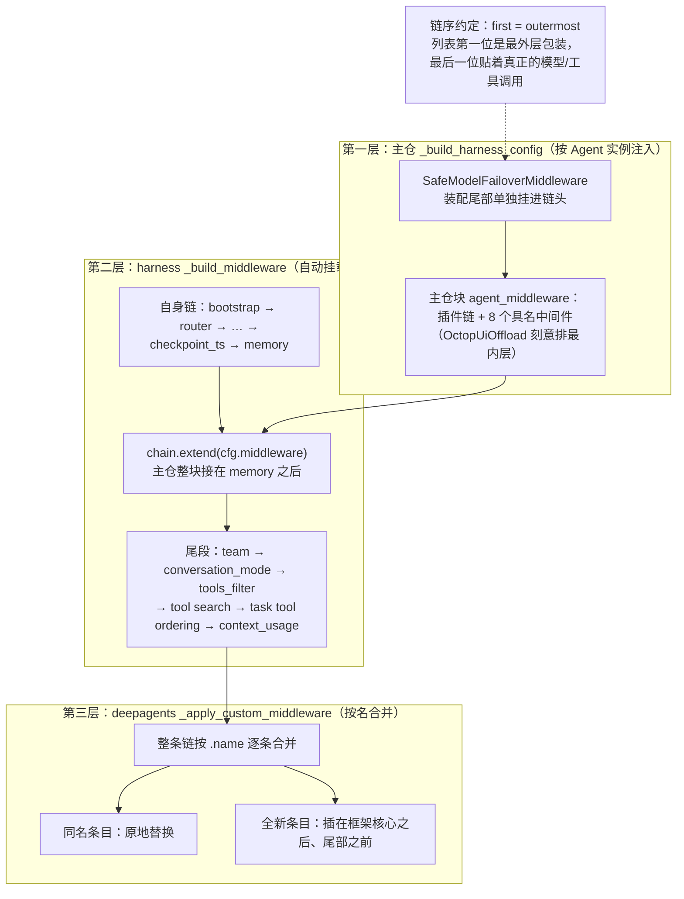
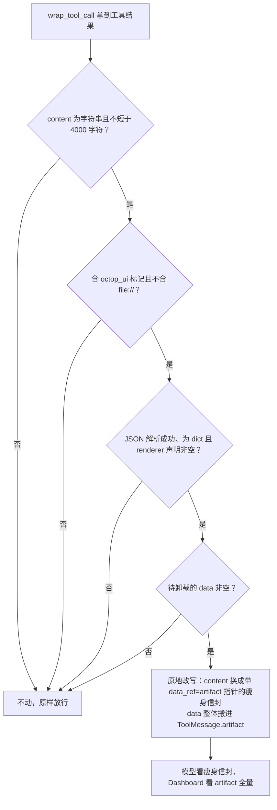
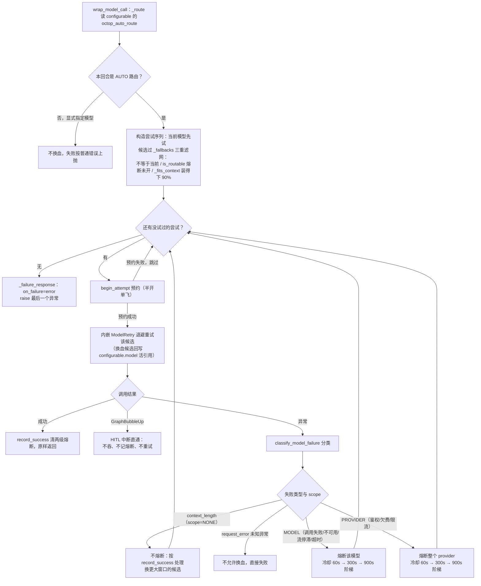

本篇拆解 Octop 在 harness（octop-harness，其下是 deepagents）之上加装的**逐次调用治理层**：每次模型调用前后、每次工具调用前后插进来的那圈中间件（middleware，一种在不改框架源码的前提下包装请求/响应的插件切面）。

[02：单轮任务执行](./02-agent-turn-execution.md) 给出了执行循环，前一部分说明能力从哪里来。本篇放大调用前后的处理：上下文怎样组装和压缩，额度怎样约束调用，模型失败后怎样切换。模型配置和候选策略仍由 [01：Agent 装配与生命周期](./01-agent-lifecycle-and-providers.md) 负责。

基线同系列：主仓 `v1.0.2`（commit `dd9dce47`），`.venv` 实装 octop-harness 1.0.2、deepagents 0.7.16、langchain 1.4.2。后补的装配与压缩说明按 harness checkout `1.0.5` 单独标记；原实装记录不代表该版本完整执行链。上下文卸载的路径规则见 [03 篇](./03-workspace-and-backend-abstraction.md)，本篇聚焦卸载时机及模型可见内容。

## 一、上下文来源与中间件装配

一次模型调用的输入涉及五类来源。下面按内容责任划分，实际注入还受当前模式、工具过滤、召回结果和压缩状态影响。

| 来源 | 进入模型的内容 | 写入与维护职责 | 深入阅读 |
| --- | --- | --- | --- |
| 系统提示 | 专家基础提示与运行指令 | 平台配置、人格设置与 harness 建图 | [01](./01-agent-lifecycle-and-providers.md)、[04](./04-skills-experts-plugins.md) |
| 工作区文件 | AGENTS.md、MEMORY.md、USER.md、SOUL.md 等 | 种子初始化、文件编辑；原生 MemoryMiddleware 注入 | [03](./03-workspace-and-backend-abstraction.md)、[09](./09-memory-system.md) |
| 记忆召回 | 与当前请求相关的长期记忆 | 召回中间件保存快照，再向模型请求副本注入 | [09](./09-memory-system.md) |
| 技能与工具 | 技能提示、子 Agent 清单和工具定义 | 扩展装配、工具过滤与按需加载 | [04](./04-skills-experts-plugins.md)、[05](./05-connectors-and-mcp-gateway.md)、[10](./10-knowledge-base-rag.md) |
| 会话状态 | 当前消息、工具结果、摘要与近期消息 | 执行图维护，checkpointer 持久化；压缩调整窗口视图 | 本文第五节与 [08](./08-versioned-history-and-trajectory.md) |

harness 的 `MemoryMiddleware` 负责会话捕获等运行时工作，deepagents 的同名中间件负责文件内容注入，不能仅凭类名把两者视为同一层。trajectory 中的 `turn_context` 为部分输入留下摘要与来源记录，便于追查；它不是完整模型请求的逐字副本。

接下来先说明这些内容经过哪些 hook，再看具体卸载、故障转移与压缩分支。

### 1、hook：一次调用前后的可插拔切面

三层中间件共用同一个基类接口——langchain 1.4.2 的 `AgentMiddleware`（`langchain/agents/middleware/types.py:385`），Octop 主仓、octop-harness、deepagents 的中间件全部是它的子类。

基类提供的钩子（hook，框架在固定时机回调的方法，每个都有同步/异步一对）：

| 钩子 | 时机 | Octop 主仓用到它的中间件 |
| --- | --- | --- |
| `before_agent` / `abefore_agent` | 一个回合（agent turn）开始前 | TokenQuota |
| `wrap_model_call` / `awrap_model_call` | 包住每次模型调用，可改请求、可换模型、可重试 | SafeModelFailover、Reasoning、KnowledgeHint、WorkspaceImage |
| `wrap_tool_call` / `awrap_tool_call` | 包住每次工具调用，可改参数、可改结果、可直接拒绝 | BrowserProfile、BinaryReadGuard、ThreadArtifacts、OctopUiOffload |
| `before_model` / `after_model` | 模型调用前 / 调用后 | 主仓未用（harness 的 MediaOffload、deepagents 的 Summarization 用） |
| `after_agent` | 回合结束后 | 主仓未用 |

列表语义在 langchain 里有明确约定——`langchain/agents/factory.py:720` 的 `_chain_async_tool_call_wrappers` docstring 写着「Compose async wrappers into middleware stack (**first = outermost**)」：列表第一位是最外层包装，最后一位贴着真正的模型/工具调用。链序就是请求流经的顺序。

### 2、三层装配：从 `_build_harness_config` 到 deepagents 的链

主仓的中间件清单在 `AgentManager._build_harness_config` 里按 Agent 逐个构造（实例注入），harness 在 `_build_middleware` 里把它们整块拼进自己的链，deepagents 再把整条链拼进框架核心与尾部之间。这条装配路径以实例和参数为接口；第五节捕获摘要中间件的临时替换另有兼容约束。

主仓装配点（`src/octop/infra/agents/manager.py:3873-3897`，01 篇引过该函数，这里聚焦中间件段）：

```python
# FilesystemGuard + ModelSettings 在 octop-harness（自动挂载）。
# BinaryReadGuard 留在 Octop（inbound/附件的产品策略）。
# ThreadArtifacts 在工具成功后把 workspace 路径写回 threads。
# WorkspaceImageMaterialize 在模型调用时展开纯路径的视觉引用。
# OctopUiOffload 保持最内层，使所有外层中间件观测到的是瘦身后的
# content；它只触碰 octop_ui 插件信封，与 ThreadArtifacts 关心的
# 文件工具结果不相交。
agent_middleware: list[Any] = [
    *plugin_middleware,
    TokenQuotaMiddleware(
        policy_repo=self._repos.user_policy_repo,
        usage_repo=self._repos.usage_repo,
    ),
    ReasoningRequestMiddleware(),
    KnowledgeSearchHintMiddleware(),
    BrowserProfileMiddleware(),
    BinaryReadGuardMiddleware(),
    WorkspaceImageMaterializeMiddleware(workspace=ws),
    ThreadArtifactsMiddleware(
        thread_repo=self._repos.thread_repo,
        workspace_dir=harness_workspace,
        agent_id=row.agent_id,
    ),
    OctopUiOffloadMiddleware(),
]
```

要点：清单里 8 个具名中间件，7 个来自 `src/octop/infra/agents/middleware/` 目录，`KnowledgeSearchHintMiddleware` 在 `src/octop/infra/knowledge/hint.py`——目录不是边界，装配点才是；目录里第 8 个文件 `model_failover.py` 的实例不在字面清单上，而在装配函数尾部单独挂进链头（§三）。

`*plugin_middleware` 是 harness 插件注册表按 priority 排序产出的第三方链（`octop_harness/plugins/registry.py` 的 `build_middleware_chain`，docstring「Return middleware instances sorted by priority (lower runs earlier)」）。

TokenQuota（两个 repo）与 ThreadArtifacts（thread_repo）共三个仓库句柄直接拿 `self._repos.*` 注入构造器——主仓 DB 进中间件，是后文边界讨论的核心证据。

harness 侧的拼接点（`octop_harness/agent.py:1511-1518`，实装 1.0.2）：

```python
chain.append(CheckpointTsMiddleware())

memory_mw = self._memory_runtime.build_middleware()
if memory_mw is not None:
    chain.append(memory_mw)

if cfg.middleware:
    chain.extend(cfg.middleware)
```

主仓整块落在 harness 的 MemoryMiddleware 之后、团队/工具过滤之前。

harness 自己的链在 `_build_middleware`（`octop_harness/agent.py:1422`）里组装，docstring 给出了完整声明顺序：bootstrap → router → model_settings → session_header → skill_filter → tool_guard → filesystem_guard → mcp_tools → retry → pii → media_offload → checkpoint_ts → memory → **user middleware** → team → conversation_mode → tools_filter → tool search → task tool ordering → context_usage（条件项按配置省略）。`HarnessAgent._init_graph` 再在最前面补 langchain 的 `TodoListMiddleware`（`agent.py:1246-1250`）。

最后一层：harness 把整条链作为 `middleware=` 传给 `deepagents.create_deep_agent`（`octop_harness/agent.py:1675-1682`）。

deepagents 0.7.16 的 `_apply_custom_middleware`（`deepagents/graph.py:204-238`）按名合并——同名（`.name` 匹配）原地替换，全新条目插在框架核心（Skills/Filesystem/SubAgent/Summarization/PatchToolCalls）之后、尾部（profile/prompt-caching/Memory/HITL）之前。框架内部的逐个拆解归本站 Deep Agents 系列，本篇只引这一处接口签名层面的行为。

三层各拼一次的装配链路如下图：



图中最要紧的两个落点：主仓块不是替换 harness 的链，而是嵌进其自身链的中段（memory 之后、team 等尾段之前）；deepagents 侧同名条目原地替换，只有全新条目才插进框架核心与尾部之间。

### 3、全景清单

按「模型调用治理 / 工具调用治理 / 回合闸门 / 上下文工程」四类，三层中间件的全景如下（主仓与 harness 各一表，deepagents 只列名）。

主仓（实例注入，`_build_harness_config` 装配，每次 rebuild 重建实例）：

| 中间件 | 钩子 | 一句话职责 | 挂载条件 |
| --- | --- | --- | --- |
| `SafeModelFailoverMiddleware` | wrap_model_call | AUTO 路由下的重试 + 按健康与上下文容量换模型（§三） | 有共享模型工厂且 `model_retry_enabled`（默认开） |
| 插件链 `*plugin_middleware` | 任意 | harness 插件包注册的第三方中间件，priority 排序 | 插件启用 |
| `TokenQuotaMiddleware` | before_agent | 回合开始前校验用户终身 token 配额 | 恒挂 |
| `ReasoningRequestMiddleware` | wrap_model_call | 把每回合的推理参数覆盖（`octop_reasoning_overrides`）合入 model 对象 | 恒挂 |
| `KnowledgeSearchHintMiddleware` | wrap_model_call | 按回合改写 `search_knowledge` 工具描述；未挂知识库时整个隐藏该工具 | 恒挂 |
| `BrowserProfileMiddleware` | wrap_tool_call | 强制 `browser_use` 落在当前用户的隔离浏览器 profile 上 | 恒挂 |
| `BinaryReadGuardMiddleware` | awrap_tool_call | 拦截 `read_file` 读二进制/非白名单附件，改引导用 shell + 技能 | 恒挂 |
| `WorkspaceImageMaterializeMiddleware` | wrap_model_call | 模型调用前把 `workspace://` 图片引用展开成 `data:` URI | 恒挂 |
| `ThreadArtifactsMiddleware` | wrap_tool_call | 文件产出工具成功后把路径记入 `threads.artifacts`（团队房间镜像） | 恒挂 |
| `OctopUiOffloadMiddleware` | wrap_tool_call | 超大 `octop_ui` 工具信封把 `data` 搬到 `ToolMessage.artifact` | 恒挂 |

harness（`_build_middleware` 自动挂载，宿主通过 config/configurable 控制）：

| 中间件 | 职责 | 挂载条件 |
| --- | --- | --- |
| `ModelRouterMiddleware` | 每次调用按优先级链选模型（configurable.model → 选择器 → 多模态默认 → default_model） | 恒挂 |
| `ModelSettingsMiddleware` | 从 configurable 合入 temperature/top_p/max_tokens 与上下文上限 | 恒挂 |
| `SessionHeaderMiddleware` | 绑定 thread_id，供逐调用 HTTP 会话头注入 | 恒挂 |
| `SkillFilterMiddleware` | Agent 级 + 按请求的技能过滤 | 恒挂 |
| `ToolGuardMiddleware` | 危险工具参数（shell 命令等）扫描：block/warn/require_approval | `tool_guard_enabled` |
| `FilesystemGuardMiddleware` | 路径 deny 规则 + 越根软失败 | 恒挂 |
| `MCPToolMiddleware` | 按请求过滤 MCP 服务器工具 | 配了 MCP |
| `ModelRetryMiddleware` | 裸重试（指数退避） | `model_retry_enabled`（**Octop 关闭**，见 §三） |
| `PIIMiddleware` | API key 与中文个人信息的检测脱敏 | `pii_enabled` |
| `MediaOffloadMiddleware` | 大体积内联媒体（base64 图片/音频）落盘换占位符 | `media_offload_enabled` |
| `CheckpointTsMiddleware` | 给新消息打 `checkpoint_ts` 时间戳 | 恒挂 |
| `MemoryMiddleware` | 会话捕获进 octop-memory / JSONL | 记忆启用时 |
| `PeerAgentMiddleware` | `ask_agent` 跨 Agent 委派 | `team_enabled` |
| `ConversationModeMiddleware` | Ask/Plan/Craft 三模式工具白名单与计划写约束 | 恒挂 |
| `ToolsFilterMiddleware` | 隐藏 `tools_disabled` 列表中的工具 | 恒挂 |
| `ToolSearchMiddleware` | 渐进式工具加载 | 配置 |
| `TaskToolLastMiddleware` | 稳定工具顺序，`task` 置尾 | 配置 |
| `ContextUsageMiddleware` | 捕获最终请求的上下文用量（供用量统计与 failover 估算） | 恒挂 |
| `BootstrapMiddleware` | 首次开机引导（BOOTSTRAP.md），插在链头 | 引导未完成时 |

deepagents 自己还挂两层，全部自动、宿主不可排除：

- **核心**（图的行为基座）：`SkillsMiddleware`、`FilesystemMiddleware`、`SubAgentMiddleware`、`SummarizationMiddleware`、`PatchToolCallsMiddleware`。
- **尾部**：profile/prompt-caching/`MemoryMiddleware`、`HumanInTheLoopMiddleware`、`_ToolExclusionMiddleware`。

注意命名陷阱：deepagents 的 `MemoryMiddleware`（注入 AGENTS.md/MEMORY.md 工作区文件）与上表 harness 的 `MemoryMiddleware`（会话捕获，09 篇）是两个东西。

### 4、包内视角：装配契约与清单补全（checkout v1.0.5）

上表按实装 1.0.2 归纳；checkout `v1.0.5` 的 `_build_middleware`（`agent.py:1469`）docstring 给出**完整声明顺序**，本身即一份写死的契约（原「harness 分模块」深潜篇的中间件节并入此处）：

```
bootstrap（前插）→ router → model_settings → session_header → skill_filter
→ mcp_tool_error → tool_guard → filesystem_guard → mcp_tools → retry → pii
→ media_offload → checkpoint_ts → memory（结构化记忆）→ 用户 middleware
→ team（peer）→ conversation_mode → tools_filter → decision（可选）
→ tool_search → task_tool_last → context_usage
```

与上表相比多出的四个条目：

- `McpToolErrorMiddleware`（`mcp_tool_error.py`）：把 MCP `McpError` 与输出 schema `RuntimeError` 转成失败工具结果、本轮继续。1.0.5 起；实装 1.0.2 的语义是可能中断本轮。
- `MemoryRecallMiddleware`（`memory_recall.py`）：逐消息持久召回快照与干净转录回放，机制归 09 篇四.1。
- `DecisionMiddleware`（`decision.py`）：主模型开口前用决策模型预筛技能/工具/队友。1.0.4 起可选，前端 decision notice 的来源。
- `TurnAwareProfile`（`turn_aware_profile.py`）：让 Summarization 的比例阈值跟随回合级模型选择。

辅助件 `runtime.py` / `turn_model.py` / `client_tool_search.py` / `native_tool_search.py` 是运行时助手与两版兼容 re-export。

主仓八件套与 harness 链的关系可以一句话说清：**这些治理本来就在链上，主仓只是配置与消费**。三处对应：

- model_failover ↔ `model_retry`：主仓替换式接管（§三）；
- UI 载荷卸载 ↔ `media_offload` 之上的产品信封层（§二.1）；
- token 配额：插在用户 middleware 槽的最前（顺序敏感的完整讨论见六.4）。

顺序约束全靠 docstring 与 review 维持：28 个中间件全是类实例按序排列，没有优先级数字。顺序错了不会报错，只会行为漂移——media_offload 挪到 PII 前，PII 就扫不到明文。

## 二、四个代表性中间件走读

### 1、OctopUiOffloadMiddleware：把大载荷搬出上下文

这是全链最典型的**上下文卸载**（context offload——把「UI 需要但模型不需要」的大数据从进上下文的 content 字段搬到消息上不进上下文的旁路字段）。触发条件四条全中才动手，动作是原地改写，失败永远不阻断工具调用。

背景在仓内设计文档 `docs/octop-ui-payload-offload.md`：bilibili-anime 插件一次搜索可返回 13-24 KB 的剧集 JSON（PoC 复现 22.5 KB），这个字符串同时服务模型上下文、历史持久化、Dashboard 实时渲染、插件 UI 四类消费者，截断会丢 UI 数据，只能分离数据面与控制面。核心实现（`src/octop/infra/agents/middleware/octop_ui_offload.py:63-85`）：

```python
def _offload(self, result: ToolMessage | Command[Any]) -> None:
    if not isinstance(result, ToolMessage):
        return
    content = result.content
    if not isinstance(content, str) or len(content) < _OFFLOAD_MIN_CHARS:
        return                      # 4000 字符以下不动
    if '"octop_ui"' not in content or _FILE_URL_GUARD in content:
        return                      # 非 octop_ui 信封不动；含 file:// 不动
    try:
        envelope = json.loads(content)
    except (ValueError, TypeError):
        return
    if not isinstance(envelope, dict):
        return
    hint = envelope.get("octop_ui")
    if not isinstance(hint, dict) or not str(hint.get("renderer") or "").strip():
        return                      # 没有渲染器声明的不算 UI 信封
    data = envelope.pop("data", None)
    if not data:
        return
    envelope["data_ref"] = "artifact"
    result.content = json.dumps(envelope, ensure_ascii=False)
    result.artifact = data          # data 整体搬到 artifact 字段
```

四个条件的短路判定顺序如下：



四道门是串行短路判断，任何一道不过就原样放行；全过才落到唯一那步原地改写。

三个细节值得停下来。第一，`ToolMessage.artifact` 是消息上的一等字段但不进模型请求——模型请求转换器只序列化 `content`，历史持久化与 WS 实时帧却保留 artifact，于是「模型看瘦身信封（含 `data_ref: "artifact"` 指针），Dashboard 看 artifact 全量」各取所需。

第二，原地改写（`result.content = ...`）而非新建 ToolMessage，保住 `id`/`tool_call_id`/`status` 等字段，链上其他消费者无感。

第三，`file://` 守卫：下游的媒体提取和 ThreadArtifacts 路径扫描从 content 里找文件路径，若插件把 `file://` 路径塞在 `data` 里，剥离会让提取失效，所以含此标记一律退回旧行为。

外层 `_try_offload` 把整个动作包在 try/except 里，任何异常只记 warning——设计文档的原则「Offload must never break a tool call」落在代码上。

阈值 4000 的选取依据（文档 §7 Q3）：其余 octop_ui 插件正常输出 2-3 KB 以内不误伤，bilibili 默认参数几乎恒触发——它正是要修的对象。

### 2、TokenQuotaMiddleware：回合入口的配额闸门

配额检查挂在**回合**而不是模型调用上——`before_agent` 是全链最早的钩子，超限直接抛 `OctopError`，整个回合（含所有迭代和工具调用）不会开始；回合一旦放行，中途不再复查。

`src/octop/infra/agents/middleware/token_quota.py` 全文只有 34 行，两个关键片段：

```python
def configurable_user_id() -> int | None:
    try:
        configurable = dict(get_config().get("configurable") or {})
    except RuntimeError:
        return None                 # 无 LangGraph 运行上下文时不设限
    raw = configurable.get("user")
    if isinstance(raw, int):
        return raw
    if isinstance(raw, str) and raw.isdigit():
        return int(raw)             # 网关放的是字符串 id
    return None
```

```python
class TokenQuotaMiddleware(AgentMiddleware[Any, Any]):
    def __init__(self, *, policy_repo: Any, usage_repo: Any) -> None:
        super().__init__()
        self._policies = policy_repo
        self._usage = usage_repo

    def _enforce(self) -> None:
        user_id = configurable_user_id()
        if user_id is not None:
            assert_token_quota_available(self._policies, self._usage, user_id)

    def before_agent(self, state: Any, runtime: Any) -> None:
        del state, runtime          # 参数刻意丢弃：只看运行上下文
        self._enforce()
```

行为人是「当前发起对话的用户」而非 Agent 属主：网关在 `build_harness_request`（`src/octop/infra/gateway/process/harness_request.py:313`）把 `user_id` 以字符串放进请求顶层的 `user` 键，harness 的请求对象再把它自动注入 `configurable`（`octop_harness/request.py:113-115` docstring 明列 `user` 等键「are injected into configurable automatically」），中间件从 configurable parse 回 int——共享 Agent 上谁的配额谁掏。

判定逻辑在 `src/octop/infra/users/resource_policy.py` 的 `assert_token_quota_available`：配额为 None 直通（默认不限），否则拿 `usage_repo.total_tokens_for_user(user_id)` 的终身累计与配额比较，超了抛 `TOKEN_QUOTA_EXCEEDED`（API 层映射成 HTTP 错误码，错误文案走 i18n）。

注意这是每回合一次的同步 DB 聚合查询，用量统计的回写路径（usage_log）不在本篇展开。

### 3、BinaryReadGuardMiddleware：字节进上下文之前

这是一条**产品策略**守卫——deepagents 的 `read_file` 读 PDF/Office 文件会把乱码或转码后的巨量文本灌进上下文，Octop 的答案不是改 read_file，而是在工具调用外面包一层直接拒绝，并用错误消息引导模型改走 shell + 技能路线。

拦截规则（`src/octop/infra/agents/middleware/binary_read_guard.py:76-96`）：

```python
def read_file_block_reason(path: str) -> str | None:
    """当 path 不允许经 read_file 读取时返回拒绝消息。"""
    if not path:
        return None
    ext = _extension(path)
    if ext == ".pdf":
        return (
            f"read_file blocked for binary PDF `{path}`. "
            "Use execute_shell_command with the pdf skill (pdftotext, "
            "pdfplumber, etc.) instead."
        )
    if ext in _BLOCKED_EXTENSIONS:        # doc/docx/xls/…/zip/bin/gif/webp/jpg/png
        return (
            f"read_file blocked for binary file `{path}`. "
            "Use execute_shell_command or the matching skill instead."
        )
    if _is_inbound_attachment(path) and ext and ext not in _TEXT_EXTENSIONS:
        return (                          # inbound/ 下非白名单后缀一律拦
            f"read_file blocked for inbound attachment `{path}`. "
            "Use execute_shell_command or the matching skill instead."
        )
    return None
```

三条规则的严格程度递进：`.pdf` 单列（给出具体的 pdftotext/pdfplumber 指引，因为附件场景里 PDF 最常见）；已知二进制扩展名通拦；`inbound/` 目录（IM 上传附件的落点，见 03/11 篇）里凡不在文本白名单（txt/md/json/csv/源码等 14 种）的扩展名都拦——未知后缀的附件默认不可读。

拦截发生在 handler 之前：`awrap_tool_call` 里对 `read_file` 的调用直接返回 `status="error"` 的 ToolMessage，工具本体根本不会执行，字节碰不到上下文。拒绝消息本身就是 prompt——告诉模型「该用什么替代」，让它在下一轮自己改道，而不是让用户看到失败。

一个源码事实：该中间件只实现了 `awrap_tool_call`（异步版），没有同步 `wrap_tool_call`；Octop 聊天链路走异步流式所以主路径无缺口，同步调用是否绕过守卫未核验（列入文末）。

### 4、WorkspaceImageMaterializeMiddleware：临调用才展开的图片引用

这个中间件与 harness 的 `MediaOffloadMiddleware` 是同一问题（图片 base64 撑爆上下文）的两个相反方向的解——media_offload 把已在上下文里的大字节**变小**（落盘换占位符），workspace_image 让从未进上下文的大字节**在最后一刻变大**（引用展开成 data: URI）。

Octop 的 IM 入口收到图片时不把 base64 写进消息，而是落盘到工作区再放一个路径引用（`src/octop/infra/gateway/media/attachment_hints.py:247` 的 `workspace://` scheme，03 篇讲过落盘规则）。checkpoint、历史、Dashboard 载荷里因此只有路径字符串；模型要看图，就得在发请求前展开（`src/octop/infra/agents/middleware/workspace_image.py:31-45`）：

```python
def wrap_model_call(
    self,
    request: ModelRequest[Any],
    handler: Callable[[ModelRequest[Any]], ModelResponse[Any]],
) -> ModelResponse[Any]:
    messages = self._expand_messages_sync(request.messages)
    return handler(request.override(messages=messages))
```

`_expand_messages` 扫每条消息的 content 块，只有含 `workspace://` 引用的消息才 `model_copy(update={"content": ...})` 换新块，其余原样传递——按需物化，改的也只是发出去的请求副本（`request.override`），LangGraph state 里的消息保持小形态。

展开走 `expand_workspace_image_ref`，经构造时注入的 `BackendWorkspace`（`ws`，在 `_build_harness_config` 里与 ThreadArtifacts 共用同一个实例）读文件生成 `data:` URI。

docstring 给出的动机直白：base64 永不落 LangGraph state，也就永不进 dashboard 历史载荷。代价是每次模型调用都要重新读盘展开同一张图——若同一图片在多轮间反复出现，token 成本每轮重付；这个代价与 media_offload 的「首轮流字节、次轮起占位」策略正好互为镜像。

两套机制在 Octop 里同时开着：`media_offload_enabled` 在 harness config 默认 True（`octop_harness/config/__init__.py:716`），主仓没有关它。

## 三、model_failover 的执行机制

### 1、与 01 策略层的衔接：替换而非叠加

01 讲的策略层（健康注册表、AUTO 候选、失败分类）在本篇的执行层落成一个动作——主仓把 harness 原生的 `ModelRetryMiddleware` 关掉，换成自己的 `SafeModelFailoverMiddleware` 插在主仓块链头。替换式接入的代码在 `manager.py:4068-4108`：

```python
if applied.model_retry_enabled:
    factory = self._harness_manager.shared_factory if self._harness_manager is not None else None
    get_chat_model = getattr(factory, "get_chat_model", None)
    if callable(get_chat_model):
        from octop.infra.agents.middleware.model_failover import (
            SafeModelFailoverMiddleware,
        )

        retry_middleware: Any = SafeModelFailoverMiddleware(
            health=self._model_health,
            candidates=lambda _current_ref, needs_multimodal: (
                self._providers.list_auto_route_candidates(
                    needs_multimodal=needs_multimodal
                )
            ),
            model_for_ref=get_chat_model,
            max_retries=applied.model_retry_max_retries,
            initial_delay=applied.model_retry_initial_delay,
            max_delay=applied.model_retry_max_delay,
            on_failure="error",
        )
    else:
        from langchain.agents.middleware import ModelRetryMiddleware

        # 无共享工厂时退回裸重试（省略三个 delay/retry 参数赋值）
        retry_middleware = ModelRetryMiddleware(
            max_retries=applied.model_retry_max_retries,
            on_failure="error",
        )

    applied = replace(
        applied,
        model_retry_enabled=False,          # 关掉 harness 原生重试
        middleware=[
            retry_middleware,
            *(applied.middleware or []),     # 插在主仓块链头
        ],
    )
```

`model_retry_enabled` 在 harness config 里默认 True（`octop_harness/config/__init__.py:646`），所以正常运行时走的是 SafeModelFailover 分支；`tests/unit/agents/test_agent_manager.py:1704-1719` 断言了这条装配（恰好一个 failover 实例、原生开关已关、`on_failure == "error"`）。

换血不叠加的理由是重试语义冲突：裸 retry 在原地退避重打同一模型，failover 要的是「同一模型重试 N 次 → 换下一个候选再试」——如果两层都开，指数退避会相乘。

SafeModelFailover 的构造器里内嵌了一个 `ModelRetryMiddleware`（`model_failover.py:74-79`）作为**每个候选**的重试引擎，全程只有这一层退避。

开关信号从哪来：网关 processor 构造回合请求时传入 `auto_route=model_route.automatic`（01 篇的策略层判定，`src/octop/infra/gateway/process/processor.py:1480`），`build_harness_request` 把它翻成 `configurable["octop_auto_route"] = True`（`harness_request.py:319-320`）。

中间件 `_route` 读这个键判定本回合是否自动路由——显式指定模型的回合**不换血**，失败按普通错误上抛。

### 2、尝试序列：候选过滤与半开预约

一次 `wrap_model_call` 最多构造「当前模型 + 过滤后的候选序列」的尝试列表，每个尝试要过三重滤网：不等于当前、熔断未开、上下文装得下。

`src/octop/infra/agents/middleware/model_failover.py:118-152`（同步版；异步版逻辑相同）：

```python
def wrap_model_call(self, request, handler) -> ModelResponse[Any]:
    current_ref, automatic = self._route(request)
    last_error: Exception | None = None
    attempts: list[tuple[str, Any]] = []
    if not automatic or not current_ref or self._health.begin_attempt(current_ref):
        attempts.append((current_ref, request.model))     # 当前模型先试
    if automatic and current_ref:
        attempts.extend(
            (candidate.ref, self._model_for_ref(candidate.ref))
            for candidate in self._fallbacks(request, current_ref)
        )

    for ref, model in attempts:
        if automatic and ref != current_ref and not self._health.begin_attempt(ref):
            continue                                       # 预约失败跳过
        routed = request if model is request.model else request.override(model=model)
        if automatic and ref and ref != current_ref:
            _configurable(request)["model"] = ref          # 回写活引用
        try:
            response = self._retry.wrap_model_call(routed, handler)  # 内嵌重试
        except GraphBubbleUp:
            raise                                          # HITL 中断直通
        except Exception as exc:
            last_error = exc
            may_failover = self._record_failure(ref, exc)
            if not automatic or not may_failover:
                return self._failure_response(exc)         # 不可换血：直接失败
            logger.warning("AUTO model route failed; trying next candidate: model=%s", ref)
            continue
        self._health.record_success(ref)
        return cast(ModelResponse[Any], response)

    return self._failure_response(
        last_error or RuntimeError("no healthy AUTO model is available")
    )
```

`_fallbacks` 的三重滤网（`model_failover.py:99-110`）：`candidate.ref != current_ref`（当前模型在前面已单独尝试）、`self._health.is_routable(candidate.ref)`（模型级与 provider 级熔断都未开）、`_fits_context(candidate, estimated, route_cap)`。第三重值得展开（`model_failover.py:42-52`）：

```python
_CONTEXT_SAFETY_RATIO = 0.9

def _fits_context(candidate, estimated_tokens, route_cap=None) -> bool:
    cap = candidate.max_input_tokens
    if route_cap is not None and route_cap > 0:
        cap = min(cap, route_cap) if cap > 0 else route_cap
    if cap <= 0:
        return True                     # 未知容量视为可装
    return estimated_tokens <= int(cap * _CONTEXT_SAFETY_RATIO)
```

候选容量来自 01 篇讲过的 `list_auto_route_candidates`（`providers/store.py:309-340`，`max_input_tokens` 或 `context_window` 字段），估算值来自 harness 的 `breakdown_from_model_request`（`octop_harness/context_usage.py:247`，与 ContextUsageMiddleware 同一套估算），再与宿主配置的 `max_input_tokens` 上限取小——**换过去的模型必须装得下这次请求的 90%**，否则跳过该候选。

多模态同样参与过滤：`latest_human_needs_multimodal`（harness `turn_model.py`）检测最新人类消息是否带非文本块，是则只留视觉模型。

两个 harness 依赖都是纯函数复用而非拷贝——执行层借策略包的估算器，避免第三套 token 口径。

### 3、失败分类与熔断状态机

换不换、熔断谁，由 `classify_model_failure` 的一次分类决定；`ModelHealthRegistry` 维护 model/provider 两级熔断器，冷却时间 60s → 300s → 900s 阶梯递增，半开状态单飞。

分类（`src/octop/infra/agents/providers/health.py:60-84`）：

```python
def classify_model_failure(exc: Exception) -> FailureDecision:
    """决定 AUTO 路由在 exc 之后可否换下一个模型。"""
    detail = exception_display_message(exc)
    lower = detail.lower()
    if any(marker in lower for marker in _MODEL_NOT_FOUND_MARKERS):
        return FailureDecision(True, "model_not_found", FailureScope.MODEL)

    classified = classify_stream_error_message(detail)   # 复用流错误分类（12 篇）
    if classified == CONTEXT_LENGTH:
        return FailureDecision(True, "context_length", FailureScope.NONE)
    if classified in _PROVIDER_FAILURES:   # 鉴权/余额/限流
        return FailureDecision(True, …, FailureScope.PROVIDER)
    if classified in _MODEL_FAILURES:      # 调用失败/不可用/流停滞/网络超时
        return FailureDecision(True, …, FailureScope.MODEL)
    if isinstance(exc, TimeoutError | ConnectionError):
        return FailureDecision(True, type(exc).__name__.lower(), FailureScope.MODEL)
    return FailureDecision(False, "request_error", FailureScope.NONE)
```

scope 决定熔断对象：PROVIDER 级失败（key 失效、欠费、限流）拉黑整个 provider 下所有模型——换同厂的下一个模型没有意义；MODEL 级只拉黑该模型；`context_length` 是特例，scope 为 NONE：`record_failure` 对 NONE 的处理是调 `record_success`（`health.py:159-163`，注释「策略/输入错误同样证明端点答了话」）——端点是健康的，只是这个请求太大，换一个窗口更大的候选即可，不该连坐。

未知异常（`request_error`）**不允许换血**（`failover=False`），直接走失败路径——保守取向：看不懂的错不去撞下一家。

熔断器本身（`health.py:128-179`）：`begin_attempt` 是预约语义——健康模型直接预约成功；冷却期过后的半开（half-open）状态同一时刻只放一个探测请求在飞（`half_open_in_flight` 标志，provider 级和 model 级各自维护），并发换血不会把一个 provider 打成多路探测。

失败计数对应冷却 60s、300s、900s 封顶（`_cooldown`）；`record_success` 同时清掉模型级和 provider 级状态。全部状态在进程内存里，重启即清零（docstring 明说「A process restart clears all circuits and gives every configured model a fresh chance」）——与 01 篇「配置在 DB、健康在内存」的分工一致。

### 4、成功、直通与失败兜底

三个边界行为补全执行路径。成功时 `record_success(ref)` 关熔断后原样返回 response——链上外层（harness 的 PII、deepagents 尾部）无感知换过血。

`GraphBubbleUp` 直通：LangGraph 的中断（HITL 审批、用户 steer）以这个异常类型冒泡，failover 把它当控制流而不是失败，不吞、不记熔断、不重试。

全部候选耗尽时 `_failure_response` 兜底——Octop 传的是 `on_failure="error"`，所以直接 raise 最后一个异常，交给上层流错误分类与用户提示（i18n 的 `model_retry_failure_prompt` 分支保留给需要软失败回复的宿主用）。

还有一个容易漏看的动作：换血成功后 `_configurable(request)["model"] = ref` 把活引用回写进运行上下文——与 harness `ModelRouterMiddleware` 路由后回写 `configurable["model"]`（`model_router.py:89-91`，注释「Stamp the live chat ref so extract can fall back to it when aux fails」）是同一约定，让记忆抽取等辅助 LLM 调用能感知本回合实际用到的模型。

model_failover 的完整执行路径如下图：



图里最关键的两个分支：`context_length` 是唯一「换血但不熔断」的失败——端点健康，只是请求太大；`GraphBubbleUp` 是唯一不进分类的中断——HITL 控制流直通，不惊动熔断器。

## 四、边界：主仓 middleware 与 harness middleware 的分工

### 1、主仓 8+1 个的依赖证据

主仓中间件没有一个是「也可以放 harness」的误放——每个都有一处 import 或构造参数越过组件包边界，指向 Octop 平台自有概念。

| 中间件 | 越界依赖 | 平台概念 |
| --- | --- | --- |
| SafeModelFailover | `providers/health.py`、`providers/store.py`、i18n 失败文案 | Octop 的 provider 库存与健康状态 |
| TokenQuota | 构造注入 `user_policy_repo`、`usage_repo`，调用 `users/resource_policy.py` | 用户配额表与用量表 |
| Reasoning | 读 `octop_reasoning_overrides`（网关 `harness_request.py:323-324` 写入） | 每回合推理开关的产品契约 |
| KnowledgeHint | `infra/knowledge/tools.py` 的 `search_knowledge` | Octop 知识库工具（10 篇） |
| BrowserProfile | `infra/utils/browser_media.py` 的 `user_browser_profile` | 按 Octop 用户隔离的浏览器 profile |
| BinaryReadGuard | `inbound/` 路径约定（无 import，纯产品策略） | IM 附件落盘目录（03/11 篇） |
| WorkspaceImage | `infra/gateway/media/attachment_hints.py` 的 `workspace://` scheme | 网关媒体落盘协议 |
| ThreadArtifacts | 构造注入 `thread_repo`，`infra/agents/threads/artifact.py` | threads 表的 artifacts 列（08 篇） |
| OctopUiOffload | `octop_ui` 信封契约（dashboard 插件 UI 协议） | 前端渲染协议 |

反过来看 harness 侧自动挂载的中间件：全部不 import octop 任何模块，参数只来自 `HarnessAgentConfig` 字段或运行时 configurable。两个包之间是干净的单向依赖（主仓 → harness），中间件层的切分与 01 篇注册表的切分同构。

### 2、harness 对照：机制泛化与「喂数式」接入

主仓与 harness 的分工不是「重要的放主仓」，而是四种接入模式并存；判断标准是**依赖方向**与**变化频率**。

模式一（实例注入）：上面的 8+1 个，平台能力以实例进链。

模式二（机制+配置键）：harness 提供通用机制，宿主通过 configurable 喂数据——`ModelSettingsMiddleware`（`octop_harness/middleware/model_settings.py:20-65`）从 `configurable["model_settings"]`/`max_input_tokens` 合入参数，这两个键由 Octop 的 runtime_limits 设置层写入（`src/octop/infra/agents/settings/runtime_limits.py`），harness 代码对 Octop 一无所知。

模式三（数据下沉）：引擎在 harness，策略数据在主仓——`ToolGuardMiddleware` 的规则目录由主仓在 `_build_harness_config` 尾部注入：`replace(applied, tool_guard_rules_dir=str(self._tool_guard.rules.rules_dir))`（`manager.py:4109-4112`），危险命令规则是平台运营内容，扫描引擎是通用件。

模式四（整体替换）：SafeModelFailover 关掉 harness 原生 retry 换自己的——01 篇讲过的「不 fork 组件包改行为」手法在中间件层的再现。

harness 的 `MediaOffloadMiddleware`（`octop_harness/middleware/media_offload.py` 实装 1.0.2）与主仓 `OctopUiOffloadMiddleware` 是边界判断的最佳对照——两者都做上下文卸载，落点不同：media_offload 处理**任意来源**的 base64 媒体块（用户上传、read_file 产物），落盘到工作区 `.media-cache/`、SHA-256 去重、次轮起换成 `[image: …; use read_file to view]` 占位文本，模型还能按需读回；octop_ui_offload 处理**特定产品信封**（`octop_ui.renderer` 声明的插件 UI 数据），搬到消息 artifact 字段、模型拿到指针但拿不回数据（设计文档明确「模型失去剧集明细可见性」是接受的行为变更）。通用字节处理上收进 harness，产品协议卸载留在主仓——能力归属在两个卸载器上给出了最清晰的注脚。

### 3、上收与下放的判断

（本站推论，依据为上两节的代码结构）一套能力要决定放哪层，Octop 的实际切分支持四问：一问**依赖**——需要主仓 repo/服务/网关协议的，只能留主仓（token_quota 离开 usage 表无从判断）；二问**通用性**——不依赖宿主概念、任何 harness 使用方都受益的机制应上收（model_settings 的参数合入、media_offload 的字节处理），上收后主仓只剩写配置键的成本；三问**变化频率**——规则/阈值类内容随运营变化，不该硬编码在组件包（tool_guard 用 rules_dir 而不是内置清单）；四问**是否要替换既有机制**——语义冲突时整体替换并关闭原生开关（failover vs retry），不要叠两层做同一件事。

另有一个工程细节：主仓中间件是 `_build_harness_config` 每次 rebuild 重新构造的实例（reload 即换新），harness 自动挂载的也是每次 `_init_graph` 重建——整条链没有跨 Agent 共享的可变状态，配的健康注册表这类进程级单例通过构造参数传入而不藏在中间件里。

## 五、上下文压缩：调整模型窗口，保留用户历史

前四节解释装配、请求改写和失败处理；本节沿会话状态这一来源，说明长对话如何缩小模型窗口。证据来自主仓 `v1.0.2` 与 harness checkout `v1.0.5`，原记录还对实装 `1.0.4` 做过关键符号的存在性复核，未逐行证明两版相同。

### 1、触发阈值、保留范围与捕获补丁

压缩由 deepagents 的 `SummarizationMiddleware` 执行，harness 负责预算计数、强制调用与用量快照更新。`/compact` 如何进入运行时见 [13 篇](./13-session-control-slash-hitl-steer.md)，压缩前后历史与轨迹怎样保存见 [08 篇](./08-versioned-history-and-trajectory.md)。

**触发与阈值**：自动压缩的阈值基准是模型的 `max_input_tokens`（harness `ModelConfig` docstring：`config/__init__.py:343-345`——"This is the value used by DeepAgents' summarization thresholds"）；触发点是 **85%**，出处是 harness `acompact_conversation` 的 docstring（"Ignores the auto 85% token trigger"，`agent.py:804`）；自动压缩保留**约 10% 窗口**（`compaction.py:8` 模块 docstring）。

**捕获补丁**（`agent.py:1814-1846`）：建图时临时包住 `deepagents_graph.create_summarization_middleware`，干两件事——

```python
# octop_harness/agent.py:1827（节选）
def _capture_summarization_middleware(*args, **kwargs):
    from octop_harness.middleware.memory_recall import count_tokens_with_recall
    # 摘要层包住记忆中间件，看到的是干净的状态消息。
    # 预算与保留范围计算也必须包含这些消息的召回快照。
    kwargs.setdefault("token_counter", count_tokens_with_recall)
    mw = orig_factory(*args, **kwargs)
    captured.append(mw)
    return mw
```

其一，注入 `token_counter=count_tokens_with_recall`：Summarization 包在记忆中间件外层、看到的是干净 state 消息，这个计数函数把召回快照算进预算——09 篇「压缩不会漏算召回」那句结论的源码就在这。其二，捕获中间件实例，让 `/compact` 能在**同一实例**上改参数（同 backend / session id / apply-event），不建第二个中间件。

**强制压缩**（`octop_harness/compaction.py`，`FORCE_KEEP_MESSAGES = 6`）：`/compact` 忽略 85% 触发、临时把 keep 收紧到「最后 6 条消息」（auto 是按窗口比例保留），用完恢复（`:150-162`——"Apply force keep + turn summary model on the graph MW; restore after"）；摘要 LLM 可由命令参数指定；不新建线程；`MIN_EFFECTIVE_MESSAGES = 8`（消息太少时压缩无意义直接返回）。成功后还有一个容易漏的收尾：`shrink_snapshot`（`agent.py:834-839`）把 ContextUsageMiddleware 的进程内快照同步缩小——否则它排位高于消息戳，上下文用量要等下一轮才反映压缩。

**压缩后模型看到什么**：摘要消息 + 近期尾部；对用户的承诺写在 i18n 文案里（`en.json:126`）：「聊天历史不变，下一轮起模型只看到摘要 + 最近消息」——历史归档（08）原样保留，变的只是模型的窗口视图。可观测面是 trajectory 的 `compacted` 事件（摘要数 / 保留数 / 移除 token 数，08 篇四节）。

压缩与媒体卸载都能减少输入体积，但保真条件不同。文件占位符可以指向原始字节，摘要则会丢失细节；即使用户历史仍在归档中，也不能把「历史没有删除」等同于「模型仍看见全部原文」。

## 六、工程判断

### 1、照搬

「configurable 单车带参」：harness 的 `runtime_config()` 帮手 + 中间件读键，让一张编译好的图按回合接收不同参数（user、octop_auto_route、reasoning_overrides、knowledge_base_catalog、max_input_tokens…）——避免了为每个用户/每档参数重建图，这是多租户 Agent 平台在 LangGraph 上的关键技巧，键名清单本身就是一份接口文档。

上下文卸载三原则同样可照搬：进 checkpoint/state 的永远是小形态（路径、指针、占位符），大形态挂消息旁路字段或工作区文件，物化只在最后一刻对请求副本做（`request.override`）。

「实例注入 + 替换式接入 + 喂数式配置」三种与组件包协作的模式可以整体搬去任何「平台壳 + 运行时包」结构。

### 2、改造

`OctopUiOffloadMiddleware` 的阈值 4000 与 `file://` 守卫是产品耦合的硬编码，通用化时前者应成配置、后者应改成「注册 content 消费方」的声明式守护；`BinaryReadGuard` 的扩展名黑白名单同样是静态 frozenset，企业部署大概率要加 `.ipynb`/`.log` 之类；`TokenQuota` 每回合一次同步 DB 聚合（`total_tokens_for_user`），用户量与回合数上来后值得换进程内计数器 + 定期对账。

这些都不是缺陷——是「平台自有策略放主仓」的自然代价，改造点恰好都在主仓文件里，不碰组件包。

### 3、避免与适用边界

避免在 wrap 钩子里做重活或持跨回合可变状态：链在每次 rebuild 时整条重建，靠实例字段累积状态会静默丢失；ThreadArtifacts 的 plan 路径重写之所以安全，因为它是纯字典改写且幂等。避免叠两层同类机制——failover/retry 的处理是范本，反例是给 harness 的 MediaOffload 之外再写一个自己的媒体卸载。

适用边界（本站推论）：`SafeModelFailover` 的健康状态进程内单份，多 worker 部署下各 worker 熔断互不知情（与 01 篇注册表同一限制）；`on_failure="error"` 意味着候选耗尽时整个回合以异常结束，已花掉的 token 照计费——配额紧张的环境要考虑在最外层再兜一次。

### 4、顺序敏感：每一处都有注释为证

主仓块内部顺序有三处刻意安排（源码注释可证）：`OctopUiOffload` 最内层，使外层所有中间件观测到瘦身后的 content（`manager.py:3877-3879`）；SafeModelFailover 垫在主仓块链头，每个候选尝试都完整流经后面的 reasoning/知识提示等改写；`TokenQuota` 在插件链之后、其余之前——配额检查先于一切模型侧改写。

harness 链同样处处有顺序理由（`octop_harness/agent.py:1423-1437、1520-1543`）：MediaOffload 排在 PII 之后（脱敏要先看到明文）、Memory 之前（会话日志存占位符而非 base64）；PeerAgentMiddleware 排在提示注入类之后保持前缀可缓存（「stable prefix stays cacheable」）；ConversationMode/ToolsFilter/ToolSearch 依次收窄工具集，隐藏的工具名不能泄进搜索目录；deepagents 侧 `_ToolExclusionMiddleware` 压尾，注释明说「excluded tool names are stripped last and cannot be restored by a custom wrap_model_call」（`deepagents/graph.py:935-936`）。

一个对应的风险事实：主仓测试目前只断言 failover 实例的存在（`test_agent_manager.py:1714-1717` 按 isinstance 过滤计数），不锁链序——顺序约束全靠注释与 review 维持，重排列表不会红测试。

## 七、未核验范围

- 中间件在真实请求里的实际执行顺序未运行验证；「first = outermost」按 langchain 1.4.2 `factory.py` docstring 与主仓注释推定，未跑 PoC。
- harness 25 个中间件文件只精读了 model_router、tool_guard、model_settings、media_offload、runtime 五个，bootstrap/checkpoint_ts/session_header/tool_search/peer/memory(999 行)/conversation_mode 等按头部 docstring 与挂载点归类；deepagents 内置中间件（SubAgent/Filesystem/Summarization 等）的框架内部归 Deep Agents 篇——但 Summarization 的 Octop/harness 侧接线（阈值基准、捕获补丁、强制压缩）已在五节核验。
- 第一节的上下文来源表是职责概览；具体实现分别归 01、02、07、09、10、11，不能将表中全部内容视为每次请求都会同时注入；`BinaryReadGuardMiddleware` 只实现异步钩子——同步调用路径是否绕过守卫（以及是否存在这样的路径）未核验。
- 五.1 的 85% 触发值与「auto 保留 ~10%」出处是 harness docstring 与 `compaction.py` 模块头，未下探 deepagents 0.7.16 的 `SummarizationMiddleware` 源码复核内部判定；压缩段行号按 harness checkout `v1.0.5` 标注，主仓 `.venv` 实装（1.0.4）仅做存在性复核，两版行级差异未逐项比对。
- octop_ui_offload 的 dashboard 消费端（artifact 落地渲染、`data_ref` 解析优先级）按设计文档 `docs/octop-ui-payload-offload.md` 采信，未读 dashboard 源码复核；该文档记录的验证（PoC、三方评审）未复现。
- 插件中间件链（`build_middleware_chain`）没有找到实装插件注册中间件的样例，priority 语义只读了注册表代码；主仓锁定 harness `>=1.0.4` 与实装 1.0.2 的差异（01 篇已记录）对 `_build_middleware` 链序的影响未逐项比对。
- tool_guard 规则目录内容与 `ToolGuardEngine` 匹配细节、安全策略 `SecurityPolicy.apply_to_config` 对 interrupt_on 的改写，只读到传参点，引擎内部未展开（归后续安全主题）；「主仓测试不锁链序」的结论基于对 `tests/unit/agents/` 的局部检索（test_agent_manager、test_octop_ui_offload、test_binary_read_guard、test_model_failover_middleware），非全量测试扫描。

上一：[06：执行环境与工作台](./06-execution-surfaces.md) · [系列导读](./index.md) · 下一：[08：会话状态与执行记录](./08-versioned-history-and-trajectory.md)
