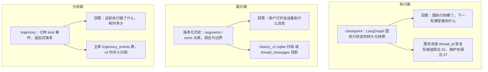
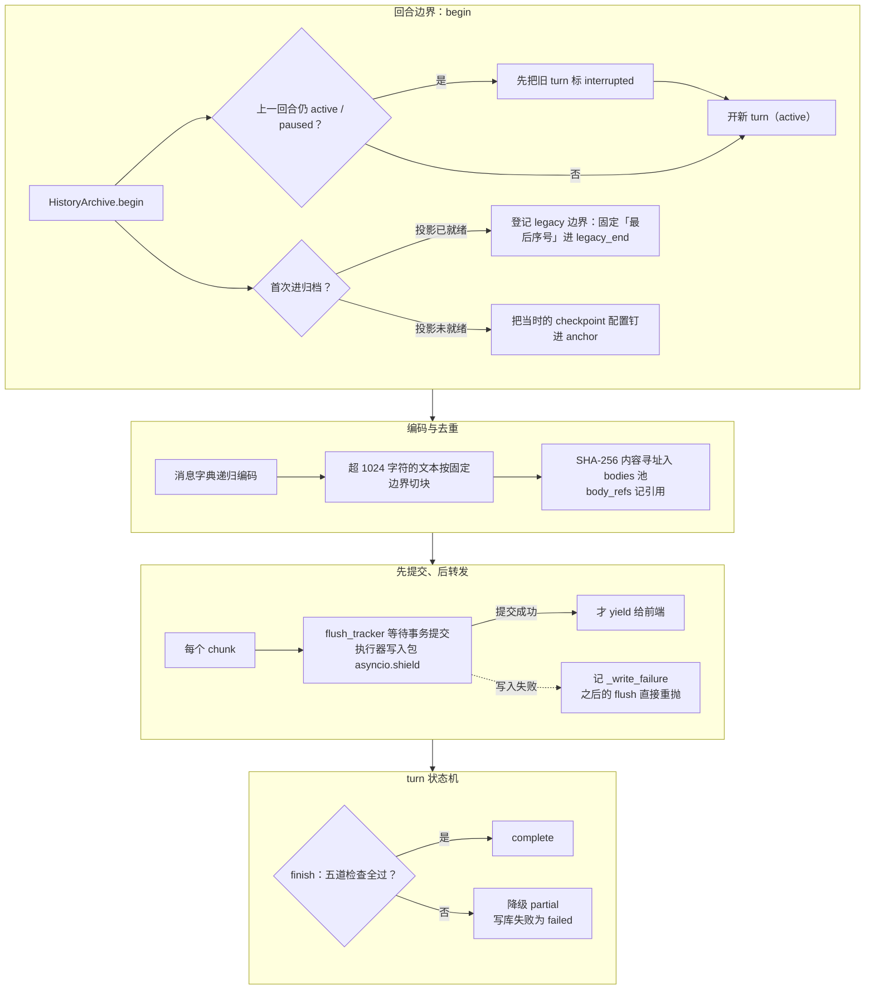
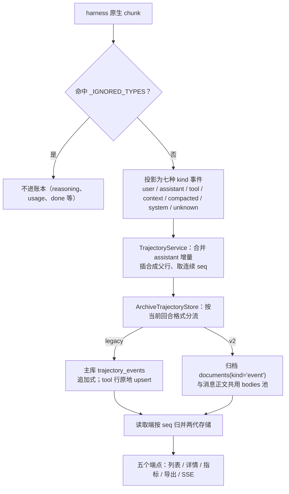

本篇拆 Octop 的会话历史子系统：一段对话进行中，消息正文、可见 thinking、工具参数与结果在什么时机、以什么格式落盘；用户翻历史时又从哪张表读回来；一轮执行额外留下一份怎样的「轨迹账本」。

[07：上下文与调用治理](./07-middleware-and-context-engineering.md) 解释一次调用看到什么，本篇解释执行状态、用户可见历史和轨迹怎样分别保存。历史捕获器与轨迹观察器消费 harness chunk，但选择保留的内容不同；输出呈现见 [12：流式事件与结果交付](./12-stream-projection-and-rendering.md)。

[09 篇](./09-memory-system.md)负责长期记忆抽取、召回和同库维护；本文按「数据分工 → 归档写入 → 历史读取 → 轨迹投影 → 回填与一致性」展开。checkpoint 的构造选择见 [01 篇](./01-agent-lifecycle-and-providers.md)，这里保留它与历史读取有关的接口。

基线：主仓 `v1.0.2`（commit `dd9dce47`）；实装 `octop-harness` 1.0.2（核自 `.venv` dist-info）。文中「源码可证实」与「本站推论」分开标注；维护者文档 `docs/versioned-history.md` 用于交叉验证，冲突处以源码为准。

## 一、执行状态、展示历史与执行轨迹

三套数据各答一问，先分层对照如下：



checkpoint 的解析与正常图执行由 harness 组织，主仓仍会在命令记账、会话分叉和维护路径中调用图状态接口。版本化历史与 trajectory 则由主仓投影保存；v2 开启后 trajectory 并入归档，见第四节。

### 1、先回答一个问题：打开一个会话，数据从哪来

Octop 里没有任何一张「messages 表」直接服务模型执行——模型每轮的历史状态主要由 LangGraph checkpoint 恢复（LangGraph 图执行状态的持久化快照，线程可从中恢复继续执行），Dashboard 翻历史来自投影表或版本化归档，执行过程分析来自 trajectory 账本。三套数据回答三个不同的问题，写入路径和读者都不同。

主仓发给 harness 的请求只带**本轮新消息**，不带历史（`src/octop/infra/gateway/process/harness_request.py:331-351`，`build_harness_request` 组装的 `messages` 列表只有一条新的 `HumanMessage`）。历史由 harness 内部按 `thread_id` 从 checkpointer 恢复进图状态。这个事实决定了后面所有设计的出发点：checkpoint 是执行面的事实来源，主仓的 history 子系统是**展示面**的派生存储。

### 2、checkpoint：历史状态的执行入口

harness 按配置选择 checkpointer，启用记忆时可复用 `Memory`；解析顺序在 [01 篇](./01-agent-lifecycle-and-providers.md)展开。一个线程可以有多步状态快照，不能把它等同于单条聊天记录。

主仓通过 `HarnessAgent.aget_history()` 或 `graph.aget_state()` 读取图状态；本基线的 CLI `octop chats get` 嵌入执行路径也调用这类接口（`src/octop/cli/support/embedded_ops.py:48–65`）。Dashboard 通常优先读取归档或投影，但在尚未完成投影时仍有 checkpoint 回退，第三节解释具体选择。

主仓也会通过状态接口写入命令记账和分叉前缀：`_append_slash_checkpoint` 服从命令的 `persist_checkpoint` 标志，`fork_dashboard_thread` 将前缀写入新线程。它们说明「checkpointer 由组件组织」不等于「平台从不写执行状态」。

### 3、存储位置与消费接口对照

三类数据的存储位置和读取目的如下。版本化历史面向对话展示，trajectory 面向执行观察；两者都不是原始执行状态。

| 数据 | 回答的问题 | 存储 | 主仓位置 |
| --- | --- | --- | --- |
| checkpoint | 图执行到哪了，下一轮模型看到什么 | agent 工作区 `checkpoints.sqlite` 或 memory 库 | harness 组织，主仓经图接口读写 |
| 版本化历史（v2 归档 / thread_messages 投影） | 用户打开会话看到什么消息 | 独立 `history_v2.sqlite` 或主库 `thread_messages` | `src/octop/infra/history/`（8 文件） |
| trajectory（执行轨迹，选择记录执行事件的账本） | 这轮执行做了什么、耗时多少 token 多少 | 主库 `trajectory_events`，v2 时并入归档 | `src/octop/infra/history/trajectory/`（9 文件） |

「版本化归档」（versioned history）指 v1.0.x 期新加的 `history_v2.sqlite`：以回合为边界、以内容寻址正文去重、默认关闭、不迁移旧数据（append-only，只追加不覆盖整段的写入约定在这里被「文档可替换、正文可共享」的折中取代，见二、3）。

开启前旧会话只有 `thread_messages` 投影（projection，把底层数据投成面向读取的表结构）可用——它是 v10 迁移引入的「dashboard history read model」（`src/octop/infra/db/migrations/010_thread_message_projection.sql:1`）。

### 4、装配：一个开关决定三种形态

`config.json` 的 `history_v2_enabled`（默认 `false`，`src/octop/config.py:136`）在 `OctopServer.start()` 里一次定型整条链路（`src/octop/infra/server.py:504-535`）：

```python
# src/octop/infra/server.py:508-531（节选，注释译中文）
history_archive = None
trajectory_store = TrajectoryStore(self.services.trajectory_event_repo)
archive_path = self.paths.root / "history_v2.sqlite"
if (
    config.history_v2_enabled
    or archive_path.exists()
    or archive_path.with_suffix(".required").exists()
):
    identity = str(config.database.resolve_sqlite_path(self.paths.root).resolve())
    if not config.database.is_sqlite:
        raise ValueError("Versioned history currently requires the SQLite control plane")
    history_archive = HistoryArchive(
        HistoryStore(archive_path, identity=identity),
        self.services.thread_message_repo,
        self.services.trajectory_event_repo,
        enabled=config.history_v2_enabled,
    )
    trajectory_store = ArchiveTrajectoryStore(history_archive)
trajectory_service = TrajectoryService(trajectory_store, TrajectoryLiveBus())
```

三个源码可证实的细节：开关关闭但归档文件（或 `.required` 标记）存在时仍会装上 `HistoryArchive`——「关掉开关不等于卸载读取器」，回退后仍能读 v2 段；PostgreSQL 控制面直接拒绝启动；归档与主库的绑定凭据是**主库 SQLite 文件的绝对路径**（`identity`），跨机器恢复需要整体搬目录（五、4）。

`Gateway` 构造时同时拿到 `trajectory_service` 与 `history_archive`，再注入 `GlobalProcessor`（11 篇的管线入口），从此每条消息、每个 chunk 都流经这两个观察器。

## 二、版本化归档的写路径

从回合边界到 turn 终态，整条写路径如下：



两条图上没有展开的规则：paused 的回合直接拒绝切换存储格式；格式与开启状态不符时开新 segment。

### 1、回合边界：segments 与 turns

v2 归档以「回合」（turn，一次用户输入到回复完成）为最小写入单位，线程内的格式切换以完整回合为边界，边界记录在 `segments` 表里。

`HistoryArchive.begin()`（`src/octop/infra/history/service.py:42-126`）在每轮开始时执行：

```python
# src/octop/infra/history/service.py:83-116（节选，注释为本站所加）
current = conn.execute(
    "SELECT * FROM segments WHERE thread_id=? ORDER BY id DESC LIMIT 1", ...
).fetchone()
if current is None:
    # 首次进归档：先登记一段 legacy 边界，不复制旧正文
    conn.execute(
        "INSERT INTO segments "
        "(thread_id,agent_id,format,legacy_start,legacy_end,anchor,trajectory_start,trajectory_end) "
        "VALUES (?,?,'legacy',0,?,?,0,?)",
        (thread_id, agent_id, message_head, dumps(anchor) if anchor else None, event_head),
    )
if current is None or current["format"] != fmt:
    if current is not None:
        conn.execute("UPDATE segments SET legacy_end=?,trajectory_end=? WHERE id=?", ...)
    cur = conn.execute(
        "INSERT INTO segments "
        "(thread_id,agent_id,format,legacy_start,trajectory_start) VALUES (?,?,?,?,?)",
        (thread_id, agent_id, fmt, message_head, event_head),
    )
    segment_id = int(cur.lastrowid or 0)
else:
    segment_id = int(current["id"])
conn.execute(
    "INSERT INTO turns(id,segment_id,status,started_at) VALUES (?,?,'active',?)", ...
)
```

规则：线程已有的 `thread_messages` 投影只固定「最后序号」进 `legacy_end`；投影尚未就绪的线程则把**当时的 checkpoint 配置**存进 `anchor` 列，读取时经图状态接口还原（`processor._begin_history`，`src/octop/infra/gateway/process/processor.py:198-242`，还会在图上还有未完成中断时放弃本轮切换——等待用户批准的回合继续用开始时的格式）。

格式与开启状态不符时开新 segment；上一回合仍 active/paused 时，新请求先把旧 turn 标 `interrupted`（重启后保留可读），paused 的回合则直接拒绝切换存储格式。

进程内用 `_owned_turns` 集合 + 线程锁防同线程双开——这是单进程假设的显式体现（SQLite + 单个 Octop 服务进程）。

### 2、表结构：五张表装下「结构 + 正文」

归档库自己建 schema、不走主库迁移，五张表把消息的结构骨架与大字段正文分开存。

```python
# src/octop/infra/history/store.py:25-50（节选）
_SCHEMA = """
CREATE TABLE archive_meta (version INTEGER NOT NULL, identity TEXT NOT NULL);
CREATE TABLE segments (
 id INTEGER PRIMARY KEY AUTOINCREMENT, thread_id TEXT NOT NULL, agent_id TEXT NOT NULL,
 format TEXT NOT NULL CHECK(format IN ('legacy','v2')),
 legacy_start INTEGER NOT NULL, legacy_end INTEGER, anchor TEXT,
 trajectory_start INTEGER NOT NULL, trajectory_end INTEGER
);
CREATE TABLE turns (
 id TEXT PRIMARY KEY, segment_id INTEGER NOT NULL REFERENCES segments(id),
 status TEXT NOT NULL, error TEXT, started_at REAL NOT NULL, finished_at REAL
);
CREATE TABLE bodies (digest TEXT PRIMARY KEY, value TEXT NOT NULL);
CREATE TABLE documents (
 id TEXT PRIMARY KEY, thread_id TEXT NOT NULL, turn_id TEXT NOT NULL REFERENCES turns(id),
 kind TEXT NOT NULL CHECK(kind IN ('message','event')), seq INTEGER NOT NULL,
 data TEXT NOT NULL, UNIQUE(thread_id,kind,seq)
);
CREATE TABLE body_refs (
 owner TEXT NOT NULL REFERENCES documents(id) ON DELETE CASCADE,
 digest TEXT NOT NULL REFERENCES bodies(digest), PRIMARY KEY(owner,digest)
);
（省略索引）
"""
```

`documents.data` 存编码后的**结构骨架**（tagged 节点树），大字段抽到 `bodies` 按 SHA-256 内容寻址（content-addressed，以内容哈希为主键存储与共享）去重，`body_refs` 记引用。同一个 `bodies` 行可以被 message 视图和 event（trajectory）视图共同引用——归档里存的是「一份正文 + 两份引用」，不是两份完整聊天。

库打开时校验 `archive_meta` 的版本与 identity（主库绝对路径），并在旁边写 `history_v2.required` 标记；事务入口在文件缺失时直接抛 `FileNotFoundError`——「缺失不等于空历史」（`store.py:83-89`）。连接带 `PRAGMA synchronous = FULL`（`store.py:67`），外键与 WAL 来自 `SqlitePool`（`src/octop/infra/db/pool.py:48-49`）。

### 3、编码与去重：1024 字符分块的内容寻址

写入时递归编码消息字典，超过 1024 Unicode 字符的文本按固定边界切块分别入池，替换文档时只释放自己的孤儿正文。

`put_document` 的编码器（`src/octop/infra/history/store.py:132-155`）：

```python
# src/octop/infra/history/store.py:132-155（节选，注释为本站所加）
def intern(item: Any) -> str:
    body = dumps(item)
    digest = hashlib.sha256(body.encode()).hexdigest()
    if digest not in old_refs and digest not in refs:
        conn.execute("INSERT OR IGNORE INTO bodies VALUES (?,?)", (digest, body))
    refs.add(digest)
    return digest

def encode(item: Any, key: str = "") -> Any:
    if isinstance(item, str) and len(item) > TEXT_BLOCK_SIZE:   # 1024
        return ["text", [intern(item[start : start + TEXT_BLOCK_SIZE])
                         for start in range(0, len(item), TEXT_BLOCK_SIZE)]]
    if isinstance(item, dict):
        return ["dict", [[k, encode(v, k)] for k, v in item.items()]]
    if isinstance(item, list):
        return ["list", [encode(v) for v in item]]
    if key in _BODY_KEYS and item not in (None, ""):
        return ["body", intern(item)]      # content/text/thinking/args/result 等
    return ["value", item]
```

固定边界分块让流式追加的 token 只新增最后一块，已提交的前缀块全部复用。文档替换时，`old_refs - refs` 的引用在同一事务里删除，且只删除已无其他引用的正文（`store.py:165-177`）；编码结果与旧值相同时直接跳过写入。维护者文档承诺的「完全相同的大字段可被两种视图引用」由此实现；它同时明确「不承诺语义去重」——工具结果对象与其格式化文本是不同字符串，各存各的。

### 4、先提交、后转发：可靠性优先的流式落盘

v2 回合中每条需要保留的消息都在**转发给前端之前**等待数据库事务提交；写入失败则停止转发并让回合带上失败状态。

Dashboard 路径的主循环（`src/octop/infra/gateway/process/processor.py:1188-1206`）每个 chunk 依次做三件事：

```python
# src/octop/infra/gateway/process/processor.py:1196-1206（节选）
usage_tracker.observe(chunk)
history_tracker.observe(chunk)
from octop.infra.history.recorder import flush_tracker

await flush_tracker(history_tracker)
self._observe_trajectory(agent_id=agent_id, thread_id=thread_id, chunk=chunk, enabled=traj_on)
（省略 hitl/工具富化，最后 yield chunk 给前端）
```

IM 路径在 `stream_project.py:117-124` 里以同样顺序调用。

`RecordingTracker.flush()`（`src/octop/infra/history/recorder.py:395-431`）用签名比对只提交变化的消息，并把执行器写入用 `asyncio.shield` 包住——执行器线程里的 SQLite 写入无法取消，反复取消也要等它落地再释放回合。写入异常会被记住（`_write_failure`），之后的 flush 直接重抛，回合不可能再被标成成功归档。

代价源码里写得直白：逐事件提交增加事务数量与首显延迟，换取「进程在提交前退出时，未提交内容不会发给前端」的顺序保证。取消路径上残留的写入等待结束后，未完成回合标 `interrupted`，重启后下一条请求把这类活动记录收尾。

### 5、turn 状态机：complete 的门槛

回合终态有六种——`active`、`paused`（HITL，human-in-the-loop，运行中暂停等人批准）、`complete`、`partial`、`failed`、`interrupted`；`complete` 要过五道检查。

`RecordingTracker.finish`（`src/octop/infra/history/recorder.py:433-480`）在 `complete` 前检查：没有解码失败（`decode_failed`）、没有残留未闭合的流式工具参数（`history_tool_args`）、至少有一条不带 tool_calls 的 AI 消息（有正式回答）、每个工具调用都有对应结果（`calls.issubset(results)`）、且该线程没有 trajectory 写入失败记录。

任一不满足降级 `partial`；写库失败是 `failed` + `archive_write_failed`，捕获不完整统一记 `capture_incomplete`。这与维护者文档的口径一致：「complete 仅表示本采集器通过当前回合的检查」。

暂停态不写 `finished_at`（仍是未完成回合），恢复走 `begin(resume=True)` 拿回原 turn 继续记。

### 6、v2 开启后旧表停写

v2 回合不再追加 `thread_messages` 与 `trajectory_events`（trajectory 改道进归档，见四、5）。

回退（开关设 false 重启）后，新回合以 `append_legacy_interval` 接着投影表尾部追加，且不宣称旧投影完整（`src/octop/infra/db/repos/thread_messages.py:91-128`）；主仓没有 v2→legacy 的反向迁移，靠读取接口按段拼接。

未装归档的部署（PostgreSQL 控制面）每轮仍走 v10 投影：`ThreadMessageRepo.append_if_ready` 只在投影状态为 `ready` 时追加，pending 的旧线程本轮丢弃、等回填（`thread_messages.py:231-280`）。

## 三、读路径与轮次投影

### 1、三种读取模式按段选择

`read_page`（`src/octop/infra/history/reader.py:14-94`）是历史读取的总入口，按「有无 segments」分两代，旧一代再按投影状态分两种。

```python
# src/octop/infra/history/reader.py:37-52（节选，注释译中文）
segments = await asyncio.to_thread(archive.store.segments, thread_id)
if boundary is None and segments:
    return await archive.page(...)      # 有 v2 段：归档分页读取
if cursor and boundary is None:
    raise ValueError("History cursor has no corresponding segment")
source = (
    boundary["source"] if boundary else (
        "projection"                                    # 投影就绪：读 thread_messages
        if await asyncio.to_thread(archive.messages.projection_status, thread_id) == "ready"
        else "checkpoint"                               # 否则：读图状态
    )
)
```

三种模式：**归档分页**（`HistoryArchive.page`，`service.py:207-272`）从最新 segment 往回取——v2 段读 `documents`，带 `anchor` 的 legacy 段经 `checkpoint_wires` 用钉住的 checkpoint 配置调 `graph.aget_state` 还原，无 anchor 的 legacy 段读 `thread_messages` 区间；**投影分页**直接翻 `thread_messages`；**checkpoint 直读**用 `aget_state` 拿全部消息再切片。

API 端点 `GET /api/agents/{agent_id}/threads/{thread_id}/history`（`src/octop/api/routers/chat/history.py:293-410`）在装了 `HistoryArchive` 时走 `read_page`，否则走投影 + 懒回填。

### 2、游标而不是 offset

归档分页返回 base64 编码的 `{thread, segment, before}` 三元组游标，翻页时校验游标属于本线程且 segment 仍存在；旧代路径另发 `legacy:` 前缀游标，checkpoint 源的游标还要钉住 `checkpoint_id`（`reader.py:27-36, 68-93`）。维护者文档「客户端应原样使用 next_cursor，不要用随新消息数量变化的 offset 替代」对应的就是这段实现——新消息持续追加时 offset 会漂移，锚定序号不会。

### 3、轮次投影：TurnHistoryTracker 只留当前回合

投影的写入端是一个「从重放倾向的 state chunk 里只保留当前用户回合」的追踪器，这是 thread_messages 行与 v2 文档共同的上游。

`TurnHistoryTracker.observe`（`src/octop/infra/history/projection.py:170-197`）对 `state_snapshot` / `state_update` 类 chunk 从**最后一条用户消息**截断：

```python
# src/octop/infra/history/projection.py:170-184（节选，注释为本站所加）
if kind in ("state_snapshot", "state_update"):
    messages = _chunk_messages(chunk)
    if not messages:
        return
    last_user = max(
        (index for index, msg in enumerate(messages) if _role(msg) in _USER_ROLES),
        default=-1,
    )
    if last_user >= 0:
        self._state_messages = messages[last_user:]   # 只保留当前回合
    else:
        self._state_messages.extend(messages)
    return
```

LangGraph 每个超步都会重放全量 state，直接全存会把历史每轮写一遍；截断到当前回合后，`inputs` 属性再补上纯流式兜底（state 里没有的 token 文本、错误消息）。时间戳不靠读 checkpoint 历史反推——harness 的 `CheckpointTsMiddleware` 在写入时把 `checkpoint_ts` 盖进 `additional_kwargs`（`octop_harness/middleware/checkpoint_ts.py:1-11`，docstring 直说这是为了消灭打开会话时的 `aget_state_history` 全量遍历）。

v2 模式下这个基类被 `RecordingTracker` 继承（`recorder.py:82`），同一套观察逻辑改写到归档；无归档部署则由 `append_if_ready` 落成 `thread_messages` 行。斜杠命令另有一条独立入口 `_append_slash_checkpoint`（`processor.py:1782-1825`）：命令声明的 `persist_checkpoint=False` 时只写投影、不动 checkpoint。

### 4、投成用户可见的气泡

无论来自哪代存储，消息最终都经 `_serialize_history_message`（`src/octop/api/routers/chat/serialize.py:921-1033`）投成 Dashboard 气泡——tool 消息变 `tool_result` 块、`reasoning_content` 变 thinking 块、用户消息里的 `image_url`/占位符噪声被剥离成 `inbound_attachments`。v2 路径在序列化返回 None 时直接报错（`history.py:338`）——归档里的消息必须可渲染，损坏不是空历史。

另有 `GET .../history/export` 导出未排版的原始 JSON 与最新回合状态（`history.py:487-519`，格式名 `octop-history-v2`），维护者文档定位它为「区分记录还在但界面没显示与读取失败」的诊断工具。

### 5、分叉：从归档取前缀

会话分叉（fork）在 v2 下从兼容读取结果取选定前缀，原会话不被回填或重写。`fork_dashboard_thread`（`src/octop/infra/agents/threads/fork.py:200-262`）用 `archive.all_messages` 拉全量前缀写进新线程的 checkpoint，再 `archive.begin` + `save_messages` + `finish("complete")` 把同一段前缀登记为新线程的归档种子；失败时 `archive.remove_thread(dest)` 清掉目标线程（该方法只服务显式删除，回填与保留策略从不调用它，`service.py:175-195`）。

## 四、trajectory：执行轨迹

从 harness chunk 到 Dashboard 台账，整条流向如下：



图上两处例外最值得记住：tool 行是追加式账本里唯一原地 upsert 的行；v2 下 trajectory 写入失败会把该线程的 history 回合压成 partial（见二、5）。

### 1、事件模型：七种 kind 的账本

trajectory 把一轮执行记成每线程单调 `seq` 的事件流，事件是 `TrajectoryEvent`（`types.py:17-29`），kind 有七种：`user` / `assistant` / `tool` / `context` / `compacted` / `system` / `unknown`。

存储默认是主库 `trajectory_events` 表（`src/octop/infra/db/migrations/012_trajectory_events.sql:3-22`，`event_id` UNIQUE + `(thread_id, seq)` UNIQUE）。

仓内注释自称 append-only ledger，但有一个源码可证实的例外：**tool 行会原地 upsert**——参数增量到达时与结果合并成同一行（repo 的 `append` 是 `ON CONFLICT DO NOTHING`，`upsert` 覆写全部列，`src/octop/infra/db/repos/trajectory_events.py:44-99`）。准确的说法是「追加式账本 + 工具行合并」。

每个 agent 可用 `config_json.enable_trajectory=false` 显式关闭，且只有显式 `false` 才关（`src/octop/infra/history/trajectory/settings.py:27-31`）。

### 2、投影器：哪些 chunk 进账本

不是所有 chunk 都进 trajectory——投影器显式忽略一批与展示相关的流事件。

```python
# src/octop/infra/history/trajectory/projector.py:8-21（节选）
_IGNORED_TYPES = frozenset(
    {
        "reasoning",
        "state_snapshot",
        "state_update",
        "usage",
        "done",
        "error",
        "custom",
        "hitl_required",
        "slash_action",
        "attachment",
    }
)
```

进入账本的映射（`projector.py:46-199`）：`token` → `assistant`（带 node 名）；`tool_call_chunk` / `tool_result` → 按 `call_id` 归并的 `tool`；`user` → `user`；`context` / `system` / `compacted` 是回合级合成事件。

合成事件的原料来自 `turn_context.py` 的 `build_turn_start_chunks`：系统提示只存 SHA-256 摘要与字符数（`content_sha256`），记忆文件、技能清单、MCP 连接器各成一行——处理器在每轮开始时分 `system` / `context` 两相注入（`processor.py:326-387`）。`compacted` 记录一次上下文压缩（摘要数、保留数、移除 token 数），让账本能回答「这轮上下文为什么突然变小」。

### 3、服务层：合流、合成父行、连续 seq

`TrajectoryService`（`src/octop/infra/history/trajectory/service.py`）在写入前做三件事——合并同请求的 assistant 增量、给纯工具爆发插合成父行、从合并视图取下一个 seq。

assistant 流式 token 按 `request_seq` 归并成一条事件并累计 `llm_duration_ms`（首 token 时间戳保留，时长覆盖整个流）；

工具爆发前若没有打开的文本气泡，插入合成 ASSISTANT 行 `"(tool call only)"`——注释标明这是与 Deep Agents 前端（DSH）的对齐行为（`service.py:197-223, 297-311`）。`_next_seq` 从 `_store.list_before` 取当前最大 seq，而 v2 模式下这个查询**横跨新旧两代存储**（见下），因此 seq 在 segment 边界处连续。

观测失败只记账不抛出（`observe_chunk` 的 catch 调 `record_failure`），绝不影响聊天流。

回合结束时 `finish_turn` 把 in-flight 快照落定、合并本轮 usage（token 数、耗时）进 assistant 事件，并触发保留策略：只保留最近 50 个用户回合（`settings.py:21`，`TRAJECTORY_RETENTION_USER_TURNS`）。

### 4、谁消费：五个端点 + SSE

trajectory 的消费面全部是 Dashboard 侧的「执行台账」视图，API 在 `src/octop/api/routers/chat/trajectory.py`：列表（省略 content/text/thinking、裁剪 args/result 到 2000 字符）、单事件详情、指标、JSONL/JSON 导出、实时 SSE。

指标 `aggregate_metrics`（`metrics.py:75-108`）从事件直接聚合：turns 数的是 `user` 事件、steps 数全部事件、token 三项求和、TTFT 与每秒 token 取 assistant 平均、`cache_hit_ratio = cache_read / (input + cache_read)`。

实时推送是进程内 `TrajectoryLiveBus`（`live.py`，每线程 256 深队列、满则丢最旧），partial 发布限频 50ms，SSE 断线用 `after_seq` / `Last-Event-ID` 续播，回放上限 2000 条（`trajectory.py:179-236`）。谁在用这些数据：源码可证实的是 Dashboard 台账与导出；「是否喂给评测」没有仓内证据，归入未核验。

### 5、与 v2 的合流：一个 store 两种后端

`ArchiveTrajectoryStore`（`src/octop/infra/history/trajectory_compat.py`）按当前回合格式分流写入，读取时合并两代。

```python
# src/octop/infra/history/trajectory/trajectory_compat.py:44-51（节选，注释译中文）
def _write(self, event: TrajectoryEvent, *, upsert: bool) -> bool:
    # 尺寸裁剪先于路由：v2 分支写自己的 document，
    # 不经过 TrajectoryStore.append 的 repo 裁剪
    bounded = self._bounded(event)
    turn = self.archive.store.turn(bounded.thread_id)
    if turn is None or turn["format"] != "v2":
        return super().upsert(bounded) if upsert else super().append(bounded)
    return self._put_v2_event(bounded, turn)   # documents(kind='event')
```

v2 事件的 `args` / `result` 与消息正文共用同一张 `bodies` 池（走同一个 `put_document`）。读取端 `list_before` / `iter_for_export` 把旧表行与归档文档按 seq 归并排序，`_next_seq` 因此跨段连续。

一个源码可证实的缝隙：compat 类覆写了 append / upsert / list / get / export / delete，**没有覆写 `prune_older_than_user_turns`**——50 回合保留策略在 v2 模式下只清旧 `trajectory_events` 表，不清归档里的 event 文档。

另一个联动：v2 下 trajectory 写入失败会进 `archive.trajectory_errors`，直接把该线程的 history 回合压成 `partial`（二、5 的第五道检查）——展示历史与轨迹账本在完整性上互相背书。

## 五、回填与一致性

### 1、回填解决的对账问题

回填（backfill）不是渠道消息对账，而是 **v10 投影上线时旧会话的历史搬运**——把只存在于 checkpoint 里的旧对话解码成 `thread_messages` 行，让 Dashboard 不必为翻一条旧消息去解码整个 checkpoint blob。

`thread_history_projection` 表给每个线程一个状态位，v10 迁移把「有活动过的线程」预置为 `pending`、新线程置 `ready`（`migrations/010_thread_message_projection.sql:29-34`）。读路径遇到 pending：返回空列表 + `history_loading=true`，同时把回填任务塞进队列（`history.py:344-372`）。

### 2、单工作队列与只读连接

回填由一个去重的单 worker 异步队列驱动，一次只解码一个 checkpoint，且优先用独立只读连接而不是活 saver。

```python
# src/octop/infra/gateway/history_backfill.py:14-31（节选，注释为本站所加）
class HistoryBackfillQueue:
    """任务去重，且保证同一时刻只解码一个巨型 checkpoint。"""

    def __init__(self, *, max_pending: int = 100) -> None:
        self._queue: asyncio.Queue[tuple[str, BackfillWork]] = asyncio.Queue(maxsize=max_pending)
        self._known: set[str] = set()   # 进程内去重键

    def enqueue(self, key: str, work: BackfillWork) -> bool:
        if key in self._known:
            return True
        if self._queue.full():
            return False
        ...
```

解码本体 `_backfill_thread_projection`（`serialize.py:482-542`）有一条三级降级链：`_isolated_sqlite_checkpoint_messages` 用 `mode=ro` URI 打开 checkpoint 库、`PRAGMA query_only`、经 `serde.with_connection` 重绑序列化器、跳过建表 DDL，在同一只读事务里取最新 checkpoint（`serialize.py:392-441`）——注释明确「新回合的可用性比旧 UI 回填重要」，SQLite 检出后失败不再回落活连接；

拿不到再走 `aget_history` / `aget_state`；最后兜底 agent 工作区的会话 JSONL。

解码结果 `replace_all` 分批（每批 200 条）写入，全程被 `status != ready` 的读闸挡住，写完才置 `ready`。每代理同时只允许一个回填（`try_begin_history_backfill` 互斥），批量入口 `POST .../history-migration/start` 检查队列余量与 agent 是否空闲（`history.py:170-221`）。PostgreSQL 控制面上投影写走 `FOR UPDATE` 行锁（`thread_messages.py:94-97`）。

### 3、v2 开启后回填停用

装上 `HistoryArchive` 后旧投影回填被显式禁止——`_backfill_thread_projection` 见到归档实例直接 `raise ValueError`（`serialize.py:493-494`），迁移状态接口的 `can_start` 同样把归档实例排除（`history.py:68-73`）。

这是维护者文档「兼容模式不自动修复旧投影，旧数据原有缺漏不会被补齐」的代码形态。旧前缀在 v2 开启那一刻被 segments 的边界（序号或 anchor）冻结，之后的一切变化都发生在归档里。

### 4、多库一致性的取舍

主库与归档库是两个 SQLite 文件，没有跨库事务；Octop 的对策是「备份有序、恢复显式、错配宁可拒绝」。

备份：带聊天的系统归档先对 `history_v2.sqlite` 取 SQLite 一致快照再取主库（降低新线程引用缺失窗口），并把 `.required` 标记一起打包（`src/octop/infra/backup/system_archive.py:250-258`）；恢复入口检测到 v2 痕迹但缺少配套数据时直接拒绝并要求停机整体恢复（`system_archive.py:454-460`）。

运行期换库也被挡：`OctopServer` 拒绝在已绑定版本化历史时重绑数据库（`server.py:301-302`）。identity 是主库绝对路径，跨机器恢复没有自动重绑定工具——这些拒绝路径与维护者文档「不要把不同时间点的主库和新归档拼在一起」一一对应。

## 六、工程判断

### 1、值得照搬

- **三份数据、三个问题的显式分层**：执行状态（checkpoint）归框架、展示历史归平台、过程账本归分析面，但归档采用先提交后转发，持久化延迟仍会影响输出。任何把 LangGraph 状态直接当聊天记录展示的实现，迟早会在「checkpoint 里没有 UI 需要的字段」（流式 thinking、错误消息、附件元数据）上补丁摞补丁——Octop 的 `TurnHistoryTracker` 存在本身就是这个教训的产物。
- **先提交后转发的顺序保证**（`recorder.flush` + `stream_project` 的调用顺序）：用可测的不变量（「前端见过的，库里一定有」）替代对时序的祈祷；`asyncio.shield` 等待不可取消的执行器写入，是取消语义与持久化语义冲突时的标准解法。
- **complete 的五道检查与 partial 状态**：把「归档成功」定义成可验证谓词（有回答、调用都有结果、无未闭合参数、无解码失败、轨迹无错），而不是「没抛异常」。数据完整性审计因此可以事后跑。
- **内容寻址 + 固定边界分块**：1024 字符块让流式重写只动尾块，消息与轨迹两视图共享大字段。对「同一正文多视图」的场景（聊天记录 + 轨迹 + 未来评测切片）是低成本的通用底座。

### 2、需要改造后再用

- **逐事件提交的首显代价**：每个 chunk 一次 `asyncio.to_thread` + SQLite 事务（FULL 同步），长工具输出的回合事务数会很可观。维护者自己标注「可靠性优先」；吞吐敏感的场景应改为批次提交或 group commit，代价是失去逐事件的顺序保证。
- **单进程假设**：`_owned_turns` 是进程内集合，segments/turns 无跨进程租约。多 worker 部署（哪怕只读多写一）需要把回合所有权下沉到库层（租约列或 advisory lock），否则两个进程能同时 begin 同一线程。
- **50 回合保留只清旧表**：v2 下 trajectory 归档文档不受保留策略约束（compat 未覆写 prune），长会话的 event 文档会无限增长。「本站推论」：这可能是有意的（归档完整性优先，partial 判定依赖轨迹记录），但没有任何注释或文档确认意图，二次开发者应把它当作待决策项。
- **identity 绑死主库绝对路径**：自托管场景换盘符/迁移机器是常态，路径即身份会让恢复体验很硬。换成内容身份（如主库 ULID）+ 显式重绑定命令更稳。

### 3、避免

- **在 PostgreSQL 控制面上强行启用 v2**：启动即拒不是过度设计——归档的 segment 边界引用 `thread_messages` 序号，两库弱一致下跨库边界会漂移。
- **删除或单独移动 `history_v2.sqlite` / `.required` 之一**：标记存在的意义就是「缺归档不是空历史」，缺文件时读取直接报错而不是展示空白——绕过它等于让用户以为历史丢了。
- **用 offset 翻历史**：三代读取路径都为此专门设计了锚定游标（segment+seq、projection seq、checkpoint_id），offset 在活会话上必然错页。
- **让投影写失败影响聊天回合**：v10 路径的 `append_if_ready` 异常只记 WARNING（`processor.py:1773-1780`，「投影是读优化，绝不能把成功的模型回复变成失败回合」）——新加的任何历史旁路都应遵守同一条纪律。

### 4、体积与双栈差异的账

源码可核对的成本项：归档**不会**让旧数据消失或主库变小（不迁移、不清理 checkpoint，维护者文档明说）；新增体积 ≈ 变化消息的结构骨架 + 新正文块（与 trajectory 事件共享）；逐事件事务 + FULL 同步是延迟账。

双栈差异是硬边界：PostgreSQL 控制面永远停在 v10 投影形态（`append_if_ready` + `FOR UPDATE`），v2 归档及其顺序保证是 SQLite 单机形态独占——这正是 00 篇「单进程 + SQLite 多用户形态」定位在存储层的投影。

「本站推论」：这套复杂度买到的核心是**可回滚的格式演进**（segment 边界让 legacy→v2→legacy 都不需要数据迁移），对会频繁改消息结构的团队值得，对一次性产品是过度工程。

## 七、未核验范围

1. 未运行任何服务、测试或模型；全部行为描述来自静态源码阅读（主仓 v1.0.2 + 实装 octop-harness 1.0.2），归档写入/读取的实际延迟与事务开销未实测。
2. LangGraph checkpointer 的编码与压缩内部（`CompactSqliteSaver`、blob 表结构、delta/seal 语义）只在调用面看过。本文解释图状态接口、归档锚定与显示投影；底层序列化算法未展开。09 篇的 slim 讨论维护协调，不代表已核读全部编码实现。
3. Dashboard 前端如何消费 `next_cursor`、trajectory SSE 与 `history_loading` 轮询（`dashboard/src/`）未读，前端侧的翻页与续播行为以 API 契约推定。
4. trajectory 数据是否被任何评测/离线分析管线消费，仓内无证据；本文只证实 Dashboard 台账与导出两个消费面。
5. octop-memory 作为 checkpointer（`_resolve_checkpointer` 第 3 分支）时，归档 anchor 钉住的 checkpoint 配置与 memory 库恢复语义的交互未逐行核验；`CheckpointSerializer.with_connection` 的 octop-memory 实装差异（维护者文档提到的版本配套要求）未验证。
6. v2 归档在真实并发（同线程多端同时发消息、HITL 恢复与取消竞态）下的行为只有代码路径推演，未做并发测试核验。

上一：[07：上下文与调用治理](./07-middleware-and-context-engineering.md) · [系列导读](./index.md) · 下一：[09：长期记忆](./09-memory-system.md)
