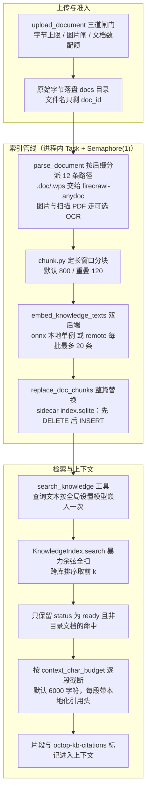
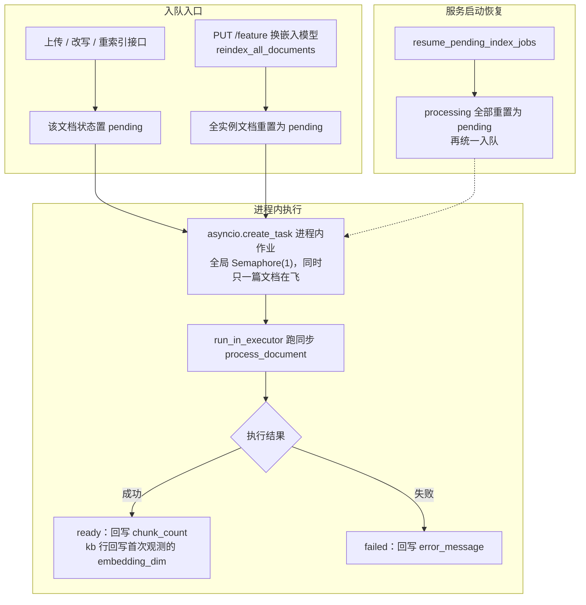
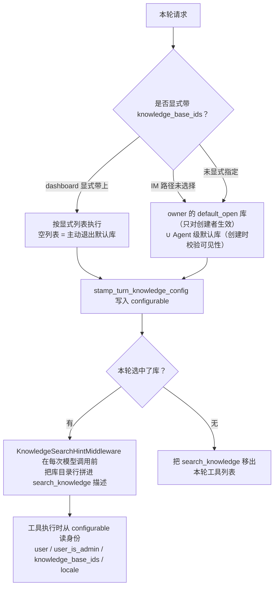

本篇拆解 Octop 的知识库子系统（`src/octop/infra/knowledge/`，17 个文件）：一份用户上传的文档，从解析（PDF/办公格式/OCR）→ 分块 → 嵌入 → 索引 → 检索，到带引用标记进入 Agent 上下文的全链路。

[09：长期记忆](./09-memory-system.md) 从对话抽取长期记忆，本篇转向用户管理的文档：`search_knowledge` 怎样把索引后的片段交给模型。RAG 指先检索语料，再用结果辅助生成；工具装配边界见 [04：能力装配](./04-skills-experts-plugins.md) 和 [05：外部工具接入](./05-connectors-and-mcp-gateway.md)。

索引作业使用进程内 Task 和线程池，没有外部任务队列；向量保存到每库一个 SQLite 文件，不依赖独立向量数据库服务。嵌入可选择本地 ONNX 或远端接口，检索用 Python 逐条计算余弦相似度。主仓代码引用 `src/octop/...`（基线 v1.0.2，commit dd9dce47）。

整条链路如下：



图上两个最关键的边界：chunk 从不进业务库，只住在每库一个的 sidecar `index.sqlite` 里，删库即随目录一起消失；检索端只认 `status == "ready"` 的文档，兜住索引与文档表之间短暂的不一致窗口。

## 一、知识库全景：两张表、一份原始文件、一道门

### 1、实体模型：kb / document / chunk 三层各在哪

控制面只有两张业务表，chunk（分块，把长文档切成可嵌入的短文本段）完全住在业务库之外的 sidecar 文件里——这是本链路最重要的结构决定。

| 层 | 住在哪 | 关键字段 |
| --- | --- | --- |
| knowledge_bases | 业务库（SQLite/PG 双栈） | `knowledge_base_id`（公开短 id）、`owner_user_id`、`shared`、`default_open`、`embedding_model`、`embedding_dim`、`max_documents`、`doc_count` |
| knowledge_documents | 业务库 | `document_id`（ULID）、`kb_id`（字符串 FK）、`path`/`filename`/`is_dir`、`content_type`、`byte_size`、`status`、`chunk_count`、`error_message` |
| chunks | `~/.octop/knowledge/<kb_id>/index.sqlite` | `chunk_id`（`{doc_id}:{ordinal}`）、`text`、`embedding`（float32 BLOB）、`meta_json` |

表结构演变本身就是可见性模型的演变史。

v5（`migrations/005_shared_experts_sso_knowledge.sql:107-145`）建表时还有一张 `knowledge_base_members`（按用户授权的成员表）；v7（`007_resource_identity_and_profile.sql:20`）直接 `DROP TABLE knowledge_base_members`，同时将资源表重建为整数主键 + 公开字符串 id，并给文档加了 `path`/`is_dir`（文件夹树）；

v10 给 kb 加 `max_documents`（默认 100，0 为不限）；v14 给 `agents` 表加 `knowledge_base_ids`（Agent 级默认库）。

成员表被删后，可见性收敛为二元：owner 本人，或实例级 `shared`。

```python
# src/octop/infra/knowledge/service.py:325-331
def get_readable_base(
    self, kb_id: str, *, actor_user_id: int, is_admin: bool = False
) -> KnowledgeBaseRow:
    base = self._require_base(kb_id)
    if is_admin or base.owner_user_id == actor_user_id or base.shared:
        return base
    raise PermissionError("knowledge base read access is required")
```

写权限更窄，只有 owner 和管理员（`get_writable_base`，`service.py:333-339`）。没有「指定某用户只读某库」的中间态——要么全实例共享，要么私有。

原始文件与索引同库分离：上传的原始字节写进 `~/.octop/knowledge/<kb_id>/docs/<doc_id><原后缀>`（`files.py:21-23`），文件名只剩 doc_id，用户文件名不做路径成分，从根上免掉了路径穿越面；删库就是 `shutil.rmtree` 整个 kb 目录（`files.py:36-37`），索引 sidecar 顺带消失。

### 2、限额与配额：三道闸门

上传路径上按顺序过三道闸（`service.py:349-393` 的 `upload_document`）。

第一道是单文档字节上限：取 `config.max_upload_bytes`（默认 `DEFAULT_MAX_UPLOAD_MB`），扩展名优先映射 content type、不在白名单即拒（支持 24 种扩展名，`service.py:35-60`）。第二道是图片闸：图片后缀（`.png/.jpg/.jpeg/.webp`）在 OCR 未启用时直接拒绝——OCR 关着时收图片只会得到永远失败的文档。

第三道是 per-base 文档数配额，在 repo 的一条条件 UPDATE 里原子执行：

```python
# src/octop/infra/db/repos/knowledge.py:305-312
if enforce_limit:
    cursor = conn.execute(
        "UPDATE knowledge_bases SET doc_count = doc_count + 1, updated_at = ? "
        "WHERE knowledge_base_id = ? AND doc_count < ?",
        (ts, kb_id, max_documents),
    )
    if cursor.rowcount != 1:
        raise ValueError(f"knowledge bases support at most {max_documents} documents")
```

先抢计数再插入，`rowcount != 1` 说明配额已满，同一事务内回滚——避免「先查后写」的竞态。实例级还有每人最多 20 个库（`MAX_BASES_PER_OWNER`，`service.py:30`）。这些数字与默认 chunk 窗口、检索参数一起，圈定了单机规模的真实边界（§六）。

文件夹的删除有个跨库细节值得一提：删目录要连带删后代，repo 没有用 `path LIKE '<dir>/%'`，因为 `_` 和 `%` 在 LIKE 里是通配符、SQLite 的 LIKE 还不区分大小写（PostgreSQL 区分），改用 `substr(path, 1, ?) = ?` 前缀比较，两个后端语义一致（`repos/knowledge.py:403-414` 注释）。

### 3、gate：不是权限，是功能准入

`gate.py` 的「gate」是**实例级功能开关 + 嵌入先决条件**的合称，跟文档权限无关——知识库是可选特性，没配好嵌入模型就不许用。

`get_capability`（`gate.py:66-96`）把就绪状态拆成四个独立检查：`model_selected`（设置了 `knowledge_embedding_model`）、`model_downloaded`（本地已有权重文件）、`deps_available`（fastembed 可导入）、`provider_ready`（远端 provider 可用）。

`usable = feature_enabled and prerequisites_ok`。prerequisites 按后端取值：onnx 后端要 fastembed 可导入且模型已下载；remote 后端要 provider 启用、有 key、有 base_url，且所选模型在 `provider.get_models()` 里并被 `is_embedding_model` 判定为嵌入模型——不是随便一个聊天模型都能当嵌入端点。

`assert_knowledge_usable`（`gate.py:164-170`）是运行时的强制点，在六个入口重复出现：建库、上传、改写文本文档、单文档重索引（`service.py`），索引任务执行（`jobs.py:38`），检索（`retrieve.py:70`）。

开关的写入侧 `set_feature_enabled`（`gate.py:122-161`）只在先决条件通过后才落 `knowledge_bases_enabled=true`；管理端 `PUT /api/knowledge-bases/feature`（`api/routers/knowledge_bases.py:391-470`）在模型或后端变化时调用 `reindex_all_documents` 全量重置——换嵌入模型等于换向量空间，旧索引全部作废。

这个 gate 还管一件部署运维的事。本地嵌入依赖（fastembed、rapidocr）可以运行时 pip 安装进当前 venv，容器重建后这些包随可写层消失，而数据卷上的设置、索引、模型缓存还在。

`warn_if_local_embedding_deps_missing`（`gate.py:99-119`）在服务启动时打警告说明这一情况（`server.py:653-656` 调用），`ocr.py` 有镜像的 `warn_if_local_ocr_deps_missing`。运行时 pip 本身有开关：默认关闭，需 `OCTOP_ALLOW_RUNTIME_PIP=1` 或管理端动作显式允许（`onnx_service.py:54-61`）。

## 二、解析与 OCR：一个分派函数与双后端

### 1、按后缀分派的解析总入口

所有格式走同一个纯函数 `parse_document(path, ocr)`（`parse.py:32-78`），按后缀分派到 12 条路径；10 类用核心依赖直接解析，`.doc/.wps` 交给 `firecrawl-anydoc`，图片与扫描 PDF 交给可选的 OCR。

| 格式 | 实现 | 位置 |
| --- | --- | --- |
| md/txt/rst/yaml/jsonl | 双编码解码（见下） | `parse.py:84-98` |
| json | 解析后 `indent=2` 重排，失败退原文 | `parse.py:101-107` |
| html/htm | 自写 `HTMLParser`，跳过 script/style/noscript/template，块级标签断行 | `parse.py:164-228` |
| csv/tsv | `csv.reader` 转「# 表名 + TAB 连行」 | `parse.py:261-263` |
| pdf | pypdf 逐页 `extract_text`；全空且 OCR 可用则整本转 OCR | `parse.py:49-55` |
| docx | python-docx，XML 级遍历（见下） | `parse.py:110-161` |
| doc/wps | firecrawl-anydoc 转 Markdown | `parse.py:58-64` |
| pptx | python-pptx 遍历 slide/shape 取 `shape.text` | `parse.py:65-73` |
| xlsx/xlsm | openpyxl `read_only + data_only`，每 sheet 一段 | `parse.py:266-278` |
| xls | xlrd，日期单元格转 isoformat | `parse.py:281-298` |

办公文档解析库（pypdf、python-docx、python-pptx、openpyxl、xlrd）与 firecrawl-anydoc 都是核心依赖（`pyproject.toml:42-49`），不是可选 extra——解析能力随主包安装即得，可选的只有嵌入与 OCR。

纯文本解码先试 `utf-8-sig` 再试 `gb18030`：

```python
# src/octop/infra/knowledge/parse.py:81
_TEXT_ENCODINGS = ("utf-8-sig", "gb18030")
```

源码注释明说这是修 bug：早期用 `errors='replace'` 把 Windows GBK 中文文档吞成乱码，检索永远命中不了原文。中文自托管场景的真实教训，双解码两行就修掉了。

Excel 的输出形态也值得看：不是 Markdown 表格，而是「`# 工作表名` + TAB 连接的行」（`_sheet_text`，`parse.py:247-258`）。单元格内 `\t`/`\n` 压成空格、行尾空 cell 裁掉、整型浮点去 `.0`、布尔转 TRUE/FALSE——把表格变成对定长分块友好的扁平文本，避免了 Markdown 表格被 800 字符窗拦腰切半的问题（至少行内不再有竖线噪声）。

### 2、docx：不走官方段落 API，走 XML 遍历

`Document.paragraphs` 只列 body 的直接 `w:p` 子节点，表格、内容控件（`w:sdt`）、修订包裹（`w:ins`）、文本框里的段落全部静默丢失——这些恰是真实 Word 文档正文最常待的地方。

Octop 用 XML 全树遍历替代，并展开 `w:altChunk`（转换器把正文塞在内嵌 HTML/嵌套 docx 部件里、document.xml 只留桩的场景）：

```python
# src/octop/infra/knowledge/parse.py:129-135（节选）
for element in body.iter(qn("w:p"), alt_chunk_tag):
    if next(element.iterancestors(_DOCX_FALLBACK_TAG), None) is not None:
        continue  # mc:Fallback 与 mc:Choice 内容重复，跳过
    if element.tag == alt_chunk_tag:
        lines.append(_docx_alt_chunk_text(element, part))
    else:
        lines.append(element.text)
```

`_docx_alt_chunk_text`（`parse.py:139-161`）按部件 content_type 分派：内嵌 HTML 走前述 HTML 剥离，纯文本直接解码，嵌套 docx 递归 `_docx_body_text`。`mc:Fallback` 的跳过防止同一段落被索引两次。

### 3、`.doc/.wps` 与 firecrawl-anydoc

OLE 二进制格式没有轻量纯 Python 解析器，Octop 把它交给 `firecrawl-anydoc`：`anydoc.format_from_bytes` 先按字节探测格式（注释指出官方格式表漏了 `.wps`，OLE 的 WPS 文件会被探测成 `doc`），再 `to_markdown_bytes` 转 Markdown（`infra/utils/anydoc_convert.py:39-72`）。

转换失败返回空串，上层 `parse_document` 对空结果显式抛错（`parse.py:62-63`）——宁可让文档进 failed 状态，也不索引空文本。同一个 anydoc 帮手被聊天附件富化复用（那里截断到 10 万字符，`anydoc_convert.py:20`），知识库索引用全文。

### 4、OCR：本地 RapidOCR 或远端视觉模型，外加拒答防投毒

OCR 是独立于解析的可选开关，同样双后端（`ocr.py`）。

本地后端是 rapidocr + onnxruntime + pymupdf（extra `knowledge-ocr`，`pyproject.toml:75-77`），引擎进程内单例、`threading.Lock` 串行（`ocr.py:300-307`）。

远端后端把任何 provider 的视觉聊天模型当 OCR 用：`build_probe_chat_model` 构造模型，每页图片 base64 成 data URL 塞进 `HumanMessage`，配一段固定的英文转写提示词（要求保留阅读顺序、标题、列表、表格行，`ocr.py:34-37`）。

PDF 的 OCR 路径统一先经 pymupdf 把每页光栅化成 2 倍矩阵的 PNG（`_image_inputs`，`ocr.py:276-297`）。本地 RapidOCR 对整本 PDF 也可用；远端后端只需要 pymupdf 一个包，`ensure_ocr_deps` 按后端安装不同集合（`ocr.py:120-141`）。

远端后端有一处少见的防御。视觉模型没收到图时会回复「请上传图片」之类的拒答话术，把这句话索引进库等于给知识库投毒且文档还显示 ready：

```python
# src/octop/infra/knowledge/ocr.py:44（节选）
_OCR_REFUSAL_MAX_CHARS = 400
_OCR_REFUSAL_RE = re.compile(
    r"no image (?:was |is |has been )?(?:attached|provided|found|received|included)"
    r"|未(?:收到|看到|检测到|获取到)[^。\n]{0,10}(?:图片|图像|照片|附件)"
    # （省略其余分支）
)
```

`_is_no_image_refusal`（`ocr.py:57-62`）用「短于 400 字符 + 英/中双语正则匹配拒答句式」双条件判定，命中则当作空页跳过（`ocr.py:346-353`）——文档最终因「无可提取文本」进 failed，错误方向是安全的。长度上限保护了「正文恰好提到上传图片」的真文档不被误杀。

## 三、分块与嵌入：定长窗口与两个后端

### 1、分块：800 字符定长窗口，120 重叠

整个分块策略只有一个 21 行的纯函数（`chunk.py:6-21`）：`strip` 后按 `step = size - overlap` 步进切定长字符窗，默认 800/120。

没有段落感知、没有标题边界、没有 token 计数——按字符数切。参数是实例级设置而非代码常量：`params.get_advanced_settings`（`params.py:48-79`）从 settings 表读四个旋钮，越界或非法值一律回退默认，不报错。

| 旋钮 | 默认 | 范围 |
| --- | --- | --- |
| knowledge_chunk_size | 800 | 100-8000 |
| knowledge_chunk_overlap | 120 | 0 到 size-1 |
| knowledge_retrieval_k | 8 | 1-20 |
| knowledge_context_char_budget | 6000 | 500-50000 |

管理端改这些参数只影响之后的索引任务，已索引文档要手动重索引才生效——参数只在 `process_document` 里读取（`jobs.py:49-50`，源码可证实），不存在「改参数自动重建」的钩子。

### 2、嵌入路由：onnx 默认，remote 走 OpenAI 兼容接口

`embed_knowledge_texts`（`embed.py:17-38`）读 `knowledge_embedding_backend` 设置分派：非 `remote` 一律走本地 `onnx_service.embed_texts`；

`remote` 用 httpx 同步客户端 POST `{base_url}/embeddings`，每批最多 20 条（远端 API 的输入数上限，`embed.py:14`），分片保序合并，数量不符即报错——向量必须与 chunk 列表对齐，供 `replace_doc_chunks` 逐条落库。

本地后端的实现在 `onnx_service.py`，它同时服务 Models 管理页的本地模型标签（模块 docstring 明言「这不是聊天 Provider」）。三个要点：

**模型目录是白名单。** 3 个推荐预设（`BAAI/bge-small-zh-v1.5`、`jinaai/jina-embeddings-v2-base-zh`、`intfloat/multilingual-e5-large`，`onnx_catalog.py:8-12`）加 9 个扩展条目，`assert_catalog_model` 拒绝目录外 id；中文模型排前两位是产品取向。

**下载与存在判定不信任标记。** 模型缓存到 `~/.octop/embedding_models/`，`OnnxDownloadManager` 进程内单任务下载（多源竞速 + 目录体积 watcher 报进度）；

`is_model_downloaded`（`onnx_service.py:282-298`）递归找真实 `*.onnx` 权重文件，并兼容 HuggingFace 缓存布局与 Qdrant/xenova 镜像的别名目录——注释记录了早期按固定文件名判断、模型下载了却永远不算存在的 bug。

**推理是全局单例 + 单条嵌入：**

```python
# src/octop/infra/agents/providers/onnx_service.py:447-465（节选）
for text in texts:
    # Release between chunks so a query need not wait for the whole document.
    # （块间释放锁，查询不必等整篇文档嵌完。）
    with _embedding_inference_lock:
        if _embedding_instance is None or _embedding_instance[:2] != (model, cache_path):
            _embedding_instance = None  # 换模型前先释放旧权重
            _embedding_instance = (model, cache_path, _build_text_embedding(model))
        vectors = [
            [float(x) for x in vec]
            for vec in _embedding_instance[2].embed([text], batch_size=1)
        ]
```

一把 `threading.Lock` 同时管权重生命周期与推理串行，注释说明动机：文档级信号量会让查询排队等整篇文档，这里逐条获取锁，查询最多等一个 chunk。

代价是 `batch_size=1`、无并行：索引一篇 500 chunk 的文档是 500 次串行推理，每次都要过锁（源码可证实的吞吐上限，§六再论）。

## 四、索引与检索：SQLite 向量库与暴力余弦

### 1、每库一个 sidecar SQLite

`KnowledgeIndex`（`index.py:26`）把一个库的全部 chunk 存进 `~/.octop/knowledge/<kb_id>/index.sqlite`，单表五列，向量为 little-endian float32 BLOB（`struct.pack(f"<{len(vector)}f")`，`index.py:82`）。

写入接口只有「整篇替换」一种语义：

```python
# src/octop/infra/knowledge/index.py:86-92
with self._connect() as conn:
    conn.execute("DELETE FROM chunks WHERE doc_id = ?", (doc_id,))
    conn.executemany(
        "INSERT INTO chunks(chunk_id, doc_id, ordinal, text, embedding, meta_json) "
        "VALUES (?, ?, ?, ?, ?, ?)",
        rows,
    )
```

同一连接同一事务里先删后插——重索引一篇文档不会出现半新半旧的中间态。

没有 FTS（全文倒排索引）、没有 ANN（近似最近邻）、没有向量扩展：`search`（`index.py:98-134`）全表 SELECT 所有 chunk，Python 循环里逐条 `struct.unpack`、算余弦、排序取前 k。维度与查询向量不符的行静默跳过——这个细节在换嵌入模型的窗口期有后果（§六）。

### 2、索引任务：进程内 Task + 信号量 + DB 状态机

无外部队列的前提下，索引任务是 `asyncio.create_task` 包的进程内作业（`jobs.py:64-73`）：全局 `Semaphore(1)`（`INDEX_CONCURRENCY = 1`，注释说明解析/OCR 吃内存，同时只允许一篇文档在飞），内部 `run_in_executor` 跑同步的 `process_document`。

`process_document`（`jobs.py:35-61`）是显式状态机：`pending → processing → ready`（回写 `chunk_count`，并向 kb 行回写首次观测到的 `embedding_dim`）或 `failed`（回写 `error_message`）。异常向上抛但 Task 被丢弃——持久化的是 DB 状态而非队列。

恢复依据是文档表中的待处理状态。服务启动时 `resume_pending_index_jobs`（`server.py:661`）调 repo 把所有 `processing` 重置为 `pending`（进程死了，没有东西真的在 processing）再统一入队：

```python
# src/octop/infra/db/repos/knowledge.py:498-503（节选）
conn.execute(
    "UPDATE knowledge_documents "
    "SET status = 'pending', error_message = '', updated_at = ? "
    "WHERE status = 'processing' AND is_dir = 0",
    (ts,),
)
```

上传、改写、重索引接口各自 enqueue 一篇；`PUT /feature` 换模型时 `reindex_all_documents`（`jobs.py:76-80`）把全实例文档重置为 pending 后逐篇入队——换模型期间文档会短暂全部退出 ready，检索返回空，这是可预期的降级而非错误。

索引任务的整体组织如下图：



Task 与信号量在进程退出时消失；文档状态保留，启动后可据此重建待处理任务。这是重新索引，不是接续旧 Task 的执行位置。整篇替换索引与 ready 状态过滤共同约束重复处理后的可见结果；跨进程和任务寿命的比较见[恢复专题](./16-disconnect-reconnect-and-recovery.md)。

### 3、检索：失败静默、预算截断、ready 过滤

`retrieve_context`（`retrieve.py:22-55`）把同步实现丢进 `run_in_executor`，并吞掉一切异常返回空串——**知识检索失败不阻断对话**，最多留一条 warning 日志。工具层同样如此（§五.2）。

同步体（`retrieve.py:58-101`）的顺序是：gate 检查 → 查询文本嵌入一次 → 对每个选中且可见的库开 `KnowledgeIndex` 检索 → 用文档行过滤命中 → 跨库按分数全局排序 → 取前 k。

注意两个过滤。一是查询嵌入用的是**全局设置的嵌入模型**，不是 kb 行上记录的那个（`retrieve.py:71` 直读 settings）——kb 行的 `embedding_model` 只是「创建/全量重索引时用哪个模型」的记账字段。二是命中 chunk 必须属于 `status == "ready"` 且非目录的文档：

```python
# src/octop/infra/knowledge/retrieve.py:90-98（节选）
ready_documents = {
    document.id: document
    for document in services.knowledge_repo.list_documents(kb_id)
    if document.status == "ready" and not document.is_dir
}
for hit in KnowledgeIndex(kb_id).search(query_vectors[0], k=k):
    document = ready_documents.get(hit.doc_id)
    if document is not None:
        ranked.append((base, hit, document))
```

索引里可能残留已删除或已失败文档的 chunk（删除文档时 `KnowledgeIndex.delete_doc` 与 repo 删除是两次独立调用，`service.py:402-407`），ready 过滤兜住这个不一致窗口。

格式化（`retrieve.py:108-132`）按 `context_char_budget`（默认 6000 字符）逐段截断，每段带本地化引用头。模型实际看到的样子（`i18n/zh.json:767-770` 的两条模板）：

```text
以下知识库内容仅供参考；回答时请引用对应来源。

[知识库：产品手册｜来源：spec.md｜片段：3]
（chunk 原文，可能被预算截断）

<!--octop-kb-citations:[{"kb_id":"...","kb_name":"产品手册","doc_id":"...","filename":"spec.md","path":"docs/spec.md"}]-->
```

没有相似度阈值：余弦分数再低（甚至为负）只要排进前 k 就进上下文；没有重排（rerank）与混合检索（向量 + 关键词）。排序唯一依据是余弦分。

## 五、引用与工具化：注释标记与逐轮改写的工具

### 1、引用：给 dashboard 的机器标记

检索结果的末尾追加一段 HTML 注释，内嵌去重后的文档级引用 JSON：

```python
# src/octop/infra/knowledge/citations.py:10 与 :53-59（节选）
CITATIONS_MARKER_PREFIX = "<!--octop-kb-citations:"

def append_citations_marker(text: str, citations: Sequence[KnowledgeCitation]) -> str:
    """Append a HTML-comment marker the dashboard can parse; LLM usually ignores it.
    （追加 dashboard 能解析的 HTML 注释标记；LLM 通常会忽略它。）"""
    payload = json.dumps(list(citations), ensure_ascii=False, separators=(",", ":"))
    return f"{body}\n\n{CITATIONS_MARKER_PREFIX}{payload}{CITATIONS_MARKER_SUFFIX}"
```

`citations_from_ranked`（`citations.py:22-40`）按检索顺序对 doc_id 去重——同一文档命中 5 个 chunk 也只出一条引用。

dashboard 侧 `dashboard/src/utils/parseKnowledgeCitations.ts:15` 用几乎相同的正则把标记剥出来渲染成来源卡片。

`strip_citations_marker`（`citations.py:62-66`）是给模型上下文剥离标记的对称函数，但主仓 src 内没有调用方（仅测试引用）——当前实现里标记会随工具输出留在模型上下文中，赌的就是「LLM 忽略 HTML 注释」，剥离函数是为后者预留的 API（本站推论）。

### 2、检索工具：常驻注册，身份从 configurable 读

`build_knowledge_tools`（`tools.py:71-120`）产出唯一的 `search_knowledge` StructuredTool：参数只有 `query` 和 `k`（1-20，默认 8）。工具描述要求把 query 写成「聚焦的检索串（关键词、名称、同义词），不是聊天回复」，并明令「不要编造引用，只用返回的段落」。

它注册进每个非团队 Agent 的运行时包（`manager.py:3783-3791`），传参是 `SimpleNamespace(knowledge_repo, settings_repo, provider_repo)` 三个 repo 的替身而非完整 services——工具只需要这三个。

执行时身份全部来自 LangGraph 的 `get_config().configurable`（`_tool_ctx`，`tools.py:56-68`）：`user`、`user_is_admin`、`knowledge_base_ids`、`locale`。没选库返回提示串，检索异常也返回字符串而非抛出（`tools.py:110-111`）——工具层同样遵守「知识链路不炸对话」。

```python
# src/octop/infra/knowledge/tools.py:95-97（节选）
user_id, is_admin, kb_ids, locale = _tool_ctx()
if not kb_ids:
    return "No knowledge bases selected for this turn."
```

### 3、逐轮选择与描述改写：07 篇中间件的知识半边

哪些库进入这一轮，由 `stamp_turn_knowledge_config`（`default_open.py:38-63`）写进 configurable。

显式列表优先：dashboard 每轮可带 `knowledge_base_ids`，空列表表示主动退出默认库（`api/routers/chat/models.py:42-44` 的字段注释、`chat/turn.py:324-326` 写进 metadata，`processor.py:1485-1494` 读出）。IM 路径没有显式选择（`processor.py:845-852`，`explicit_ids=None`）。

未显式指定时取「owner 是自己的 default_open 库」∪「Agent 级默认库」（`agents.knowledge_base_ids`，v14 加列，创建时经 `validate_knowledge_base_ids` 校验可见性，`manager.py:2855-2867`）。`default_open` 只对创建者生效——shared 库标记 default_open 不会自动挂到其他查看者身上（`default_open.py:21-22` 注释明说这是 per-owner 语义）。cron 主动推送走同一入口（`cron/delivery.py:277`）。

显式选择、默认并集与中间件改写的衔接如下图：



两个关键分支：空显式列表是「主动退出默认库」而非回退默认；本轮无库时工具被直接移除，而不是在描述里写「不要调用」（理由见下文 docstring）。

选中列表变成什么？`catalog_for_selected_bases` 产出 `{id, name, description}` 行，`KnowledgeSearchHintMiddleware`（`hint.py:94-106`）在**每次模型调用前**把它拼进 `search_knowledge` 的 description（「Attached this turn: - 库名: 描述」，描述裁 240 字符）；本轮没有挂任何库时直接把工具从工具列表里移除：

```python
# src/octop/infra/knowledge/hint.py:67-75（节选）
if not catalog:
    filtered = [
        tool
        for tool in tools_in
        if not (isinstance(tool, BaseTool) and tool.name == SEARCH_KNOWLEDGE_TOOL)
    ]
```

docstring 给出的理由是「schema 里写『不要调用』比直接删掉工具弱」。工具常驻、描述逐轮改写、可见性靠中间件，是 07 篇「configurable 单车带参」模式在知识链上的完整应用；中间件挂载顺序与机制归 07 篇，此处不重拆。

## 六、工程判断

### 1、照搬

**Sidecar 索引与业务库分离**：向量数据不进业务 schema，删库即删目录，业务迁移/备份不必背上 BLOB 体重，双栈数据库也不用为向量列写两套迁移。

**「DB 状态即队列」的索引任务**：状态机三态 + 启动时 processing 重置 + 信号量限并发，在无外部队列的单进程里是完整正确的作业模型，与 15 篇 cron 的组织方式同构。

**Gate 的先决检查拆分**：`model_selected`/`model_downloaded`/`deps_available`/`provider_ready` 四项独立上报而非一个布尔，管理端能精确告诉用户缺什么；容器重建后依赖丢失的启动告警是自托管产品的真实运维细节。

**远端 OCR 的拒答防投毒**：任何「用视觉模型当 OCR」的实现都该抄这段——它防的不是模型错误，而是把错误话术固化进检索库的复合故障。

### 2、改造

暴力余弦全扫描是第一个要改的点。

每库默认 100 篇、每篇几十到几百 chunk，单库几千到几万行 BLOB 全表扫 + 纯 Python 点积；每次查询还要为每个库新开 SQLite 连接，构造器里重跑一遍 `mkdir + CREATE TABLE IF NOT EXISTS`（`index.py:29-31` 调 `_initialize`，40-55 每次执行）。百库 × 万 chunk 量级会明显拖慢工具调用，换 sqlite-vec 或上 ANN 是规模化的第一步。

第二个是嵌入吞吐：`batch_size=1` + 全局锁意味着大文档索引是长串行段，fastembed 本身支持批量；锁的粒度（逐 chunk 释放）是为查询延迟牺牲吞吐的取舍，文档量上来后应改成批量嵌入 + 查询抢占。

第三，`index.search` 对维度不匹配的 chunk 静默跳过：换嵌入模型后、全量重索引完成前，检索会安静地返回更少结果而不报错。运维上应加一个「库内维度不一致」的显式信号，而不是让用户自己发现「怎么搜不到了」。

### 3、避免与适用边界

定长字符分块对中文尚可（汉字信息密度高），对代码、表格、Markdown 标题结构是破坏性的——800 字符窗会把表格拦腰切断，检索命中的片段缺乏结构上下文；上生产建议至少换段落感知分块。

引用标记赌「LLM 忽略 HTML 注释」，跨模型不保证成立，`strip_citations_marker` 已预留但未接线（§五.1）。

适用边界（本站推论）：家庭/小团队、单实例文档总量数千以内、检索延迟秒级可容忍——这正是 gate、20 库/人、100 文档/库默认配额共同圈定的定位；超出后需要的不是调参，而是把 index.py 换成真正的向量库。

与 Deep Agents 系列对照：框架侧的「知识」是工作区文件 + Skills 渐进披露（模型自己 grep/读文件），Octop 这条链是平台壳补上的经典 RAG 管线——两者在一个 Agent 里并存，`search_knowledge` 管高召回的语义检索，文件工具管精确读取，分工本身是个好设计。

## 七、未核验范围

1. 未启动服务、未上传文档、未执行任何索引或检索；全链行为为静态源码阅读结论，fastembed/rapidocr/pymupdf/pypdf 等库的实际解析质量与耗时未实测。
2. `onnx_download.py` 的多源竞速下载实现只读了调用方（`download_model_raced`），内部源码未逐行核验；各嵌入模型在 fastembed 各版本下的可加载性未验证。
3. dashboard 侧只核验了 `parseKnowledgeCitations.ts` 的标记解析与 locales 文案，知识库管理页、每轮库选择器的交互流程未读前端源码。
4. `StructuredTool` 经 `HarnessAgentConfig.tools` 进入 deepagents 工具列表的后续处理（工具搜索、执行包裹）属 harness 侧，归 07/04 篇，本篇只核验到 `manager.py` 的装配点。
5. bridge 跨实例知识库（`api/routers/bridge.py:323-350` 的对端 KB 只读浏览路由）只确认了 HTTP 面存在，隧道协议与对端检索是否走同一条 `retrieve_context` 未核验。
6. `strip_citations_marker` 在主仓 src 内无调用方是全仓 grep 的结论（仅 `tests/unit/knowledge/test_citations.py` 引用）；「预留 API」的定性为本站推论，不排除后续版本接线。

上一：[09：长期记忆](./09-memory-system.md) · [系列导读](./index.md) · 下一：[11：请求接入与消息路由](./11-im-gateway-message-pipeline.md)
