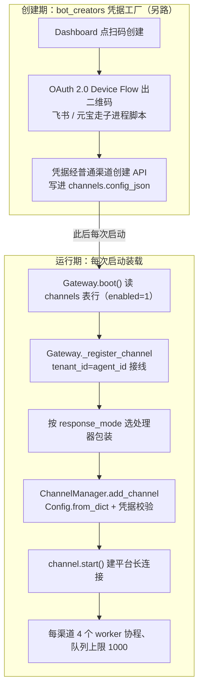
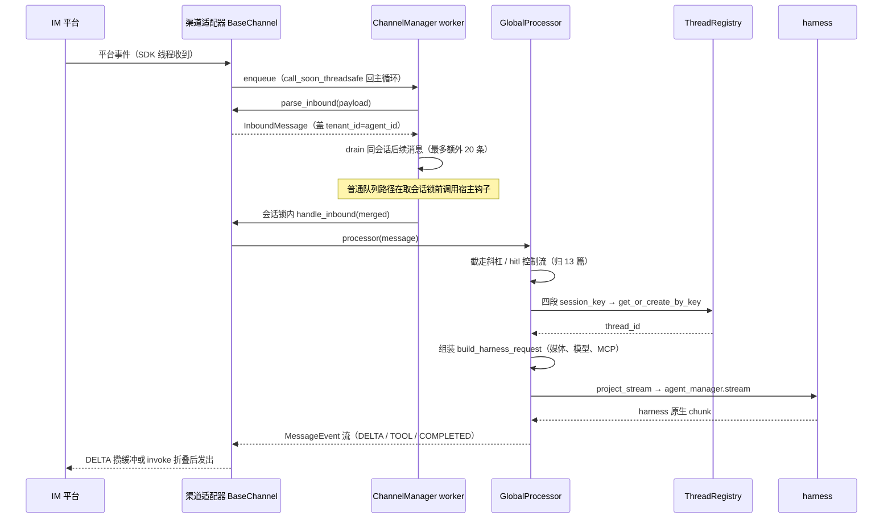
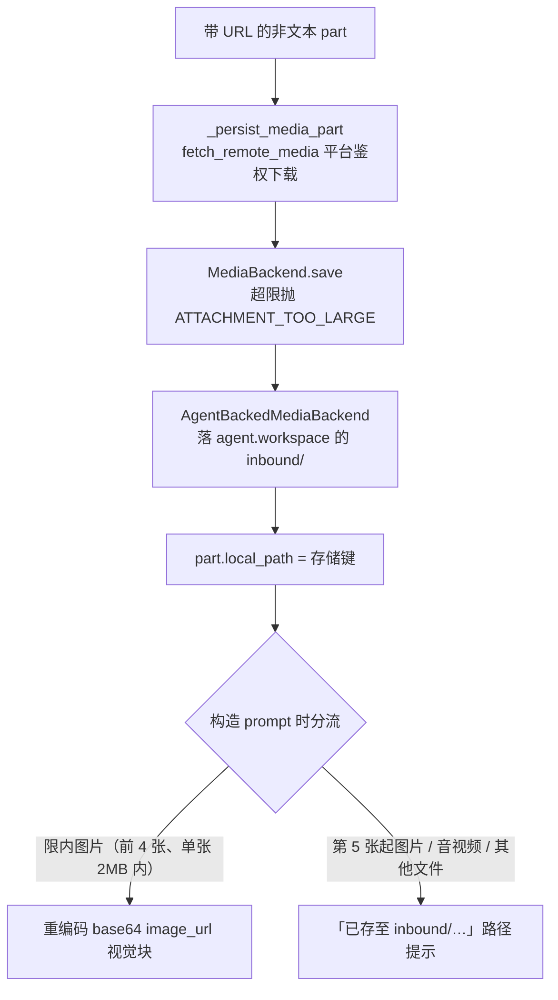

本篇拆解 Octop 的 IM 渠道接入与消息处理管线：一条来自飞书、企业微信、QQ 或 Telegram 的消息，怎样路由到某个用户的某个 Agent，处理后又怎样以事件流的形式回流。

协议适配在独立包 `octop-gateway`，业务路由、会话与持久化在主仓 `src/octop/infra/gateway/`。本文沿一条入站消息串联两者，不另设重复的组件总览。

主仓基线为 `v1.0.2`（`dd9dce47`）。原文部分片段来自 gateway 实装 `1.0.0`；本轮对照主仓锁定的 gateway `1.0.3` checkout（`224ed07`），重新核读了入队、worker、会话锁和消息类型，相关段落已注明版本。其余旧证据保留版本标记，未作全包逐行迁移。

前面已说明运行时、工具和状态。本篇回到请求入口，解释渠道怎样定位 Agent 与会话，再交给 [02：单轮任务执行](./02-agent-turn-execution.md) 的运行主线。输出投影见 [12：流式事件与结果交付](./12-stream-projection-and-rendering.md)，控制消息与审批见 [13：人机协作与会话控制](./13-session-control-slash-hitl-steer.md)；面板的 steer 不属于通用 IM 入站管线。

## 一、渠道模型

### 1、channels 表里的一行

持久化 IM 渠道由 `channels` 表的一行描述，绑定一个 Agent；启用并成功装载后才会对应运行中的 bot 连接。凭据以明文 JSON 存在 `config_json` 列里。

`ChannelRow`（`src/octop/infra/db/repos/channels.py`）定义了行长什么样：

```python
@dataclass(frozen=True)
class ChannelRow:
    id: int
    channel_id: str      # 公开字符串 ID（ULID），注册进 ChannelManager 的键
    agent_id: str        # 绑定的 Agent —— 路由的核心外键
    user_id: int         # 创建者（owner），外部 IM 会话记账到此人头上
    kind: str            # 渠道类型：feishu / wecom / qq / telegram / …
    name: str            # 同一 agent 内唯一；同 agent 同名同 kind 更新，异 kind 报错
    config_json: str     # 平台凭据 + 选项，整包 JSON 字符串
    enabled: int         # 0 时 Gateway 不注册该渠道
    created_at: int
    updated_at: int
（省略 from_row 映射）
```

`agent_id` 是整条链路的路由锚点：注册渠道时它被当作 `tenant_id` 传给 octop-gateway（见二、2），消息进来时又从 `InboundMessage.tenant_id` 读回来。

`config_json` 的内容因 kind 而异——飞书是 `app_id`/`app_secret`，企微是 `bot_id`/`secret`，QQ 是 `app_id`/`token`/`secret`，主仓不做结构校验，原样 `json.loads` 后交给渠道适配器的 `Config.from_dict`（`Gateway._config_from_row`，`src/octop/infra/gateway/gateway.py`）。

凭据写入路径（API 创建渠道，`src/octop/api/routers/channels.py` 的 `create_channel`）只是 `json.dumps(spec.config)` 后 INSERT，没有加密调用。这与连接器子系统形成对照——`infra/connectors/` 有专门的凭据加密模块，channels 表没有。源码可证实「明文存储」；是否构成风险取决于部署形态，见六、工程判断。

### 2、支持哪些平台

主仓支持面 = octop-gateway 的内置渠道 + 插件注册的渠道，自身不维护渠道清单。

`Gateway` 直接 re-export 包的枚举（`src/octop/infra/gateway/gateway.py`）：

```python
from octop_gateway.channels import ChannelKind
```

渠道类型由包内延迟加载表登记。以下按 checkout `1.0.3` 汇总连接方式，具体出站渲染归 [12 篇](./12-stream-projection-and-rendering.md)：

| 渠道 | 连接 | 关键实现 |
| --- | --- | --- |
| 飞书 | lark-oapi SDK 长连接 WS | watchdog 监测连接；出站沿用默认缓冲循环，再发送 post + md 消息 |
| 钉钉 | dingtalk-stream SDK | app_key/secret/robot_code |
| Discord | discord.py Gateway WS | 使用 bot 身份接入，输出转换见 12 篇 |
| 企业微信 | wecom-aibot-sdk WS | 首答超时在覆写的 `handle_inbound` 处理 |
| QQ | 官方 bot WS + REST | C2C **replace 模式**流式（官方 `stream_messages` 原地替换）；`stream_blocks.py` 稳定前缀防正文重复追加 |
| 微信 | iLink HTTP 长轮询 | 多账号；按换行切分约 2000 字长文；扫码登录 |
| 元宝 | 二进制 WebSocket | 富媒体先传 COS 再发 TIM 元素；单连接限制（探测即踢线） |
| 小艺 | 华为 OpenClaw A2A 双 WS | AK/SK 签名 |
| MQTT | paho-mqtt | IoT 设备 |
| Telegram | Bot API HTTP 长轮询 | `policy.py` 纯函数准入（私聊放行；群聊 always/mention/mention_or_reply + 白名单）；原生回调按钮；显式拒绝才重试 |

主仓在十种内置之外还有一条扩展缝：`src/octop/infra/gateway/plugin_channels.py` 的 `apply_plugin_channels` 把 octop-harness 插件通过 `PluginContext.channel()` 注册的渠道类转交给 `octop_gateway.channels.register_channel_kind`，之后这些 kind 与内置渠道走完全相同的创建、探测、持久化与重建路径。

API 层的 `_validate_channel_kind`（`src/octop/api/routers/channels.py`）先查 `ChannelKind` 枚举、再查插件清单。gateway `1.0.3` 的 `register_channel_kind` 还检查注册所有权：内建类型不可覆盖，同一 owner 可重复注册以支持重载，不同 owner 不可抢占同一个 kind，卸载也只能撤销自己的注册。包内扩展点就落在渠道注册环节，技能与插件的完整生命周期见 [04 篇](./04-skills-experts-plugins.md)。

一个版本细节：实装 1.0.0 的 `octop_gateway/channels/__init__.py` 里没有 `register_channel_kind` 函数，`plugin_channels.py` 拿不到它时会抛 "gateway lacks channel plugin lifecycle support; upgrade gateway"——主仓 `pyproject.toml` 要求 `octop-gateway>=1.0.3` 正好补上这个缺口，插件渠道在实装 1.0.0 环境下不可用是版本差异的直接后果。

### 3、两个不在表里的渠道

Dashboard 网页聊天和 CLI 聊天是注册在 `ChannelManager` 里的进程内虚拟渠道，不占 `channels` 表行。

`Gateway.boot()`（`src/octop/infra/gateway/gateway.py`）先注册两个内置实例：`WebSocketChannel`（`channel_id="octop-dashboard"`，走 `WebSocketHub` 推送 harness 原生 chunk）和 `CliChannel`（`channel_id="octop-cli"`，CLI 的 `octop chats send/repl` 走它）。

`ThreadRegistry.is_virtual_channel` 用类型字符串 `dashboard`/`cli`/`mcp` 区分虚拟渠道与 IM 渠道——虚拟渠道不是 IM 出站目标，主动推送时会被跳过或转成 Dashboard toast（`Gateway.notify_dashboard_push`）。

Dashboard 和 CLI 复用渠道、会话和处理器接口，但仍有各自的批处理、输出和控制行为；统一入口不表示网页端与 IM 的执行分支完全相同。

## 二、启动时装载

### 1、装配位置与顺序

Gateway 在 `OctopServer.start()` 里先于 AgentManager boot，渠道装载发生在 `Gateway.boot()`；媒体后端因这个顺序问题要二次补挂。

`src/octop/infra/server.py` 的启动序列（节选）：

```python
gateway = Gateway(
    agent_manager=registry,
    repos=self.services.repos,
    trajectory_service=trajectory_service,
    history_archive=history_archive,
)
await gateway.boot()
（省略 cron / care 装配）
await registry.boot()          # AgentManager 在 gateway 之后启动
registry.schedule_idle_reclaim_sweep()
await gateway.refresh_media_backends()   # 补挂：此时 agent.workspace 才可用
```

媒体后端依赖 `agent_manager.get_agent(agent_id).workspace`，而 Agent 实例此刻还不存在，所以 `Gateway.boot()` 里注册渠道时挂的是 `None`，等 `registry.boot()` 之后由 `refresh_media_backends()` 逐渠道补挂（`gateway.py` 中该方法的 docstring 明说 "gateway boots before agents"）。

源码可证实这个时序；本站推论：照搬这套装配时若忘了补挂，IM 图片/文件下载会在运行时静默跳过（`BaseChannel._persist_media` 里 `if not self._media_backend: return`）。

### 2、从 channel 行到运行中的 bot

装载入口是 `Gateway._register_channel`，它把 channel 行翻译成 octop-gateway 的渠道实例，`tenant_id=agent_id` 是路由接线。

从 channel 行到运行中的 bot，创建期与运行期是两条路：



两条路只在创建期交汇一次：bot creator 拿到凭据就退出，运行期装载永远走 `_register_channel` 这条链；`tenant_id=row.agent_id` 在 `add_channel` 时接线，之后每条入站消息都带着这个租户键进处理器。

```python
# src/octop/infra/gateway/gateway.py  _register_channel()
async def _register_channel(self, row: ChannelRow) -> None:
    config = self._config_from_row(row)
    from octop.infra.agents.teams.service import is_team_agent

    team_host = False
    if self._agent_manager is not None:
        try:  # 团队宿主需要派发旁白，强制流式，避免 invoke 折叠丢内容
            team_host = is_team_agent(self._agent_manager.get_row(row.agent_id))
        except Exception:
            team_host = False
    if team_host:
        response_mode: ChannelResponseMode = "stream"
    elif row.kind == "qq":
        response_mode = qq_channel_response_mode(config)
    else:
        response_mode = normalize_channel_response_mode(config.get("response_mode"))
    processor = processor_for_response_mode(self._processor, response_mode)
    if row.kind == "weixin" and response_mode == "stream":
        processor = wrap_weixin_stream_processor(processor)
    manager = self._require_channel_manager()
    await manager.add_channel(
        row.kind, config,
        tenant_id=row.agent_id,      # ← Agent ULID 成为租户键
        channel_id=row.channel_id,
        processor=processor,
    )
    registered = manager.get_channel(row.channel_id)
    if registered is not None:
        backend = media_backend_for_agent(self._agent_manager, row.agent_id)
        if backend is not None:
            registered.set_media_backend(backend)
    self._set_runtime_status(row.channel_id, connected=True)
（省略 weixin 发送令牌监听）
```

`ChannelManager.add_channel`（`octop_gateway/manager.py`）查 `BUILTIN_CHANNELS` 表拿渠道类，把 dict config 经 `Config.from_dict` 转成类型化 dataclass，`missing_credentials()` 校验必填凭据（缺了抛 `ChannelCredentialsError`），实例化后注册、`start()`、每渠道起 4 个 worker 协程（`workers_per_channel=4`，队列上限 1000）。

渠道类构造时保存 `tenant_id`，之后每条 `parse_inbound` 出来的 `InboundMessage` 都盖上 `tenant_id=self._tenant_id`（`octop_gateway/channels/feishu.py` 实装 1.0.0）——octop-gateway 对「租户」的全部理解就是一个不透明字符串，主仓把 agent ULID 塞进去，消息路由就成立了。

注意 `processor_for_response_mode` 的包装：默认 `invoke` 模式把整轮流折叠成一条消息（见三、5），`stream` 保留逐段输出；QQ C2C 默认流式（`c2c_streaming` 缺省 True）；团队宿主 Agent 无条件流式。同一个 `GlobalProcessor` 被不同包装函数包出不同交付风格，处理器本体不感知渠道差异。

### 3、长连接怎么建立

每个渠道适配器在自己的 `start()` 里建立平台连接，方式随平台 SDK 各异；连接线程通过线程安全 enqueue 回到 asyncio 主循环。

以飞书为例（`octop_gateway/channels/feishu.py`，实装 1.0.0）：

```python
async def start(self) -> None:
    """启动：刷新 token 并连接 WebSocket。"""
    self._running = True
    self._main_loop = asyncio.get_running_loop()
    await self._refresh_token()          # tenant_access_token，提前 300s 续期
    await self._ensure_bot_open_id()     # /bot/v3/info 缓存 bot 自己的 open_id
    await self._start_ws_client()        # lark-oapi WS 客户端跑在守护线程
    self._ws_watchdog_task = asyncio.create_task(
        self._ws_watchdog_loop(), name=f"feishu-ws-watchdog-{self.channel_id}"
    )
```

lark-oapi 的 `ws.Client.start()` 是阻塞调用，适配器把它放进 daemon 线程并起 watchdog 看护重连；线程里收到事件后调 `channel.enqueue(payload)`，`ChannelManager.enqueue` 用 `loop.call_soon_threadsafe` 把载荷投回事件循环（`octop_gateway/manager.py` 注释点名了 lark-oapi WebSocket 线程和 wecom-sdk 线程这两个来源）。

watchdog 的职责是把「SDK 自己的重连」与「SDK 假活」区分开，三道阈值全部来自 `feishu.py:46-53` 的模块常量：

```python
_WS_WATCHDOG_INTERVAL = 30.0         # 巡检间隔
_WS_RECONNECT_STALE_SECONDS = 180.0  # 重连中卡超过 3 分钟 → 硬重启
_WS_ACTIVITY_STALE_SECONDS = 3600.0  # 线程看似正常但 1 小时无任何消息/重连活动 → 硬重启
_WS_RESTART_BACKOFF_SECONDS = 5.0    # 硬重启退避
```

第三条针对的场景源码注释写得直白：SDK 接收循环死掉时**不触发任何重连钩子**，线程看起来还是「fine」——lark-oapi 自带的重连只覆盖它自己知道的故障，watchdog 是兜住「静默死亡」的第二层。硬重启的动作是杀 WS 线程重建连接，孤儿线程归档进 `_ws_orphan_threads`（`feishu.py:116`）等 join。也就是说飞书链路的断线自愈是两层结构：SDK 内建重连管普通闪断，30 秒一轮的 watchdog 管重连卡死与假活。

企微走 `wecom-aibot-sdk` 的 WebSocket 长连接（模块 docstring：客户端主动连接、无需公网回调 URL），Telegram 用 long-polling，钉钉用 stream 模式。**Octop 全程不需要公网入站回调**——五家主要 IM 全是客户端主动外连，这对家庭自托管是关键的产品决策。

`Gateway.probe_channel` 提供凭据探测：起一个临时渠道实例再立刻停掉。一个 README 看不到的细节藏在 `ChannelManager.probe_channel`（实装 1.0.0）：元宝渠道探测时强制加 `probe_mode="sign_token"`，注释解释元宝只允许一条有效 bot WebSocket 会话，全量探测连接会把线上 bot 踢下线。

### 4、bot_creators 是凭据工厂，不是装载器

`bot_creators/` 四个文件解决的是「凭据从哪来」，不是「渠道怎么启动」。

AGENTS.md 把 `bot_creators/` 描述为「按渠道类型创建 bot 的工厂」，实际调用链是：用户在 Dashboard 点「扫码创建」→ `api/routers/channels.py` 起子进程跑 `feishu_bot_creator.py` 或 `yuanbao_bot_creator.py` → 脚本走 OAuth 2.0 Device Flow（RFC 8628，飞书用 `lark_oapi.register_app` 出二维码）→ 凭据以 JSON 行流式打回父进程 → 前端拿到 `app_id`/`app_secret` 后再走普通的渠道创建 API。

`feishu_runner.py` 封装了子进程的启动/轮询/终止与凭据提取。

也就是说 bot creator 在**创建期**跑一次就退出，**运行期**装载渠道的始终是 `Gateway._register_channel` → `ChannelManager.add_channel` → `channel.start()`。

钉钉的扫码注册甚至不走子进程，直接在 router 进程内用 `channels/dingtalk_registration.py` 完成 Device Flow，凭据全程不落前端。

## 三、一条消息的旅程

下图沿普通 IM 消息展示主路径，gateway 侧按 `1.0.3` 的队列与 worker 组织。停止命令还可以在入队前走独立旁路，紧接图后的正文单独说明：



队列、合并与会话锁都在 octop-gateway 内；调用 `GlobalProcessor` 后才进入主仓的业务路由。锁前钩子只描述已进入 worker 的消息，入队前的紧急控制旁路是另一条路径，二者需要分开理解。

### 1、平台事件到统一消息（octop-gateway 侧）

平台原生事件经 `parse_inbound` 归一为 `InboundMessage`，经每渠道队列与 session 锁串行化后进入 `handle_inbound` 模板。

octop-gateway 的统一消息抽象（本轮核读 checkout `1.0.3` 的 `octop_gateway/models.py`）：

- `InboundMessage`——入站统一消息：`channel_id`/`channel_type`/`tenant_id`/`channel_subject`（回复目标）/`content`（`ContentPart` 判别联合：text/image/video/audio/file）/`metadata`（平台路由杂项）。`.text` 属性拼接全部文本 part。
- `MessageEvent`——处理器回吐的事件，`MessageEventType` 十种：MESSAGE（完整消息）、DELTA（流式增量）、THINKING/THINKING_DELTA、FLUSH、TYPING、TOOL_START/TOOL_END、ERROR、COMPLETED。
- `ChannelSubject`——出站路由句柄：subject_id（DM 是用户 openid，群聊是会话 ID）+ metadata（msg_id、webhook_url 等平台回包所需的临时字段），每条入站消息都会刷新它。

SDK 回调通过 `enqueue` 回到管理器保存的事件循环。正常运行时，`_put_to_queue` 先解析消息并判断 `interrupt_message_predicate`；命中时创建独立任务执行 `channel.handle_inbound`，直接返回，不进普通队列，也不取会话锁。主仓用这个入口处理紧急停止命令。未命中的消息才交给 worker；控制消息还会被 `control_message_predicate` 排除在批合并之外。

普通消息的核心处理来自 gateway `1.0.3` 的 `manager.py:724–754`。下面保留消息解析、批处理和加锁的真实代码，省略外层异常捕获与锁前钩子的实现：

```python
message = payload if isinstance(payload, InboundMessage) else channel.parse_inbound(payload)
session_key = channel.get_debounce_key(message)

batch = [message]
is_control = self._control_message_predicate is not None and self._control_message_predicate(message)
if not is_control and channel.should_batch_inbound(message):
    batch.extend(self._drain_same_session(queue, channel, session_key))
merged = channel.merge_inbound(batch) if len(batch) > 1 else batch[0]

# （省略锁前钩子：调用 self._on_pre_lock，并隔离钩子异常）
async with self._session_lock(channel_id, session_key):
    await channel.handle_inbound(merged)
```

批处理从首条消息开始，`_drain_same_session` 最多再尝试抽取 20 条。因此源码中的 20 是后续抽取次数上限，一批最多包含首条加后续共 21 条；遇到不同会话或控制消息会提前停止。锁键为 `f"{channel_id}:{session_key}"`，防止不同注册渠道中相同的原生 subject ID 共用一把锁。

默认每渠道 4 个 worker、队列容量 1000。入队使用 `put_nowait`，满队列会记录错误并丢弃载荷，未提供持久化缓冲或背压等待。这些是本轮在 `manager.py:92–93、249–309、708–805` 核对到的行为。

主仓另注册 `_preempt_cancel_on_stop` 锁前钩子，供仍经过普通队列的停止消息在等待会话锁前通知在途轮次取消。入队旁路与锁前通知解决的是不同位置的等待，完整停止语义见 [13 篇](./13-session-control-slash-hitl-steer.md)。

`BaseChannel.handle_inbound` 继续完成适配器预处理、回复目标登记、媒体下载和群聊上下文处理，再调用业务处理器。本文下一步进入处理器；其输出缓冲、超时占位和 typing 保活交给 [12 篇](./12-stream-projection-and-rendering.md)。

### 2、进入 GlobalProcessor

`GlobalProcessor.__call__` 按 `tenant_id` 定位 Agent 与 owner 用户，先截走三种控制流，剩下的才进正常轮次。

`src/octop/infra/gateway/process/processor.py` 主流程（大幅节选）：

```python
async def __call__(self, msg: InboundMessage) -> AsyncIterator[MessageEvent]:
    METRICS.inc("messages_total")
    agent_id = msg.tenant_id or ""
    if not agent_id:
        yield MessageEvent.error_event("No agent (tenant_id) specified")
        yield MessageEvent.completed()
        return
    agent_row = self._agent_repo.get(agent_id)
    user_id = resolve_user_id_for_message(
        msg, agent_owner_id=agent_row.user_id if agent_row is not None else None)
    session_key = session_key_from_message(msg, agent_id=agent_id)
    channel_type = msg.channel_type or "unknown"
    cmd = parse_slash(msg.text)                       # 斜杠解析（13 篇）
    locale = resolve_user_locale(...)
    if cmd is not None and cmd.name in HITL_APPROVAL_COMMANDS:
        （省略 hitl 审批分支 → 13 篇）
    if cmd is None and msg.text.strip():
        ask_record = self._hitl.resolve_ask_pending(...)  # 追问待答分支 → 13 篇
        （省略）
    if cmd is not None:
        （省略普通斜杠命令分支：dispatcher.handle → 13 篇）
    thread_id = await self._thread_registry.get_or_create_by_key(
        session_key=session_key, agent_id=agent_id, user_id=user_id,
        channel_type=channel_type,
        channel_channel_id=msg.channel_id or None,
        channel_metadata=im_meta)
    （省略构造请求与执行，见下）
    yield MessageEvent.completed()
```

用户归属（`process/message_keys.py` 的 `resolve_user_id_for_message`）是个容易踩的语义点：dashboard/cli/mcp 三类虚拟渠道把数字 `subject_id` 直接当 Octop 用户 id；**外部 IM 的平台身份 id 与 Octop 用户域无关，一律记到 Agent owner 头上**——该 Agent 的所有 IM 用户共享 owner 的身份与偏好，互不隔离。

docstring 写得很直白："IM members of one agent share the owner's profile"。

### 3、session_key 与 thread 定位

会话标识是四段式 `session_key`，`ThreadRegistry` 用 sessions + threads 两张表把它绑定到 harness 的 `thread_id`（即 LangGraph checkpoint 线程）。

键的构造（`process/message_keys.py` → `infra/gateway/threads.py`）：

```python
def session_key_from_message(msg: InboundMessage, *, agent_id: str) -> str:
    meta = msg.metadata or {}
    explicit = meta.get("session_key")          # Dashboard 可显式指定
    if isinstance(explicit, str) and explicit.strip():
        return explicit.strip()
    return ThreadRegistry.make_key(
        agent_id=agent_id,
        channel_type=msg.channel_type or "unknown",
        channel_subject_id=subject_id_from_message(msg),
        channel_chat_type=chat_type_from_message(msg),   # dm / group
    )

@staticmethod
def make_key(*, agent_id, channel_type, channel_subject_id, channel_chat_type="dm"):
    """全局唯一会话键：agent:channel:subject:chat_type"""
    return f"{agent_id}:{channel_type}:{channel_subject_id}:{channel_chat_type}"
```

同一个飞书用户跟同一个 Agent 的私聊永远落在同一个 session_key 上；群聊与私聊不同键、天然分会话。

`get_or_create_by_key` 的双重检查（无锁快路径 + `asyncio.Lock` 内复查）之外有一个防御细节：session 行存在但其 `thread_id` 指向的 thread 行已被删除时，视为未绑定，重新建 thread 并改绑——避免往死线程写轮次。

`im_meta`（`session_metadata_from_message`）把 openids、chat_id 等耐久路由字段白名单存进 session 行、剥掉 msg_id/response_url 等易失字段；微信还额外多存一份 `context_token` 供 cron 主动推送寻址。

`thread`（线程）是 harness 执行与历史的单位：`ThreadRegistry` 同时提供 `reset`（`/new` 换新线程）、`rebind`（把 session 指到既有线程）与群聊/团队用的 `peer_room_session_key`（同一个人在同一群里的不同 Agent 会话不得与私聊串线程）。

### 4、构造 harness 请求并执行

媒体进内容块或路径提示、模型逐级回退解析、MCP 连接器注入，最后组装成 harness stream 请求，经 `project_stream` 变成 `MessageEvent`。

回到 `__call__` 的中段（节选）：

```python
media_backend = media_backend_for_agent(self._agent_manager, agent_id)
content = await build_content_from_message(msg, media_backend=media_backend, locale=locale)
model_route = self._resolve_harness_model_route(
    agent_id, thread_id, None, user_id=user_id,
    needs_multimodal=content_blocks_need_vision(content))   # 视觉轮自动升级模型
mcp_servers = await self._resolve_turn_mcp_servers(
    agent_id=agent_id, user_id=user_id, explicit=None,
    apply_defaults=True, raise_on_failure=False)   # 连接器加载失败只告警，不阻断 IM 轮
request = build_harness_request(
    thread_id=thread_id, user_id=user_id, agent_id=agent_id,
    session_key=session_key,
    source=f"{msg.channel_type}/{msg.channel_id}",
    content=content, model=model_ref, auto_route=model_route.automatic,
    message_kwargs=message_kwargs or None)
（省略团队标记 / 知识库注入 / 会话模式标记）
yield MessageEvent.typing()
history_tracker = await self._begin_history(agent_id, thread_id, request)
try:
    async for ev in project_stream(
        self._agent_manager, agent_id, request, ...):
        yield ev
（省略错误路径与收尾：touch 线程、记 usage、落历史投影）
```

模型解析的优先级链（`_resolve_harness_model_route`）：本轮显式选择 > 线程粘性值 > Agent 默认 > 用户偏好（标记 auto）> 系统回退；解析出模型还需通过可用性校验，失效引用会被丢弃再回退。

`project_stream`（`process/stream_project.py`）把 `agent_manager.stream(agent_id, request)` 的 harness 原生 chunk 翻译成 `MessageEvent`——工具提示本地化、HITL 暂停、媒体提取都在那层，细节归 12 篇。

失败时残局不丢：`_persist_incomplete_turn` 把已产出的部分 token 和错误落进历史，再 `yield MessageEvent.error_event(...)`。

### 5、回复交接与主动推送的寻址

`project_stream` 产出 `MessageEvent` 后，渠道负责把事件转换成平台消息。stream/invoke 选择、正文缓冲、工具提示与前导文本过滤属于[输出投影篇](./12-stream-projection-and-rendering.md)，这里结束普通消息的入站旅程。

主动推送复用回复目标，但没有新的入站消息。`Gateway.push_text_from_session` 经 `_resolve_push_subject` 从 session 行重建 `ChannelSubject`，再合并渠道内存中的最新路由状态、剥掉已失效的被动回复字段，调用 `channel.push_text`。session 中保存的 openid、chat_id 和 context_token 因而同时服务后续推送。cron 与主动关怀怎样产生这类请求，见 [15 篇](./15-cron-and-proactive-care.md)。

## 四、媒体与附件

### 1、入站下载落 workspace

图片/语音/文件的字节由 octop-gateway 在 `handle_inbound` 阶段下载，经 `MediaBackend` 抽象落进目标 Agent 工作区的 `inbound/` 目录。

下载发生在 `BaseChannel._persist_media`（每条入站消息、每个带 URL 的非文本 part）：

```python
# octop_gateway/channel.py  _persist_media_part()（实装 1.0.0，节选）
filename = self._resolve_media_filename(part, index, timestamp)
key = f"{self.channel_type}/{self._channel_id}/{filename}"
try:
    data, mime = await self.fetch_remote_media(url)   # 平台鉴权下载，子类可注入 token
    await self._media_backend.save(data, key)
    part.local_path = key          # 后续所有读者用这个键取字节
    part.size = len(data)
except Exception:
    logger.warning("Failed to persist media: url=%s", url[:100], exc_info=True)
```

`MediaBackend` 是 octop-gateway 的可插拔接口（`save/read/exists/get_local_path`，键语义完全由实现方定义）。主仓的实现在 `src/octop/infra/gateway/media/ingress.py`：

```python
class AgentBackedMediaBackend(MediaBackend):
    """octop-gateway ``MediaBackend`` 适配器，背后是 ``agent.workspace``。"""
    def __init__(self, workspace: BackendWorkspace, *, max_bytes: int | None = None):
        self._workspace = workspace
        self._max_bytes = max_bytes

    async def save(self, data: bytes, key: str) -> None:
        validate_inbound_size(data, max_bytes=self._max_bytes)
        await self._workspace.aupload_bytes(inbound_rel_path(key), data)
```

`process/agent_resolve.py` 的 `media_backend_for_agent` 从 AgentManager 取 `agent.workspace` 包一层即成。

为什么落 workspace：IM 附件与 Dashboard 上传走同一条 `inbound/` 路径规则（03 篇详述），Agent 工作区就是附件仓库——换 COS/S3/Docker 后端时 IM 媒体自动跟着走，且工具能直接按 `inbound/...` 相对路径引用附件。

大小上限取 `OctopConfig.max_upload_bytes`，超限抛 `ATTACHMENT_TOO_LARGE`。

### 2、图片进视觉块、其余成路径提示

入站媒体在构造 prompt 时分两路——限内图片变成 `image_url` 多模态块，其余一切（含超限图片、音视频、文件）变成「工作区路径提示」文本。

从平台字节到 prompt 内容块，媒体链路如下：



分叉两边不对称：进视觉块会连带把模型解析升级到视觉可用引用，路径提示则要 Agent 自己开工具读内容；`.doc`/`.wps` 这类 OLE 二进制文档另有一路，由 anydoc 抽成 Markdown 直接内联进 prompt。

`process/harness_request.py` 的 `build_content_from_message` 与 `media/attachment_hints.py` 的门限：

```python
# media/attachment_hints.py
VISION_MAX_BYTES = 2 * 1024 * 1024   # 2MB
VISION_MAX_COUNT = 4                 # 最多 4 张进视觉
VISION_MAX_SIDE = 1568               # 超尺寸重编码（JPEG 85）
```

前 4 张图经 `materialize_image_part` 重编码成 base64 `image_url` 块（`content_blocks_need_vision` 因此为真，模型解析升级到视觉可用引用）；第 5 张起与所有非图片附件走 `hints_from_content_parts`，生成形如「附件 audio（audio/mpeg）已存至 inbound/…」的路径提示，Agent 需要内容时自己开工具读。

`.doc`/`.wps` 这类 OLE 二进制文档由 `_extracted_document_texts` 用 anydoc 抽成 Markdown 内联进 prompt（截断保护）。

`inbound_attachments_from_parts` 把附件清单挂到 `HumanMessage.additional_kwargs`，供 Dashboard 历史界面渲染附件气泡。

### 3、语音与 OCR 的真实情况

本链路内**没有**语音转写，也**没有** OCR——音频只作为文件提示进入 prompt，图片走视觉模型通道。

在 `build_content_from_message` 与 `hints_from_content_parts` 的分支里，`AudioContent` 只产出路径提示，没有任何 ASR 调用；OCR 同理不在 IM 链路（知识库子系统另有解析管线，属 10 篇）。要语音可听懂，得靠 Agent 自己用工具处理，或等模型侧的音频输入能力。没找到就写没找到：源码里 IM 入站到 harness 请求的这段路径上不存在转写步骤。

## 五、两个包的边界

octop-gateway 管「协议」——连接、解析、发送、限流、缓冲；主仓 `infra/gateway` 管「业务路由与会话」——哪个 Agent、哪个用户、哪个线程、什么模型、记什么账。包不知道 Agent 存在，主仓不知道平台协议。

代码证据从主仓侧看是五处接线：

| 接线点 | 主侧行为 | 包侧契约 |
| --- | --- | --- |
| `tenant_id=row.agent_id`（`_register_channel`） | 填入 Agent 公共 ID | 不透明字符串，回填到每条 `InboundMessage.tenant_id` |
| `GlobalProcessor`（实现 `MessageProcessor`） | 业务轮次 | `Callable[[InboundMessage], AsyncIterator[MessageEvent]]` |
| `AgentBackedMediaBackend` | 落 workspace `inbound/` | `MediaBackend` 键值接口 |
| `set_pre_lock_handler(_preempt_cancel_on_stop)` | `/stop` 抢占 | 锁前钩子 |
| `install_channel_thinking_clean()`（`process/channel_thinking.py`） | 替换思维链清洗 | 猴子补丁 `BaseChannel._clean_output` |

反方向零依赖：octop-gateway（实装 1.0.0）全库不 import `octop.*`，manager 源码里只有注释提到 "Used by Octop"。

这套单向依赖让包可以独立发布给任何 bot 项目用，也意味着主仓想改协议行为只能靠包装（processor 包装、push 前清洗）或猴子补丁（`_clean_output`）——后者是边界上最脆的一根线，包升级改掉该方法签名时补丁会静默失效，`install_channel_thinking_clean` 只有 `_PATCHED` 单次守卫、没有签名校验。

旧环境和当前锁定版的差异需要在接口处核对。原实装 `1.0.0` 缺少插件渠道注册接口，checkout `1.0.3` 提供该能力；其余 Telegram 准入、微信 typing、QQ 流式与错误终态等修订，按本文前面的版本标注理解。CHANGELOG 没有提到某项修复，不能据此断定实现未变；下文队列容量、丢弃和批处理判断采用本轮实际核读的 `1.0.3` 代码。

## 六、工程判断

### 1、串行会话需要独立的控制入口

会话锁避免同一会话的普通消息并发执行，入队旁路和锁前通知则给停止请求留下进入运行时的机会。这套分工适合交互式 bot；只复制会话锁而遗漏控制入口，会让取消请求一起排在长轮次后面。锁与任务表都在进程内，多副本部署需要重新设计它们的共享范围。

### 2、队列容量、重复与合并需要按业务选择

当前队列满时丢弃，已核读的入队和 worker 路径也没有按平台 msg_id 统一去重。重投是否再次执行，还取决于渠道适配器和 SDK。对计费敏感的场景应核对完整路径，选择幂等键、持久缓冲或背压机制；容量 1000 和每渠道 4 个 worker 本身不能证明吞吐足够。

同会话合并允许一批最多包含首条加额外 20 条消息，减少执行轮数，也改变了消息之间的边界。聊天场景可以采用这项策略，逐条指令必须独立执行的场景应调整 `should_batch_inbound`；Dashboard 已通过关闭批合并保留轮次边界。

### 3、资源归属与媒体接线要随生命周期维护

gateway 先启动、Agent 后启动，使媒体后端需要在实例就绪后补挂。复用这条启动链时，需要保留 `refresh_media_backends` 等补接步骤，不能只照搬注册渠道的调用。

包内的 `tenant_id` 被 Octop 用作 Agent 路由键，不能据此推断平台具有独立租户隔离。IM 用户按 Agent owner 解析平台身份，渠道凭据又以明文配置入库；共享部署时，应结合资源归属和备份访问权限评估是否需要独立凭据保护。

### 4、扩展协议时区分公开接口与内部替换

统一处理器、媒体后端和插件渠道注册接口允许协议包独立发布。应优先使用这些扩展点；替换 `BaseChannel._clean_output` 等内部方法，则需要在依赖升级时核对签名和调用位置。stream/invoke 包装的输出取舍见 [12 篇](./12-stream-projection-and-rendering.md)，本篇只保留入站路由所依赖的契约。

## 七、证据范围与未核验项

- 本文保留标注为 `.venv` 实装 `1.0.0` 的旧片段；渠道表、插件注册与消息契约采用 checkout `v1.0.3`。本轮重新核读了该版本的 `manager.py:249–309、708–805` 与消息类型，已据此修正队列、批处理和控制旁路说明。其余组件细节沿用此前 checkout `v1.0.3` 的阅读记录（manager.py/models.py、channel.py 前 450 行、channels/__init__.py、constraints.py 关键段、feishu watchdog、telegram policy 与 CHANGELOG）；两版差异按 CHANGELOG 对账，未做逐 commit 代码比对；channel.py 后半（handle_inbound 共享件全流程）、group_context.py、utils.py 的 Debouncer/merge 未逐行读。
- 各渠道出站媒体上传（飞书 image_key、QQ 上传、元宝 COS 上传）只确认了走 `load_media_bytes` 统一取字节，平台侧细节未逐行核验；各渠道 `_send_*` 平台原语只到 docstring 级。
- 微信 iLink、元宝、小艺三家内部协议的实现未展开；群聊 `GroupContextManager` 的激活/可见性策略只有导出清单，策略求值未读。
- `project_stream` 的投影细节、HITL/斜杠/steer 的内部机制分别归 12、13 篇，本文只核验了交接点的调用签名。
- Dashboard WebSocketChannel 的 steer 续流、CLI 渠道、bridge 插件渠道重载路径未展开。
- 未连接任何 IM 平台、未运行任何服务、测试或构建；结论均来自静态源码阅读（基线 commit `dd9dce47`，2026-10-23 核验）。

上一：[10：文档知识与检索](./10-knowledge-base-rag.md) · [系列导读](./index.md) · 下一：[12：流式事件与结果交付](./12-stream-projection-and-rendering.md)
