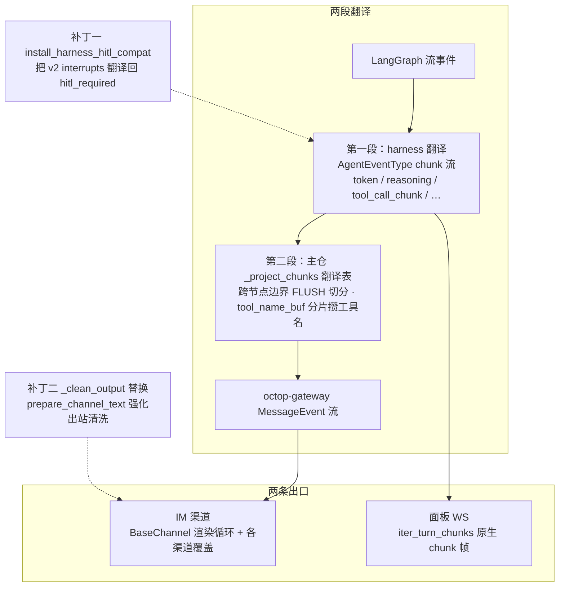
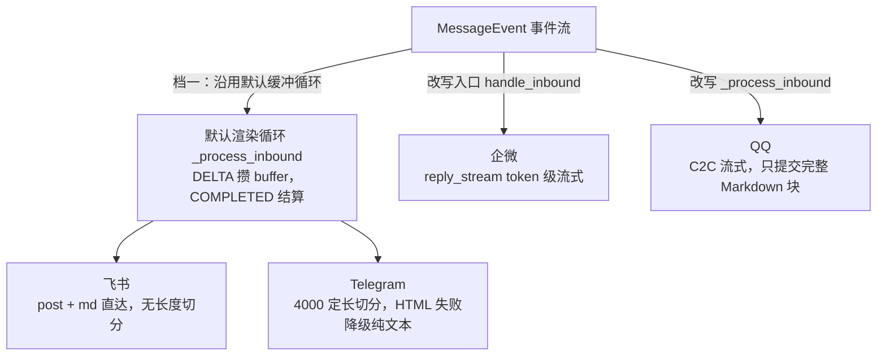
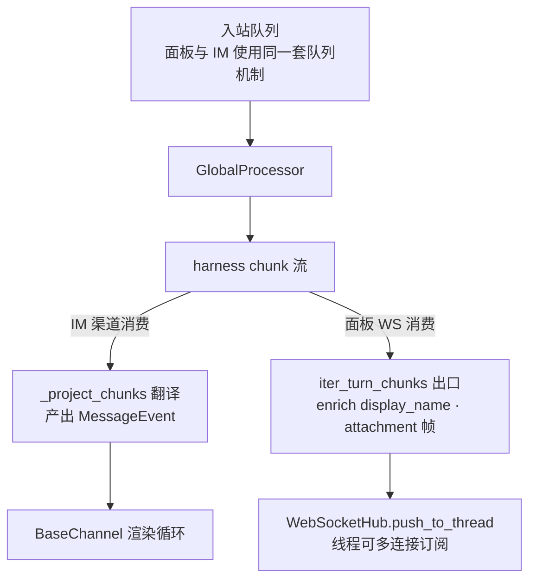

本篇拆解 Octop 回复侧的「投影与渲染」：harness（deepagents/LangGraph）吐出的流式事件，怎样变成飞书、企业微信、QQ、Telegram 和网页面板各自能显示的消息。

承接 [11：请求接入与消息路由](./11-im-gateway-message-pipeline.md)，消息已进入平台处理器并调用 harness。本篇从返回的 chunk 开始，追踪主仓如何投影事件、渠道如何发送，以及面板为何直接消费 chunk。执行循环见 [02：单轮任务执行](./02-agent-turn-execution.md)。

主仓基线为 `v1.0.2`（`dd9dce47`）。原有框架与渠道片段分别来自 harness 实装 `1.0.2`、gateway 实装 `1.0.0`；第三节默认渲染循环已按 gateway checkout `1.0.3` 重新核读，协议实现补充使用 harness checkout `1.0.5`。每处保持版本标记，不能把旧渠道实例直接当作新版完整行为。

斜杠命令、hitl 审批决策与 steer 的机制归 13 篇，本篇只在投影层的交接点（`hitl_required` 事件）停留一站。

## 一、投影层在哪：两段翻译、两条出口

先给整条链路一张地图，各站细节见后续小节：



图里两处边界最关键：面板出口不走 `MessageEvent`，在 chunk 层就分岔（第五节展开）；两枚猴子补丁一个守第一段翻译的 `hitl_required` 通路，一个换掉 IM 出站路径上的清洗逻辑（第四节）。

### 1、harness 先把 LangGraph 事件翻译成 chunk 协议

投影是两段接力——harness 包先把 LangGraph 的流事件压成自己的 chunk 协议，主仓再把 chunk 协议翻译成 `MessageEvent`。

chunk 协议的出处是 harness（实装 1.0.2）的 `AgentEventType`（`octop_harness/protocols/langgraph.py:52`）：

```python
class AgentEventType(StrEnum):
    """由 HarnessAgent.stream 发出的流事件类型。"""
    TOKEN = "token"
    REASONING = "reasoning"
    TOOL_CALL_CHUNK = "tool_call_chunk"
    TOOL_RESULT = "tool_result"
    STATE_UPDATE = "state_update"
    STATE_SNAPSHOT = "state_snapshot"
    CUSTOM = "custom"
    HITL_REQUIRED = "hitl_required"
    USAGE = "usage"
（省略 HITL/CUSTOM 之外的序列化细节）
```

每个 chunk 都带 `node` 字段（LangGraph 节点名）。thinking 在这一段就已经分流：`_content_block_delta` 把 `thinking` 类型的内容块拆成 reasoning 部分，`ThinkSplitter` 把模型直接吐在正文里的 `<think>` 标签也喂成 `reasoning` 事件（`langgraph.py:30-49`）。所以下游看到的是「token 与 reasoning 已经分离、带节点标注」的规整流。

### 2、主仓 stream_project 把 chunk 翻译成 MessageEvent

`src/octop/infra/gateway/process/stream_project.py` 的 `_project_chunks`（`stream_project.py:82`）是 IM 路径的核心翻译表——纯函数式的 `async for` 生成器，把 chunk dict 换成 octop-gateway 的 `MessageEvent`。

```python
async for chunk in chunks:
    if usage_tracker is not None:
        usage_tracker.observe(chunk)          # 计费旁路：每个 chunk 都过观察器
    if history_tracker is not None:
        history_tracker.observe(chunk)        # 历史归档旁路（08 篇）
（省略 tracker flush）
    ctype: str = chunk.get("type", "")
    node: str | None = chunk.get("node")

    if ctype == "token":
        if tool_state.current_node is not None and node != tool_state.current_node:
            yield MessageEvent.flush()        # 跨节点边界：先结一段消息
        tool_state.current_node = node
        content = chunk.get("content") or ""
        if content:
            yield MessageEvent.delta(content)

    elif ctype == "reasoning":
        content = chunk.get("content") or ""
        if content:
            yield MessageEvent.thinking_delta(content)
（省略 tool_call_chunk / tool_result / hitl_required / state_update 分支）
```

翻译表全貌（源码可证实）：

| chunk 类型 | 产出事件 | 备注 |
| --- | --- | --- |
| `token` | `DELTA`（跨节点时先 `FLUSH`） | 正文增量 |
| `reasoning` | `THINKING_DELTA` | 推理增量，渲染层决定去留 |
| `tool_call_chunk` | `TOOL_START`（名称攒齐且收到首个 args 片段时） | 名字分片到达，用缓冲区拼接 |
| `tool_result` | 补发 `TOOL_START`（若漏）+ `TOOL_END` + 媒体 `MESSAGE` | 媒体仅白名单工具（四、3） |
| `hitl_required` | `MESSAGE`（审批卡片文本），随后**流终止** | 细节归 13 篇 |
| `state_update` | 跨节点时 `FLUSH` | 无正文的状态推进 |

表外还有 `usage`/`state_snapshot`/`custom` 三类 chunk：它们不进翻译分支，`usage` 由循环开头的 `usage_tracker.observe` 旁路消费（计费不占消息流）。

`FLUSH` 的语义来自 octop-gateway（实装 1.0.0）`models.py:239` 的 `MessageEvent.flush()` docstring：把已累积内容立即结算成一条消息、下一段重新开始。deepagents 的多节点图（子 Agent、计划节点）在节点切换时天然分叉输出，`current_node` 比对让每个节点段各成一条 IM 消息，而不是把子 Agent 的碎碎念和最终答案糊成一坨。

工具名的拼接值得注意细节：LangGraph 的 `tool_call_chunk` 里工具名也是分片到达的，`_ToolProjectionState.tool_name_buf` 按 `index` 键逐段攒名，首个 `args` 片段到达才发 `TOOL_START`——只见到名字不见参数时还不知道这是不是一次真实调用。

### 3、投影层还有两枚猴子补丁

投影不是一处纯函数——模块导入时就打了两个补丁，分别修 harness 的漏译和 gateway 的弱清洗。

`stream_project.py:29` 的 `install_harness_hitl_compat()`（`src/octop/infra/gateway/hitl/stream_compat.py:63`）包住 harness 的 `LangGraphProtocol._project_chunk`：LangGraph v2 把 `__interrupt__` 挪到了 `chunk["interrupts"]`，harness 只读旧位置，`hitl_required` 就永远出不来——补丁把 v2 interrupts 翻译回 `hitl_required` chunk。

没有这层，审批卡在两个出口（IM 与面板）都不会出现。

另一枚在渲染层（四、2）。两枚补丁都只有「装过一次」的布尔守卫，没有签名校验，包升级改掉方法名即静默失效——11 篇已把这个列为边界上最脆的线，本篇第四节会看到它的具体落点。

### 4、包内视角：协议层的三种实现

上游这九种 chunk 事件的产出口是 harness 的协议层（checkout `v1.0.5`；原「harness 整体架构」深潜篇的协议节并入此处）。`ChatProtocol`（`protocols/base.py`）是抽象基类，`resolve_protocol(name, graph)` 按名解析并缓存；三种实现决定输出形态：**langgraph**（本事件流，主仓默认——面板 WS 与 IM 渠道经主仓再投影）、**openai**（ChatCompletion chunk dict，OpenAI 兼容 HTTP 面）、**mcp**（MCP SamplingMessage，给 MCP 客户端宿主）。

`AgentEventType` 九种投影自 LangGraph 四路流（`stream_mode=["values","updates","messages","custom"]`，`protocols/langgraph.py:168`）。三个值得记的投影细节：

- **内部模型流过滤**（`protocols/langgraph.py:20`）：LangChain 给压缩调用打 `metadata["lc_source"]=="summarization"` 标，messages 流里这些嵌套 token 必须在消费者看到前剔除。
- **think 标签流式拆分**（`ThinkSplitter`）：跨 chunk 的 `<think>` 块正确分流到 reasoning/text。
- **usage 的 `call_id` 合成**（`protocols/langgraph.py:91`）：按 `node:step` 合成调用 id，宿主能把 token 用量归到具体模型调用。

另一条边界：`stream_events` 刻意不过运行期斜杠层（`agent.py:591`）——请求以 `/` 开头时不进图直接本地分派，要斜杠处理就用 `stream`。

## 二、工具提示的本地化

### 1、tool_display_name 的四级回退

工具名到「人话」的解析在主仓 i18n 域完成，四级回退保证任何工具名都有输出。

`src/octop/i18n/domains/tools.py:68` 的 `resolve_tool_display_name`：

```python
def resolve_tool_display_name(
    name: str | None,
    locale: str | Locale = "en",
    *,
    mcp_server_labels: Mapping[str, str] | None = None,
    plugin_labels: Mapping[str, str] | None = None,
) -> str:
    if not name:
        return lookup("tools.unknown", locale) or "unknown"
    text = lookup(f"tools.{name}", locale)      # 1. i18n 词条：tools.write_todos
    if text is not None:
        return text
    if plugin_labels and name in plugin_labels: # 2. 插件自带标签
        return plugin_labels[name]
    if mcp_server_labels:                       # 3. MCP 前缀改写
        for server in sorted(mcp_server_labels, key=len, reverse=True):
            prefix = f"{server}_"
            if not name.startswith(prefix):
                continue
            base = name[len(prefix) :]
            server_label = mcp_server_labels[server]
            if base:
                return f"{server_label} · {humanize_tool_segment(base)}"
            return server_label
    return name                                  # 4. 原名直出
```

词条样例（`src/octop/i18n/zh.json:605` / `en.json:605`）：`write_todos` → 「编写计划」/ "Write plan"，`task` → 「子智能体任务」/ "Sub-agent task"。MCP 工具名是 `服务器名_工具名` 的拼接串，第 3 级把服务器段换成连接器的显示名、工具段做下划线转空格加首字母大写（`humanize_tool_segment`），最长前缀优先避免歧义。

MCP 标签从哪来：`AgentManager.resolve_tool_display_name_for_chat`（`src/octop/infra/agents/manager.py:2125`）按用户取 `mcp_server_labels_for_user` 组装后调用同一函数——IM 与面板共用这条解析链。

### 2、tool_hint_text 的构造与消费：AGENTS.md 那条规则的落点

Octop 在投影层把提示语**整句预格式化**塞进 `metadata.tool_hint_text`，octop-gateway 读到即直用、读不到才回退英文模板——「不要只依赖英文 `tool_hint_template`」的规则落实在两个包的这段协议上。

投影侧（`stream_project.py:101`）：

```python
def _tool_start(raw: str) -> MessageEvent:
    label = _tool_label(raw)                       # 本地化显示名
    return MessageEvent.tool_start(
        label,
        tool_hint_text=channel_tool_hint_start(label, loc),  # 整句预格式化
        # 原始工具 id，供 invoke-collapse / team 渠道 UX 用（label 已本地化）
        tool_key=raw,
    )
```

`channel_tool_hint_start`（`src/octop/i18n/domains/channel.py:17`）取 `channel.tool_hint_start` 词条：中文「🔧 正在调用工具：`{tool_name}`」、英文 "🔧 Calling tool: `{tool_name}`"（`zh.json:678` / `en.json:678`）。消费侧是 octop-gateway 的 `tool_hint_message`（`octop_gateway/constraints.py:98`）：

```python
def tool_hint_message(metadata, constraints, *, phase="start") -> str:
    """格式化工具状态行，优先使用 metadata 里预本地化的 ``tool_hint_text``。"""
    raw = metadata.get("tool_hint_text")
    if isinstance(raw, str) and raw.strip():
        return raw                                # Octop 的预格式化文案，直用
    tool_name = metadata.get("tool_name", "tool")
    template = constraints.tool_end_template if phase == "end" else constraints.tool_hint_template
    return template.format(tool_name=tool_name)   # 英文模板回退
```

细节：`MessageEvent.tool_start(label, ...)` 把 label 放进 `metadata.tool_name`（`octop_gateway/models.py:279`），所以即便走了英文模板回退，`{tool_name}` 填的也是本地化 label。i18n 与渠道包之间没有 locale 概念的传递——传的是成品字符串。这是两个包保持单向依赖（gateway 不认识 `octop.*`）的前提下的干净解法。

### 3、locale 在入口解析一次、贯穿整轮

locale 不在投影层解析，`GlobalProcessor` 入口解析一次后向下传。

`src/octop/infra/gateway/process/processor.py:663`：

```python
locale = resolve_user_locale(
    user_repo=self._user_repo,
    user_id=user_id,
    channel_type=channel_type,
    metadata=msg.metadata,
)
```

解析链在 `src/octop/infra/utils/locale.py:22` 的 `resolve_locale`：存储的用户偏好 → 显式覆盖（HTTP 侧是 `resolve_request_locale` 读 `Accept-Language`）→ `metadata` 里的 `locale/language/lang` 键 → 渠道类型暗示（`feishu/wecom/weixin/dingtalk/qq/xiaoyi/yuanbao` 一律 zh，`telegram` 为 en）→ 默认 `zh`。

解析出的 locale 随后传给 `project_stream`（工具提示、审批卡）、`_stream_error`（错误文案）、`build_content_from_message`（入站提示）。同一轮里工具名、错误、卡片不会出现中英混搭。

## 三、渠道约束与分段

### 1、ChannelConstraints：渠道差异的声明面

渠道间「能发什么、多快发、要不要装思考」的差异全部声明在 `ChannelConstraints`（`octop_gateway/constraints.py:27`），渲染循环按声明行事。

```python
@dataclass
class ChannelConstraints:
    reply_timeout: float = 0.0            # 平台限时首答秒数，0 = 无约束
    send_rate_limit: tuple[int, float] | None = None   # 滑动窗口 (N 条 / M 秒)
    typing_keepalive_interval: float = 0.0
    timeout_strategy: str = "none"        # "placeholder" = 超时先发占位文案
    placeholder_texts: list[str] = field(default_factory=lambda: [...])
    tool_hint_throttle: float = 6.0       # 声明了但全仓无消费（六、2）
    show_tool_hints: bool = True          # 是否发工具提示行
    tool_hint_template: str = "🔧 Calling tool: {tool_name}"
    tool_end_template: str = "✅ {tool_name} done"
    show_thinking: bool = False           # 是否转发推理内容
    thinking_template: str = "💭 Thinking: {content}"
（省略 placeholder_text 随机选择 property）
```

`ChannelConfig` 上的 `show_thinking` / `show_tool_hints` 两个开关随渠道配置（`channels.config_json`）覆盖默认值（`channel.py:245-247`）。声明集中带来的好处：主仓不需要 if-else 渠道名，装渠道时把 config 灌进 constraints 即可。

### 2、BaseChannel 的默认渲染循环：缓冲、刷新与终态

默认循环积累 DELTA，在 FLUSH、完整 MESSAGE 或 COMPLETED 时交付正文。gateway `1.0.3` 还把 ERROR 当成终态：先发送已积累的文本和错误事件，再退出循环，避免后续 COMPLETED 把失败改成成功。

下面截取 checkout `1.0.3` 的 `channel.py:836–905`，保留正文缓冲、刷新与错误分支，省略 thinking、完整消息与正常完成的处理：

```python
events = self._processor(message)
async for event in events:
    if event.type == MessageEventType.DELTA:
        # 累积增量正文
        for part in event.content:
            if isinstance(part, TextContent) and part.text:
                delta_buffer.append(part.text)
    # （省略 THINKING 与 THINKING_DELTA 分支）
    elif event.type == MessageEventType.FLUSH:
        # 立即将所有已积累的缓冲分别发送
        if thinking_buffer:
            thinking_text = "".join(thinking_buffer)
            thinking_buffer.clear()
            formatted = self._constraints.thinking_template.format(content=thinking_text.strip())
            await self._rate_limited_send(subject, formatted)
        if delta_buffer:
            full_text = "".join(delta_buffer)
            delta_buffer.clear()
            await self._rate_limited_send(subject, full_text)
    # （省略 COMPLETED 与 MESSAGE 分支）
    elif event.type == MessageEventType.ERROR:
        if delta_buffer:
            await self._rate_limited_send(subject, "".join(delta_buffer))
            delta_buffer.clear()
        await self._deliver_event(subject, event)
        break
    else:
        # 处理输入状态、工具开始与工具结束事件
        await self._deliver_event(subject, event)
```

每个出站口都过 `_rate_limited_send` → `_clean_output` → `reply_text`（`channel.py:919`），`reply_text` 先 `_acquire_rate_slot` 扣一个滑动窗口令牌。出站 API 的三层结构与「一条用户可见消息恰好扣一个令牌」的纪律写在 `channel.py:320-331` 的注释块里：公开 `reply_*`/`push_*` 扣槽，子类的 `_send_*` 原语不许再碰公开名，否则一条消息会被扣多次槽。

飞书走的就是这套默认循环——它没有覆盖 `_process_inbound`，约束全取基类默认值（无限流、无超时、不显思考）。

### 3、渠道实例：发送原语与专用事件循环

以下实例和分档图保留 gateway 实装 `1.0.0` 的观察，用来解释「改发送原语」与「改事件消费」的区别。新版可能在两者之间增加包装层：本轮在 `1.0.3` 的 Telegram 适配器中已看到独立 `_process_inbound` 包装，内部仍调用基类，不能再把「没有覆盖方法」作为跨版本判据。

两档的分野一张图看完：



判断渠道差异时，需要分别查看 `handle_inbound`、`_process_inbound` 和 `_send_*`。企微覆盖入口，QQ 与小艺则覆盖事件处理方法；方法覆盖层次不同，共同输入仍是 `MessageEvent`。本轮 `1.0.3` 检索也发现微信和 Telegram 的处理方法覆盖，旧图只保留为 `1.0.0` 的实例说明。

**飞书：只改原语，markdown 直达。** `_send_text`（`octop_gateway/channels/feishu.py:610`）把文本包成 `msg_type="post"` + `{"tag": "md"}` 元素发出去，代码块、加粗、链接由飞书原生渲染；发送前只做一次「代码围栏前补换行」的正规化（`_build_post_content`，`feishu.py:625`）。没有长度切分——超长就交给平台。

`_deliver`（`feishu.py:701`）优先用 reply API 回进话题线程，失败降级为普通发送。

**Telegram：定长切分 + 格式降级。** 常量在 `octop_gateway/channels/telegram/channel.py:30`：平台上限 `_TELEGRAM_MAX_MESSAGE_LENGTH = 4096`，自家切片 `_TELEGRAM_SEND_CHUNK_SIZE = 4000`。

`_send_text`（`channel.py:203`）先做 Markdown → Telegram HTML 子集的转换（`format_html.py` 的 `markdown_to_telegram_html`：围栏代码块、行内代码、链接先抽成占位符，正文整体 HTML 转义，再还原标题加粗、引用块、剧透、删除线），按 `parse_mode=HTML` 发送；

`TelegramError` 时**去掉 parse_mode 重发纯文本**（`channel.py:223-227`）——转换器不认识的语法不会让消息发不出去。切分本身是 `_chunk_text` 的 4000 定长切（`channel.py:282`），不感知 HTML 标签边界。

**企微：整段换循环，token 级流式。** 企微的约束最紧（`reply_timeout=10.0`、`timeout_strategy="placeholder"`、`send_rate_limit=(2, 5.0)`，`wecom.py:100-108`），它覆盖 `handle_inbound`（`wecom.py:349`）改用 SDK 的 `reply_stream(finish=False)` 增量更新——企微客户端里呈现为逐步展开的气泡。

首 token 超时用 `asyncio.wait` 而非 `wait_for`（`wecom.py:405-430`）：占位文案先流出去，**不取消**仍在途的第一个事件任务，模型首字迟到也不丢。整条流只扣一个速率槽（部分更新不是新消息）；`TOOL_START` 提示也走流式通道，`TOOL_END` 被丢弃（`wecom.py:476-492`）；流收尾后媒体另行主动发送（`wecom.py:537-546`）。

QQ 的 C2C 流式（`qq/channel.py:621`）是同档改写，且只提交**完整的 Markdown 块**避免拼接出现在表格/代码围栏中间；小艺（`xiaoyi/channel.py:422`）把事件流转成 A2A artifact 流——三种「流式协议」三种适配，但输入都是同一串 `MessageEvent`。

## 四、thinking 与中间输出

### 1、结构化通路：show_thinking 决定去留

reasoning 内容在投影层永远变成 `THINKING_DELTA`，去留由渲染层按 `show_thinking` 决定——IM 渠道默认丢弃，面板默认展示。

`BaseChannel._process_inbound` 里 `THINKING_DELTA` 只在 `show_thinking=True` 时进 buffer（`channel.py:842-845`）；结算时套 `thinking_template` 前缀。

默认 `False` 的渠道（企微、Telegram、飞书）推理内容全程不可见；`show_thinking` 是渠道配置项，用户可在 `config_json` 里打开。面板渠道（五、1）声明 `show_thinking=True`——网页端把 reasoning 当一等公民渲染。

### 2、文本内嵌标签的兜底：被替换掉的 _clean_output

octop-gateway 自带的 `_clean_output` 只认 `<think>` 标签，Octop 在 `Gateway.boot()` 用猴子补丁把它换成更强的 `prepare_channel_text`。

补丁安装点在 `src/octop/infra/gateway/gateway.py:227-232`，实现是 `src/octop/infra/gateway/process/channel_thinking.py:10`：

```python
def install_channel_thinking_clean() -> None:
    """用 Octop 更宽的剥离/格式化替换 ``BaseChannel._clean_output``。

    上游只剥 ``<think>`` 且只跳过主动 ``push_text``。Octop 在这里升级
    入站回复的清洗；``Gateway.push_text`` 清洗主动推送。
    """
    （省略 _PATCHED 守卫）
    from octop_gateway.channel import BaseChannel

    def _clean_output(self: BaseChannel, text: str) -> str:
        constraints = self.constraints
        return prepare_channel_text(
            text,
            show_thinking=bool(constraints.show_thinking),
            thinking_template=str(
                getattr(constraints, "thinking_template", None) or "💭 Thinking: {content}"
            ),
        )

    BaseChannel._clean_output = _clean_output
```

增强点在 `src/octop/infra/utils/llm_text.py:52` 的 `prepare_channel_text`：相比上游多认 `<thinking>` 标签，还处理「孤儿闭合标签」——一些 OpenAI 兼容路由把推理塞在普通 `content` 里、只发一个 `</think>` 闭合标记（`strip_thinking` 专门处理这种前缀型污染，`llm_text.py:27-49`）。

`show_thinking=False` 时全部剥掉，`True` 时套模板格式化。补丁的价值：一次替换让十个渠道类的出站清洗同时升级，不用 fork 包。

两个边界（源码可证实）：其一，`_clean_output` 挂在 `_rate_limited_send` 里，企微的流式覆盖路径直接调 `reply_stream` 不经过它——兜底清洗对企微流式无效（但企微走的是结构化事件通路，正文 DELTA 里本来不含标签，风险有限）。

其二，BaseChannel 异常兜底文案 `"An error occurred while processing your message."` 硬编码英文（`channel.py:907-910`）——Octop 在 processor 层就 `yield MessageEvent.error_event(本地化文案)`，正常错误轮次到不了这段英文；只有 processor 自身崩掉才漏出。

### 3、stream 与 invoke 怎样选择可见正文

主仓在处理器外层包装交付风格。`collapse_to_invoke_response`（`process/response_mode.py`）把 invoke 模式收敛为最终完整消息：工具调用前刷出的普通文本作为过程旁白处理，`ask_agent` 的派发行保留，团队宿主用它呈现调度；完成时把最终文本和媒体交付给渠道。

微信流外的 `withhold_weixin_stream_preamble` 只在实际出现非 `ask_agent` 工具调用后抑制前导文本，其他情况继续透传。这与 `show_thinking` 是不同的可见性控制：前者选择正文中的过程输出，后者决定推理内容是否交付。

### 4、附件推送：白名单 + 三道防重

工具结果里的媒体不是「见文件就推」——白名单六个投递工具，且要过三道防重门。

投影层处理 `tool_result` 时的媒体分支（`stream_project.py:182-189`）：

```python
if harness_workspace is not None and tool_state.saw_tool_call:
    chunk_for_media = dedup_tool_result_messages(chunk, tool_state.emitted_media_ids)
    if chunk_for_media is not None:
        async for media_event in media_events_from_tool_result(
            chunk_for_media,
            workspace=harness_workspace,
        ):
            yield media_event
```

白名单是 `MEDIA_PUSH_TOOL_BASES`（`src/octop/infra/gateway/media/tool_media.py:50`）：`send_file`、`send_file_to_user`、`desktop_screenshot`、`mobile_screenshot`、`generate_image`、`generate_video`——`write_file`/`read_file`/浏览器转储被明确排除，注释写明原因：它们的结果「长得像媒体」，放行会把历史出站文件反复重推。

三道门（`_ToolProjectionState` 注释，`stream_project.py:44-51`）：本轮见过真实 `tool_call_chunk`（历史回放不算）、`tool_call_id` 未发过（`PatchToolCallsMiddleware` 的 Overwrite 全量重放会带着旧结果再来一遍）、去重后的消息逐块转成 `ImageContent`/`FileContent` 等 `MESSAGE` 事件（`media_events_from_tool_result`，`tool_media.py:900`）。

字节的读取遵守统一优先级：base64 内联 → 工作区路径 → 远端 URL（`block_to_content_part`，`tool_media.py:829`）。

## 五、面板路径：WS 帧流与 IM 的共用与分叉

### 1、WebSocketChannel：虚拟渠道、整套换渲染器

面板聊天复用「渠道」抽象进队列与会话层，但渲染器整个换掉——不走 `MessageEvent`，harness 原生 chunk 直接推 WebSocket。

`WebSocketChannel`（`src/octop/infra/gateway/ws/ws_channel.py:39`）的约束声明与 IM 相反（`ws_channel.py:56-61`）：`show_thinking=True`（推理要展示）、`send_rate_limit=None`（网页没有平台限额）。

它的 `handle_inbound` 覆盖（`ws_channel.py:99`）不消费 `__call__` 的 `MessageEvent`，而是调 `GlobalProcessor.iter_turn_chunks`（`processor.py:946`，docstring 明说这是「绕过 octop-gateway MessageEvent 批处理」的出口），每个 chunk 原样 `hub.push_to_thread`。`processor.py:943-944` 的分区注释就是两条出口的正式分界：

```python
# -- harness 原生 chunk 流（Dashboard WS 等）-------------------------------
# IM 渠道（钉钉、飞书等）通过 __call__ → MessageEvent 发送。
```

把这段分区注释画成图，两条出口的共用与分叉如下：



关键分叉在消费接口：IM 侧拿翻译后的 `MessageEvent` 进渲染循环，面板侧每个 chunk 只做 enrich 就原样推给订阅的连接；各渠道使用自己的队列，复用的是队列机制与执行协议。

HTTP 入口在 `src/octop/api/routers/chat/ws.py:37` 的 `/agents/{agent_id}/chat/ws`，docstring 一句话定协议："Wire protocol mirrors harness stream chunks"——面板帧协议就是 harness chunk 协议加少量控制帧（`turn.started`/`turn.ended`/`steer.*`）。

用户回合经 `build_dashboard_inbound` 组成 `InboundMessage` 后 `channel_manager.enqueue(WS_CHANNEL_ID, inbound)`（`ws.py:235-244`），进入面板渠道自己的队列，复用与 IM 相同的管理器机制。

`WebSocketHub`（`ws_hub.py:26`）是订阅表：连接可订阅线程、线程可多连接（换浏览器/重连续看），`mark_turn_active` 标志支撑重连后判断「这轮还在跑」——其恢复边界在本节末说明，完整状态机见[恢复专题](./16-disconnect-reconnect-and-recovery.md)。

### 2、面板版的投影：display_name 与 attachment 帧

面板路径不做 MessageEvent 翻译，但同样在出站前 enrich chunk——加 `display_name`、把白名单工具结果展开成 `attachment` 帧。

`iter_turn_chunks` 循环里对每个 chunk 过 `enrich_tool_stream_chunk`（`stream_project.py:55`，`processor.py:1259` 调用）：给 `tool_call_chunk`/`tool_result` 加 `display_name` 字段——用 `agent_manager.resolve_tool_display_name_for_chat`（带插件与 MCP 标签）而非裸 `tool_display_name`，前端不用理解 i18n 就能显示「编写计划」。

媒体走 `iter_dashboard_attachment_frames`（`tool_media.py:667`），门槛与 IM 相同的 `saw_tool_call` 门 + `tool_call_id` 去重，外加第三道「路径/URL 键去重」（同一文件换 call_id 也不重推）；帧形态是 `{"type": "attachment", "kind": ..., "url": 工作区下载 URL}`，与 IM 的「ContentPart + 平台上传」是同源数据的两种编码。

两份渲染逻辑（IM 的 `media_events_from_tool_result` 与面板的 `attachment_frames_from_tool_result`）在 `tool_media.py` 里并列维护，共用白名单与去重原语。

### 3、审批续流的 SSE 与 CLI 的反向转换

普通面板聊天用 WebSocket，HITL 审批后的这条续流路径用 SSE（服务端事件流）。平台还有 trajectory 等观察流使用 SSE，不能据此概括为「全平台只有审批使用 SSE」。CLI 渠道则把 `MessageEvent` 反向转换成 chunk。

面板的审批续流是 `POST /api/agents/{agent_id}/chat/hitl/resume`（`src/octop/api/routers/chat/routes.py:242`），`StreamingResponse` 包 `iter_hitl_resume_chunks`（`processor.py:1299`），帧用 `format_sse("chunk", payload)` 编码（`chat/sse.py:24`，`event: chunk\ndata: {json}\n\n`）。

locale 在这条路径取 `resolve_request_locale`（读 `Accept-Language`，`routes.py:301`）。

CLI 侧的 `message_event_to_cli_chunks`（`src/octop/infra/gateway/cli/events.py:20`）做的是反方向翻译：`DELTA` → `token`、`MESSAGE` → 带 `\n` 的 `token`、`TOOL_START` → `tool_start`（名字优先 `tool_name` 回退 `tool_key`），而 `THINKING`/`TYPING`/`FLUSH`/`COMPLETED`/`TOOL_END` 全部丢弃——终端没有气泡和折叠，结构化提示被压平成纯文本流。

同一条 `MessageEvent` 流，三个消费者三种取舍。

### 4、输出连接与执行轮次的寿命不同

`WebSocketHub` 维护订阅连接，执行轮次由后台任务继续推进。连接断开不会自动取消当前轮次；重新连接后，客户端需要恢复线程订阅，并根据 `turn_active` 与持久化历史判断如何继续显示。

这份输出契约不承诺补发所有丢失的 token。重新订阅、重拉历史与按序号回放是三种能力，是否可用取决于对应的数据源。前端门控、重试次数、HITL 续流和 steer 快照统一放在[断线重连与恢复专题](./16-disconnect-reconnect-and-recovery.md)，本篇保留连接与轮次分离这一渲染前提。

## 六、工程判断

### 1、照搬

「提示语整句预格式化、下游只认字符串」的跨包 i18n 协议值得原样搬：`metadata.tool_hint_text` 优先、`tool_hint_template` 回退，让 gateway 包对 locale 零感知，两个包各自发布互不牵扯。做任何「宿主有 i18n、组件包没有」的集成时，这是标准答案。

「白名单 + 三道防重」的附件推送值得搬：投递意图由工具名声明（`send_file` 算投递、`write_file` 不算），重放场景（历史回放、Overwrite 全量重发）逐层挡住。凡是「流式工具结果里可能藏着文件」的系统都会踩这个坑。

「渲染循环可整段替换」的模板方法值得搬：`_prepare_inbound`/`_process_inbound`/`_finalize_inbound` 的骨架把「准备与收尾」固定，把「怎么发」开放成单方法覆盖，企微/QQ/小艺三种流式协议各改各的、互不污染。

### 2、改造

`tool_hint_throttle` 是摆设字段：`constraints.py:72` 声明「工具执行超过 N 秒发中间状态」，但两个仓库里都没有任何消费点（检索确认）。照抄 `ChannelConstraints` 做自己的渠道框架时，先审一遍字段的真实性，别把死旋钮当能力文档。

企微的 `asyncio.wait` 首 token 超时手法值得记住并推广：占位与真事件是并行关系而不是替代关系，超时处理不取消在途任务。任何「限时首答」的平台对接都该用这个姿势，`wait_for` 的取消语义在这里是错的。

### 3、避免

避免在渲染层做定长切分而不看结构：Telegram 的 `_chunk_text` 按 4000 字符直切，HTML 转换在切分之前完成，切分点可能落在 `<pre><code>` 标签中间，后半段会以裸标签开头。源码可证实切分不感知标签边界；实际是否破坏渲染未验证（本站推论，见未核验范围）。

QQ 渠道「只提交完整 Markdown 块」的注释说明作者在别的渠道踩过同类坑——做分段时按块边界切是更稳的基线。

避免依赖 `_clean_output` 兜底覆盖所有路径：它挂在 `_rate_limited_send` 上，任何绕开这个入口的渲染覆盖（企微流式直调 `reply_stream`）都逃过清洗。兜底逻辑应该放在所有出站口的公共汇聚点，而不是其中一个。

### 4、适用边界

面板的 `WebSocketHub` 是纯内存订阅表（连接、线程订阅、turn active 标志全在进程内），弱恢复靠重连 + 订阅 + `is_turn_active` 判断（五、4），turn 状态随进程丢失。单进程自托管（Octop 的架构假设）下成立；多副本部署需要外部 pub/sub 替换 hub，IM 渠道侧则因每渠道单实例而更耐扩展。

两枚投影/渲染补丁（`_project_chunk`、`_clean_output`）按方法名替换、无签名校验，锁死组件包版本的升级节奏——这是「平台壳改协议包行为」的固定代价，要么接受钉版本，要么把行为上游化。

## 七、未核验范围

1. 主仓基线为 `v1.0.2`（`dd9dce47`）。旧片段来自 gateway 实装 `1.0.0`、harness 实装 `1.0.2`；协议实现补充注明 harness checkout `1.0.5`。本轮补核 gateway `1.0.3` 的默认事件循环、渠道方法覆盖位置和 Telegram 包装入口，未运行服务、测试或构建。
2. gateway 默认循环的 ERROR 终态已按 `1.0.3` 修订。`constraints.py` 的字段示例和具体渠道发送原语仍保留旧实装版本；除正文列出的补核点外，未逐项完成 `1.0.0→1.0.3` 行为比对。
3. Telegram 定长切分对 HTML 标签的实际破坏效果、飞书 `post`+`md` 在各客户端的渲染表现，未做动态验证。
4. dingtalk、discord、mqtt、weixin、yuanbao 渠道的发送原语未逐行核验（只确认它们未覆盖渲染循环、走默认缓冲策略）；QQ 的 `StreamSession` 节流与重试参数、小艺 A2A artifact 协议只读了 `_process_inbound` 段。
5. dashboard 前端如何消费 chunk 帧（`token`/`reasoning`/`attachment`/`done` 的渲染与折叠逻辑）未读前端源码；原已核读的恢复门控细节由恢复专题承接，本篇第五节仅保留输出接口边界，但 `chatStore` 内 WS 建连与订阅消息的完整收发序列只读了与恢复相关的分支；`turn.started`/`steer.*` 控制帧的交互细节归 13 篇。
6. harness `ThinkSplitter` 的内部分态机、`PatchToolCallsMiddleware` 的 Overwrite 触发条件只在调用面核验，未读实现；hitl 卡片格式化 `format_hitl_card` 与审批决策链归 13 篇。
7. 团队（teams）宿主的 `stamp_team_host_chunk` 帧改写只确认存在，未展开（归 14 篇）。

上一：[11：请求接入与消息路由](./11-im-gateway-message-pipeline.md) · [系列导读](./index.md) · 下一：[13：人机协作与会话控制](./13-session-control-slash-hitl-steer.md)
