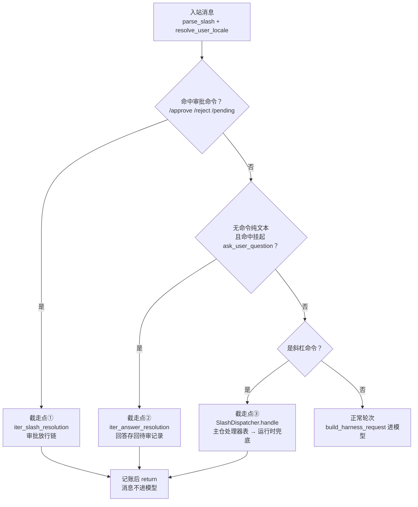
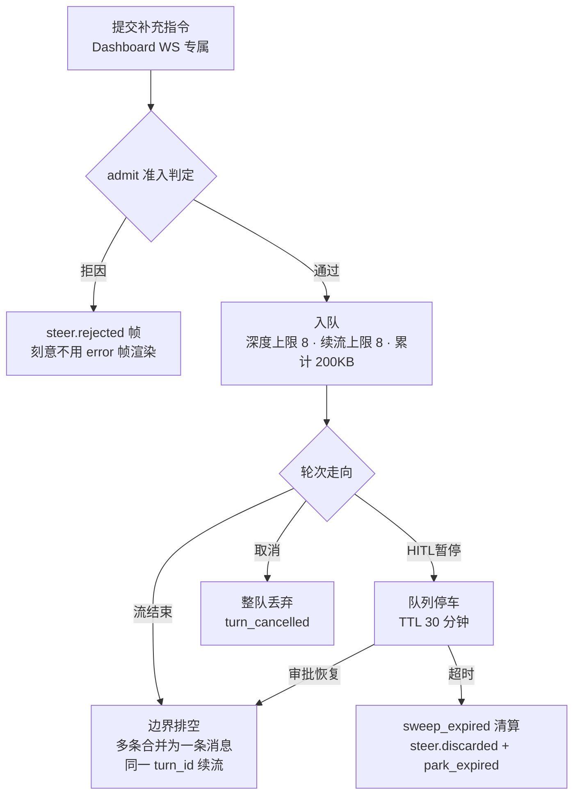
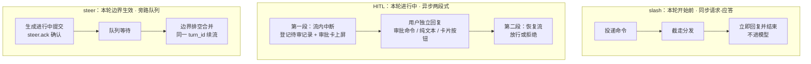

本篇拆解 Octop 的会话控制面：用户在对话进行中怎样指挥 Agent。三条线——斜杠命令（`/help`、`/stop` 等在消息进模型前被截走路由到处理器）、HITL（human-in-the-loop，人机协同审批：工具调用需要用户批准时暂停图执行，用户回复后放行或拒绝）、steer（运行中介入：Agent 正在生成时追加补充指令，不打断当前运行）。

[11：请求接入与消息路由](./11-im-gateway-message-pipeline.md) 和 [12：流式事件与结果交付](./12-stream-projection-and-rendering.md) 已说明请求与回复两端。本篇解释用户怎样改变任务：命令与审批回复复用消息入口，steer 由面板 WebSocket 接收。按轮前命令、暂停审批和运行中介入区分三种控制时机。

主仓代码在 `src/octop/infra/gateway/`（slash、hitl、steer 三个子包），中断的产生与恢复在 `octop_harness` 包。主仓基线为 `v1.0.2`（`dd9dce47`）；早期中断片段来自实装 `1.0.2`，第五节运行时补充来自 checkout `1.0.5`，两者分别标注。

## 一、控制面总览

先看全景：IM 路径上，一条入站消息在进入模型前按固定顺序经过三道闸门，命中任意一道即被截走。



三道闸门去向各异：①走审批放行链，②把回答存回待审记录，③交 `SlashDispatcher` 两级分发；三关全过，消息才落到 `build_harness_request` 进入正常轮次。

### 1、三个截走点

`GlobalProcessor.__call__`（IM 路径）在产出事件流之前有且只有三道控制流闸门，按固定顺序判定；Dashboard 路径 `iter_turn_chunks` 是同一套判定加更多记账。

`src/octop/infra/gateway/process/processor.py:662` 起是 IM 消息的判定序列：

```python
cmd = parse_slash(msg.text)
locale = resolve_user_locale(...)
if cmd is not None and cmd.name in HITL_APPROVAL_COMMANDS:
    # 截走点 ①：/approve /reject /pending 交给 HitlChannelCoordinator
    async for ev in self._hitl.iter_slash_resolution(cmd, ...):
        yield ev
    （省略 usage / history 记账与 return）

# 截走点 ②：无命令但有纯文本时，检查是否有挂起的 ask_user_question
if cmd is None and msg.text.strip():
    ask_record = self._hitl.resolve_ask_pending(session_key, ...)
    if ask_record is not None:
        async for ev in self._hitl.iter_answer_resolution(ask_record, msg.text, ...):
            yield ev
        （省略 return）

if cmd is not None:
    # 截走点 ③：普通斜杠命令交给 SlashDispatcher
    sink = _MessageEventSink()
    handled = await self._dispatcher.handle(cmd, self._slash_ctx(...), sink)
    for ev in sink.events:
        yield ev
    if handled:
        yield MessageEvent.completed()
        return
```

三个截走点覆盖三种控制语义：①是审批决策的回传（对已暂停的轮次操作），②是问答式 HITL 的作答（用户直接回复文本，不需要命令），③是即时命令的请求-应答。三者都命中即 `return`，消息永远不会落到后面的 `build_harness_request`——这就是「进入模型前被截走」的字面含义。HITL 引发的暂停发生在第四段（普通轮次的 `project_stream` 内部），本篇三、2 展开。

### 2、同一份命令目录，四个消费方

命令元数据只有一份（`slash/catalog.py` 的 `CATALOG` 元组），路由、帮助文本、HTTP API、Dashboard 输入框菜单四个消费方共享它。

每条命令是一个冻结的 `SlashCommandSpec`（`catalog.py:22`），关键字段：`origins`（`all` / `im` / `ui` / `cli` 的可见面过滤）、`client_action`（`new_chat` / `cancel_stream` / `switch_agent`——面板端本地处理的动作标记）、`persist_checkpoint`（命令输入输出是否写入 agent 的 checkpoint 历史）。

`channel_origin()`（`catalog.py:321`）把渠道类型归约为三个 origin：`dashboard → ui`、`cli → cli`、其余全部算 `im`——新增 IM 平台时 `/help` 自动保留 IM 命令，不需要改代码。

HTTP 面只暴露目录查询，没有执行端点。

`GET /api/slash/commands`（`api/routers/slash.py:40`）返回双语 label、icon、tone、分类、client_action，供面板输入框菜单用；`include_hitl_approval` 参数由安全策略推导——`tool_execution_may_pause(security.load())` 为假时，`/approve`、`/reject`、`/pending` 从目录里隐去（面板用卡片交互，不需要这三个命令；HITL 全局关闭时 IM 也不该展示它们）。

v1.0.2 目录全景（25 个主名字，`CATALOG` 逐条对应）：

| 命令 | 别名 | 分类 | 可见面（origins） | client_action |
| --- | --- | --- | --- | --- |
| `/help` | — | system | all | — |
| `/status` | — | core | all | — |
| `/model` | models | core | all | — |
| `/mode` | ask / plan / craft | core | all | — |
| `/new` | clear | core | all | new_chat |
| `/compact` | — | core | all | — |
| `/stop` | cancel | core | all | cancel_stream |
| `/history` | — | core | all | — |
| `/token` | — | core | all | — |
| `/list` | topics / sessions | session | all | — |
| `/switch` | — | session | all | — |
| `/resume` | — | session | im, cli, all | — |
| `/approve` | — | session | im, cli | — |
| `/reject` | — | session | im, cli | — |
| `/pending` | — | session | im, cli | — |
| `/title` | — | session | all | — |
| `/delete` | — | session | all | — |
| `/pin` | — | session | all | — |
| `/unpin` | — | session | all（hidden） | — |
| `/memory` | — | system | ui, cli | persist_checkpoint=False |
| `/cron` | — | system | ui, cli | — |
| `/agent` | — | system | ui, cli | switch_agent |
| `/skills` | — | system | ui, cli | — |
| `/connectors` | — | system | ui, cli | — |
| `/exit` | quit | system | cli（hidden） | — |

分类里的 core 是「对话本身」的旋钮（模型、模式、停止、统计），session 是线程管理，system 是平台运维。`client_action` 三值都出现在 core / system 里——`new_chat`、`cancel_stream`、`switch_agent` 是面板本地动作，意味着这三条命令在面板上有一部分行为发生在浏览器（清空输入框、断流、切 Agent），服务端处理器只做对应的状态变更。

## 二、斜杠命令：路由、目录与处理器

### 1、识别：主仓正则收窄 harness 解析器

斜杠识别有两层——主仓先用更严的正则做门禁，通过后才交给 harness 的解析器；门禁存在的直接原因是 harness 解析器会把路径误判成命令。

harness 实装 1.0.2 的解析正则（`octop_harness/slash/core.py:21`）是 `r"^\s*/([a-zA-Z][\w-]*)\s?(.*)$"`——`/root/ddd` 会被解析成命令名 `root` 加参数 `/ddd`。用户在聊天里贴一个文件路径就会误触发。主仓 `src/octop/infra/gateway/slash/parser.py:13` 加了门禁：

```python
# harness 解析器在第一个非单词字符处截断命令名，/root/ddd 会被当成
# /root 分发。这里要求命令名后必须是空白（或文本结束），路径保持普通聊天文本。
_COMMAND_RE = re.compile(r"^\s*/[a-zA-Z][\w-]*(?:\s[\s\S]*)?$")

def parse_slash(text: str | None) -> SlashCommand | None:
    if not text or not _COMMAND_RE.match(text):
        return None
    return _parse_slash(text)
```

（注释译自原文。）`/help me` 通过，`/root/ddd` 不通过。这个「宿主收窄包行为」的小补丁是控制面可靠性的第一块砖。

### 2、两级分发：gateway 处理器 + harness 运行时

`SlashDispatcher` 先查主仓处理器表，查不到再降级到 harness 的 `RuntimeSlashDispatcher`；命令因此分成「平台命令」（管线程、渠道、任务）和「运行时命令」（管生成本身）两类。

`src/octop/infra/gateway/slash/dispatcher.py:33`：

```python
async def handle(self, cmd: SlashCommand, ctx: SlashCtx, sink: SlashSink) -> bool:
    handler = self._handlers.get(cmd.name)
    if handler is None:
        if self._runtime.has(cmd.name):
            runtime_ctx = await build_runtime_ctx(cmd, ctx)
            await self._runtime.handle(cmd, runtime_ctx, sink)
            return True
        return False
    try:
        await handler(self, cmd, ctx, sink)
    except OctopError as exc:
        await sink.text(f"error: {exc.message}")
    await sink.complete()
    return True
```

主仓处理器注册在 `slash/handlers/`（session、composite、platform、memory、hitl 五组，`register_all` 按 `CATALOG` 逐条挂载）；harness 运行时处理器只有三个名字：`stop`/`cancel`、`model`/`models`、`skills`（`octop_harness/slash/handlers.py:106`）。降级桥 `runtime_bridge.py:26` 值得看一眼——`/stop` 特判不绑定新线程：

```python
if cmd.name in ("stop", "cancel"):
    thread_id = ctx.thread_registry.get_bound_thread_id(ctx.session_key)
else:
    thread_id = await ensure_thread_id(ctx)
```

`/stop` 操作的是「当前绑定的线程」，如果为它创建新线程就永远停不到正在跑的那一个。桥接层把 `ctx.agent_manager.cancel_stream` 等回调包成 harness 期望的 `RuntimeSlashCtx`——harness 只见回调，不见 AgentManager，边界干净。

### 3、`/stop` 的双通道与一个处理器的完整走读

`/stop` 在 IM 上有一条绕过会话锁的抢占比路径，这是 11 篇「锁前钩子」在控制面的实际消费者；普通命令则以 `/compact` 为样板走完整的「解析 → 分发 → 回调 harness → 本地化输出」链。

IM 同会话轮次串行（11 篇的四 worker + 会话锁），`/stop` 排在长轮次后面就失去意义。`Gateway.boot()`（`src/octop/infra/gateway/gateway.py:252`）注册了锁前钩子：

```python
self._channel_manager.set_pre_lock_handler(self._preempt_cancel_on_stop)
```

`_preempt_cancel_on_stop`（`gateway.py:535`）在消息进锁之前解析文本，命中 `/stop` 或 `/cancel` 就直接 `agent_manager.cancel_stream(agent_id, thread_id)` 发出取消信号，不等排队的 `/stop` 本身被处理。

随后正式排到的 `/stop` 走 runtime 处理器 `handle_stop`（`octop_harness/slash/handlers.py:24`）——再次 `cancel_stream`（幂等）并回复本地化的「已停止生成。」或「当前会话没有进行中的生成。」。取消的落点 `GlobalProcessor.cancel_agent_stream`（`processor.py:934`）注释写明语义：流迭代器干净结束、状态停在上一个完成的超步 checkpoint。

`/compact`（`slash/handlers/composite.py:63`）展示平台命令的标准形态：解析参数 → `thread_registry.get_bound_thread_id` 定位线程 → 取 harness 实例 `ctx.agent_manager.get_agent(agent_id)` → 调 `harness.acompact_conversation(tid, model=model_ref)` 强制摘要化 + 历史卸载 → 按 `CompactResult` 的 `reason` 分支输出四条不同的本地化文案（`compact.nothing` / `compact.unavailable` / `compact.failed` / `compact.done_offload`）。

模型选择遵循优先级：本轮 composer 选的 `ctx.model_ref` → `/model` 话题覆盖 → fallback。所有输出经 `sink.text()` 流出——处理器不关心自己跑在 IM、面板还是 CLI，sink 由调用方注入。

`/new`（`slash/handlers/session.py:27`）是最短的一个完整样本，能同时看到线程操作、面板动作回传与本地化三件套：

```python
async def cmd_new(d: SlashDispatcher, cmd: SlashCommand, ctx: SlashCtx, sink: SlashSink) -> None:
    new_tid = await ctx.thread_registry.reset(
        agent_id=ctx.agent_id,
        user_id=ctx.user_id,
        channel_type=ctx.channel_type,
        channel_subject_id=subject_id(ctx),
        channel_chat_type=chat_type(ctx),
    )
    if cmd.args:
        ctx.thread_registry.set_title_if_null(new_tid, cmd.args)
    lang = lang_of(ctx)
    if hasattr(sink, "action"):
        await sink.action("new_chat", thread_id=new_tid)
    await sink.text(tr("new.started", lang, short=new_tid[-6:]))
```

`thread_registry.reset` 把 session_key 重绑到新线程（旧线程保留在 `/list` 里可 `/switch` 回去）；`/new 周报` 的参数顺手设为新线程标题。`sink.action` 用 `hasattr` 探测——`BufferSink` 支持动作而 IM 的 `_MessageEventSink` 不支持，面板路径（`iter_turn_chunks` 收集 `slash_actions` 转成 `slash_action` 帧）靠它通知前端清空对话窗，IM 上这个分支静默跳过。同一个处理器天然适配两种渠道，这就是 sink 协议的价值。

### 4、命令输出的本地化

命令文案全部走 `slash.*` i18n 命名空间，处理器里没有硬编码英文；字段名翻译有专门的兜底函数。

域模块 `src/octop/i18n/domains/slash.py` 只有一层薄包装：`tr("new.started", lang)` 展开为 `slash.new.started`；`localized_rows()` 把 `/status` 输出的 `("thread", ...)`、`("tokens", ...)` 行键翻译成「话题」「Token 用量」，`field_label` 查不到键时回退原键。`zh.json` 的 `slash` 段结构与代码一一对应，例如（`src/octop/i18n/zh.json:55`）：

```json
"hitl": {
  "card_title": "⚠️ 需要工具审批",
  "card_intro": "智能体请求执行以下工具：",
  "card_footer": "回复 `/approve` 批准，或 `/reject 原因` 拒绝。",
  "card_pending_id": "审批 ID：`{pending_id}`（30 分钟内有效）",
  （省略 none_pending / not_owner / expired / approved_ack 等）
}
```

注意 `card_pending_id` 文案里的「30 分钟内有效」——它就是把三、2 里 store 的 TTL 常量写进了用户可见文案；TTL 改了这句要同步改，这是文案与实现耦合的一处实证。`/help` 的输出同样由目录驱动：`slash/help.py:15` 按 `CATEGORY_ORDER`（core / session / media / system / debug）分组、每条取 `description_for(locale)`，命令改目录即改帮助，无双份维护。

### 5、Ask / Plan / Craft：模式如何进入请求

`/mode` 及其别名选择后续轮次的工作方式。主仓 `infra/agents/conversation_mode.py` 解析模式并写入请求；harness 的 `ConversationModeMiddleware` 再约束工具与执行行为。选择模式与批准某个工具调用是两种控制，模式不能替代 HITL 决策。

主仓 `v1.0.2` 的解析优先级由 `resolve_conversation_mode` 直接给出：

```python
def resolve_conversation_mode(
    *,
    explicit: object | None = None,
    thread_mode: object | None = None,
    default_mode: object | None = None,
) -> ConversationMode:
    """合法显式模式 → 会话粘性模式 → 专家默认 → craft。"""
    if isinstance(explicit, str) and explicit in {"ask", "plan", "craft"}:
        return explicit  # type: ignore[return-value]
    if explicit is not None:
        return DEFAULT_CONVERSATION_MODE
    if thread_mode is not None:
        return parse_conversation_mode(thread_mode)
    return parse_conversation_mode(default_mode)
```

显式值存在但不合法时直接退回默认，不再尝试会话值。`stamp_conversation_mode` 把选定模式写入 `configurable`；Ask / Plan 下还清空请求中的 skills 与 MCP server 列表，并把 `search_knowledge` 放入宿主额外只读工具名单。这是主仓对 harness 策略的补充，不能概括成「只剩一个工具」。

Plan 的执行请求可由 `is_plan_execute_utterance` 识别中英文短语，再交给 Craft 执行计划。主仓同时扩展 `is_allowed_plan_path`，允许工作区前缀下的计划文件；这处导入时替换依赖 harness 内部符号，升级时需核对兼容性。计划文件的路径归属仍遵循 [03 篇](./03-workspace-and-backend-abstraction.md) 的工作区规则。

`/history` 等命令的存储和查询实现见 [08 篇](./08-versioned-history-and-trajectory.md)；本篇只追踪命令如何进入对应处理器。

## 三、HITL：审批的存储与放行

### 1、harness 侧：interrupt 如何打断工具执行

HITL 的「断」发生在 harness 的两个位置——按工具名配置的 `interrupt_on` 门（SecurityPolicy 派生）和命令参数守卫 `ToolGuardMiddleware`；两者都调 LangGraph 的 `interrupt()`，图停在超步边界等 `Command(resume)` 恢复。

安全策略（`octop_harness/security/models.py:47`）里 `HitlPolicy` 默认关闭（`enabled=False`），默认工具清单 `DEFAULT_HITL_TOOLS = ("bash", "execute", "write_file", "edit_file", "delete")`，允许决策默认 `approve` / `reject`。

`resolve_interrupt_on()` 把它转成 `{工具名: {"allowed_decisions": [...]}}` 映射；`HarnessAgent._resolve_interrupt_on()`（`octop_harness/agent.py:1382`）在此基础上并入 `ask_user_question`——且只允许 `respond` 决策，注释写明理由：这个工具是「协作通道而非审批闸门」，必须在默认策略（HITL 关闭）下也能用。

第二处是命令守卫（`octop_harness/middleware/tool_guard.py:82`）：

```python
async def _await_approval(self, request, handler, result):
    hitl_request = build_tool_guard_hitl_request(result)
    response = interrupt(hitl_request)          # 图在此暂停
    decisions = response.get("decisions") if isinstance(response, dict) else None
    （省略决策解析）
    if decision.get("type") == "approve":
        return await handler(request)           # 放行：真正执行工具
    （省略）                                       # 拒绝：返回 error ToolMessage
```

`mode="require_approval"` 时高风险 shell 参数走这条路：批准则执行 `handler`，拒绝则给模型一条 error 状态的 `ToolMessage`（拒绝原因进入模型上下文，模型会换方案）。恢复入口 `HarnessAgent.resume_hitl`（`agent.py:529`）把决策包成 `Command(resume={"decisions": decisions})` 重新 `astream`（`protocols/langgraph.py:156`）；中断本身在流里表现为 `__interrupt__` 载荷，协议层把它投影成 `hitl_required` 事件（`langgraph.py:233-237`）。

### 2、主仓侧：pending store 与审批卡

`HitlPendingStore` 是进程内的会话级待审登记簿——4 位十六进制短 ID、30 分钟 TTL、同槽位去重；审批卡是纯文本 Markdown，按 ask 与非 ask 两种模板渲染。

IM 轮次的事件流投影（`src/octop/infra/gateway/process/stream_project.py:192`）在遇到 `hitl_required` 事件时完成登记并立即结束本轮：

```python
elif ctype == "hitl_required":
    request = normalize_hitl_request(chunk.get("request"))
    if hitl_coordinator is not None and hitl_ctx is not None:
        record = hitl_coordinator.register_from_request(request, ctx=hitl_ctx)
        request["pending_id"] = record.pending_id
        card = format_hitl_card(record.action_requests,
                                pending_id=record.pending_id, locale=loc)
        if projection_state is not None:
            projection_state.hitl_paused = True
        yield MessageEvent.text(card)
    return
```

`return` 结束整个流——轮次停在「暂停」而非「完成」，`processor.py:891` 的 `hitl_paused` 标记让上层跳过「正常完成」的记账分支。store（`src/octop/infra/gateway/hitl/store.py`）的 `register`（L65）有两段值得抄的去重逻辑：

```python
# 新暂停只替换同一槽位。两个团队成员共用房间会话，一个成员的
# 卡片不能顶掉另一个的。同一中断常被投影两次；复用那个 pending_id，
# 避免第一帧的自动恢复拿到已过期的 ID。
for existing in list(self._records.values()):
    if not _same_pause_slot(existing, session_key=session_key,
                            resume_agent_id=resume_agent_id):
        continue
    if _actions_equivalent(existing.action_requests, action_requests):
        return existing          # 同一中断重复投影：复用
for existing in list(self._records.values()):
    if not _same_pause_slot(existing, session_key=session_key,
                            resume_agent_id=resume_agent_id):
        continue
    existing.status = "expired"  # 同槽位新暂停：旧的过期
pending_id = secrets.token_hex(2)
（省略记录构造与插入）
```

（注释译自原文。）槽位由「session_key + 归属（普通轮次还是某个成员任务）」定义；动作等价用 JSON 序列化比较。

ID 只取 4 个十六进制字符——用户要在 IM 里手敲 `/approve ab12`，可读性优先于防碰撞（2 字节空间、进程内字典查重保证不撞）。TTL 常量 `_DEFAULT_TTL_SECONDS = 30 * 60`（L13），每次访问惰性 GC：过期的 `pending` 标 `expired`，非 `pending` 且超龄的记录整行删除。

卡片渲染在 `hitl/format.py:125`：审批卡列出每个动作的本地化工具名、JSON 参数块（截断 400 字符）与 pending_id；`ask_user_question` 中断则走 `format_ask_card`（L168）——一次只渲染一个问题，选项标 `a) b) c)`，注释说明原因：IM 客户端没有面板的交互式多问题卡片，逐题展示让字母/数字回复能无歧义映射到可见选项。

一个版本接缝必须记下：`hitl/stream_compat.py:63` 的 `install_harness_hitl_compat()` 对 `octop_harness.protocols.langgraph.LangGraphProtocol._project_chunk` 打运行时猴子补丁——LangGraph v2 把 `__interrupt__` 从 values 载荷挪到了 `chunk["interrupts"]`，实装 1.0.2 的投影只读旧位置，不打补丁 `hitl_required` 根本到不了 Octop（模块 docstring 写明症状是面板 `ask_user_question` 永远转圈）。processor 和 stream_project 在模块导入时各调一次（全局 `_INSTALLED` 防重入）。

### 3、`/approve` 与 `/reject`：放行的完整链路

审批命令在截走点①进入 `iter_slash_resolution`，先按 ID 或「最新」解析待审记录并校验归属，再把决策数组送回 harness 恢复图执行；恢复流里若再遇中断，会注册新的待审记录形成链式审批。

`src/octop/infra/gateway/hitl/coordinator.py:475` 的流程：`/pending` 直接列同会话待审项；`/approve ab12` 按 ID 精确取（`get_pending` 校验 session 与 agent 匹配），不带 ID 则 `resolve_for_session` 取最新一条；记录存在但 `user_id` 不等于发起人 → 「仅发起本轮对话的用户可以批准或拒绝。」；状态已过期 → 「审批请求已过期」。

决策构造（L249）按动作数生成等长数组：`/approve` → 每个动作 `{"type": "approve"}`；`/reject 理由` → 每个动作 `{"type": "reject", "message": 理由}`。随后 `project_resume_stream` 调 `agent_manager.resume_hitl` → harness `Command(resume)`。恢复流的输出时序有个细节：

```python
async for ev in project_resume_stream(...):
    if record is not None and not ack_sent:
        ack = tr("hitl.approved_ack", lang) if approve else tr("hitl.rejected_ack", lang)
        yield MessageEvent.text(ack)
        ack_sent = True
    had_output = True
    yield ev
（省略异常分支）
if record is not None and resolved_status is not None:
    self._store.mark_resolved(record.pending_id, resolved_status)
```

确认消息压在第一块恢复输出之前（IM 渠道按序渲染，用户先看到「已批准，继续执行…」再看到续写的正文）；`mark_resolved` 在流成功结束后才落——中途抛异常时记录保持 `pending`，用户重发 `/approve` 仍能再试，代价是六、1 提到的静默过期问题多了一层掩盖。

恢复途中再次 `hitl_required` 不会丢——投影层会用同一个 coordinator 注册新记录，命令回复「仍有工具等待您的审批。」。

团队场景有一处分叉：`hand_member_pause`（L262）发现记录带着 `resume_agent_id`（团队成员的暂停寄存在房主会话上）时，决策直接投递给那个成员任务，主图不动。这是 14 篇的内容，此处只记交接。

### 4、`ask_user_question`：问答式 HITL

提问中断不需要命令作答——用户直接回文本；多问题逐题收集，选项简写（`a`、`2`、`a,c`）展开成选项标签再送回模型。

截走点②的 `resolve_ask_pending`（`coordinator.py:299`）只接受 `ask_user_question` 中断且只认被提问的用户本人（群聊里问别人的问题不会劫持你的消息）。`collect_ask_reply`（L360）逐题推进：store 的 `append_ask_answer` 记下答案并递增 `ask_question_index`，没答完就渲染下一题的卡片并设 `outcome.awaiting_more`（历史 tracker 挂起而非完成）；答完则把全部问答拼成「用户回答：\n- 标签: 答案」格式的消息。

选项简写解析在 `format.py:273` 的 `parse_ask_reply`——正则 `_SELECTION_RE` 匹配纯选择串（兼容中文顿号、逗号），命中的 `a` / `1` / `a,c` 展开为选项 label，注释解释了为什么展开而不是透传：让模型看到语义选择而非索引，其余任何文本原样转发（自由回答、反问、改话题都是合法回复，模型处理得比解析器好）。最终决策类型是 `{"type": "respond", "message": ...}`——与 harness 侧 ask 工具只允许 `respond` 的配置严格对齐。

### 5、Dashboard 面与「本会话不再询问」

面板审批走 SSE 端点 `POST /api/agents/{agent_id}/chat/hitl/resume`；「本会话允许该工具」的旁路持久在 `threads.hitl_policy` 列，实现方式是给 `interrupt_on` 的判定回调包一层壳，另有流内的自动放行循环。

面板路径（`api/routers/chat/routes.py:242`）：解析该线程最新待审记录（或按 body 指定的 ID）→ 先 `mark_resolved` 再恢复（「恢复流可能很长，不清掉记录的话历史重载会把同一张卡再注入一次」）→ `iter_hitl_resume_chunks` 流式输出。body 可带 `hitl_policy`——写入 `HitlSessionPolicyStore`（`src/octop/infra/agents/security/hitl_session.py:186`，内存缓存 + `threads.hitl_policy` 列持久化）。

旁路的生效点有两处：装配时 `apply_session_bypass`（L244）给每个工具的 `when` 判定包壳——线程策略允许则跳过中断（`ask_user_question` 除外，永远问）；流内 `iter_with_session_auto_approve`（`hitl/coordinator.py:110`）在遇到 `hitl_required` 且策略全覆盖时直接自动续流（上限 8 轮），注释记录了它解决的竞态：客户端对同一张卡的自动恢复与下一轮赛跑导致「审批请求已过期」，自动恢复失败时降级为把卡片交给用户。

决策合法性在 API 边界还有一道校验 `decision_rejection_reason`（L183）——决策数必须等于动作数、类型必须在 `allowed_decisions` 内，把模型深处的重试失败翻译成可操作的 400。

## 四、steer：运行中介入

### 1、语义与准入状态机

steer 是「排队到轮次边界再注入」的软介入——不立刻打断模型，而是在当前流结束（或工具超步完成）后把队列里的补充指令拼成一条新输入续流；准入口径全部落在 `SteerCoordinator.admit` 的状态机上。

模块 docstring（`src/octop/infra/gateway/steer/coordinator.py:1`）写明定位：「审批式准入暂存于此，直到 octop-harness 暴露原生的模型间排空缝；当前排空发生在 Octop 的轮次边界（每次 harness `stream` 调用完成后），通过续流循环实现」。

状态机（`steer/types.py`）：轮次相位 `TurnPhase` 有八态，可介入的只有 `STEERABLE_PHASES = {"streaming_text", "awaiting_tools", "between_model_steps"}`；上限四件套——队列深度 `STEER_DEPTH_CAP = 8`、每轮续流次数 `STEER_CONTINUATION_CAP = 8`、累计文本 `STEER_TEXT_CAP_BYTES = 200_000`、HITL 停车 TTL `HITL_PARK_TTL_SECONDS = 30 * 60`（注释：镜像 HITL pending store 的 TTL 水位）。

`admit`（coordinator.py:274）的闸门按顺序判定，抽主干：

```python
if delivery == "follow_up" and active:
    return SteerAdmitReject(reason="turn_active", ...)
if not active:
    if delivery == "steer":
        return SteerAdmitReject(reason="no_active_turn", ...)
    return None            # idle + auto/follow_up：调用方走普通新轮次
（省略 空输入 / 字节上限 / cancelling 三闸）
if hitl_paused or state.phase == "hitl_paused":
    return SteerAdmitReject(reason="hitl_paused", ...)
（省略 expected_turn_id 匹配）
if state.phase not in STEERABLE_PHASES:
    return SteerAdmitReject(reason="turn_not_steerable", ...)
if cpid in state.known:    # client_pending_id 幂等
    return SteerAdmitOk(status="idempotent", ...)
if len(state.queue) >= STEER_DEPTH_CAP:
    return SteerAdmitReject(reason="queue_full", ...)
（省略入队与 SteerAdmitOk(status="queued")）
```

拒因表之外还有两个语义点：`delivery` 三态（`auto` / `steer` / `follow_up`）让同一入口表达「忙时排队、闲时降级」（auto）、「必须排队」（steer）、「必须等下一轮」（follow_up）；`expected_turn_id` 让客户端绑定它看到的那次生成，轮次已换代时明确拒绝而不是把指令注进别人的轮次。

准入的 HTTP 面在 Dashboard WS 路由 `_maybe_admit_steer`（`api/routers/chat/ws.py:586`）：先进 `sweep_expired` 清扫过期停车，`steer.rejected` 帧刻意不用 `type=error`（注释：error 帧会落在活轮次 socket 上、被面板当流失败气泡渲染）。

断线重连的体验也有专门照顾——`snapshot_frames`（coordinator.py:234）为重连连接生成基线帧：一条 `steer.queue_snapshot`（队列条目 + 各自 preview + 续流计数，不消耗 seq）加一条 `turn.resumed`（当前相位），新连接据此重建排队气泡的状态。

`SteerCoordinator` 挂在 `Gateway` 上（`gateway.py:125`），构造时注入 `WebSocketChannel`——steer 是 Dashboard WS 专属能力，IM 渠道与 CLI 渠道没有这条线（本站推论自装配：只有 `WebSocketChannel` 拿到 steer 实例）。

把 admit 之后的完整流转收拢成一张图（停车与排空的细节见下两小节）：



图中最关键的两处分叉：HITL 暂停时队列「停车」保留——存量指令不清、新提交被 `hitl_paused` 拒因挡下，审批恢复后从第一个边界排空；`/stop` 的取消则是终止语义，整队按 `turn_cancelled` 丢弃（详见四、4）。

### 2、边界排空：WebSocketChannel 的续流循环

续流引擎是 `WebSocketChannel.handle_inbound` 里的 `while True` 循环——流结束即尝试排空队列，排到就把多条 steer 用 `\n---\n` 拼成一条消息继续同一逻辑轮次；工具超步后的第一块模型输出是抢占点，此后到达的 token 被丢弃。

`src/octop/infra/gateway/ws/ws_channel.py:99` 的循环骨架：`begin_turn` 开轮（旧队列未排空则按 `park_expired` / `turn_cancelled` 丢弃并广播 `steer.discarded`）→ 内层 `async for` 消费 `iter_turn_chunks`，按块类型更新相位（`tool_result` → `awaiting_tools`，`hitl_required` → `hitl_paused` 且本 WS 轮结束、恢复走 SSE）→ 抢占判定（L190）：

```python
if (not preempted
    and chunk_type in ("token", "tool_call_chunk")
    and saw_tool_result
    and self._steer.has_pending(thread_id)):
    # 工具超步完成后的第一块模型输出。丢弃该块：checkpoint 仍停在
    # 工具结果处，客户端不能渲染续流将看不到的文本。
    preempted = True
    self._steer.set_phase(thread_id, "between_model_steps")
    cancel(...)   # processor.cancel_agent_stream
    continue
```

抢占后后续非 `done`/`error` 块全部静默丢弃（注释：取消已落在工具边界，后面的 token 不在 checkpoint 里，不能展示）。流结束进 `drain_for_continuation`（coordinator.py:497）：续流次数超限则整队丢弃（`continuation_exhausted`）；否则取走队列、计数 +1、相位置 `between_model_steps`，多条文本 `coalesce_texts` 用 `\n---\n` 连接。

随后面板依次收到 `user` 帧（`meta.steer=true` 的用户气泡）、`steer.drained`、`turn.resumed`，续流以 `_continuation_inbound` 克隆的 InboundMessage 重新进入循环——同一个 `turn_id` 贯穿始终，客户端视角是「一个轮次被补充了指令」。

`end_turn`（L543）在自然结束时若队列为空则清态；有残留队列而无排空路径按 `turn_cancelled` 丢弃——注释称之为「搁浅防护」（strand guard）。

### 3、与 HITL 暂停的交叉

审批暂停期间 steer 队列「停车」而非丢弃——`end_turn` 检测到 `hitl_paused` 就只记 `parked_at` 不清队列；审批通过、SSE 恢复流走完后，排队指令在第一个边界排空续流。

`end_turn` 的注释（coordinator.py:548）把机制说得很直白：HITL 中断把队列停住，它会在审批恢复后的第一个边界排空（SSE 恢复路由调 `take_hitl_pending`）；WS 轮结束但状态保留，因此准入继续以 `hitl_paused` 拒绝新 steer。

排空的触发点在 SSE 恢复路由尾部（`api/routers/chat/routes.py:205`）：`iter_dashboard_hitl_resume_sse` 在恢复流无跟进暂停地完成后调 `resume_parked_steers`（`ws_channel.py:496`）——`stage_hitl_pending` 先「描述而不取走」排队内容，确认 WS 队列线程可用后把续流消息重新 `enqueue` 进 dashboard 渠道，成功才 `commit_staged_hitl` 真正清队，失败 `release_staged_hitl` 保留现场（两段提交避免入队失败丢队列）。

若恢复流又暂停在新的审批上，则不做排空——注释：现在排空会开一个把那张新卡弄过期的轮次。停车超过 30 分钟由 `sweep_expired` 清算（`steer.discarded` + `park_expired`）。

排空续流还保留着轮次的「创作上下文」。`remember_context`（coordinator.py:178）在轮次开始时从入站 metadata 摘出 `_CONTINUATION_META_KEYS` 白名单——模型选择、推理参数、会话模式、技能与知识库清单、MCP 服务器、composer 上下文；

`resume_parked_steers` 用 `continuation_metadata` 重建续流入站的 metadata（补上 `thread_id`、`session_key` 和一个占位的 `ws_connection_id`）。

效果是：审批暂停几十分钟后排空的 steer，仍然用用户当时选的模型和挂载的技能继续，不会静默回落到默认配置。

### 4、与 `/stop` 的差异

`/stop` 是终止语义——取消信号立刻发出、轮次结束、steer 队列被 `turn_cancelled` 丢弃；steer 是延续语义——不打断、排队、边界合并。两者唯一的交点是抢占取消复用同一个 `cancel_stream`，但 steer 抢占后立即续流，`/stop` 之后什么都不续。

对比三条实证：①`/stop` 经锁前钩子即时生效（二、3），steer 的抢占要等到工具边界（四、2）；②面板取消路径（`ws.py:161`）先 `mark_cancelling` 再 `discard(reason="turn_cancelled")` 整队丢弃，`cancelling` 相位下新 steer 全部拒绝，WS 轮自然结束时 `end_turn` 对残留队列同样按 `turn_cancelled` 兜底；

③steer 续流后 `turn.resumed` 帧带同一 `turn_id`，面板把两次生成渲染为一个轮次。紧急止损用 `/stop`，改向补充用 steer，产品语义分工清晰。

## 五、三条流的共同模式与边界

### 1、不同控制时机下的确认与续流

三种控制都需要定位 Agent、用户和会话，但入口与时间语义不同。slash 是请求与应答，HITL 分为暂停登记和后续决策，steer 通过 Dashboard 旁路队列把投递确认与实际生效分开。

斜杠处理器使用 `SlashCtx`（`slash/ctx.py:24`）携带 agent、user、session_key、thread_registry、repos 和 locale。审批协调器与 steer 协调器另有各自的状态与调用入口，不能概括为三者共用一个上下文对象。

语义差异决定可靠性要求不同：slash 命令失败立即可见（`error:` 前缀回显）；HITL 的两段之间靠 pending store 的 TTL 兜底、靠 `expire_pending_for_thread` 在 Dashboard 新轮开始时清场（`processor.py:1142`，注释：防止历史重载重新注入已死卡片）；steer 的投递确认靠 `steer.ack` + `client_pending_id` 幂等，撤回靠 `steer.remove`（已排空的返回 `already_drained` 而非报错）。

三种时间语义的对照结构如下：



三者的分界只在生效时机：slash 在进模型前就地结束；HITL 把图停在审批点、等用户的独立消息恢复；steer 完全不打断生成，把指令攒到下一个边界合并生效。

拿一段面板会话的时间线把三种语义摆在一起：用户 14:00 发「清理下载目录」，生成进行中追发「顺便看看回收站」（steer 入队，面板气泡 pending，模型还没看到它）；

14:02 Agent 要跑 bash，图在工具前中断，WS 轮以 `hitl_paused` 结束、审批卡上屏（HITL 第一段）——此时已排队的 steer 停车保留，暂停期间新 steer 会被 `hitl_paused` 拒因挡下；

14:05 用户点卡片批准（SSE 恢复流，HITL 第二段），图恢复执行；恢复流跑完，SSE 尾部 `resume_parked_steers` 把停车队列排空，续流带着补充指令继续同一 `turn_id`。

若这轮开始前用户还敲过 `/status`，那就是第三种语义——同步问答，立即返回、立即结束。三个动作都进同一根会话管道，但只有第一步真正「变成了一轮对话」。

### 2、IM 与面板的能力差

能力差全部声明在目录的 `origins` 字段里，由 `channel_origin` 在运行时过滤——审批命令只属于 IM/CLI，steer 只属于 Dashboard，管理命令只属于面板/CLI。

逐类清点（源码可证实，`catalog.py:71`）：`approve` / `reject` / `pending` 的 origins 是 `{im, cli}`——面板用卡片按钮，不需要打字；`memory`、`cron`、`agent`、`skills`、`connectors` 是 `{ui, cli}`——运维命令不在 IM 里暴露；`exit` 只有 `{cli}` 且 `hidden`。steer 反向独占 Dashboard：它的准入入口长在 WS 路由、执行引擎长在 `WebSocketChannel`，IM 消息进来时根本没有 steer 判定分支。

另有两处隐蔽的差：其一，命令历史入 checkpoint 只发生在 Dashboard 路径——`_append_slash_checkpoint`（`processor.py:1782`）唯一的调用点在 `iter_turn_chunks`（L1107），IM 的 `__call__` 命令分支直接回显即返回，模型看不到 IM 上的 `/status` 问答；

其二，`/memory` 特判 `persist_checkpoint=False`，跳过 harness checkpoint 追加但仍写线程消息投影（目录注释：checkpoint 数据库维护期间回复必须仍可见）。

### 3、harness 侧的运行时配合

取消与暂停续流需要 harness 提供运行时支持。以下两项按 checkout `v1.0.5` 说明，不用于反推旧实装 `1.0.2`：**抢占式取消**：`_iter_until_cancelled`（`agent.py:403`）把流迭代 `__anext__()` 与 `cancel_event.wait()` 包成两个 task 用 `asyncio.wait(FIRST_COMPLETED)` 竞速——朴素"async for + 标志位检查"要等到下一个 token 才能看到取消，而这个实现让取消信号在 LLM/工具的阻塞 await 中也能被抢占；`/stop` 的即时体验由这里兜底。

**HITL 恢复的进程内请求身份**：`stream()` 捕获 `hitl_required` 事件时把当次运行 `config` 深拷贝存进 `_hitl_resume_configs[thread_id]`（`agent.py:517`），`resume_hitl`（`agent.py:545`）用这份**进程内**的请求范围恢复。效果是审批暂停几十分钟后放行，仍用用户当时选的模型与挂载的技能，不会静默回落到默认配置（第四节 steer 的停车保留讲过同款效果的消费端）。

docstring 同时警告"宿主必须在恢复前自行鉴权"：身份与工具选择属于暂停的那个请求，不是"该线程最近一次调用"。

这个请求身份字典位于进程内，重启后不会自动保留。图状态的 checkpoint、主仓 pending 记录与恢复请求的配置必须分别检查；仅有 checkpoint 不能证明原审批链可完整续接。配置保留能力见 harness `1.0.4` 起的 CHANGELOG 记录，本文按 `1.0.5` 实现解释；跨进程与重启边界由[恢复专题](./16-disconnect-reconnect-and-recovery.md)统一说明。

## 六、工程判断

照搬、改造与适用边界，按源码可证实的细节排列：

1. **审批有 TTL、无超时动作。** 30 分钟 TTL 三处可证（store 常量、卡片文案、steer 停车 TTL 镜像），但过期只把状态标 `expired`——没有定时器、没有主动通知；用户下一次 `/approve` 或面板刷新才看到「已过期」。中断本身还停在 LangGraph checkpoint 里：源码里没有找到「审批过期后自动 resume 成 reject」的路径，未核验 LangGraph 对停在 interrupt 的线程发起新消息的行为（见七）。对审批敏感的场景，这个「静默过期」需要补一个 cron 扫描自动拒绝或推送提醒。
2. **多设备并发审批的结果是可预期降级。** 同会话两台设备先后 `/approve`：不带 ID 时都解析到同一条最新记录；`AgentManager.resume_hitl` 的 `_thread_execution_lock` 把两次恢复串行化，第一次真正放行，第二次进入 `iter_slash_resolution` 时记录已 `resolved`、按无待审处理（无输出则回「当前会话没有待审批的工具操作。」）。谁先到谁生效、后到者拿到明确文案，没有重复执行工具的风险——这套「解析即校验 + 执行锁」的组合可以照搬。
3. **pending store 与 steer 队列都有进程寿命。** `HitlPendingStore` 和 `SteerCoordinator` 的登记状态在内存中，checkpoint 持久化不等于它们也已持久化。扩展到多副本或重启续跑时，需要设计审批记录重建、请求身份恢复与 steer 队列处置；不能仅凭图内仍有中断，就向用户承诺原卡片和全部排队指令仍然有效。
4. **steer 的「边界排空」是务实妥协，不是真中断注入。** 真正的运行中介入（把补充指令插进两次模型调用之间）需要 harness 暴露排空缝，docstring 明说在等。当下的近似是：工具超步后第一块输出处取消 + 边界续流，代价是模型超步内生成的 token 被丢弃、`cancelling` 期间新 steer 被拒。适用边界：长工具链 Agent（bash/浏览器的多步执行）收益最大——每步工具完成都是注入点；纯长文本生成场景中 steer 退化为「排队到生成结束」，与 follow-up 无异。
5. **`\n---\n` 合并多条 steer 是上下文工程选择。** 多条补充指令拼成一条 HumanMessage（`coalesce_texts`），模型看到的是一段被分隔的完整补充而非多条插入消息——避免伪造对话轮次，也避免 checkpoint 里出现模型从未见过的消息顺序。200KB 累计上限防的是队列拼接出超大输入。做多轮介入系统时这个「合并而非插入」的原则值得照搬。
6. **主仓给 harness 打猴子补丁是脆弱接缝。** `install_harness_hitl_compat` 修补 `LangGraphProtocol._project_chunk` 的前提是「harness 1.0.2 只读旧版 `__interrupt__` 位置」——harness 升级修掉这个问题后补丁变成无害冗余，但若 v2 载荷再变，症状是 HITL 静默失效。宿主对包做运行时 patch 应配套版本探测与启动日志，这里只有模块级 docstring 记录原因。
7. **两级分发留下了双实现隐患。** `/model` 同时有 gateway 版（`composite.py:299`，读 agent 行默认模型）和 harness runtime 版（`handlers.py:39`）；gateway 注册优先，runtime 版只在 harness 自带 CLI REPL 等脱离主仓的场景生效。两份代码各自演化（主仓版多一个 `sink.action` 通知），改文案时容易漏一边——目录里同名命令最好只留一个属主，另一个显式委托。
8. **`error: {exc.message}` 是 i18n 规范的漏网处。** dispatcher 捕获 `OctopError` 后回显硬编码英文前缀 + 未本地化 message（`dispatcher.py:44`），与仓库自己的「服务端输出必须走 i18n」规则相悖，也是照搬时要修的点。
9. **`origins` 过滤的是可见性，不是可执行性。** `visible_in` 只被 `/help` 聚合与 `/api/slash/commands` 消费；分发路径（`dispatcher.handle` → 主仓处理器表 → runtime 兜底）不查 origins。IM 里手敲 `/skills`（origins 为 ui,cli）会真的执行——gateway 没注册它，落到 harness runtime 的 `handle_skills`，`list_skills` 桥在 `runtime_bridge.py` 已接好。`/exit` 是唯一的反例：gateway 注册了一个专门报错的处理器（`handlers/platform.py:158` 抛 `"/exit handled at CLI level"`），说明作者意识到了这层缝隙，但只堵了这一个口。产品上这通常无害（自己的 Agent 自己控制）；把 IM 渠道开放给家庭群以外的成员时，命令面收窄要另做鉴权，不能指望目录字段。
10. **锁前钩子 + 幂等取消的配对值得抄。** `/stop` 的即时性完全依赖 `set_pre_lock_handler` 抢跑（否则排在会话锁后失去意义），而正式排到的 `/stop` 再次 `cancel_stream` 不会出错——控制命令「先斩后奏、奏时再斩一次」的幂等设计，是串行化框架里实现抢占的标准答案。

## 七、未核验范围

- 引用的 octop_harness 源码全部来自 `.venv` 实装 1.0.2；`interrupt_on` 深层消费方（deepagents 图内 HITL 中间件的判定细节）未逐行展开，框架侧归 Deep Agents 系列。
- LangGraph 对「仍在 interrupt 状态的线程发起新输入」的确切行为（报错 / 忽略 / 隐式恢复）未核验；审批过期后旧中断在 checkpoint 中的最终归宿只推断了源码可见路径。
- 团队场景的 `hand_member_pause` / `deliver_member_hitl` 只确认了分叉条件与投递签名，成员任务的接收端（TeamManager）归 14 篇。
- Bridge 对端的 steer 帧转发（`api/bridge_peer.py`、`infra/bridge/manager.py` 的 `steer.ack/removed` 推送）只浏览未拆解，归 14 篇。
- Dashboard 前端对 `steer.queued/drained/resumed/discarded` 帧的渲染与「pending 气泡」交互（含 `client_pending_id` 的生成规则）未读前端源码，本文只覆盖服务端协议。
- CLI REPL 内嵌的 runtime slash 体验（`octop_harness/cli/repl/loop.py` 的 intercept 引用）未展开。
- 未运行任何服务、测试或构建；结论均来自静态源码阅读（主仓基线 commit `dd9dce47`，harness 1.0.2 / gateway 1.0.0 实装，2026-10-24 核验）。

上一：[12：流式事件与结果交付](./12-stream-projection-and-rendering.md) · [系列导读](./index.md) · 下一：[14：多 Agent 协作](./14-teams-delegation-bridge.md)
