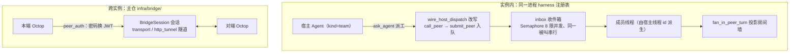
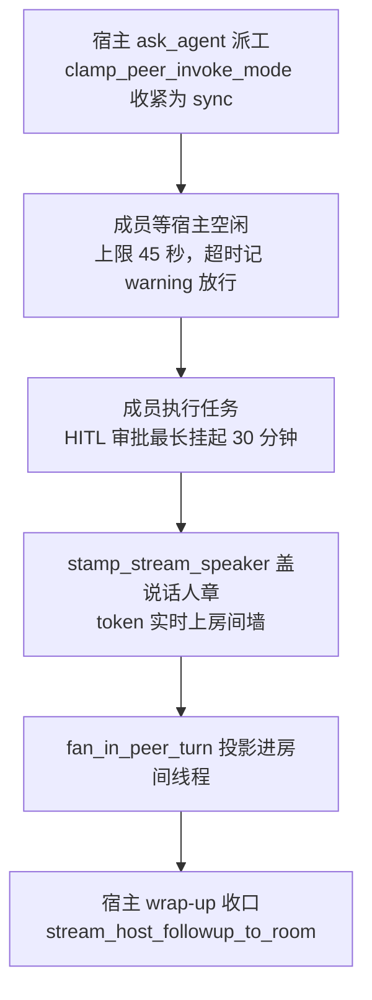
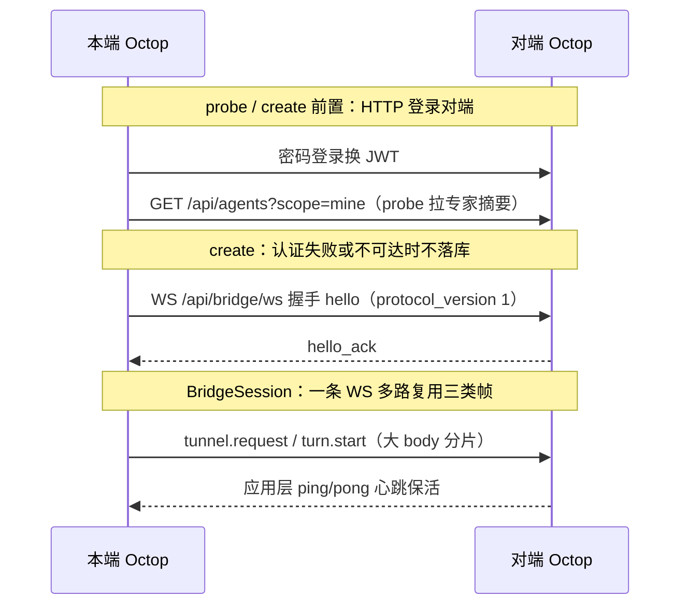

单 Agent 的运行与人机交互已经建立，本篇扩展到参与者之间的发现、委派与结果汇流。[01：Agent 装配与生命周期](./01-agent-lifecycle-and-providers.md) 中略过的团队绑定与 peer 接线在这里展开；[15：自动触发](./15-cron-and-proactive-care.md) 另讲工作何时触发。

本篇按参与对象拆解协作：独立 Agent 先通过 peer 发现与 `ask_agent` 互调，Team 再组织成员派工、独立线程和房间历史；Bridge 则把远端实例的能力接到本地界面。前两者使用进程内协作机制，Bridge 经 WebSocket 隧道转发请求和流事件。

主仓代码引用 `src/octop/...`，组件包引用 `octop_harness/...`（实装 1.0.2）；基线为主仓 v1.0.2，commit dd9dce47。

## 一、先区分图内子 Agent、peer、Team 与 Bridge

### 1、一张地图

[04 篇](./04-skills-experts-plugins.md)的子 Agent 文件定义在父执行图内加载，不等同于已注册的平台 Agent。本文从独立运行时之间的协作开始，再解释 Team 的编排与 Bridge 的远端访问。

三种形态的链路全景如下：



图中展示 Team 的房间汇流与 Bridge 的跨实例连接。普通 peer 互调也可脱离 Team 使用；Bridge 请求最终在对端 Agent 执行，但其跨实例传输不通过 `ask_agent` 或 Team 派工。

| 形态 | 参与者 | 机制所在 | 核心文件 |
| --- | --- | --- | --- |
| 图内子 Agent | 父图与嵌套子图 | harness 子 Agent 装配 | 定义来源与工具边界见 [04 篇](./04-skills-experts-plugins.md) |
| 专家互调（peer call） | 任意两个同用户专家 | harness `teams/`（工具 + inbox） | `octop_harness/teams/{tools,inbox,team_manager}.py` |
| 专家团队 | 宿主（`kind=team`）+ ≥2 成员专家 | harness 派工 + 主仓房间 | `src/octop/infra/agents/teams/`（4 文件） |
| 跨实例 Bridge | 两台 Octop 的各一个用户 | 主仓 `infra/bridge/`（10 文件） | `src/octop/infra/bridge/*.py` |

`docs/bridge.md` 明说「`ask_agent` / Team 不参与跨实例」，源码可证实：`infra/bridge/` 从不 import harness 的 teams，远程专家只是内存里的影子条目（`bridge:{connection_id}:{remote_agent_id}`），对话在对端执行，发起侧不落 `threads` 表。

三种形态落到数据上各有一处「锚」：互调锚在 inbox 消息的 `source_thread_id`（回叫并回父线程），团队锚在宿主的 `thread_id`（房间 id 即宿主线程 id，成员线程由它派生），桥锚在 `bridge_connections.connection_id`（双方同一 id，影子 id 由它拼出）。团队的线程拓扑（源码可证实，`octop_harness/teams/util.py:72` 的 `derive_peer_thread_id`）：

```text
conversation_id = 主持人 thread_id
  ├── 主持人 LangGraph thread = conversation_id
  ├── 成员 A checkpoint = conversation_id~A
  └── 成员 B checkpoint = conversation_id~B
```

不拆 `threads.thread_id` 的 UNIQUE，多专家不写进同一条 checkpoint；团队页的历史是 `thread_messages` 的投影行（带 `speaker_agent_id` 标说话人），不是宿主 checkpoint 的回放。

### 2、运行时协作接口与主仓会话接线

harness `teams/` 拥有协作原语（peer 发现、工具、inbox 队列、回调协议），主仓 `teams/` 拥有平台语义（花名册、房间上墙、历史投影、i18n、在途锁），两者靠 harness 的 hook 接口 + 主仓的运行时 monkey-patch 衔接。

harness 侧的 hook 面（`octop_harness/teams/team_manager.py:55` 的 `TeamManager`）：

```python
def bind_peer_session(
    self,
    *,
    prepare: PreparePeerSession | None = None,
    after: AfterPeerCall | None = None,
) -> None:
    """宿主 hook：把一次 peer 调用映射到持久的被叫会话。

    *prepare* 可改写 ``thread_id`` / ``session_key`` / ``message``
    / ``configurable``（例如 Octop 的 ``threads`` 表和群聊记录）。
    身份键（``agent_id``、``user``、``thread_id``、``source``）被忽略。
    （省略 *after* 说明）
    """
```

主仓在 `AgentManager.boot()`（`src/octop/infra/agents/manager.py:606-629`）完成四步接线：把 `GlobalProcessor` 作为 `team_processor` 传给 `HarnessAgentManager`；`bind_peer_enrich` 刷新 peer 元数据；`bind_peer_session(prepare=prepare_peer_session, after=record_peer_turn)` 把 peer 调用挂到 Octop 的 threads 表；`wire_shared_member_peers` 放行共享专家（见三.6）。

真正值得注意的边界处理是 `wire_host_dispatch`（`src/octop/infra/agents/teams/team_manager.py:2210`）：它在运行时替换 harness `TeamManager` 的四个方法——`call_peer`（宿主的同步调用被改写为 `submit_peer` 入队）、`_call_agent`（inbox 回叫改走房间流式）、`_invoke_peer`（异步派工改走 `stream_peer_to_room`）、`_enrich_request`（注入宿主改写后的任务说明书）。

`_patch_inbox_wrapup`（同文件 :1973）还会替换 `inbox._synthesize_reply`。这是 01 篇「不 fork 组件包换行为」策略的又一实例，代价见五.2。

## 二、peer 原语：发现、调用、收件箱与回调

### 1、发现与调用：TeamManager 提供的基础接口

本小节以 harness checkout `v1.0.5` 补充接口职责；后续 inbox 与主仓接线路径仍按文首标注的版本解释。`TeamManager`（`octop_harness/teams/team_manager.py:55`）在 `AgentRegistry` 之上提供四件事：

- **发现**：`list_peers`（`team_manager.py:175`）按 `metadata["user_id"]` 过滤（无 user_id 的 agent 对所有人可见），叠加 agent 级 `team_peers` 白名单与请求级覆盖（从 LangGraph config 读）——多用户隔离的语义由宿主写进 metadata 字典，运行时只认字典。
- **同步路径**：`teams/tools.py` 的 `agent_list`/`ask_agent` 两个结构化工具，`PeerAgentMiddleware` 注入提示词（07 篇一.4 装配表），`peer_invoke_mode`（sync/async/both）按 agent 配置。
- **异步路径**：`HarnessAgentInboxManager`（`teams/inbox.py`，398 行）全局收件箱队列 + 有界并发 worker；宿主通过 `TeamProcessor` 的 `compose_followup` 和 `on_reply` 参与结果整理与投递；Octop 的 `GlobalProcessor` 再委托主仓团队服务，下一小节沿这条调用链展开。
- **会话映射钩子**：`bind_peer_session`（`team_manager.py:86`）允许宿主重写对等调用的 `thread_id`/`session_key`/`message`——Octop 用它把对等调用映射到自己的 `threads` 表与群聊转录。

一个退化事实值得记：没有宿主 processor 时，teams 退化为纯同步工具调用；harness 独立运行也能使用 `ask_agent`，持久化与房间语义则由宿主补齐。

### 2、inbox 闭环与并发模型

后台委派（delegation，把任务交给另一个 Agent 后自己继续）的闭环是 harness inbox 的四步：`target.call` → `compose_followup` 组提示 → `source.call`（落在父 thread）→ `on_reply` 投递，全部纯内存。

`octop_harness/teams/inbox.py` 的并发模型（docstring :1-11 译）：一个进程级 `HarnessAgentInboxManager` 服务所有 Agent，`asyncio.Queue` 派发、`Semaphore(8)`（`DEFAULT_INBOX_MAX_CONCURRENCY = 8`，:33）限并发；**同一被叫串行**（per-target `asyncio.Lock`，:263），**不同被叫并行**；回叫按源 thread 串行（per-source lock，:304）。

单条消息的状态机是六态 `queued → running → replying → done | failed | cancelled`，`_process`（:256）在每个锁边界都复查 `_is_cancelled`——取消是一等公民，被叫执行中、回叫前、回叫后三个窗口都能取消成功。

`_synthesize_reply`（:353）把 `compose_followup` 的产物经 `build_one_shot_request` 打到 `source_agent_id + source_thread_id`——LangGraph checkpointer 自动把这轮并进父对话，天然「结合之前的问题一并处理」。

`InboxMessage` 不保存 `result_text`/`reply_text`，历史靠 checkpoint，队列只是路由与状态；终态消息在 `_finish` 后即从字典修剪（`_prune_terminal`，:383），查询接口只看得到在途任务。

主仓侧 `GlobalProcessor` 实现的 `TeamProcessor` 协议只有两个方法且都委托给 `TeamManager`（`processor.py:459-482`）：`compose_followup`（`team_manager.py:286`）用 i18n 模板 `teams.followup_done/failed` 组提示，成员结果截 6000 字符注入——因为成员回答落在房间墙/成员 checkpoint 而不是宿主图里，收口提示必须自带摘录；

`on_reply`（:319）按「有房间推房间、有 session 推 session、两者皆无才补 snapshot」的顺序投递，失败经 `format_stream_error` 格式化。

这套 `TeamProcessor` 缝隙（组合提示 + 投递出口）是 harness 团队库与宿主平台之间最干净的一刀：harness 不认识 gateway/IM，DM 和群房间用同一个 hook。

非团队的专家互调也走这条管道，但会话定位有细节：`prepare_peer_session` 只要请求带了 `source_session_key`，就为被叫方派生 `peer:{房间}` 会话键（`team_manager.py:190-201`，调 `ThreadRegistry.peer_room_session_key` / `peer_session_key`），不复用被叫方的 1:1 DM 会话——源码注释明说「升级后旧 DM 里的 peer 历史不会跟过来」。

对用户的表现是：每个同事在自己的会话列表里多一条独立对话，双方视角对称。

### 3、@ 提及的现状：提示词工程，不是前置调用

`docs/agent-call-agent.md` 描述的 `apply_mentions`（用户 @ 某专家 → 主 stream 前先对该专家做一次同步 `call_peer`，结果注入 system）**在 v1.0.2 源码中已不存在**——主仓与 harness 全树检索 `apply_mentions` 均无命中；取而代之的是 harness `PeerAgentMiddleware`（`octop_harness/middleware/peer.py:160`）的请求级提示注入。

```python
def _inject(self, request: ModelRequest) -> ModelRequest:
    # （省略 override 组装）
    if has_agent_at_mention(_latest_user_text(request)):
        block = self._prompt_block(request, invoke_mode=invoke_mode)
```

`_AGENT_AT_RE`（:36）匹配 `@名字` 且排除 `@file.ext`；只有最新用户消息含 @ 记号时才把 peer 名单（`render_peer_prompt`，:66，含中英文两份文案：「用户消息里的 @名字 表示要把问题交给对方：先匹配专家名单，命中则 ask_agent，不要自己顶替」）追加进 system message，平时保持前缀稳定以命中 provider 缓存。

也就是说 @ 的语义从「宿主代码替用户调 peer」变成了「提示模型自己调 `ask_agent`」，可靠性取决于模型服从度。Dashboard 表单里的 `target_agent_ids` 只作为 composer context `targetAgents` 盖在 HumanMessage 上（`src/octop/infra/gateway/process/message_keys.py:51`），用于历史气泡的角色 chip，不再触发任何前置调用。

这是维护者文档滞后于源码的实例，读文档时须以版本为准。

## 三、专家团队：宿主、花名册与房间

### 1、kind=team：宿主就是一行普通 agents

团队不是新表，宿主是 `agents` 表里 `kind='team'` 的一行，花名册只存在宿主工作区的 `.octop/manifest.json`，没有成员表。

`src/octop/infra/db/migrations/016_agent_teams.sql` 全文只有一行 DDL：

```sql
-- v16：团队宿主是 kind=team 的普通 Agent。
-- 花名册保存在宿主工作区的 .octop/manifest.json，不单独建成员表。
ALTER TABLE agents ADD COLUMN kind TEXT NOT NULL DEFAULT 'expert';
```

`TeamService`（`src/octop/infra/agents/teams/service.py:114`）围绕这份清单工作：`validate_member_ids`（:183）把传入列表当**完整下一版花名册**而非增量——出现已删除/团队宿主/无权使用的 id 抛 `TEAM_MEMBER_INVALID`，可用成员少于 `TEAM_MIN_MEMBERS = 2`（:19）抛 `TEAM_MEMBERS_TOO_FEW`。

成员校验规则 `_user_may_use_member`（:71）允许三种：自己的、admin、`is_shared=1` 的分享专家。团队本身不可分享（`TEAM_NOT_SHAREABLE`，`manager.py:788`）。HTTP 面 `api/routers/teams.py` 很薄：校验后调 `agent_registry.create/delete`，改花名册后 `reload` 宿主。

清单本体由 `_write_manifest`（`service.py:152`）经 `BackendWorkspace.write_text` 写入（遵守 03 篇的工作区 I/O 单入口规则），形态与 `docs/expert-teams.md` 一致：

```json
{
  "kind": "team",
  "members": ["expert-a", "expert-b"]
}
```

`visible_member_ids`（:173）在读取侧再过滤一遍「已删除或本身是团队宿主」的 id 但**不回写磁盘**——花名册允许暂时引用失效成员，展示层静默剔除；真正清账发生在删除专家时：`drop_member`（:255）遍历所有团队行把该 id 从清单里摘掉，`AgentManager.delete` 随后逐个 `reload` 受影响的宿主（`manager.py:1069-1113`），让 `team_peers` 配置同步收窄。

### 2、宿主装配：白名单工具、隐藏模板与 async 派工

宿主的 harness 配置在通用翻译层之后被 `_apply_team_host_config`（`src/octop/infra/agents/manager.py:4159`）整体收窄——工具只剩派工五件套，派工模式强制 async，MCP/技能/插件/子图全部摘除。

```python
if not is_team_agent(row):
    if "peer_invoke_mode" in _HARNESS_AGENT_CONFIG_FIELDS:
        return replace(cfg, peer_invoke_mode="sync")   # 普通专家：只许同步
    return cfg
updates: dict[str, Any] = {}
if "tools_disabled" in _HARNESS_AGENT_CONFIG_FIELDS:
    updates["tools_disabled"] = host_tools_disabled(...)  # 目录减白名单
if "team_peers" in _HARNESS_AGENT_CONFIG_FIELDS:
    updates["team_peers"] = tuple(self._teams.member_ids(row.agent_id))
if "peer_invoke_mode" in _HARNESS_AGENT_CONFIG_FIELDS:
    updates["peer_invoke_mode"] = "async"              # 宿主：只许异步
# （省略 mcp_server_configs={} / skills_dir=None / tools=None /
#   subagents_auto_load=False / bootstrap_enabled=False / system_prompt）
```

工具白名单（`service.py:25`）是 `agent_list`、`ask_agent`、`memory_search`、`memory_get`、`current_time` 五项，`HOST_TOOLS_DISABLED` 取「内置目录 − 白名单」做黑名单，`_apply_team_host_config` 里那一串 `if "xxx" in _HARNESS_AGENT_CONFIG_FIELDS` 是 01 篇讲过的版本协商模式。系统提示词由 `host_system_prompt`（`team_manager.py:103`）拼装：用户自定义 + i18n 的 `teams.host_briefing` 运行时简报。

创建时 `seed_team_template`（`service.py:311`）把 `template/` 下的 `SOUL.md`（人格）、`AGENTS.md`（调度准则）、`MEMORY.md`、`manifest.json` 批量写进宿主工作区——模板 `AGENTS.md` 开篇即「你是这个房间的**协调人**，不是执行人」，并把「禁止原样转发用户原话」「成员未运行则派工失败、不自动拉起」写成了行为红线。

请求级还有一道保险：`GlobalProcessor` 在每轮宿主对话前调 `teams.stamp_host_runtime(request, agent_id)`（`processor.py:844` → `team_manager.py:692`），把 `configurable.peer_invoke_mode` 强制为 `async` 并剥掉请求里的 MCP 配置——即使某个运行时仍默认 sync，工具层也拿不到同步面。

### 3、派工：ask_agent 的两条路与任务改写

派工的执行面是 harness 的 `ask_agent` 工具（`octop_harness/teams/tools.py:161`），按 `peer_invoke_mode` 出三种 schema：`both` 暴露 `mode=sync|background` 参数，`sync`/`async` 把参数藏掉让模型无从选错；工具描述明写「用户写 @名字 时优先用这个工具」。

mode 判定链（`tools.py:173-175`）值得细看：

```python
configured = team.peer_invoke_mode_for(from_agent_id) or peer_invoke_mode
forced = clamp_peer_invoke_mode(_request_peer_invoke_mode(), configured)
use_async = _use_async_invoke(forced, mode, team.enabled)
```

`clamp_peer_invoke_mode`（`octop_harness/teams/util.py:26`）的规则是「请求级覆盖只能收紧不能放宽」：sync 是最小权限面，sync 配置的 Agent 永远 sync；async 配置可以在某一轮收紧到 sync（成员被派工时正是如此）；both 才接受任意请求值。

宿主发出 `ask_agent` 后，被 `wire_host_dispatch` 改写的 `call_peer` 直接转成 `submit_peer` 入 inbox，立即返回 `job_id`。

inbox worker 执行前，主仓的 `prepare_peer_session`（`team_manager.py:165`）先做平台侧准备：用 `derive_peer_thread_id`（`octop_harness/teams/util.py:72`）生成成员 checkpoint 线程 `主thread~成员id`（后缀替换不堆叠，重复派同一成员续在同一线程）；经 `stash_peer_prompt` 暂存「宿主改写的任务 + 群聊背景」二元组；给线程起名「来自团队 `{宿主名}`」；群聊场景先给 IM 通道推一条「已请 `{成员}` 处理」。

`_member_runtime`（:785）给成员的请求级覆盖是本篇最有意思的一对约束：

```python
extra: dict[str, Any] = {"peer_invoke_mode": "sync"}
if is_team_agent(host):
    extra["team_peers"] = [
        member_id for member_id in self._agent_manager.teams.member_ids(call.from_agent_id)
        if member_id != call.to_agent_id
    ]
```

成员被派工时降为 sync（不能再异步往群里拉人），peer 白名单收窄为**其余同事**（仍可同步互相询问）——`docs/expert-teams.md` 决策 13/23 的源码落点。

任务说明书由 `wire_host_dispatch` 里包装的 `_enrich_request`（:2351）注入：SystemMessage 放群聊记录、HumanMessage 放宿主改写后的任务，替换 harness 默认的一句话 `message`；被叫成员看到的是主持人改写的说明书，不是用户原话。

### 4、房间墙：谁在说话，谁在等

团队房间的实时面全在主仓 `TeamManager.stream_peer_to_room`（`team_manager.py:365`）——成员 token 经 WS hub 打上 `speaker_agent_id` 直接上墙，但必须等宿主当前轮空闲；宿主自己的收口轮通过替换 `inbox._synthesize_reply` 走同一条房间流，而不是阻塞的 `call()`。

成员从被派工到宿主收口的一次完整轮次如下：



链路上最关键的两处等待：上墙前「等宿主空闲 45 秒」防的是两个说话人的 token 交错；执行中的 HITL 审批挂起最长 30 分钟，不算任务结束。

成员上墙的让行逻辑（:373-379 docstring 译）：宿主的回复是单一 token 累积流，成员模型若在宿主还在流式时启动，两个说话人的 token 会交错，所以成员先等宿主空闲：

```python
_HOST_IDLE_WAIT_SEC = 45.0      # 等宿主空闲的上限
_MEMBER_HITL_WAIT_SEC = 30 * 60 # 成员工具审批最长挂起 30 分钟
```

等待期间成员帧照常进成员自己的线程页（`member_tid`），只是不上房间墙；超时 45 秒仍繁忙则记 warning 放行。

成员的 `hitl_required`（Human-in-the-loop，需要用户审批的工具暂停）不算任务结束：房间收到审批卡片，`_wait_member_hitl` 挂在 future 上等 `deliver_member_hitl` 投递决定，然后 `resume_hitl` 恢复成员图（:499-520）。

每帧经 `stamp_stream_speaker`（:1535）盖说话人章后推 `hub.push_to_thread(room_thread_id, ...)`；正在直播但尚未落库的成员文本记在 `_live_member_text`，刷新页面重连时 `deliver_live_member_catchup`（:1061）在锁内「先订阅再重放」，保证 token 不重复。

成员轮结束后 `fan_in_peer_turn`（:652）把带 `speaker_agent_id` 的消息轨迹（工具调用轨迹保留，ToolMessage 正文截到 4000 字符）投影进房间线程的 `thread_messages`，未直播时补一条 snapshot；`record_peer_turn`（:233）同时写成员自己的页面。

宿主收口走 `stream_host_followup_to_room`（:600）：等宿主空闲、流式到房间、持久化并打 `team_wrapup` 标，`_live_host_replies` 集合保证随后的 `on_reply` 不把同一段总结再写一遍。

IM 通道看不到房间 WS，所以 `_push_room_to_channels`（:1360）把成员发言以「`{成员名}`：正文」、收口以「【主持人总结】」的完整消息推给绑定的通道。

宿主自己直播时也过一道盖章：`GlobalProcessor` 的各流式出口统一调 `stamp_team_host_chunk`（`team_manager.py:1557`，`processor.py:967` 起多处）给宿主 token 盖宿主 id，函数开头有一条保护——帧上已有**别的**说话人 id 就原样放行，宿主盖章永远不会覆盖借道宿主流的成员帧。

历史转录也有对应的防泄漏：`_is_team_system_prompt`（:1575）按前缀（「[团队成员」「[系统唤醒」「以下是当前群聊记录」等中英文标记）识别内部调度消息，把宿主图里的派工噪音挡在群聊转录之外，成员收到的 System 背景不再回炉。

欢迎语是聚合的：`team_host_welcome_payload`（`welcome.py:86`）丢弃宿主自己的快捷卡，把每个成员自己的快捷卡（工作区 → 专家模板 → 默认集，与成员 1:1 聊天同一解析顺序）按内容去重后合并展示。

### 5、在途派工锁：进程内的花名册护锁

在途派工记账是纯进程内的 `TeamJobTracker`（`src/octop/infra/agents/teams/jobs.py:8`），按 inbox `job_id` 幂等；`TeamService.assert_roster_writable`（`service.py:216`）用它拒绝移除在途成员，`assert_can_delete_agent`（:232）拒绝删除在途专家或团队。

```python
class TeamJobTracker:
    """跟踪在途的宿主→成员派工。
    优先使用稳定的 ``job_id``（inbox id）使 begin/end 幂等。计数器留给
    没有 job id 的调用方。进程重启即丢失——花名册锁不跨重启存活，
    也拦不住重启前遗留的 inbox 任务。
    """
```

`begin` 在 `prepare_peer_session` 开头调用，`end` 在 `record_peer_turn` 的 `finally` 与 `on_reply` 两条路径收口（`team_manager.py:202、284、764`）——与 `docs/expert-teams.md`「失败也会释放」一致。重启后锁消失可再改编制，但 inbox 同样是纯内存（见二.2），两边一起丢，语义自洽。

### 6、共享成员：wire_shared_member_peers 的二次放行

harness 的 `list_peers`/`_resolve_peer_entry` 天然只认「同 user_id 的注册项」，宿主成员里若有别人分享来的专家会拿不到 `agent_list`、派工被拒；`wire_shared_member_peers`（`team_manager.py:2114`）再次运行时替换这两个方法，把 `team_peers` 白名单上的共享专家按 `_user_may_use_member` 逐个放回。

替换后的 `resolve_peer_entry` 先走原方法，仅在异常文本含 "not owned by user" 时查白名单二次尝试（:2181-2203）。

这一层是 01 篇 boot 序列里「共享成员 peer 接线」的实体，也是「分享来的专家可真正派工」决策的落点——产出进对方工作区（成员用自己的 checkpoint 与 workspace），但派工方拿不到对方配置。

## 四、Bridge：跨实例互联

### 1、连接行与生命周期

一条桥连接是 `bridge_connections` 表的一行（迁移 `019_bridge_connections.sql`，遵循资源表约定：整数代理主键 + 字符串 `connection_id` 公开 id），每用户上限 10 条（`manager.py:98`）；密码与 token 用 Fernet 加密落库。

```sql
CREATE TABLE IF NOT EXISTS bridge_connections (
  id              INTEGER PRIMARY KEY AUTOINCREMENT,
  connection_id   TEXT NOT NULL UNIQUE,
  owner_user_id   INTEGER NOT NULL REFERENCES users(id) ON DELETE CASCADE,
  peer_base_url   TEXT NOT NULL,
  peer_username   TEXT NOT NULL,
  display_name    TEXT NOT NULL,
  -- （省略 notes / icon_name / credential_blob / access_token_blob /
  --   token_expires_at / status / last_error / last_seen_at）
  auto_reconnect  INTEGER NOT NULL DEFAULT 1,
  peer_client_host TEXT,
  -- （省略 created_at / updated_at）
);
CREATE UNIQUE INDEX IF NOT EXISTS idx_bridge_connections_owner_display
  ON bridge_connections(owner_user_id, display_name);
```

`display_name` 每用户唯一且必填（聊天页分组切换用），取名冲突时 `_allocate_display_name` 自动加 ` (2)`、` (3)` 后缀。重复连接的判定键是 `peer_identity_key`（规范化 URL + 用户名 casefold），同键再连抛 `BRIDGE_PEER_ALREADY_LINKED`。

生命周期全部在 `BridgeManager`（`src/octop/infra/bridge/manager.py:244`）：

- **probe**（:396）：HTTP 登录对端 + `GET /api/agents?scope=mine` 拉专家摘要，不落库不开 WS；
- **create**（:489）：先登录——认证失败或不可达时**没有 DB 行**；`connect=True`（Dashboard 默认）时只有对端登录且 WS `hello_ack` 双成功才保留行，失败回滚删除，显示名不被死卡占用；
- **自动重连**（:822 `_outbound_supervisor`）：指数退避 2→4→8→16→30 秒，连续 5 次失败后自动关掉 `auto_reconnect` 并置 error；token 过期前 60 秒或握手被拒（HTTP 401/403、close code 4001）时用存的密码重新登录（:909）；
- **被动行**：对端主动拨入时 `upsert_reverse`（:1113）落一行没有凭据的 reverse 行，`_is_inbound`（:103）判「无 credential_blob 即入站」，入站行不能拨出、不能改对端凭据、不能自动重连——方向不对称是显式建模的。

### 2、认证与握手：密码登录 + 双向 hello

peer 认证就是「拿对端账号密码做一次普通 HTTP 登录换 JWT」，WS 握手时 token 同时放查询串和 `Authorization` 头（防代理剥查询串，`manager.py:950-957`，且 `proxy=None` 绕过系统代理）；首配冷启动假定发起方 HTTP 可达对端，NAT 后的实例只能由外侧发起。

握手帧（:961-970）：

```python
hello = {
    "type": "hello",
    "protocol_version": PROTOCOL_VERSION,   # ids.py:13，当前为 1
    "connection_id": connection_id,
    "role": "initiator",
    "advertise_base_url": ...,
    "features": list(ADVERTISED_BRIDGE_FEATURES),  # ["body_chunks", "turn_control"]
}
```

WS 地址由 `peer_ws_url`（`peer_auth.py:105`）从对端 base URL 推导——`https` 对应 `wss`、`http` 对应 `ws`，路径固定 `/api/bridge/ws`，token 放查询串：

```python
scheme = "wss" if parsed.scheme == "https" else "ws"
root = f"{scheme}://{parsed.netloc}{parsed.path.rstrip('/')}"
return f"{root}/api/bridge/ws?token={quote(token, safe='')}"
```

`protocol_version` 不相等即拒（入站 close 4002、出站抛 `BRIDGE_PEER_UNREACHABLE`），没有版本协商只有相等性检查——桥两端必须同版本升级，`features` 列表承担增量能力的协商（`body_chunks` 分片上传、`turn_control` 中途取消）。

从探测、握手到多路复用的完整时序如下：



两类帧的去向不同：`tunnel.*` 走双侧白名单内的通用 HTTP 转发，`turn.*` 由对端完全复用本地对话管线流式回传。

入站侧 `accept_inbound`（:1037）在路由层先过本机 JWT（`api/routers/bridge.py:504` 的 `/api/bridge/ws`，token 取查询串或 Authorization 头），然后校验 hello：30 秒内必须是 hello（close 4000）、协议版本相等（4002）、`connection_id` 若已存在须属当前用户（4003）、超连接上限（4008）。

自连防护两道：出站侧 `is_self_peer_url` 用规范化 URL（`peer_auth.py:65`，localhost 与 127.0.0.1 归一）拒绝拨自己；入站侧只有对端 advertise 了**非环回**地址才拒（:1082）——因为默认安装人人 advertise `http://127.0.0.1:port`，不构成回环证据。

SSRF 防线在 `normalize_peer_base_url`：每次都做 DNS 解析并拒绝 169.254.0.0/16、fe80::/10 与其 IPv4 映射段（云 metadata 地址，`peer_auth.py:15-19`）。同一 `connection_id` 的新连接在 `_register_session`（:1155）里踢旧留新，避免双管道。

### 3、「加密」的真实边界：Fernet 只管落库凭据

`crypto.py` 全文 28 行，Fernet 密钥存在本机 `secrets` 表（`get_or_create("bridge_fernet")`），加密对象只有两样——落库的对端密码与 access token；**隧道帧本身没有任何应用层加密**，机密性完全依赖传输层（https/wss）或可信内网。

这一点对安全评估很关键：若两端经 `ws://`（http 对端）互联，`tunnel.request` 里的 token、对话正文、上传文件在链路上都是明文。自托管在家庭内网用尚可，跨公网必须 `https` 对端或前置 TLS。

对端账号密码以可解密形式存在本机 DB（为了自动重连），本机 DB 泄露等价于对端该账号沦陷——这是用「账号线」而非「能力线」做联邦的固有代价。

### 4、一条 WS 三类帧：tunnel / turn / browser 多路复用

`BridgeSession`（`transport.py:86`）在一条 WebSocket 上多路复用三类帧，靠 `request_id` + future/queue 关联；大 body 分片、应用层心跳、半开检测都做在会话层。

```python
BRIDGE_WS_MAX_BYTES = 32 * 1024 * 1024            # 单帧上限（含 base64 膨胀）
BRIDGE_TUNNEL_MAX_BODY_BYTES = 8 * 1024 * 1024    # 不分片时的 body 上限
FEATURE_BODY_CHUNKS = "body_chunks"               # 协商后可分片
BODY_CHUNK_RAW_BYTES = 256 * 1024                 # 每片原始字节
BRIDGE_TUNNEL_CHUNKED_MAX_BODY_BYTES = 100 * 1024 * 1024  # 分片后上限
HEARTBEAT_INTERVAL_SEC = 20.0 / HEARTBEAT_TIMEOUT_SEC = 60.0
```

8MB 单帧上限的算术：base64 膨胀 4/3 后约 10.7MB，仍低于 uvicorn 默认 16MB WS 帧上限，注释明说要与对端服务器限制对齐。

心跳是**应用层 ping/pong**（不是 WS 协议的 ping opcode）——注释解释：应用数据帧才能重置 NAT/L7 设备的空闲计时器；`is_stale` 只在「对端会答 pong 且静默超 60 秒」时判半开掉线，避免误杀不会答 pong 的旧对端。

`handle_message`（:213）把 `tunnel.request` 和 `turn.start/listen/cancel/steer_remove` 都丢进独立 task——turn 可能跑几分钟，绝不能阻塞收帧循环；`next_queue_item`（:317）让等待方在「队列有货」与「WS 已死」之间赛跑，掉线立刻抛 `ConnectionError` 而非干等超时。

### 5、HTTP 隧道与路径策略：影子 id 的进出

隧道执行「任意 method/path/query/headers/body」的通用 HTTP 转发，但两侧各有一道**代码级路径白名单**；入站侧身份不是对端说了算——剥掉对端传来的 `authorization/cookie`，按本机连接行属主现签一个 token 注入。

白名单 `tunnel_policy.py`（:54 `is_tunnel_path_allowed`）：`/api/agents` 集合只许 GET；`/api/agents/{id}/...`（threads/history/uploads/chat/memory/tools/subagents/reload 等子面）放行全部动词；composer 只读面（providers/resolved、active-model、knowledge-bases、hitl 设置）只 GET；浏览器 viewer 两个 GET + handoff 一个 POST；MBTI、subagent-catalog、ACP、cron/settings、connector-instances 各按需放行；**管理/认证/bridge 控制面一律不进隧道**。

出站侧 `tunnel_http`（`manager.py:1222`）在跳之前先查白名单，不合规直接抛 `BRIDGE_REMOTE_UNSUPPORTED`（提示「请在对端 Octop 上操作」）；入站侧 `execute_local_http`（`http_tunnel.py:62`）再查一遍——双侧校验，版本错配也不会单侧裸奔。

入站执行（`manager.py:1294`）：`_owner_access_token` 用 `token_signer`（由 `api.app` 注入，绕开 infra→api 依赖）给连接行属主签发 JWT，把请求经 `httpx.ASGITransport` 直接打在本机 FastAPI app 上——不占真实端口、不走网络栈。对端传来的请求头先过清洗（`http_tunnel.py:19-28`）：

```python
# 逐跳 / 敏感头：绝不从远端隧道发起方转发进本机 ASGI 调用
# （认证以连接属主身份注入）。
_DROP_REQUEST_HEADERS = frozenset(
    {
        "host",
        "content-length",
        "connection",
        "transfer-encoding",
        "authorization",
        "cookie",
    }
)
```

`authorization` 与 `cookie` 在列的意义：对端无法冒充本机任何其他身份，隧道请求因此以「对端登录的那个本机账号」身份执行，可见范围即该账号本机可见范围，本机用户 id 与对端用户 id 无对应关系（`docs/bridge.md` §4.3，源码可证实）。

发起侧的路由入口是 `api/middleware/bridge_proxy.py`（:206 `install`）：全局 HTTP 中间件识别 `/api/agents/bridge:{cid}:{aid}/...` 或 `X-Octop-Agent-Id` 带 bridge id 的白名单路径，改写 id 段为对端真实 id 后走隧道，返回体再改写回来。

影子 id 体系（`ids.py`）：`format_bridge_agent_id`（:26）拼 `bridge:{cid}:{aid}` 且 cid 禁含冒号；`list_remote_agents`（`manager.py:1318`）把对端列表映射成影子行（`state` 强制 `running`、`bridge: True`、`member_ids` 整组改写）。

JSON 改写 `rewrite_tunneled_json`（`ids.py:148`）只映射**身份键**（`agent_id`、`speaker_agent_id`、`member_ids` 等）与 URL 段，刻意不做子串替换——注释给出了原因：团队成员线程 id 是 `{room}~{member}`、session key 以 `{agent_id}:` 开头，整串替换会把对端可读的 id 弄坏。

### 6、turn 协议：远程对话与房间续听

远程对话不走「HTTP 隧道里塞 SSE」，而是独立的 `turn.*` 帧族：`turn.start`（发起一轮）、`turn.chunk`（携带完整流帧）、`turn.end/error`（收束）、`turn.listen/unlisten`（只订阅）、`turn.cancel/steer_remove`（运行中介入，需对端 feature `turn_control`）；`peer_turn.py:9` 的 `USER_TURN_WS_KEYS` 与本机 dashboard WS 的用户轮字段表逐键同步（测试断言两边不漂移）。

发起侧 `relay_user_turn`（`manager.py:2075`）发 `turn.start` 后在等待队列上收 chunk，每帧经 `rewrite_peer_stream_frame` 把说话人 id/媒体 URL 改写回影子 id 再喂给本机浏览器 WS；600 秒队列超时但在见过 `turn.ended` 后只续等不报错——因为「宿主轮结束不是房间结束，成员还要等宿主空闲后才 flush」。

对端侧 `_execute_peer_turn`（:1575）在本机 WS hub 注册一个合成连接 `bridge-turn-{request_id}`、订阅线程、把入站消息塞进既有 channel manager 队列，流帧原样回传，所以对端完全复用本地对话管线，桥只是换了一条进线。

`turn.listen`（`_execute_peer_listen`，:1728）订阅已有房间线程并先走 `subscribe_with_member_catchup`（`team_manager.py:116`）重放在墙未落库的成员文本——浏览器刷新后远程团队房间的成员直播不断流，正是 2026-10 的修复 commit `0394e28f`（"keep team member streams alive through refresh"）加的路径。

`peer_turn_relay_finished`（`peer_turn.py:36`）规定 harness 的 `done` 不是中继终点，`turn.ended` 才是——dashboard 的 Generating 状态以它收口，旧对端不发 `turn.ended` 时发起侧代发一个补齐。

第三类 `browser.*` 帧族是 Chat dock「远程浏览器」的中继：发起侧 `relay_browser_stream`（`manager.py:2452`）先等浏览器客户端的 `start` 消息再发 `browser.start`，随后双向搬运——服务端帧包在 `browser.server` 里回推，客户端消息包在 `browser.client` 里转发；

对端 `_execute_peer_browser`（:2362）把这些回调适配成 `send_json/is_connected/receive_text` 三件套喂给注入的 `PeerBrowserRunner`，复用本机浏览器 harness 的执行面。

独立 Remote Browser 页与安装/录制仍只打本机，不经桥。

`docs/bridge.md` 头部自称「实现中（Phase 0–3 骨架已落地）」，但 v1.0.2 源码已含 Phase 4 的内容（退避重连、路径策略、turn_control 特性协商、浏览器画面中继 `browser.start/client/server/end` 帧），文档状态滞后。

## 五、工程判断

### 1、照搬

`TeamProcessor` 协议（`compose_followup` + `on_reply` 两个方法）是「队列库 × 宿主平台」缝隙的最佳切法：库负责执行与并发，宿主只管提示词和投递出口，octop-harness 因此一个 gateway/IM 引用都没有。

桥的双侧路径白名单（发起侧 fail-fast、执行侧兜底，同一函数两处调用）与「剥对端认证头、按连接属主现签 token」的身份注入，是任何 HTTP 隧道类功能的安全底线模板。

`TeamJobTracker` 的「稳定 job_id 幂等 + 无 id 退化为计数」的轻量在途锁，适合一切「删改前要确认没人在跑」的编排场景。

影子 id 只改身份键、不改子串的纪律，是所有「跨系统 id 命名空间映射」都该抄的细节。

### 2、改造

`wire_host_dispatch` 家族（运行时替换 harness `call_peer`/`_call_agent`/`_invoke_peer`/`_enrich_request`/`_synthesize_reply` 五处）功能正确但脆弱：harness 内部一重构方法名就静默失效，且它的存在本身是为了绕「harness 默认 sync」——`_install_team_host_dispatch` 的 docstring（`manager.py:4115`）写明「even on harness 1.0.8 (default sync)」，主仓对组件包版本漂移已经打了三层补丁。

若自己造平台，应把「宿主强制 async」「房间流式回叫」上推成组件包的原生 hook（`bind_peer_session` 已经是正面范例），而不是包一层又一层的替换。

房间墙的「单一 token 累积流 + 45 秒等空闲」是实用的防交错护栏，不是通用调度器——多成员并行直播时每成员各自等待，扩展到大规模并发直播间需要换成真正的多路合流。

### 3、避免

避免把跨实例信任建立在「路径白名单之外还有别的刹车」的幻想上：隧道的全部安全边界就是（a）连接属主账号的本机权限、（b）`tunnel_policy.py` 的正则白名单、（c）传输层加密。

密码可解密落库换来了自动重连，代价是本机 DB 泄露即对端账号沦陷——高安全场景应换成对端签发的窄 scope token。

避免在 `ws://` 明文链路上跑桥；避免假设 hello 里的 advertise URL 可信（源码自己都只把它当展示名，环回地址不作自连证据）。

团队侧要避免把 inbox 当持久队列用：重启丢在途任务是设计决定（`agent-interop-mailbox.md` 决策 2），需要可靠交付的任务必须另做持久化，且文档明确该扩展应在 harness 层做而非 octop 再建一张表。

### 4、适用边界与信任模型

源码可证实的边界：团队协作与 inbox 全部进程内（单进程假设同 01 篇），重启丢在途派工与队列；inbox 并发 8、桥每用户 10 连接、单帧 body 8MB/分片 100MB，都是家庭/小团队量级。

信任模型上（本站推论）：bridge 的安全面等价于「把连接属主账号的 agent 范围操作权交给了持密码的对端」——对端被攻破时，攻击者可经隧道聊天、读写工作区、改个性化工具设置，但拿不到管理/认证/桥控制面（白名单拒绝），`observe_ws_client_host` 也只信任来自环回代理的 `X-Forwarded-For` 最右跳；

社区对自托管平台「主动出网联邦」的疑虑，Octop 的回应是 SSRF metadata 段硬拒 + 双侧白名单 + 密码加密，但没有配对码、没有按能力授权、没有审计日志，跨组织互联不建议照此形态上生产。

NAT 穿透的真实能力：桥本身解决了「业务流量走已建立的 WS」（云端可访问家里），但**首配仍需一侧 HTTP 可达对端**（登录换 token），纯双向 NAT 无中继不可冷启动——`docs/bridge.md` §9.1 把这条列为头号风险，源码未提供配对码替代路径。

## 六、未核验范围

1. `octop_harness/agent.py` 中 `PeerAgentMiddleware` 的挂载条件（`team_enabled` 配置路径）与 harness 1.0.2 相对锁定版的 teams API 差异未逐项比对；`team_tools()` 与中间件重复注入工具的防重逻辑只读了注释。
2. dashboard 团队聊天 UI（成员条、徽章、说话人气泡）与 `dashboard/src/utils/remoteExpert.ts` 的 `SURFACES` 清单只对照了 `tunnel_policy.py` 注释，未读前端源码；`cli/commands/bridge.py` 只确认存在，未读。
3. turn 帧承载的完整流帧分类学（token/reasoning/tool/steer/hitl 等）归 12 篇，本篇只核实转发与改写路径；`turn.cancel`/`steer_remove` 的对端 steer 队列语义只读到调用点。
4. `browser.*` 中继（Chat dock 远程浏览器）只梳理了帧族与 runner 注入点，`PeerBrowserRunner` 的 install/录制路径未读。
5. i18n `teams.*` 键值、`welcome.py` 的成员快捷卡合并在前端的表现、`hitl` 协调器的存储结构（13 篇范围）均未展开。
6. 全部结论来自静态阅读；未启动服务、未做 WS 握手/隧道/团队派工的运行验证，并发与超时数值均引自源码常量。

上一：[13：人机协作与会话控制](./13-session-control-slash-hitl-steer.md) · [系列导读](./index.md) · 下一：[15：自动触发](./15-cron-and-proactive-care.md)
