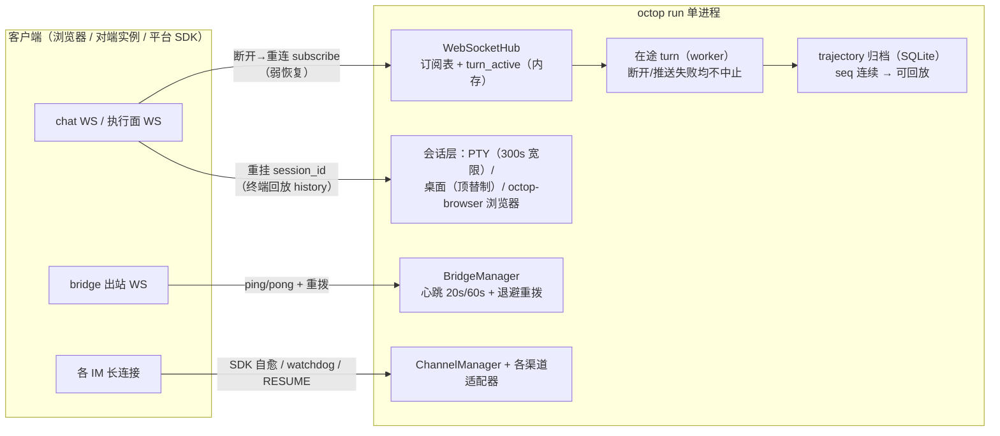

前面已介绍执行、记录、交互和自动运行。本篇以故障为线索比较对象寿命：连接恢复、数据补齐和执行续接各需要哪些存活状态。各领域内部实现保留在主题篇，这里统一检查恢复边界。

本篇是横切主题篇：不新增模块，而是把散在 [12](./12-stream-projection-and-rendering.md)（面板弱恢复门控）、[14](./14-teams-delegation-bridge.md)（Bridge 退避重拨）、[06](./06-execution-surfaces.md)（终端/桌面流）、[11](./11-im-gateway-message-pipeline.md)（飞书 watchdog）里的重连切片收拢成一张全景地图，并补齐此前未核验的面——SSE 续流的断开语义、steer 快照补发、HITL 停靠、浏览器状态流重连、QQ 渠道的平台级 RESUME、Bridge 心跳半开检测、开机自愈与 trajectory 序号续传。各领域内部的细节仍归原篇，本篇给跨层对照与设计综合；主仓基线为 `v1.0.2`/`dd9dce47`，gateway checkout 为 `v1.0.3`。

判断能恢复什么，先找仍然存活的状态：连接断开时，后台任务可能继续；进程退出时，内存任务、订阅和审批登记都会消失。磁盘上的 checkpoint、历史和配置各自保留一部分信息，不能替代整套运行现场。

## 一、恢复什么：连接、会话、数据与执行

先给整张地图。Octop 里会被「断」的连接有五类，每类的检测者、恢复动作和状态存放位置都不同：

| 断点 | 连接 | 谁检测断线 | 恢复动作 | 状态放在哪（比连接长寿的东西） |
| --- | --- | --- | --- | --- |
| 面板对话 | WS `/chat/ws`（+HITL SSE） | 浏览器 `onclose` | 重新订阅；历史、队列快照另行补取 | 原进程内的 turn 可继续 |
| 执行面流 | 终端/桌面/浏览器 WS | 浏览器 `onclose` / 服务端宽限计时 | 重挂同一会话（终端回放 history） | PTY 进程 / 截屏会话 / octop-browser 浏览器会话 |
| Bridge 隧道 | 出站 WS（跨公网） | 心跳超时（20s ping / 60s 静默） | 退避重拨，5 次熔断 | DB 里的连接行 + auto_reconnect 标志 |
| IM 渠道 | 各平台长连接/WS | SDK 钩子 + watchdog + 心跳 | SDK 自愈 / 硬重启 / 平台 RESUME | 渠道配置行（boot 时重装载） |
| 进程本身 | 全部 | 人 / 运维 | 按启动清单重建运行时 | 配置、任务表、checkpoint 与归档各自持久化 |

本篇按恢复对象区分四个动作，避免用一个「强/弱」标签承诺全部能力：

- **重建连接**：重新建立 TCP/WebSocket、鉴权和握手，如 Bridge 重拨。
- **重新订阅**：附着仍然存活的任务，接收后续事件。面板源码称其为 weak stream resume；普通 chat chunk 不按游标补发。
- **补齐数据**：重拉历史、补发队列快照、回放 PTY 缓冲，或按 trajectory 序号续读。它们恢复的数据类型和保留窗口不同。
- **恢复执行**：依据 checkpoint 或任务表重新启动工作。还需要恢复入口、身份与执行条件，不能从「记录仍在」直接推导出原任务已续跑。

QQ 的平台 RESUME 见第五节第 1 小节，trajectory 的归档游标见第六节。前者依赖平台仍接受会话及序号，后者依赖本地归档和有限回放窗口；两者都不等于全链路无丢失或恰好执行一次。

| 状态 | 保存位置与寿命 | 连接断开后 | 进程重启后 |
| --- | --- | --- | --- |
| 在途 turn / asyncio Task | 当前进程 | 本地 chat 路径可继续执行 | 原 Task 消失，不能据 checkpoint 宣称自动续跑 |
| LangGraph checkpoint | 配置的持久化后端 | 可保留图状态 | 状态可读取；恢复执行仍需对应入口和条件 |
| hub 订阅 / turn_active | 进程内 | 新连接可重订阅、查询标志 | 标志与订阅消失；重读历史不会复活旧 Task |
| HITL pending 卡片 | 进程内 dict，30 分钟 TTL | 同进程刷新可从 store 补卡 | 登记消失；checkpoint 不自动重建 pending_id |
| steer 队列 | 进程内，审批停靠有 TTL | 订阅可补当前队列快照 | 未消费队列丢失 |
| PTY 与 scrollback | 进程内，脱离后 300 秒宽限；缓冲有限 | 宽限内可重挂并回放保留内容 | 不恢复原 PTY 现场 |
| 桌面流 / 浏览器控制权 | 进程内 | 按各入口新建流或保留接管状态 | 内存状态消失；浏览器磁盘 profile 另算 |
| 浏览器 profile | 磁盘目录 | 登录目录仍可复用 | 可复用目录，不等于旧 CDP 或任务恢复 |
| Bridge 连接行 | DB；凭据与 auto_reconnect | supervisor 可重拨 | 按配置重拨，不续接旧隧道请求 |
| 文档索引任务 | 文档状态落库，Task 在内存 | 任务不依赖页面连接 | pending/processing 按启动规则重新索引，见 [10 篇](./10-knowledge-base-rag.md) |
| 历史 / trajectory | 持久化投影与版本化归档 | 可读取已落盘结果或事件 | 保留已提交数据，不保存所有运行中现场 |



图中的归档边表示执行过程中可记录轨迹事件。普通聊天窗口重拉的是线程历史；trajectory 是独立观察流，不会自动把归档事件作为普通 chat chunk 逐帧补回。两者的数据形态和读取契约见 [08 篇](./08-versioned-history-and-trajectory.md)。

支撑弱恢复的关键结构是**会话与订阅者分离**：PTY 进程属于「会话」，WS 连接只是「订阅者」（06 篇）；turn 属于「线程」，WS 连接只是 hub 里的一个订阅条目（12 篇）；浏览器实例属于 octop-browser 的会话注册表，画面 WS 只是附着器（06 篇三.5）。连接生生死死，会话按各自的寿命规则存活。

## 二、面板对话：弱恢复的三根支柱

### 1、本地对话路径：断开不主动取消执行

本地对话路径把订阅清理与 turn 取消分开。下列三处支持连接断开后继续消费执行流；它们不覆盖进程崩溃，也不能直接推广到 Bridge 中继任务树。

第一处是 WS 端点的收尾块（`src/octop/api/routers/chat/ws.py:253`），注释直接把设计意图写成了文档：

```python
finally:
    # 断开不得取消在途 turn；客户端可重连并订阅后续 chunk。
    # 这是弱流恢复。
    hub.unregister(connection_id)
```

断开只做 `unregister`（从订阅表摘掉这一条），turn 本体在 `WebSocketChannel` 的 worker 里继续跑。

第二处在 worker 的推送循环（`src/octop/infra/gateway/ws/ws_channel.py:211`）——即使推送**失败**（连接刚死、send 抛异常），也不中止 harness 流：

```python
# 投递失败不得中止 harness turn，否则客户端闪断可能
# 让生成停在节点中间，留下不完整的 checkpoint。
try:
    await self._hub.push_to_thread(thread_id, chunk)
except Exception:
    logger.exception("websocket push failed thread=%s (turn continues)", thread_id)
```

注释点名了动机：中途取消会在 checkpoint 里留下不完整的节点状态。投递失败降级为日志，turn 继续，后续 chunk 交给重连回来的订阅者。

第三处在 HITL 审批续流的 SSE 生成器（`src/octop/api/routers/chat/routes.py:177`）。`request.is_disconnected` 被检查，但检查结果只影响**是否向前端吐帧**，不取消恢复本身——生成器继续把 `iter_hitl_resume_chunks` 消费完，然后照常触发停靠 steer 的放行（`routes.py:199` 注释："also when the SSE client disconnected, because the resume itself completed here"）。审批决策已经落定，Agent 的续跑不因看板闪断而作废。

### 2、订阅即恢复：hub 与 turn_active

第二根支柱是服务端的重连接口：**新连接对同一 `thread_id` 发 `subscribe`，即接上还在跑的轮**。`WebSocketHub` 是纯内存订阅表（`src/octop/infra/gateway/ws/ws_hub.py:26`），三个要点：

- 每个连接同一时刻只绑一个线程，`subscribe` 切线程时自动退订旧线程（`ws_hub.py:73`）——「一个连接看一个会话」，多浏览器看同一会话则是多条连接各占一个订阅位；
- `mark_turn_active` / `is_turn_active` 维护跨连接存活的轮次标志（`ws_hub.py:103`），类 docstring 明说「重连的客户端经内存中的 turn active 标志恢复接收实时 chunk」；
- 推送按线程扇出并给帧盖 `thread_id` 章（`ws_hub.py:129`），前端据此丢弃串台帧。

订阅握手在 `ws.py:105` 完成，顺序是：校验线程存在且属于当前用户与 Agent（`ws.py:110`，重连路径上所有权再验一次）→ 团队房间先走成员补播（见 2.5）→ 回 `turn_status{active}` 告诉前端这轮是否还在线 → 清扫过期 steer 并**补发 steer 队列快照帧**（`ws.py:133-147`）。补快照是必要的一环：断线期间用户看不到 `steer.queued` 帧，重连后没有快照，前端 chips 与服务端队列就会失配。

`turn_active` 的另一半暴露在历史端点：`GET …/history` 的响应带 `turn_active` 字段（`src/octop/api/routers/chat/history.py:142`），它是前端「要不要发起订阅探针」的服务端真相（2.4）。

### 3、前端门控：wsResumeGate 的四个纯函数

第三根支柱在前端：要不要重连、什么时候放弃，全部收敛在一个纯函数模块 `dashboard/src/pages/Chat/hooks/wsResumeGate.ts`（[12 篇](./12-stream-projection-and-rendering.md)只保留输出链上的简要说明）。两个常量定死边界：最多自动重订阅 **8 次**（`MAX_STREAM_RESUME_ATTEMPTS`），本地流式态在**无 socket 20 秒**后强制封口（`STREAM_STALE_WITHOUT_SOCKET_MS`）。

| 函数 | 判定 | 对应常量 |
| --- | --- | --- |
| `shouldResumeStreamAfterClose` | 意外断开 且 本地在流式 且 有合法 thread_id 且 未到 8 次 且 会话在焦点 | 8 次 |
| `shouldProbeActiveTurn` | 本地在流式，**或**历史响应说 `turn_active` | — |
| `shouldBlockHistoryRefresh` | 仅当流式中**且有**活 socket 才挡下拉刷新 | — |
| `shouldForceSealStream` | 流式中、无 socket、焦点会话、20 秒无活动 → 本地封口 | 20 秒 |

值得读的是注释里的克制：`shouldForceSealStream` 明说「打开的 socket 豁免——长时间工具/思考轮不吐 token 是正常的」，所以 20 秒计时的前提是**没有 socket**；而 `shouldProbeActiveTurn` 的注释解释了为什么「服务端说在跑」才能触发探针——消息形状无法区分「轮中 checkpoint」与「已结束」，永远不猜，否则活轮会失联：

```ts
// dashboard/src/pages/Chat/hooks/wsResumeGate.ts:53–59
export function shouldProbeActiveTurn(opts: {
  isStreaming: boolean;
  /** 服务端 GET …/history 返回的 turn_active。 */
  turnActive?: boolean;
}): boolean {
  return opts.isStreaming || Boolean(opts.turnActive);
}
```

封口动作只清本地 `isStreaming` 和未完成的气泡，**没有任何取消服务端的调用**（`chatStore.ts:610` 的 watchdog，注释："Seal sticky stream without cancelling a server turn (no socket)"）。

### 4、重连编排：400 毫秒、焦点豁免与后台记账

门控的执行者分两条路，都在 `chatStore.ts`：

**发送路（`sendTurnWebSocket`，`chatStore.ts:2765`）**：每次发送开一条新 socket（顶掉旧的是有意关闭，不给服务端发 cancel）。意外断开且门控放行时，**固定 400ms 后**转 `attachThread` 重订阅（`chatStore.ts:2964`）——注意是固定延迟，不是指数退避；防抖靠的是 8 次上限 + 20 秒封口 + 焦点豁免三重闸。这组参数与终端/桌面流的指数退避不同（三.4）。源码证明的是参数选择，未提供故障分布或性能实验来证明固定延迟更优。

**订阅路（`attachThread`，`chatStore.ts:2481`）**：开 listen-only socket，`onopen` 即发 `subscribe`；`turn_status.active` 为真则保持/进入流式态，并经 `shouldEmitStreamResumeNotice`（`resumeAttempt > 0`）toast 一次「已重新接上」。`onclose` 的分派是整个前端恢复逻辑最密的 70 行（`chatStore.ts:2686-2760`），骨架如下：

意外断开且在流式 → 400ms 后 `attachThread(resumeAttempt+1)`；**后台标签不重连**（`sessionFocused === false` 直接返回 false），改记入 `pendingResumeBySession`，等用户切回该会话时 `rebindFocusedSessionIfNeeded`（`chatStore.ts:120`）再续；重试用尽或建连失败 → 本地封口，不粘 `isStreaming`。

焦点模型本身在 `useChat.ts:832`：挂载登记焦点会话、卸载让位。配套规则是「离开空闲会话顺手关 socket，流式中的不关」（`chatStore.ts:97`，注释：listen socket 在轮结束后为团队迟到的回复保留）——后台会话保持 `isStreaming` 状态但不产生重连流量，「正在看的会话才值得重连」是显式决策。

### 5、断线窗口的补齐：重拉历史、steer 快照、成员补播

弱恢复不回放 chunk，断线窗口的内容靠三条补齐路径：

1. **普通 chunk**：重连后前端重拉线程历史投影补齐（渲染归 12 篇，此处不展开）。
2. **steer 队列**：订阅握手时服务端补发快照帧（2.2），前端据此恢复 chips 与撤回入口。
3. **团队房间直播文本**：成员回答尚未落库时，刷新页面历史里什么都没有——`subscribe_with_member_catchup`（`src/octop/infra/agents/teams/team_manager.py:116`）在订阅路径上「先订阅再重放」进行中的成员文本，协调实时订阅与缓存补播。这是 #2159 的成果（commit `0394e28f`，提交说明："Cloud rooms dropped member tokens after the host turn ended, and a refresh mid-answer had nothing in history to restore"），bridge 云协作房间走同一条补播链（2.8）。

### 6、两层心跳

面板 WS 没有服务端主动心跳：主仓对 uvicorn 只显式设置了 `ws_max_size`（`src/octop/launch.py:117`），协议层 ping 沿用 uvicorn 默认值；业务层是**客户端每 25 秒发一帧 `{"type":"ping"}`**（`CHAT_WS_PING_MS`，`chatStore.ts:529`），服务端原样回 `pong`（`ws.py:101`）。方向选择有讲究：浏览器端到端检测代理空闲超时（常见 60 秒）只需要有流量，客户端 ping 足够；而服务端不需要主动探活，因为「连接死了」对服务端无后果——推送失败被吞掉（2.1），turn 照跑，客户端迟早重连。通知 WS（`/api/notifications/ws`，`src/octop/api/routers/chat/notify_ws.py:23`）复用同一套 ping/pong 与 hub，向一个用户的全部面板连接推 cron/主动关怀 toast——断线恢复策略与聊天 WS 同构（重连后靠拉取补齐，没有推送回放）。

### 7、HITL 暂停：停靠、SSE 续流与 steer 队列停靠

审批暂停是「连接寿命 < 会话寿命」的极端案例，前端把 socket **停靠（park）**而不是关闭：收到 `hitl_required` 或带 `hitl_paused` 的 `turn.ended` 时，`parkLiveSocketForHitl`（`chatStore.ts:3401`）把 socket 转为 listen-only、发 `streamEnd` 解锁输入框，但连接留着。审批决定经 `POST …/chat/hitl/resume` 走 SSE 续流（fetch reader 解析，`chatStore.ts:3144`）——普通审批续跑的 chunk 经该 SSE 返回；保留的 WS 仍可接收后续队列轮次或房间成员流，不应把两条传输混为一条。

服务端对等的两件事：其一，暂停期间新入队的 steer **停靠在服务端队列里**（`ws_channel.py:329` 注释："the steer queue is parked server-side and survives the approval pause (drains after SSE resume)"），SSE 续流完成后 `resume_parked_steers`（`ws_channel.py:496`）把停靠队列作为新 turn 重新入队，全部 steer 协议帧照常流出；停靠有 30 分钟 TTL（`HITL_PARK_TTL_SECONDS`，`src/octop/infra/gateway/steer/types.py:15`），超时清扫为 `park_expired`。其二，SSE 续流期间若再次中断（嵌套审批），新卡片登记进 pending store，「历史重载/刷新可以重新注入审批卡」（`routes.py:123`）。这里说的是 store 仍存在的同进程刷新：`history.py:383–388` 从该 store 读取 `hitl_pending`，不是从归档重建审批登记。

### 8、bridge 云协作聊天：one room pipe

对端是 bridge 远程 Agent 时，`ws.py:262` 走 `_bridge_chat_ws` 中继路径，恢复语义多一条「房间单管道」约束：host 轮的订阅者在 `turn.ended` 之后**不释放**，继续转发成员 token（`ws.py:362` 注释："Keep forwarding after host `turn.ended`. Member tokens use this same subscriber; handing the room to a second listen drops them"）；第二条 listen 会复制 host 流，所以换订阅必须先停旧的（`ws.py:497`）。断线重连时前端重新 `subscribe`，服务端经成员补播（2.5）恢复直播——云房间刷新不再丢成员回答（#2159）。这条路径上「恢复」的载体不是 hub 订阅表而是中继任务树（listen task + turn tasks），断开时统一取消，重连重建。

## 三、执行面：会话与订阅者分离的三种变体

三个物理执行面共享「会话与订阅者分离」的骨架，但会话寿命策略各有一变。

### 1、终端：宽限 300 秒 + 回放 history

终端的会话是 PTY 进程 + pump 任务 + 环形 scrollback，断线后 `_arm_detach_cleanup`（`src/octop/api/routers/terminal.py:423`）用 `loop.call_later(300s)` 挂起销毁计时；300 秒内同 `session_id` 重连即取消计时并回放 `{"type":"history"}` 帧，超时无人认领才杀进程组（06 篇已详述模型）。重连路径上属主再验一次（只有会话创建者能重连），进程级 10 个名额对重连不计新数。前端 `useTerminal.ts` 是标准的指数退避状态机：基数 1 秒、`2^attempt` 递增、15 秒封顶、最多 10 次（`useTerminal.ts:55-57`），shell 正常退出（`exit` 帧）抑制重连，Agent 归属在连接时捕获、重连间不变。

### 2、桌面：顶替制，无宽限

桌面流每用户只允许一条：新流开启时 `supersede_user_stream`（`src/octop/infra/desktop/session.py:49`）主动断开旧流——同一用户刷新页面就是「顶替」而非「宽限等待」，截屏会话随断开释放，全局并发 3。前端 `useDesktopStream.ts` 退避 1s×2ⁿ、5 次上限（无封顶常量，5 次本身就是封顶），状态机含独立 `reconnecting` 档，并暴露手动 `reconnect()`（重置计数）。旧截屏会话会释放；宿主桌面环境并不随该流销毁。重连建立新的截屏流，不回放断线期间画面。

### 3、浏览器：组件会话与画面连接分离

浏览器面的分离最彻底：Chromium 实例与登录态 profile 属于 octop-browser 的会话注册表（[06 篇](./06-execution-surfaces.md)三.5），画面 WS 只是附着器——断线/刷新/换标签都不杀浏览器。三条支撑细节：

- **start 即重挂**：连接后发 `{"type":"start", "reuse_session": true, "session_id": "<profile>"}`（`dashboard/src/hooks/useBrowserStream.ts:120`，协议 `src/octop/api/routers/browser/stream.py:8`），服务端 attach 已有会话而不是新开 Chrome；
- **状态流无限重连**：画面 hook 本身不自动重连（`onclose` 只置 `stopped`，tab 列表保留避免闪空）；独立的状态监听 hook `useBrowserSessionState.ts` 开 1×1 的 listen-only WS，指数退避 1s×2ⁿ 封顶 16s、**无次数上限**（挂载期间一直试，`useBrowserSessionState.ts:113`），连上即重置计数并 HTTP 补拉一次覆盖错过的事件（`:180`）。协议要求 open 后 15 秒内发 start 帧否则服务端关闭（`stream.py:404` 的 `wait_for(receive_text(), timeout=15.0)`）——早期版本漏发 start 导致重连风暴，issue #225 修复后 open 即发（`useBrowserSessionState.ts:162` 注释点名）；
- **控制权跨重连**：`_CONTROL_OWNERS` 刻意存在会话注册表之外（`src/octop/api/routers/browser/harness.py:23`，注释："a takeover survives dashboard reloads and WS reconnects"），用户接管状态不随连接丢失。

### 4、三种变体的参数对照与手动重连入口

| 面 | 会话寿命 | 重连退避 | 次数上限 | 断线丢失 |
| --- | --- | --- | --- | --- |
| 终端 | 宽限 300s 后杀 | 1s×2ⁿ 封顶 15s | 10 次（exit 抑制） | 宽限外进程死亡；宽限内回放 history |
| 桌面 | 每用户单流，新顶旧 | 1s×2ⁿ | 5 次（即封顶） | 断线期间的帧 |
| 浏览器画面 | 组件会话独立于画面流，另受空闲回收约束 | 不自动重连（手动/换页重启） | — | 帧与会话状态（状态流重连补拉） |
| 浏览器状态 | 同上（listen-only 流） | 1s×2ⁿ 封顶 16s | 无上限 | 事件（HTTP 补拉） |

终端与桌面重连耗尽后的 UI 入口是面板里的手动重连按钮；云协作专家链接断开则由 `RemoteDisconnectBanner`（`dashboard/src/components/RemoteDisconnectBanner.tsx:12`）兜底——出站方向（本端可拨）给「重新连接」跳转 `/bridge`，**入站方向（对端拨入）不能重拨**，只能提示等待对端，方向不对称在 UI 层如实呈现（与四.3 的服务端规则呼应）。

## 四、Bridge：心跳、退避重拨与开机自愈

跨实例 Bridge 走公网，断线检测不能指望 TCP——半开连接（NAT 超时、对端崩溃）在操作系统层面可能几分钟无感知。14 篇已核验退避与熔断的外层，这里补齐检测与自愈的内层。

### 1、半开检测：20 秒 ping、60 秒静默

`BridgeSession` 自带应用层心跳（`src/octop/infra/bridge/transport.py:133`）：每 **20 秒**发一帧 `{"type":"ping"}`，对端回任何帧都会刷新 `_last_recv`；`is_stale` 判定「**见过 pong 的对端**静默满 **60 秒**」即认定死亡（`transport.py:126`，注释点名 half-open / NAT drop），心跳循环主动 `close("heartbeat timeout")`，把「无感的死连接」变成「有事件的可重拨状态」。

### 2、请求侧 5 秒等拨与开机自愈

会话死了但请求来了怎么办：`_require_live_session`（`src/octop/infra/bridge/manager.py:1193`）先丢弃 stale 会话，然后**等 supervisor 最多 5 秒**（`_RECONNECT_GRACE_SEC = 5.0`，`manager.py:100`）——退避重拨通常在 2-30 秒档，短请求直接失败返回 `BRIDGE_NOT_CONNECTED`，赶上刚拨上的就无感续上。

进程重启的自愈在两处：boot 时 `resume_auto_connections`（`manager.py:803`）把所有 `auto_reconnect` 的连接行**逐个重拨**，由 `server.py:663` 的 `bridge-auto-resume` 任务异步拉起（不阻塞启动）；同一清单里还有知识库索引任务的恢复（`resume_pending_index_jobs`，`server.py:650`）。「重启后哪些长连接自动回来」是有明确清单的——bridge 拨号恢复、IM 渠道重新装载、Agent 重新启动，而面板 WS/终端会话/桌面流不恢复（进程内状态，见第六节）。

### 3、方向不对称

对端拨入的 reverse 行没有凭据，不能拨出、不能改对端凭据、不能开自动重连（`manager.py:645`，[14 篇](./14-teams-delegation-bridge.md)第四节的连接生命周期）——重连能力跟着「凭据持有方」走，这条规则一路贯穿到前端横幅（三.4）。

## 五、IM 渠道：三层自愈

11 篇拆过飞书的两层结构（lark-oapi SDK 内建重连管闪断，30 秒一轮 watchdog 管重连卡死与假活，三阈值 30/180/3600 秒 + 5 秒重启退避 + 孤儿线程归档）。本节补两块：gateway `v1.0.3` checkout 里**各渠道的重连策略光谱**，和 QQ 明确暴露的网关协议 RESUME 分支。

### 1、QQ：平台级 RESUME

QQ adapter 保留平台会话与序号，并在平台允许时发送 RESUME（`octop_gateway/channels/qq/channel.py`）。恢复窗口与平台端语义不由本地 adapter 单独保证：

```python
# octop_gateway/channels/qq/channel.py:1248,1255（节选）
elif op == _OP_RECONNECT:        # 服务端例行踢线，不是错误
    # 平台例行重连时保留 session_id 与 last_sequence，
    # 下次尝试 RESUME，以接续两条连接之间的事件。
    raise _GatewayReconnectError
elif op == _OP_INVALID_SESSION:  # 会话失效，按载荷布尔分叉
    # True：会话可恢复，下次尝试 RESUME。
    # False：会话不可恢复，重新 IDENTIFY，并刷新 token。
    can_resume = bool(payload.get("d"))
    if not can_resume:
        self._session_id_ws = None
        self._last_sequence = None
        self._force_token_refresh = True
    raise ConnectionError("Invalid session")
```

- **服务端踢线**（op=7 RECONNECT）不当作错误：保留 `session_id` 与 `last_sequence`，下一个连接直接发 **RESUME** 而非 IDENTIFY，且立即按最小延迟重连、不膨胀退避（`:1171`）；
- **会话失效**（op=9 INVALID_SESSION）按载荷布尔值分叉：`true` → 下连 RESUME；`false` → 清空会话与序号、强制刷新 token、重新 IDENTIFY（`:1255`）；
- **退避纪律**：几何退避 1 秒 ×2 封顶 60 秒，**只有走完 READY 或 RESUMED 才重置**（`:1230-1240` 注释："merely reconnecting is not enough"）——TCP 连上但鉴权失败会继续吃退避，防止坏 token 打出重连风暴。token 过期在重连边界统一刷新（`:1151`）。

### 2、渠道重连策略光谱

| 渠道 | 策略 | 出处 |
| --- | --- | --- |
| 飞书 | SDK 自愈 + watchdog 硬重启（30/180/3600s 阈值） | `feishu.py:46`（11 篇详述） |
| QQ | 自实现重连循环 + 平台 RESUME + 几何退避 1→60s | `qq/channel.py:1137` |
| 企业微信 | wecom SDK `max_reconnect_attempts=-1`（无限重连） | `wecom.py:129` |
| Discord | discord.py `start(token, reconnect=True)`（SDK 内建） | `discord.py:175` |
| MQTT | paho `reconnect_delay_set(1, 10)` | `mqtt.py:145` |
| 小翼 | 六档延迟表 [1,2,5,10,30,60]，上限 50 次 | `xiaoyi/constants.py:9` |
| 元宝 | 常驻重连循环，吞掉全部传输/鉴权异常 | `yuanbao/channel.py:792` |
| Telegram/Discord webhook 类 | 轮询/回调，无长连接可断 | — |

光谱的两端是「SDK 全托」与「协议自实现」，Octop 的选择标准是平台给了什么：有 RESUME 语义的（QQ/Discord 系）尽量做会话级恢复，只有断线通知的就做无限重连。渠道管理器层面没有全局的「渠道崩溃重启器」——`ChannelManager` 装载失败只记日志不阻塞其它渠道（`octop_gateway/manager.py:167`），worker 循环广捕获异常存活（`:758`）；渠道自身的死亡检测与复活全部下沉到各渠道适配器。这与 11 篇指出的「无消息幂等」缺口同源：平台补偿重投会被当作新消息处理，重连策略的强弱直接放大或缓解该风险。

另外一处小而完整的自愈在连接器侧：Agently 邮件监听是按实例常驻的子进程 watch，跨重连保留**有界**的已见消息去重窗口（`src/octop/infra/connectors/gateway/agently_watch.py:28`）——重连后平台补投靠它挡住重复触发。

## 六、trajectory：从归档游标恢复观察流

第一节的寿命表区分了任务现场与持久数据。trajectory 恢复的是已归档事件的观察流：SSE 同时接收 `after_seq` 与 `Last-Event-ID`（两者取大），先订阅 live bus，再按 `from_seq` 回读归档。

同 seq 的工具 upsert 会再次发送，前端按 event_id 更新；严格小于当前游标的实时帧才丢弃。源码中的回读受 `TRAJECTORY_SSE_REPLAY_MAX` 限制，不能把一次连接描述成任意长断线窗口的无界回放。

```python
# src/octop/api/routers/chat/trajectory.py:144（节选）
def _resume_after_seq(after_seq: int | None, last_event_id: str | None) -> int | None:
    header_seq: int | None = None
    raw = last_event_id.strip() if last_event_id is not None else ""
    with contextlib.suppress(ValueError):
        header_seq = int(raw) if raw else None      # 原生 Last-Event-ID 头 → 序号
    if after_seq is None:
        return header_seq
    if header_seq is None:
        return after_seq
    return max(after_seq, header_seq)

# :197–205（回放循环内，节选）
for event in replay:
    payload = asdict(event)
    event_seq = event.seq
    # 同 seq 工具更新也重发；客户端按 event_id 更新，后续更大序号接着发送。
    yield _sse_named("event", payload, sse_id=event_seq)
    if event_seq > last_seq:
        last_seq = event_seq
```

前端用原生 EventSource，onerror 自管退避（首次 0ms，1s×2ⁿ 封顶 15s，无上限）并带着 `lastSeq` 重开（`dashboard/src/pages/Chat/hooks/useTrajectorySession.ts:143`）。回放能力来自归档的序号连续性，这正是 08 篇把 history 做成版本化归档的回报之一。

演进线上看，重连能力是逐步长出来的：#157 首次引入 chat stream resume 与共享终端 dock，#168 把恢复判定挂到服务端 `turn_active`，#1300 的 mid-turn steering 补上了重连后的队列快照协议，#2159 让云协作房间在刷新后保住成员直播。每一步都在回答同一个问题：**连接死了，什么东西必须活着**。

## 七、设计综合与工程判断

### 1、六个可移植模式

1. **会话与订阅者分离**：把「有状态的工作」（turn、PTY、浏览器实例）与「无状态的连接」分属不同生命周期，重新订阅可复用存活对象；幂等性仍需重复订阅、去重和输出合并规则保证。终端的 300s 宽限、hub 的 turn_active、octop-browser 的会话注册表是同一模式的三档强度。
2. **断开不杀轮 + 投递失败降级**：连接质量不该决定工作存亡。三处代码证据（二.1）的共同前提是「取消的代价（不完整 checkpoint）大于浪费的代价（无人观看的 turn）」。对计费敏感的场景要重新算这笔账。
3. **客户端判定与服务端状态配套**：`subscribe`、`turn_status` 和 history 的 `turn_active` 共同决定是否续听。订阅表和轮次标志仍在服务端内存，多副本部署还需解决路由、状态共享与消息分发，不能称作无状态协议。
4. **心跳方向与目的匹配**：客户端 ping（25s）足够保活与检测；只有服务端**有后果**的场景（bridge 半开会卡住后续请求）才值得服务端心跳 + 静默超时（20s/60s）主动判死。
5. **退避参数跟着故障模型走**：聊天流固定 400ms×8 次（故障多为瞬时）、终端 1s×2ⁿ 封顶 15s×10 次（进程可能真的没了）、浏览器状态流无限次封顶 16s（服务端会重启但会话常驻）、bridge 五档表 2→30s×5 次熔断（公网故障会持续）、QQ 几何 1→60s 只在 READY/RESUMED 重置（鉴权失败也算失败）。没有一组参数是「通用最佳」，都是对各自故障分布的押注。
6. **熔断与方向不对称**：无限重连只配给「重连无副作用」的观察流；有状态拨号（bridge）5 次熔断并落库关闭，入站方向干脆不给重连能力。防重连风暴的另一面是协议自证（QQ 的 READY/RESUMED 才算成、浏览器 start 帧防 15s 服务端关闭）。

### 2、边界与缺口

- **单进程状态**：hub、HITL store、steer 队列和多个设备会话表在内存中。替换 hub 只解决消息分发的一部分；多副本还要处理任务归属、审批身份与队列一致性。
- **面板 chunk 无续传**：断线窗口靠重拉历史补齐的前提是轮已落库；**进行中**的轮断线，窗口内的原始 chunk 不通过该 WS 重放（重连后从当前进度继续，已落盘结果仍可重拉）。要补齐得给 chunk 帧加序号 + 服务端环形缓冲，trajectory 的 `after_seq` 协议是现成范本——当前路径没有提供这层游标协议；是否补做取决于产品需要恢复原始流帧还是最终内容。
- **审批登记与 checkpoint 分离**：`routes.py:123–125` 的刷新补卡依赖 pending store；`history.py:383–388` 直接读该 store。进程退出后，不能仅凭 checkpoint 或旧 `hitl_required` 事件承诺 pending_id、成员恢复定位与完整审批流程自动还原。
- **渠道重投幂等**（11 篇缺口）在重连语境下放大：QQ 的 RESUME 提供平台会话接续尝试，但平台侧主动补偿的重复投递仍会触发完整的多轮执行。

## 八、未核验范围

1. 未运行任何服务与连接，全部结论来自静态源码阅读（主仓 `v1.0.2`/`dd9dce47`，gateway checkout `v1.0.3`/`224ed07`）；未实测任何断线场景的时序行为。
2. uvicorn 默认 WS 心跳参数（`ws_ping_interval` 等默认值）依 uvicorn 版本而定，主仓未显式覆盖（`launch.py` 仅设 `ws_max_size`），本篇只断言「主仓未自定义」，未核验所装 uvicorn 版本的具体默认值。
3. `chatStore.ts` 只精读了恢复相关分支（LiveSocket 记账、attachThread、sendTurnWebSocket 的 onclose、watchdog、HITL 停靠与 SSE 续流）；chunk 渲染、usage 采样、团队多说话人状态机只读到与恢复相交的部分，其余归 12 篇与前端未核验范围。
4. 团队房间的 `deliver_live_member_catchup` 内部（锁内重放的帧序细节）未逐行读，引用 [14 篇](./14-teams-delegation-bridge.md)第三节的房间投影说明；`_bridge_chat_ws` 的中继任务树只核验了任务创建/取消结构与注释声明的语义。
5. gateway 各渠道（wecom/discord/mqtt/xiaoyi/yuanbao）只核验了重连相关常量与循环骨架，SDK 内部重连行为（discord.py 的分片重连、wecom SDK 的退避曲线）未下探；telegram 轮询间隔策略未读。
6. 移动端（ADB）shell 的会话模型未读，仅由 06 篇「与终端面同构」的结论带过；`agent_mcp` 的 `resume_octop_expert`（`protocol.py:52`）只确认了它与 HITL 续流共用 `iter_hitl_resume_chunks`，MCP 传输层自身的断线重连未核验。
7. 前端各页面对重连状态的 UI 呈现（`Chat/index.tsx`、`ChatDockPanel` 等组件树）在排除范围内，本篇只核验 hooks 与 store 层。

上一：[15：自动触发](./15-cron-and-proactive-care.md) · [系列导读](./index.md)
