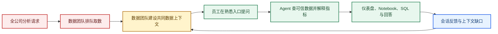
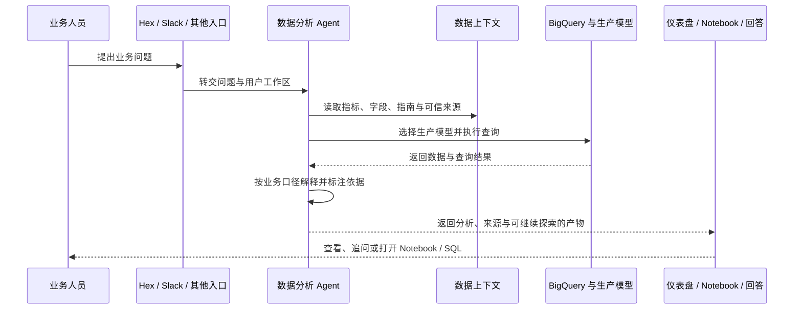
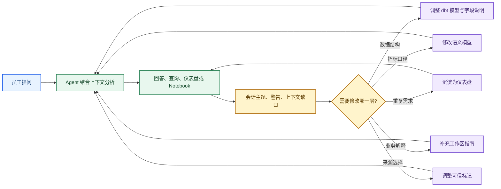
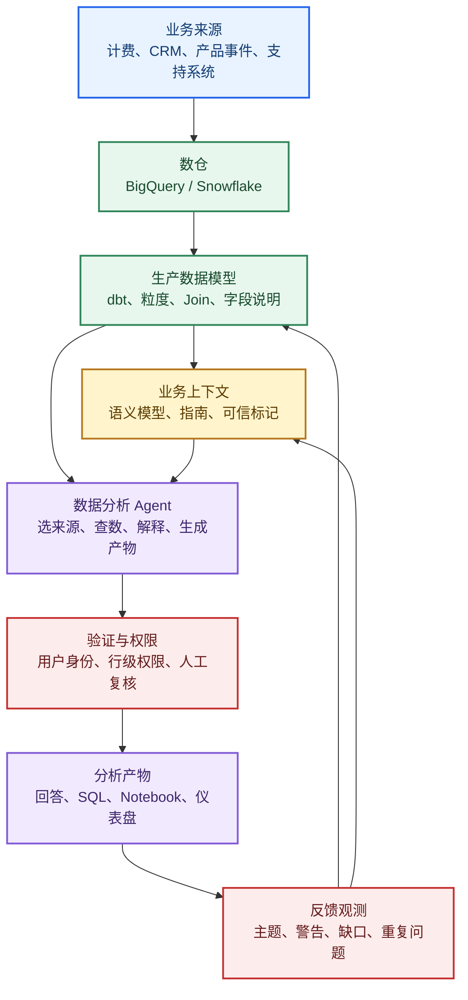

# 企业数据分析 Agent：先把数据基础建好，再让员工自助分析

> 来源：LangChain 数据团队的 [How we built LangChain’s agent-first data stack](https://www.langchain.com/blog/agent-data-stack)，发布于 2026 年 7 月 27 日。

这是供 LangChain 员工查询和分析内部业务数据的企业数据分析 Agent。员工可以从 Hex、Slack、CLI、MCP 和 LangSmith Fleet 等入口提问，Agent 根据数据模型、指标定义和业务指南查数、生成分析，用户还能在同一个工作区继续查看仪表盘、Notebook 和 SQL。

原文真正要解决的问题不是“模型能不能生成 SQL”，而是数据团队怎样把**数据的生成方式、指标的计算口径、业务上的解释规则和可信来源**交给 Agent。只给数据库访问权，Agent 可能生成语法正确、业务含义错误的答案。

这套做法可以先用一张图看懂：



下面先讲清原文的业务场景和实施过程，再区分作者自述、公开材料能够核验的事实，以及迁移到其他组织时需要补上的工程控制。

## 一、先看挑战：一个数据团队怎样承接全公司的分析需求

这一节解释原来的取数流程为什么会堵住数据团队，以及员工真正需要的交付物是什么。

### 1、需求很多但入口分散：同一个数据人反复做相似工作

原文描述的起点很直接：当时数据团队只有一人，几乎所有业务问题都要找数据人员处理。营销人员想看销售管道，产品人员想看使用趋势，销售和部署团队想了解客户健康，客户工程团队要检查流失、扩张和账户变化。

每次请求都要经过相近的步骤：理解问题和口径，找到正确模型，写或修改查询，核对结果，再把答案发回去。数据人员真正花时间的部分，往往不是敲 SQL，而是判断“这个数字应该怎样定义”。

### 2、旧 BI 能看固定报表：不适合继续追问和协作

预定义仪表盘能稳定展示固定指标，却难以覆盖不断变化的探索问题。员工还需要把查询、代码、说明和结果放在一起，继续追查一个数字从哪里来、换一个筛选条件后怎样变化。

团队希望员工可以自助提问，同时保留仪表盘、Notebook 和 SQL 工作流，避免再维护一套与既有数据平台分离的问答系统。原文因此把 Hex 选为共用工作区：技术人员可以在 Notebook 中构建分析，业务人员可以从对话入口得到有来源的答案。

### 3、交付不只是一个数字：还要让人知道依据和限制

对业务人员，交付物是可以理解、能继续追问的分析；对数据和工程人员，交付物还要能沿着数据模型、查询和代码追查计算过程。一般问题可以由 Agent 先处理，复杂或高风险分析仍由数据团队核验。

所以这不是把数据团队完全替换掉，而是把重复的第一轮分析交给 Agent，把数据人员的时间转向复杂分析、建模和跨团队口径协调。

## 二、再看系统：数据怎样从业务来源变成分析 Agent 可以引用的事实

这一节解释原文的基础数据流水线，以及为什么 Agent 需要同时接触生产数据和描述数据的材料。


*图 1：从业务数据采集到分析工作区的整体架构。来源：[LangChain 数据团队原文](https://www.langchain.com/blog/agent-data-stack)。*

原文的架构从左到右经过四段：计费系统、第三方来源、内部服务和事件数据先被采集到 BigQuery；dbt 再把原始数据转换成生产数据模型；Hex 在上层提供报告、Notebook 和对话式分析。GitHub 中保存 dbt 的 SQL 与转换逻辑，帮助人和 Agent 追查字段的来源。

这条链解决的是“数据从哪里来、怎样加工”，还没有解决“业务问题应该怎样解释”。后者由下一层上下文补足。

### 1、先把表和字段写成业务语言：dbt 文档约束数据含义

dbt 管理数据转换模型及其 SQL 逻辑，也承载表和列的说明。原文用账户状态说明文档的作用：只写“账户状态”不够，Agent 还需要知道每个值代表什么，以及默认应该怎样筛选。

例如，Active 表示仍有有效付费合同，Churned 表示曾经付费但合同已经结束，Prospect 表示尚未成为客户。客户报告默认只筛选 Active，除非问题明确要求包括流失或潜在客户。

这段说明同时给出取值含义、默认过滤和例外条件。Agent 才能判断一个查询是否符合业务语义，而不是只生成一条语法正确的 SQL。表级文档还应说明数据粒度、适合回答的问题和容易误用的字段。

### 2、再固定重复使用的指标：语义模型减少临时猜测

语义模型定义 ARR（年度经常性收入）、销售管道、活跃使用量和客户健康等指标的计算口径，也描述模型之间的关系。员工问“管道金额”或“活跃客户”时，Agent 可以引用已有定义，不必从表名和字段名重新猜测。

语义层解决不了底层重复、粒度混乱或描述错误的数据。原文的顺序是先把基础模型做清楚，再用语义模型把经常使用的指标固定下来。

### 3、补上字段说明放不下的规则：工作区指南承载业务语境

复杂业务规则无法全部塞进表和列的描述，就写进 Hex workspace guides（工作区指南）。原文举到的内容包括：

- 每周 GTM 报告怎样定义销售管道；
- 不同部署方式如何比较使用量；
- 客户健康分析需要哪些筛选条件；
- 什么情况应该请数据团队复核。

团队在 GitHub 中维护这些指南，再同步到 Hex。这样规则有审阅入口和变更记录，不会只存在某个数据人的记忆里。

### 4、给可信来源加信号：Endorsements 帮 Agent 选对资产

Endorsements（可信标记）表示某个仪表盘、查询或数据资产经过数据团队认可。它解决的是“多个名字相近的来源都能查到数字时，应该优先引用哪一个”。

例如，员工询问 ARR 时，经过标记的 ARR 仪表盘及其计算逻辑，比名称相似的旧查询更适合作为参考。只有数据团队能作此标记，被标记资产发布修改前还要经过审阅；如果所有资产都被标记，信号就失去区分能力。

这几类材料各自回答不同问题：

| 材料 | 解决的问题 | 典型内容 |
| --- | --- | --- |
| 数据模型与 dbt 文档 | 数据怎样生成、字段代表什么 | 粒度、Join、字段取值、转换逻辑 |
| 语义模型 | 指标按什么口径计算 | ARR、管道、活跃使用量、客户健康 |
| 工作区指南 | 这类问题应该怎样解释 | 报告规则、筛选条件、复核边界 |
| 可信标记 | 哪个来源值得优先引用 | 已审阅的仪表盘、查询和计算逻辑 |

## 三、看一次提问：Agent 怎样把数据、口径和业务规则组合起来

这一节把“上下文已经准备好”落到一次分析请求，说明用户看到的回答怎样与底层数据材料连接。



用户问的是业务问题，Agent 需要处理的是一组相互关联的判断：应该用哪个指标，筛选哪些客户，选择哪个可信资产，结果能否支持当前结论。数据上下文的作用，是把这些判断从模型的临场猜测变成可维护的组织材料。

## 四、反馈怎样回到数据系统：错误回答不只是一次对话失败

这一节解释 LangChain 团队怎样从真实会话发现上下文缺口，并决定改仪表盘、语义模型、dbt 文档还是工作区指南。

团队使用 Hex Context Studio 查看会话主题、警告和上下文缺口。常见问题与修复方向大致如下：

| 观察到的问题 | 可能的修复 |
| --- | --- |
| 员工反复问同一问题 | 增加或改进仪表盘 |
| Agent 反复误解某个指标 | 修改语义模型定义 |
| Agent 总选错数据来源 | 调整可信标记或 dbt 文档 |
| 回答缺少业务背景 | 补充工作区指南 |

数据团队决定修改哪一层，并审阅变更。重复问题还可能沉淀为固定仪表盘，减少相同请求反复进入开放式分析。


*图 2：上下文如何进入 Agent，以及使用反馈如何返回数据系统。来源：[LangChain 数据团队原文](https://www.langchain.com/blog/agent-data-stack)。*

可以把这条反馈链简化为：



原文的重点是：数据团队维护的不是一份静态知识库，而是一套会被真实提问持续检验的数据上下文。Agent 的错误和用户的重复问题，都是下一轮数据建模和资料维护的输入。

## 五、结果与边界：请求量增长说明采用情况，不等于答案质量

这一节整理原文报告的采用情况，并说明哪些数字可以作为案例结果，哪些仍缺少独立验证。

### 1、原文报告了较高采用量：数据团队从逐条回答转向维护系统

原文称，旧 BI 工具在六周内完全迁走；全公司员工都以某种方式使用这套数据工作区，其中约 70% 只有只读访问，约 30% 有 Agent 访问。

在过去 30 天里，已开通 Agent 的员工中接近全部使用过它。这个群体约占全公司三分之一，共发生约 2,200 次 Agent 会话，平均每位已开通用户每月约 23 次。文章还称，Agent 处理的请求量约为三人数据团队直接处理能力的 40 倍。

这些数字说明使用入口已经进入日常工作，也解释了数据团队为什么把精力转向复杂分析、数据建模和跨团队口径协调。只读访问和 Agent 访问由 IT 提供自助申请，员工有需要时可以请求开通。

### 2、原文也承认质量评估仍在建设：上下文变更需要回归

团队把“评估上下文改动是否真的改善回答”列为后续计划。目前主要观察使用趋势、警告和定性反馈，Agent 的回答仍需人判断，影响重要决策的问题应让数据团队参与核验。

原文建议先覆盖最常被问到的问题及其数据模型，争取把约 80% 的常见需求支持好，再逐步补长尾。这里的 80% 是建设优先级建议，不是已经测得的准确率。

### 3、本站核验边界：40 倍不是正确率，采用量也不是业务收益

“40 倍”比较的是 Agent 请求量和三人数据团队可承接的请求量，不是上线前后请求量增长，也不是正确答案数量增长。公开材料没有提供原始计数、答案正确率、节省工时或重要分析带来的经营结果。

文章说明了架构选择和团队自报使用情况，但不能证明每次问答都遵守同一套数据权限，也不能仅凭文章复现 40 倍统计。本文没有取得生产 SQL、查询计划、授权配置或用户任务结果，因此不把“更多人使用”写成“更多问题被正确解决”。

这里的产品是 LangChain 员工使用的内部数据工作区，案例采用 Hex 的分析能力；原文没有说明这是一个独立售卖的数据 Agent。文章也没有逐个追踪重要分析是否改变了经营结果。

## 六、最后归纳落地方法：把数据 Agent 做成“上下文维护系统”

这一节把案例压缩成一套从数据架构到 Agent 实现的做法，说明哪些工作交给模型，哪些工作必须由数据团队和程序持续控制。

### 1、先搭五层架构：来源、模型、上下文、Agent、反馈

迁移到自己的组织时，可以先画出下面这条链：



数据流水线负责把事实做出来，数据上下文负责说明事实怎样解释，Agent 负责把用户问题映射到这些材料并生成分析，验证层负责权限和高风险复核，反馈再推动模型与上下文更新。

### 2、先维护共同口径，再开放 Agent 查询

最小可行实现可以按这个顺序推进：

1. 选择少量高频、结果容易核对的业务问题。
2. 为涉及的生产模型补齐粒度、字段含义、默认筛选和常见误用。
3. 为 ARR、管道、活跃客户等高频指标建立统一语义定义。
4. 把业务解释、筛选规则和复核边界写成可审阅的工作区指南。
5. 给少量经过验证的仪表盘和查询加可信标记。
6. 再让 Agent 读取这些上下文、查询生产模型，并输出带来源的分析。

如果不同团队对“活跃客户”有不同定义，应先把口径冲突显式化，不能让模型临时挑一个解释。

### 3、Agent 输出要能回查：回答、查询和来源一起交付

一个可用的分析回答至少应让用户知道：用了哪个指标定义，选择了哪些数据源，使用了什么筛选条件，查询覆盖了什么时间范围，以及哪些结论仍需要人工核验。

对技术人员，最好同时提供 SQL、Notebook 或可打开的仪表盘；对业务人员，先给结论和解释，再给数据来源与继续探索的入口。这样用户可以从“答案”继续走到“依据”，数据团队也能定位错误发生在模型、指标、指南还是 Agent 的选择。

### 4、把真实问题变成上下文回归：每次修改都要知道改善了什么

反馈处理不应停在“有人点了差评”。应把典型问题记录成回归样本：原始问题、期望指标、允许的数据源、查询结果、解释要求和人工判断。修改 dbt 文档、语义模型、指南或可信标记后，重新跑这些样本，确认回答变好且没有引入新的口径错误。

涉及敏感客户数据时，还要单独控制调用者身份、数据行级权限和导出范围。原文没有披露足以复用的授权实现，不能把“Agent 能查数”直接理解成“所有员工都能访问所有数据”。

### 5、最终的工程判断：Agent-first 首先改变的是数据工作的入口和维护方式

这个案例的价值不在于把一个聊天窗口接到数仓，而在于把数据团队的工作拆成两类：Agent 处理高频、可核验的第一轮分析；数据团队维护生产模型、共同指标、业务指南、可信来源和回归样本。

按本站的架构判断，它是**数据流水线支撑分析 Agent 的混合应用**。数据采集、dbt 转换和生产模型按配置运行；用户提问后的分析交给 Agent；权限、高风险问题和上下文变更仍需要程序或数据团队控制。公开文章没有充分披露 Hex 分析 Agent 内部如何重试 SQL、追加工具调用或决定何时交人，因此不能据此复现其内部 Agent 引擎，也不能反推出必然使用某个编排框架。

最终应形成一条可回查的链：

```text
用户问题 → 指标与来源选择 → 查询与解释 → 权限和人工核验 → 分析产物 → 反馈样本 → 数据上下文更新
```

当这条链稳定后，Agent 才有可能从“会查数”变成组织里可靠的分析入口。

> 相关材料：[LangChain 数据团队原文](https://www.langchain.com/blog/agent-data-stack)；[广告投放运营 Agent](../sales-marketing/langchain-paid-media-metric-to-write.md)。原文复核日期：2026 年 9 月 26 日。

