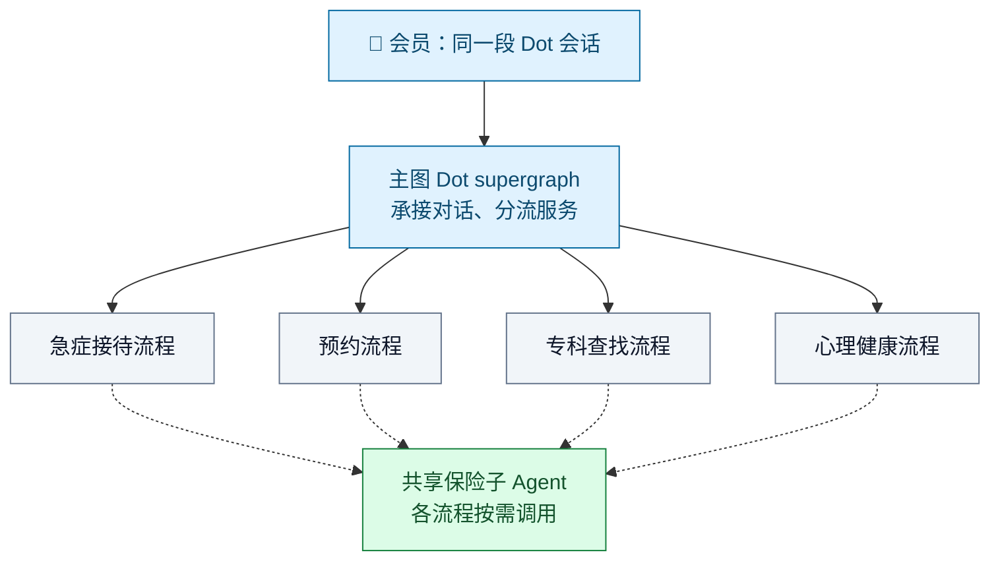
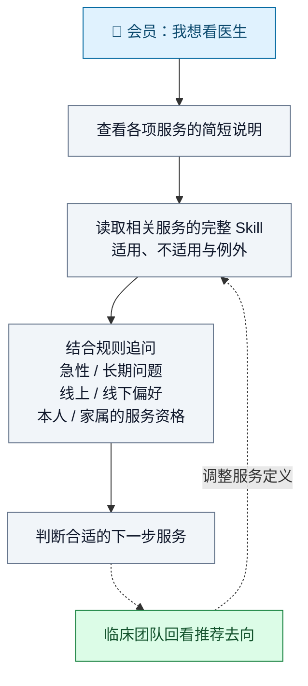
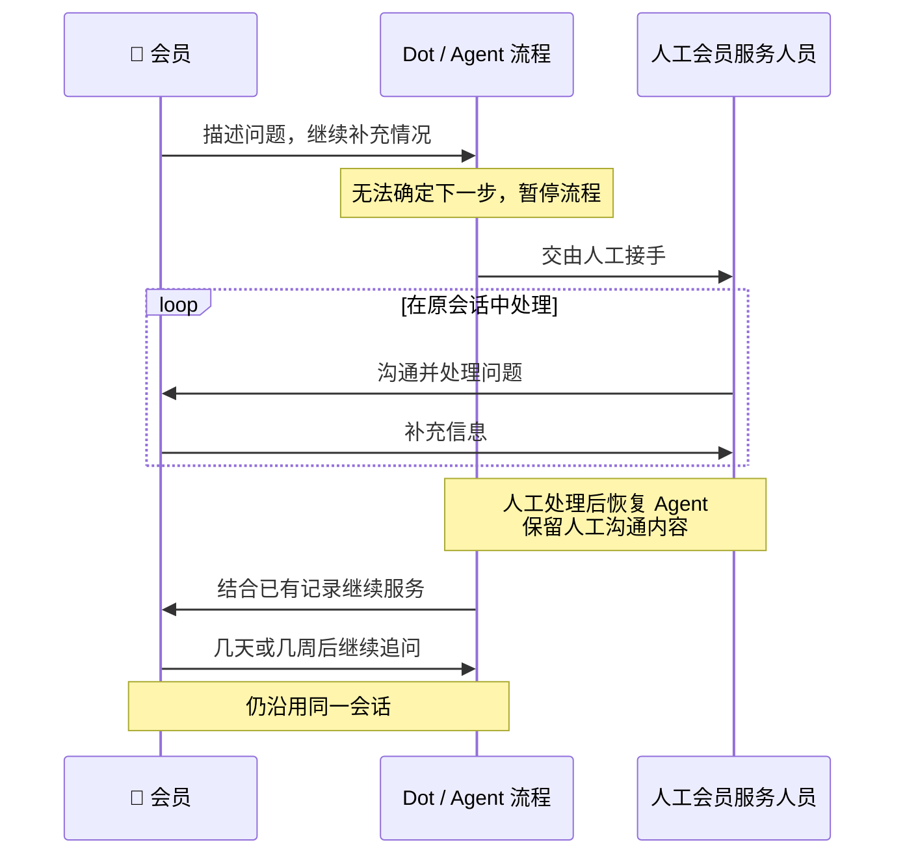
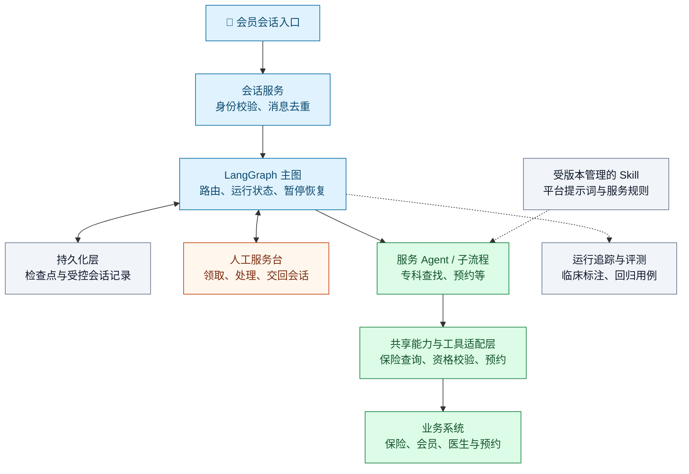

# 就医导航 Agent：从保险与就医咨询到预约和人工接续

> 来源：[Included Health 客户案例](https://www.langchain.com/blog/how-included-health-built-federated-agents-for-healthcare-navigation-with-deep-agents-and-langgraph)，发布于 2026 年 9 月 17 日。

Dot 是 Included Health 面向雇主及健康计划会员的医疗服务导航 Agent。会员可以询问保险覆盖、费用与账单，寻找医生或预约服务，必要时由人工服务人员接手。**原文关心的不是单轮问答，而是一个人在同一段对话里不断改变问题时，系统怎样保留健康背景、安排正确服务并识别紧急情况。**

这个案例有两层改进：用 Agent 根据会员的具体情况追问和选择服务，再解决多个 Agent 切换时的语气、记录和能力衔接问题。前四节按原文讲解问题、做法与结果，并用三张示意图解释关系；第五节给出本站建议的工程实现路径与架构图，明确区分案例披露和落地建议。

## 一、原来的服务导航卡在哪里，Agent 怎样接上

会员的需求会在对话中变化，多个服务之间的切换又容易打断体验。本节从固定问答路径和团队原有 Agent 的衔接困难讲起，再把这些问题与 Dot 的解决做法逐项对应，说明为什么需要后面的设计。

### 1、固定问答路径难以跟上会员需求的变化

Included Health 帮助雇主和健康计划的会员找到合适的医疗服务，包括线上初级保健、急症门诊、心理健康、专科查找和预约。初级保健指日常、持续性的基础医疗服务。**产品的业务任务是帮助这个人找到合适的下一步。** 难点在于，会员开口问的问题未必已经表达了完整的就医需求。

原文从医疗服务常见的结构化导航树讲起：系统预先安排问题和分支，会员依次回答，软件再把人引向某项服务。这让流程容易被程序处理，却要求复杂的个人情况适应预设路径。对话中刚出现的新信息，可能已经要求改变提问顺序或服务方向。

原文用“动脉斑块扫描是否在保险范围内”说明这个问题：

- **最初提出的请求是查费用。** 系统需要回答检查是否被保险覆盖。
- **追问后可能出现新的健康背景。** 会员胆固醇偏高，家里还有心脏病史。
- **需要提供的帮助随之扩大。** 除了回答费用，还可能需要建议会员与初级保健医生讨论。只完成保险查询，会遗漏这部分需求。

原文另举了“我胸痛”的开场：系统需要在第一轮识别潜在急症，不能等会员走完一串固定问题才处理。两个例子共同说明，下一步问什么、转向哪项服务，需要随着当前信息调整。

### 2、多个 Agent 分工后，跨服务切换仍会产生割裂

不同 Agent 分别处理服务后，会员的问题仍会跨越团队边界。原文举例说，一个人正在找专科医生，也可能中途问“这要花多少钱”。保险查询必须在这个时刻可用，处理完费用问题后还要能继续找医生。

团队报告了迁移到 Deep Agents 之前的两项具体困难：切换到另一个 Agent 时，回答口吻可能突然变得简短、生硬；为了让各服务都能回答保险问题，需要把保险能力逐一接入各子流程的路由逻辑。

跨服务还需要接续已经交代的信息。若 Agent 无法确定下一步，人工服务人员要能进入当前会话处理，之后 Agent 继续使用这段人工沟通记录。这也是后面交接和暂停恢复设计要满足的要求。

### 3、Agent 按上下文判断，平台承接服务切换与人工协作

Dot 用大语言模型理解健康背景和含糊需求，根据新信息继续追问；服务规则帮助它判断哪种服务更合适，流程与共享能力负责把判断接到实际服务上。原文中的问题与做法可以对应起来看：

| 遇到的问题 | Dot 采用的做法 | 具体改变了什么 |
| --- | --- | --- |
| 费用问题背后可能还有就医需求 | 结合健康背景和追问结果判断下一步 | 回答保险问题时，也能识别需要进一步就医沟通的情形 |
| “想看医生”对应多种服务，资格与偏好又不同 | 按需读取服务规则，询问急缓、线上线下偏好和家属资格 | 根据当前会员的情况选择服务 |
| 找医生中途出现保险问题 | 各服务调用共享保险子 Agent | 费用查询成为跨流程可用的能力，减少逐个子流程接线 |
| 切换 Agent 时口吻变化，已有信息需要交接 | 统一平台提示词，传递摘要与完整记录位置 | 接手者沿用服务语气并了解前情 |
| Agent 无法确定下一步，会员以后还可能回来追问 | 暂停流程、人工多轮处理，再带着记录恢复 | 人工与 Agent 在同一段长期会话里接续服务 |

临床团队还会回看推荐去向，用反馈调整服务规则。下面先展开各团队的服务如何组合，再解释规则读取、人工接管和上线后的评审。

## 二、主图、团队流程与共享保险能力怎样合作

Dot 把各团队负责的服务接到一个对话入口，并让它们复用保险查询能力。本节围绕“谁负责服务、交接时带走什么、共用能力放在哪里”展开，解释会员跨服务咨询时，后台怎样分工与接续。

### 1、主图分流，业务团队各管一段服务

Included Health 用一个主 LangGraph 图承接对话并分流，称为 Dot supergraph。急症接待、预约、找专科医生、心理健康等子流程由不同产品团队负责。LangGraph 在这里组织流程和长期状态，不要求所有团队把业务规则写进同一个 Agent。

**图 1：主图把请求交给相应服务，保险能力供多个流程复用。** 实线表示服务分流，虚线表示按需调用共享能力；图中的四类服务不是先后执行的四个步骤。

### 2、交接带走摘要和完整记录位置

跨流程时，服务语气和已经交代的信息都要接续。团队使用 Deep Agents——提供子 Agent、文件系统与 Skill 等能力的 Agent 框架——统一这些平台能力。原来切换 Agent 时，回答可能忽然变得生硬；全局平台提示词用于保持一致的服务语气。

上下文交接则有两份材料：**对话摘要**帮助接手者快速了解前情，**完整会话记录的文件路径**让它在需要时回看细节。离开的流程生成摘要并传递记录位置，接手的流程据此继续，会员不必重新讲述健康背景和已经讨论过的问题。

### 3、保险问题由共享能力处理

保险覆盖的问题也可能在找专科医生的中途出现。原来每个子流程都要各自接入保险能力；现在团队把它做成共享的平台子 Agent，让各服务流程都能回答费用问题。共享的是保险查询能力，各团队仍维护自己的服务流程。

图 1 中的保险子 Agent 因而放在多个服务流程之外：找医生的团队继续维护专科查找流程，中途遇到费用问题时调用共享能力，不必在每个可能涉及费用的节点都单独接一套保险路由。

## 三、Skill 和人工接管怎样处理不确定的去向

服务已经接通，还需要判断当前会员适合去哪一项服务。本节说明两种处理方式：Agent 读取服务规则并补问关键信息；仍无法确定下一步时，由人工接手，处理后再恢复 Agent。

### 1、Skill 给出服务适用条件

Dot 用 Skill 记录服务是什么、什么时候适合、什么时候不适合以及例外。这里的 Skill 是存放在虚拟文件系统中的服务说明与操作规则，供 Agent 按当前问题读取。

Agent 起初只看到各项服务的简短说明，判断哪些与当前请求相关后，再读取完整规则。原文称这种按需展开信息的方式为“渐进披露”。

**图 2：先了解可选服务，再读取相关规则，补齐决定去向所需的信息。** 虚线表示事后的临床回看和规则改进，不是每轮回复都要等待的审批步骤。

“想看医生”本身还不足以选定服务。简短说明帮助 Agent 找到相关选项，完整 Skill 则提供继续询问的依据：即使都希望线上就诊，急性问题与长期健康管理也可能对应不同服务；替家属咨询时，还需要考虑家属的资格。

临床团队会回看最终去向，把是否认可推荐的意见用于调整 Skill 定义。雇主计划常含 20–30 项第三方福利，把这些也整理成 Skill，是原文提到的在建方向。

### 2、人工接手后仍留在原会话

当 Agent 无法确定下一步，LangGraph 暂停原流程，把对话交给人工会员服务人员。人工可以多轮处理，之后 Agent 带着人工沟通内容恢复。

**图 3：人工接管改变当前的处理者，同一段会话继续保留。** 图中展示原文描述的交互顺序，不指定内部采用的消息接口或存储实现。

恢复后的 Agent 需要知道人工已经问过什么、处理过什么；会员几天或几周后回来，也能接着原来的记录继续问。人工处理期间另开并行 Agent 做背景研究，属于团队设想的下一步，原文没有说已经上线。

## 四、上线后怎样由临床人员检查去向

推荐出一个去向后，团队还要检查推荐是否合适、紧急情况是否被正确识别。本节介绍临床标注、迁移前的模拟评测，以及上线后报告的三类指标，说明团队怎样观察和改进运行质量。

### 1、标注去向与紧急情况

LangSmith 是记录、评测和人工标注 Agent 运行过程的平台。团队称每段会话都会进入它的标注队列，临床人员检查推荐的就医去向、紧急情况保护措施是否正确触发，以及不应触发时是否避免误报。标注导出到自有数仓形成运营指标，也为图 2 中的服务定义调整提供依据。

迁移到 Deep Agents 涉及四个产品团队。团队先用多轮模拟用户评测检查变更，把大部分表现有所改善的结果分享给其他团队，再推进迁移；据其报告，迁移在不到两周内完成，没有出现明显退步。

### 2、区分团队报告的三类结果

案例称 Dot 于 2026 年 8 月向客户推出，早期结果分为三类：

| 观察的问题                 | 团队报告的结果                | 原文给出的观察范围   |
| -------------------------- | ----------------------------- | -------------------- |
| 会员是否更愿意使用聊天服务 | 聊天参与度提升 75%            | 会员参与情况         |
| 推荐的就医去向是否合适     | 临床人员同意率超过 95% 的目标 | 经临床人员评分的会话 |
| 高风险情况能否被识别       | 识别了超过 99% 的高风险情形   | 定期临床审计         |

这三项分别观察使用情况、推荐去向和风险识别。临床人员留下的标签还会进入数仓，用于持续观察运行质量。

## 五、工程落地总结：从模块分工到一条可验收的服务链路

实现这类系统，需要把前面的业务做法落到模块、状态、工具和人工操作上。本节沿着“找专科医生，中途问费用，必要时转人工，再继续服务”这条链路，说明架构怎样拆、接口怎样接、最终怎样验收。**以下属于本站的工程建议；Dot 的生产源码和完整接口未公开，不能把这些字段与模块当成其内部实现。**

### 1、用主图组织会话，把服务判断与业务执行分开

按[控制权的判断口径](../index.md#四架构方式与执行控制)，可以采用业务流程与 Agent 协作的混合架构。若沿用案例的技术组合，LangGraph 主图负责当前服务、暂停恢复和服务间路由；各业务团队在服务 Agent 或子流程中维护自己的问答与办理逻辑；Deep Agents 承接平台提示词、Skill 和子 Agent 等共用能力。

**图 4：本站建议的工程模块与连接关系。** 实线表示调用或状态读写，虚线表示配置支持或运行观测。持久化层在图中合并展示，检查点与完整会话记录可使用不同存储；图中的身份校验、去重、人工服务台等，是落地时需要补齐的应用层职责。

会话服务先验证访问者能否操作当前会员的会话，再把消息送给主图。主图将问题交给专科查找或预约服务；服务中的 Agent 决定还缺什么信息、需要查询什么，工具适配层负责调用会员、保险、医生和预约系统，并返回可检查的业务结果。

保险能力应由一处维护，但不必一开始就做成独立 Agent：如果只是带参数查询，先提供共享工具；如果需要多轮补问、组合不同查询并解释结果，再封装成保险子 Agent。是否拆分应取决于任务和维护边界，而不是为了增加 Agent 数量。

### 2、先约定共享状态，再实现摘要与记录交接

同一会话需要稳定的标识和可恢复的执行状态。[LangGraph 的持久化文档](https://docs.langchain.com/oss/python/langgraph/persistence)区分了保存线程状态的检查点和保存跨线程数据的 Store。这里的 checkpointer（检查点保存器）负责保存图状态；采用自托管运行时，应接入可持久保存的实现，并在后续调用中使用同一个 `thread_id`。线程标识只用于定位状态，会话所属会员和访问权限仍需由应用校验。

下面是建议约定的共享状态内容，不是 Dot 已公开的数据结构。各服务还可以维护自己的局部状态。检查点的实现可接着读本站的[状态持久化与恢复拆解](../../../engineering/langchain-series/langgraph/06-checkpoints-store-and-recovery.md)。

| 状态内容 | 建议记录什么 | 要解决的问题 |
| --- | --- | --- |
| 会话与主体 | 会话标识、会员标识、实际就诊人、身份关系 | 替家属咨询时，避免把本人的资格用于家属 |
| 当前执行位置 | 当前服务、待解决问题、下一步、当前处理者、状态版本 | 费用查询或人工处理结束后，知道回到哪里继续 |
| 已知信息与依据 | 用户原话或记录引用、业务系统查询结果、取得时间 | 区分用户自述与已核实事实，识别可能过期的信息 |
| 待办动作与结果 | 查询或预约请求标识、办理状态、业务回执 | 重试、超时或恢复后，不把未完成当成已完成 |
| 交接材料 | 摘要、记录引用、未决问题、规则版本 | 接手者知道发生了什么、还缺什么，以及依据哪版规则处理 |

服务切换时，摘要应覆盖请求、已确认信息、未决问题和已执行动作；细节通过受控的记录引用读取。接手服务读取前应校验权限。仅传递一个文件路径，并不会自动保证接手者能访问、只能访问被授权内容，或在进程重启后仍能读取。

### 3、Skill 负责说明怎么判断，工具负责查询与办理

将每项服务写成可独立维护的规则文件，说明服务范围、适用条件、排除条件、需要追问的信息、可用工具以及何时交给人工。[Deep Agents 的 Skill 文档](https://docs.langchain.com/oss/python/deepagents/skills)说明了按需读取方式：启动时提供名称和简介，选中后再加载完整的 `SKILL.md`。工程上还应记录规则版本和审核人，让评审能回查某次推荐使用了什么规则。

例如，专科查找 Skill 可以提醒 Agent 询问就诊偏好和实际就诊人；具体资格仍由会员或福利系统查询。不要只凭提示词判断“有资格”就直接创建预约：工具入口应重新校验身份、服务资格和必要参数，失败时返回明确原因。

保险查询接口应返回查询对象、服务项目、覆盖结果、数据来源与时间；未知和查询失败要与“不覆盖”分开。预约接口应返回业务系统的预约标识和状态；超时只能记为结果待确认，再通过请求标识查回执，不能向会员声称已经预约成功。

对创建预约等写操作，应使用稳定的业务请求标识防重，并检查后端是否真正支持重复请求返回同一结果。需要补做去重或结果核对时，应放在工具适配层，而不是依赖模型记得“这次不要再调用”。

### 4、把人工接管做成会话状态转换，并设计恢复后的第一步

人工接管需要应用层管理待领取、人工处理中、待恢复和 Agent 处理中等状态。交接时记录待解决的问题、当前记录版本和已完成动作；人工服务台负责领取与多轮沟通；交回时附上处理结果、待办项和最新记录位置。多人领取或重复交回时，通过状态版本检查拒绝过期操作，避免人工与 Agent 同时推进同一件事。

若使用 LangGraph，`interrupt()` 是在节点内暂停执行并等待外部输入的函数，`Command(resume=...)` 是提交恢复数据的调用方式。应在同一线程上恢复，并让节点把人工结果写入约定的共享状态。它们提供暂停恢复能力；人工队列、聊天界面、处理权限和消息归档仍由应用实现。

[官方中断文档](https://docs.langchain.com/oss/python/langgraph/interrupts)指出，恢复时会从中断所在节点的开头重新执行，中断前的代码可能再次运行。因此，应把创建人工工单、发送通知、创建预约等副作用与等待节点分开，并用稳定的请求标识防重；拆分节点本身不保证外部操作只执行一次。节点重入与恢复过程可接着读本站的[中断与恢复源码拆解](../../../engineering/langchain-series/langgraph/07-interrupts-and-command.md)。

恢复后的第一步应检查人工已经完成了什么，以及原有信息是否仍然有效。若人工已经预约，Agent 应读取预约回执继续服务；若会员几周后回来，应按业务规则重新确认保险资格和可约时间，不能只复用旧查询结果。

### 5、先打通一条完整链路，再用异常场景验收

最小版本可以先只接专科查找、保险查询和人工接管。先完成共享状态与工具契约，再接真实系统或受控测试接口，加入 Skill 与路由后验证人工处理与恢复；这条链路通过后，再逐项加入预约、心理健康等其他服务。

验收要覆盖模型回答、图状态和业务系统结果，尤其检查以下场景：

| 验收场景 | 必须观察到的行为 |
| --- | --- |
| 找医生中途询问费用 | 查询针对正确的会员与服务；返回后仍保留原来的找医生任务 |
| 咨询对象从本人变成家属 | 更新实际就诊人，重新查询相应资格，不沿用本人的结果 |
| 费用查询超时或没有数据 | 明确返回未知或待确认，不编造费用或覆盖结论 |
| 人工完成部分任务后交回 | Agent 读到人工记录与回执，继续未完成部分 |
| 重复消息、进程重启或重复恢复 | 能恢复当前任务，且不重复建单、预约或发送同一业务通知 |
| 首轮出现紧急信息 | 按临床团队定义的升级规则处理，不继续普通问答路径 |

每次运行应关联会话、规则版本、模型版本、工具调用和业务请求标识，供临床评审与故障排查回查。记录进入追踪平台前需按权限和数据处理要求裁剪；评审发现的问题再转为可重复执行的回归用例，改 Skill、提示词或路由后重新检查。

原文的参与度、推荐同意率和高风险识别率是客户报告的运营结果，不能直接作为复制系统的验收门槛。工程验收还要单独检查恢复、权限、重复执行和结果真实性；临床指标则由相关团队定义分组、样本和升级责任。

资料：[Included Health 客户案例](https://www.langchain.com/blog/how-included-health-built-federated-agents-for-healthcare-navigation-with-deep-agents-and-langgraph)。原文复核日期：2026-10-07。
