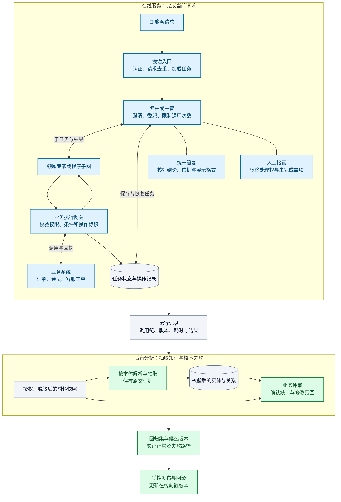
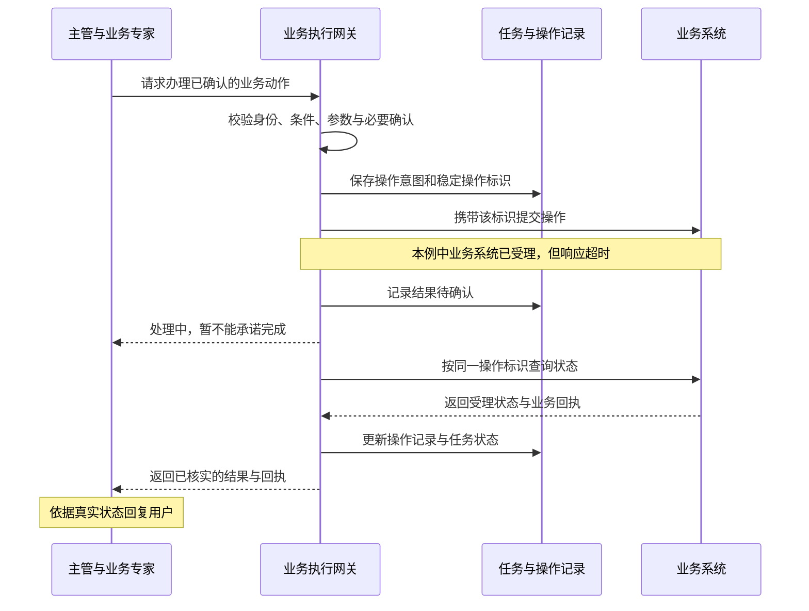

# 客户体验 Agent 怎样在生产中改进：Lyft、Vodafone 与 LATAM 的实践

这些是面向出行和电信业务的客户服务 Agent：帮助乘客、司机和电信用户查询信息、处理争议、办理服务，也帮助人工坐席诊断问题。它们背后还有两类系统：让业务人员配置 Agent 的建设平台，以及把客户对话整理成业务知识的分析管线。

LangChain 的这篇专题把几类工作放在一起，讨论同一个问题：**当 Agent 已经上线，团队怎样根据真实服务过程，决定该改提示词、改调用流程，还是补一项产品能力。** Lyft 发现自己的测试用户过于配合；Vodafone 把业务人员编写的排障文档变成运行时可查询的程序；LATAM 则从被拒绝的消息中发现了漏掉的旅客需求。

> 原文：[Customer Experience (CX) Agents in Production: Lessons from Lyft, Vodafone, and LATAM Airlines](https://www.langchain.com/blog/customer-experience-cx-agents-in-production-lessons-from-lyft-vodafone-and-latam-airlines)，Jess Ou，2026 年 8 月 4 日。下文先完整讲解案例及其结果，再单独给出工程总结与实现建议。案例数字均为原文报告；原图保留来源，本站架构图另行标明。

## 一、先分清任务，才能理解这些系统的架构

同样叫客户体验 Agent，交付物可能是一笔办结的业务、一份给坐席的诊断建议，也可能是一组供产品团队分析的数据。原文的五套主要系统，需要放回各自的任务中理解。

| 系统 | 谁在使用 | 一次工作要交付什么 |
| --- | --- | --- |
| Lyft AI Assist | 乘客、司机 | 处理账户、费用、收入与理赔问题；必要时转人工 |
| Vodafone Super TOBi | App 或语音渠道中的电信客户 | 回答问题，并衔接开通、停用等业务办理 |
| Vodafone Super Agent | 呼叫中心坐席 | 根据客户资料给出诊断、政策依据与下一步动作 |
| LATAM Concierge | LATAM App 中的旅客 | 协助查航班、规划旅行、选择旅行服务和处理客服诉求 |
| LATAM Compass | 用户研究、产品及其他内部团队 | 从会话、访谈、通话和文档中提取概念与关系，形成可查询的知识 |

前台服务的价值可以从等待时间、人工转接、问题解决与用户回访观察；坐席助手要看它是否帮助人作出正确判断；后台分析则要看提取出的信息是否可靠、能否支持后续工作。把它们都归结为“回答准确率”，会丢掉真正要验收的结果。

原文还用两个补充案例交代业务背景。Podium 的 AI Employee 面向汽车经销商、暖通承包商等本地企业响应潜客，案例报告五分钟内回复相比一小时内回复，线索转化率高出 46%。Cisco 的内部助手则帮助网络工程师从大量候选发现中挑出少数值得调查的问题，即使用户只说“帮帮我”，也要找到可开始处理的方向。两者分别强调响应速度和人的决策效率。

这些团队共同使用的一组技术，需要分清职责。LangGraph 用有状态的图组织执行过程；LangChain 提供模型、工具等开发组件；LangSmith 记录调用轨迹并支持评测。工具相近，各家公司安排控制权、业务程序和知识处理的方式却不同。

## 二、Lyft：建设速度提高后，怎样让测试接近真实客服

### 1、业务人员配置常规服务，工程师处理复杂理赔

Lyft 把 Agent 建设分成了两层。账户、收入等常规问题由业务专家配置；涉及图像处理、欺诈判断等复杂环节的车辆损坏理赔，仍交给机器学习工程师开发专门 Agent。

原文报告，Lyft 每月约有 7,900 万次行程，AI Assist 每月处理约 27 万次交互，运行着至少七个生产 Agent。分流率达到 65%，AI 解决率为 35%。Lyft 对“解决”的要求较高：车辆损坏理赔可能要收集信息和照片、通过工具取得业务数据、结合欺诈信号作决定，再把结果解释给司机，整个过程在约十五分钟内完成。用户没有进入人工队列，只能说明分流结果，不能单独证明这些工作已经办完。

在执行结构上，主路由 Agent 根据请求选择处理者，乘客和司机各有服务路径。每个子 Agent 都是一张完整的 LangGraph 状态图，作为子图接入主图。一般司机问题在交流中变成车辆损坏理赔时，当前处理者可以交回控制权，由主路由重新分派。

常规 Agent 在运行时读取 JSON 配置和提示词。提示词保存在 LangSmith Prompt Hub，即团队集中管理提示词的地方。业务人员可以维护平台已有工具能够支撑的任务，工程人员继续负责复杂能力和共用运行机制。原文报告，首个司机 Agent 用了约六个月，而新配置型 Agent 约两周即可建成；两者对应不同建设阶段和任务复杂度。配置细节可结合本站的 [Lyft 平台专篇](./lyft-support-agent-platform.md)阅读。

平台开放后，新的困难是把业务经验写完整。政策、例外、澄清问题和退出条件，往往散在不同人的经验里。Lyft 因此引入结构化的提示词编写方法，并用自动检查查找矛盾指令和不完整的对话路径。

### 2、一场多轮测试，同时固定业务事实和用户行为

Lyft 的离线测试让一个模型扮演用户，与待测客服 Agent 进行多轮对话。场景必须同时定义任务、用户画像和业务环境；测试产生的整条轨迹，再交给代码断言和模型评审检查。

原文的取消费争议示例能说明这套测试具体测什么。模拟司机抱怨乘客取消订单，自己却没有收到取消费。环境设定中，乘客在 120 秒规则窗口内的第 97 秒取消，因此按普通规则不应收取取消费；但司机服务年限为 6.2 年，属于高忠诚用户，近 90 天没有获得过补偿，测试预期允许给予善意补偿。

模拟用户带着不满开场，强调自己服务多年，以及这件事是否公平。验收结果则是明确的：**给予 10 美元补偿、不转人工、最多六轮解决。** 这些都是图中的场景设定，不是面向所有司机的公开赔付政策。

*图 1：任务、环境和用户画像共同构成测试输入，代码与模型共同评审轨迹。来源：专题原文的“How Lyft builds evals”。*

这道题同时考查政策理解和服务过程。Agent 要区分“取消费本来就该支付”与“符合另一个补偿条件”，也要在用户带有情绪、信息不完整时取得足够背景。金额、是否转人工、轮数可以明确核对；解释是否有事实错误、是否在无效劝说，则需要检查对话。离线场景达到要求后，Agent 才进入生产。

### 3、把评分规则、评审模型和模拟用户分别校准

早期 Lyft 使用“回答是否有帮助”“对话是否自然”“工具是否适当”“对话是否完整”等通用指标。原文配图里，完整性约为 0.77，工具使用适当性约为 0.42。这样的差异能提示问题，却很难直接指导修改：一次低分究竟来自错用工具、过早转人工，还是反复解释同一件事？

团队与运营、质量人员一起改写规则，把评价落到可观察的服务行为上，并更多采用通过／不通过的判断。

- **解释与引导**：能够帮助用户时给出有效说明；确认无法解决时转人工。重复无效说明、没有合理尝试就转出、解释中包含事实错误，都可以直接判失败。
- **用户请求人工**：按这个案例的业务规则，首次请求时尝试挽留一次，再次请求时转出。首次就转出、第二次仍不转、遗漏必要说明，以及明确无力帮助后还继续超过三个对话轮次，都是失败情形。

规则写清后，还要验证模型是否按业务人员的标准执行评审。原文的校准图从人工标注的参考样本出发，经过训练／验证集划分、模型评分、与人工判断对齐，再迭代评审提示词。这里调整的是评审器；图中的数据划分不能据此解释为客服模型已经接受了训练。

*图 2：人工参考样本和评审提示词共同参与校准。来源：专题原文的“Golden Dataset → Alignment Process”配图。*

另一个需要校准的对象是模拟用户。Lyft 最初生成的测试客户表达清楚、耐心充足、乐于配合，离线通过率超过 90%，生产体验却没有那么好。真实用户会省略背景、只写几个词、反复重申要求，也可能从一开始就只想退款或直接找人工。

Lyft 使用真实客户原话微调模拟用户，并加入寻求退款、怀疑 AI、坚持转人工等画像。测试因此变得更难，但更接近真实服务。**评审器判断得准、模拟用户行为真实，是两件需要分别验证的事。** 只修好其中一项，离线结果仍可能失真。

### 4、线上失败怎样回到下一轮开发

开发、预发布和生产中的调用都进入 LangSmith。团队能沿一条轨迹检查路由、上下文、检索内容、工具返回和最终回复，区分问题发生在哪个环节。原文的运行截图同时显示用户问题、知识库查询和返回文本；标注队列则把对话与简洁性、前后矛盾等评审项放在一起。

自动化把失败轨迹送入标注队列，产品经理和质量人员用自然语言记录失败原因。修改随后可能落在提示词、流程、数据集或未来离线测试上。业务人员既参与定义规则，也参与判断失败，不必让工程师转述每一条服务要求。

Lyft 接下来的工作，是把零散脚本和笔记本整理成统一评测框架，对任务、数据集、用户画像、评分器和 Agent 适配器进行版本管理。适配器用于通过共同接口运行不同的被测系统。有了这些可复用组件，团队才更容易对每次提示词修改做回归，或用同样的场景比较不同模型。

更远的计划是把成功轨迹用于监督微调，配图也列出了基于成对偏好样本的直接偏好优化（DPO），让模型学习两种结果中哪一种更好。这部分属于后续训练路线，原文没有说生产反馈已能自动训练并替换线上模型。

## 三、Vodafone：业务办理与坐席排障，为什么要拆成两套系统

### 1、Super TOBi 先澄清任务，再组织多步 API 调用

Fastweb + Vodafone 面向意大利电信客户提供账单、漫游、优惠、业务开通和技术支持。原来的 TOBi 能处理简单请求，复杂任务则需要读取多个系统的客户背景，并把若干业务步骤接起来。Super TOBi 承担这类直接面向客户的服务，入口包括 Customer Companion App 和语音渠道。

它的主管 Agent 负责所有请求共有的工作：输入校验、安全检查、问候、结束会话和人工交接。诉求不清楚时，主管先提问澄清；确认意图后，将任务交给对应的业务场景 Agent。每个业务 Agent 只接入该场景所需的一组 API。

业务 Agent 采用 LLMCompiler 模式，即由模型把任务组织成包含依赖关系的调用计划，再安排执行。原文的流程图把这一过程分得很清楚：

1. **规划器选择 API 并建立依赖图。** 有向无环图表达哪些调用依赖前面的结果。
2. **执行单元运行调用。** 相互独立的 API 可以并行执行。
3. **汇总器检查结果。** 汇合已取得的数据，决定结果是否足够、是否需要重新规划。
4. **生成回复。** 根据实际取得的信息答复客户，部分业务同时返回结构化动作标签。

动作标签的用途，是让聊天系统衔接开通优惠、停用服务或更新支付方式等办理动作。因此，用户的一句话会经过理解、查询、执行与答复几个环节；对话承载的是一项业务任务。

### 2、Super Agent 的知识库保存步骤、条件与动作之间的关系

Super Agent 的使用者是呼叫中心坐席。它根据客户情况提供诊断、符合政策的指引、有来源的解释和下一步建议，最终由工作人员使用这些结果处理客户问题。

为了让这套系统知道如何排障，业务人员先按结构化模板编写操作程序，列出步骤、条件和动作。知识随后经过一条由 LangGraph 组织的处理管线：文本转换为 JSON，任务型 Agent 检查并修正内容，从各个步骤提取节点与关系，再识别步骤需要的 API，写入 Neo4j。Neo4j 是一种图数据库，在这里用于连接操作步骤、适用条件、规定动作和验证接口。

*图 3：文档进入知识图谱之前先完成结构化和校验。来源：专题原文的 Super Agent 知识建设配图。*

图中的 ReAct Agent 指在推理与工具调用之间交替工作的 Agent，这里承担材料检查与修正。管线处理后的内容可以回答“当前步骤应检查什么”“用哪个接口验证”“条件满足后执行什么动作”，不只是返回一段相关文档。

持续集成与部署流程负责验证和发布。团队报告，更新后的程序可在数小时内进入生产，且无需停机。业务人员维护操作知识，后台管线负责把它转成运行时能够使用的形式；坐席提问时无需重新解析整份原始文档。

### 3、同一个坐席入口，分开处理程序排障和开放问答

坐席发起请求后，主管会结合客户关系管理系统（CRM）中的信息确认客户背景，再判断应该走哪条路径。

**排障请求进入程序子图。** 系统从 Neo4j 读取相关程序，逐步调用 API 验证条件。一旦条件满足，就结合规定动作与已收集的客户信息生成诊断和建议；若当前条件不成立，继续沿程序检查后续步骤，寻找可能的问题与处理方法。

**开放知识问题进入混合检索。** 向量检索负责找出相关片段，知识图谱补充业务上下文和来源关系，为带有政策依据的回答提供材料。它不需要为了回答一条知识问题，把整个排障程序都执行一遍。

这里存在两种不同的知识使用方式：程序排障要检验客户当下的真实条件，开放问答则要找齐解释问题所需的资料。两条路径都服务坐席，不能与 Super TOBi 面向客户的交易动作混成同一套执行过程。

### 4、日常评测怎样进入业务团队的工作

Vodafone 从开发阶段便接入 LangSmith。生产轨迹每天收集成数据集，夜间使用评测工具同时检查用户问题、Agent 回答、上下文和评分规则，输出 1–5 分、原因说明以及违反了哪些规则。业务人员再据此与技术团队讨论提示词修改。

专题报告，Super TOBi 服务近 950 万客户，正确率为 90%，解决率为 82%，客户费力度评分为 5.2／7；后者衡量客户完成服务需要付出的努力，具体高低含义取决于量表。Super Agent 则帮助坐席把一次来电解决率提高到 86% 以上。两套系统的使用者和统计对象不同，这些数字分别描述各自的业务表现。

Vodafone 的自动评测保留分数、解释和违反规则的信息，Lyft 更偏向细粒度的通过／不通过。原文呈现了两种实践，共同点是让业务人员能从评审结果找到具体问题，并参与修改。继续扩充两套系统及其他电信运营应用，则属于原文介绍的后续方向。

## 四、LATAM：从一次对话的浪费，追到整批会话里的新需求

### 1、Concierge 建在共用平台上，仍要逐次检查运行成本

Concierge 是 LATAM App 内的旅行助手，帮助旅客查航班、探索目的地和活动，并使用酒店、租车等服务。原文报告，测试首月触达约 5.2 万用户；运行一年多后，约有 4,000 名每日活跃用户。

LATAM 的内部 AI 平台 Cosmos 为它提供基础设施、持续集成与部署、模型接入、可复用模板，以及通过 LangSmith 实现的运行观测。Cosmos 支撑 20 个业务领域中的 120 多个生成式 AI 产品，产品团队不必逐个从头建设这些共用能力。

共用平台并没有消除单个产品的效率问题。原文以航空业务的成本结构说明约束：LATAM 每年运送约 8,700 万名乘客，利润率约为 3%–5%，每一美元运营支出中约 31 美分用于燃油。模型调用和维护工作也会占用经营资源，生产中的重复计算值得逐项检查。

### 2、主管保留会话控制权，专家只返回本次任务的发现

Concierge 最初由分类 Agent 判断诉求，再把控制权交给相应专家。各专家都有自己的结构化输出格式和格式化提示词。内容已经生成后，还会调用模型整理格式；即使后续组件不需要这种中间表示，这一步也照常执行。

*图 4：改造前的多段调用。图中的 Formatter 是额外格式化调用，ToneOutput 是输出语气整理。来源：专题原文的 LATAM“Agent architecture”。*

团队在 LangSmith 的单条轨迹中看到了重复结构化，测得这种模式带来约 15% 的延迟与 token 开销。聚合仪表盘能显示总体耗时，却不容易直接暴露哪一段只是把已有内容重新排列。

改造后，主管 Agent 持有整段对话的控制权，将需要的工作委派给航班、预订、目的地、活动、保险、行程规划或客服专家。每个专家返回自己查到的内容，主管再汇总，并在回复旅客前统一整理展示格式。

*图 5：主管与专家的职责划分。七个专家是可选择的能力，不是每次请求都要经过的七个步骤。来源：同上。*

原文把这种方式称为 tool-per-agent，即把专家封装为主管可调用的工具。专家完成一次委派后返回结果，后续对话和最终答复仍由主管组织。这个变化同时调整了控制权和输出责任，减少了每个专家独立准备完整展示结果的工作。

案例报告，改版保持了输出质量，成本下降约 15%。这里的收益来自删掉重复工作；原文没有把“增加主管”本身当成所有系统都能降低成本的保证。

### 3、被判为范围外的消息，暴露了产品漏掉的客服能力

Concierge 还有一个更直接影响服务的问题：约 13% 的消息被判定为超出范围。团队原以为旅客在测试系统或询问无关话题，回看这些会话后发现，**其中约 95% 都是正当的旅客需求**，包括值机、行李、LATAM Pass 会员服务、特殊服务和旅行要求。

问题出在产品原先覆盖的任务与旅客实际预期之间。一个放在航空公司 App 里的旅行助手，会被问到出行前后的客服事项，而原来的能力划分没有接住它们。

LATAM 增加了客服专家，为这些消息提供实际处理去向。原文报告，超范围消息比例从约 13% 降至 1%，新增客服专家承接了约 12% 的日消息，用户回访率提高 6%。

三个数字观察的是不同变化：范围判断是否更合适、请求实际交给谁、用户是否愿意再来。其中“95%”的分母是原先被判为范围外的消息，不能写成全部旅客消息中的 95%；新增客服也同时涉及请求识别与处理能力，不能只理解为把分类标签放宽。

### 4、Compass 把大量材料变成可分析的业务概念与关系

单条轨迹解释了一次误判或一次多余调用，但每月数万条会话还包含另一类问题：什么主题经常引起人工转接，哪些需求持续出现，旅客透露了什么偏好，哪些互动可能与流失有关。Compass 就是为这类跨材料分析建设的系统。

它读取 Agent 对话、用户研究访谈、客服通话和法律材料，把非结构化内容转成知识图谱。这里的关键约束是**业务本体**，即预先定义本领域有哪些概念、概念之间允许存在什么关系。用户研究可以定义痛点、功能需求和用户群；合同分析则可以定义当事人、条款、义务与截止日期。

处理管线分成三段，每段交付的内容不同：

1. **Parser（解析器）准备输入。** 把文本或多模态材料整理为模型能够处理的内容。
2. **Mapper（映射器）提取概念。** 使用 Gemini 按领域本体识别实体及关系，形成结构化结果。
3. **Modeler（建模器）写入图谱。** 把结果存入 BigQuery Graph，供后续查询和分析。

*图 6：Compass 的处理阶段与配套能力。来源：专题原文的 Compass 架构图。*

图下方的本体注册表规定每个领域要提取哪些实体与关系，评测层检查语义抽取质量。换一个领域时，主要调整业务概念和关系定义，底层处理管线可以复用。模型可以替换或升级，LATAM 持续维护的是自己业务中“哪些信息重要、彼此怎样关联”的定义。

用户研究给出了一个具体应用。过去，团队逐份把访谈记录交给 ChatGPT，再人工归类填进表格。定义本体后，新访谈可以按相同标准处理，结果直接进入 BigQuery，原本数周的工作缩短到数天。案例报告，Compass 已处理约 8,000 份材料，本体覆盖率约 85%–98%，处理成本降至每份材料约一美分。

抽取不一致还可能暴露业务定义本身的问题。不同团队对同一术语理解不同，或者没有说清两种概念怎样关联，模型就会收到含混的目标。原文因此把本体建设也视为澄清组织知识的过程。

### 5、图谱放在哪里，取决于谁要把它用起来

LATAM 曾考虑以 Spanner Graph 作为主要存储。原文认为它在技术上适合这项任务，但公司多数数据已经在 BigQuery；再维护另一套存储，就要引入跨库查询、额外等待和新的运维依赖。团队最终选择 BigQuery Graph，让新知识与已有数据处于同一分析环境，现有用户也更容易接着使用。

原文还介绍了开始连接旅客全程信号的方向。出发前，Concierge 能取得意图、目的地、同行人和偏好；旅行当天，客服通话又补充问题类型、处理结果、联系渠道、政策和后续动作。原文关系图的主线是“意图—问题类型—解决办法”，周围再关联退款、改签选择等信息。旅行结束后的反馈与下一次旅行，也可以继续进入这条处理管线。

这是从单次对话扩展到跨旅程知识的建设方向。原文称这一连接正在开始，并没有展示一套已经完整落地的、自动把所有图谱知识回写到前台 Agent 的实现。

## 五、原文的共同经验：改进能力来自 Agent 周围的系统

原文结尾归纳的五个主题，可以沿着前面的案例串起来理解。让更多业务人员参与建设后，提示词必须写清政策、例外与退出条件；Lyft 的自动检查和 Podium 的提示词版本管理，都在处理这个问题。能配置 Agent 之后，还要有可以共同审阅的数据集和评审标准，才能判断一次修改是否应该发布。

运行观测要在上线前就具备。真实反馈会表现为用户反应、失败工具调用、未完成任务和异常交接；没有轨迹，很难再还原原因。规模扩大后，人工逐条分拣也会成为负担。Cisco 的补充实践是用分诊 Agent 通过 LangSmith 的 MCP 服务读取失败轨迹、归并问题并创建 Jira 工单。MCP 提供工具访问接口，Jira 记录待修复问题；人继续设计和实施修复。

生产使用还会推动架构变化。LATAM 删掉重复格式化、补上客服专家，分别回应了执行浪费和任务缺口。Agent 进入实际工作流程后，也需要承担比答复更具体的职责：Super TOBi 衔接业务办理，Super Agent 支持排障，Lyft 的理赔 Agent 收集材料并推进决定。

对话积累到一定规模，又会成为业务分析材料。旅客询问意大利餐厅，除了当下的问题，还可能透露目的地、偏好和行程背景。Compass 将这类信号变成可复用的数据，用来发现重复痛点、产品缺口和潜在需求。这也是原文从前台服务讲到后台知识系统的原因。

## 六、工程总结：把一次服务做完整，再让失败推动改进

**以下为本站的实现建议。** 原文公开了架构、流程和部分结果，没有公开三家公司完整的生产源码、接口契约、事务处理或授权实现。下面的模块、字段和时序用于说明如何实现类似系统，不代表这些企业的内部设计。

### 1、先决定控制权放在哪里，再决定需要几个 Agent

这几个案例最有参考价值的差异，是谁决定下一步，以及这个决定需要多大自由度。

| 任务特征 | 适合借鉴的结构 | 采用时要付出的实现成本 |
| --- | --- | --- |
| 每次主要由一个服务流程承接，聊到一半可能换诉求 | Lyft 的主路由与服务子图 | 保存当前处理者、转交原因和已完成工作，避免重新询问或重复执行 |
| 一个请求需要多个专家提供信息，并形成统一答复 | Concierge 的主管调用专家 | 限制子任务上下文和调用预算，定义返回结果，处理专家失败 |
| 有明确步骤、条件与规定动作的排障 | Super Agent 的程序子图 | 维护程序版本、条件判定和失败出口，保证更新可验证 |
| 大批材料需要反复抽取、重跑和统计 | Compass 的后台处理管线 | 保存来源定位、抽取版本、去重标识和处理状态 |

一条路径也可以组合几种控制方式。比如主管把问题交给客服专家，专家内部再调用一个固定的业务检查流程。模型负责理解旅客诉求，程序负责执行明确的条件判断；“查到退款申请”与“确认退款已到账”必须对应不同事实。

如果系统只有一个知识库和少量工具，可以先让单个 Agent 完成任务。出现职责独立、工具权限不同、上下文互相干扰或确实需要分工的情况，再拆专家。每多一层主管与专家往返，都需要额外处理延迟、状态和失败，不能只按业务部门名称拆节点。

### 2、在线执行、后台知识和发布评测分别承担什么责任

自建旅行客服可以按下图组织。在线部分负责完成当前请求；后台部分处理受控的会话材料；评测与发布部分把已确认的问题变成可验证的改动。图中的“业务执行网关”是一个建议模块，用于统一检查工具调用身份、业务条件和执行回执。

*图 7：本站建议的服务与改进架构。实线表示业务请求或材料处理，虚线表示观测记录。末端发布的配置进入下一版本在线服务；这不是 LATAM 的生产部署图。*

旅客发来一句行李咨询时，会话入口识别用户和当前任务，主管判断是否还缺航段等信息，再把必要上下文交给客服专家。专家查询业务系统和适用知识，返回事实、来源和处理状态。主管根据这些结果答复，或者继续补问。后台抽取和产品分析不阻塞这次回复。

这里延续 LATAM 的改造思路：对旅客的展示格式由最终出口负责。专家之间仍需稳定的数据契约，例如航班编号、政策版本和办理结果应明确表示；应删掉的是没有下游用途的模型重排。结构化接口如何校验，可结合本站的[结构化输出拆解](../../../engineering/langchain-series/langchain/14-structured-output-and-repair.md)阅读。

### 3、状态记录办到了哪里，专家结果说明凭什么这样判断

仅保存聊天历史，恢复任务时还要重新猜测已经做过什么。建议把会话标识、任务标识和业务操作标识分开：同一段会话可以处理多个问题，一个任务又可能包含几次查询和一次业务写入。

| 记录位置 | 建议保留的内容 | 解决的具体问题 |
| --- | --- | --- |
| 任务状态 | 当前意图、当前处理者、待补充信息、流程版本、任务状态 | 换话题、恢复会话和人工接管时知道从哪里继续 |
| 子任务输入 | 本次目标、必要客户信息、已知事实、工具范围、剩余时间 | 避免专家重新提问，或得到超过任务需要的数据与权限 |
| 专家结果 | 完成／待补问／不可办理／工具失败等状态，以及事实、来源、时间 | 避免把查不到数据、规则不允许和系统故障混成同一种结论 |
| 业务操作记录 | 稳定操作标识、参数摘要、提交状态、后端回执 | 重试或恢复时查清是否已经办理 |
| 运行记录 | 请求与任务标识、配置版本、调用关系、耗时、token 与错误类型 | 把一次用户体验关联到实际执行过程 |

例如，行李专家返回“缺少航段”时，主管应补问或读取允许访问的订单信息；返回“接口暂时不可用”时，则应进入重试或人工处理；只有拿到查询结果，才能说明当前航段适用什么服务。三者都可能暂时没有答案，下一步却不同。

工具所使用的客户身份和权限应来自可信的服务端上下文，不能因为模型在参数里生成了某个旅客编号，就允许读取该旅客的订单。人工接管时，还需要原子地转移任务的处理权，让后台 Agent 停止继续提交动作，并把已完成事项和未解决问题一并交出。

### 4、业务超时后查回执，不能让模型猜成功或重新办理

假设自建旅行客服增加了一项退款办理能力。这里仅用它解释写操作的恢复设计，不表示 Concierge 已公开了这项实现。主管可以理解退款诉求，业务工具则必须检查实际业务规则、权限和必要确认。

执行前保存操作意图与稳定操作标识；确认调用被受理后再记录回执。关键异常是：业务系统已经受理，但响应在途中超时。此时任务状态应是“结果待确认”，不能直接记为失败，更不能另建一笔操作再次提交。

*图 8：本站建议的业务动作超时恢复过程。图中假设后端支持按操作标识查询；“已受理”与“最终完成”仍需区分。*

如果后端支持幂等键，即用同一个标识重复请求也不会重复执行同一动作，重试时应复用该键。若后端没有幂等或状态查询能力，就需要对账、核对业务记录或转人工，不能承诺仅靠本地状态表就能保证外部动作只执行一次。

主管可以在已取得的结果上继续判断，但成功结论必须由业务回执支持。恢复图执行的位置，也不能代替检查外部业务系统的真实状态。这是把 Super TOBi 的动作标签或其他 Agent 的工具调用落到生产服务时，必须补全的执行细节。

### 5、程序知识与会话知识，使用不同的发布标准

Vodafone 的程序图谱描述“应该怎样处理”，Compass 的会话图谱描述“材料中发生或表达了什么”。两者都用实体和关系，却不能共用一套松散的审核标准。

程序知识需要保留步骤、条件、所需接口、满足条件后的动作，以及无匹配、信息缺失和接口失败时的出口。发布前用代表性客户状态验证路径；运行中的任务应能定位所用程序版本，避免一次排障执行到中途，后续步骤已经换成另一套规则。

会话知识则必须保留证据位置和语义差异。“用户想退款”“坐席判断符合条件”“后端已经退款”，应形成不同的记录。每条抽取结果至少能回到材料、说话人和片段位置；无证据的关系应被隔离，不能混入已确认事实。

本体、材料、模型和抽取配置都需要版本。处理重试要避免把同一材料重复计入统计；按新本体重新处理旧材料时，应能比较新旧结果。跨旅程关联还需要可靠的旅客或订单标识，不能仅因同名、目的地相同或偏好相似，就把两段对话合并成一个人的经历。

分析结果进入业务使用前，也要确认统计口径。例如发现大量“行李问题”之后，还需区分额度咨询、费用争议和延误处置，再决定补知识、加工具还是调整服务流程。LATAM 选择 BigQuery 的理由在这里很具体：研究和业务人员已有分析环境，新数据更容易进入他们现有的工作。其他团队可以先用关系表验证需要回答的问题，再决定是否引入图数据库。

### 6、评测同时检查任务、对话和评审器，发布必须能回查版本

从一条明确业务开始建立多轮回归集，场景至少覆盖正常完成、缺信息、中途换题、工具失败和坚持转人工。沿用 Lyft 的思路，把环境事实与模拟用户分开：模拟用户不知道的信息，不能为了配合测试主动补给 Agent；用户带有情绪，也不应改变工具中预设的业务事实。

每条场景检查两类结果。金额、参数、工具次数、回执和重复执行由代码核对；解释是否正确、补问是否有效、转人工是否符合本业务规则，则交给人工与经过校准的模型评审。Lyft 的“先挽留一次”属于它自己的规则，不宜直接复制成所有客服系统的默认行为。

人工参考集用于检查评审器的判断，真实用户表达用于检查模拟用户。调整评审提示词后，用保留的验证样本检查一致性，并看清哪些失败被漏判、哪些正常服务被误判。服务 Agent、模拟用户和评审器最好分别保存版本，避免无法判断通过率变化究竟来自谁。

对 LATAM 的范围问题，可以将运行结果拆为“真正无关”“业务相关但尚无能力”“能力已有但路由错误”“上下文不足”。发布新增专家后，同时检查路由变化和实际解决情况，防止超范围比例下降了，消息却只被交给一个仍然办不成事的处理者。

性能比较也应使用相同任务和质量要求，观察每次任务的模型调用数、token、总延迟和高延迟请求。减少一次格式化调用之后，还要检查字段是否丢失、最终回复是否引用了正确的业务结果。生产失败经人工确认后进入回归集，候选提示词、工具配置和流程作为一组版本受控发布，出现退化时能够回滚。运行记录的设计可参考本站的[运行观测方法](../../../../notes/agent-system-design/06-observation/agent-observability.md)。

### 7、从这些结果能得出什么，实施时应先做到哪一步

这些案例足以支持几项具体工程选择：Lyft 展示了可配置 Agent 需要真实的多轮验收；Vodafone 展示了程序知识从文档到运行时执行的组织方式；LATAM 展示了通过轨迹删去无用调用、发现漏接任务，并进一步组织后台分析的过程。

结果数字仍有边界。LATAM 的回访率“提高 6%”没有说明是相对增幅还是百分点；Compass 的本体覆盖率不能直接当成抽取准确率；一次来电解决率、AI 解决率和分流率也不能跨案例直接排名。原文未完整披露统计分母、对照条件及生产源码，因此无法据此复现各公司的效果或补出它们的内部交易实现。

落地时，可以先选择一类真实客服任务，明确允许做什么、何时算完成、何时补问或转人工。让必要工具返回可验证的结果，补齐状态恢复与一组多轮测试，再开始受控使用。只有观测到明确的任务分工需要，才增加专家；只有跨会话分析出现稳定需求，才建设 Compass 这类抽取管线。这样每一步都有可检查的交付物，而不用一开始就复制三家公司的全部平台。

**来源与阅读范围**

本文复核了[专题原文](https://www.langchain.com/blog/customer-experience-cx-agents-in-production-lessons-from-lyft-vodafone-and-latam-airlines)完整正文及 17 张配图，复核日期为 2026 年 10 月 8 日。Lyft 的多轮测试与评审校准对应“How Lyft builds evals”；Vodafone 的知识建设与双路径执行、LATAM 的主管改造与 Compass 对应各自的“Agent architecture”；规划中的能力对应“What’s next”。未将原文链接的视频当作已核验来源。

文中六张原图的下载地址与文件校验信息记录在仓库的 `static/img/blog-cases/sources.json`。工程图与字段建议为本站参考设计。
