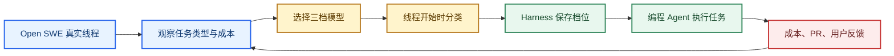
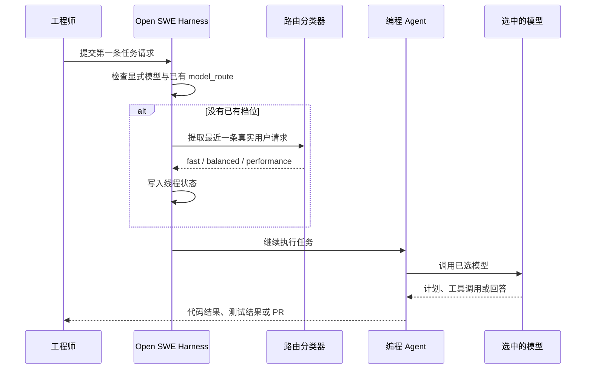
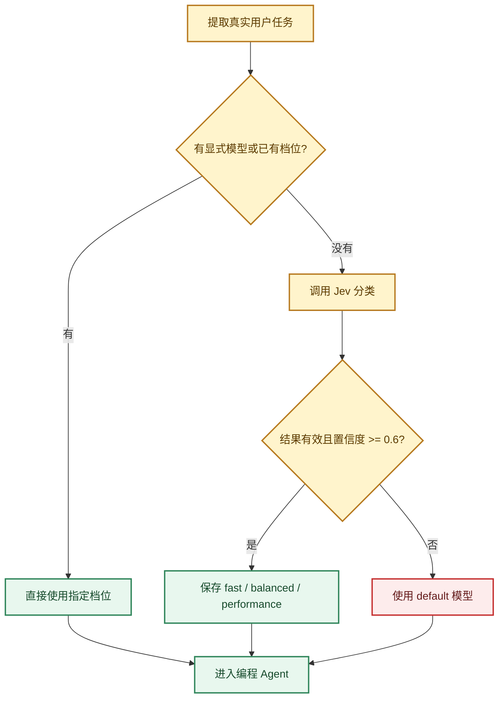
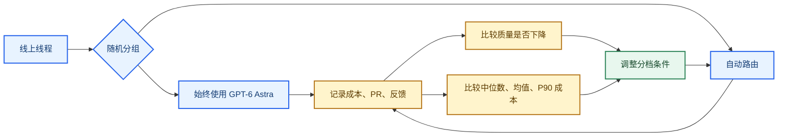
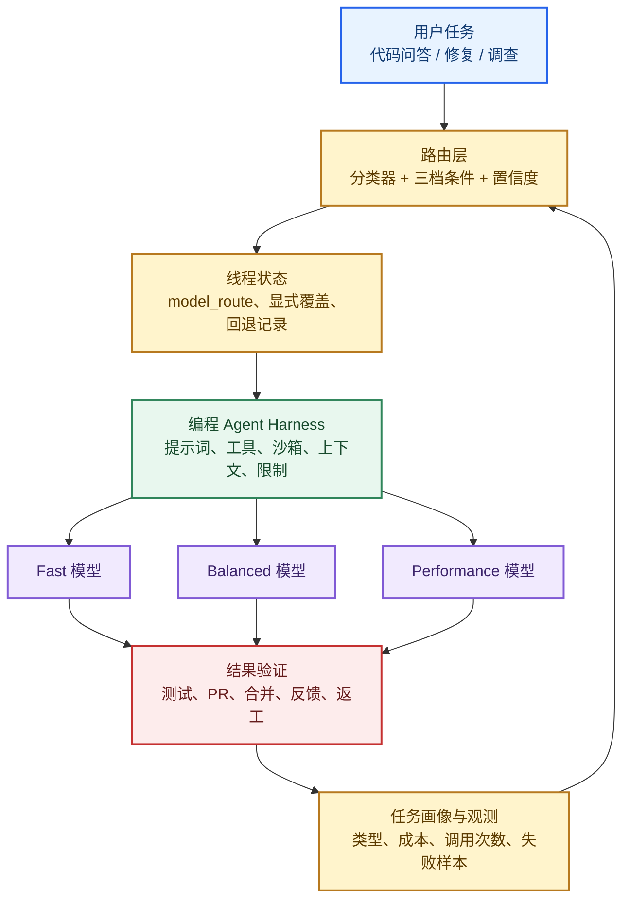

# 编程 Agent 的模型路由：Open SWE 怎样按任务选择模型

> 来源：Sydney Runkle、Eugene Yurtsev 的 [How to Build a Model Router in the Harness](https://www.langchain.com/blog/how-to-build-a-model-router-in-the-harness)，发布于 2026 年 10 月 1 日。
>
> 公开源码核对到 `8e0e13e33a94da2266e180b0ffeb7c6264832457`，核对日期为 2026 年 10 月 3 日；该提交用于核对运行机制，不等同于博客实验版本。

Open SWE 是面向工程师的编程 Agent。工程师从 Slack 或网页提出代码问题、要求修改代码，Agent 调查代码库、运行工具、执行测试，并可以创建拉取请求（PR）。

团队遇到的挑战很具体：Open SWE 每月的模型支出快速增长，但它接到的任务难度差别很大。查询代码状态、补测试、处理发布操作，和跨模块设计、复杂故障调查，都被同一个高能力模型处理。真正要解决的问题不是“能不能换一个便宜模型”，而是怎样判断一个请求需要多少模型能力，同时保证任务结果不变差。

原文给出的解决路径如下：



这篇文章先把原文案例讲清楚，再核对公开实现，最后把它整理成一套可以迁移到其他 Agent 的工程做法。

## 一、先看挑战：同一个编程 Agent 为什么不能一直用最强模型

这一节解释 Open SWE 面对的成本问题，以及团队怎样从真实线程中确认任务确实存在明显的难度差异。

### 1、任务入口相同：代码问答、修改和调查混在一起

Open SWE 的入口面向同一批工程师，但任务内容并不统一。原文观察到，新功能约占 22%，修复约占 17%，测试或无需修改的运行约占 16%；其余还包括发布运维、设计、故障调查、PR 维护和问答。

团队从 LangSmith 轨迹提取线程级数据，再用大模型依据标题和元数据标注任务类型。这里的标签是分析用的启发式分类，用来观察流量，不是生产路由规则。

### 2、任务成本不同：调用次数和模型费用可以帮助估计复杂度

原文统计了 2026 年 8 月 29 日至 9 月 5 日的一周交互线程。功能开发和调查通常更长、更贵；测试和发布类任务通常较短。


*图 1：原文的一周任务画像。每行是一类任务，四列依次展示线程数量、调用次数中位数、模型成本中位数和复杂度构成。来源：[Open SWE 模型路由原文](https://www.langchain.com/blog/how-to-build-a-model-router-in-the-harness)。*

原文把总成本和模型调用次数都当作复杂度线索，但也说明调用次数有歧义：调用多，可能是任务本身复杂，也可能是模型没有一次完成，用户不得不继续补充要求。因此，这些数据适合发现“值得分档”的空间，不能直接变成“某类任务永远用便宜模型”的规则。

团队由此提出一个待验证假设：初始用户请求已经包含一部分任务难度信息，路由器可以据此把许多线程交给更便宜、更快的模型，而不影响交付结果。

## 二、再看方案：团队怎样把模型能力分成三个可执行档位

这一节说明原文如何从通用模型评测和 Open SWE 的任务条件出发，得到 Fast、Balanced、Performance 三档，而不是直接按模型排行榜选一个模型。

### 1、先找成本与能力的折中点：基准用于筛选候选

团队参考 Artificial Analysis Intelligence Index 的能力分数和单任务成本，把候选模型放到同一张“能力—成本”图上。帕累托前沿表示不存在另一个候选能同时做到更便宜和更强，但最终配置并没有机械地只选前沿上的点。


*图 2：原文筛选候选模型时参考的能力与成本散点图。数据口径截至 2026 年 9 月 9 日，不能直接当作当前采购建议。来源：[Open SWE 模型路由原文](https://www.langchain.com/blog/how-to-build-a-model-router-in-the-harness)。*

### 2、再写任务条件：档位描述决定分类器怎样选模型

博客实验使用了三档配置：

| 档位 | 原文实验模型及推理配置 | 适合承接的任务 |
| --- | --- | --- |
| Fast | `GLM-5.3-Flash`，`xhigh` | 目标明确、范围较小、容易验证的任务 |
| Balanced | `GPT-5.6 Sol`，`medium` | 常规修复、有界调查和多文件实现 |
| Performance | `GPT-6 Astra`，`low` | 需求有歧义、需要架构权衡或复杂推理的任务 |

这些名称和模型只记录原文实验配置。团队把模型基准、供应商对模型能力的说明，以及前一步观察到的真实任务分布合在一起，写成每档的自然语言条件。分类器的目标是选择“预计能完成任务的最低成本档位”。

判断依据也不是请求长短。原文强调，修改范围是否明确、有没有强测试、失败能否撤销、是否涉及高后果操作，比字数和预计运行时长更适合用来判断模型是否够用。

## 三、看运行时：分类器只负责选档，Harness 负责把选择接进 Agent

这一节把“模型路由”从概念落到一次真实调用：请求进入后谁做判断、选择保存在哪里、模型怎样被替换，以及失败时怎样继续任务。

### 1、线程开始时只分类一次：后续调用沿用同一个档位

Open SWE 的初版路由读取线程第一条用户请求，然后为整个线程选择模型。这样做有三个好处：分类成本只发生一次，后续调用不需要重复判断，A/B 实验也容易把路由线程和单模型线程进行比较。



路由放在 Harness，是因为 Harness 同时持有编程 Agent 的任务提示词、工具、领域规则和线程状态。通用网关如果只看一段请求文本，通常拿不到这些任务条件。这里的关键不是组件名称，而是路由器能否取得判断模型适配度所需的上下文。

原文第一版使用支持结构化输出的大模型做分类，后来改用 Jev 决策模型，作者报告分类环节接近快 50 倍。这个数字描述的是分类速度，不是整个线程成本下降 50 倍。

### 2、运行层保存选择：中间件在模型调用前替换模型对象

公开提交中的 `ModelSelectionMiddleware` 是项目自己的模型选择中间件。中间件可以插入 Agent 的执行循环，在模型调用前读取状态并修改本次请求。

在 [model_selection.py](https://github.com/langchain-ai/open-swe/blob/8e0e13e33a94da2266e180b0ffeb7c6264832457/agent/middleware/model_selection.py#L128-L145) 的 `select_route()` 中，逻辑先处理显式指定和关闭路由，再复用已有档位；只有线程还没有选择时，才提取用户请求交给分类器：

```python
# 状态已有档位时直接沿用，避免每次模型调用重新分类。
if model_route := state.get("model_route"):
    return normalize_route(model_route)

if self._routing_mode == "fast":
    return "fast"

messages = state.get("messages", [])
# 只把最近一条真实用户任务交给分类器，并限制输入长度。
task = _latest_human_task(messages)[-8_000:]
return await _select_jev_route(task)
```

分类完成后，`abefore_model()` 把 `model_route` 写回状态；`awrap_model_call()` 在实际调用前读取这个状态，并用 `request.override(model=model)` 替换模型。其他请求内容继续交给后续处理器。这样，分类器不负责执行代码，编程 Agent 也不需要知道自己为何被分到某一档。

### 3、分类失败仍要能执行：低置信度和异常统一回退

`agent/utils/jev.py` 中的 `select_jev_choices()` 设置了 3 秒超时，只接受有效候选以及 0.6 至 1.0 的置信度结果。缺少凭据、请求异常、输出格式异常或置信度不符合条件时，调用方得到空选择；上层 `_select_jev_route()` 再把空选择转换为 `default`。



默认模型由组装 Agent 时传入，因此仅凭分类函数不能断言它一定是最强模型。回退机制保证路由服务短暂不可用时任务仍能开始，但生产系统应单独记录回退次数，否则失败会被隐藏在正常执行量里。

## 四、核对结果：实验同时观察成本和代码交付

这一节解释团队怎样判断路由是否值得使用，以及 973 条真实线程的实验结果能证明什么、不能证明什么。

### 1、先定义结果：合并 PR 是主指标，用户反馈补充非代码任务

模型路由只有在质量不明显下降的前提下节省成本才有价值。团队考虑过离线评测和线上 A/B：离线评测便于重复比较，但需要足够像真实流量、还能评价 PR 质量的数据集；线上 A/B 接近真实使用，却会让用户承担不理想路由的影响。

团队最终做了线上实验，并记录两类结果：

- **合并 PR**：Open SWE 记录它创建的 PR 以及后续合并或关闭状态，团队把“线程最终产生合并 PR”作为主要成功指标。

- **用户反馈**：点赞或点踩覆盖没有产生 PR 的问答线程，也能暴露“任务做完了，但不该使用最贵模型”这类路由错误。

实验闭环可以画成这样：



### 2、第一轮 A/B：成本中位数下降 64%，合并 PR 比例没有显著差异

2026 年 9 月 16 日至 22 日，实验覆盖 973 条线程：477 条始终使用 GPT-6 Astra，496 条使用自动路由。

| 指标 | 始终使用 Astra | 自动路由 | 原文报告的变化 |
| --- | ---: | ---: | --- |
| 每线程成本中位数 | 2.61 美元 | 0.94 美元 | 下降 64% |
| 每线程平均成本 | 4.76 美元 | 2.75 美元 | 下降 42% |
| 每线程成本第 90 百分位 | 11.07 美元 | 6.93 美元 | 下降 37% |
| 最终有合并 PR 的线程比例 | 27.3% | 29.2% | `p = 0.49` |
| 创建 PR 的线程比例 | 39.6% | 38.9% | `p = 0.82` |

路由组中，279 条进入 Balanced，167 条进入 Fast，50 条进入 Performance，约为 56%、34% 和 10%。三个档位的线程成本中位数分别为 1.50、0.097 和 2.88 美元。


*图 3：973 条线程实验的成本分布，白线标出中位数，纵轴采用对数刻度。来源：[Open SWE 模型路由原文](https://www.langchain.com/blog/how-to-build-a-model-router-in-the-harness)。*

这些数字支持一个有限结论：在这次流量、这组三档模型和这个路由条件下，自动路由显著降低了线程成本，同时没有观察到合并 PR 比例的统计显著差异。`p = 0.49` 不是“两个方案严格等效”的证明；合并 PR 也没有覆盖可维护性、后续缺陷、人类返工和问答质量。

### 3、全量使用 Fast 很快停掉：便宜模型不能替代任务分层

团队还把自动路由和全量使用 Fast 的方案比较。工程师很快反馈 Fast-only 的输出影响工作，试验不到一天便结束，因此原文没有把它当成有统计意义的结果。

这段经历说明，节省来自“把适合的任务交给便宜模型”，而不是把所有线程改成最低档。Performance 只占路由线程约 10%，但它仍然为需求消歧、设计权衡和复杂推理保留了必要的能力余量。

## 五、看清边界：这次验证的是线程初始路由，不是完整的动态调度系统

这一节把原文已经承认的限制、公开源码能证实的行为和本站的工程判断分开，避免把一次概念验证扩大解释成通用方案。

### 1、线程中途改变任务：原文还没有验证重新路由

当前路由只在第一条用户请求进入时选择一次。如果用户先问“这个模块做什么”，再追问“请跨五个包修改并提交 PR”，初始档位可能就不再适合后续工作。

原文把线程中途重新路由列为后续方向。切换模型会丢失原模型的提示词缓存，新模型需要重新读取上下文；对人类回复间隔较长的异步 Agent，这项成本有时已经被缓存过期抵消，但仍应通过实际轨迹测量，不能直接假设切换划算。

### 2、子 Agent 还没有统一接入：路由覆盖范围有限

博客实验主要为主线程选模型，子 Agent 仍然独立选择自己的模型。长任务如果能同时为子 Agent 分档，可能继续降低成本，但这会引入新的状态、上下文和结果归因问题，原文没有给出验证结果。

### 3、公开源码能确认运行机制：不能重建全部线上实验

固定提交中的测试覆盖了状态写入、连续调用只分类一次、忽略注入上下文，以及显式指定模型优先等行为。`_latest_human_task()` 会跳过系统注入的动态上下文，优先取真实用户消息；分类器拿到的是提取并截断后的用户文本，不是完整代码库和工具清单。

这些代码可以证明路由怎样进入模型调用，但不能证明 2026 年 9 月线上实验使用了完全相同的提示词、模型版本和部署参数。实验数字仍应按作者报告处理。

### 4、工程判断：最值得复用的是可检查的选择与结果关联

适合照搬的是过程：从真实任务画像开始，为不同能力档位写清条件，保存每次选择，再观察成本、重试、人类返工和任务完成情况。

需要按自己的系统改造的是三件事：

- **分档条件**：用自己的任务和验收结果写条件，不要只按请求长度分类。

- **回退与升级**：明确默认模型、分类超时策略、连续失败时是否升级，以及任务变化后由谁重新选择。

- **结果指标**：把业务成功、代码质量、重试、返工和成本放在同一张实验表里；只看一次调用价格，会把“便宜但需要人重做”误判成优化。

权限、沙箱、审批和工具副作用仍由原有 Harness 规则控制。模型降档不应自动扩大或缩小它可以访问的代码、执行的命令和提交的权限。

## 六、最后归纳落地方法：把“按任务选模型”做成一条可观察的工程闭环

这一节把 Open SWE 的案例压缩成一套从架构到代码实现的做法，回答“如果要在自己的 Agent 里落地，应该怎样开始”。

### 1、先画清四层：任务、路由、执行、结果

可以把系统拆成四层，但每层都要有具体职责：



### 2、路由层只做有限决策：输出档位，不接管任务

分类器的输出可以是 `fast`、`balanced`、`performance` 或 `default`。它不应该生成完整执行计划，也不应该直接调用代码工具。这样可以把分类错误限制在“模型选择”这一层，编程 Agent 仍然负责调查、修改、测试和交付。

一次请求的最小实现顺序是：

1. 读取显式模型配置和线程已有状态。
2. 没有已有档位时，提取真实用户任务，去掉不应影响分类的动态注入内容，并限制输入长度。
3. 调用结构化分类器，校验候选值和置信度。
4. 把档位写入线程状态。
5. 在模型调用前根据档位替换模型对象。
6. 记录分类耗时、档位、回退原因和最终结果。

这正是公开 `ModelSelectionMiddleware` 的价值：选择逻辑与 Agent 主循环分开，但在模型调用边界上汇合。

### 3、实验层要同时回答两个问题：省了多少钱，任务是否仍然完成

先建立固定的成功定义，再开启路由。编程 Agent 至少应同时观察：

- 任务是否完成，以及 PR 是否创建、通过检查并合并；
- 人类是否需要大幅修改、重试或重新发起任务；
- 每线程成本的中位数、均值和高分位；
- 分类失败、默认回退和用户负面反馈；
- 任务类型与模型档位是否长期失配。

如果暂时没有可靠的离线 PR 评测集，可以像原文一样做线上 A/B，但应把实验窗口、分组、控制模型和停止条件写清楚。结果不显著时，只能说“没有观察到差异”，不能写成“质量完全相同”。

### 4、最终的工程原则：先让路由可解释，再让它动态化

Open SWE 的案例给出的顺序很稳妥：先从真实轨迹理解任务，再固定三档模型和路由条件；先在线程开始时选一次，再根据失败样本决定是否需要中途重路由和子 Agent 路由。

这样做的核心产物不是一个神秘的“智能路由器”，而是一条能够回查的链：

```text
用户请求 → 选择了哪一档 → Agent 做了什么 → 花了多少成本 → 结果是否通过 → 下次怎样调整条件
```

当这条链能被观测、复盘和回归测试，模型升级时才可以只替换某一档的模型或条件，而不必重写整个编程 Agent。

> 相关材料： [Open SWE 模型路由原文](https://www.langchain.com/blog/how-to-build-a-model-router-in-the-harness)；[模型选择中间件](https://github.com/langchain-ai/open-swe/blob/8e0e13e33a94da2266e180b0ffeb7c6264832457/agent/middleware/model_selection.py)；[Jev 请求与结果检查](https://github.com/langchain-ai/open-swe/blob/8e0e13e33a94da2266e180b0ffeb7c6264832457/agent/utils/jev.py)；[Open SWE × Deep Agents 源码解析](../../../engineering/deepagents应用案例解析/open-swe/index.md)。正文与配图复核日期：2026 年 10 月 3 日。
