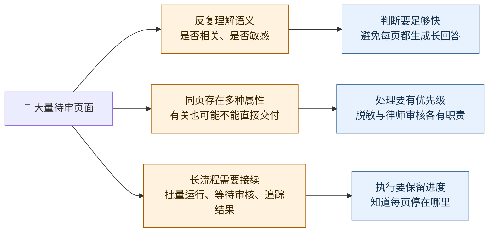
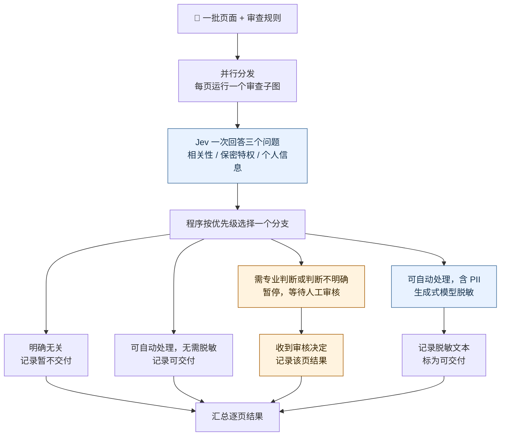
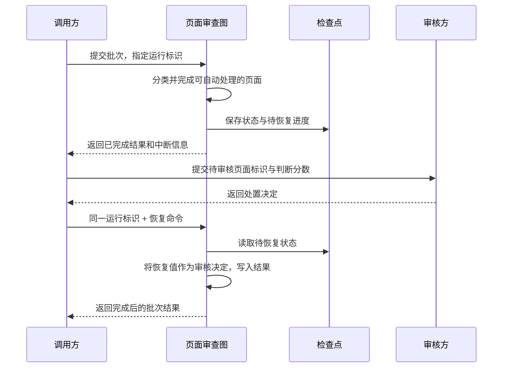
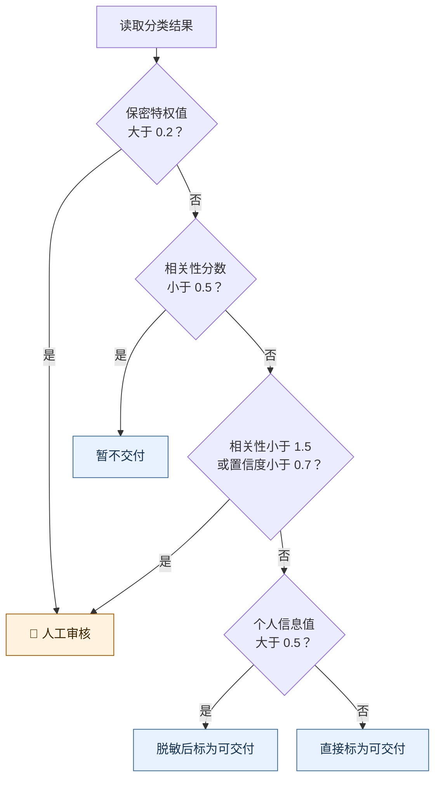
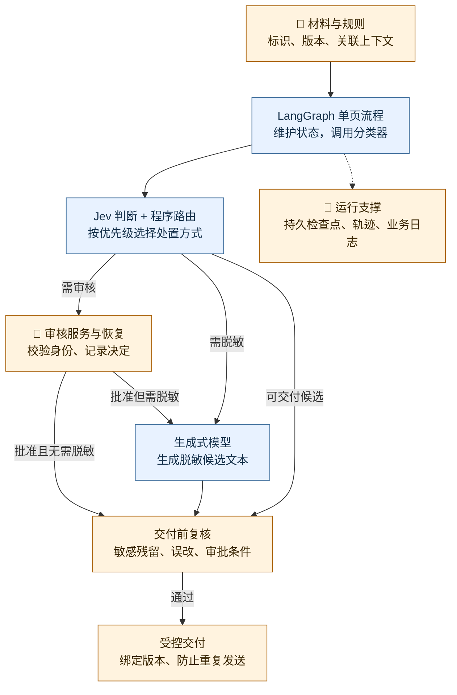

# 文档审查 Agent：从批量分类到脱敏、人工审核与工程落地

这是一个面向文档审查人员和律师的 **文档审查 Agent 示例**：在交付材料前，逐页判断是否与案件有关、是否包含个人信息、是否可能涉及律师保密特权，再安排交付、暂不交付、脱敏或人工审核。

它把重复判断交给 Jev，把处理顺序交给 LangGraph，把文本脱敏交给生成式模型，把需要专业裁决的页面留给律师。下面先讲清原文的挑战、做法和结果，再核对源码，最后给出从架构到验收的落地路径。

> 来源：Sydney Runkle、Hunter Lovell 的 [Building Prod with Jev and LangGraph](https://www.langchain.com/blog/building-prod-with-jev-and-langgraph)，发布于 2026 年 9 月 25 日。
>
> 本文结合[公开示例的固定修订](https://gist.github.com/sydney-runkle/a632ba4ea0b2b72501dfa4b6ab2a7d8a/9bd06dc63f0408c980b3a5aa37d06cc1d97a813b)讲解，复核日期为 2026 年 10 月 8 日。示例使用六页合成材料，并非客户生产部署报告。

## 一、业务挑战：大量页面都要判断，但处理方式并不相同

**本节说明审查任务为什么难：同样是读一页材料，系统既要判断它有没有用，也要判断它能不能交付，还要承担批量执行和人工介入的成本。**

原文的场景是诉讼中的电子证据审查。公司向对方交付材料前，需要按本次案件的审查规则逐页检查；作者指出，一起案件可能涉及数十万页。这里介绍的是作者设定的应用场景，不是某家客户的实际处理量。

难点在于，一页材料可以同时“与案件有关”和“不宜直接交付”。包含员工联系方式的审批记录可能有证据价值，却需要先脱敏；转述律师意见的邮件，即使高度相关，也需要律师判断是否交付。单一的“相关／不相关”标签无法完成整个任务。



*图 1：按原文整理的三个挑战。分类速度、处理策略和运行可靠性需要分别解决。*

手写规则适合执行确定条件，但难以穷举“这句话是否在转述法律意见”。每页都调用通用大模型，则要为重复的有限判断支付模型调用开销。即使模型判断得很快，程序仍要解决下一步读哪些材料、什么时候暂停、人工决定回来后怎样继续等问题。

## 二、方案分工：Jev 做判断，程序安排执行，必要时调用大模型和律师

**本节说明作者怎样拆分任务：让每个组件承担一种明确职责，把“理解页面”和“处理页面”接成可检查的流程。**

### 1、把有限判断变成程序可以直接使用的字段

Jev 是 TypeSafe 提供的决策模型：输入当前材料和一组问题，输出带类型的答案与概率，供程序读取并选择分支。在本例中，它不负责撰写审查报告，也不自行决定一整套工具调用步骤。

原文对比了三种组织方式：

| 组织方式           | 谁判断下一步                   | 放到文档审查中会怎样                       |
| ------------------ | ------------------------------ | ------------------------------------------ |
| 显式程序规则       | 开发者写好的条件               | 处理顺序容易检查，但语义条件难以穷举       |
| 模型驱动的 Agent   | 模型结合工具结果继续决策       | 模型同时承担判断和步骤安排                 |
| 程序中嵌入模型判断 | 模型回答有限问题，代码读取答案 | Jev 判断页面属性，程序安排脱敏、交付或审核 |

本例采用第三种。程序明确执行“可能涉及保密特权就转人工”，Jev 判断页面是否满足这个语义条件。作者强调 Jev 的结构化输出、一次回答多个问题、低延迟和重复判断稳定性；其中稳定性是设计目标及早期实验观察，不能直接当成判断正确率。


*图 2：原文的两类模型对比。上半是输入上下文、输出文本；下半将输入分为 State（材料与状态）和 Questions（问题），输出多项结构化判断。右侧刻度是概念示意，不是本例某一页的实测分数。[来源](https://www.langchain.com/blog/building-prod-with-jev-and-langgraph)。*

### 2、把判断、执行、改写和审核分给不同组件

LangGraph 是组织有状态执行流程的框架：节点表示一次工作，状态保存节点需要读取和更新的信息，边决定下一步运行哪个节点。把单页处理组织成子图后，就能在批次流程中重复使用。

| 参与者               | 本例负责什么                             | 交给下一环节的内容                         |
| -------------------- | ---------------------------------------- | ------------------------------------------ |
| Jev 分类器           | 阅读审查规则和页面，回答三类问题         | 相关性分数、置信度、保密特权与个人信息判断 |
| LangGraph 与路由代码 | 按既定顺序选分支，组织逐页处理与暂停恢复 | 当前页面状态、选中的节点、处理进度         |
| 生成式模型           | 只改写需要脱敏的页面                     | 用 `[REDACTED]` 替换个人信息后的文本     |
| 律师或审核人员       | 判断被升级的页面应如何处置               | 外部审核决定                               |
| LangSmith            | 记录运行轨迹，帮助开发者检查一次执行     | 模型输入、判断结果、经过的分支和耗时       |

这套分工让“增加页面数量”主要增加重复分类任务；生成式模型和人工只处理进入各自分支的页面。

## 三、处理过程：一批页面怎样得到各自的审查结果

**本节沿页面的流转解释原文方案：带着规则进入分类，按判断选择处置方式，自动处理的页面完成，待审核页面保存进度等待决定。**

### 1、每页都带着本次审查规则，一次回答三个问题

分类入口需要页面文本和本次材料请求的审查规则。规则提供“正在查什么”的背景，页面提供“正在判断什么”的事实；缺少前者，同一段文字就无法按具体案件判断相关性。文档标识留在流程状态中，用于关联后续结果。

| 问题字段         | 用中文理解                     | 它解决的处理问题                       |
| ---------------- | ------------------------------ | -------------------------------------- |
| `responsive`   | 是否与本次材料请求相关         | 明确无关的页面暂不交付；模糊页面交人工 |
| `privileged`   | 是否可能涉及律师参与或法律意见 | 可能涉及保密特权时，先交律师判断       |
| `contains_pii` | 是否含个人可识别信息，简称 PII | 可以交付但含个人信息时，先脱敏         |

三个问题在一次分类请求中提出，但后续分支有优先级。例如，同一页既含个人信息又可能涉及律师意见，不能因为发现了个人信息就直接脱敏后放行。



*图 3：结合原文与公开示例整理的处理流程。每页选一个分支；“可交付”在示例中是结果标签，代码没有实现向外部发送文档。精确阈值见第五节。*

脱敏提示要求真正删除个人信息的原字符，用 `[REDACTED]` 替换，并原样保留其他文本。这里需要生成式模型，是因为处理产物已经从几个判断字段变成一整页修改后的正文。

### 2、用公开示例中的材料看四条路径

作者附带的 `corpus.py` 将场景具体化为一家虚构货运公司的季度收入确认审查。下面是作者为合成材料设置的预期去向，便于理解流程，不代表所有模型运行都会得到相同结果。

| 页面内容                                   | 为什么要区分处理                   | 样例预期去向 |
| ------------------------------------------ | ---------------------------------- | ------------ |
| 季度收入汇总、审计委员会记录               | 直接涉及本次收入确认问题           | 可交付       |
| 装卸区维修通知                             | 与本次审查事项无关                 | 暂不交付     |
| 收入调整审批记录，含员工联系方式和账户号码 | 业务内容相关，部分个人信息需要删除 | 脱敏后可交付 |
| 律师意见、文字残缺的手写记录               | 涉及专业判断，或信息不足以直接处理 | 人工审核     |

以审批记录为例，任务不是删除整页，而是保留收入调整与审批事实，去掉应删除的个人信息。这也是“相关性判断”和“个人信息判断”必须分开的原因。

### 3、暂停时保存进度，恢复时把决定交回原流程

人工审核用到 LangGraph 的 `interrupt()`：它在节点中暂停执行，将待审核信息返回调用方。`Command(resume=...)` 是提交恢复值的命令对象，用于把外部决定送回被暂停的运行。



*图 4：公开示例的中断与恢复关系。示例的“审核方”由预设决定模拟，尚未提供真实审核界面。*

这里有三种不同的信息载体：**状态**保存页面与分类答案，供下一节点使用；**检查点**保存运行进度，支撑暂停和恢复；**运行轨迹**帮助开发者回看输入、分数与分支。原文将可靠执行能力交给 LangGraph，执行细节则需要继续核对示例采用的保存方式。

## 四、原文结果：分类步骤更快，完整任务仍由运行流程衔接

**本节说明作者报告了什么效果，以及它能支持哪一层结论：实验主要比较分类速度，延伸讨论的是如何为有限判断选择合适的模型。**

作者在同一个文档审查图中，分别让 Jev 和 Sonnet 承担分类，报告多次试验中 Jev 的**分类步骤快约 5–6 倍**。原文提供两条 LangSmith 轨迹，并展示决策模型输入和各项输出的专用视图，便于查看某页为什么进入某个分支。

| 原文提到的结果                             | 实际指向的范围                                     |
| ------------------------------------------ | -------------------------------------------------- |
| 本例快约 5–6 倍                           | 文档审查图中的分类步骤，不是律师耗时或整批交付周期 |
| 最高快 200 倍、便宜 400 倍                 | 原文引用的 TypeSafe 其他基准宣传，不是本例实测     |
| 浏览器动作延迟中位数由 1.97 秒降至 0.46 秒 | 原文转述的 Browserbase 早期测试，不是文档审查结果  |

浏览器案例解释了作者想推广的分工。Stagehand 是帮助程序操作网页的工具，其 `act()` 执行网页动作：先标出当前页面可交互的元素，再让 Jev 从候选中选动作类型和目标，置信度低于 0.7 时回退到大模型。网页操作看似开放，当前可选按钮和输入框却是有限的，因而可以拆出一个范围明确的选择问题。

作者据此讨论模型能力的拆分：有限分类交给决策模型，开放式推理和文本生成保留给通用模型，运行框架负责将它们接起来。在文档审查里，这种拆分具体表现为“每页分类，只对部分页面脱敏，只对部分页面请求人工判断”。

## 五、实现核验：源码怎样组织状态、分支和恢复

**本节转入固定版本源码，说明前面的流程具体落在哪些函数上，并区分演示已经做到的部分与仍需补齐的工程能力。**

本节代码均来自文首固定修订的 `review.py`。`build_review_graph()` 是组装审查图的函数，接收分类器、脱敏模型和检查点保存器；三者从外部传入，便于替换模型，也便于测试时使用固定响应。

### 1、页面状态组织模型上下文，子图负责重复处理

源码用 `PageState` 描述单页状态，保存 `doc_id`、`page`、`protocol`、`answers` 和 `results`。其中 `protocol` 是审查规则，`answers` 是分类回答，`results` 是逐页处置结果。

下面是 `classify()` 的完整函数体。`QUESTIONS` 是前面三个问题的定义；原英文注释已译成中文：

```python
def classify(state: PageState) -> dict:
    # 审查规则随页面一起传入，使每个问题都能看到案件背景。
    response = classifier.invoke(
        {
            "state": {"protocol": state["protocol"], "page": state["page"]},
            "questions": QUESTIONS,
        }
    )
    return {"answers": response}
```

单页子图把 `classify` 接到条件分支，再将各处置节点接到结束位置。外层批次使用 `Send`——LangGraph 向指定节点分发独立状态的对象——为每页启动一次 `review_page`。

`StateGraph` 是定义状态、节点和边的图构造器，`compile()` 将定义变成可运行的图，`START` 与 `END` 分别标记入口和结束。以下节选省略前面的单页图构造，中文注释为本文补充：

```python
def fan_out(state: BatchState) -> list[Send]:
    # 每页携带自己的文本、标识和规则，进入同一套单页流程。
    return [Send("review_page", p) for p in state["pages"]]

batch = StateGraph(BatchState)
batch.add_node("review_page", page.compile())
batch.add_conditional_edges(START, fan_out, ["review_page"])
batch.add_edge("review_page", END)
return batch.compile(checkpointer=checkpointer)
```

结果列表采用 `operator.add` 作为合并规则，即把不同页面返回的列表拼接起来。这里汇总的是逐页记录；实际交付若要求原文顺序，还应按页面标识或页码重新组织。

### 2、路由有严格顺序，分数和置信度各有含义

`route()` 优先检查保密特权，再检查相关性，之后才决定是否脱敏。下面将代码中的常量展开为具体阈值：



*图 5：固定修订 `review.py` 的实际分支顺序。阈值是示例策略；例如保密特权值恰好等于 0.2，不会由第一条分支送人工。*

TypeSafe 的 `Score` 是按多个等级评分的问题类型。本例定义“无关、可能相关、直接相关”三个等级，返回的 `score` 是等级概率的加权结果，可能落在 0.49 或 1.8，不能只用 `score == 0` 判断无关。`Noul` 是是非问题类型，本例读取其 `noul` 数值处理保密特权与个人信息判断。

下面保留 `route()` 的核心分支，省略函数声明和答案提取；中文注释为本文补充：

```python
# 保密特权判断优先，避免直接进入脱敏后交付的路径。
if privileged > PRIVILEGE_ESCALATION_THRESHOLD:
    return "attorney_review"
if responsive.score < NOT_RESPONSIVE_THRESHOLD:
    return "withhold"

# 明确无关的页面已退出；其余页面继续接受分数和置信度检查。
if (
    responsive.score < RESPONSIVE_THRESHOLD
    or responsive.confidence < RESPONSIVE_CONFIDENCE_THRESHOLD
):
    return "attorney_review"
if answers.nouls["contains_pii"].noul > PII_REDACTION_THRESHOLD:
    return "redact"
return "produce"
```

源码与 README 的概括存在差别：说明文字建议相信明确分数，而实际代码仅让明确无关的低分提前退出；**高相关性页面只要置信度低于 0.7，仍然送人工。** `test_uncertain_pages_escalate_to_attorney_review` 覆盖了这个情况。

换模型还需要重新校准阈值。`llm_classifier.py` 让聊天模型返回概率，再自行计算期望分数和置信度，其中置信度公式是比较实验用的近似构造。README 报告，仅换置信度公式，六页中的路由一致数就从四页变为五页。相同字段名不保证相同统计含义，模型之间路由一致也不等于判断正确。

### 3、演示完成了流程连接，交付前的校验仍需补齐

公开代码可以证明分支怎样执行，但不能替代真实业务的验收。把关键差别并列起来，更容易看清改造位置：

| 环节         | 固定版本实际行为                                                                | 对工程实现的影响                                                         |
| ------------ | ------------------------------------------------------------------------------- | ------------------------------------------------------------------------ |
| 人工审核     | `attorney_review()` 把恢复值直接写入结果；`compare.py` 使用预设决定模拟审核 | 需要真实审核入口、决定值校验、身份与意见记录；批准交付后还需明确是否脱敏 |
| 检查点       | 演示注入 `InMemorySaver`，即进程内存中的检查点保存器                          | 支持演示暂停恢复，不能据此保证进程重启后的恢复                           |
| 敏感正文     | 中断载荷只有标识和分数，但页面状态及批次状态仍含正文                            | 持久化时仍须处理正文的访问权限与保留期限                                 |
| 脱敏输出     | `redact()` 直接采用模型返回文本，并标为已脱敏、可交付                         | 还需检查敏感信息残留和非敏感文本误改                                     |
| 分类接口异常 | 聊天模型适配器对缺失分布使用均匀分布，对缺失是非答案使用 0.5                    | 需要区分接口缺字段与模型对内容不确定，避免混成业务判断                   |
| 测试         | `test_review.py` 用固定回答验证分支、恢复、汇总和接口结构                     | 能检查程序连接，不能证明真实模型的审查与脱敏质量                         |

性能也有口径差异：Gist README 的另一组六页记录列出 Jev 每页 0.34 秒、Sonnet 每页 3.80 秒，不能与博客的 5–6 倍混成同一组统计。`compare.py` 将分类调用耗时累加，并另记整图实际经过的时间；并行执行时，两者不同，部分比较还使用不同网络路径。

本次核对了博客正文、相关静态图、固定版本源码与测试文件；未运行模型调用或示例测试，嵌入视频和需登录的 LangSmith 轨迹未作为独立验证证据。公开材料未给出独立人工标准答案、大规模漏检数据或完整生产费用。

**实现资料与关联阅读**

- [固定修订的完整示例](https://gist.github.com/sydney-runkle/a632ba4ea0b2b72501dfa4b6ab2a7d8a/9bd06dc63f0408c980b3a5aa37d06cc1d97a813b)：`review.py`、`corpus.py`、`llm_classifier.py`、`compare.py` 与 `test_review.py`。
- [LangGraph 中断与恢复源码拆解](../../../engineering/langchain-series/langgraph/07-interrupts-and-command.md)：进一步理解暂停与恢复的运行机制。
- [Agent 评测](../../../../notes/agent-system-design/06-observation/agent-evaluation.md)：区分程序测试、模型效果与完整任务验收。
- [Open SWE 模型路由](../development-operations/open-swe-model-routing.md)：结构化判断怎样用于编程 Agent 的模型选择。

## 六、整篇总结：从架构分工落实到可验收的审查系统

**本节将全文收束到落地方法：复用“规则与页面输入 → 结构化判断 → 程序路由 → 专项处理”的架构，再补齐材料关联、人工恢复、输出复核和实际交付。以下是本站基于案例提出的工程建议。**

### 1、架构上沿用单页工作流，把交付前后的责任接完整

可以沿用本例的组件分工：Jev 分类，LangGraph 组织状态和分支，生成式模型脱敏，人工处理需要裁决的页面。业务改造需要围绕这些节点补上真实输入与真实输出。



*图 6：本站建议的落地架构。蓝色复用示例分工，橙色表示需要落实或扩充的组件；实线表示调用或材料流转，虚线表示运行支撑依赖。图中只展开拟交付材料的出口，暂不交付的页面保留处置记录。真实审核、持久恢复、独立复核与受控交付都需补齐。*

图中最关键的补充是：人工批准后仍按决定进入必要的脱敏与复核，生成式模型输出也先作为候选文本。复核不通过时退回人工或重新处理；只有通过后，系统才执行实际交付，并记录交付了哪个版本。

### 2、工程上按依赖顺序实施，每一步都有验收产物

实施顺序可以沿着数据进入、判断、执行、恢复、验收展开。这样遇到错误时，能够定位是材料不足、分类失误、路由错误，还是执行结果不合格。

| 实施顺序          | 具体要做什么                                                                     | 用什么判断完成                                                    |
| ----------------- | -------------------------------------------------------------------------------- | ----------------------------------------------------------------- |
| 1. 定义材料与规则 | 给页面稳定标识，保存正文版本、审查规则版本，并补齐必要的前后页、邮件链或附件背景 | 同一页面能回查原始材料，也能说明它依据哪版规则判断                |
| 2. 定义分类契约   | 固定问题、等级含义、返回字段；接口异常单独处理；保存实际模型和依赖版本           | 分类结果可校验，缺字段不会被悄悄当成正常判断                      |
| 3. 实现分支策略   | 沿用先处理高风险条件的结构，用业务标注集重新选择阈值                             | 保密特权与 PII 同时出现、临界分数、高相关低置信等情况都有明确预期 |
| 4. 接入人工与恢复 | 使用持久检查点；关联运行、中断、页面和审核决定；校验审核权限与恢复值             | 服务重启后可继续，重复提交决定不会导致重复交付                    |
| 5. 补齐脱敏与交付 | 检查敏感残留、非敏感内容误改，以及批准附带的处理条件；保存最终版本与交付记录     | 已脱敏标签对应实际检查结果，每次交付都能回查依据                  |
| 6. 评测质量与成本 | 分别评测分类、脱敏、人工升级与整批任务，记录单页耗时、批次耗时和人工等待         | 在可接受的漏检、误改和人工负担下，再判断替换分类器是否划算        |

公开 README 将 `langchain-typesafe` 标为 alpha 阶段，示例也包含可变的模型别名。复现时应固定实际安装版本和模型标识，不能只保存 Gist 修订与几组阈值。

### 3、迁移时明确哪些可以复用，哪些必须重做

**可以复用的是组件分工与流程组织。** 单页子图、可替换分类器、独立脱敏节点和人工暂停点，都有清楚的输入输出，便于分开调试和测试。

**必须重做的是业务上下文、阈值与验收。** 页面是否依赖邮件链、何种错误必须转人工、脱敏后能否交付，都由实际业务决定。若任务主要依赖跨文档事实拼接或开放式调查，还需要额外的检索与推理流程，本例的逐页分类不足以覆盖。

这个案例提供的落地起点，是一套将重复语义判断接入明确处理步骤的工作流。把它做成可用的审查系统，需要让每一页都能回答四个问题：依据什么材料和规则作出判断，为什么进入这个分支，人工与模型实际改了什么，以及最终交付的版本是否通过了验收。
