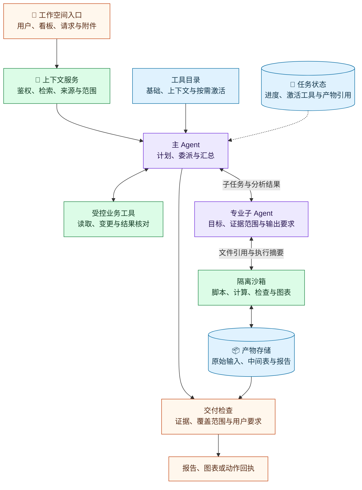

# 项目协作 Agent：Sidekick 怎样把分散的工作资料变成可交付成果

Sidekick 是服务 monday.com 客户团队的项目协作 Agent。员工可以让它汇总项目、寻找阻塞项、起草进展、分析上传文件，也可以让它更新看板中的记录。一次请求往往同时涉及“找资料”“做判断”和“执行操作”。

本文解读 monday.com AI 工程负责人 Omri Bruchim 于 **2026 年 8 月 11 日**发表的[客座文章](https://www.langchain.com/blog/building-monday-com-sidekick-why-capable-agents-need-more-than-just-tools)。文章讨论的是一次生产架构重构：为什么给单个 Agent 不断增加工具会降低实际效果，以及团队如何重新划分资料检索、任务组织、专业分析与代码执行的职责。

前六节按业务问题讲清原文的做法、例子和复盘。后面再区分公开证据与未知实现，给出本站的工程架构建议。

## 一、用户要完成工作，资料却分散在不同位置

### 1、同一个入口要承接不同性质的任务

Sidekick 嵌在 monday.com 工作空间内。用户打开它时，系统已经知道当前用户、账户，以及所在的工作空间、看板、文档、仪表盘或记录。这些产品信息能帮助助手理解“这个项目”“这条记录”指的是什么。

*图 1：原文中的产品界面。输入框提供附件、引用和 Skill 入口，下方列出创建看板、写文档、在线研究、分析数据等任务。图片来源：monday.com 团队原文。*

任务之间的差别很大。查一条记录可能只需要一次读取；写项目更新需要综合材料；分析表格要处理字段和计算；生成报告则可能持续多步，留下文件和图表。原文认为，把这些任务都塞进同一种推理循环，是初版设计需要纠正的问题。

### 2、项目总结需要跨越看板、文档和文件

工作资料不只存在于看板。记录、进展更新、文档、仪表盘、会议、文件、通知和外部集成都可能包含相关信息。用户的一句“总结项目”，可能同时依赖看板上的状态、会议记录中的解释，以及刚上传的表格。

原文贯穿架构说明的例子是：**分析三块看板与一个 CSV 文件，找出主要交付风险，再准备管理层简报。**

这个任务的交付物是有依据的风险判断和简报。取得看板数据、检查表格、统一字段、关联数据、计算和制图，都是形成交付物的中间工作。Sidekick 需要把这些环节接起来，而用户仍然只面对一个助手。

## 二、为什么增加工具反而让初版更难用

### 1、新能力会改变整个 Agent 的选择环境

初版 Sidekick 由一个通用 Agent 加不断扩大的工具列表组成。这个设计让团队快速验证了需求：用户确实希望助手能够总结项目、分析文件、更新看板并调用已连接的系统。

进入生产后，新增工具开始影响已有任务。原文归纳了七种反复出现的问题：

| 生产表现 | 原文描述的原因与影响 |
| --- | --- |
| 更容易选错工具 | 多个工具名称和描述相近，模型更难区分何时使用哪一个 |
| 任务资料受到挤压 | 每轮都携带大量工具参数结构和说明，减少留给用户请求与业务数据的上下文空间 |
| 提示词承担过多职责 | 研究、内容生成、数据分析、看板操作和文件处理规则集中在同一处 |
| 长任务中途失去方向 | 某个中间步骤失败，可能打乱整个推理过程 |
| 排错难以归因 | 最终回答出错时，难以判断问题来自计划、工具选择、工具执行、检索资料还是成文 |
| 延迟和费用上升 | 缺少结构约束，Agent 会探索无关工具或重复调用 |
| 回归测试组合膨胀 | 新增一个工具，可能影响表面上与它无关的工作流 |

这里的维护成本不只在于“工具多了，提示词变长”。同一个 Agent 负责所有任务时，一处能力调整可能改变许多场景的执行路径，团队也就难以局部修改、局部评测。

### 2、团队需要处理三类不同的复杂度

原文把这些现象归结为三个问题。

**任务复杂度**积累在一个提示词和一个推理循环里。看板操作与内容写作需要不同的规则，通用 Agent 却必须同时理解它们。

**上下文体积**随工作过程增长。多块看板、几份文档、历史对话、工具结果和之前生成的产物，全部经过主模型既昂贵，也不一定有助于判断。

**执行过程**需要保存中间状态。真实分析会经历探索、临时文件、反复转换、校验和局部失败恢复，无法总是压缩成两三次 API 调用。

重构因此从职责划分入手：主 Agent 理解目标并组织工作，专业子 Agent 处理较窄的问题，受控工具访问业务系统，隔离执行环境承接文件和代码。团队借助 Deep Agents 提供的计划、委派等运行能力完成这种拆分；Deep Agents 是用于构建多步 Agent 的框架，具体业务边界仍由应用团队设计。

## 三、分层架构怎样组织一次请求

*图 2：原文的职责分层图。双向关系与底部的记忆、状态表示各层需要持续协作，不能把它理解成所有请求都只走一遍的固定流水线。*

### 1、上下文层同时处理访问范围和资料相关性

产品入口提供“谁在什么地方提出问题”。上下文与权限层则负责决定哪些资料允许使用、哪些资料与这次任务有关。

原图把资料来源分成几部分：

- 结构化 monday.com 数据，例如看板、记录和文档。
- 语义搜索结果，用来寻找相关知识和工作材料。
- 对话上下文，例如历史消息、文件和记忆。

图中明确标注，**用户可访问的范围在检索前确定**。权限约束属于资料取得过程，不能等模型已经读完受限信息后，再在最终回答中删掉它。

资料相关性也由这一层处理。用户当前所在的看板提供理解线索，但一个跨项目问题还可能需要其他获准访问的看板、文件和文档。系统需要选择提供哪些材料，也需要决定哪些材料暂时不进入模型。

### 2、主 Agent 组织工作，子 Agent 缩小判断范围

主 Agent 解释用户目标、维护计划，并决定下一步是直接回答、调用工具、委派子任务还是使用沙箱。简单查询可以走短路径，复杂任务才需要更多执行环节。

子 Agent 接收较窄的目标，使用较小的工具集合。原图列举了看板搭建、数据分析、网页研究和通用任务；正文另以内容生成说明这种限制：负责写作的 Agent 没有必要拿到全部看板管理工具。

这种划分让不同任务有各自的指令、工具和评测范围。风险分析要判断证据是否支持结论，写作要把已有发现组织成用户要求的格式，两者可以分别改进。

### 3、状态让后续对话能够接着做

原图底部的 Memory and state（记忆与状态）列出对话历史、已检索知识和已激活工具，并注明这些内容跨轮保留。

因此，架构里既有“这一轮提供什么”，也有“后续轮次沿用什么”。例如工具已经激活这一事实属于运行状态；主 Agent 后续继续处理任务时，需要知道当前有哪些能力可用。

原文在这里给出的是状态职责。其具体保存方式、保留时长和失效处理没有展开，后文的实现建议会单独讨论。

## 四、三层工具目录怎样减少每轮选择负担

### 1、基础工具常驻，上下文工具随工作对象提供

工具不再一次性全部展开。原图把工具按可见时机分成三层，让常见能力保持可用，同时减少暂时无关的工具说明。

*图 3：原文的三层工具图。只有延迟层标注为激活后解锁，不能把正文中的“显式激活”概括成每个工具调用前都必须激活一次。*

| 工具层 | 完整定义何时可用 | 原图列出的工具 |
| --- | --- | --- |
| 基础层 | 始终放在提示词中 | 网页搜索 `webSearch`、网页提取 `webUrlExtract`、知识搜索 `knowledgeBaseSearch`、图像生成 `imageGen` |
| 上下文层 | 根据用户当前工作对象提供 | 看板信息 `get_board_info`、记录分页 `get_board_items_page`、活动 `get_board_activity`、更新 `get_updates` |
| 延迟层 | 激活后才展开完整定义 | `create_board`、`create_items`、`all_monday_api` 等；原图标注 180 多项能力在解锁前隐藏 |

这里的 schema（参数结构）说明工具接受哪些参数、参数如何组织。工具目录可以先用简短介绍帮助 Agent 发现能力，需要执行时再提供完整参数结构。

### 2、延迟加载还要有明确的发现和激活入口

原图的 Activation（激活）区域列出三种入口：

- `deferred_tools_activate`：显式请求激活延迟工具的入口。
- Skill 的 `required_tools`：通过任务指引声明所需工具。
- dependency groups（依赖组）：图中列出的另一种激活关联。

Skill 在这里指按任务提供的操作指引，`required_tools` 是它声明依赖能力的位置。图中还注明，工具目录由 Haiku 4.5 模型汇总。

这些信息解释了“完整工具定义暂时隐藏后，Agent 从哪里知道还有哪些能力”。但原图没有展示激活函数的参数、依赖组如何展开，也没有说明目录汇总是否在每次请求中执行，不宜据此补写内部调用流程。

### 3、工具可见性和业务权限分别负责不同问题

三层目录控制的是模型在当前任务中需要面对哪些能力。权限控制约束的是这些能力可以访问哪些数据、执行哪些动作。

例如激活创建记录的工具，只是让 Agent 获得该工具的调用定义。原架构中的上下文与权限层、具有权限感知能力的工具，仍然承担业务访问控制。不能把“工具已解锁”解释成“用户获得了新的看板权限”。

## 五、三块看板加一个 CSV，怎样形成风险简报

### 1、工具、子 Agent 和沙箱分别承接什么

原文按每一部分工作的性质选择执行方式，同一个请求可以连续使用三者。

| 工作性质 | 采用的机制 | 在例子中的作用 |
| --- | --- | --- |
| 输入输出明确、可审计的业务动作 | 受控工具 | 读取看板、搜索文档、更新记录或发送经批准的消息 |
| 需要集中处理的专业判断 | 子 Agent | 分析交付风险、研究材料或组织内容 |
| 需要文件、代码和中间状态的反复处理 | 沙箱 | 检查 CSV、转换数据、运行计算、修正错误并生成图表 |

原文也提到 MCP，即模型上下文协议，用于连接 Agent 与外部工具、资源。MCP 与工具调用解决能力如何被访问；沙箱提供实际工作的隔离环境。两者可以配合使用。

### 2、从受控取数进入专业分析

在“三块看板与一个 CSV”的例子中，主 Agent 通过 monday.com 工具取得相关看板数据，再把风险分析交给目标更窄、上下文更集中的分析子 Agent。

分析子 Agent 负责判断要研究哪些交付风险。它需要选定资料和相应分析能力，不必同时承担所有看板管理、网页研究与内容生成任务。

这也解释了为什么子 Agent 和工具不能简单互换。读取看板是一项明确动作；判断不同资料如何影响交付风险，需要在一个目标下综合证据。

### 3、沙箱把反复计算留在工作区里

CSV 如果需要标准化、关联、计算或生成图表，分析子 Agent 就可以使用沙箱。文件和选定的看板数据进入隔离工作区，Agent 在那里执行转换、检查结果并生成结构化输出或可视化。

原文进一步展开了文件处理的过程：保存上传文件，检查列名，编写脚本并运行；遇到解析错误后修改脚本，再运行并生成图表。中间文件保留在工作区，主 Agent 接收结果和执行摘要。

这种工作方式避免为每一种列操作、表格转换都定义一个工具，也避免让每张中间数据表不断经过主模型上下文。业务系统访问由受控工具完成，计算工作在沙箱里继续。

文件系统在这里还有可检查性上的价值。团队可以查看目录、脚本、日志和产物，不必为每一种中间结果另建私有协议；Agent 也能利用这些熟悉的对象继续工作。

### 4、写作阶段使用分析发现形成交付物

完成分析后，主 Agent 或专门的写作子 Agent 将结果整理成用户偏好的管理层简报格式。图表和分析结果成为写作依据，主 Agent 不需要重新阅读每一次转换产生的完整数据。

原文在内容生成场景中同样强调研究与写作分开：根据发布看板和支持文档起草发布计划、客户更新或内部公告时，这种分工有助于保留资料来源、减少无依据生成。

上述过程是作者用于说明职责衔接的例子。它解释了一次任务可以怎样展开，没有规定每个用户请求都必须经过相同的四个阶段。

## 六、框架、可观测性与生产复盘怎样接在一起

### 1、复用通用运行能力，保留业务层控制

团队将 LangChain 生态放在编排与 Agent 运行层。原文列出的分工包括：

| 组件 | 在原文中的职责 |
| --- | --- |
| LangGraph | 提供有状态的多步执行能力，支撑任务在多次调用之间继续推进 |
| Deep Agents | 支撑计划、子 Agent 委派等多步任务组织 |
| LangSmith | 记录执行轨迹、排错、管理评测数据集并比较不同实现 |
| 沙箱 | 隔离执行代码，处理文件及需要保留一段时间的中间状态 |

LangGraph 是组织和运行有状态工作流的框架；LangSmith 是观察与评测 Agent 执行过程的平台。它们提供运行基础，monday.com 继续使用自己的工具、检索层、模型和权限控制。

原文特别解释了为什么没有再构建一套庞大的内部运行抽象：除非它能带来明确的 monday.com 业务价值，否则团队更愿意把精力用于产品上下文、权限、工具、评测和用户体验。

### 2、一条轨迹要能解释结果是怎样形成的

一次请求中，主 Agent 调用模型、检索资料、委派子任务、执行工具和使用沙箱，相关活动需要出现在同一条 trace（执行轨迹）里。团队同时关注延迟、token 使用和失败。

当报告出错时，只看到最后一个模型调用不够。排错者需要区分：取到的资料不对，计划有误，委派目标不清，工具失败，沙箱计算出错，还是成文阶段改变了分析结论。

评测也沿着整条任务展开。团队将离线评测与生产信号结合，检查是否选择了正确上下文、遵守了权限、完成了任务，并给出用户可信的结果。一次 API 调用成功，只能说明某项操作完成，不能直接证明整份简报可用。

### 3、上线后的用途与团队反思

截至原文发表时，修订后的架构已在生产运行数月。作者归纳了三类反复出现的用途：

- 跨来源项目报告：组合看板、文档、更新和活动信息，形成管理层摘要。
- 文件处理：把表格与 monday.com 数据结合，寻找异常，交付图表或报告。
- 内容制作：根据发布看板和支持材料，起草发布计划、客户更新或内部公告。

这些用途让团队对任务边界的划分更有信心。用户感知到的是一个助手，内部则可以根据任务需要组合检索、工具、专业子 Agent 和沙箱。

团队最明确的复盘是：应该更早划清能力边界。初版有利于验证需求，但他们让主 Agent 累积了过多职责。生产中的权限、缺失资料、模糊请求、工具失败和成本约束，使这种积累越来越难维护。

原文还把从回答问题走向协助、进一步走向主动帮助用户工作，作为产品演进方向。它没有把这个方向展开成已完成的自动跟进流程。

## 七、公开材料证实了什么，哪些实现还不能确定

原文提供了生产架构、工具分层图、代表性任务和团队经验，但没有附上 Sidekick 的生产源码或完整调用轨迹。本篇能核对图中的能力名称与职责，不能逐行验证其权限传播、委派输入和沙箱配置。

“三块看板加一个 CSV”是作者解释架构的例子，不是可回放的生产会话。文中报告了上线时间和典型用途，没有公布可用于比较重构前后的任务成功率、延迟或费用数字。

以下几类结论应分别看待：

| 证据类型 | 能支持的判断 | 不能据此确定的细节 |
| --- | --- | --- |
| Sidekick 原文与配图 | 团队采用主 Agent、专业子 Agent、分层工具和沙箱协作 | 每个子 Agent 的输入字段、激活实现、沙箱供应商与资源限制 |
| 团队的生产复盘 | 文件处理、项目报告和内容制作是出现的用途 | 相对初版提升多少、所有用户是否获得相同效果 |
| monday.com 公开 API 文档 | 外部接入时的身份权限与分页规则 | Sidekick 内部是否经过完全相同的调用封装 |
| LangGraph 官方文档 | 框架如何划分线程状态持久化与跨线程存储 | Sidekick 实际采用的数据库、保存配置与恢复策略 |

写操作的确认条件、网络超时后的处理方式、产物过期策略，也没有在原文中详细交代。下面给出的接口、保存方案和验收方法属于**本站实现建议**，用于说明如何把这种职责划分落成系统，不代表 monday.com 已公开的生产细节。

## 八、工程实现：把分工落实到接口、数据与恢复边界

### 1、架构图之外，还要约定每次交接的内容

下图延续原文的职责划分，增加任务状态、产物存储和交付检查。它表达逻辑模块关系，不要求每个方框单独部署为一个服务。

*图 4：本站建议的实现结构。工具与子 Agent 返回执行结果，沙箱通过文件引用交付产物；虚线表示主 Agent 对任务状态的使用。模型调用、取数、委派和执行应关联到同一次请求的轨迹。*

以风险简报为例，模块之间不宜只传一段自然语言任务描述。需要约定的内容至少包括：

| 交接位置 | 建议传递的内容 | 解决的具体问题 |
| --- | --- | --- |
| 入口到上下文服务 | 已认证用户、账户、当前对象、附件引用、用户目标 | 明确“这个项目”指什么，以及从谁的权限出发取数 |
| 上下文服务到主 Agent | 获准使用的材料、来源标识、取数时间、覆盖范围与缺口 | 防止把部分材料当成项目全貌 |
| 主 Agent 到分析子 Agent | 分析目标、选定资料引用、可用能力、输出要求和停止条件 | 让分析任务保持范围，避免重复承担全部对话职责 |
| 子 Agent 到沙箱 | 获准使用的输入文件、选定数据、执行限制 | 让计算只接触本次任务需要的资料 |
| 分析到写作 | 风险发现、依据、计算口径、未解决问题、图表引用 | 防止写作阶段丢掉证据或把猜测改成事实 |
| 工具到主 Agent | 成功、失败或结果待确认的状态，以及可核查的业务回执 | 区分动作已生效和仅仅发起了请求 |

这些约定应落实到实际接口校验。例如，子 Agent 返回一份风险清单时，每条结论应能关联到看板记录或计算结果；只有一段无法回查的总结，不应直接进入最终简报。

### 2、上下文服务要交付“范围明确的数据”

针对跨看板分析，取数工具除了返回记录，还应报告读取是否完整、使用了什么过滤条件，以及读取发生的时间。

monday.com 的 [Items page 文档](https://developer.monday.com/api-reference/reference/items-page)提供了一个具体约束：`items_page` 是分批读取看板记录的查询对象，默认返回 25 条，单页最多 500 条；返回的 `cursor` 是继续读取的位置标记，可供 `next_items_page` 查询后续记录。

因此，本站建议把分页推进封装在受控取数层里，或者明确返回“还有后续页”。如果任务只取到了部分记录，分析结果就要保留这个范围，不能写成覆盖整块看板。API 返回成功与资料已经取全，应分别判断。

权限也要跟随身份执行。[Authentication 文档](https://developer.monday.com/api-reference/docs/authentication)说明，个人 API token 的权限对应其用户在产品中的访问权限，应用 token 还有额外的权限范围约束。自行接入 monday.com 时，应让调用身份与所服务的用户、任务范围一致，避免通过一个权限更大的共享账号扩大资料可见范围。

这两条是外部实现可以直接核查的 API 约束，不用于反推 Sidekick 的内部凭证方案。

### 3、工具激活需要同步模型可见能力与实际执行能力

采用延迟工具后，要分别维护工具目录、当前已激活工具，以及执行器能够分发的工具实现。

例如主 Agent 激活 `create_items` 后，后续模型调用应当能看到它的参数定义，执行器也应能接住相同名称的调用。只在提示词中写入说明，执行器没有注册实现，会产生“模型选对了工具，但系统执行不了”的失败。

反过来，执行器能够调用某项 API，也不代表应该把它默认暴露给所有子 Agent。写作子 Agent 可以只收到写作相关能力，主 Agent 的完整激活集合不必无条件复制过去。

原图把已激活工具列为跨轮状态。实现时还应约定上下文工具的刷新规则：用户从 A 看板切换到 B 看板后，当前对象相关的工具和参数背景需要更新；已激活过的工具也仍须在执行时检查当前权限。

依赖组同样需要控制展开范围。如果一个任务指引间接激活了大半个目录，延迟加载原本减少选择负担的作用就会被抵消。可以记录每次激活的来源和工具数量，把异常扩张放进评测。

### 4、沙箱计算要验证数据关系，不能只看脚本退出成功

回到三块看板与 CSV 的分析。以下是本站建议补充的计算检查，原文没有披露这套检查已经存在。

进入沙箱后，保留原始输入，将清洗后的数据、中间结果和最终图表分别保存。给文件保留来源与版本信息，后续才知道某个风险数字使用了哪一次看板读取、哪一个附件。

关联数据前，要确认主键和字段含义。例如 CSV 使用项目编号，看板使用记录 ID，二者需要明确映射；相同的“负责人”列名，也未必使用相同的人员标识。不能仅凭名称相似就把数据拼在一起。

计算过程中，适合用确定性检查约束结果：

- 关联前后的记录数量是否符合预期，有没有因为重复键产生多倍记录。
- 未匹配数据是否单独列出，有没有在关联时被静默丢弃。
- 日期、时区、缺失值和状态口径是否已明确。
- 图表和文字采用的数值是否来自同一份经过检查的分析结果。

脚本成功退出，只能说明程序运行到了结束。假设部分 CSV 行无法对应任何看板记录，Agent 应当报告这个缺口，或请求补充映射，不能直接把这些行当成零风险。

沙箱回传主 Agent 的内容可以是精简摘要、校验结果和产物引用。需要进一步核查时，再按引用读取对应文件，而不是把全部中间表重新送回对话。

### 5、任务状态、沙箱文件与业务动作分别设计恢复方式

**恢复任务，至少要知道进度在哪里、文件在哪里、外部动作是否已经生效。** 三者不应全部寄托在聊天记录里。

| 保存对象 | 建议保留的信息 | 恢复时要回答的问题 |
| --- | --- | --- |
| 任务状态 | 计划、已完成子任务、激活工具、资料与产物引用 | 下一步需要继续什么，哪些分析已经做过 |
| 工作文件与产物 | 原始数据、脚本、中间表、图表和保留期限 | 引用的文件还在不在，能否复用或重建 |
| 业务动作记录 | 目标对象、变更内容、执行标识、回执与核对状态 | 上一次写入是否成功，再执行会不会重复 |

[LangGraph 的 Persistence 文档](https://docs.langchain.com/oss/python/langgraph/persistence)区分两种保存机制：checkpointer（检查点保存器）保存某个线程的图状态，支持对话延续和恢复；store（存储接口）保存应用定义的跨线程数据，用于长期信息。实际采用框架时，需要根据数据用途选择保存位置。

这类框架状态保存，不应被当作整个应用已经具备恢复能力的证据。任务状态里保存了一个图表路径，恢复时仍要检查产物是否存在、是否属于本次任务，以及输入是否已经变化。

如果失败发生在 CSV 解析阶段，可以保留取数结果，修复解析后继续分析；但复用前应核对资料时效。若失败发生在报告成文阶段，可以复用已经核验的分析结果。恢复范围应尽量落在失败的工作单元，而不是每次都重新读取三块看板。

写操作需要更严格的处理。假设用户要求更新看板，调用发出后网络超时，系统可能暂时不知道变更是否已经生效。此时应保存“结果待确认”，查询目标状态或核对业务回执；对于创建类操作，可在适用时使用业务侧去重标识和动作记录，防止直接重试产生重复记录。具体策略要以实际 API 能力为准。

### 6、报告完成与允许写入是两个验收点

分析任务的完成条件应落在交付物上：风险判断有依据，覆盖范围说明清楚，图表与数值一致，文件可访问，并符合用户要求的格式。

写入看板则需要另一组条件。系统要明确执行对象、修改字段、变更内容，以及业务规定的授权或确认要求。批准或执行的应是这一次具体变更，不能把“用户请求生成简报”延伸成顺便修改项目状态。

这些检查可以组织成小规模回归集：

| 测试情境 | 应观察的结果 |
| --- | --- |
| 用户只能查看部分目标看板 | 各阶段都保留可用资料范围，最终报告不伪装成完整分析 |
| 看板记录超过一页 | 工具继续分页，或明确标注数据不完整 |
| CSV 有重复关联键或无法解析的日期 | 计算停止、修正或报告缺口，不静默生成可信外观的结果 |
| 沙箱中途失败或产物过期 | 能判断哪些结果可复用，并说明哪些步骤需要重做 |
| 更新记录时网络超时 | 先核对是否生效，再按业务规则处理重试 |
| 写作阶段引入分析结果中没有的数字 | 交付检查能够发现并要求修正 |

排错时，把这些失败归到取数、激活、委派、计算、写作或动作执行阶段。评测不仅检查最终文本，还应检查中间输入、文件和回执；轨迹也应记录相应的来源引用与检查结果，同时遵守资料访问和保留要求。

## 九、工程总结：按任务需要逐步增加执行结构

### 1、可以直接借鉴的是职责与交接方式

Sidekick 案例最值得借鉴的做法，是让任务组织、专业判断、业务访问与文件计算分别承担明确职责。

在风险简报中，主 Agent 决定怎样推进任务；分析子 Agent 判断交付风险；受控工具取得看板资料；沙箱运行表格转换与计算；写作阶段把已验证的发现形成简报。每次交接都应该带着范围、依据和结果状态，这样才有局部评测和局部恢复的基础。

三层工具目录也可以借鉴，但层级的内容应由自己的任务决定。原图把图像生成列为基础能力，这是 Sidekick 的选择；只做项目风险分析的产品，不必因此把图像生成设为常驻工具。

### 2、子 Agent 和沙箱要用收益抵偿额外成本

简单只读查询可以由一个 Agent 加受控工具完成。只有当专业指令相互干扰、上下文过大，或某项任务需要单独评测时，拆出子 Agent 才更有依据。委派会增加模型调用和交接成本，过短的任务可能得不偿失。

沙箱适合需要反复处理文件和代码的任务，也带来启动时间、资源限制、网络控制、依赖管理和文件清理成本。固定口径、重复执行的报表，可以优先做成经过验证的计算工具；开放式分析再使用沙箱，不必每次都由模型重写同一套统计逻辑。

### 3、用交付质量决定是否继续拆分

落地时，可以先选“三块看板与 CSV 生成简报”这一条任务，做通受控取数、分析、交付和错误报告。再用失败记录决定需要补工具发现、拆专业子 Agent，还是引入文件执行环境。

验收重点应包括资料覆盖、结论依据、数值一致性、产物可用性和外部动作是否正确；同时记录完成一份合格简报所需的延迟、模型调用和执行成本。只有这些指标能帮助判断拆分是否改善了实际工作。

这也承接了原文的重构经验：扩展能力时，要让新增任务有明确的资料范围、执行位置和失败处理方式。对这个案例而言，工程完成的标志是用户拿到可信的风险简报，系统也能说明它使用了哪些资料、哪些数据仍缺失，以及失败后该从哪里继续。

相关机制可继续阅读本站的[上下文装配](../../../../notes/agent-system-design/03-view/agent-context-management.md)、[执行空间](../../../../notes/agent-system-design/05-action/agent-workspace-sandbox.md)和[架构方式与执行控制](../index.md#四架构方式与执行控制)。

---

**来源与复核范围**

- [Omri Bruchim：Building monday.com Sidekick: why capable agents need more than just tools](https://www.langchain.com/blog/building-monday-com-sidekick-why-capable-agents-need-more-than-just-tools)，2026 年 8 月 11 日。已复核完整正文、产品界面及两张架构图。原文另附地图生成演示视频；本篇未逐帧核验视频，不从中推断执行细节。
- [monday.com：Items page](https://developer.monday.com/api-reference/reference/items-page)，用于核对分页约束。
- [monday.com：Authentication](https://developer.monday.com/api-reference/docs/authentication)，用于核对公开 API 的身份与权限关系。
- [LangGraph：Persistence](https://docs.langchain.com/oss/python/langgraph/persistence)，用于区分线程状态与跨线程存储。

复核日期：2026 年 10 月 8 日。补充文档反映复核时的公开接口与框架说明，不用于追认 Sidekick 在原文发表时的具体实现。本文未引用 Sidekick 生产源码；图 4、接口约定、恢复设计与回归场景均为本站建议。
