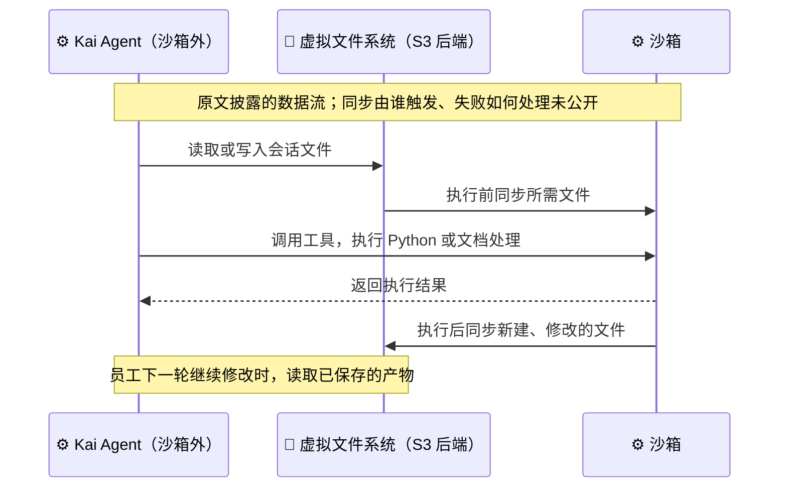
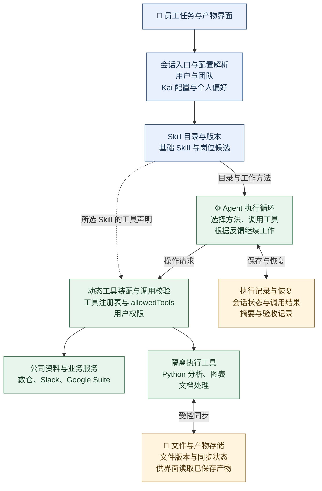

# 企业知识工作 Agent：Stripe Kai 如何把公司资料变成可持续修改的工作产物

Kai 是 Stripe 面向内部员工的知识工作 Agent。销售用它准备客户会议，财务用它分析数据、制作仪表盘，业务运营人员用它整理资料和起草文档。员工在一个会话里提出任务，Kai 连接公司资料、执行分析，并把报告、图表和文件呈现在会话旁，供员工继续修改。

这个案例值得拆开的，是一项完整工作的几个环节怎样接起来：Agent 怎样获得岗位知识，怎样从庞大的工具目录里找到所需能力，执行代码后文件保存在哪里，员工过几天回来又怎样继续。

> **主要来源**：[LangChain 的 Stripe Kai 客户案例][case]，作者 Sofia Sulikowski，发布于 2026 年 8 月 3 日。
>
> 前五节讲解原文披露的产品、技术做法与结果；第六节核对公开框架源码；第七节给出本站的工程实现建议。案例中的采用数据属于客户自述，公开框架代码不代表 Kai 的生产代码。

## 一、为什么非工程员工需要一个公司内部的 Agent

### 1、员工需要把资料处理成能交付的材料

Kai 的全称是 Knowledge AI Platform，即知识 AI 平台。它面向的工作经常横跨多个来源：客户会议准备需要汇总公司内部资料，财务分析需要取得数据并计算，文档起草则需要把分散的信息组织成可供他人阅读的材料。

原文列出的接入包括内部数据仓库、Slack 和 Google Suite。员工不必在这些系统之间反复搬运内容，可以把查找、归纳、分析和产物制作交给同一个会话。

新员工还会用 Kai 了解公司的知识、流程与系统。无论是熟悉公司，还是准备一份业务材料，都依赖 Stripe 自身的上下文。只有通用模型，并不能直接提供公司特有的资料入口和工作方法。

### 2、把终端和配置负担留给平台

原文把需求增长与编程 Agent 的普及联系起来。员工已经看到 Agent 可以完成复杂任务，也希望把类似能力用于自己的工作；但要求非工程员工使用终端、接好公司数据，再自行处理安全配置，使用门槛仍然很高。

Kai 因而提供了面向全员的产品入口。员工进入会话后就能使用已经接好的公司能力，平台团队负责内部基础设施和运行环境，各业务团队贡献领域知识。

界面也围绕持续工作来设计。报告、仪表盘和文件与聊天并排显示，用户可以针对已有产物继续提要求。原文还强调实时反馈和低延迟：多步任务不能只在结束时突然返回一个结果，员工需要知道系统正在工作。

## 二、为什么选用 Deep Agents，又保留哪些自建部分

### 1、从重复建设运行能力，转向维护公司接入与产品

Stripe 原先已有团队在 Ruby 和 Java 技术栈中建设 Agent 编排能力。这些语言与内部服务接近，接入已有基础设施相对方便；但长任务执行、质量评测和通用运行能力仍要自行维护。

Deep Agents 提供的是 Agent 的通用运行框架。原文称为 harness，可以理解为包住模型、组织工具循环、文件操作和上下文处理的执行外壳。Stripe 希望复用这些基础能力，把更多精力留给公司内部集成和员工体验。

这项选择有前置成本。Stripe 当时以 Ruby、Java 为主，采用 Python 需要补服务脚手架和部署支持。原文所说“一名工程师约一周完成初版”，发生在这些基础准备之后，描述的是 Kai 初版的开发速度。

团队还看重中间件和流式输出。中间件是在 Agent 执行过程中插入特定处理逻辑的组件，例如压缩过长的上下文；流式输出则让界面能逐步展示执行反馈。它们减少了平台团队从头建设通用能力的工作量。

### 2、四层架构分别负责什么

原文用四层说明 Kai 的结构。下表按从员工入口到底层框架的方向重排，表示职责分层，不表示四个独立部署的服务。

| 层次 | 原文披露的职责 | 对员工任务的作用 |
| --- | --- | --- |
| 用户体验层 | 面向员工的界面与交互 | 提交任务、查看反馈、继续修改产物 |
| Kai 配置层 | 定义不同 Kai Agent 的 Skill、行为与角色 | 让销售、财务等团队获得适合自己的能力配置 |
| Stripe 自建运行层 | 适配公司安全要求、基础设施和内部服务 | 把通用 Agent 接入 Stripe 的实际工作环境 |
| Deep Agents 核心 | 模型交互、工具循环、中间件与状态管理 | 组织模型调用、执行工具并处理运行状态 |

同一套底层运行能力可以支持多个岗位，但岗位能力的内容仍由公司维护。例如，销售团队提供自己的工作方法，Stripe 负责把所需服务接好，Deep Agents 承接模型与工具之间的循环。框架并不会自动获得 Stripe 的业务知识。

## 三、文件、沙箱与摘要怎样支撑持续工作

### 1、文件保存在持久工作区，沙箱承担临时执行

Kai 使用以 S3 对象存储为后端的虚拟文件系统。虚拟文件系统为 Agent 提供可读写的文件视图，实际内容保存在云端，能够在多轮对话中继续使用。

沙箱负责执行代码，文件则通过同步进入和离开沙箱。原文披露了两个方向：执行前把所需文件送入沙箱，执行后把新建或修改的文件写回虚拟文件系统。

下面按原文重画数据流。图表示读取、执行和回写之间的关系，不表达具体同步协议、事务顺序或失败恢复策略。



这里的关键是**Agent 本身运行在沙箱外，沙箱作为工具供它调用**。一次代码执行结束后，Agent 仍可根据结果继续工作；需要保留的产物通过回写进入持久文件系统。

### 2、执行代码服务于分析和文件制作

原文列出两类沙箱用途。

一类是数据工作：Agent 编写 Python，查询和分析数据，生成可视化。另一类是文件处理：操作 PDF、演示文稿等格式，完成仅靠聊天文本难以交付的材料。

这解释了 Kai 为什么同时需要资料工具和代码执行能力。内部连接器提供公司信息，代码执行把数据转成分析结果或文件；产物回到持久工作区后，用户才能在后续对话中接着修改。

### 3、摘要控制每轮需要带回模型的历史

文件保存解决产物延续，摘要中间件解决长会话的上下文负担。Kai 的使用节奏与连续编程不同，很多员工隔一段时间才回来继续同一条会话。

原文特别提到这种使用节奏的费用问题。较长的历史仍需重新提供给模型，而长时间间隔可能无法享受提示词缓存带来的收益；反复带入全部历史会增加成本。

Kai 使用可调整的摘要策略，包括何时触发、使用哪个模型，以及摘要输出的 token 预算。团队通过这些配置平衡历史保留程度与费用。原文没有公布生产阈值或成本下降比例。

会话的延续由两类机制共同支持：文件系统保留实际材料，摘要保留继续推理所需的历史信息。它们保存的对象不同，不能互相替代。

## 四、上千个 Skill 与五百多个工具怎样进入一次任务

### 1、岗位知识由业务团队维护

Skill 是供 Agent 按需使用的工作方法与领域说明。Stripe 已有一百多个团队贡献一千多个 Skill，业务人员可以把岗位知识写进去，而不必把每项知识更新都交给平台工程师。

原文认为，这种分工能让公司知识随业务积累，并减少日常使用时反复询问同事的需要。销售怎样准备会议、财务怎样做分析，能够保留各自的上下文。

不过，全公司的目录总量不等于每名员工都会看到的目录。Kai 根据三个维度准备相关能力：员工所属团队、使用的 Kai 配置、个人偏好。销售运营与财务人员起步所见的 Skill 可以不同，用户还可以在默认配置上增加自己的选择。

基础 Skill 会始终加载，用于保留通用的公司背景和必要行为要求。其余 Skill 再按任务需要选择。

### 2、选工作方法，再提供相应工具

Stripe 内部有五百多个 MCP 工具。MCP 是连接模型应用与外部工具、数据的协议；在本案例中，它承载公司内部能力的接入。

如果把全部工具的名称、参数和使用说明一起交给模型，它们会占据大量上下文，也会增加选择难度。Kai 因而把能力发现拆为两层：

1. 模型根据任务选择需要的 Skill，并按需加载或卸载相关 Skill。
2. 系统读取已选 Skill 的 `allowedTools` 声明，动态提供与之相关的 MCP 工具。

Skill 在这里承担了从“我要完成什么工作”到“需要哪些具体能力”的连接作用。模型先选择岗位方法，再接触相关工具，避免一开始就在数百个工具中逐项辨认。

原文明确把这称为两层延迟加载。加载 Skill 正文和加载工具说明是两个动作，基础 Skill 则不随任务选择被移除。

### 3、目录长到一定程度，选择器本身也会失准

即使工具已经按需加载，Skill 的入口目录仍会不断增长。模型至少需要读到名称与简要说明，才能决定读取哪个完整 Skill。

Stripe 对 frontmatter，也就是 Skill 文件顶部的元数据，设置了 1,024 字符限制。但在他们的实际配置中，超过约 150 个 Skill 与系统提示词一起提供时，仍观察到选择质量下降。

这里应分清三种数量：一千多个是全公司已积累的 Skill；个人可用目录经过团队和配置筛选；约 150 个是原文报告的一次容量观察。它不是所有模型共同适用的上限。

### 4、检索缩小候选范围，模型作最终选择

团队并未简单地把选择工作全部交给检索。在他们的观察中，只要模型拥有足够的相关上下文，模型直接选择 Skill 的效果通常优于已有检索方案。问题是目录增长后，很难一直把相关信息完整放进去。

原文提出的后续方向是混合选择：检索或分类器先缩小候选范围，再让模型结合任务上下文作最终决定。写作时这部分仍在建设中。

团队与个人配置解决的是“这名员工通常需要哪些能力”，任务级预筛解决的是“当前这件事可能用到哪些能力”。两次缩小范围发生在不同位置，后者还需要避免过早漏掉必要 Skill。

## 五、采用情况说明了什么，产品还在补哪些能力

### 1、从内部预览扩展到多个岗位

原文报告，Kai 开放预览后一周就达到季度采用目标，约四周从 296 位用户增长到 5,000 多位。案例同时给出以下使用情况：

| 指标 | 原文报告值 |
| --- | --- |
| 每周使用 Kai 的员工比例 | 83% |
| 每周会话量 | 超过六万次 |
| 营销团队采用比例 | 95% |
| GTM 团队采用比例 | 87% |

GTM 指面向市场、销售及增长等业务职能。原文把低门槛的聊天界面和公司特有的资料、Skill 结合，作为广泛采用的重要原因。

Kai 的工程团队也在使用 Kai 本身。他们会让它查询系统资料、分析运行轨迹和使用数据，找出哪些工作场景尚未得到 Skill 覆盖。业务使用情况由此成为下一轮能力建设的输入。

### 2、个性化行为与多人协作仍在演进

不同团队不只需要不同资料，也有不同的交互偏好。有的员工希望 Agent 先计划、再提出澄清问题；有的员工正在头脑风暴，希望快速获得想法，不想经过一套较重的流程。

原文称，团队正在评估分类器与 AI 方法，根据用户情境调整行为，让系统减少对手工配置的依赖。扩大 Skill 选择能力、强化治理与合规，也属于后续工作。

协作方面，案例描述的当前形态主要是单用户会话。路线图希望进一步支持 Skill 与产物共享，并让多人在同一产物上继续迭代。团队已经能贡献 Skill，与多人共同编辑产物，是成熟度不同的两项能力。

## 六、公开源码能解释哪一段实现

### 1、Kai 的工具加载策略不等于框架默认行为

原文没有提供 Kai 的生产仓库或完整 Skill 示例。可以核验的是公开 Deep Agents 框架，以及哪些框架能力还不足以直接复现案例描述。

下面固定检查 **Deep Agents 0.6.12 的发布标签**，对应提交 `7e70065200007896336f38fe905803e6763e8f85`。它是本文用于比较的公开版本，不能据此断言 Stripe 生产中使用了同一版本。

`SkillsMiddleware` 是 Deep Agents 中负责发现 Skill、收集元数据并向模型提供 Skill 目录的中间件。源码位于 `libs/deepagents/deepagents/middleware/skills.py`。其中 [`_format_skills_list()`][skill-list] 会把工具声明和 Skill 路径写进目录文本：

```python
# 摘自 _format_skills_list() 的循环体，其余目录格式化逻辑省略。
# 中文注释为本文补充；下面的 Allowed tools 是提示词文本。
if skill["allowed_tools"]:
    lines.append(f"  -> Allowed tools: {', '.join(skill['allowed_tools'])}")
lines.append(f"  -> Read `{skill['path']}` for full instructions")
```

[`modify_request()`][skill-request] 则把目录拼进系统提示词。以下为同一函数末尾的连续片段，前面的元数据读取与检查省略：

```python
# 将 Skill 来源、加载告警和目录组织成提示词片段。
skills_section = self.system_prompt_template.format(
    skills_locations=skills_locations,
    skills_load_warnings=skills_load_warnings,
    skills_list=skills_list,
)

new_system_message = append_to_system_message(request.system_message, skills_section)

# 只替换本次模型请求的系统消息，没有替换工具列表。
return request.override(system_message=new_system_message)
```

这段实现提供的是 Skill 目录与按需读取入口。文件里的 `allowed-tools` 被解析成 `allowed_tools` 元数据，随后展示在提示词中；**该中间件没有据此修改 `request.tools`，即本次模型请求中的工具列表**。

因此，案例中通过 `allowedTools` 动态装配 MCP 工具的行为，需要应用层或其他扩展实现。不能只在 Skill 文件里写入工具名称，就认为已经获得了 Kai 描述的工具加载能力。博客与公开源码的字段写法也不同，不能把它们当成同一份配置文件逐字套用。

这一差异会直接影响复现方案：Skill 目录负责让模型发现工作方法，工具注册与筛选逻辑负责实际准备可调用能力。更多发现、读取和存储后端行为可接着阅读本站的 [SkillsMiddleware 源码解析](../../../engineering/langchain-series/deepagents/07-skills-middleware.md)。

### 2、哪些内容仍需要应用实现来回答

案例足以说明产品与主要数据流，但没有公开完整的执行与恢复机制。工程复现仍需自行设计以下部分：

- 选错 Skill 后怎样重新选择，多个 Skill 的工具声明怎样合并，工具何时卸载。
- 用户身份如何传到内部服务，数据访问与写操作在哪里校验。
- 沙箱文件回写失败怎样补偿，重试时是否会重复执行代码。
- 文件版本、会话恢复和多人修改怎样协调。

案例的采用数据也不能回答任务完成质量。员工愿意每周使用，说明产品进入了日常工作；它没有直接给出报告正确率、节省工时、人工修订量或支付业务收入变化。后续验收应单独测这些与目标有关的指标。

## 七、工程总结：把一次知识工作实现成可继续、可检查的任务

以下是本站结合案例与源码提出的实现建议。图中的组件是建议保留的职责边界，**不是 Stripe 已公开的部署图，也不要求每个框都做成独立服务**。

### 1、运行架构应同时容纳任务、能力与产物

Kai 可以按[本目录的判断口径](../index.md#四架构方式与执行控制)归为 Agent 主导的知识工作应用：模型选择 Skill，并根据工具反馈继续组织工作。程序负责准备能力、执行具体操作和保存状态。

复现时，建议把以下职责显式分开，避免把所有逻辑堆进系统提示词或单个工具函数。



配置层准备员工的候选能力，模型决定当前采用哪种工作方法，工具层把方法映射到实际操作。文件存储和执行记录各自保存材料与进度，界面从已保存的结果中展示产物。

这里要让“工具出现在模型面前”与“这次调用被允许执行”分别有明确的实现位置。按 `allowedTools` 缩小工具目录有助于模型选择；实际读取哪张表、哪份文档，仍需由调用校验与底层业务服务按用户身份决定。

### 2、用客户会议准备串起执行过程

以下任务是说明架构关系的示例，并非原文公布的真实会话记录。假设销售提出：“整理这家客户近期的合作情况，生成会议简报，并补一张趋势图。”

会话入口先确定用户、团队和所用配置，准备基础 Skill 与销售相关候选。模型从候选中选取适用的方法，读取完整说明。工具装配层据此找到已注册的资料工具，并与用户可用能力求交集。

Agent 随后查询资料。资料工具最好返回可回查的来源标识、取得时间和查询条件，便于后续检查简报依据。权限不足、无结果和服务失败应保留不同状态，避免把一次取数失败解释成“客户近期没有活动”。

需要制图时，系统将输入文件与代码交给沙箱。执行结果经过检查、文件完成回写后，界面再把它标记为可继续使用的产物。如果代码执行成功但保存失败，任务状态应明确停在“待保存”，而不是直接显示完成。

员工稍后要求“把图表改成按月汇总”，系统需要恢复本次任务的目标、数据口径和产物版本，再修改已有材料。只恢复聊天摘要，却找不到上次图表的数据和文件，无法可靠地完成这种延续工作。

### 3、实现时最值得补齐的三个细节

**Skill 应有可追溯的版本与维护者。**

任务记录中建议保存所选 Skill 的标识与版本。否则业务团队修改了一份说明后，同一个任务为什么产生不同结果很难排查。Skill 的描述还应交代适用问题与不适用问题，减少名称相近、含义重叠导致的误选。

平台团队可以维护加载协议、校验和工具接入，岗位团队负责业务方法与样例。新 Skill 进入默认目录前，用典型任务检查是否选得到、是否会误选，以及引用的工具是否真实存在。

**产物发布要晚于持久化确认。**

建议为一次执行保存输入文件版本、输出清单和保存状态。沙箱中生成了文件，只能证明临时执行成功；文件回到持久存储并可重新读取后，才适合向用户确认产物已保存。

回写失败时，如果沙箱和结果仍可用，应优先重试回写，避免无差别重跑整项任务。文件涉及并发修改时，需要约定版本检查或冲突处理，不能默认最后一次写入覆盖所有变化。

**摘要之外还要保留少量明确的任务状态。**

建议单独保存任务目标、用户已确认的约束、关键查询条件、产物路径与版本，以及尚未完成的步骤。例如“按月汇总、排除测试数据”应进入可恢复状态，不能只寄希望于摘要恰好保留了这句话。

这不要求把所有历史都结构化。资料正文可以留在文件中，聊天保留讨论过程，少量结构化状态负责那些丢失后会改变执行结果的信息。

### 4、验收要覆盖选择、执行与继续工作的全过程

复制 Kai 时，建议从一个岗位的一组真实任务开始。先验证从资料到产物的完整过程，再扩大 Skill 目录，避免用目录规模代替任务效果。

| 要验证的问题 | 可执行的检查方式 |
| --- | --- |
| 能否选到正确方法 | 给出同义提问、跨岗位问题和相似 Skill，检查必要 Skill 是否进入候选、最终选择是否合理 |
| 工具是否既可用又受约束 | 用有权限和无权限的用户执行同一任务，检查工具目录、调用拒绝和资料返回范围 |
| 产物能否真正交付 | 打开生成文件，核对关键数字、来源、格式和业务要求，记录人工修订量 |
| 保存失败能否恢复 | 在执行后中断文件回写，检查界面是否误报成功、恢复后是否重复执行 |
| 长会话能否继续 | 触发摘要后再次修改旧产物，检查用户约束、数据口径和文件版本是否仍然一致 |
| 成本与等待是否可接受 | 记录完成一项有效任务的 token、工具耗时、失败重试和总费用 |

目录选择需要分两段观察。必要 Skill 如果在检索预筛时就被排除，模型再强也无法从候选中选中；候选已经包含正确 Skill 却选错，才应继续检查描述、上下文与模型选择策略。

### 5、哪些值得照搬，哪些需要按业务改造

Kai 适合借鉴的条件，是公司资料分散、岗位知识需要持续更新，而且员工确实要反复制作和修改材料。在这种场景下，团队维护 Skill、工具按需加载、产物持久保存，分别对应知识维护、能力选择和工作延续三个具体问题。

落地时可以直接采用这种分工，但需要按本公司的身份体系、数据权限和文件生命周期改造运行层。摘要阈值、候选数量以及检索方式应由真实任务评测决定，约 150 个 Skill 的观察值不能直接写成通用配置。

若目标只是查询固定知识库中的答案，先做好检索、引用和访问控制即可，未必需要引入代码沙箱与双向文件同步。若任务包含必须按顺序执行的业务动作，步骤和审批条件应写进程序控制，不能只写在 Skill 说明里。

以客户会议准备为例，最小可用成果应是销售能取得有依据的简报、打开图表，并在下一轮继续修改；平台同时能解释用了哪份 Skill、查了哪些资料、保存的是哪个版本。等这一条路径稳定后，再增加更多岗位和协作能力。

---

来源与核验：客户案例见 [Stripe Kai 原文][case]；框架对照见 [Deep Agents 0.6.12 的 Skill 中间件][skill-source]。原文与公开源码核对日期：2026 年 10 月 8 日。

[case]: https://www.langchain.com/blog/how-stripe-built-their-knowledge-ai-platform-on-deep-agents
[skill-source]: https://github.com/langchain-ai/deepagents/blob/7e70065200007896336f38fe905803e6763e8f85/libs/deepagents/deepagents/middleware/skills.py
[skill-list]: https://github.com/langchain-ai/deepagents/blob/7e70065200007896336f38fe905803e6763e8f85/libs/deepagents/deepagents/middleware/skills.py#L874-L891
[skill-request]: https://github.com/langchain-ai/deepagents/blob/7e70065200007896336f38fe905803e6763e8f85/libs/deepagents/deepagents/middleware/skills.py#L913-L939
